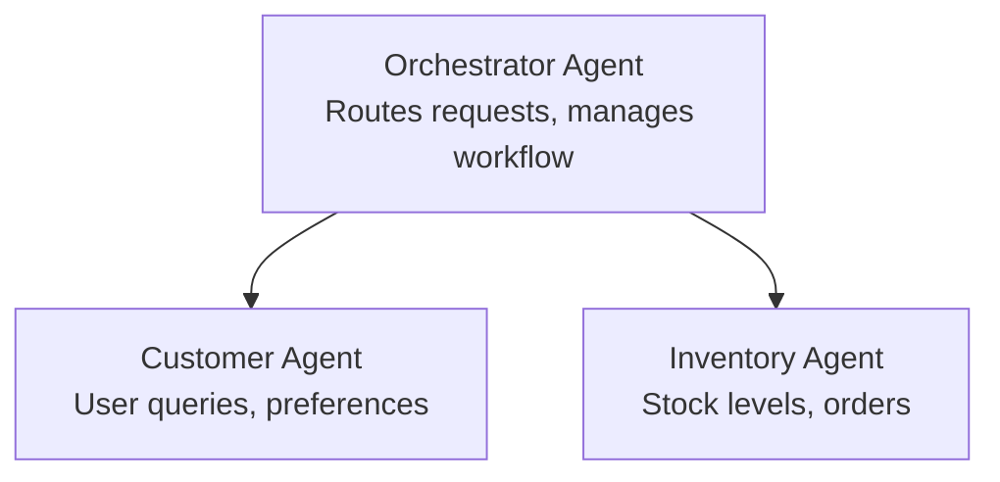

# Kapitel 5: Multi-Agent AI-løsninger

**📚 Kursus**: [AZD For Beginners](../../README.md) | **⏱️ Varighed**: 2-3 timer | **⭐ Kompleksitet**: Avanceret

---

## Oversigt

Dette kapitel dækker avancerede multi-agent arkitekturmodeller, agentorkestrering og AI-udrulninger klar til produktion til komplekse scenarier.

> Kommando-vejledning gennemgået mod den frigivne `azd 1.37.2` reference. Cloud-udrulninger blev ikke udført.

## Læringsmål

Ved at gennemføre dette kapitel vil du:
- Forstå multi-agent arkitekturmodeller
- Udrulle koordinerede AI-agent systemer
- Implementere agent-til-agent kommunikation
- Bygge produktionsklar multi-agent løsninger

---

## 📚 Lektioner

| # | Lektion | Beskrivelse | Tid |
|---|--------|-------------|------|
| 1 | [Multi-Agent Basics](multi-agent-basics.md) | Praktisk: udrul en fungerende multi-agent app med `azd up` | 45 min |
| 2 | [Coordination Patterns](../chapter-06-pre-deployment/coordination-patterns.md) | Agentorkestreringsstrategier (fortsætter i Kapitel 6) | 30 min |
| 3 | [ARM Template Deployment](../../examples/retail-multiagent-arm-template/README.md) | Et-klik udrulningseksempel | 30 min |

> **Start med Lektion 1.** Det er den eneste fuldt praktiske, udrulningsklare lektion i dette kapitel. Lektion 2 findes i Kapitel 6 (den deles med præ-udrulningsplanlægning), og [Retail Multi-Agent Solution](../../examples/retail-scenario.md) er en arkitektur-blåtryk—et designreference, ikke en ét-kommando skabelon.

---

## 🚀 Hurtigstart

```bash
# Option 1: Deploy the multi-agent template used in Lesson 1
azd init --template Azure-Samples/contoso-creative-writer .
azd up

# Option 2: Initialize a Foundry agent interactively with the GA bundle
azd ext install microsoft.foundry
azd ai agent init
azd up
```

> **Hvilken tilgang?** Brug `azd init --template` for at starte fra et fungerende eksempel. Brug `azd ai agent init` interaktivt, eller `azd ai agent init --template <path-to-azure.yaml>` for at adoptere et aktuelt agentprojekt. Se [AZD AI CLI reference](../chapter-08-production/production-ai-practices.md#azd-ai-cli-commands-and-extensions) for versionskrav og evalueringsmigrering.

Kør disse alternativer i separate tomme mapper. GA Foundry workflow kræver `azd >= 1.37.0`; dets interaktive flow genererer ikke den tilpassede Service Bus pipeline i koordineringslektion. For lokal test, kodeudrulning og oprydning mellem nyt og genbrugt projekt, følg [hosted-agent walkthrough](../chapter-02-ai-development/microsoft-foundry-integration.md#hosted-agent-walkthrough-ga).

---

## 🤖 Multi-Agent Arkitektur



---

## 🎯 Fremhævet Løsning: Retail Multi-Agent

Løsningen [Retail Multi-Agent Solution](../../examples/retail-scenario.md) demonstrerer:

- **Kundeagent**: Håndterer brugerinteraktioner og præferencer
- **Lageragent**: Styrer lagerbeholdning og ordrebehandling
- **Orkestrator**: Koordinerer mellem agenter
- **Delt Hukommelse**: Kontekststyring på tværs af agenter

### Brugte tjenester

| Service | Formål |
|---------|---------|
| Microsoft Foundry Models | Sprogforståelse |
| Azure AI Search | Produktkatalog |
| Cosmos DB | Agenttilstand og hukommelse |
| Container Apps | Agenthosting |
| Application Insights | Overvågning |

---

## 🔗 Navigation

| Retning | Kapitel |
|-----------|---------|
| **Forrige** | [Kapitel 4: Infrastruktur](../chapter-04-infrastructure/README.md) |
| **Næste** | [Kapitel 6: Forud for Udrulning](../chapter-06-pre-deployment/README.md) |

---

## 📖 Relaterede Ressourcer

- [AI Agent Guide](../chapter-02-ai-development/agents.md)
- [Produktions AI Praksis](../chapter-08-production/production-ai-practices.md)
- [AI Fejlfinding](../chapter-07-troubleshooting/ai-troubleshooting.md)

---

<!-- CO-OP TRANSLATOR DISCLAIMER START -->
**Ansvarsfraskrivelse**:
Dette dokument er blevet oversat ved hjælp af AI-oversættelsestjenesten [Co-op Translator](https://github.com/Azure/co-op-translator). Selvom vi bestræber os på nøjagtighed, skal du være opmærksom på, at automatiserede oversættelser kan indeholde fejl eller unøjagtigheder. Det originale dokument på dets oprindelige sprog bør betragtes som den autoritative kilde. For kritisk information anbefales professionel menneskelig oversættelse. Vi påtager os intet ansvar for misforståelser eller fejltolkninger, der opstår som følge af brugen af denne oversættelse.
<!-- CO-OP TRANSLATOR DISCLAIMER END -->