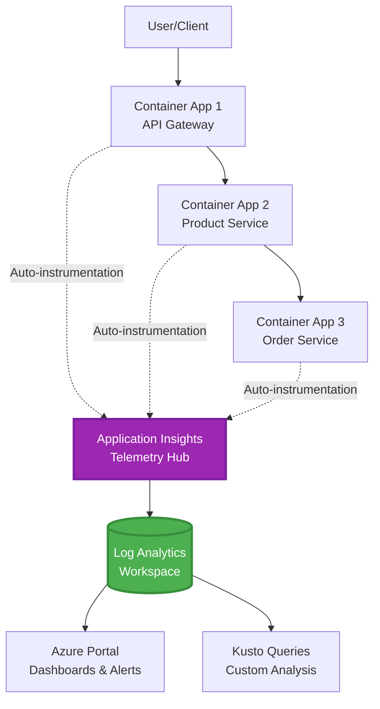
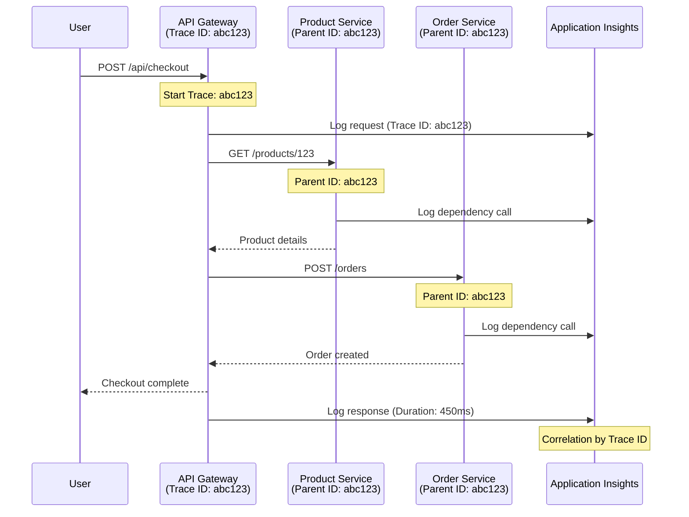

# Application Insights Integration med AZD

⏱️ **Anslået tid**: 40-50 minutter | 💰 **Omkostningspåvirkning**: ~$5-15/måned | ⭐ **Kompleksitet**: Mellemstadie

**📚 Læringssti:**
- ← Forrige: [Preflight Checks](preflight-checks.md) - Validering før udrulning
- 🎯 **Du er her**: Application Insights Integration (Overvågning, telemetri, fejlfinding)
- → Næste: [Deployment Guide](../chapter-04-infrastructure/deployment-guide.md) - Udrul til Azure
- 🏠 [Kursusforside](../../README.md)

---

## Hvad du vil lære

Ved at gennemføre denne lektion, vil du:
- Deklarere **Application Insights** i AZD infrastruktur og konfigurere SDK-instrumentering
- Konfigurere **distribueret tracing** for mikrotjenester
- Implementere **brugerdefineret telemetri** (målinger, begivenheder, afhængigheder)
- Opsætte **live målinger** til realtidsmonitorering
- Oprette **advarsler og dashboards** fra AZD-udrulninger
- Fejlfinding af produktionsproblemer med **telemetriforespørgsler**
- Optimere **omkostninger og sampling** strategier
- Overvåge **AI/LLM applikationer** (tokens, latenstid, omkostninger)

## Hvorfor Application Insights med AZD er vigtigt

### Udfordringen: Produktionsobservabilitet

**Uden Application Insights:**
```
❌ No visibility into production behavior
❌ Manual log aggregation across services
❌ Reactive debugging (wait for customer complaints)
❌ No performance metrics
❌ Cannot trace requests across services
❌ Unknown failure rates and bottlenecks
```

**Med Application Insights + AZD:**
```
✅ Automatic telemetry collection
✅ Centralized logs from all services
✅ Proactive issue detection
✅ End-to-end request tracing
✅ Performance metrics and insights
✅ Real-time dashboards
✅ AZD provisions the monitoring declared in your templates
```

**Analogi**: Application Insights er som at have en "black box" flyregistrator + cockpittavle til din applikation. Du ser alt, hvad der sker i realtid, og kan afspille enhver hændelse.

---

## Arkitekturoversigt

### Application Insights i AZD-arkitekturen



### Hvad der overvåges automatisk

Understøttet auto-instrumentering fanger anmodninger/afhængigheder for instrumenterede biblioteker. Tilpassede begivenheder og målinger kræver applikationskode; tilgængelighedstests skal konfigureres separat. Den indsamler ikke hver række nedenfor kun fordi ressourcen eksisterer.

| Telemetri Type | Hvad Den Fanger | Brugstilfælde |
|----------------|------------------|----------|
| **Anmodninger** | HTTP-anmodninger, statuskoder, varighed | API-ydeevneovervågning |
| **Afhængigheder** | Eksterne kald (DB, API'er, lagring) | Identificere flaskehalse |
| **Undtagelser** | Ubehandlede fejl med stack-traces | Fejlfinding af fejl |
| **Brugerdefinerede Begivenheder** | Forretningsbegivenheder (tilmelding, køb) | Analyse og funnels |
| **Målinger** | Ydeevnetællere, brugerdefinerede målinger | Kapacitetsplanlægning |
| **Spor** | Logbeskeder med alvorlighed | Fejlfinding og revision |
| **Tilgængelighed** | Oppetid og svartidstest | SLA-overvågning |

---

## Forudsætninger

### Nødvendige værktøjer

```bash
# Verify Azure Developer CLI
azd version
# Command reference baseline: azd 1.37.2

# Verify Azure CLI
az --version
# ✅ Expected: azure-cli 2.50.0 or higher
```

### Azure-krav

- Aktivt Azure abonnement
- Rettigheder til at oprette:
  - Application Insights ressourcer
  - Log Analytics arbejdsområder
  - Container Apps
  - Ressourcegrupper

### Faglige forudsætninger

Du bør have gennemført:
- [AZD Basics](../chapter-01-foundation/azd-basics.md) - Grundlæggende AZD-koncepter
- [Configuration](../chapter-03-configuration/configuration.md) - Miljøopsætning
- [First Project](../chapter-01-foundation/first-project.md) - Grundlæggende udrulning

---

## Lektion 1: Automatisk Application Insights med AZD

### Hvordan AZD opretter Application Insights

AZD opretter Application Insights **kun når projektets infrastruktur deklarerer det**. `azure.yaml` alene opretter ikke overvågning eller instrumenterer applikationskode.

> **Eksempelscope:** Denne lektion indeholder integrationsfragmenter, ikke et komplet `monitored-app` projekt i dette arkiv. Lever en hovedskabelon og parameterkortlægning, et Container Apps-miljø, registry/image og identitetskonfiguration, Dockerfile og servicetag før udrulning. Senere lektioner viser alternative/udvidelsesfragmenter, ikke filer der alle kan indsættes sammen uændret. Start med et fungerende [mikrotjenest eksempel](../../../../examples/microservices) hvis du har brug for en kørbar baseline.

### Projektstruktur

```
monitored-app/
├── azure.yaml                     # AZD configuration
├── infra/
│   ├── main.bicep                # Main infrastructure
│   ├── core/
│   │   └── monitoring.bicep      # Application Insights + Log Analytics
│   └── app/
│       └── api.bicep             # Container App with monitoring
└── src/
    ├── app.py                    # Application with telemetry
    ├── requirements.txt
    └── Dockerfile
```

---

### Trin 1: Konfigurer AZD (azure.yaml)

**Fil: `azure.yaml`**

```yaml
name: monitored-app
metadata:
  template: monitored-app@1.0.0

services:
  api:
    project: ./src
    language: python
    host: containerapp

# Monitoring must be declared in infra/ and enabled in application code.
```

Dette deklarerer den deployerbare service. Følgende Bicep og SDK-konfiguration leverer overvågning; azd tilføjer dem ikke implicit.

---

### Trin 2: Overvågningsinfrastruktur (Bicep)

**Fil: `infra/core/monitoring.bicep`**

```bicep
param logAnalyticsName string
param applicationInsightsName string
param location string = resourceGroup().location
param tags object = {}

// Log Analytics Workspace (required for Application Insights)
resource logAnalytics 'Microsoft.OperationalInsights/workspaces@2022-10-01' = {
  name: logAnalyticsName
  location: location
  tags: tags
  properties: {
    sku: {
      name: 'PerGB2018'  // Pay-as-you-go pricing
    }
    retentionInDays: 30  // Keep logs for 30 days
    features: {
      enableLogAccessUsingOnlyResourcePermissions: true
    }
  }
}

// Application Insights
resource applicationInsights 'Microsoft.Insights/components@2020-02-02' = {
  name: applicationInsightsName
  location: location
  tags: tags
  kind: 'web'
  properties: {
    Application_Type: 'web'
    WorkspaceResourceId: logAnalytics.id
    IngestionMode: 'LogAnalytics'
    publicNetworkAccessForIngestion: 'Enabled'
    publicNetworkAccessForQuery: 'Enabled'
  }
}

// Outputs for Container Apps
output logAnalyticsWorkspaceId string = logAnalytics.id
output logAnalyticsWorkspaceName string = logAnalytics.name
output applicationInsightsConnectionString string = applicationInsights.properties.ConnectionString
output applicationInsightsInstrumentationKey string = applicationInsights.properties.InstrumentationKey
output applicationInsightsName string = applicationInsights.name
output applicationInsightsId string = applicationInsights.id
```

---

### Trin 3: Forbind Container App til Application Insights

**Fil: `infra/app/api.bicep`**

```bicep
param name string
param location string
param tags object = {}
param containerAppsEnvironmentId string
param containerImage string
param applicationInsightsConnectionString string

resource containerApp 'Microsoft.App/containerApps@2023-05-01' = {
  name: name
  location: location
  tags: tags
  properties: {
    managedEnvironmentId: containerAppsEnvironmentId
    configuration: {
      ingress: {
        external: true
        targetPort: 8000
      }
      secrets: [
        {
          name: 'appinsights-connection-string'
          value: applicationInsightsConnectionString
        }
      ]
    }
    template: {
      containers: [
        {
          name: 'api'
          image: containerImage // Supply an accessible image and registry authentication
          resources: {
            cpu: json('0.5')
            memory: '1Gi'
          }
          env: [
            {
              name: 'APPLICATIONINSIGHTS_CONNECTION_STRING'
              secretRef: 'appinsights-connection-string'
            }
            {
              name: 'APPLICATIONINSIGHTS_ENABLED'
              value: 'true'
            }
          ]
        }
      ]
    }
  }
}

output uri string = 'https://${containerApp.properties.configuration.ingress.fqdn}'
```

---

### Trin 4: Applikationskode med Telemetri

**Fil: `src/app.py`**

```python
from flask import Flask, request, jsonify
from azure.monitor.opentelemetry import configure_azure_monitor
import logging
import os

app = Flask(__name__)

# Get Application Insights connection string
connection_string = os.environ.get('APPLICATIONINSIGHTS_CONNECTION_STRING')

if connection_string:
    # Azure Monitor OpenTelemetry instruments supported libraries, including Flask.
    configure_azure_monitor(
        connection_string=connection_string,
        logger_name=__name__,
        enable_live_metrics=True
    )
    logger = logging.getLogger(__name__)
    logger.setLevel(logging.INFO)
    
    print("✅ Application Insights enabled")
else:
    logger = logging.getLogger(__name__)
    logger.setLevel(logging.INFO)
    print("⚠️ Application Insights not configured")

@app.route('/health')
def health():
    logger.info('Health check endpoint called')
    return jsonify({'status': 'healthy', 'monitoring': 'enabled' if connection_string else 'disabled'})

@app.route('/api/products')
def get_products():
    logger.info('Fetching products')
    
    # In-memory fixture: this is not a database dependency call.
    products = [
        {'id': 1, 'name': 'Laptop', 'price': 999.99},
        {'id': 2, 'name': 'Mouse', 'price': 29.99},
        {'id': 3, 'name': 'Keyboard', 'price': 79.99}
    ]
    
    logger.info(f'Returned {len(products)} products')
    return jsonify(products)

@app.route('/api/error-test')
def error_test():
    """Test error tracking"""
    logger.error('Testing error tracking')
    try:
        raise ValueError('This is a test exception')
    except Exception as e:
        logger.exception('Exception occurred in error-test endpoint')
        return jsonify({'error': str(e)}), 500

@app.route('/api/slow')
def slow_endpoint():
    """Test performance tracking"""
    import time
    logger.info('Slow endpoint called')
    time.sleep(3)  # Simulate slow operation
    logger.warning('Endpoint took 3 seconds to respond')
    return jsonify({'message': 'Slow operation completed'})

if __name__ == '__main__':
    app.run(host='0.0.0.0', port=8000)
```

**Fil: `src/requirements.txt`**

```txt
Flask
azure-monitor-opentelemetry
gunicorn
requests
openai
```

Løs disse afhængigheder i dit projekt, test dem sammen, og fastlås de resulterende versioner. Nye projekter bør bruge Azure Monitor OpenTelemetry, ikke de pensionerede OpenCensus Python eksportører.

---

### Trin 5: Udrul og verificer

```bash
# Deploy only after completing and wiring the infrastructure fragments above
azd up

# Get app URL
APP_URL=$(azd env get-value API_URL) # Requires this output in main.bicep

# Generate telemetry
curl $APP_URL/health
curl $APP_URL/api/products
curl $APP_URL/api/error-test
curl $APP_URL/api/slow
```

**✅ Forventet output:**
```json
{
  "status": "healthy",
  "monitoring": "enabled"
}
```

---

### Trin 6: Vis telemetri i Azure Portal

```bash
# Get Application Insights details
azd env get-values | grep APPLICATIONINSIGHTS

# Open in Azure Portal
az monitor app-insights component show \
  --app $(azd env get-values | grep APPLICATIONINSIGHTS_NAME | cut -d '=' -f2 | tr -d '"') \
  --resource-group $(azd env get-values | grep AZURE_RESOURCE_GROUP | cut -d '=' -f2 | tr -d '"') \
  --query "appId" -o tsv
```

**Naviger til Azure Portal → Application Insights → Transaction Search**

Du bør se:
- ✅ HTTP-anmodninger med statuskoder
- ✅ Anmodningsvarighed (3+ sekunder for `/api/slow`)
- ✅ Undtagelsesdetaljer fra `/api/error-test`
- ✅ Brugerdefinerede logbeskeder

---

## Lektion 2: Brugerdefineret Telemetri og Begivenheder

### Spor forretningsbegivenheder

Lad os tilføje brugerdefineret telemetri for forretningskritiske begivenheder.

**Fil: `src/telemetry.py`**

```python
from contextlib import contextmanager
from azure.monitor.opentelemetry import configure_azure_monitor
from opentelemetry import metrics, trace
from opentelemetry.trace import SpanKind
import logging
import os

class TelemetryClient:
    """Custom telemetry client for Application Insights"""
    
    def __init__(self, connection_string=None):
        self.connection_string = connection_string or os.environ.get('APPLICATIONINSIGHTS_CONNECTION_STRING')
        
        # Configure once per process. If app.py already calls this, keep only
        # one configure_azure_monitor call and use logger_name='telemetry'.
        if self.connection_string:
            configure_azure_monitor(
                connection_string=self.connection_string,
                logger_name=__name__,
                enable_live_metrics=True
            )
        self.logger = logging.getLogger(__name__)
        self.logger.setLevel(logging.INFO)
        self.tracer = trace.get_tracer(__name__)
        self.meter = metrics.get_meter(__name__)
        self.instruments = {}
    
    def track_event(self, event_name: str, properties: dict = None):
        """Track custom business event"""
        properties = properties or {}
        self.logger.info(
            f"CustomEvent: {event_name}",
            extra={
                # OTel log attributes become customDimensions in App Insights.
                    'event_name': event_name,
                    **properties
            }
        )
    
    def track_metric(self, metric_name: str, value: float, properties: dict = None):
        """Track custom metric"""
        properties = properties or {}
        if metric_name not in self.instruments:
            self.instruments[metric_name] = self.meter.create_histogram(metric_name)
        self.instruments[metric_name].record(value, attributes=properties)
    
    @contextmanager
    def track_dependency(self, name: str):
        """Time the real operation inside a client span; exceptions mark failure."""
        with self.tracer.start_as_current_span(name, kind=SpanKind.CLIENT) as span:
            yield span

# Global telemetry client
telemetry = TelemetryClient()
```

### Opdater applikation med brugerdefinerede begivenheder

**Fil: `src/app.py` (forbedret)**

Tilføj disse routes til den eksisterende Flask-applikation; behold de tidligere helbredstest-routes. Det forkortede blok nedenfor viser en separat app for klarhed. Telemetriinitialisering bor nu i `telemetry.py`—initialiser ikke eksportører to gange.

```python
from flask import Flask, request, jsonify
from telemetry import telemetry
import time
import random
import os

app = Flask(__name__)

@app.route('/api/purchase', methods=['POST'])
def purchase():
    """Track purchase event with custom telemetry"""
    data = request.get_json(silent=True) or {}
    product_id = data.get('product_id')
    quantity = data.get('quantity', 1)
    price = data.get('price', 0)
    if not isinstance(quantity, int) or quantity < 1 or \
       not isinstance(price, (int, float)) or price < 0:
        return jsonify({'error': 'quantity and price must be non-negative numbers; quantity >= 1'}), 400
    
    # Track business event
    telemetry.track_event('Purchase', {
        'product_id': product_id,
        'quantity': quantity,
        'total_amount': price * quantity,
        'user_id': request.headers.get('X-User-Id', 'anonymous')
    })
    
    # Track revenue metric
    telemetry.track_metric('Revenue', price * quantity, {
        'product_id': product_id,
        'currency': 'USD'
    })
    
    return jsonify({
        'order_id': f'ORD-{random.randint(1000, 9999)}',
        'status': 'confirmed',
        'total': price * quantity
    })

@app.route('/api/search')
def search():
    """Track search queries"""
    query = request.args.get('q', '')
    
    start_time = time.time()
    
    # Simulate search (would be real database query)
    results = [{'id': 1, 'name': f'Result for {query}'}]
    
    duration = (time.time() - start_time) * 1000  # Convert to ms
    
    # Track search event
    telemetry.track_event('Search', {
        'query': query,
        'results_count': len(results),
        'duration_ms': duration
    })
    
    # Track search performance metric
    telemetry.track_metric('SearchDuration', duration, {
        'query_length': len(query)
    })
    
    return jsonify({'results': results, 'count': len(results)})

@app.route('/api/external-call')
def external_call():
    """Track external API dependency"""
    import requests
    
    try:
        # Set an actual test endpoint; api.example.com is not a working API.
        with telemetry.track_dependency('ExternalAPI'):
            response = requests.get(os.environ['EXTERNAL_API_URL'], timeout=5)
            response.raise_for_status()
            result = response.json()
    except Exception as e:
        return jsonify({'error': 'External dependency failed'}), 502
    
    return jsonify(result)

if __name__ == '__main__':
    app.run(host='0.0.0.0', port=8000)
```

### Test brugerdefineret telemetri

```bash
# Track purchase event
curl -X POST $APP_URL/api/purchase \
  -H "Content-Type: application/json" \
  -H "X-User-Id: user123" \
  -d '{"product_id": 1, "quantity": 2, "price": 29.99}'

# Track search event
curl "$APP_URL/api/search?q=laptop"

# Track external dependency
curl $APP_URL/api/external-call
```

**Vis i Azure Portal:**

Naviger til Application Insights → Logs, og kør derefter:

```kusto
// View purchase events
traces
| where customDimensions.event_name == "Purchase"
| project 
    timestamp,
    product_id = tostring(customDimensions.product_id),
    total_amount = todouble(customDimensions.total_amount),
    user_id = tostring(customDimensions.user_id)
| order by timestamp desc

// Revenue recorded in Purchase events (not a billing ledger)
traces
| where customDimensions.event_name == "Purchase"
| summarize TotalRevenue = sum(todouble(customDimensions.total_amount)) by bin(timestamp, 1h)
| render timechart

// View search performance
traces
| where customDimensions.event_name == "Search"
| summarize 
    AvgDuration = avg(todouble(customDimensions.duration_ms)),
    SearchCount = count()
  by bin(timestamp, 5m)
| render timechart
```

---

## Lektion 3: Distribueret Tracing for Mikrotjenester

### Aktiver cross-service tracing

Med kompatibel instrumentering og W3C trace-context propagation korrelerer Application Insights anmodninger på tværs af tjenester. Deling af en forbindelse streng alene etablerer ikke parent-child spans. Det følgende arkitekturfragment refererer til moduler, du skal implementere.

**Fil: `infra/main.bicep`**

```bicep
targetScope = 'subscription'

param environmentName string
param location string = 'eastus'

var tags = { 'azd-env-name': environmentName }

resource rg 'Microsoft.Resources/resourceGroups@2021-04-01' = {
  name: 'rg-${environmentName}'
  location: location
  tags: tags
}

// Monitoring (shared by all services)
module monitoring './core/monitoring.bicep' = {
  name: 'monitoring'
  scope: rg
  params: {
    logAnalyticsName: 'log-${environmentName}'
    applicationInsightsName: 'appi-${environmentName}'
    location: location
    tags: tags
  }
}

// API Gateway
module apiGateway './app/api-gateway.bicep' = {
  name: 'api-gateway'
  scope: rg
  params: {
    name: 'ca-gateway-${environmentName}'
    location: location
    tags: union(tags, { 'azd-service-name': 'gateway' })
    applicationInsightsConnectionString: monitoring.outputs.applicationInsightsConnectionString
  }
}

// Product Service
module productService './app/product-service.bicep' = {
  name: 'product-service'
  scope: rg
  params: {
    name: 'ca-products-${environmentName}'
    location: location
    tags: union(tags, { 'azd-service-name': 'products' })
    applicationInsightsConnectionString: monitoring.outputs.applicationInsightsConnectionString
  }
}

// Order Service
module orderService './app/order-service.bicep' = {
  name: 'order-service'
  scope: rg
  params: {
    name: 'ca-orders-${environmentName}'
    location: location
    tags: union(tags, { 'azd-service-name': 'orders' })
    applicationInsightsConnectionString: monitoring.outputs.applicationInsightsConnectionString
  }
}

output APPLICATIONINSIGHTS_CONNECTION_STRING string = monitoring.outputs.applicationInsightsConnectionString
output GATEWAY_URL string = apiGateway.outputs.uri
```

### Vis end-to-end transaktion



**Forespørg end-to-end trace:**

```kusto
// Find complete request flow
let traceId = "abc123...";  // Copy operation_Id from a request in Application Insights
dependencies
| union requests
| where operation_Id == traceId
| project 
    timestamp,
    type = itemType,
    name,
    duration,
    success,
    cloud_RoleName
| order by timestamp asc
```

---

## Lektion 4: Live Metrics og Realtidsmonitorering

### Aktiver Live Metrics Stream

Live Metrics giver næsten realtids telemetri når understøttet og aktiveret af SDK'en. Det er ikke en latenstid SLA. Python OpenTelemetry setup'et ovenfor inkluderer det med `enable_live_metrics=True`.

**Adgang til Live Metrics:**

```bash
# Get Application Insights resource
APPI_NAME=$(azd env get-values | grep APPLICATIONINSIGHTS_NAME | cut -d '=' -f2 | tr -d '"')

# Get resource group
RG_NAME=$(azd env get-values | grep AZURE_RESOURCE_GROUP | cut -d '=' -f2 | tr -d '"')

echo "Navigate to: Azure Portal → Resource Groups → $RG_NAME → $APPI_NAME → Live Metrics"
```

**Hvad du ser i realtid:**
- ✅ Indkommende anmodningshastighed (anmodninger/sek)
- ✅ Udgående afhængighedskald
- ✅ Antal undtagelser
- ✅ CPU- og hukommelsesforbrug
- ✅ Aktiv serverantal
- ✅ Eksempeltelemetri

### Generer belastning til test

```bash
# Generate load to see live metrics
for i in {1..100}; do
  curl --silent --max-time 10 "$APP_URL/api/products"
  curl --silent --max-time 10 "$APP_URL/api/search?q=test$i"
done

# Watch live metrics in Azure Portal
# You should see request rate spike
```

---

## Praktiske øvelser

### Øvelse 1: Opsæt advarsler ⭐⭐ (Mellem)

**Mål**: Opret advarsler for høje fejlhastigheder og langsomme svartider.

**Trin:**

1. **Opret advarsel for fejlhastighed:**

```bash
# Get Application Insights resource ID
APPI_ID=$(az monitor app-insights component show \
  --app $APPI_NAME \
  --resource-group $RG_NAME \
  --query "id" -o tsv)

# Create metric alert for failed requests
az monitor metrics alert create \
  --name "High-Error-Rate" \
  --resource-group $RG_NAME \
  --scopes $APPI_ID \
  --condition "count requests/failed > 10" \
  --window-size 5m \
  --evaluation-frequency 1m \
  --description "Alert when failed request count exceeds 10 per 5 minutes"
```

2. **Opret advarsel for langsomme svar:**

```bash
az monitor metrics alert create \
  --name "Slow-Responses" \
  --resource-group $RG_NAME \
  --scopes $APPI_ID \
  --condition "avg requests/duration > 3000" \
  --window-size 5m \
  --evaluation-frequency 1m \
  --description "Alert when average response time exceeds 3 seconds"
```

3. **Opret advarsel via Bicep (foretrukket for AZD):**

**Fil: `infra/core/alerts.bicep`**

```bicep
param applicationInsightsId string
param actionGroupId string = ''
param location string = resourceGroup().location

// High error rate alert
resource errorRateAlert 'Microsoft.Insights/metricAlerts@2018-03-01' = {
  name: 'high-error-rate'
  location: 'global'
  properties: {
    description: 'Alert when error rate exceeds threshold'
    severity: 2
    enabled: true
    scopes: [
      applicationInsightsId
    ]
    evaluationFrequency: 'PT1M'
    windowSize: 'PT5M'
    criteria: {
      'odata.type': 'Microsoft.Azure.Monitor.SingleResourceMultipleMetricCriteria'
      allOf: [
        {
          name: 'Error rate'
          metricName: 'requests/failed'
          operator: 'GreaterThan'
          threshold: 10
          timeAggregation: 'Count'
        }
      ]
    }
    actions: actionGroupId != '' ? [
      {
        actionGroupId: actionGroupId
      }
    ] : []
  }
}

// Slow response alert
resource slowResponseAlert 'Microsoft.Insights/metricAlerts@2018-03-01' = {
  name: 'slow-responses'
  location: 'global'
  properties: {
    description: 'Alert when response time is too high'
    severity: 3
    enabled: true
    scopes: [
      applicationInsightsId
    ]
    evaluationFrequency: 'PT1M'
    windowSize: 'PT5M'
    criteria: {
      'odata.type': 'Microsoft.Azure.Monitor.SingleResourceMultipleMetricCriteria'
      allOf: [
        {
          name: 'Response duration'
          metricName: 'requests/duration'
          operator: 'GreaterThan'
          threshold: 3000
          timeAggregation: 'Average'
        }
      ]
    }
  }
}

output errorAlertId string = errorRateAlert.id
output slowResponseAlertId string = slowResponseAlert.id
```

4. **Test advarsler:**

```bash
# Generate errors
for i in {1..20}; do
  curl $APP_URL/api/error-test
done

# Generate slow responses
for i in {1..10}; do
  curl $APP_URL/api/slow
done

# Check rule configuration (not fired/resolved alert-instance history)
az monitor metrics alert list \
  --resource-group $RG_NAME \
  --query "[].{Name:name, Enabled:enabled}" \
  --output table
```

**✅ Succeskriterier:**
- ✅ Advarsler oprettet succesfuldt
- ✅ Advarsler aktiveres når tærskler overskrides
- ✅ Kan se advarselshistorik i Azure Portal
- ✅ Integreret med AZD udrulning

**Tid**: 20-25 minutter

---

### Øvelse 2: Opret brugerdefineret dashboard ⭐⭐ (Mellem)

**Mål**: Byg et dashboard der viser nøgleapplikationsmålinger.

**Trin:**

1. **Opret dashboard via Azure Portal:**

Naviger til: Azure Portal → Dashboards → Nyt Dashboard

2. **Tilføj fliser for nøglemålinger:**

- Antal anmodninger (sidste 24 timer)
- Gennemsnitlig svartid
- Fejlrate
- Top 5 langsomste operationer
- Geografisk brugerfordeling

3. **Opret dashboard via Bicep:**

**Fil: `infra/core/dashboard.bicep`**

```bicep
param dashboardName string
param applicationInsightsId string
param location string = resourceGroup().location

resource dashboard 'Microsoft.Portal/dashboards@2020-09-01-preview' = {
  name: dashboardName
  location: location
  properties: {
    lenses: [
      {
        order: 0
        parts: [
          // Request count
          {
            position: {
              x: 0
              y: 0
              rowSpan: 4
              colSpan: 6
            }
            metadata: {
              type: 'Extension/Microsoft_OperationsManagementSuite_Workspace/PartType/LogsDashboardPart'
              inputs: [
                {
                  name: 'resourceId'
                  value: applicationInsightsId
                }
                {
                  name: 'query'
                  value: '''
                    requests
                    | summarize RequestCount = count() by bin(timestamp, 1h)
                    | render timechart
                  '''
                }
              ]
            }
          }
          // Error rate
          {
            position: {
              x: 6
              y: 0
              rowSpan: 4
              colSpan: 6
            }
            metadata: {
              type: 'Extension/Microsoft_OperationsManagementSuite_Workspace/PartType/LogsDashboardPart'
              inputs: [
                {
                  name: 'resourceId'
                  value: applicationInsightsId
                }
                {
                  name: 'query'
                  value: '''
                    requests
                    | summarize 
                        Total = count(),
                        Failed = countif(success == false)
                    | extend ErrorRate = (Failed * 100.0) / Total
                    | project ErrorRate
                  '''
                }
              ]
            }
          }
        ]
      }
    ]
  }
}

output dashboardId string = dashboard.id
```

4. **Udrul dashboard:**

```bicep
// Add to a subscription-scoped main.bicep with rg and monitoring declared
module dashboard './core/dashboard.bicep' = {
  name: 'dashboard'
  scope: rg
  params: {
    dashboardName: 'dashboard-${environmentName}'
    applicationInsightsId: monitoring.outputs.applicationInsightsId
    location: location
  }
}
```

```bash
# Deploy
azd up
```

**✅ Succeskriterier:**
- ✅ Dashboard viser nøglemålinger
- ✅ Kan fastgøres til Azure Portals startside
- ✅ Opdateres i realtid
- ✅ Kan udrulles via AZD

**Tid**: 25-30 minutter

---

### Øvelse 3: Overvåg AI/LLM-applikation ⭐⭐⭐ (Avanceret)

**Mål**: Spor Microsoft Foundry Models forbrug (tokens, omkostninger, latenstid).

**Trin:**

1. **Opret AI-overvågningswrapper:**

**Fil: `src/ai_telemetry.py`**

```python
from telemetry import telemetry
from openai import AzureOpenAI
import time

class MonitoredAzureOpenAI:
    """Microsoft Foundry Models client with automatic telemetry"""
    
    def __init__(self, api_key, endpoint, input_usd_per_million,
                 output_usd_per_million, api_version="2024-10-21"):
        self.client = AzureOpenAI(
            api_key=api_key,
            api_version=api_version,
            azure_endpoint=endpoint
        )
        self.input_rate = input_usd_per_million
        self.output_rate = output_usd_per_million
    
    def chat_completion(self, model: str, messages: list, **kwargs):
        """Track chat completion with telemetry"""
        start_time = time.time()
        
        try:
            # Call Microsoft Foundry Models
            response = self.client.chat.completions.create(
                model=model,
                messages=messages,
                **kwargs
            )
            
            duration = (time.time() - start_time) * 1000  # ms
            
            # Extract usage
            usage = response.usage
            prompt_tokens = usage.prompt_tokens
            completion_tokens = usage.completion_tokens
            total_tokens = usage.total_tokens
            
            # Approximation: supply actual deployment/region/contract rates.
            # Cached input, batch, provisioned and other charges need separate accounting.
            prompt_cost = (prompt_tokens / 1_000_000) * self.input_rate
            completion_cost = (completion_tokens / 1_000_000) * self.output_rate
            total_cost = prompt_cost + completion_cost
            
            # Track custom event
            telemetry.track_event('OpenAI_Request', {
                'model': model,
                'prompt_tokens': prompt_tokens,
                'completion_tokens': completion_tokens,
                'total_tokens': total_tokens,
                'duration_ms': duration,
                'cost_usd': total_cost,
                'success': True
            })
            
            # Track metrics
            telemetry.track_metric('OpenAI_Tokens', total_tokens, {
                'model': model,
                'type': 'total'
            })
            
            telemetry.track_metric('OpenAI_Cost', total_cost, {
                'model': model,
                'currency': 'USD'
            })
            
            telemetry.track_metric('OpenAI_Duration', duration, {
                'model': model
            })
            
            return response
            
        except Exception as e:
            duration = (time.time() - start_time) * 1000
            
            telemetry.track_event('OpenAI_Request', {
                'model': model,
                'duration_ms': duration,
                'success': False,
                'error': str(e)
            })
            
            raise
```

2. **Brug overvåget klient:**

```python
from flask import Flask, request, jsonify
from ai_telemetry import MonitoredAzureOpenAI
import os

app = Flask(__name__)

# Initialize monitored OpenAI client
openai_client = MonitoredAzureOpenAI(
    api_key=os.environ['AZURE_OPENAI_API_KEY'],
    endpoint=os.environ['AZURE_OPENAI_ENDPOINT'],
    input_usd_per_million=float(os.environ['INPUT_USD_PER_MILLION']),
    output_usd_per_million=float(os.environ['OUTPUT_USD_PER_MILLION'])
)

@app.route('/api/chat', methods=['POST'])
def chat():
    data = request.json
    user_message = data.get('message')
    
    # Call with automatic monitoring
    response = openai_client.chat_completion(
        model=os.environ['AZURE_OPENAI_DEPLOYMENT'], # Deployment name, not catalog ID
        messages=[
            {'role': 'user', 'content': user_message}
        ]
    )
    
    return jsonify({
        'response': response.choices[0].message.content,
        'tokens': response.usage.total_tokens
    })
```

3. **Forespørg AI-målinger:**

```kusto
// Total AI spend over time
traces
| where customDimensions.event_name == "OpenAI_Request"
| where tobool(customDimensions.success) == true
| summarize TotalCost = sum(todouble(customDimensions.cost_usd)) by bin(timestamp, 1h)
| render timechart

// Token usage by model
traces
| where customDimensions.event_name == "OpenAI_Request"
| summarize 
    TotalTokens = sum(toint(customDimensions.total_tokens)),
    RequestCount = count()
  by Model = tostring(customDimensions.model)

// Average latency
traces
| where customDimensions.event_name == "OpenAI_Request"
| summarize AvgDuration = avg(todouble(customDimensions.duration_ms))
| project AvgDurationSeconds = AvgDuration / 1000

// Cost per request
traces
| where customDimensions.event_name == "OpenAI_Request"
| extend Cost = todouble(customDimensions.cost_usd)
| summarize 
    TotalCost = sum(Cost),
    RequestCount = count(),
    AvgCostPerRequest = avg(Cost)
```

**✅ Succeskriterier:**
- ✅ Hvert OpenAI-kald spores automatisk
- ✅ Tokenforbrug og omkostninger synlige
- ✅ Latenstid overvåget
- ✅ Kan sætte budgetadvarsler

**Tid**: 35-45 minutter

---

## Omkostningsoptimering

### Samplingstrategier

Kontroller omkostninger ved sampling af telemetri:

```python
import os

# Configure before the one configure_azure_monitor() call in your process.
os.environ["OTEL_TRACES_SAMPLER"] = "microsoft.fixed_percentage"
os.environ["OTEL_TRACES_SAMPLER_ARG"] = "0.1" # 10% trace sampling
```

Trace sampling reducerer ikke hver telemetrikategori med 90%. Målinger og uafhængigt udsendte logs har brug for egne volumenkontroller. Vælg rate ud fra observabilitetsbehov, ikke et generelt produktionsforbud.

Indstil SDK-sampling eksplicit; komponentens `SamplingPercentage` property er ikke en erstatning for at konfigurere Python OpenTelemetry sampler.

### Dataopbevaring

```bicep
resource logAnalytics 'Microsoft.OperationalInsights/workspaces@2022-10-01' = {
  name: logAnalyticsName
  properties: {
    retentionInDays: 30  // Minimum (cheapest)
    // Options: 30, 31, 60, 90, 120, 180, 270, 365, 550, 730
  }
}
```

### Månedlige omkostningsestimater

| Datavolumen | Opbevaring | Månedlig omkostning |
|-------------|-----------|---------------------|
| 1 GB/måned | 30 dage | ~$2-5 |
| 5 GB/måned | 30 dage | ~$10-15 |
| 10 GB/måned | 90 dage | ~$25-40 |
| 50 GB/måned | 90 dage | ~$100-150 |

Disse tal er vejledende, ikke tilbud. Verificer indtagelse, opbevaring, advarsler og test priser i din region og aftale; gratis kvoter deles/afgrænses i henhold til Azure Monitor priser, ikke en garanteret gratis SKU per Application Insights-ressource.

---

## Fagligt checkpoint

### 1. Grundlæggende Integration ✓

Test din forståelse:

- [ ] **Q1**: Hvordan opretter AZD Application Insights?
  - **S**: Den deployerer overvågningsressourcer, der eksplicit er deklareret i projektets Bicep/Terraform skabeloner.

- [ ] **Q2**: Hvilken miljøvariabel aktiverer Application Insights?
  - **S**: `APPLICATIONINSIGHTS_CONNECTION_STRING`

- [ ] **Q3**: Hvad er de tre hovedtyper af telemetri?
  - **S**: Anmodninger (HTTP-kald), Afhængigheder (eksterne kald), Undtagelser (fejl)

**Praktisk verifikation:**
```bash
# Check if Application Insights is configured
azd env get-values | grep APPLICATIONINSIGHTS

# Verify telemetry is flowing
az monitor app-insights metrics show \
  --app $APPI_NAME \
  --resource-group $RG_NAME \
  --metric "requests/count"
```

---

### 2. Brugerdefineret telemetri ✓

Test din forståelse:

- [ ] **Q1**: Hvordan sporer du brugerdefinerede forretningsbegivenheder?
  - **S**: Denne lektions wrapper skriver strukturerede OTel-logs med `event_name` attributter, der kan forespørges i `traces`; de er ikke automatisk `customEvents`.

- [ ] **Q2**: Hvad er forskellen på begivenheder og målinger?
  - **S**: Begivenheder er diskrete hændelser, målinger er numeriske værdier

- [ ] **Q3**: Hvordan korrelerer du telemetri på tværs af tjenester?
  - **S**: Application Insights bruger automatisk `operation_Id` til korrelation

**Praktisk verifikation:**
```kusto
// Verify custom events
traces
| where customDimensions.event_name != ""
| summarize count() by tostring(customDimensions.event_name)
```

---

### 3. Produktionsmonitorering ✓

Test din forståelse:

- [ ] **Q1**: Hvad er sampling, og hvorfor bruge det?
  - **S**: Sampling reducerer datavolumen (og omkostninger) ved kun at fange en procentdel af telemetrien

- [ ] **Q2**: Hvordan opsætter du advarsler?
  - **S**: Brug metrisk advarsler i Bicep eller Azure Portal baseret på Application Insights målinger

- [ ] **Q3**: Hvad er forskellen på Log Analytics og Application Insights?
  - **S**: Application Insights gemmer data i Log Analytics arbejdsområde; App Insights giver applikationsspecifikke visninger

**Praktisk verifikation:**
```bash
# Check the sampler configured for the running application, not only the ARM component.
az containerapp show --name "$APP_NAME" --resource-group "$RG_NAME" \
  --query "properties.template.containers[].env[?starts_with(name, 'OTEL_TRACES_SAMPLER')]"
```

---

## Best Practices

### ✅ GØR:

1. **Brug korrelations-IDs**
   ```python
   logger.info('Processing order', extra={
           'order_id': order_id,
           'user_id': user_id
   })
   ```

2. **Opsæt advarsler for kritiske målinger**
   ```bicep
   // Error rate, slow responses, availability
   ```

3. **Brug struktureret logging**
   ```python
   # ✅ GOOD: Structured
   logger.info('User signup', extra={'user_id': 'pseudonymous-id'})
   
   # ❌ BAD: Unstructured
   logger.info(f'User 123 signed up')
   ```

4. **Overvåg afhængigheder**
   ```python
   # Automatically track database calls, HTTP requests, etc.
   ```

5. **Brug Live Metrics under udrulninger**

### ❌ GØR IKKE:

1. **Log ikke følsomme data**
   ```python
   # ❌ BAD
   logger.info(f'Login: {username}:{password}')
   
   # ✅ GOOD
   logger.info('Login attempt', extra={'result': 'failed'})
   ```

2. **Vælg ikke sampling uden at måle volumen og diagnostiske behov**
   ```python
   # ❌ Expensive
   # 100% traces may be appropriate for a small workload or investigation.
   
   # ✅ Cost-effective
   # A lower trace rate reduces visibility; validate coverage before enabling.
   ```

3. **Ignorer ikke dead letter queues**

4. **Glem ikke at sætte grænser for dataopbevaring**

---

## Fejlfinding

### Problem: Ingen telemetry vises

**Diagnose:**
```bash
# Check connection string is set
azd env get-values | grep APPLICATIONINSIGHTS

# Check application logs via Azure Monitor
azd monitor --logs

# Or use Azure CLI for Container Apps:
az containerapp logs show --name $APP_NAME --resource-group $RG_NAME --tail 50
```

**Løsning:**
```bash
# Verify connection string in Container App
az containerapp show \
  --name $APP_NAME \
  --resource-group $RG_NAME \
  --query "properties.template.containers[0].env" \
  | grep -i applicationinsights
```

---

### Problem: Høje omkostninger

**Diagnose:**
```bash
# Query ingestion volume in the linked Log Analytics workspace.
# WORKSPACE_ID is the workspace customer ID (GUID), not its ARM resource ID.
az monitor log-analytics query --workspace "$WORKSPACE_ID" \
  --analytics-query "Usage | where TimeGenerated > ago(30d) | where IsBillable == true | summarize IngestedMB=sum(Quantity) by DataType"
```

**Løsning:**
- Reducer samplingfrekvensen
- Forkort opbevaringsperioden
- Fjern detaljeret logning

---

## Lær mere

### Officiel dokumentation
- [Application Insights Oversigt](https://learn.microsoft.com/azure/azure-monitor/app/app-insights-overview)
- [Azure Monitor OpenTelemetry opsætning](https://learn.microsoft.com/azure/azure-monitor/app/opentelemetry-enable?tabs=python)
- [Kusto Query Language](https://learn.microsoft.com/azure/data-explorer/kusto/query/)
- [AZD Overvågning](https://learn.microsoft.com/azure/developer/azure-developer-cli/monitor-your-app)

### Næste trin i dette kursus
- ← Forrige: [Preflight Checks](preflight-checks.md)
- → Næste: [Deployment Guide](../chapter-04-infrastructure/deployment-guide.md)
- 🏠 [Kursus Hjem](../../README.md)

### Relaterede eksempler
- [Microsoft Foundry-modeller Eksempel](../../../../examples/azure-openai-chat) - AI telemetry
- [Microservices Eksempel](../../../../examples/microservices) - Distribueret tracing

---

## Resumé

**Du har lært:**
- ✅ Automatisk Application Insights provisionering med AZD
- ✅ Tilpasset telemetry (hændelser, målinger, afhængigheder)
- ✅ Distribueret tracing på tværs af microservices
- ✅ Live-målinger og overvågning i realtid
- ✅ Alarmfunktioner og dashboards
- ✅ AI/LLM applikationsovervågning
- ✅ Omkostningsoptimeringsstrategier

**Vigtige pointer:**
1. **Deklarér overvågning eksplicit** - AZD deployer dine skabeloner; SDK-instrumentering sender telemetry
2. **Brug struktureret logning** - Gør forespørgsler nemmere
3. **Spor forretningstransaktioner** - Ikke kun tekniske målinger
4. **Overvåg AI-omkostninger** - Spor tokens og forbrug
5. **Opsæt alarmer** - Vær proaktiv, ikke reaktiv
6. **Optimer omkostninger** - Brug sampling og opbevaringsgrænser

**Næste trin:**
1. Gennemfør de praktiske øvelser
2. Tilføj Application Insights til dine AZD-projekter
3. Lav tilpassede dashboards til dit team
4. Lær [Deployment Guide](../chapter-04-infrastructure/deployment-guide.md)

---

<!-- CO-OP TRANSLATOR DISCLAIMER START -->
**Ansvarsfraskrivelse**:
Dette dokument er blevet oversat ved hjælp af AI-oversættelsestjenesten [Co-op Translator](https://github.com/Azure/co-op-translator). Selvom vi bestræber os på nøjagtighed, skal du være opmærksom på, at automatiserede oversættelser kan indeholde fejl eller unøjagtigheder. Det originale dokument på dets oprindelige sprog bør betragtes som den autoritative kilde. For kritisk information anbefales professionel menneskelig oversættelse. Vi påtager os intet ansvar for misforståelser eller fejltolkninger, der opstår som følge af brugen af denne oversættelse.
<!-- CO-OP TRANSLATOR DISCLAIMER END -->