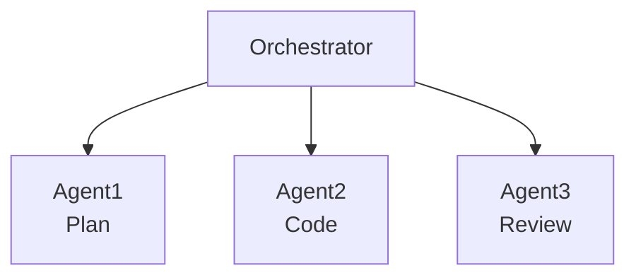
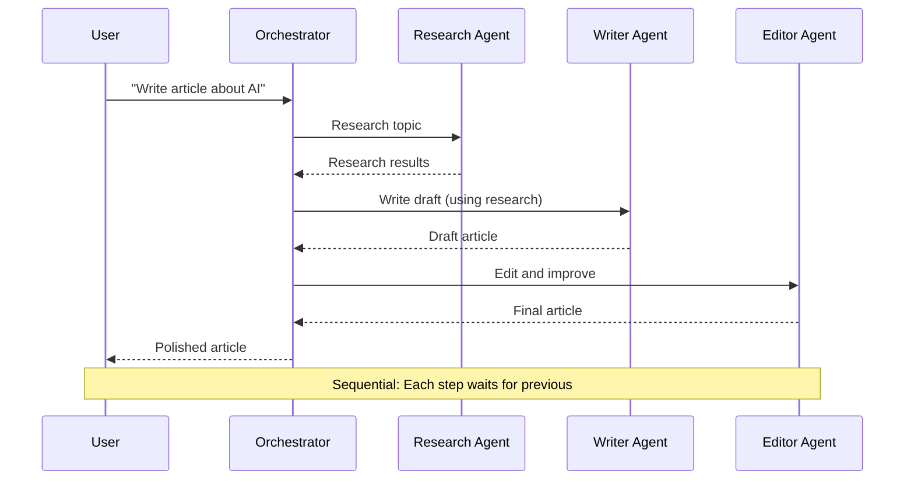
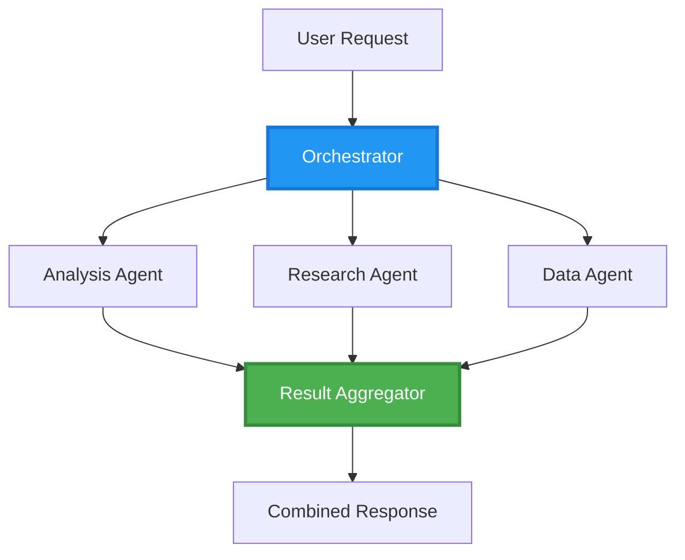
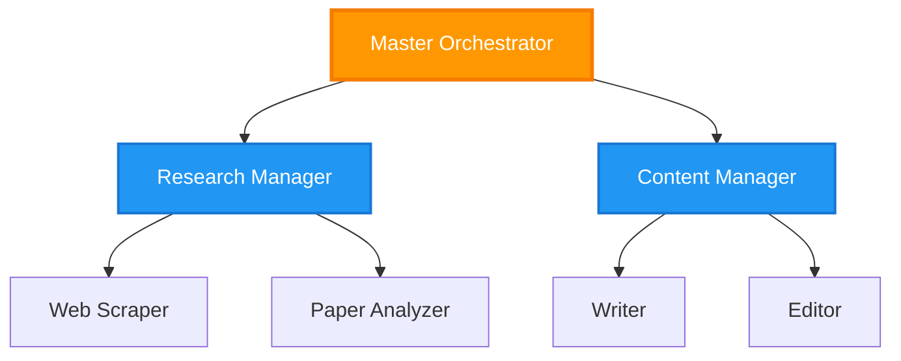
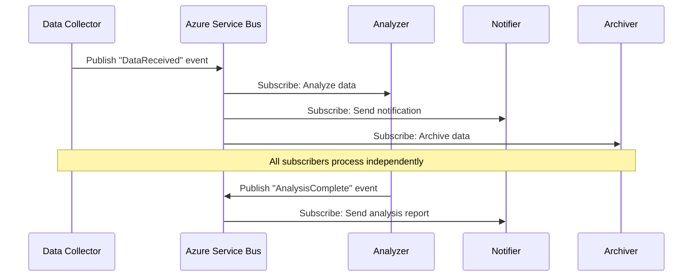
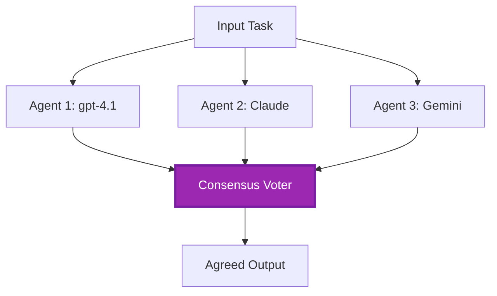
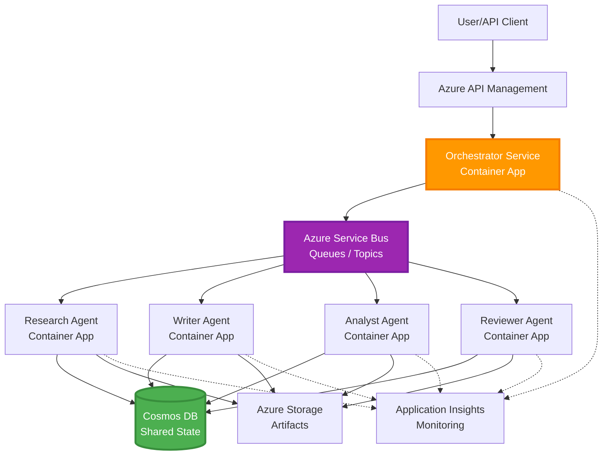

# Mønstre for Multi-Agent Koordinering

⏱️ **Anslået tid**: 60-75 minutters læsning; flere timer for implementering | 💰 **Anslået omkostning**: arbejdsbyrde-afhængig | ⭐ **Kompleksitet**: Avanceret

**📚 Læringssti:**
- ← Forrige: [Kapacitetsplanlægning](capacity-planning.md) - Ressourcestørrelse og skaleringsstrategier
- 🎯 **Du er her**: Multi-Agent Koordineringsmønstre (Orkestrering, kommunikation, tilstandsstyring)
- → Næste: [SKU-udvalg](sku-selection.md) - Valg af de rette Azure-tjenester
- 🏠 [Kursus Hjem](../../README.md)

---

## Hvad du vil lære

Ved at færdiggøre denne lektion vil du:
- Forstå **multi-agent arkitektur** mønstre og hvornår de skal bruges
- Implementere **orkestreringsmønstre** (centraliserede, decentraliserede, hierarkiske)
- Designe **agentkommunikations** strategier (synkron, asynkron, hændelsesdrevet)
- Administrere **delt tilstand** på tværs af distribuerede agenter
- Udrulle **multi-agent systemer** på Azure med AZD
- Anvende **koordinationsmønstre** til virkelige AI-scenarier
- Overvåge og fejlfinde distribuerede agentsystemer

## Hvorfor Multi-Agent Koordinering er vigtigt

### Udviklingen: Fra Enkel Agent til Multi-Agent

**Enkel Agent (Simpel):**
```
User → Agent → Response
```
- ✅ Let at forstå og implementere
- ✅ Hurtig til simple opgaver
- ❌ Begrænset af enkeltmodels kapaciteter
- ❌ Kan ikke parallelisere komplekse opgaver
- ❌ Ingen specialisering

**Multi-Agent System (Avanceret):**

- ✅ Specialiserede agenter til specifikke opgaver
- ✅ Parallel udførelse for hastighed
- ✅ Modulær og vedligeholdelsesvenlig
- ✅ Bedre til komplekse arbejdsgange
- ⚠️ Kræver koordinationslogik

**Analogi**: En enkelt agent er ligesom én person, der udfører alle opgaver. Multi-agent er som et team, hvor hvert medlem har specialiserede færdigheder (forsker, programmør, anmelder, forfatter), der arbejder sammen.

---

## Kernekoordineringsmønstre

### Mønster 1: Sekventiel Koordinering (Ansvarskæde)

**Hvornår man bruger:** Opgaver skal fuldføres i en bestemt rækkefølge, hver agent bygger videre på tidligere output.



**Fordele:**
- ✅ Klar dataflow
- ✅ Let at fejlfinde
- ✅ Forudsigelig udførelsesrækkefølge

**Begrænsninger:**
- ❌ Langsommere (ingen parallelisme)
- ❌ En enkelt fejl blokerer hele kæden
- ❌ Kan ikke håndtere indbyrdes afhængige opgaver

**Eksempler på anvendelser:**
- Indholdsskabelse pipeline (forskning → skriv → rediger → udgiv)
- Kodegenerering (planlæg → implementer → test → deployer)
- Rapportgenerering (dataindsamling → analyse → visualisering → opsummering)

---

### Mønster 2: Parallel Koordinering (Fan-Out/Fan-In)

**Hvornår man bruger:** Uafhængige opgaver kan køre samtidigt, resultater kombineres til sidst.



**Fordele:**
- ✅ Hurtigt (parallel udførelse)
- ✅ Fejltolerant (delvise resultater acceptable)
- ✅ Skalerer horisontalt

**Begrænsninger:**
- ⚠️ Resultater kan ankomme i forkert rækkefølge
- ⚠️ Behov for aggregeringslogik
- ⚠️ Komplekst tilstandsstyring

**Eksempler på anvendelser:**
- Multi-kilde dataindsamling (API'er + databaser + web scraping)
- Konkurrenceanalyse (flere modeller genererer løsninger, bedste vælges)
- Oversættelsestjenester (oversæt til flere sprog samtidigt)

---

### Mønster 3: Hierarkisk Koordinering (Manager-Arbejder)

**Hvornår man bruger:** Komplekse arbejdsgange med underopgaver, nødvendigt med delegation.



**Fordele:**
- ✅ Håndterer komplekse arbejdsgange
- ✅ Modulær og vedligeholdelsesvenlig
- ✅ Klare ansvarslinjer

**Begrænsninger:**
- ⚠️ Mere kompleks arkitektur
- ⚠️ Højere latenstid (flere koordinationslag)
- ⚠️ Kræver sofistikeret orkestrering

**Eksempler på anvendelser:**
- Virksomhedsdokument behandling (klassificer → diriger → behandl → arkiver)
- Data pipelines med flere trin (indsaml → rens → transformer → analyser → rapporter)
- Kompleks automatiseringsarbejdsgang (planlæg → ressourceallokering → udførsel → overvågning)

---

### Mønster 4: Hændelsesdrevet Koordinering (Udgiv-Abonner)

**Hvornår man bruger:** Agenter skal reagere på hændelser, løs kobling ønskes.



**Fordele:**
- ✅ Løs kobling mellem agenter
- ✅ Let at tilføje nye agenter (bare abonner)
- ✅ Asynkron behandling
- ✅ Robust (beskedpersistens)

**Begrænsninger:**
- ⚠️ Eventuel konsistens
- ⚠️ Komplekse fejlfindingsudfordringer
- ⚠️ Problemer med beskedordning

**Eksempler på anvendelser:**
- Overvågningssystemer i realtid (alarmer, dashboards, logs)
- Multi-kanal notifikationer (email, SMS, push, Slack)
- Databehandlings pipelines (flere forbrugere af samme data)

---

### Mønster 5: Konsensusbaseret Koordinering (Afstemning/Kvorum)

**Hvornår man bruger:** Kræver accept fra flere agenter før fortsættelse.



**Fordele:**
- ✅ Højere nøjagtighed (flere meninger)
- ✅ Fejltolerant (mindretalsfejl acceptable)
- ✅ Indbygget kvalitetskontrol

**Begrænsninger:**
- ❌ Dyrt (flere modelkald)
- ❌ Langsommere (venter på alle agenter)
- ⚠️ Konfliktløsning nødvendig

**Eksempler på anvendelser:**
- Indholdsmoderering (flere modeller vurderer indhold)
- Kodegennemgang (flere linters/analyzers)
- Medicinsk diagnose (flere AI-modeller, ekspertvalidering)

---

## Arkitekturoversigt

### Færdigt Multi-Agent System på Azure



**Nøglekomponenter:**

| Komponent | Formål | Azure-tjeneste |
|-----------|---------|---------------|
| **API Gateway** | Indgangspunkt, ratebegrænsning, autentifikation | API Management |
| **Orkestrator** | Koordinerer agentarbejdsgange | Container Apps |
| **Beskedkø** | Asynkron kommunikation | Service Bus / Event Hubs |
| **Agenter** | Specialiserede AI-arbejdere | Container Apps / Functions |
| **Tilstandslager** | Delt tilstand, opgavestyring | Cosmos DB |
| **Artefaktlager** | Dokumenter, resultater, logs | Blob Storage |
| **Overvågning** | Distribueret sporing, logs | Application Insights |

Service Bus køer/emner og Event Hubs er forskellige tjenester med forskellige leverings-/forbrugsmodeller; Event Hubs er ikke en plug-and-play-udskiftning for Service Bus arbejds-koden nedenfor. Parallelisme, vedvarende beskeder og modelafstemning garanterer ikke i sig selv fejltolerance eller højere nøjagtighed.

---

## Forudsætninger

### Nødvendige værktøjer

```bash
# Verify Azure Developer CLI
azd version
# Command reference baseline: azd 1.37.2

# Verify Azure CLI
az --version
# ✅ Expected: azure-cli 2.50.0 or higher

# Verify Docker (for local testing)
docker --version
# ✅ Expected: Docker version 20.10 or higher
```

### Azure-krav

- Aktiv Azure-abonnement
- Rettigheder til at oprette:
  - Container Apps
  - Service Bus namespaces
  - Cosmos DB konti
  - Storage konti
  - Application Insights

### Forudgående viden

Du bør have gennemført:
- [Konfigurationsstyring](../chapter-03-configuration/configuration.md)
- [Autentifikation & Sikkerhed](../chapter-03-configuration/authsecurity.md)
- [Microservices Eksempel](../../../../examples/microservices)

---

## Implementeringsvejledning

> **Designbrikker, ikke et færdigt laboratorium:** Projekttræet og `File:` etiketterne nedenfor beskriver filer, du skal oprette i dit eget projekt; dette repository indeholder ikke en komplet `multi-agent-system` applikation. Manglende dele inkluderer hoved-/parameter-templates, Container Apps miljø/registrering, Dockerfiler og afhængighedslås, Cosmos database/container opsætning, modeludrulninger, identitets-/roller-konfiguration, skaleringsregler og parallelle arbejdere/køer. Forvent ikke at `azd init` genererer disse filer eller `azd up` udruller uddragene uændret. For en eksekverbar start, gennemfør [Multi-Agent Basics](../chapter-05-multi-agent/multi-agent-basics.md).

**Runtime antagelser:** Python 3.10+, `azure-servicebus`, `azure-cosmos`, `openai`, Flask og (til overvågning) `azure-monitor-opentelemetry`; sæt `shared` på Python importstien i hvert servicebillede. Cosmos `agent-state/tasks` containeren skal allerede eksistere med partition key `/id`. Nøglebaserede forbindelser forenkler disse brikker, ikke produktsråd: foretræk managed identities med scoped Service Bus/Cosmos/OpenAI data-plane roller. Eksponer ikke nøgler i output eller logs.

Service Bus levering er **mindst én gang**. Persistér idempotens pr. opgave **og trin**, brug optimistisk samtidighed (ETags) for læs/modificer/skrive tilstand, og forny meddelelseslåse under lang behandling. Den simple tilstandsstyrer nedenfor er kun sekventiel og implementerer ikke disse produktionsgarantier.

### Projektstruktur

```
multi-agent-system/
├── azure.yaml                    # AZD configuration
├── infra/
│   ├── main.bicep               # Main infrastructure
│   ├── core/
│   │   ├── servicebus.bicep     # Message queue
│   │   ├── cosmos.bicep         # State store
│   │   ├── storage.bicep        # Artifact storage
│   │   └── monitoring.bicep     # Application Insights
│   └── app/
│       ├── orchestrator.bicep   # Orchestrator service
│       └── agent.bicep          # Agent template
└── src/
    ├── orchestrator/            # Orchestration logic
    │   ├── app.py
    │   ├── workflows.py
    │   └── Dockerfile
    ├── agents/
    │   ├── research/            # Research agent
    │   ├── writer/              # Writer agent
    │   ├── analyst/             # Analyst agent
    │   └── reviewer/            # Reviewer agent
    └── shared/
        ├── state_manager.py     # Shared state logic
        └── message_handler.py   # Message handling
```

---

## Lektion 1: Sekventielt Koordineringsmønster

### Implementering: Pipeline til Indholdsskabelse

Lad os designe en sekventiel pipeline: Forskning → Skriv → Rediger. Udgivelse ligger uden for dette eksempel.

### 1. AZD Konfiguration

**Fil: `azure.yaml`**

```yaml
name: content-pipeline
metadata:
  template: multi-agent-sequential@1.0.0

services:
  orchestrator:
    project: ./src/orchestrator
    language: python
    host: containerapp
  
  research-agent:
    project: ./src/agents/research
    language: python
    host: containerapp
  
  writer-agent:
    project: ./src/agents/writer
    language: python
    host: containerapp
  
  editor-agent:
    project: ./src/agents/editor
    language: python
    host: containerapp
```

### 2. Infrastruktur: Service Bus til Koordinering

**Fil: `infra/core/servicebus.bicep`**

```bicep
param name string
param location string
param tags object = {}

resource serviceBusNamespace 'Microsoft.ServiceBus/namespaces@2022-10-01-preview' = {
  name: name
  location: location
  tags: tags
  sku: {
    name: 'Standard'
    tier: 'Standard'
  }
  properties: {
    minimumTlsVersion: '1.2'
  }
}

// Queue for orchestrator → research agent
resource researchQueue 'Microsoft.ServiceBus/namespaces/queues@2022-10-01-preview' = {
  parent: serviceBusNamespace
  name: 'research-tasks'
  properties: {
    maxDeliveryCount: 3
    lockDuration: 'PT5M'
    deadLetteringOnMessageExpiration: true
  }
}

// Queue for research agent → writer agent
resource writerQueue 'Microsoft.ServiceBus/namespaces/queues@2022-10-01-preview' = {
  parent: serviceBusNamespace
  name: 'writer-tasks'
  properties: {
    maxDeliveryCount: 3
    lockDuration: 'PT5M'
  }
}

// Queue for writer agent → editor agent
resource editorQueue 'Microsoft.ServiceBus/namespaces/queues@2022-10-01-preview' = {
  parent: serviceBusNamespace
  name: 'editor-tasks'
  properties: {
    maxDeliveryCount: 3
    lockDuration: 'PT5M'
  }
}

output namespace string = serviceBusNamespace.name
// Do not output RootManageSharedAccessKey. Resolve scoped credentials
// securely or use managed identity in the application and scale rules.
```

### 3. Delt Tilstand Styrer

**Fil: `src/shared/state_manager.py`**

```python
from azure.cosmos import CosmosClient, PartitionKey
from datetime import datetime, timezone
import os

class StateManager:
    """Manages shared state across agents using Cosmos DB"""
    
    def __init__(self):
        endpoint = os.environ['COSMOS_ENDPOINT']
        key = os.environ['COSMOS_KEY']
        
        self.client = CosmosClient(endpoint, key)
        self.database = self.client.get_database_client('agent-state')
        self.container = self.database.get_container_client('tasks')
    
    def create_task(self, task_id: str, task_type: str, input_data: dict):
        """Create a new task"""
        task = {
            'id': task_id,
            'type': task_type,
            'status': 'pending',
            'input': input_data,
            'created_at': datetime.now(timezone.utc).isoformat(),
            'steps': []
        }
        self.container.create_item(task)
        return task
    
    def update_task_step(self, task_id: str, step_name: str, result: dict):
        """Update task with completed step"""
        task = self.container.read_item(task_id, partition_key=task_id)
        
        task['steps'].append({
            'name': step_name,
            'completed_at': datetime.now(timezone.utc).isoformat(),
            'result': result
        })
        
        self.container.replace_item(task_id, task)
        return task
    
    def complete_task(self, task_id: str, final_result: dict):
        """Mark task as complete"""
        task = self.container.read_item(task_id, partition_key=task_id)
        task['status'] = 'completed'
        task['result'] = final_result
        task['completed_at'] = datetime.now(timezone.utc).isoformat()
        self.container.replace_item(task_id, task)
        return task
    
    def get_task(self, task_id: str):
        """Retrieve task state"""
        return self.container.read_item(task_id, partition_key=task_id)
```

### 4. Orkestrator Service

**Fil: `src/orchestrator/app.py`**

```python
from flask import Flask, request, jsonify
from azure.servicebus import ServiceBusClient, ServiceBusMessage
import json
import uuid
import os
from shared.state_manager import StateManager

app = Flask(__name__)
state_manager = StateManager()

# Service Bus connection
servicebus_connection_str = os.environ['SERVICEBUS_CONNECTION_STRING']
servicebus_client = ServiceBusClient.from_connection_string(servicebus_connection_str)

@app.route('/health', methods=['GET'])
def health():
    return jsonify({'status': 'healthy', 'service': 'orchestrator'})

@app.route('/create-content', methods=['POST'])
def create_content():
    """
    Sequential workflow: Research → Write → Edit (returns a draft; no publishing)
    """
    data = request.get_json(silent=True) or {}
    topic = data.get('topic')
    
    if not topic:
        return jsonify({'error': 'Topic required'}), 400
    
    # Create task in state store
    task_id = str(uuid.uuid4())
    task = state_manager.create_task(
        task_id=task_id,
        task_type='content_creation',
        input_data={'topic': topic}
    )
    
    # Send message to research agent (first step)
    sender = servicebus_client.get_queue_sender('research-tasks')
    message = ServiceBusMessage(
        body=json.dumps({
            'task_id': task_id,
            'topic': topic,
            'next_queue': 'writer-tasks'  # Where to send results
        }),
        content_type='application/json'
    )
    
    with sender:
        sender.send_messages(message)
    
    return jsonify({
        'task_id': task_id,
        'status': 'started',
        'workflow': 'sequential',
        'steps': ['research', 'write', 'edit'],
        'message': 'Content creation pipeline initiated'
    }), 202

@app.route('/task/<task_id>', methods=['GET'])
def get_task_status(task_id):
    """Check task status"""
    try:
        task = state_manager.get_task(task_id)
        return jsonify(task)
    except Exception as e:
        return jsonify({'error': str(e)}), 404

if __name__ == '__main__':
    app.run(host='0.0.0.0', port=8080)
```

### 5. Forskningsagent

**Fil: `src/agents/research/app.py`**

```python
from azure.servicebus import ServiceBusClient, ServiceBusMessage
from openai import AzureOpenAI
import json
import os
import time
from shared.state_manager import StateManager

# Initialize clients
state_manager = StateManager()
servicebus_client = ServiceBusClient.from_connection_string(
    os.environ['SERVICEBUS_CONNECTION_STRING']
)

openai_client = AzureOpenAI(
    api_key=os.environ['AZURE_OPENAI_API_KEY'],
    api_version="2024-10-21",
    azure_endpoint=os.environ['AZURE_OPENAI_ENDPOINT']
)

def process_research_task(message_data):
    """Process research request and pass to writer"""
    task_id = message_data['task_id']
    topic = message_data['topic']
    next_queue = message_data['next_queue']
    
    print(f"🔬 Researching: {topic}")
    
    # Call Microsoft Foundry Models for research
    response = openai_client.chat.completions.create(
        model=os.environ['AZURE_OPENAI_DEPLOYMENT'],
        messages=[
            {"role": "system", "content": "You are a research assistant. Provide comprehensive research on the given topic."},
            {"role": "user", "content": f"Research this topic thoroughly: {topic}"}
        ],
        max_tokens=1500
    )
    
    research_results = response.choices[0].message.content
    
    # Update state
    state_manager.update_task_step(
        task_id=task_id,
        step_name='research',
        result={'research': research_results}
    )
    
    # Send to next agent (writer)
    sender = servicebus_client.get_queue_sender(next_queue)
    message = ServiceBusMessage(
        body=json.dumps({
            'task_id': task_id,
            'topic': topic,
            'research': research_results,
            'next_queue': 'editor-tasks'
        }),
        content_type='application/json'
    )
    
    with sender:
        sender.send_messages(message)
    
    print(f"✅ Research complete for task {task_id}")

def main():
    """Listen to research queue"""
    receiver = servicebus_client.get_queue_receiver('research-tasks')
    
    print("🔬 Research Agent started, listening for tasks...")
    
    with receiver:
        while True:
            messages = receiver.receive_messages(max_wait_time=5)
            for message in messages:
                try:
                    message_data = json.loads(str(message))
                    process_research_task(message_data)
                    receiver.complete_message(message)
                except Exception as e:
                    print(f"❌ Error processing message: {e}")
                    receiver.abandon_message(message)

if __name__ == '__main__':
    main()
```

### 6. Skriveagent

**Fil: `src/agents/writer/app.py`**

```python
from azure.servicebus import ServiceBusClient, ServiceBusMessage
from openai import AzureOpenAI
import json
import os
from shared.state_manager import StateManager

state_manager = StateManager()
servicebus_client = ServiceBusClient.from_connection_string(
    os.environ['SERVICEBUS_CONNECTION_STRING']
)

openai_client = AzureOpenAI(
    api_key=os.environ['AZURE_OPENAI_API_KEY'],
    api_version="2024-10-21",
    azure_endpoint=os.environ['AZURE_OPENAI_ENDPOINT']
)

def process_writing_task(message_data):
    """Write article based on research"""
    task_id = message_data['task_id']
    topic = message_data['topic']
    research = message_data['research']
    next_queue = message_data['next_queue']
    
    print(f"✍️ Writing article: {topic}")
    
    # Call Microsoft Foundry Models to write article
    response = openai_client.chat.completions.create(
        model=os.environ['AZURE_OPENAI_DEPLOYMENT'],
        messages=[
            {"role": "system", "content": "You are a professional writer. Write engaging, well-structured articles."},
            {"role": "user", "content": f"Based on this research:\n\n{research}\n\nWrite a comprehensive article about: {topic}"}
        ],
        max_tokens=2000
    )
    
    article_draft = response.choices[0].message.content
    
    # Update state
    state_manager.update_task_step(
        task_id=task_id,
        step_name='writing',
        result={'draft': article_draft}
    )
    
    # Send to editor
    sender = servicebus_client.get_queue_sender(next_queue)
    message = ServiceBusMessage(
        body=json.dumps({
            'task_id': task_id,
            'topic': topic,
            'draft': article_draft
        }),
        content_type='application/json'
    )
    
    with sender:
        sender.send_messages(message)
    
    print(f"✅ Article draft complete for task {task_id}")

def main():
    """Listen to writer queue"""
    receiver = servicebus_client.get_queue_receiver('writer-tasks')
    
    print("✍️ Writer Agent started, listening for tasks...")
    
    with receiver:
        while True:
            messages = receiver.receive_messages(max_wait_time=5)
            for message in messages:
                try:
                    message_data = json.loads(str(message))
                    process_writing_task(message_data)
                    receiver.complete_message(message)
                except Exception as e:
                    print(f"❌ Error: {e}")
                    receiver.abandon_message(message)

if __name__ == '__main__':
    main()
```

### 7. Redigeringsagent

**Fil: `src/agents/editor/app.py`**

```python
from azure.servicebus import ServiceBusClient
from openai import AzureOpenAI
import json
import os
from shared.state_manager import StateManager

state_manager = StateManager()
servicebus_client = ServiceBusClient.from_connection_string(
    os.environ['SERVICEBUS_CONNECTION_STRING']
)

openai_client = AzureOpenAI(
    api_key=os.environ['AZURE_OPENAI_API_KEY'],
    api_version="2024-10-21",
    azure_endpoint=os.environ['AZURE_OPENAI_ENDPOINT']
)

def process_editing_task(message_data):
    """Edit and finalize article"""
    task_id = message_data['task_id']
    topic = message_data['topic']
    draft = message_data['draft']
    
    print(f"📝 Editing article: {topic}")
    
    # Call Microsoft Foundry Models to edit
    response = openai_client.chat.completions.create(
        model=os.environ['AZURE_OPENAI_DEPLOYMENT'],
        messages=[
            {"role": "system", "content": "You are an expert editor. Improve grammar, clarity, and structure."},
            {"role": "user", "content": f"Edit and improve this article:\n\n{draft}"}
        ],
        max_tokens=2000
    )
    
    final_article = response.choices[0].message.content
    
    # Mark task as complete
    state_manager.complete_task(
        task_id=task_id,
        final_result={
            'topic': topic,
            'final_article': final_article,
            'word_count': len(final_article.split())
        }
    )
    
    print(f"✅ Article finalized for task {task_id}")

def main():
    """Listen to editor queue"""
    receiver = servicebus_client.get_queue_receiver('editor-tasks')
    
    print("📝 Editor Agent started, listening for tasks...")
    
    with receiver:
        while True:
            messages = receiver.receive_messages(max_wait_time=5)
            for message in messages:
                try:
                    message_data = json.loads(str(message))
                    process_editing_task(message_data)
                    receiver.complete_message(message)
                except Exception as e:
                    print(f"❌ Error: {e}")
                    receiver.abandon_message(message)

if __name__ == '__main__':
    main()
```

### 8. Udrul og test

Disse kommandoer gælder **først efter du har implementeret de manglende projektfiler**. Interaktiv Foundry agent initialisering er en separat arbejdsgang; den genererer ikke denne Service Bus-design.

```bash
# In your completed custom project
azd up

# Alternative in a SEPARATE empty folder (GA bundle workflow requires azd >= 1.37.0)
azd ext install microsoft.foundry
azd ai agent init
azd up
```

> Se [AZD AI CLI Commands](../chapter-08-production/production-ai-practices.md#azd-ai-cli-commands-and-extensions) for alle `azd ai` flag og muligheder.

```bash
# Get orchestrator URL
ORCHESTRATOR_URL=$(azd env get-values | grep ORCHESTRATOR_URL | cut -d '=' -f2 | tr -d '"')

# Create content
curl -X POST $ORCHESTRATOR_URL/create-content \
  -H "Content-Type: application/json" \
  -d '{"topic": "The Future of AI in Healthcare"}'
```

**✅ Forventet output:**
```json
{
  "task_id": "a1b2c3d4-e5f6-7890-abcd-ef1234567890",
  "status": "started",
  "workflow": "sequential",
  "steps": ["research", "write", "edit"],
  "message": "Content creation pipeline initiated"
}
```

**Tjek opgavefremskridt:**
```bash
TASK_ID="a1b2c3d4-e5f6-7890-abcd-ef1234567890"
curl $ORCHESTRATOR_URL/task/$TASK_ID
```

**✅ Forventet output (fuldført):**
```json
{
  "id": "a1b2c3d4-e5f6-7890-abcd-ef1234567890",
  "type": "content_creation",
  "status": "completed",
  "steps": [
    {
      "name": "research",
      "completed_at": "2025-11-19T10:30:00Z",
      "result": {"research": "..."}
    },
    {
      "name": "writing",
      "completed_at": "2025-11-19T10:32:00Z",
      "result": {"draft": "..."}
    }
  ],
  "result": {
    "topic": "The Future of AI in Healthcare",
    "final_article": "...",
    "word_count": 1500
  }
}
```

---

## Lektion 2: Parallel Koordineringsmønster

### Implementering: Multi-kilde Forskningsaggregator

Lad os bygge et parallelt system, der indsamler information fra flere kilder samtidigt.

### Parallel Orkestrator

**Fil: `src/orchestrator/parallel_workflow.py`**

```python
from flask import Flask, request, jsonify
from azure.servicebus import ServiceBusClient, ServiceBusMessage
import json
import uuid
import os
from shared.state_manager import StateManager

app = Flask(__name__)
state_manager = StateManager()

servicebus_client = ServiceBusClient.from_connection_string(
    os.environ['SERVICEBUS_CONNECTION_STRING']
)

@app.route('/research-parallel', methods=['POST'])
def research_parallel():
    """
    Parallel workflow: Multiple agents work simultaneously
    """
    data = request.json
    query = data.get('query')
    
    task_id = str(uuid.uuid4())
    task = state_manager.create_task(
        task_id=task_id,
        task_type='parallel_research',
        input_data={
            'query': query,
            'agents': ['web', 'academic', 'news', 'social']
        }
    )
    
    # Fan-out: publish sequentially; workers may process concurrently.
    agents = [
        ('web-research-queue', 'web'),
        ('academic-research-queue', 'academic'),
        ('news-research-queue', 'news'),
        ('social-research-queue', 'social')
    ]
    
    for queue_name, agent_type in agents:
        sender = servicebus_client.get_queue_sender(queue_name)
        message = ServiceBusMessage(
            body=json.dumps({
                'task_id': task_id,
                'query': query,
                'agent_type': agent_type,
                'result_queue': 'aggregation-queue'
            }),
            content_type='application/json'
        )
        
        with sender:
            sender.send_messages(message)
    
    return jsonify({
        'task_id': task_id,
        'status': 'started',
        'workflow': 'parallel',
        'agents_dispatched': 4,
        'message': 'Parallel research initiated'
    }), 202

if __name__ == '__main__':
    app.run(host='0.0.0.0', port=8080)
```

### Aggregeringslogik

**Fil: `src/agents/aggregator/app.py`**

```python
from azure.servicebus import ServiceBusClient
import json
import os
from collections import defaultdict
from shared.state_manager import StateManager

state_manager = StateManager()
servicebus_client = ServiceBusClient.from_connection_string(
    os.environ['SERVICEBUS_CONNECTION_STRING']
)

# Single-process demo only: not durable or shared across replicas.
# Production: use durable unique (task_id, agent_type) result records.
task_results = defaultdict(dict)
expected_agents = 4  # web, academic, news, social

def process_result(message_data):
    """Aggregate results from parallel agents"""
    task_id = message_data['task_id']
    agent_type = message_data['agent_type']
    result = message_data['result']
    
    # Store result
    task_results[task_id][agent_type] = {
        'agent': agent_type,
        'data': result
    }
    
    print(f"📊 Received result from {agent_type} agent ({len(task_results[task_id])}/{expected_agents})")
    
    # Check if all agents completed (fan-in)
    if len(task_results[task_id]) == expected_agents:
        print(f"✅ All agents completed for task {task_id}. Aggregating...")
        
        # Combine results
        aggregated = {
            'query': message_data['query'],
            'sources': list(task_results[task_id].values()),
            'summary': generate_summary(list(task_results[task_id].values()))
        }
        
        # Mark complete
        state_manager.complete_task(task_id, aggregated)
        
        # Clean up
        del task_results[task_id]
        
        print(f"✅ Aggregation complete for task {task_id}")

def generate_summary(results):
    """Generate summary from all sources"""
    summaries = [r['data'].get('summary', '') for r in results]
    return '\n\n'.join(summaries)

def main():
    """Listen to aggregation queue"""
    receiver = servicebus_client.get_queue_receiver('aggregation-queue')
    
    print("📊 Aggregator started, listening for results...")
    
    with receiver:
        while True:
            messages = receiver.receive_messages(max_wait_time=5)
            for message in messages:
                try:
                    message_data = json.loads(str(message))
                    process_result(message_data)
                    receiver.complete_message(message)
                except Exception as e:
                    print(f"❌ Error: {e}")
                    receiver.abandon_message(message)

if __name__ == '__main__':
    main()
```

**Fordele ved Parallel Mønster:**
- ⚡ **Potentielt lavere latenstid** (begrænset af den langsommeste arbejder plus koordineringsomkostninger)
- 🔄 **Kan understøtte delvise resultater** med eksplicitte deadlines og fejlhåndtering (ikke implementeret i grundlæggende aggregator)
- 📈 **Skalerbart** (tilføj nemt flere agenter)

---

## Praktiske øvelser

### Øvelse 1: Tilføj timeout-håndtering ⭐⭐ (Mellem)

**Mål**: Implementér timeout logik, så aggregator ikke venter uendeligt på langsomme agenter.

**Startpunkt:** Kør denne lokale deadline-simulering før integration i en kø-arbejder. En timeout, der kun kontrolleres ved modtagelse af en anden besked, udløses aldrig, hvis den manglende arbejder ikke sender noget.

**Trin**:

1. **Tilføj timeout-overvågning til aggregator:**

```python
import asyncio

async def simulated_agent(name, delay):
    await asyncio.sleep(delay)
    return {'agent': name, 'result': 'done'}

async def main():
    tasks = [asyncio.create_task(simulated_agent(name, delay))
             for name, delay in [('web', 0.1), ('academic', 0.2),
                                 ('news', 0.3), ('social', 3)]]
    done, pending = await asyncio.wait(tasks, timeout=1)
    results = [task.result() for task in done]
    for task in pending:
        task.cancel()
    await asyncio.gather(*pending, return_exceptions=True)
    print({'completed_agents': len(results), 'timed_out': bool(pending)})
    assert len(results) == 3 and pending

asyncio.run(main())
```

2. **Forventet output:**

```text
{'completed_agents': 3, 'timed_out': True}
```

3. **Kø-system integration (designopgave):** Persistér dispatch deadline og forventede agenter ved oprettelse af opgave, kør periodisk deadline sweep uafhængigt af indkomne resultater, færdiggør atomisk delvise resultater, og ignorer sene/duplikerede beskeder for færdiggjorte opgaver. Lokal timeout afbryder ikke fjernarbejdere.

Kun for dit implementerede projekt:

```bash
azd deploy aggregator

# Submit task
curl -X POST $ORCHESTRATOR_URL/research-parallel \
  -H "Content-Type: application/json" \
  -d '{"query": "AI safety research"}'

# Check results after 30 seconds
curl $ORCHESTRATOR_URL/task/$TASK_ID
```

**✅ Succes kriterier:**
- ✅ Den lokale test returnerer efter sin ét-sekunders deadline, selvom en agent er ufuldstændig
- ✅ Respons indikerer delvise resultater (`"timed_out": true`)
- ✅ Tilgængelige resultater returneres (3 ud af 4 agenter)

**Tid**: 20-25 minutter

---

### Øvelse 2: Implementér retry-logik ⭐⭐⭐ (Avanceret)

**Mål**: Automatisk gentagelse af fejlede agent-opgaver før opgivelse.

**Trin**:

1. **Brug Service Bus leveringsantællinger i stedet for egne retry-tællere:**

```python
import json
import time
# Integration fragment: use a live peek-lock ServiceBusReceiver.
# Set queue maxDeliveryCount to 4 for one attempt + up to three retries.
```

2. **Tilføj retry-handler til agenter:**

```python
def process_with_retry(message, receiver, process_func):
    """Process message with automatic retry on failure"""
    try:
        message_data = json.loads(str(message))
        
        # Process the message
        process_func(message_data)
        
        # Success - complete
        receiver.complete_message(message)
        
    except Exception as e:
        if message.delivery_count < 4:
            # Bounded exponential delay: 5s, 10s, 20s.
            # Renew the lock if processing + waiting can exceed its duration.
            time.sleep(5 * 2 ** (message.delivery_count - 1))
            receiver.abandon_message(message)
        else:
            # Max retries exceeded - move to dead letter queue
            print(f"❌ Max attempts exceeded for message {message.message_id}")
            receiver.dead_letter_message(
                message,
                reason="MaxRetriesExceeded",
                error_description=str(e)
            )
```

3. **Overvåg dead letter kø:**

```python
def monitor_dead_letters():
    """Check dead letter queue for failed messages"""
    receiver = servicebus_client.get_queue_receiver(
        'research-tasks',
        sub_queue='deadletter'
    )
    
    with receiver:
        messages = receiver.receive_messages(max_wait_time=5)
        for message in messages:
            print(f"☠️ Dead letter: {message.message_id}")
            print(f"Reason: {message.dead_letter_reason}")
            print(f"Description: {message.dead_letter_error_description}")
```

**✅ Succes kriterier:**
- ✅ Fejlede opgaver retryes automatisk (op til 3 gange)
- ✅ Eksponentiel backoff mellem retries (5s, 10s, 20s), med fornyelse af beskedlås hvor nødvendigt
- ✅ Efter max retries går beskeder til dead letter kø
- ✅ Dead letter beskeder kan inspiceres; genafspilning kræver separat idempotent genoprettelsesarbejdsgang

**Tid**: 30-40 minutter

---

### Øvelse 3: Implementér Circuit Breaker ⭐⭐⭐ (Avanceret)

**Mål**: Forhindre kaskadefejl ved at stoppe forespørgsler til fejlfyldte agenter.

**Trin**:

1. **Opret circuit breaker klasse:**

```python
from enum import Enum
from datetime import datetime, timedelta, timezone

class CircuitState(Enum):
    CLOSED = "closed"      # Normal operation
    OPEN = "open"          # Failing, reject requests
    HALF_OPEN = "half_open"  # Testing if recovered

class CircuitBreaker:
    def __init__(self, failure_threshold=5, timeout_seconds=60):
        self.failure_threshold = failure_threshold
        self.timeout_seconds = timeout_seconds
        self.failure_count = 0
        self.last_failure_time = None
        self.state = CircuitState.CLOSED
    
    def call(self, func):
        """Execute function with circuit breaker protection"""
        if self.state == CircuitState.OPEN:
            # Check if timeout expired
            if datetime.now(timezone.utc) - self.last_failure_time > timedelta(seconds=self.timeout_seconds):
                self.state = CircuitState.HALF_OPEN
                print("🔄 Circuit breaker: HALF_OPEN (testing)")
            else:
                raise Exception(f"Circuit breaker OPEN for agent. Try again in {self.timeout_seconds}s")
        
        try:
            result = func()
            
            # Success
            self.failure_count = 0 # Count consecutive failures only
            if self.state == CircuitState.HALF_OPEN:
                self.state = CircuitState.CLOSED
                self.failure_count = 0
                print("✅ Circuit breaker: CLOSED (recovered)")
            
            return result
            
        except Exception as e:
            self.failure_count += 1
            self.last_failure_time = datetime.now(timezone.utc)
            
            if self.failure_count >= self.failure_threshold:
                self.state = CircuitState.OPEN
                print(f"🔴 Circuit breaker: OPEN (too many failures)")
            
            raise
```

2. **Anvend på agentkald:**

```python
# In orchestrator
agent_circuits = {
    'web': CircuitBreaker(failure_threshold=5, timeout_seconds=60),
    'academic': CircuitBreaker(failure_threshold=5, timeout_seconds=60),
    'news': CircuitBreaker(failure_threshold=5, timeout_seconds=60),
    'social': CircuitBreaker(failure_threshold=5, timeout_seconds=60)
}

def send_to_agent(agent_type, message_data):
    """Send with circuit breaker protection"""
    circuit = agent_circuits[agent_type]
    
    try:
        circuit.call(lambda: send_message(agent_type, message_data))
    except Exception as e:
        print(f"⚠️ Skipping {agent_type} agent: {e}")
        # Continue with other agents
```

Denne kredsløb beskytter **send operationen**, ikke fuldførelsen af den fjernarbejder: at køe en besked med succes siger intet om, hvorvidt en agent er i live. `send_message` er din applikations senderfunktion. For eksekveringskredsløb, fodr observerede opgavefejl/tidsudløb ind i en holdbar koordinator. Denne in-memory-klasse er en enkelttrådet demonstration, ikke en distribueret kredsløbsafbryder.

3. **Test kredsløbsafbryder lokalt:**

```python
# Run after the class definition; no Azure changes required.
circuit = CircuitBreaker(failure_threshold=5, timeout_seconds=0)
def fail():
    raise RuntimeError("simulated failure")
for _ in range(5):
    try:
        circuit.call(fail)
    except RuntimeError:
        pass
assert circuit.state == CircuitState.OPEN
assert circuit.call(lambda: "recovered") == "recovered"
assert circuit.state == CircuitState.CLOSED
print("Circuit breaker recovery verified")
```

**✅ Succes kriterier:**
- ✅ Efter 5 fejl åbner kredsløbet (afviser anmodninger)
- ✅ Efter 60 sekunder går kredsløbet til halvåben (tester genopretning)
- ✅ Andre agenter fortsætter med at arbejde normalt
- ✅ Kredsløbet lukker automatisk, når agenten genopretter

**Tid**: 40-50 minutter

---

## Overvågning og Fejlfinding

### Distribueret Sporing med Application Insights

**Fil: `src/shared/tracing.py`**

```python
from azure.monitor.opentelemetry import configure_azure_monitor
from opentelemetry import trace
from opentelemetry.trace import SpanKind
import logging
import os

connection_string = os.environ.get('APPLICATIONINSIGHTS_CONNECTION_STRING')

# Configure once per process. Message send/receive trace-context propagation
# and agent attributes on exceptions need explicit instrumentation.
if connection_string:
    configure_azure_monitor(connection_string=connection_string, logger_name=__name__)
tracer = trace.get_tracer(__name__)

# Configure logging
logger = logging.getLogger(__name__)
logger.setLevel(logging.INFO)

def trace_agent_call(agent_name, task_id, operation_name, operation):
    """Trace agent operations"""
    with tracer.start_as_current_span(f'agent.{agent_name}.{operation_name}', kind=SpanKind.CLIENT) as span:
        span.set_attribute('agent', agent_name)
        span.set_attribute('task_id', task_id)
        span.set_attribute('operation', operation_name)
        
        try:
            result = operation()
            span.set_attribute('status', 'success')
            logger.info('Agent operation completed', extra={
                'agent': agent_name, 'task_id': task_id, 'operation': operation_name
            })
            return result
        except Exception as e:
            span.set_attribute('status', 'error')
            logger.exception('Agent operation failed', extra={
                'agent': agent_name, 'task_id': task_id, 'operation': operation_name
            })
            raise
```

### Application Insights Forespørgsler

**Spor multi-agent arbejdsgange:**

```kusto
// Trace complete workflow for a task
traces
| where customDimensions.task_id == "a1b2c3d4-..."
| project timestamp, message, customDimensions.agent, customDimensions.operation
| order by timestamp asc
```

**Sammenligning af agentperformance:**

```kusto
// Compare agent execution times
dependencies
| where name contains "agent"
| summarize 
    avg_duration = avg(duration),
    p95_duration = percentile(duration, 95),
    count = count()
  by agent = tostring(customDimensions.agent)
| order by avg_duration desc
```

**Fejlanalyse:**

```kusto
// Find which agents fail most
exceptions
| where customDimensions.agent != ""
| summarize 
    failure_count = count(),
    unique_errors = dcount(outerMessage)
  by agent = tostring(customDimensions.agent)
| order by failure_count desc
```

---

## Omkostningsanalyse

### Multi-Agent Systemomkostninger (månedlige estimater)

Illustrative planlægningstal kun, ikke tilbud: summen nedenfor er **$240-565/måned**. Verificer aktuelle regionale priser, aktive/inaktive replika-timer, input/output token-mix, lagring og telemetri. Serverless har ingen minimum for provisioneret gennemløb, men fakturerer stadig for anmodninger og lagring.

| Komponent | Konfiguration | Omkostning |
|-----------|--------------|------|
| **Orkestrator** | 1 Container App (1 vCPU, 2GB) | $30-50 |
| **4 Agenter** | 4 Container Apps (0.5 vCPU, 1GB hver) | $60-120 |
| **Service Bus** | Standard niveau, 10M beskeder | $10-20 |
| **Cosmos DB** | Serverless, 5GB lager, 1M RUs | $25-50 |
| **Blob Storage** | 10GB lagring, 100K operationer | $5-10 |
| **Application Insights** | 5GB indtag | $10-15 |
| **Microsoft Foundry Modeller** | gpt-4.1, 10M tokens | $100-300 |
| **Total** | | **$240-565/måned** |

### Strategier for Omkostningsoptimering

1. **Brug serverless hvor det er muligt:**
   ```bicep
   // Cosmos DB serverless (no minimum cost)
   properties: {
     databaseAccountOfferType: 'Standard'
     capabilities: [{ name: 'EnableServerless' }]
   }
   ```

2. **Skalér agenter til nul ved inaktivitet:**
   ```bicep
   scale: {
     minReplicas: 0  // Requires a Service Bus/KEDA scale rule to wake workers
     maxReplicas: 10
   }
   ```

3. **Brug batching for Service Bus:**
   ```python
   # Send messages in batches (cheaper)
   sender.send_messages([message1, message2, message3])
   ```

4. **Cache hyppigt brugte resultater:**
   ```python
   # Use Azure Cache for Redis
   if cache.exists(query_hash):
       return cache.get(query_hash)
   ```

---

## Bedste Praksis

### ✅ GØR:

1. **Brug idempotente operationer**
   ```python
   # Pseudocode: implement a durable, atomic per-step deduplication claim.
   def process_task(task_id):
       raise NotImplementedError("Claim (task_id, step) atomically, execute, persist outcome")
   ```

2. **Implementer omfattende logging**
   ```python
   logger.info(f"Agent: {agent_name}, Task: {task_id}, Action: {action}")
   ```

3. **Brug korrelations-ID'er**
   ```python
   # Pass task_id through entire workflow
   message_data = {
       'task_id': task_id,  # Correlation ID
       'timestamp': datetime.utcnow().isoformat()
   }
   ```

4. **Sæt besked TTL (tid-til-levetid)**
   ```bicep
   properties: {
     defaultMessageTimeToLive: 'PT1H'  // 1 hour max
   }
   ```

5. **Overvåg døde-brev køer**
   ```python
   # Regular monitoring of failed messages
   monitor_dead_letters()
   ```

### ❌ GØR IKKE:

1. **Lav ikke cirkulære afhængigheder**
   ```python
   # ❌ BAD: Agent A → Agent B → Agent A (infinite loop)
   # ✅ GOOD: Define clear directed acyclic graph (DAG)
   ```

2. **Bloker ikke agent-tråde**
   ```python
   # ❌ BAD: Synchronous wait
   while not task_complete:
       time.sleep(1)
   
   # ✅ GOOD: Use message queue callbacks
   ```

3. **Ignorer ikke delvise fejl**
   ```python
   # ❌ BAD: Fail entire workflow if one agent fails
   # ✅ GOOD: Return partial results with error indicators
   ```

4. **Brug ikke uendelige genforsøg**
   ```python
   # ❌ BAD: retry forever
   # ✅ GOOD: max_retries = 3, then dead letter
   ```

---

## Fejlsøgningsguide

### Problem: Beskeder sidder fast i køen

**Symptomer:**
- Beskeder akkumuleres i køen
- Agenter behandler ikke
- Opgavestatus sidder fast på "afventer"

**Diagnose:**
```bash
# Check queue depth
az servicebus queue show \
  --resource-group "$RG_NAME" \
  --namespace-name mybus \
  --name research-tasks \
  --query "countDetails"

# Check agent logs using Azure CLI
az containerapp logs show --name research-agent --resource-group $RG_NAME --tail 50
```

**Løsninger:**

1. **Øg agent-replikaer:**
   ```bash
   az containerapp update \
     --resource-group "$RG_NAME" \
     --name research-agent \
     --min-replicas 3 \
     --max-replicas 10
   ```

2. **Tjek døde-brev kø:**
   ```bash
   az servicebus queue show \
     --resource-group "$RG_NAME" \
     --namespace-name mybus \
     --name research-tasks \
     --query "countDetails.deadLetterMessageCount"
   ```

---

### Problem: Opgave tidsudløb/fuldføres aldrig

**Symptomer:**
- Opgavestatus bliver "i gang"
- Nogle agenter fuldfører, andre gør ikke
- Ingen fejlmeddelelser

**Diagnose:**
```bash
# Check task state
curl $ORCHESTRATOR_URL/task/$TASK_ID

# Check Application Insights
# Run query: traces | where customDimensions.task_id == "..."
```

**Løsninger:**

1. **Implementér timeout i aggregator (Øvelse 1)**

2. **Tjek for agentfejl med Azure Monitor:**
   ```bash
   # View logs via azd monitor
   azd monitor --logs
   
   # Or use Azure CLI to check specific container app logs
   az containerapp logs show --name <agent-name> --resource-group $RG_NAME --follow | grep "ERROR\|FAIL"
   ```

3. **Verificér at alle agenter kører:**
   ```bash
   az containerapp list \
     --resource-group rg-agents \
     --query "[].{name:name, status:properties.runningStatus}"
   ```

---

## Lær Mere

### Officiel Dokumentation
- [Azure Service Bus](https://learn.microsoft.com/azure/service-bus-messaging/service-bus-messaging-overview)
- [Cosmos DB](https://learn.microsoft.com/azure/cosmos-db/introduction)
- [Container Apps DAPR](https://learn.microsoft.com/azure/container-apps/dapr-overview)
- [AI Agent Orchestration Patterns](https://learn.microsoft.com/azure/architecture/ai-ml/guide/ai-agent-design-patterns)

### Næste Trin i Dette Kursus
- ← Forrige: [Kapacitetsplanlægning](capacity-planning.md)
- → Næste: [SKU Valg](sku-selection.md)
- 🏠 [Kursus Hjem](../../README.md)

### Relaterede Eksempler
- [Microservices Eksempel](../../../../examples/microservices) - Service kommunikationsmønstre
- [Microsoft Foundry Modeller Eksempel](../../../../examples/azure-openai-chat) - AI integration

---

## Resumé

**Du har lært:**
- ✅ Fem koordineringsmønstre (sekventiel, parallel, hierarkisk, hændelsesdrevet, konsensus)
- ✅ Multi-agent arkitektur på Azure (Service Bus, Cosmos DB, Container Apps)
- ✅ State management på tværs af distribuerede agenter
- ✅ Timeout håndtering, genforsøg og kredsløbsafbrydere
- ✅ Overvågning og fejlfinding af distribuerede systemer
- ✅ Strategier for omkostningsoptimering

**Vigtige Pointer:**
1. **Vælg det rigtige mønster** - Sekventielt for ordnede arbejdsgange, parallelt for hastighed, hændelsesdrevet for fleksibilitet
2. **Håndter state forsigtigt** - Brug Cosmos DB eller lignende til delt state
3. **Håndter fejl yndefuldt** - Tidsudløb, genforsøg, kredsløbsafbrydere, døde-brev køer
4. **Overvåg alt** - Distribueret sporing er essentielt for fejlfinding
5. **Optimer omkostninger** - Skalér til nul, brug serverless, implementér caching

**Næste Skridt:**
1. Fuldfør de praktiske øvelser
2. Byg et multi-agent system til din anvendelse
3. Studér [SKU Valg](sku-selection.md) for at optimere ydeevne og omkostninger

---

<!-- CO-OP TRANSLATOR DISCLAIMER START -->
**Ansvarsfraskrivelse**:
Dette dokument er blevet oversat ved hjælp af AI-oversættelsestjenesten [Co-op Translator](https://github.com/Azure/co-op-translator). Selvom vi bestræber os på nøjagtighed, skal du være opmærksom på, at automatiserede oversættelser kan indeholde fejl eller unøjagtigheder. Det originale dokument på dets oprindelige sprog bør betragtes som den autoritative kilde. For kritisk information anbefales professionel menneskelig oversættelse. Vi påtager os intet ansvar for misforståelser eller fejltolkninger, der opstår som følge af brugen af denne oversættelse.
<!-- CO-OP TRANSLATOR DISCLAIMER END -->