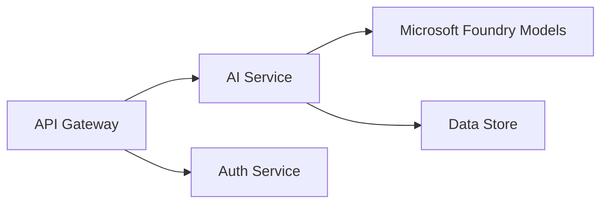
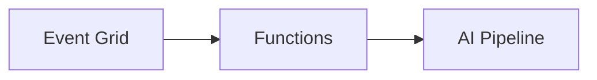

# Kapitel 8: Produktions- & Enterprise-Mønstre

**📚 Kursus**: [AZD For Begyndere](../../README.md) | **⏱️ Varighed**: 2-3 timer | **⭐ Kompleksitet**: Avanceret

---

## Oversigt

Dette kapitel dækker enterprise-klar udrulningsmønstre, sikkerhedshærdning, overvågning og omkostningsoptimering for produktions-AI arbejdsbelastninger.

Dette er en arkitektonisk reference, ikke en komplet produktionstemplate til udrulning. Eksempler udelader integrationsdetaljer, som skal leveres og testes i din egen applikation; læsning af tjeklisten certificerer ikke produktionsklarhed.

> **Foundry GA-opdatering (2026-11-09):** Brug `azd >= 1.37.0` og den generelt tilgængelige `microsoft.foundry` 1.0-pakke til Foundry-arbejdsgangen; evalueringer installeres separat. Se [release-omfang og migration](production-ai-practices.md#recent-release-changes-and-fixes) og det [autentificerede pipeline-eksempel](production-ai-practices.md#cicd-pipeline-configuration). Dette er en dokumentationsgennemgang, ikke en live-udrulningsvalidering eller bred GA-status for valgfrie forhåndsvisningsfunktioner.

## Læringsmål

Ved at gennemføre dette kapitel vil du:
- Udrulle multi-region robuste applikationer
- Implementere enterprise sikkerhedsmønstre
- Konfigurere omfattende overvågning
- Optimere omkostninger i stor skala
- Opsætte CI/CD pipelines med AZD

---

## 📚 Lektioner

| # | Lektion | Beskrivelse | Tid |
|---|--------|-------------|------|
| 1 | [Produktions-AI praksis](production-ai-practices.md) | Enterprise udrulningsmønstre | 90 min |

---

## 🚀 Produktions Tjekliste

- [ ] Multi-region udrulning for robusthed
- [ ] Administreret identitet til autentificering (ingen nøgler)
- [ ] Application Insights til overvågning
- [ ] Omkostningsbudgetter og alarmer konfigureret
- [ ] Sikkerhedsscanning aktiveret
- [ ] CI/CD pipeline integration
- [ ] Katastrofeberedskabsplan

---

## 🏗️ Arkitektur Mønstre

### Mønster 1: Microservices AI



### Mønster 2: Hændelsesdrevet AI



---

## 🔐 Bedste Sikkerhedspraksis

```bicep
// Illustrative properties from different resources, NOT a standalone Bicep file.
// Attach identity to the application host:
identity: {
  type: 'SystemAssigned'
}

// AI account properties (also require private endpoints, DNS and app connectivity):
properties: {
  publicNetworkAccess: 'Disabled'
  networkAcls: {
    defaultAction: 'Deny'
  }
}
```

---

## 💰 Omkostningsoptimering

| Strategi | Hovedbegrænsning |
|----------|---------|
| Skaler til nul (Container Apps) | Kræver en passende trigger; andre tjenester medfører stadig omkostninger |
| Brug forbrugsniveauer til udvikling | Sammenlign udvalgte tjenestepriser og arbejdsbyrde |
| Planlagt skalering | Skaler via understøttet infrastruktur/automation |
| Reservationer/provisioneret kapacitet | Kun når understøttet; forpligtelser kan øge inaktive omkostninger |

Brug det [komplette budgetressourcestyringsmønster](production-ai-practices.md#2-cost-monitoring-and-budgets) med en gyldig startdato, faktureringsomfang, modtagere og rettigheder. Et budget sender alarmer; det begrænser ikke forbruget. Besparelser afhænger af målte udnyttelse og er ikke garanterede procentdele.

---

## 📊 Overvågningsopsætning

```bash
# Open the Application Insights logs view (requires configured monitoring)
azd monitor --logs

# Check Application Insights
azd monitor --overview

# View metrics
az monitor metrics list --resource <resource-id>
```

---

## 🔗 Navigation

| Retning | Kapitel |
|-----------|---------|
| **Forrige** | [Kapitel 7: Fejlfinding](../chapter-07-troubleshooting/README.md) |
| **Kursus fuldført** | [Kursus Startside](../../README.md) |

---

## 📖 Relaterede Ressourcer

- [AI Agents Guide](../chapter-02-ai-development/agents.md)
- [Application Insights](../chapter-06-pre-deployment/application-insights.md)
- [Multi-Agent Solutions](../chapter-05-multi-agent/README.md)
- [Microservices Example](../../examples/microservices/README.md)

---

<!-- CO-OP TRANSLATOR DISCLAIMER START -->
**Ansvarsfraskrivelse**:
Dette dokument er blevet oversat ved hjælp af AI-oversættelsestjenesten [Co-op Translator](https://github.com/Azure/co-op-translator). Selvom vi bestræber os på nøjagtighed, skal du være opmærksom på, at automatiserede oversættelser kan indeholde fejl eller unøjagtigheder. Det originale dokument på dets oprindelige sprog bør betragtes som den autoritative kilde. For kritisk information anbefales professionel menneskelig oversættelse. Vi påtager os intet ansvar for misforståelser eller fejltolkninger, der opstår som følge af brugen af denne oversættelse.
<!-- CO-OP TRANSLATOR DISCLAIMER END -->