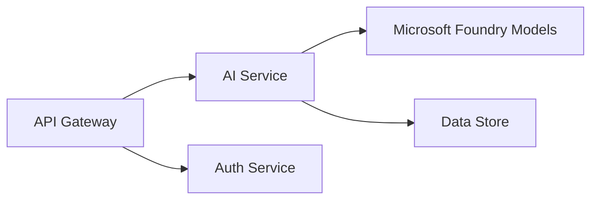
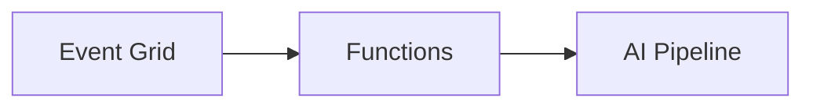

# Kapitel 8: Produktions- og virksomheds-mønstre

**📚 Kursus**: [AZD For Begyndere](../../README.md) | **⏱️ Varighed**: 2-3 timer | **⭐ Kompleksitet**: Avanceret

---

## Oversigt

Dette kapitel dækker virksomheds-klare udrulningsmønstre, sikkerhedshærdning, overvågning og omkostningsoptimering for AI arbejdsbelastninger i produktion.

Dette er en arkitektonisk reference, ikke en komplet udrulbar produktion skabelon. Eksempler udelader integrationsdetaljer, som skal leveres og testes i din egen applikation; gennemlæsning af tjeklisten certificerer ikke produktionsegnede løsninger.

> **Udgivelsesgennemgang (2026-11-04):** AI CLI vejledning blev kontrolleret mod `azd 1.37.2`, agenter `1.0.0-beta.23`, og evalueringer `1.0.0-beta.2` dokumentation/kilde. Se [udgivelsesændringer og rettelser](production-ai-practices.md#recent-release-changes-and-fixes) for kompatibilitetskrav og migrationsdetaljer; dette er ikke en validering af live udrulning.

## Læringsmål

Ved at gennemføre dette kapitel vil du:
- Udrulle multi-region robuste applikationer
- Implementere virksomhedssikkerheds-mønstre
- Konfigurere omfattende overvågning
- Optimere omkostninger i stor skala
- Opsætte CI/CD pipelines med AZD

---

## 📚 Lektioner

| # | Lektion | Beskrivelse | Tid |
|---|--------|-------------|------|
| 1 | [Produktions AI Praksis](production-ai-practices.md) | Virksomheds-udrulningsmønstre | 90 min |

---

## 🚀 Produktions-tjekliste

- [ ] Multi-region udrulning for robusthed
- [ ] Styret identitet til autentificering (ingen nøgler)
- [ ] Application Insights til overvågning
- [ ] Omkostningsbudgetter og alarmer konfigureret
- [ ] Sikkerhedsscanning aktiveret
- [ ] CI/CD pipeline integration
- [ ] Katastrofeberedskabsplan

---

## 🏗️ Arkitektur-mønstre

### Mønster 1: Microservices AI



### Mønster 2: Begivenhedsdrevet AI



---

## 🔐 Sikkerhedsbedste praksis

```bicep
// Illustrative properties from different resources, NOT a standalone Bicep file.
// Attach identity to the application host:
identity: {
  type: 'SystemAssigned'
}

// AI account properties (also require private endpoints, DNS and app connectivity):
properties: {
  publicNetworkAccess: 'Disabled'
  networkAcls: {
    defaultAction: 'Deny'
  }
}
```

---

## 💰 Omkostningsoptimering

| Strategi | Hovedbegrænsning |
|----------|---------|
| Skaler til nul (Container Apps) | Kræver en passende udløser; andre tjenester pådrager stadig omkostninger |
| Brug forbrugsniveauer til udvikling | Sammenlign valgte tjenestepriser og arbejdsbelastning |
| Planlagt skalering | Skaler via understøttet infrastruktur/automatisering |
| Reservationer/provisioneret kapacitet | Kun når understøttet; forpligtelser kan øge inaktive omkostninger |

Brug [det komplette budget-ressource mønster](production-ai-practices.md#2-cost-monitoring-and-budgets) med en gyldig startdato, faktureringsomfang, modtagere og tilladelser. Et budget sender alarmer; det begrænser ikke forbruget. Besparelser afhænger af målt udnyttelse og er ikke garanterede procenter.

---

## 📊 Overvågningsopsætning

```bash
# Open the Application Insights logs view (requires configured monitoring)
azd monitor --logs

# Check Application Insights
azd monitor --overview

# View metrics
az monitor metrics list --resource <resource-id>
```

---

## 🔗 Navigation

| Retning | Kapitel |
|-----------|---------|
| **Forrige** | [Kapitel 7: Fejlfinding](../chapter-07-troubleshooting/README.md) |
| **Kursus færdig** | [Kursusforside](../../README.md) |

---

## 📖 Relaterede ressourcer

- [AI Agenter Guide](../chapter-02-ai-development/agents.md)
- [Application Insights](../chapter-06-pre-deployment/application-insights.md)
- [Multi-Agent Løsninger](../chapter-05-multi-agent/README.md)
- [Microservices Eksempel](../../examples/microservices/README.md)

---

<!-- CO-OP TRANSLATOR DISCLAIMER START -->
**Ansvarsfraskrivelse**:
Dette dokument er blevet oversat ved hjælp af AI-oversættelsestjenesten [Co-op Translator](https://github.com/Azure/co-op-translator). Selvom vi bestræber os på nøjagtighed, skal du være opmærksom på, at automatiserede oversættelser kan indeholde fejl eller unøjagtigheder. Det originale dokument på dets oprindelige sprog bør betragtes som den autoritative kilde. For kritisk information anbefales professionel menneskelig oversættelse. Vi påtager os intet ansvar for misforståelser eller fejltolkninger, der opstår som følge af brugen af denne oversættelse.
<!-- CO-OP TRANSLATOR DISCLAIMER END -->