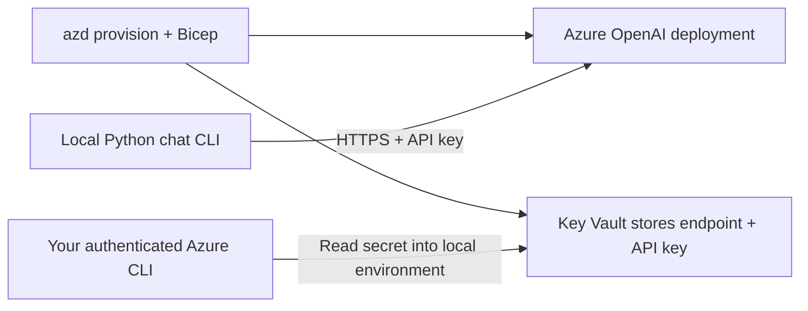

# Azure OpenAI Chat — Lokal CLI og AZD Infrastruktur

**Niveau:** Mellem · **Tid:** 35–60 minutter inklusive opsætning

Denne prøveprovision opretter en **Azure OpenAI-ressource og Key Vault**, og kører derefter en
interaktiv Python chat-CLI **på din maskine**. Den hoster ikke en webapplikation
eller Container App. Standardmodellen er `gpt-4.1`, version `2025-04-14`, med
`GlobalStandard` deploymentskapacitet 20. Tjek aktuel tilgængelighed og kvote i
din valgte region før provisionering; modellens livscyklusdatoer kan ændres.

## Læringsmål

- Provisionér modelinfrastruktur med Bicep og azd.
- Hent en API-nøgle fra Key Vault uden at placere den i udrulningsoutput.
- Send Chat Completions-forespørgsler og vedligehold samtalehistorik.
- Fortolk tokenoptællinger og begrænsningerne ved omkostningsestimater.



Der er ingen managed-identity runtime-integration, multi-region failover, brugerdefineret
rate limiter, streaming-tilstand eller hostet compute i dette eksempel. OpenAI SDK
udfører op til to forsøg ved fejl, der kan forsøges igen; CLI rapporterer tilbageværende fejl.

## Forudsætninger

- En aktuel stabil [azd](https://learn.microsoft.com/azure/developer/azure-developer-cli/install-azd)
  (udgivet version på gennemgangstidspunktet: 1.37.2).
- [Azure CLI](https://learn.microsoft.com/cli/azure/install-azure-cli).
- Python **3.10+** (3.11 anbefalet) og et virtuelt miljø.
- Et Azure-abonnement med tilladelse til at oprette Cognitive Services og Key Vault
  ressourcer, udrulle modeller og læse vaultens hemmeligheder.
- Regional tilgængelighed og `GlobalStandard` kvote for `gpt-4.1`. Adgangskrav
  afhænger af abonnement og funktion; der er ingen garanteret godkendelsestid.

```bash
azd version
az version
python --version
azd auth login
az login
```

Dette er separate autentificeringssessioner. Vælg det samme abonnement i begge
værktøjer før du kører kommandoerne nedenfor.

## Hurtig start (Bash)

Kør fra repository-roden:

```bash
cd examples/azure-openai-chat
azd env new myopenai
azd provision
```

Vælg en understøttet region. Provisionering opretter en resource group, OpenAI-konto,
modeludrulning, Key Vault og `openai-endpoint`/`openai-api-key` hemmelighederne.
Der er **ingen tjenester at udrulle** i `azure.yaml`.

Indlæs ikke-hemmelige output og hent hemmeligheden ind i dit aktuelle shell:

```bash
export AZURE_OPENAI_ENDPOINT="$(azd env get-value AZURE_OPENAI_ENDPOINT)"
export AZURE_OPENAI_MODEL="$(azd env get-value AZURE_OPENAI_MODEL)"
KV_NAME="$(azd env get-value AZURE_KEY_VAULT_NAME)"
export AZURE_OPENAI_API_KEY="$(az keyvault secret show \
  --vault-name "$KV_NAME" --name openai-api-key --query value --output tsv)"

python -m venv .venv
source .venv/bin/activate
python -m pip install -r src/requirements.txt
python src/chat.py
```

I PowerShell aktiver med `.\.venv\Scripts\Activate.ps1` og tildel miljø-
variabler med `$env:AZURE_OPENAI_ENDPOINT = azd env get-value AZURE_OPENAI_ENDPOINT`
(og tilsvarende for modellen). Hent API-nøglen med
`$env:AZURE_OPENAI_API_KEY = az keyvault secret show --vault-name $KV_NAME --name openai-api-key --query value -o tsv`.
Sæt `$KV_NAME = azd env get-value AZURE_KEY_VAULT_NAME` først.

Udskriv ikke, commit ikke, og indsæt ikke API-nøglen i fejllogs. CLI læser proces-
miljøvariabler; den henter **ikke** Key Vault-hemmeligheder eller indlæser `.env` filer.
`config.py` validerer endpoint, token-grænse og temperatur ved opstart.

Forventet output (indhold og forbrug varierer):

```text
Azure OpenAI Chat Application
Model: gpt-4.1
...
You: Say hello in one sentence.
Assistant: Hello! How can I help you today?
[Tokens: ... | Cost: $...]
```

Kommandoer: `stats` viser totaler, `clear` rydder samtalehistorik, og
`quit`/`exit` afslutter sessionen. Der er ingen `--stream`, `--show-tokens`, `tokens`,
eller `cost` kommandoer.

## Verificer udrulningen

Efter indlæsning af shell-variablerne ovenfor:

```bash
curl --fail-with-body \
  "${AZURE_OPENAI_ENDPOINT%/}/openai/deployments/${AZURE_OPENAI_MODEL}/chat/completions?api-version=2024-10-21" \
  -H "Content-Type: application/json" \
  -H "api-key: $AZURE_OPENAI_API_KEY" \
  -d '{"messages":[{"role":"user","content":"Say hello!"}],"max_tokens":50}'

az keyvault secret list --vault-name "$KV_NAME" --query "[].name" -o table
```

Succes: API'en returnerer HTTP 200 med `choices[0].message.content` og `usage`;
vaulten viser `openai-api-key` og `openai-endpoint`. En succesfuld ARM-udrulning
alene verificerer ikke inferens.

## Filer og konfiguration

```text
azure.yaml                         # Infrastructure-only AZD project
infra/main.bicep                   # Subscription deployment
infra/main.parameters.json         # Environment, location, principal ID
infra/resources/openai.bicep       # Account + model
infra/resources/keyvault.bicep     # Vault + deploying user's secret access policy
infra/resources/secrets.bicep      # Writes secrets, no key output
src/chat.py                        # Interactive CLI
src/config.py                      # Environment validation
src/requirements.txt               # Python packages
```

For at ændre den provisionerede model/version/kapacitet, rediger standarderne i
`infra/main.bicep` og kør `azd provision`. At sætte `AZURE_OPENAI_MODEL` i dit
shell vælger kun et **eksisterende udrulningsnavn**; det udruller ikke en anden model.

| Runtime variabel | Standard / kilde |
|---|---|
| `AZURE_OPENAI_ENDPOINT` | Påkrævet; azd ikke-hemmeligt output |
| `AZURE_OPENAI_API_KEY` | Påkrævet; hent fra Key Vault |
| `AZURE_OPENAI_MODEL` | `gpt-4.1`; Azure udrulningsnavn |
| `AZURE_OPENAI_MAX_TOKENS` | 800 (valideringsinterval 1–4096) |
| `AZURE_OPENAI_TEMPERATURE` | 0.7 (interval 0–2) |
| `AZURE_OPENAI_INPUT_PRICE_PER_1K` | 0.002 USD; illustrativ u-cachet inputrate |
| `AZURE_OPENAI_OUTPUT_PRICE_PER_1K` | 0.008 USD; illustrativ outputrate |

## Omkostninger og sikkerhedsbegrænsninger

Omkostningsvisningen er et **estimat**, ikke Azure-fakturering. Den ganger API-token-
forbrug med de konfigurerede rater og tager ikke højde for cached input-rabatter,
regionale/SKU-forskelle, skat, prisændringer eller mislykkede/omprøvede kald.
Overskriv **begge rater**, når du bruger en anden model eller SKU, og verificer aktuelt
[Azure OpenAI prissætning](https://azure.microsoft.com/pricing/details/cognitive-services/openai-service/).

Til illustration koster 100 forespørgsler med 500 uncached input- og 200 output-tokens hver
ved standardraterne `100 × (500/1000 × .002 + 200/1000 × .008) = $0.26`.
Key Vault-operationer/opbevaring medfører separate gebyrer. Der er intet fast gebyr på $50/måned
for denne lokale CLI og ingen hostet compute i templaten.

Vaulten bruger en adgangspolitik for den deployerende principal; det er ikke et RBAC- eller
managed-identity applikationseksempel. Offentlige endpoints og API-nøgleautentifikation
bruges til undervisning. Begræns tilladelser og tilføj passende identitets-/netværks-
kontroller før tilpasning til produktion.

## Praktiske øvelser

### 1. Verificer kontekst og nulstil den

**Start:** kørende CLI. **Mål:** observer historik.
Sig “Remember the word cedar,” og spørg derefter “What word did I ask you to remember?”
Kør `stats`; to succesfulde ture bør tælle som to udvekslede beskeder.
Kør `clear` og `stats`; udvekslede beskeder bør være nul (token-totaler forbliver).
Modellens præcise formulering er ikke deterministisk.

### 2. Ændr responsgrænsen

**Start:** afslut CLI, men behold samme shell.
Kør `export AZURE_OPENAI_MAX_TOKENS=100`, genstart `python src/chat.py`, og bed om
en kort forklaring af azd. Sørg for, at banneret viser 100.
Gendan med `unset AZURE_OPENAI_MAX_TOKENS`. En mindre responsgrænse reducerer ikke
allerede afsendte historik-tokens.

### Almindelige problemer

- **Manglende miljøvariabler:** provisioning eksporterer ikke shell-værdier;
  gentag eksporttrinene. Et nyt terminalvindue har brug for dem igen.
- **403 ved læsning af Key Vault:** verificer Azure CLI abonnement/login og principal
  i vault-adgangspolitikken. Politiskift kan tage tid at slå igennem.
- **404 inferens:** tjek udrulningsnavn, endpoint og udrulningsstatus.
- **429 inferens:** vent på, at rater nulstilles; verificer regional modelkvote.
  CLI fjerner mislykkede ture fra historikken så genforsøg ikke dublerer dem.
- **Konteksts længde:** eksemplet beskærer ikke lange samtaler; brug `clear`.
- **Model utilgængelig/trukket tilbage:** konsulter aktuel modeltilgængelighed og opdater
  model/version/SKU samlet; API-version og modelversion er forskellige indstillinger.

## Oprydning og næste trin

```bash
azd down
unset AZURE_OPENAI_API_KEY
```

Key Vault har syvdages soft-delete retention; rensning kræver særskilte tilladelser.
Der findes ikke et fastlagt testsuite; kør ikke en ikke-eksisterende `pytest tests/`-kommando.
Tilføj mocked API-tests før udvidelse af koden.

[Container-eksempler](../../../../examples/container-app) · [Retail arkitektur blueprint](../retail-scenario.md) ·
[Kursus-hjem](../../README.md) · [Rapporter et problem](https://github.com/microsoft/AZD-for-beginners/issues)

---

<!-- CO-OP TRANSLATOR DISCLAIMER START -->
**Ansvarsfraskrivelse**:
Dette dokument er blevet oversat ved hjælp af AI-oversættelsestjenesten [Co-op Translator](https://github.com/Azure/co-op-translator). Selvom vi bestræber os på nøjagtighed, skal du være opmærksom på, at automatiserede oversættelser kan indeholde fejl eller unøjagtigheder. Det originale dokument på dets oprindelige sprog bør betragtes som den autoritative kilde. For kritisk information anbefales professionel menneskelig oversættelse. Vi påtager os intet ansvar for misforståelser eller fejltolkninger, der opstår som følge af brugen af denne oversættelse.
<!-- CO-OP TRANSLATOR DISCLAIMER END -->