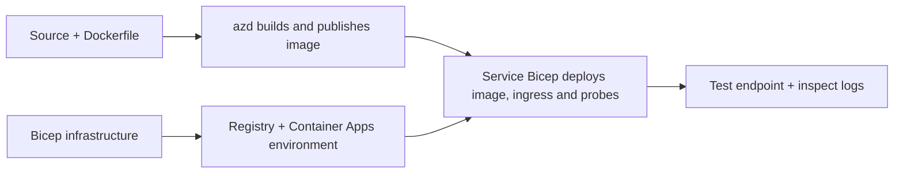

# Container App-implementeringseksempler med AZD

Denne mappe indeholder to læringseksempler med kildekode, Dockerfiles,
Bicep-infrastruktur og `azure.yaml`. Ingen af dem er produktionssikre.

## Vælg et eksempel

| Eksempel | Hvad der er implementeret | Forudsætninger |
|---|---|---|
| [Simple Flask API](../../../../examples/container-app/simple-flask-api) | Enkel Python CRUD API, hukommelsesbaserede elementer, helbredstjek, HTTP-skalering | Grundlæggende CLI- og HTTP-kendskab |
| [Two-service microservices](../../../../examples/container-app/microservices) | Node.js gateway, intern read-only Python produktservice, telemetri og skalering | Gennemfør først enkeltservice-eksemplet |

Afslut på 30–60 minutter inklusive opsætning og verifikation. Azure-provisioneringstider varierer.

## Forudsætninger

- [Azure Developer CLI](https://learn.microsoft.com/azure/developer/azure-developer-cli/install-azd)
- [Azure CLI](https://learn.microsoft.com/cli/azure/install-azure-cli) til verifikationskommandoer
- Docker med sin daemon kørende for at bygge disse containerbilleder
- Et Azure-abonnement med rettigheder til at oprette ressourcer og tilstrækkelig regional kvote
- Bash til shelleksemplerne eller tilsvarende PowerShell-kommandoer

```bash
azd version
az version
docker info
azd auth login
az login
```

De to værktøjer har separate login-sessioner. Brug en aktuel stabil azd; den nuværende
udgivelse på gennemgangstidspunktet er 1.37.2. Ældre minimumsversioner er ikke en
kompatibilitetsgaranti.

## Kom godt i gang

Fra lagerets rodmappe:

```bash
cd examples/container-app/simple-flask-api
azd env new flask-demo
azd up
API_URL=$(azd env get-value API_ENDPOINT)
curl --fail-with-body "${API_URL}/health"
```

Forventet: HTTP 200 med `"status": "healthy"`. Følg eksempel-README’en for at oprette,
læse, opdatere og slette et element samt inspicere logs.



Den indledende provisionering bruger et offentligt hello-world-billede på port 80. Service-specifikke
Bicep-parameterfiler lader `azd deploy` erstatte det med det byggede applikationsbillede
og den korrekte app-port/helbredstjek (8000 for Flask/produkt, 8080 for gateway).
Behold disse filer med deres `azure.yaml` `module` indstillinger.

## Konfiguration: hvad ændrer hvad

`azure.yaml` vælger kildemapper, sprog, værter og implementeringsmoduler.
Container-CPU/hukommelse, indgående trafik, helbredstjek, replikaantal og skaleringsregler defineres
i **Bicep**, ikke i tilfældige `resources`, `scale` eller `regions` serviceegenskaber.

`azd env set SOME_VALUE ...` gemmer en værdi lokalt. Den ændrer kun en udrullet
ressource, når en parameter, miljømapping eller hook eksplicit bruger den
værdi. Disse eksempler bruger ikke `MAX_REPLICAS`, `SCALE_TO_ZERO_TIMEOUT`,
`CONTAINER_APP_REPLICA_TYPE` eller brugerdefinerede kanarieindstillinger fra azd-miljøværdier.
Rediger den relevante Bicep og kør `azd up` for at genprovisionere og implementere.

Læg ikke applikationskilde under `infra/`. `project` skal pege på den kildemappe,
der indeholder Dockerfile og afhængighedsmanifest.

## Overvågning og omkostninger

- `azd monitor --logs` åbner et portalvisning; det er ikke en terminal logstrøm.
  Brug `az containerapp logs show --follow` med det faktiske ressourcenavn.
- Den simple API skriver stdout-logs, der indsamles gennem Container Apps/Log Analytics.
  Dens provisionerede Application Insights-ressource er ikke automatisk instrumenteret.
- Microservices-gatewayen bruger Node.js Application Insights SDK; Python-
  tjenesten eksporterer applikationslogsporinger. Fuld Python-forespørgsels-/afhængighedssporing
  er ikke konfigureret.
- Skaler-til-nul kan reducere beregningsomkostninger, men registry og log-indsamling/-lagring
  kan stadig koste penge. Microservices standardindstillinger holder replikaer kørende.
  Estimer din region og brug i
  [Azure pricing calculator](https://azure.microsoft.com/pricing/calculator/).

## Avancerede mønstre — ikke inkluderede implementeringer

Disse er designretninger, ikke yderligere lokale projekter eller copy-and-run-snippets:

- **Vedvarende data og autentificering:** erstat hukommelseslagring og tilføj
  Microsoft Entra ID-autentificering/autorisation inden produktion.
- **Blue-green/canary:** brug Container Apps multiple-revision modus, revisions-
  labels, trafikvægte, helbredsverifikation og rollback-procedurer.
  Der er ingen `deploymentStrategy: canary` azd-konfiguration i disse eksempler.
  Se [revision management](https://learn.microsoft.com/azure/container-apps/revisions).
- **Multi-region:** opret separate miljøer og apps i Bicep og design
  global routing og datakonsistens. En tjenestes `regions` liste er ikke en azd-
  udrulningsmekanisme.
- **Queue workers:** tilføj worker-kilde, afhængigheder, kø-ressourcer, en styret
  identitet med data-plane-roller og en autentificeret skalaregler. Kopier ikke
  en tom `src/worker` sti og forvent et kørbart projekt.
- **Dapr:** provisioner komponenter, konfigurer sidecar, installer passende SDK,
  og implementer tilstands-/pub-sub-fejlhåndtering.
- **Secrets:** brug styret identitet og rolle-tildelinger, hvor muligt. Bare
  at oprette en Key Vault giver ikke applikationer adgang eller indlæser hemmeligheder.

## Oprydning

Fra eksempel-mappen:

```bash
azd down
```

Gennemgå sletningsbeskederne og bekræft, at den dedikerede ressourcegruppe fjernes.
Brug ikke disse eksempler som et produktionsgrundlag uden yderligere design og tests.

[Eksempelliste](../README.md) · [Kursusforside](../../README.md) ·
[Container Apps dokumentation](https://learn.microsoft.com/azure/container-apps/) ·
[Rapporter et problem](https://github.com/microsoft/AZD-for-beginners/issues)

---

<!-- CO-OP TRANSLATOR DISCLAIMER START -->
**Ansvarsfraskrivelse**:
Dette dokument er blevet oversat ved hjælp af AI-oversættelsestjenesten [Co-op Translator](https://github.com/Azure/co-op-translator). Selvom vi bestræber os på nøjagtighed, skal du være opmærksom på, at automatiserede oversættelser kan indeholde fejl eller unøjagtigheder. Det originale dokument på dets oprindelige sprog bør betragtes som den autoritative kilde. For kritisk information anbefales professionel menneskelig oversættelse. Vi påtager os intet ansvar for misforståelser eller fejltolkninger, der opstår som følge af brugen af denne oversættelse.
<!-- CO-OP TRANSLATOR DISCLAIMER END -->