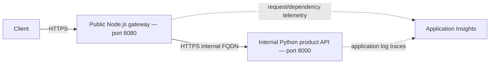

# Mikroservices med to tjenester — Azure Container Apps

**Niveau:** Mellem · **Tid:** 45–60 minutter inklusiv opsætning

Denne læringsprøve implementerer en **Node.js API Gateway** og en **read-only Python
Product Service**. Kildekode, Dockerfiles, Bicep og azd-konfiguration er inkluderet.
Det er ikke et produktionstestet system.

## Det vil du lære

- Udrul to tjenester uafhængigt.
- Brug en intern backend FQDN over HTTPS.
- Bekræft svar ved succes, ikke fundet og utilgængelig tjeneste.
- Forstå telemetri og uafhængige skaleringsgrænser.



Produktkataloget indeholder fem faste produkter i hukommelsen. Der er **ingen POST,
PUT eller DELETE handlers**, database, Service Bus, ordre-/bruger-/notifikationstjeneste,
C# eller Go-kode. Disse er idéer til fremtidig udvikling, ikke inkluderede funktioner.
Gateway’en autentificerer ikke brugere; intern ingress er ikke en erstatning
for applikationsautorisation.

## Forudsætninger

Fuldfør først [single Flask API](../../../../../examples/container-app/simple-flask-api).
Installer en aktuel stabil azd (udgivet version på gennemgangstidspunktet: 1.37.2), Azure CLI
og Docker med daemon kørende. Du skal have en Azure-abonnement, tilladelse til at oprette ressourcer
og Container Apps regional kvote.

```bash
azd version
az version
docker info
azd auth login
az login
```

Brug det samme abonnement i begge CLI-værktøjer. Kommandoerne nedenfor bruger Bash.

## Udrul og bekræft

Fra rodmappen i repository:

```bash
cd examples/container-app/microservices
azd env new microservices-demo
azd up
GATEWAY_URL=$(azd env get-value API_GATEWAY_URL)
RG_NAME=$(azd env get-value AZURE_RESOURCE_GROUP)
GATEWAY_NAME=$(azd env get-value API_GATEWAY_NAME)
PRODUCT_NAME=$(azd env get-value PRODUCT_SERVICE_NAME)

curl --fail-with-body "${GATEWAY_URL}/health"
curl --fail-with-body "${GATEWAY_URL}/api/products"
curl --fail-with-body "${GATEWAY_URL}/api/products/1"
curl -i "${GATEWAY_URL}/api/products/999"
```

**Succes:** health 200; liste 200 med **fem** produkter; produkt 1 er en Laptop
prissat til 999,99 med lager 50; ukendt produkt returnerer 404.
Beskrivelser er inkluderet i svarene; tidsstempler varierer.

Den indledende provisionering bruger offentlige hello-world-billeder på port 80, så den ikke forsøger
at hente ikke-eksisterende billeder fra et tomt register. Service-specifikke Bicep-moduler
og parameterfiler erstatter dem med byggede billeder og app-porte/prober under
`azd deploy`. Hovedparametrene bevarer de publicerede billednavne til senere provisionering.

## Tjenester og netværk

| Tjeneste | Eksponerede endpoints | Standardressourcer |
|---|---|---|
| Gateway | GET `/`, `/health`, `/api/products`, `/api/products/:id` | 1 vCPU, 2 GiB, 2–20 replikaer |
| Produkt | GET `/`, `/health`, `/products`, `/products/<id>` | 0.5 vCPU, 1 GiB, 1–10 replikaer |

Produkt-ingress har `external: false` og `allowInsecure: false`. Bicep injicerer
`PRODUCT_SERVICE_URL=https://<actual-internal-fqdn>` ind i gateway’en. HTTP ville
omdirigere; HTTPS matcher den konfigurerede ingress. Et kort DNS-navn skal matche
**det faktiske Container App-navn**, ikke den logiske tjenestenøgle `product-service`.
Prøv ikke at kalde den interne URL direkte fra din bærbare.

Gateway’en har en timeout på fem sekunder for produktopkald. Manglende produkt-ID’er
propagere som 404; overførselsfejl/andre backend-fejl returnerer 503. Gateway
`/health` tjekker kun gateway’en, ikke backend-tilgængelighed.

## Filer og konfiguration

```text
azure.yaml
infra/main.bicep
infra/main.parameters.json
infra/abbreviations.json
infra/core/container-apps-environment.bicep
infra/core/monitor.bicep
infra/app/api-gateway.bicep
infra/app/api-gateway.parameters.json
infra/app/product-service.bicep
infra/app/product-service.parameters.json
src/api-gateway/{app.js,package.json,Dockerfile}
src/product-service/{main.py,requirements.txt,Dockerfile}
```

Skalering, CPU/hukommelse, porte og prober sættes i `infra/app/*.bicep`. Ændr disse
filer og kør `azd up` for at anvende infrastrukturen og udrulle på ny. Der er ingen
`GATEWAY_MAX_REPLICAS` miljøvariabel-parameter i denne prøve.

For kodeændringer alene:

```bash
azd deploy product-service
azd deploy api-gateway
```

Node-billedet bruger Node 22; Python-billedet bruger Python 3.11. Begge binder til
`0.0.0.0`. Ingress/prober bruger henholdsvis port 8080 (gateway) og 8000 (produkt).

## Lokal udvikling med Docker

Kør fra denne eksempelmappe. Brug et brugerdefineret netværk, **ikke `localhost`
for en container til at nå en anden**:

```bash
docker network create azd-microservices-demo
docker build -t local-product ./src/product-service
docker build -t local-gateway ./src/api-gateway
docker run -d --name azd-product --network azd-microservices-demo local-product
docker run -d --name azd-gateway --network azd-microservices-demo \
  -p 8080:8080 -e PRODUCT_SERVICE_URL=http://azd-product:8000 local-gateway
curl --fail-with-body http://localhost:8080/api/products
```

Forventet: fem produkter. HTTP bruges kun til dette lokale Docker-netværk.

```bash
docker stop azd-product azd-gateway
docker rm azd-product azd-gateway
docker network rm azd-microservices-demo
```

## Overvågning

```bash
az containerapp logs show --name "$GATEWAY_NAME" --resource-group "$RG_NAME" --follow
# In a separate terminal:
az containerapp logs show --name "$PRODUCT_NAME" --resource-group "$RG_NAME" --tail 100
```

`azd monitor --logs` åbner en portalvisning; den streamer ikke terminal-logfiler.
Node SDK indsamler gateway-forespørgsler/afhængigheder. Pythons `AzureLogHandler`
eksporterer **logspor**, ikke automatiske Flask-forespørgsler, SQL-afhængigheder eller fulde
distribuerede spor. OpenCensus er en ældre SDK; foretræk Azure Monitor OpenTelemetry
ved udvidelse af denne prøve.

I Application Insights Logs, generer forespørgsler og inspicer:

```kusto
requests
| where timestamp > ago(1h)
| where name contains "products"
| summarize RequestCount=count(), AvgDuration=avg(duration) by bin(timestamp, 5m)
```

For Python-applikationsbeskeder:

```kusto
traces
| where timestamp > ago(1h)
| where message contains "products"
| project timestamp, message, severityLevel
```

Tillad forsinkelse i indtag og sampling; forvent ikke et præcist antal forespørgsler eller en
garanteret latenstid. Ingen brugerdefinerede alarmer eller dashboards er konfigureret.

## Praktiske øvelser

### Øvelse 1: Ændr kataloget

**Startpunkt:** `src/product-service/main.py`.
**Mål:** verificer uafhængig tjenesteudrulning.
Skift Laptop’s lager fra 50 til 49 i den faste `products`-liste, kør
`azd deploy product-service`, og foretag derefter en forespørgsel `${GATEWAY_URL}/api/products/1`.

**Succes kriterier / løsning:** HTTP 200 med `"stock":49`. Gendan 50 og udrul igen.
**Almindeligt problem:** redigerer gateway’en i stedet for tjenesten, der ejer kataloget.
Dette ændrer kildedata, ikke en vedvarende lagerdatabase.

### Øvelse 2: Verificer replika-konfiguration

**Startpunkt:** `infra/app/product-service.bicep`.
**Mål:** observer en infrastrukturændring uden at gætte på autoskalering.
Skift `minReplicas: 1` til `minReplicas: 2`, kør `azd up`, og derefter:

```bash
az containerapp show --name "$PRODUCT_NAME" --resource-group "$RG_NAME" \
  --query properties.template.scale -o json
```

**Succes kriterier:** konfigureret minimum er 2 og maksimum forbliver 10.
Gendan minimum 1 og kør `azd up`.
**Almindeligt problem:** `azd deploy` alene anvender ikke ændringer til urelateret delt
infrastruktur. Indstil ikke `maxReplicas` til nul som en fejlsimuleringsmetode.
Dette verificerer konfigurationsændringer, ikke en belastningstest eller et garanteret øjeblikkeligt replikaantal.

### Øvelse 3: Test håndtering af utilgængelig tjeneste lokalt

**Startpunkt:** begge lokale Docker-containere ovenfor kører.
**Mål:** skelne backend-fejl fra et manglende produkt.
Stop kun produktcontaineren:

```bash
docker stop azd-product
curl -i http://localhost:8080/api/products
docker start azd-product
curl --fail-with-body http://localhost:8080/api/products
```

**Succes kriterier:** mens stoppet, returnerer gateway 503 med
`"error":"Product service unavailable"`; efter genstart returnerer listen 200.
Prøv igen efter kort opstartsforsinkelse, hvis nødvendigt.
**Almindeligt problem:** at stoppe gateway’en tester en anden fejl (ingen HTTP-svar).

## Omkostninger og mangler til produktion

Standard minimum replikaer holder computeren kørende. Registry og overvågning medfører også
omkostninger. Der er ikke et valideret fast $50/måned totalt: estimer regional CPU/hukommelse,
replika-timer, forespørgsler, registry og logopbevaring i
[Azure prisberegner](https://azure.microsoft.com/pricing/calculator/).
Slet læringsressourcer omgående.

Produktionsarbejde omfatter autentifikation/autorisation, scoped managed identities,
vedvarende data, input-/svarvalidering, understøttet observabilitet-instrumentering,
belastnings-/fejltest, CI/CD, alarmer og genopretningsprocedurer. Tilføjelse af en ordre-
tjeneste, kø eller database er en separat implementeringsopgave, ikke en færdig
øvelse eller allerede tilgængelig funktion her.

## Fejlfinding og oprydning

- **Billede ikke fundet under første provisionering:** bootstrap bør bruge det offentlige billede;
  verificer hovedbilledets parameter-standardværdier og udrulningsmodul-mapping.
- **503 produkter:** tjek produktlogfiler, billedrevision og injiceret intern HTTPS-URL.
- **404 uventet sti:** produkt-API er skrivebeskyttet; verificer ruten, ikke en ikke-eksisterende CRUD-handler.
- **Ingen telemetri:** inspicer runtime forbindelsesstrenge uden at eksponere dem og
  tillad forsinkelse i indtag. Python forespørgsels-tabeller fyldes ikke af dens loghandler.

Fra denne prøve-mappe:

```bash
azd down
```

Gennemgå sletningsanmodninger og verificer, at den dedikerede ressourcegruppe fjernes.

[Forrige: Flask API](../../../../../examples/container-app/simple-flask-api) · [Næste: Database app](../../../../../examples/database-app) ·
[AI-udvikling](../../../docs/chapter-02-ai-development/README.md) ·
[Kursus hjem](../../../README.md) · [Rapporter et problem](https://github.com/microsoft/AZD-for-beginners/issues)

---

<!-- CO-OP TRANSLATOR DISCLAIMER START -->
**Ansvarsfraskrivelse**:
Dette dokument er blevet oversat ved hjælp af AI-oversættelsestjenesten [Co-op Translator](https://github.com/Azure/co-op-translator). Selvom vi bestræber os på nøjagtighed, skal du være opmærksom på, at automatiserede oversættelser kan indeholde fejl eller unøjagtigheder. Det originale dokument på dets oprindelige sprog bør betragtes som den autoritative kilde. For kritisk information anbefales professionel menneskelig oversættelse. Vi påtager os intet ansvar for misforståelser eller fejltolkninger, der opstår som følge af brugen af denne oversættelse.
<!-- CO-OP TRANSLATOR DISCLAIMER END -->