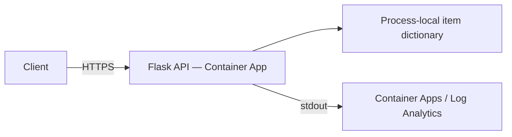

# Enkel Flask API — Azure Container Apps

**Niveau:** Begynder · **Tid:** 30–45 minutter inklusive opsætning

Udrul en Python Flask CRUD API med Azure Developer CLI (azd). Kildekode, Dockerfile,
Bicep og udrulningsparametre er inkluderet. Dette er et **læreeksempel**, ikke
en produktionsklar API.

## Hvad du vil lære

- Byg og publicer en container gennem azd.
- Konfigurer ingress og liveness/readiness probes.
- Verificer CRUD-svar og inspicer applikationslogs.
- Forstå hvorfor data i hukommelsen er uegnet til holdbare applikationer.



**Vigtigt:** elementerne holdes i én proces. Standard er **én Gunicorn worker,
0–1 replikaer**, hvilket bevidst undgår inkonsistente data på tværs af workers/replikaer.
Elementer går tabt ved genstart, revisionsændring eller skalering til nul. Øget antal replikaer
kræver delt vedvarende lager. API'en har ingen autentifikation eller autorisation.

## Forudsætninger

- [Nuværende stabile azd](https://learn.microsoft.com/azure/developer/azure-developer-cli/install-azd)
  (publiseret version ved gennemgangstidspunkt: 1.37.2).
- [Azure CLI](https://learn.microsoft.com/cli/azure/install-azure-cli) til verifikation.
- Docker med kørende daemon; det er påkrævet for standard lokal image build.
- Azure abonnement, rettigheder til ressourceoprettelse og regional kvote for Container Apps.
- Bash til kommandoerne nedenfor (eller tilsvarende PowerShell).
- Python 3.11 til valgfri lokal udvikling.

```bash
azd version
az version
docker info
azd auth login
az login
```

CLI-værktøjerne har separate login-sessioner. Brug samme abonnement i begge.

## Hurtig start

Fra rodmappen af repository:

```bash
cd examples/container-app/simple-flask-api
azd env new flask-demo
azd up
API_URL=$(azd env get-value API_ENDPOINT)
RG_NAME=$(azd env get-value AZURE_RESOURCE_GROUP)
API_NAME=$(azd env get-value API_NAME)
curl --fail-with-body "${API_URL}/health"
```

Forventet: HTTP 200 og JSON med `"status":"healthy"`,
`"service":"simple-flask-api"` og et aktuelt UTC-tidsstempel.
Provisionering og image build tager typisk adskillige minutter; tider kan variere.

Første provisionering bruger et offentligt hello-world image, lyt på port 80.
`azure.yaml` vælger `infra/app/api.bicep` og den tilsvarende parameterfil til
serviceudrulning, som skifter image, ingress og probes til port 8000.
Slet ikke disse udrulningsparametre.

## Verificer CRUD

Kør følgende sekventielt mens samme replika er aktiv:

```bash
# Create: HTTP 201; note the returned id (1 for a fresh process).
curl -i -X POST "${API_URL}/api/items" \
  -H "Content-Type: application/json" \
  -d '{"name":"Test Item","description":"My first item"}'

# Read list: HTTP 200, total 1 in a fresh process.
curl --fail-with-body "${API_URL}/api/items"

# Replace 1 if your create response returned another id.
curl --fail-with-body "${API_URL}/api/items/1"
curl -i -X PUT "${API_URL}/api/items/1" \
  -H "Content-Type: application/json" -d '{"name":"Updated Item"}'
curl -i -X DELETE "${API_URL}/api/items/1"
curl -i "${API_URL}/api/items/1"
```

Succes: POST 201, reads/PUT 200, DELETE 204 uden body, derefter manglende element 404.
Ugyldig/ikke-objekt JSON eller et tomt navn returnerer 400.
Hvis et element forsvinder mellem forespørgsler, tjek for genstart eller skalering til nul;
dette er en tilsigtet begrænsning i hukommelsen, ikke vedvarende lagring.

| Endpoint | Metoder |
|---|---|
| `/` | GET — serviceinformation |
| `/health` | GET — liveness/readiness |
| `/api/items` | GET, POST |
| `/api/items/{id}` | GET, PUT, DELETE |

## Logs og konfiguration

```bash
az containerapp logs show --name "$API_NAME" --resource-group "$RG_NAME" --follow
```

Forventet: Gunicorn opstart, adgangslogs for requests og applikationsbeskeder.
`azd monitor --logs` åbner en portalvisning; den streamer ikke til terminalen.
Application Insights er provisioneret men **ikke instrumenteret af denne Flask-kode**;
brug Container Apps/Log Analytics til stdout-logs.

Rediger `infra/app/api.bicep` for CPU/hukommelse, replika-grænser eller skaléringsregler, og
kør derefter `azd up`. Standard er 0,5 vCPU, 1 GiB, minimum 0 / maksimum 1 replika, og en
HTTP grænseværdi på 50 samtidige forespørgsler. Skalering til nul kan tilføje koldstart-latens.

Vilkårlige `azd env set MAX_REPLICAS`, `API_KEY`, `LOG_LEVEL` eller
`SCALE_TO_ZERO_TIMEOUT` værdier er **ikke koblet til denne skabelon eller app**.
At sætte en værdi gør den ikke automatisk til en runtime miljøvariabel.
Imaget binder eksplicit til port 8000; opdater Dockerfile, Bicep ingress og probes
sammen hvis porten ændres.

## Filer

```text
azure.yaml
infra/main.bicep
infra/main.parameters.json
infra/app/container-apps.bicep       # Environment, registry, monitoring
infra/app/api.bicep                  # App, ingress, probes, scale settings
infra/app/api.parameters.json        # Image and resource values for azd deploy
src/app.py
src/Dockerfile
src/requirements.txt
```

## Lokal udvikling

Fra denne eksempelmappen:

```bash
python -m venv .venv
source .venv/bin/activate  # PowerShell: .\.venv\Scripts\Activate.ps1
python -m pip install -r src/requirements.txt
python src/app.py
```

I et andet terminalvindue, test `http://localhost:8000/health` og CRUD-endpoints.
Eller byg og kør det faktiske image:

```bash
docker build -t flask-api:local ./src
docker run --rm -p 8000:8000 flask-api:local
```

For udelukkende kodeændringer efter først udrulning, kør `azd deploy api`.
For Bicep-ændringer, kør `azd up` for at gen-provisionere og udrulle.

## Praktiske øvelser

### 1. Validér afvisning af input

**Startpunkt:** udrullet API, `API_URL` ovenfor.
**Mål:** verificer API’en afviser ugyldige JSON-formater og manglende navne.

```bash
curl -i -X POST "${API_URL}/api/items" \
  -H "Content-Type: application/json" -d '[]'
curl -i -X POST "${API_URL}/api/items" \
  -H "Content-Type: application/json" -d '{"name":""}'
```

**Succes kriterier / løsning:** begge returnerer 400 med en JSON-fejl, ikke 500.
**Almindeligt problem:** undladelse af JSON content-type header.

### 2. Tilføj en skrivebeskyttet version-endpoint

**Startpunkt:** `src/app.py`. **Mål:** udvid og genudrul API’en.
Tilføj dette før `if __name__ == '__main__':` blokken:

```python
@app.route('/version', methods=['GET'])
def version():
    return jsonify({'version': '1.0.0'})
```

Kør `azd deploy api`, derefter `curl --fail-with-body "${API_URL}/version"`.
**Succes kriterier:** HTTP 200 og `{"version":"1.0.0"}`.
**Almindeligt problem:** at placere ruten efter den blokerende `app.run()` kald når
der testes med `python src/app.py`.

### Videnscheckpoint

Hvorfor er én worker utilstrækkelig til holdbare data? Fordi selv en proces mister
sit ordbogsindhold ved genstart. En produktionsversion behøver delt vedvarende lager,
autentifikation, autorisation, migrationer, tests og operationel overvågning.

## Omkostninger og fejlsøgning

Dette er ikke en garanteret $0 udrulning: det Basic registry og log-lagring/-indtagelse
kan give omkostninger selv når app-beregninger er nul. Brug
[priskalkulatoren](https://azure.microsoft.com/pricing/calculator/) for dit område.

- **Docker build-fejl:** bekræft `docker info`, netværksadgang og afhængigheder.
- **Uegnet app:** undersøg konsol-/systemlogs og verificer image-port, ingress,
  og probes stemmer overens. En pladsholder må ikke probes på Flask-porten.
- **403/permissions:** bekræft abonnement og rettigheder til ressourceoprettelse.
- **Elementer forsvinder:** in-memory tilstand nulstilles ved genstart/skalering til nul; tilføj en database
  for holdbar adfærd.

## Oprydning og næste trin

```bash
azd down
```

Gennemgå sletningsprompten og bekræft at den dedikerede ressourcegruppe er fjernet.
Brug ikke destruktiv oprydning mod en ressourcegruppe med upåvirkede data.

[Næste: Database app](../../../../../examples/database-app) · [Microservices](../../../../../examples/container-app/microservices) ·
[Container oversigt](../README.md) · [Kursus startside](../../../README.md) ·
[Rapportér en fejl](https://github.com/microsoft/AZD-for-beginners/issues)

---

<!-- CO-OP TRANSLATOR DISCLAIMER START -->
**Ansvarsfraskrivelse**:
Dette dokument er blevet oversat ved hjælp af AI-oversættelsestjenesten [Co-op Translator](https://github.com/Azure/co-op-translator). Selvom vi bestræber os på nøjagtighed, skal du være opmærksom på, at automatiserede oversættelser kan indeholde fejl eller unøjagtigheder. Det originale dokument på dets oprindelige sprog bør betragtes som den autoritative kilde. For kritisk information anbefales professionel menneskelig oversættelse. Vi påtager os intet ansvar for misforståelser eller fejltolkninger, der opstår som følge af brugen af denne oversættelse.
<!-- CO-OP TRANSLATOR DISCLAIMER END -->