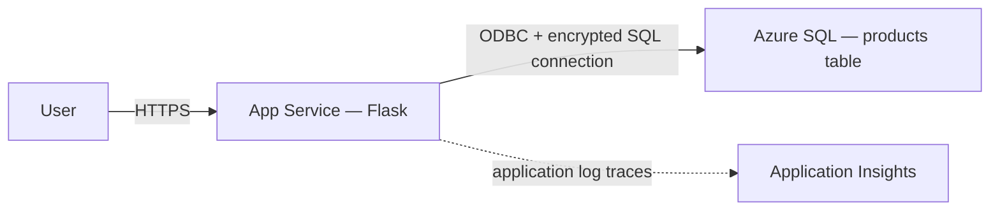

# Flask og Azure SQL på App Service

**Niveau:** Mellem · **Tid:** 30–60 minutter inklusive forudsætninger

Dette eksempel implementerer en Python Flask read API til **Linux App Service** og en Basic
Azure SQL-database. Kildekode, Bicep og azd-konfiguration er inkluderet. Det er en
læringsapplikation, ikke en produktsklar databasearkitektur.

## Det lærer du

- Provisioner App Service, SQL og overvågningsressourcer med Bicep.
- Konfigurer krypteret SQL-forbindelse uden at gemme legitimationsoplysninger.
- Initialiser et skema inden start af Gunicorn workers.
- Bekræft seedede data, responses ved ikke fundet, og databasehelbred.



Ressourcer: dedikeret ressourcegruppe, B1 Linux App Service-plan, Python 3.11 Web
App, SQL-server og Basic 2-GB database, Application Insights og Log Analytics.
Web App bruger **source/ZIP-deployment og Oryx afhængighedsinstallation**;
`azd deploy` bygger eller deployer ikke den valgfrie Dockerfile.

## Forudsætninger

- Aktuel stabil [azd](https://learn.microsoft.com/azure/developer/azure-developer-cli/install-azd)
  (udgivet version ved gennemgangstidspunkt: 1.37.2).
- [Azure CLI](https://learn.microsoft.com/cli/azure/install-azure-cli) til verifikation.
- Azure-abonnement, tilladelser til at oprette de listede ressourcer og regional kvote.
- Python **3.11** til lokal udvikling; den committed `pyodbc==5.0.1` kan kræve
  native build-værktøjer på nyere Python-versioner.
- Microsoft ODBC Driver 18 (eller 17) til SQL Server på lokale maskiner. `pip install
  pyodbc` installerer ikke systemdriveren. Se
  [ODBC-installation](https://learn.microsoft.com/sql/connect/odbc/download-odbc-driver-for-sql-server).
- Docker kun ved test af den valgfrie container lokalt.

```bash
azd version
az version
azd auth login
az login
```

Brug samme abonnement i begge værktøjer. Kommandoer nedenfor bruger Bash.

## Deploy

Fra repository-rodmappen:

```bash
cd examples/database-app
azd env new sql-demo
azd provision
azd deploy
WEB_URL=$(azd env get-value WEB_APP_URI)
WEB_NAME=$(azd env get-value WEB_APP_NAME)
RG_NAME=$(azd env get-value AZURE_RESOURCE_GROUP)
```

Vælg en understøttet region. `sqlAdminLogin` er sat til standard til `sqladmin`; det krævede
`sqlAdminPassword` er en sikker parameter. Angiv en stærk adgangskode, når du bliver bedt om det.
Hold deployments-legitimationsoplysninger ude af Git og fejlrapporter. Den aktuelle interpolering
af forbindelsesstrengen forventer en adgangskode uden forbindelsesstreng-afgrænsere såsom
`;`; tilpas escaping før brug af sådanne værdier.

Bicep sætter en startkommando, der kører `init_database()` **før** Gunicorn
workers starter. Dette er nødvendigt, fordi import af `app:app` ikke udfører
Pythons `if __name__ == '__main__'` blok. På en frisk database
oprettes `products` og indsættes fem rækker. Det er et simpelt undervisnings-seed, ikke en
samtidigheds-migrationsramme; brug korrekte migrationer før skalering af instanser.

App'en vælger installeret Microsoft ODBC Driver 18, derefter 17, hvis forbindelsesstrengen
ikke eksplicit navngiver en driver. Hvis ingen findes, mislykkes opstart med en
håndterbar installationsfejl. Bekræft driver-tilgængelighed i din valgte
App Service runtime i stedet for at antage den.

## Verificer

```bash
curl --fail-with-body "${WEB_URL}/"
curl --fail-with-body "${WEB_URL}/health"
curl --fail-with-body "${WEB_URL}/products"
curl --fail-with-body "${WEB_URL}/products/1"
curl -i "${WEB_URL}/products/999"
```

Forventet:

- `/` returnerer endpoint-oplysninger.
- `/health` returnerer 200 med `{"status":"healthy","database":"connected"}`.
- `/products` returnerer fem seedede produkter på en frisk database.
- `/products/1` returnerer Laptop med pris 1299,99.
- Et ikke-eksisterende produkt returnerer 404 med `{"error":"Product not found"}`.

API'en er read-only. Der er ingen POST/PUT/DELETE-route eller browser UI.
Databaseforbindelsesfejl returnerer 503 fra `/health`; det er ikke succes.

## Filer og konfiguration

```text
azure.yaml                         # Python App Service source deployment
infra/main.bicep
infra/main.parameters.json
infra/abbreviations.json
infra/resources/sql-server.bicep
infra/resources/sql-database.bicep
infra/resources/app-service-plan.bicep
infra/resources/web-app.bicep       # Settings + initialization/startup command
infra/resources/app-insights.bicep
src/web/app.py
src/web/requirements.txt
src/web/Dockerfile                 # Optional local container, not the azd target
.env.sample
```

`SQL_CONNECTION_STRING` sendes som en sikker Bicep-parameter til Web App-modulet
og gemmes i App Service-indstillinger, ikke som deployments-outputs.
`APPLICATIONINSIGHTS_CONNECTION_STRING` konfigurerer logeksport.
`SCM_DO_BUILD_DURING_DEPLOYMENT=true` aktiverer server-side afhængighedsinstallation.
At sætte arbitrære `azd env` værdier ændrer ikke automatisk app-indstillinger.

SQL-firewallens `0.0.0.0` regel tillader forbindelse fra **Azure services,
inklusive andre kunders abonnementer**, med forbehold for SQL-godkendelse. Den er
ikke begrænset til denne app eller abonnement. SQL offentlig netværksadgang er aktiveret.
Brug scopes networking og en ikke-admin applikationsidentitet før produktion.

## Lokal udvikling

Brug Python 3.11 og en installeret Microsoft SQL ODBC-driver:

```bash
python -m venv .venv
source .venv/bin/activate  # PowerShell: .\.venv\Scripts\Activate.ps1
python -m pip install -r src/web/requirements.txt
export SQL_CONNECTION_STRING='Server=tcp:YOUR_SERVER.database.windows.net,1433;Database=YOUR_DATABASE;UID=YOUR_USER;PWD=YOUR_PASSWORD;Encrypt=yes;TrustServerCertificate=no;Connection Timeout=30;'
python src/web/app.py
```

Erstat pladsholdere sikkert. En kopieret `.env`-fil bliver **ikke automatisk loaded**
af denne applikation. Eksporter variabler i din nuværende shell i stedet.
For Azure SQL fra en bærbar computer, tillad midlertidigt kun din egen offentlige IP:

```bash
SQL_SERVER=$(azd env get-value SQL_SERVER_NAME)
MY_IP=YOUR_PUBLIC_IP
az sql server firewall-rule create -g "$RG_NAME" -s "$SQL_SERVER" \
  -n AllowMyLearningIP --start-ip-address "$MY_IP" --end-ip-address "$MY_IP"
```

Fjern reglen efter test:

```bash
az sql server firewall-rule delete -g "$RG_NAME" -s "$SQL_SERVER" -n AllowMyLearningIP
```

Valgfri container-test fra dette eksempelbibliotek:

```bash
docker build -t sql-flask:local src/web
docker run --rm -p 8000:8000 -e SQL_CONNECTION_STRING sql-flask:local
```

Dette image installerer Driver 18 ved hjælp af Debian 12-pakkerepositoriet, der matcher dens
Bookworm-base, initialiserer databasen én gang og starter derefter Gunicorn.

## Overvågning og fejlfinding

Aktivér/følg App Service filesystem applikationslogs, når du fejlsøger opstart:

```bash
az webapp log config --name "$WEB_NAME" --resource-group "$RG_NAME" \
  --application-logging filesystem --level information
az webapp log tail --name "$WEB_NAME" --resource-group "$RG_NAME"
```

Denne kode eksporterer applikations **logspor** gennem en legacy OpenCensus-handler.
Den konfigurerer ikke automatisk Flask request/dependency tracing, Live Metrics,
SQL auditing, diagnostic settings eller alerts. Disse kræver separat opsætning.
For ny instrumentering, foretræk Azure Monitor OpenTelemetry.

I Application Insights Logs, efter at have sendt API-forespørgsler:

```kusto
traces
| where timestamp > ago(1h)
| where message contains "products" or message contains "Health check"
| project timestamp, message, severityLevel
```

Tillad indtagelsesforsinkelse. Request-table eller Live Metrics aktivitet er ikke et færdighedskriterium
for denne log-only instrumentering.

- **Mangler driver:** inspicer `pyodbc.drivers()` i runtime og installer en
  understøttet Microsoft ODBC-driver. En Python-pakke alene er utilstrækkelig.
- **Forbindelsesfejl:** tjek SQL-indstillinger, legitimationsoplysninger, firewall og valgte
  abonnement. Deaktivér ikke kryptering for at omgå en fejl.
- **Mangler produktstabel:** bekræft at Bicep startkommando blev implementeret;
  alene start af `gunicorn app:app` springer initialisering over.
- **Pakkebyggefejl:** brug Python 3.11 eller lever native build-forudsætninger.
- **Data med nulpris:** nul er en gyldig decimalpris; den skal serialiseres som 0.0,
  ikke `null`.

## Praktiske øvelser

### Øvelse 1: Verificer adfærd ved manglende produkt

**Udgangspunkt:** implementeret API og `WEB_URL` ovenfor.
**Mål:** skelne en manglende række fra en brudt database.
Forespørg `/health` og `/products/999` med kommandoerne ovenfor.
**Succeskriterier / svar:** helbred 200, ikke-eksisterende produkt 404 (ikke 500 eller 503).
**Almindeligt problem:** antage at et ikke-fundet svar beviser, at SQL-forbindelsen er brudt.

### Øvelse 2: Ændr en seedet værdi

**Udgangspunkt:** Azure SQL Query Editor, forbundet til prøve-databasen.
**Mål:** vis at API-data gemmes i SQL og ikke i proceshukommelse.

```sql
UPDATE products SET price = 0 WHERE id = 1;
SELECT id, name, price FROM products WHERE id = 1;
```

Forespørg `${WEB_URL}/products/1`. **Succeskriterier:** pris er `0.0`, ikke `null`.
Gendan værdien:

```sql
UPDATE products SET price = 1299.99 WHERE id = 1;
```

**Almindeligt problem:** at redigere Python seed-listen opdaterer ikke allerede eksisterende rækker i SQL.
Kør ikke skema-/dataøvelser mod en produktionsdatabase.

### Øvelse 3: Tilføj et read-only count endpoint

**Udgangspunkt:** `src/web/app.py`.
**Mål:** udvid API'en med en parameterfri aggregatforespørgsel.
Tilføj dette før `if __name__ == '__main__':`-blokken:

```python
@app.route('/product-count')
def product_count():
    from contextlib import closing
    with closing(get_db_connection()) as conn, closing(conn.cursor()) as cursor:
        cursor.execute("SELECT COUNT(*) FROM products")
        return jsonify({'count': cursor.fetchone()[0]})
```

Kør `azd deploy web`, og forespørg derefter `${WEB_URL}/product-count`.
**Succeskriterier:** 200 med `{"count":5}` på den uberørte seedede database.
**Almindeligt problem:** ændring af ruten, men glem at deploye igen.
Til produktion, tilføj fejlhåndtering/tests; denne korte øvelse fokuserer på forespørgslen.

## Omkostninger, produktionsmangler og oprydning

B1 App Service og Basic-databasen faktureres, mens de er provisioneret. At stoppe
Web App'en stopper **ikke** fakturering af App Service-planen. Logs og lagring kan tilføje omkostninger.
Brug [Azure prisberegneren](https://azure.microsoft.com/pricing/calculator/)
for aktuel regional prissætning. Skift til F1 kræver også deaktivering af `alwaysOn`;
det er ikke en one-line drop-in erstatning. SQL serverless er ikke automatisk gratis.

Produktionsarbejde omfatter en mindst-privilegeret app-identitet (ikke SQL admin),
autentifikation/autorisation, privat netværk, sikre migrationer, gennemgang af
forbindelse pooling/livscyklus, telemetri, auditing, alerts, tests og genopretningsprocedurer.
Redis caching og ekstra tabeller er udviklingsidéer, ikke implementerede øvelser.

Fra dette eksempelbibliotek:

```bash
azd down
```

Gennemgå sletteprompten og bekræft, at den dedikerede ressourcegruppe fjernes.
Slet ikke grupper med ikke-relaterede data.

[Container eksempler](../../../../examples/container-app) ·
[AI udvikling](../../docs/chapter-02-ai-development/README.md) ·
[Kursusstart](../../README.md) · [Rapporter et problem](https://github.com/microsoft/AZD-for-beginners/issues)

---

<!-- CO-OP TRANSLATOR DISCLAIMER START -->
**Ansvarsfraskrivelse**:
Dette dokument er blevet oversat ved hjælp af AI-oversættelsestjenesten [Co-op Translator](https://github.com/Azure/co-op-translator). Selvom vi bestræber os på nøjagtighed, skal du være opmærksom på, at automatiserede oversættelser kan indeholde fejl eller unøjagtigheder. Det originale dokument på dets oprindelige sprog bør betragtes som den autoritative kilde. For kritisk information anbefales professionel menneskelig oversættelse. Vi påtager os intet ansvar for misforståelser eller fejltolkninger, der opstår som følge af brugen af denne oversættelse.
<!-- CO-OP TRANSLATOR DISCLAIMER END -->