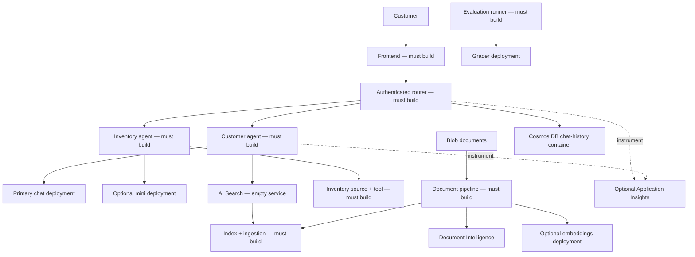

# Multi-Agent Kundesupport — Detailhandelsarkitektur Blueprint

**Kapitel 5: Multi-Agent AI-løsninger**

- [Kursus startside](../README.md)
- [Kapitel 5](../docs/chapter-05-multi-agent/README.md)
- [Forudsætning: AI-integration](../docs/chapter-02-ai-development/microsoft-foundry-integration.md)
- [Næste: Kapacitetsplanlægning](../docs/chapter-06-pre-deployment/capacity-planning.md)
- [ARM infrastruktur stillads](retail-multiagent-arm-template/README.md)

> **Arkitekturguide, ikke en færdig applikation.** De eneste detailimplementeringsfiler
> er `azuredeploy.json`, `azuredeploy.parameters.json` og `deploy.sh` i
> `retail-multiagent-arm-template/`. Router/frontend containers er hello-world
> pladsholdere. Der findes hverken detailagent, UI, indtagelsespipeline, evaluator, scanner eller
> applikationstest suite lokalt.

## Oversigt

**Mål:** design et kundesupportsystem med en kundebetjent og en lageragent,
identificer hvad infrastrukturen leverer, og planlæg de manglende applikationskontrakter
og verifikation.

**Målgruppe:** udviklere, som har gennemført den lokale
[chat-eksempel](../../../examples/azure-openai-chat) og [to-tjeneste container eksempel](../../../examples/container-app/microservices).
Afslut 2–3 timer til arkitektonisk studie. At bygge applikationen er et separat
projekt: 80–120 udviklingstimer er et illustrativt planlægningsskøn for
erfarne udviklere, **ikke et leveringsløfte**; produktionstykkelse, tests,
sikkerhedsgennemgang og drift kræver yderligere arbejde.

### Læringsmål

- Forklar routing, grundlæggelse, værktøjstilladelser og samtaleejerskab.
- Skeln mellem modelidentifikatorer, udrulningsnavne, API-versioner og ARM-versioner.
- Design dokumentindtag og hentning med matchende vektordimensioner.
- Definer verificerbare funktionelle, evaluerings- og fejl-gendannelseskrav.
- Adskil valgfrie arkitekturmål fra de faktisk tilvejebragte ressourcer.

## Løsningsarkitektur



Dette er en **målrettet applikationsarkitektur**, ikke et diagram over kørende agent
tjenester. ARM-skelettet opretter kun de underliggende tjenester og to pladsholder-
containere. Front Door, registry, administrerede identiteter, rollefordelinger,
private endpoints, failover, applikationsinstrumentering og alarmer er ikke inkluderet.

### Ansvarsområder og kontrakter

| Komponent | Påkrævet adfærd | Bevis før det betragtes som færdigt |
|---|---|---|
| Frontend | Autentificer brugere, gengiv chat, upload dokumenter sikkert | UI- og uploadtests, tilgængelige fejl |
| Router | Autoriser forespørgsler, vælg agent, begræns værktøjskald/tidsfrister | Routingtests, autorisationstjek, fejltolerance-tests |
| Kundeagent | Forankr politik-/produktoplysninger i godkendte kilder | Korrekte citater, afholden sig ved manglende data |
| Inventarværktøj | Læs autoritativ lagerstatus med scoped tilladelser | Deterministiske lager-tests; ingen opfundet tilgængelighed |
| Dokumentpipeline | Uddrag, del op, indlejre, indekser, opdater/slet | Indekserede testdata og retry/dødbrev-adfærd |
| Samtaleopbevaring | Isoler brugere, håndhæv opbevaring | Autorisationstest på tværs af brugere og TTL-tests |
| Evalueringskører | Sammenlign output med sandhedsgrundlag og rubrik | Dækning, fejltællinger, reproducerbare rapporter |

Tænk på routeren som en reception og værktøjerne som begrænsede interne systemer:
det at vælge en specialist er ikke autorisation til at få adgang til enhver kundes optegnelser.
Håndhæv identitet og tilladelser i applikationskode og datatjenester, ikke i prompt.

## Infrastruktur vs. Applikation

Læs [scaffold README](retail-multiagent-arm-template/README.md) før
provisioning. Den lister nøjagtige ressourcer, tilstande, omkostninger og begrænsninger.

| Logisk brug | ARM udrulningsnavn | Model / version | Standardregion |
|---|---|---|---|
| Kundechat | `gpt-4.1-chat` | `gpt-4.1` / `2025-04-14` | `eastus2` |
| Inventar | `gpt-4.1-mini-inventory` | `gpt-4.1-mini` / `2025-04-14` | `westus2`, valgfrie |
| Indlejringer | `text-embedding-ada-002` | `text-embedding-ada-002` / `2` | `francecentral`, valgfrie |
| Evaluering | `gpt-4.1-grader` | `gpt-4.1` / `2025-04-14` | Primærregion som standard |

Tjek model/version/SKU tilgængelighed og kvote i **hver region**. Chat/mini/grader
bruger `GlobalStandard`; indlejringer bruger `Standard`. Kapacitets-enhed-til-TPM-kortlægninger er
modelspecifikke. Tilføj ikke forskellige kapacitetsenheder som en universel kvotegaranti.

Et Azure OpenAI-requests `model` argument er **udrulningsnavnet**, ikke
nødvendigvis katalogets modelidentifikator. Data-plane API-version `2024-10-21`
adskiller sig fra modelversionen `2025-04-14` og ARM-ressourcen `apiVersion`.
Man kan ikke løse en utilgængelig model kun ved at ændre data-plane API-versionen.

`--no-multi-region` springer sekundære og embeddings-konti over. En primær chat- og
uafhængig grader-konto forbliver. Separate modelkonti giver ikke automatisk
failover; det kræver applikationsrouting, kompatible udrulninger, sundhedstjek,
retry-grænser og vurdering af datalokalisering.

## Implementeringskøreplan

### 1. Start med en testet interaktion

Før provisioning af det store scaffold, brug det lokale chat-eksempel til at etablere
inferensforbindelse. Definer et repræsentativt kundespørgsmål, den godkendte
svar-kilde, forventet citat og fejladfærd, når den kilde mangler.

### 2. Definer routing og værktøjsgrænser

Skab din egen router-kilde, afhængighedsmanifest, Dockerfile og tests. En
illustrativ kontrakt kunne være `POST /chat` med `{"message":"...","conversation_id":"..."}`.
**Det endepunkt er et designforslag; det er ikke implementeret af ARM-skabelonen.**

Valider kropstyper/grænser, udled brugeridentitet fra autentifikation, håndhæv
samtaleejerskab, anvend forespørgstidsgrænser, og returnér meningsfulde fejlkoder.
Behandl ikke HTTP-fejl eller tomme svar som succesfulde agentresultater.

### 3. Implementer grundlæggelse og indtag

ARM-skabelonen opretter ikke et søgeindeks. Dette er en **referencetype JSON
fragment til tilpasning i din egen indeksdefinition**, ikke en fil allerede i repoet:

```json
{
  "name": "retail-product-index",
  "fields": [
    {"name": "id", "type": "Edm.String", "key": true},
    {"name": "title", "type": "Edm.String", "searchable": true},
    {"name": "content", "type": "Edm.String", "searchable": true},
    {"name": "category", "type": "Edm.String", "filterable": true},
    {
      "name": "content_vector",
      "type": "Collection(Edm.Single)",
      "searchable": true,
      "dimensions": 1536,
      "vectorSearchProfile": "retail-profile"
    }
  ],
  "vectorSearch": {
    "algorithms": [{"name": "retail-hnsw", "kind": "hnsw"}],
    "profiles": [{"name": "retail-profile", "algorithm": "retail-hnsw"}]
  }
}
```

Profilen forbinder vektorfeltet til dets algoritme. Dimensioner skal matche
den faktiske embedningsoutput (1536 for denne `ada-002` udrulning). For Python-hentning,
brug `azure.search.documents.models.VectorizedQuery` frem for en inkomplet
ordbog uden dens type af vektorforespørgsel:

```python
# Reference function only: supply an authenticated async SearchClient and an embedding.
from azure.search.documents.models import VectorizedQuery

async def retrieve(search_client, embedding):
    results = await search_client.search(
        search_text=None,
        vector_queries=[VectorizedQuery(
            vector=embedding,
            k_nearest_neighbors=5,
            fields="content_vector"
        )],
        select=["id", "title", "content"]
    )
    return [document async for document in results]
```

Skab en separat indtagsimplementering, som:

1. Autoriserer uploadadgang og validerer indholdstype og størrelse.
2. Læser private blobs via autentificerede SDK-kald. En privat blob-URL alene
   er **ikke** et læsbart Document Intelligence-input; send downloadede bytes med
   `AnalyzeDocumentRequest(bytes_source=...)` eller brug en passende scoped,
   kortlevet SAS efter vurdering af adgangskrav.
3. Uddrager tekst, deler den op for at passe til embedningsgrænser, og genererer embedding.
4. Opretter stabile gyldige dokumentnøgler og uploader stykker med matchende vektorer.
5. Tjekker indekseringsresultater per dokument, håndterer retries, og opdaterer/sletter forældede data.

Undgå at interpolere vilkårlige bruger nøgler/værdier i OData-filtre. Brug whitelistede felter,
valider værdityper, og escap citattegn. Boolean- og numeriske filtre kræver
typede literaler, ikke citerede strenge.

### 4. Web-grundlæggelse

**Bing Search v7 blev udfaset den 11. august 2025.** Det gamle `Microsoft.Bing/accounts`
resource og `api.bing.microsoft.com/v7.0/search` eksempler er ikke en understøttet
implementeringsvej. Evaluer en aktuelt understøttet grundlæggelsesintegration i
Microsoft Foundry og dens SDK, tilladelser, fakturering, og citatkrav;
ingen er implementeret her. Det er ikke en plug-and-play erstatning for det udfasede endepunkt.

### 5. Tilføj telemetri og evaluering

Oprettelse af Application Insights instrumenterer ikke kode. Brug understøttet Azure Monitor
OpenTelemetry-instrumentering, når du bygger en ny applikation, propagér trace
kontekst mellem tjenester, og undgå at logge kundeprompter, dokumenter eller hemmeligheder.
Afkortning af en forespørgsel anonymiserer den **ikke**.

Mål forespørgselsvarighed, routing-/værktøjsfejl, relevans ved hentning, citatkvalitet,
korrekthed, tokenforbrug og afholdenhed. Gem faktuelle lager-/politiksager
sammen med evalueringssager: en grader kan ikke pålideligt bestemme faktuel korrekthed
ud fra kun et spørgsmål og et svar.

En grader-udrulning er ikke en evalueringskører. Implementer en versioneret rubrik,
struktureret output/skema-validering, score-intervalkontroller, transportfejloptælling,
og menneskegennemgåede sager. Rapporter ufuldstændige/fejltilfælde særskilt; konverter dem
ikke til succesfulde karakterer eller inkluder dem tavst som nul-kvalitets modelresponser.

Ligeledes er nogle få søgeordstjek ikke en sikkerhedscertificering. Et mislykket HTTP-
request, manglende teststrategi eller tomt svar skal gøre en test **ukonkluderet eller
fejlet**, ikke give en “100% sikker” score. Udfør autoriseret test med passende
værktøjer og menneskelig gennemgang før enhver påstand om produktionsparathed.

### 6. Udrul din applikation

Opret dine egne kildemapper, manifester, tests, registry og image-pull
tilladelser. Erstat pladsholdere med byggede billeder og opdater ingress/prober til
at matche hver apps lytteport. Konfigurer runtime miljøvariabler i Bicep
eller en eksplicit understøttet azd miljømapping.

Der er ikke noget generisk `config` ordbog under en azd service, som automatisk
opretter runtime miljøvariabler. `azd env set` ændrer kun ressourcer, der
eksplicit bruger disse værdier. Der er ikke implementeret nogen kanariefugl, regionsliste eller fine-tuning hook
i dette scaffold.

## Praktiske designøvelser

Disse er **arkitekturovelser**, ikke påstande om eksekverbar detail-starterkode.

### Øvelse 1: Verificér grænsen

**Udgangspunkt:** de tre filer i `retail-multiagent-arm-template/`.
**Mål:** skeln mellem provisioning og applikationsfunktionalitet.
Åben `azuredeploy.json`, find både containerbilleder og `targetPort` værdier,
og lav derefter en liste over applikationskomponenter, som mangler i arkivet.

**Succeskriterier / svar:** begge billeder er hello-world pladsholdere, der lytter
på port 80; agenter, chat UI, router-håndterere, indeks/indtag, evaluator og scanner
er fraværende. En succesfuld pladsholder root-forespørgsel validerer ikke `/chat`.
**Typisk problem:** fortolkning af ressourcenavne som `retail-router` som fungerende kode.

### Øvelse 2: Spor vektorkonfigurationen

**Udgangspunkt:** indeks JSON ovenfor.
**Mål:** forstå felt → profil → algoritme relationen.
Identificér hvilke værdier, der skal ændres, når der skiftes til en embedningsmodel med en
anden outputdimension, og inspicer derefter `retrieve` funktionen.

**Succeskriterier / svar:** skift feltet `dimensions` til faktisk vektorlængde;
hold `vectorSearchProfile` i trit med en deklareret profil og dens algoritme;
forespørgslen `fields` skal navngive vektorfeltet. Generér eksisterende dokumentvektorer på ny,
når embedningsmodellen ændres.
**Typisk problem:** kun at ændre modelnavnet, mens inkompatible vektorer beholdes.

### Øvelse 3: Definér en fejltetest

**Udgangspunkt:** ansvarsoversigt.
**Mål:** forhindre falsk succes.
Skriv forventet adfærd for en utilgængelig inventar-API, et søgeindeks uden
matchende dokumenter, og en evalueringsforespørgsel, der returnerer HTTP 503.

**Succeskriterier / svar:** ingen opfundne inventarværdier; eksplicit afståelse eller
eskalering, når kontekst mangler; evaluering rapporterer en transportfejl fremfor
kvalitet eller sikkerhedsgodkendelse. Tilføj eksekverbare tests, når du bygger applikationen.
**Typisk problem:** at fange alle undtagelser og fortsætte med et tomt svar.

## Omkostninger, fejlfinding og oprydning

- Infrastruktur medfører løbende omkostninger selv med tomme søgeindekser og pladsholder-
  apps. Brug aktuelle regionale priser; hverken “minimal” eller multi-region betyder gratis.
- Token-omkostninger afhænger af model, cached/uncached input, output og udrulnings SKU.
  Routing kan spare penge kun, hvis målt arbejdsbyrde og kvalitetsresultater berettiger det;
  en fast besparelse på 60–80% er ikke garanteret.
- Tjek modeltilgængelighed og kvote før provisioning; skeln mellem tilladelsesfejl,
  udrulningsnavn, region, modelversion og API-version fejl.
- Kør ikke manglende `setup-data.sh` evaluator-CLI’er eller `pytest tests/` kommandoer.
  Deres implementeringer er en del af din udviklings-backlog.
- Scaffolden er kun ARM: følg dens
  [verifikations- og oprydningsinstruktioner](retail-multiagent-arm-template/README.md).
  `azd down` styrer ikke disse ressourcer.

## Relaterede ressourcer

- [Fungerende lokal chat-eksempel](../../../examples/azure-openai-chat)
- [Fungerende to-service container eksempel](../../../examples/container-app/microservices)
- [AI Search vektorindekser](https://learn.microsoft.com/azure/search/vector-search-how-to-create-index)
- [Container Apps dokumentation](https://learn.microsoft.com/azure/container-apps/)
- [Fejlfinding](../docs/chapter-07-troubleshooting/common-issues.md)
- [Rapportér et problem](https://github.com/microsoft/AZD-for-beginners/issues)

---

<!-- CO-OP TRANSLATOR DISCLAIMER START -->
**Ansvarsfraskrivelse**:
Dette dokument er blevet oversat ved hjælp af AI-oversættelsestjenesten [Co-op Translator](https://github.com/Azure/co-op-translator). Selvom vi bestræber os på nøjagtighed, skal du være opmærksom på, at automatiserede oversættelser kan indeholde fejl eller unøjagtigheder. Det originale dokument på dets oprindelige sprog bør betragtes som den autoritative kilde. For kritisk information anbefales professionel menneskelig oversættelse. Vi påtager os intet ansvar for misforståelser eller fejltolkninger, der opstår som følge af brugen af denne oversættelse.
<!-- CO-OP TRANSLATOR DISCLAIMER END -->