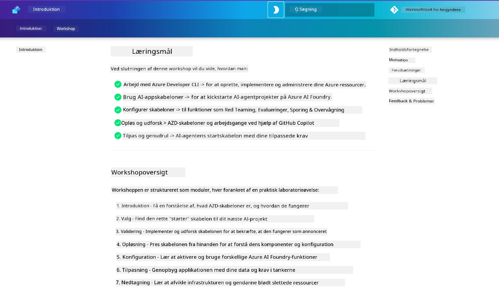

<div align="center">
  <div style="background: linear-gradient(135deg, #0078d4, #106ebe); border-radius: 10px; padding: 20px; margin: 20px 0; box-shadow: 0 4px 15px rgba(0, 120, 212, 0.3); border: 2px solid #005a9e;">
    <h2 style="color: white; margin: 0; font-size: 24px; text-shadow: 1px 1px 2px rgba(0,0,0,0.3);">
      🎯 AZD for AI-udviklere Workshop
    </h2>
    <p style="color: white; margin: 10px 0 0 0; font-size: 16px; text-shadow: 1px 1px 2px rgba(0,0,0,0.3);">
      <strong>En praktisk workshop til at bygge AI-applikationer med Azure Developer CLI.</strong><br>
      Fuldfør 7 moduler for at mestre AZD-skabeloner og AI-implementeringsarbejdsgange.
    </p>
    <div style="margin-top: 15px;">
      <span style="background: rgba(255,255,255,0.2); padding: 5px 10px; border-radius: 15px; color: white; font-size: 14px;">
        📅 Kildevejledning gennemgået: November 2026
      </span>
    </div>
  </div>
</div>

# AZD for AI-udviklere Workshop

Velkommen til den praktiske workshop til læring af Azure Developer CLI (AZD) med fokus på AI-applikationsudrulning. Denne workshop hjælper dig med at opnå en anvendt forståelse af AZD-skabeloner i 3 trin:

1. **Opdagelse** - find den skabelon, der passer til dig.
1. **Implementering** - implementer og bekræft, at det fungerer
1. **Tilpasning** - modificer og iterer for at gøre det til dit!

I løbet af denne workshop vil du også blive introduceret til kerneudviklerværktøjer og arbejdsgange, for at hjælpe dig med at effektivisere din end-to-end udviklingsrejse.

<br/>

## Browser-baseret Guide

Workshop-lektionerne er i Markdown. Du kan navigere dem direkte i GitHub - eller starte en browser-baseret preview som vist på skærmbilledet nedenfor.



For at bruge denne mulighed - fork repositoriet til din profil, og start GitHub Codespaces. Når VS Code-terminalen er aktiv, skriv denne kommando:

Denne browser-preview virker i GitHub Codespaces, dev-containere eller en lokal kopi med Python og MkDocs installeret.

```bash title="" linenums="0"
python -m pip install -r requirements-dev.txt
python -m mkdocs serve --config-file workshop/mkdocs.yml
```

Kør disse kommandoer fra **kursus-repositoriets rod**, ikke den separat initialiserede AI-prøve. Hold previewen i forgrunden, så fejl forbliver synlige; stop den med Ctrl+C. For at tjekke siden uden at servere den, kør `python -m mkdocs build --strict --config-file workshop/mkdocs.yml`.

Om et par sekunder vil du se en pop-up dialog. Vælg muligheden for `Open in browser`. Den webbaserede guide vil nu åbne i en ny browserfane. Nogle fordele ved denne preview:

1. **Indbygget søgning** - find nøgleord eller lektioner hurtigt.
1. **Kopier-ikon** - hold musen over kodeblokke for at se denne mulighed
1. **Tema skifte** - skift mellem mørkt og lyst tema
1. **Få hjælp** - klik på Discord-ikonet i footeren for at deltage!

<br/>

## Workshop Oversigt

**Varighed:** 3-4 timer  
**Niveau:** Begynder til Mellem  
**Forudsætninger:** Fortrolighed med Azure, AI-koncepter, VS Code og kommandolinjeværktøjer.

Dette er en praktisk workshop, hvor du lærer ved at gøre. Når du har gennemført øvelserne, anbefaler vi at gennemgå AZD For Beginners-curriculum for at fortsætte din læringsrejse inden for sikkerhed og produktivitets bedste praksis.

| Tid| Modul  | Mål |
|:---|:---|:---|
| 15 min | [Introduktion](docs/instructions/0-Introduction.md) | Sæt scenen, forstå målene |
| 30 min | [Vælg AI Skabelon](docs/instructions/1-Select-AI-Template.md) | Undersøg muligheder og vælg startskabelon | 
| 30 min | [Validér AI Skabelon](docs/instructions/2-Validate-AI-Template.md) | Implementer standardløsning til Azure |
| 30 min | [Opløs AI Skabelon](docs/instructions/3-Deconstruct-AI-Template.md) | Undersøg struktur og konfiguration |
| 30 min | [Konfigurer AI Skabelon](docs/instructions/4-Configure-AI-Template.md) | Aktivér og prøv tilgængelige funktioner |
| 30 min | [Tilpas AI Skabelon](docs/instructions/5-Customize-AI-Template.md) | Tilpas skabelonen til dine behov |
| 30 min | [Nedtag Infrastruktur](docs/instructions/6-Teardown-Infrastructure.md) | Ryd op og frigiv ressourcer |
| 15 min | [Afslutning & Næste Skridt](docs/instructions/7-Wrap-up.md) | Læringsressourcer, workshop-udfordring |

<br/>

## Hvad Du Vil Lære

Tænk på AZD Skabelonen som en læringssandbox til at udforske forskellige kapaciteter og værktøjer til end-to-end udvikling på Microsoft Foundry. Ved slutningen af denne workshop bør du have en intuitiv forståelse for forskellige værktøjer og koncepter i denne sammenhæng.

| Koncept  | Mål |
|:---|:---|
| **Azure Developer CLI** | Forstå værktøjskommandorer og arbejdsgange|
| **AZD Skabeloner**| Forstå projektstruktur og konfiguration|
| **Azure AI Agent**| Provisionér & implementér Microsoft Foundry-projekt  |
| **Azure AI Search**| Aktiver kontekst-engineering med agenter |
| **Observability**| Undersøg tracing, overvågning og evalueringer |
| **Red Teaming**| Undersøg modstandersimulering og modforholdsregler |

<br/>

## Workshop Struktur

Workshoppen er struktureret til at tage dig på en rejse fra skabelonopdagelse, til implementering, opløsning og tilpasning - ved brug af den officielle [Getting Started with AI Agents](https://github.com/Azure-Samples/get-started-with-ai-agents) startskabelon som basis.

### [Modul 1: Vælg AI Skabelon](docs/instructions/1-Select-AI-Template.md) (30 min)

- Hvad er AI Skabeloner?
- Hvor kan jeg finde AI Skabeloner?
- Hvordan kan jeg komme i gang med at bygge AI Agenter?
- **Laboratorium**: Hurtigstart i Codespaces eller en dev-container

### [Modul 2: Validér AI Skabelon](docs/instructions/2-Validate-AI-Template.md) (30 min)

- Hvad er AI Skabelon Arkitekturen?
- Hvad er AZD Udviklingsarbejdsgangen?
- Hvordan kan jeg få hjælp til AZD Udvikling?
- **Laboratorium**: Implementer & Validér AI Agent-skabelon

### [Modul 3: Opløs AI Skabelon](docs/instructions/3-Deconstruct-AI-Template.md) (30 min)

- Undersøg dit miljø i `.azure/` 
- Undersøg din ressourceopsætning i `infra/` 
- Undersøg din AZD-konfiguration i `azure.yaml`s
- **Laboratorium**: Modificer Miljøvariabler & Implementér igen

### [Modul 4: Konfigurer AI Skabelon](docs/instructions/4-Configure-AI-Template.md) (30 min)
- Undersøg: Retrieval Augmented Generation
- Undersøg: Agent Evaluering & Red Teaming
- Undersøg: Tracing & Overvågning
- **Laboratorium**: Undersøg AI Agent + Observabilitet 

### [Modul 5: Tilpas AI Skabelon](docs/instructions/5-Customize-AI-Template.md) (30 min)
- Definér: PRD med Scenariekrav
- Konfigurer: Miljøvariabler for AZD
- Implementér: Lifecycle Hooks for tilføjede opgaver
- **Laboratorium**: Tilpas skabelon til mit scenarie

### [Modul 6: Nedtag Infrastruktur](docs/instructions/6-Teardown-Infrastructure.md) (30 min)
- Opsummering: Hvad er AZD Skabeloner?
- Opsummering: Hvorfor bruge Azure Developer CLI?
- Næste Skridt: Prøv en anden skabelon!
- **Laboratorium**: Nedluk infrastruktur & oprydning

<br/>

## Workshop Udfordring

Vil du udfordre dig selv til mere? Her er nogle projektforslag - eller del dine idéer med os!!

| Projekt | Beskrivelse |
|:---|:---|
|1. **Opløs en Kompleks AI Skabelon** | Brug den arbejdsgang og de værktøjer, vi har skitseret, og se om du kan implementere, validere og tilpasse en anden AI-løsning skabelon. _Hvad lærte du?_|
|2. **Tilpas med dit Scenarie**  | Prøv at skrive en PRD (Produktkravsdokument) for et andet scenarie. Brug derefter GitHub Copilot i dit skabelonrepo i Agent Model - og bed det om at generere en tilpasningsarbejdsgang til dig. _Hvad lærte du? Hvordan kunne du forbedre disse forslag?_|
| | |

## Har du feedback?

1. Opret en issue på dette repo - tag den med `Workshop` for nemheds skyld.
1. Deltag i Microsoft Foundry Discord - forbind dig med dine peers!


| | | 
|:---|:---|
| **📚 Kursus Hjem**| [AZD For Beginners](../README.md)|
| **📖 Dokumentation** | [Kom i gang med AI-skabeloner](https://learn.microsoft.com/en-us/azure/ai-foundry/how-to/develop/ai-template-get-started)|
| **🛠️AI Skabeloner** | [Microsoft Foundry Skabeloner](https://ai.azure.com/templates) |
|**🚀 Næste Skridt** | [Begynd Workshop](#workshop-overview) |
| | |

<br/>

---

**Navigation:** [Hovedkursus](../README.md) | [Introduktion](docs/instructions/0-Introduction.md) | [Modul 1: Vælg Skabelon](docs/instructions/1-Select-AI-Template.md)

**Klar til at begynde at bygge AI-applikationer med AZD?**

[Begynd Workshop: Introduktion →](docs/instructions/0-Introduction.md)

---

<!-- CO-OP TRANSLATOR DISCLAIMER START -->
**Ansvarsfraskrivelse**:
Dette dokument er blevet oversat ved hjælp af AI-oversættelsestjenesten [Co-op Translator](https://github.com/Azure/co-op-translator). Selvom vi bestræber os på nøjagtighed, skal du være opmærksom på, at automatiserede oversættelser kan indeholde fejl eller unøjagtigheder. Det originale dokument på dets oprindelige sprog bør betragtes som den autoritative kilde. For kritisk information anbefales professionel menneskelig oversættelse. Vi påtager os intet ansvar for misforståelser eller fejltolkninger, der opstår som følge af brugen af denne oversættelse.
<!-- CO-OP TRANSLATOR DISCLAIMER END -->