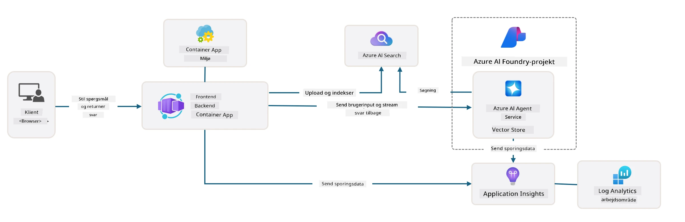

# 3. Nedbryd en Skabelon

!!! tip "VED SLUTNINGEN AF DENNE MODUL VIL DU VÆRE I STAND TIL AT"

    - [ ] Use GitHub Copilot and optional MCP tools for Azure documentation and read-only exploration
    - [ ] Identify the template's application, infrastructure, configuration, and test entry points
    - [ ] Verify generated explanations against actual repository files
    - [ ] **Lab 3:** Trace one request and one configuration input through the project

---

## 1. Aktivér GitHub Copilot

Åbn det initialiserede AI-eksempel i VS Code, og aktivér [GitHub Copilot](https://code.visualstudio.com/docs/copilot/chat/chat-agent-mode). Log ind med en konto, der har en gyldig plan; brugsgrænser varierer. Bed Copilot om at forklare repository'et før du godkender ændringer.

### Valgfri MCP-servere

Disse tjenester kan levere yderligere værktøjer:

- [Azure MCP Server](https://learn.microsoft.com/azure/developer/azure-mcp-server/overview)
- [Microsoft Learn MCP Server](https://learn.microsoft.com/training/support/mcp)

I VS Code, gennemgå [MCP konfigurationsvejledningen](https://code.visualstudio.com/docs/copilot/chat/mcp-servers) og opret `.vscode/mcp.json` hvis nødvendigt:

```json
{
  "servers": {
    "Azure MCP Server": {
      "type": "stdio",
      "command": "npx",
      "args": ["-y", "@azure/mcp@latest", "server", "start"]
    },
    "microsoft.docs.mcp": {
      "type": "http",
      "url": "https://learn.microsoft.com/api/mcp"
    }
  }
}
```

Kommandoen `npx` kræver en understøttet Node.js/npm installation og downloader eksekverbar kode. Gennemgå pakken og fastgør en godkendt version for en reproducerbar teamopsætning. Start serverne ved hjælp af VS Codes MCP-kontroller og inspicer de tilgængelige værktøjer; navnene kan ændre sig mellem versioner.

**Godkendelse er separat.** Brug `azd auth login` for AZD. Følg Azure MCP's dokumenterede godkendelsesflow for dets værktøjer; AZD-login alene etablerer ikke en MCP-session. Brug `az login` separat, når en øvelse eller hook kalder Azure CLI.

Prøv læse- og skrivebeskyttede prompts:

1. "Brug Microsoft Learn MCP til at finde dokumentationen for Azure Developer CLI konfiguration."
2. "Forklar dette repository's `azure.yaml`; angiv de filer der implementerer hver hook."
3. "Ved brug af de tilgængelige Azure MCP værktøjer, list mine deployerede ressourcer uden at ændre noget."

Tjek den valgte tenant/abonnement og hvert foreslået værktøjskald. Godkend ikke oprettelse, sletning eller ændring af adgang til ressourcer blot for at udforske arkitekturen.

## 2. Forstå arkitekturen

Eksemplet huser en Python FastAPI backend og en React/TypeScript frontend i Azure Container Apps. Backend kommunikerer med en agent i et Microsoft Foundry-projekt. Hentning og observabilitet afhænger af de aktiverede skabelonfunktioner og succesfuld opsætning; de er ikke garanteret blot fordi applikationen er deployeret.



Sammenlign dette diagram med den [aktuelt upstream deployment guide](https://github.com/Azure-Samples/get-started-with-ai-agents/blob/main/docs/deployment.md) og dine faktiske ressourcer. Tjek den konfigurerede modeldeployment, agentværktøjer, managed identity, rollefordelinger og valgfrie AI Search/Application Insights ressourcer.

**Øvelse:** Bed Copilot om at spore en chatforespørgsel fra frontend gennem API til Foundry, med fil- og funktionsreferencer. Åbn disse referencer og verificér forklaringen. Drop ikke at udlede implementeret godkendelse, routing eller autorisation kun ud fra et diagram.

## 3. Repository struktur

Følgende udvalgte stier blev kontrolleret mod eksemplet den 4. november 2026. Din initialiserede revision er fortsat den sande kilde:

```text
get-started-with-ai-agents/
  azure.yaml
  docker-compose.yaml
  requirements-dev.txt
  .devcontainer/
  infra/
    main.bicep
    main.parameters.json
    api.bicep
    core/
  src/
    Dockerfile
    pyproject.toml
    requirements.txt
    api/
      main.py
      routes.py
      search_index_manager.py
    frontend/
      package.json
      src/
    files/
  scripts/
    validate_env_vars.sh
    validate_env_vars.ps1
    postdeploy.sh
    postdeploy.ps1
  tests/
    test_evaluation.py
    test_red_teaming.py
  docs/
    deployment.md
    deploy_customization.md
    ai_search.md
    observability.md
    local_development.md
    troubleshooting.md
```

### Infrastruktur og konfiguration

`infra/main.bicep` orkestrerer ressourcer; `main.parameters.json` forbinder skabeloninput til AZD miljøværdier. `azure.yaml` vælger applikationstjenesten og livscyklus-hooks. Spor et input som `USE_AZURE_AI_SEARCH_SERVICE` gennem disse filer for at finde ud af, hvad der faktisk ændres.

### Applikation og identitet

Læs `src/api/` og `src/frontend/` sammen. Identificér, hvor agenten oprettes eller hentes, hvor instruktioner/værktøjer konfigureres, og hvilken identitet hvert Azure-kald bruger. Eksempelfiler under `src/files/` er demonstrationsdata, ikke en produktionskatalog eller autorisationsmodel.

### Tests og observabilitet

De nuværende evaluerings- og red-team adgangspunkter er under `tests/`; ældre `evals/` og `airedteaming/` mappehenvisninger er forældede for dette eksempel. Læs `docs/observability.md` for forudsætninger og omkostninger før du kører cloudtests. Disse Python-tests er adskilt fra den valgfri `azure.ai.evaluations` AZD-udvidelse.

## 4. Verificér dine fund

- Identificér API-ruten, agentinteraktionen og hentningskoden for et eksempelspørgsmål.
- Forklar hvilken identitet der tilgår Foundry og hvilken konfiguration der vælger dens endpoint.
- Find de faktiske pre-up og post-deploy scripts og deres fejlbehandlingsadfærd.
- List eventuelle afhængigheder eller valgfrie funktioner, der mangler i din deployment.

Fortsæt til [Konfigurer en Skabelon](4-Configure-AI-Template.md).

---

<!-- CO-OP TRANSLATOR DISCLAIMER START -->
**Ansvarsfraskrivelse**:
Dette dokument er blevet oversat ved hjælp af AI-oversættelsestjenesten [Co-op Translator](https://github.com/Azure/co-op-translator). Selvom vi bestræber os på nøjagtighed, skal du være opmærksom på, at automatiserede oversættelser kan indeholde fejl eller unøjagtigheder. Det originale dokument på dets oprindelige sprog bør betragtes som den autoritative kilde. For kritisk information anbefales professionel menneskelig oversættelse. Vi påtager os intet ansvar for misforståelser eller fejltolkninger, der opstår som følge af brugen af denne oversættelse.
<!-- CO-OP TRANSLATOR DISCLAIMER END -->