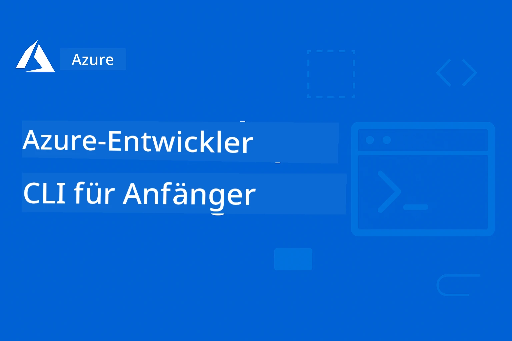

# AZD für Anfänger: Eine strukturierte Lernreise

 

[](https://github.com/microsoft/AZD-for-beginners)
[](https://GitHub.com/microsoft/azd-for-beginners/network/)
[](https://github.com/microsoft/AZD-for-beginners)

[](https://discord.com/invite/nkVh3dp)
[](https://discord.gg/nTYy5BXMWG)

---

### Automatisierte Übersetzungen (immer aktuell)

<!-- CO-OP TRANSLATOR LANGUAGES TABLE START -->
[Arabisch](../ar/README.md) | [Bengalisch](../bn/README.md) | [Bulgarisch](../bg/README.md) | [Birmanisch (Myanmar)](../my/README.md) | [Chinesisch (vereinfacht)](../zh-CN/README.md) | [Chinesisch (traditionell, Hongkong)](../zh-HK/README.md) | [Chinesisch (traditionell, Macau)](../zh-MO/README.md) | [Chinesisch (traditionell, Taiwan)](../zh-TW/README.md) | [Kroatisch](../hr/README.md) | [Tschechisch](../cs/README.md) | [Dänisch](../da/README.md) | [Niederländisch](../nl/README.md) | [Estnisch](../et/README.md) | [Finnisch](../fi/README.md) | [Französisch](../fr/README.md) | [Deutsch](./README.md) | [Griechisch](../el/README.md) | [Hebräisch](../he/README.md) | [Hindi](../hi/README.md) | [Ungarisch](../hu/README.md) | [Indonesisch](../id/README.md) | [Italienisch](../it/README.md) | [Japanisch](../ja/README.md) | [Kannada](../kn/README.md) | [Khmer](../km/README.md) | [Koreanisch](../ko/README.md) | [Litauisch](../lt/README.md) | [Malaiisch](../ms/README.md) | [Malayalam](../ml/README.md) | [Marathi](../mr/README.md) | [Nepalesisch](../ne/README.md) | [Nigerianisches Pidgin](../pcm/README.md) | [Norwegisch](../no/README.md) | [Persisch (Farsi)](../fa/README.md) | [Polnisch](../pl/README.md) | [Portugiesisch (Brasilien)](../pt-BR/README.md) | [Portugiesisch (Portugal)](../pt-PT/README.md) | [Punjabi (Gurmukhi)](../pa/README.md) | [Rumänisch](../ro/README.md) | [Russisch](../ru/README.md) | [Serbisch (Kyrillisch)](../sr/README.md) | [Slowakisch](../sk/README.md) | [Slowenisch](../sl/README.md) | [Spanisch](../es/README.md) | [Swahili](../sw/README.md) | [Schwedisch](../sv/README.md) | [Tagalog (Filipino)](../tl/README.md) | [Tamilisch](../ta/README.md) | [Telugu](../te/README.md) | [Thailändisch](../th/README.md) | [Türkisch](../tr/README.md) | [Ukrainisch](../uk/README.md) | [Urdu](../ur/README.md) | [Vietnamesisch](../vi/README.md)

> **Möchten Sie lieber lokal klonen?**
>
> Dieses Repository enthält Übersetzungen in über 50 Sprachen, was die Downloadgröße erheblich erhöht. Um ohne Übersetzungen zu klonen, verwenden Sie Sparse-Checkout:
>
> **Bash / macOS / Linux:**
> ```bash
> git clone --filter=blob:none --sparse https://github.com/microsoft/AZD-for-beginners.git
> cd AZD-for-beginners
> git sparse-checkout set --no-cone '/*' '!translations' '!translated_images'
> ```
>
> **CMD (Windows):**
> ```cmd
> git clone --filter=blob:none --sparse https://github.com/microsoft/AZD-for-beginners.git
> cd AZD-for-beginners
> git sparse-checkout set --no-cone "/*" "!translations" "!translated_images"
> ```
>
> Dadurch erhalten Sie alles, was Sie benötigen, um den Kurs abzuschließen – mit einem viel schnelleren Download.
<!-- CO-OP TRANSLATOR LANGUAGES TABLE END -->

## 🆕 Was ist heute neu in azd

> 📌 **Foundry GA-Update (09.11.2026):** Das **`microsoft.foundry` 1.0 Bundle ist allgemein verfügbar**, angekündigt am [5. November 2026](https://devblogs.microsoft.com/azure-sdk/microsoft-foundry-azure-developer-cli-ga/). Verwenden Sie **`azd >= 1.37.0`** und installieren Sie es mit `azd ext install microsoft.foundry`. Folgen Sie dem [hosted-agent Walkthrough](docs/chapter-02-ai-development/microsoft-foundry-integration.md#hosted-agent-walkthrough-ga) für Einrichtung, lokalem Testen und Deployment. Dieses Update basiert auf veröffentlichten Anleitungen und nicht auf einer Live-Azure-Bereitstellung; die Bundle-GA macht nicht jede optionale Funktion, Erweiterung oder SDK allgemein verfügbar.

Azure Developer CLI unterstützt viele Anwendungstypen, einschließlich Web-Apps, APIs und KI-Agenten, durch unterstützte Hosts, Vorlagen und Erweiterungen.

Das bedeutet Folgendes für Sie:

- **Ein GA-Bundle für die Foundry-Entwicklung.** `microsoft.foundry` installiert sieben Kern-Erweiterungen, einschließlich Agenten, Projekte und Agent Inspector. Agent-Code und Bereitstellungseinstellungen bleiben zusammen in `azure.yaml`.
- **Lokal testen, dann Ihren Code bereitstellen.** Verwenden Sie `azd ai agent init --deploy-mode code`, `azd provision` und `azd ai agent run`, um lokale Anfragen und Antworten zu inspizieren. Verwenden Sie dann `azd deploy` für einen Remote-Build in Foundry, ohne lokale Container-Builds.
- **Qualität separat messen.** Installieren Sie **`azure.ai.evaluations`** für `azd ai eval generate`, `init` und `run start`; es ist nicht im Bundle enthalten. Behalten Sie geprüfte Datensätze und Bewertungsraster mit Ihrem Code. Ältere Projekte sollten der [Evaluations- und Optimierungs-Migrationsanleitung](docs/chapter-08-production/production-ai-practices.md#evaluation-migration-and-quality-checks) folgen.
- **Konfiguration in CI/CD wiederverwenden.** Nach einem erfolgreichen `azd up` konfigurieren Sie eine Pipeline mit `azd pipeline config`. Installieren Sie das Bundle auf dem Runner und behalten Sie die generierten Authentifizierungs- und Umgebungs-Einstellungen.
- **Glattere alltägliche Grundlagen.** Kürzliche Veröffentlichungen machten `azd init` idempotent (sicher zum erneuten Ausführen), ließen `azd auth login` automatisch veraltete Tokens löschen und fügten eine freundliche `azd tool` Einrichtungsabfrage beim ersten Start hinzu.
- **Der Kern-Workflow hat sich nicht geändert.** Egal, ob Sie eine Todo-App, einen Microservice oder eine Multi-Agent-KI-Lösung bereitstellen, die Befehle sind gleich.

> **Hinweis für Aspire-Nutzer:** Microsoft bezeichnet das Produkt jetzt einfach als **Aspire** (früher „.NET Aspire“). Die AZD Aspire-Unterstützung bleibt unverändert – nur der Name wurde aktualisiert.

Wenn Sie azd bereits verwendet haben, ist die KI-Unterstützung eine natürliche Erweiterung – kein separates Tool oder ein fortgeschrittener Kurs. Wenn Sie neu anfangen, lernen Sie einen Workflow, der für alles funktioniert.

---

## 🚀 Was ist Azure Developer CLI (azd)?

**Azure Developer CLI (azd)** ist ein entwicklerfreundliches Kommandozeilen-Tool, das das Bereitstellen von Anwendungen in Azure einfach macht. Anstatt manuell Dutzende Azure-Ressourcen zu erstellen und zu verbinden, können Sie ganze Anwendungen mit einem einzigen Befehl bereitstellen.

### Das Zauberwort `azd up`

```bash
# This single command does everything:
# ✅ Creates all Azure resources  
# ✅ Configures networking and security
# ✅ Builds your application code
# ✅ Deploys to Azure
# ✅ Gives you a working URL
azd up
```

Die Vorlage liefert die Anwendungs- und Infrastrukturkonfiguration. Erfolgreiche Bereitstellung erfordert dennoch unterstützte Dienste/Modelle, ausreichende Kontingente und Berechtigungen, korrekte Eingaben und Verifizierung der bereitgestellten Anwendung. `azd up` macht eine Vorlage nicht automatisch sicher, konform oder produktionsreif.

---

## ❓ Azure Developer CLI vs Azure CLI: Was ist der Unterschied?

Das ist die häufigste Frage von Anfängern. Hier ist die einfache Antwort:

| Feature | **Azure CLI (`az`)** | **Azure Developer CLI (`azd`)** |
|---------|---------------------|--------------------------------|
| **Zweck** | Verwaltung einzelner Azure-Ressourcen | Bereitstellung kompletter Anwendungen |
| **Denkweise** | Infrastruktur-orientiert | Anwendungs-orientiert |
| **Beispiel** | `az webapp create --name myapp...` | `azd up` |
| **Lernkurve** | Kenntnis von Azure-Diensten erforderlich | Nur Ihre App kennen |
| **Bestens geeignet für** | DevOps, Infrastruktur | Entwickler, Prototyping |

### Einfaches Gleichnis

- **Azure CLI** ist wie alle Werkzeuge zu haben, um ein Haus zu bauen – Hammer, Sägen, Nägel. Man kann alles bauen, braucht aber Bauwissen.
- **Azure Developer CLI** ist wie einen Bauunternehmer zu engagieren – Sie beschreiben, was Sie wollen, und er kümmert sich um den Bau.

### Wann man welches Tool verwendet

| Szenario | Verwenden Sie dies |
|----------|----------|
| „Ich möchte meine Web-App schnell bereitstellen“ | `azd up` |
| „Ich muss nur ein Speicherkonto erstellen“ | `az storage account create` |
| „Ich entwickle eine komplette KI-Anwendung“ | `azd init --template azure-search-openai-demo` |
| „Ich muss eine bestimmte Azure-Ressource debuggen“ | `az resource show` |
| „Ich möchte in meiner konfigurierten Produktionsumgebung bereitstellen“ | Überprüfen Sie Konfiguration, Zugriff, Kosten und Betriebsregeln vor `azd up --environment production` |

### Sie arbeiten zusammen!

AZD und Azure CLI haben separate Authentifizierung und Konfiguration. Verwenden Sie `azd auth login` für AZD und `az login`, wenn ein Hook oder Diagnose-Befehl explizit Azure CLI benötigt. Sie können beide verwenden:
```bash
# Deploy your app with AZD
azd up

# Then fine-tune specific resources with Azure CLI
az webapp config set --name myapp --always-on true
```

---

## 🌟 Finde Vorlagen in Awesome AZD

Nicht von Grund auf neu starten! **Awesome AZD** ist die Community-Sammlung von einsatzbereiten Vorlagen:

| Ressource | Beschreibung |
|----------|-------------|
| 🔗 [**Awesome AZD Gallery**](https://azure.github.io/awesome-azd/) | Durchsuchen Sie 200+ Vorlagen mit Ein-Klick-Bereitstellung |
| 🔗 [**Reichen Sie eine Vorlage ein**](https://github.com/Azure/awesome-azd/issues) | Tragen Sie Ihre eigene Vorlage zur Community bei |
| 🔗 [**GitHub Repository**](https://github.com/Azure/awesome-azd) | Setzen Sie einen Stern und erkunden Sie den Quellcode |

### Beliebte KI-Vorlagen aus Awesome AZD

Wählen Sie eine Vorlage in einem eigenen leeren Verzeichnis; die folgenden Befehle sind Alternativen. Das nachfolgende `.` initialisiert dieses Verzeichnis.

```bash
# RAG Chat with Microsoft Foundry Models + AI Search
azd init --template azure-search-openai-demo .

# Quick AI Chat Application
azd init --template openai-chat-app-quickstart .

# AI Agents with Foundry Agents
azd init --template get-started-with-ai-agents .
```

---

## 🎯 In 3 Schritten starten

Bevor Sie starten, vergewissern Sie sich, dass Ihr Rechner für die Vorlage, die Sie bereitstellen wollen, bereit ist:

**Windows:**
```powershell
.\validate-setup.ps1
```

**macOS / Linux:**
```bash
bash ./validate-setup.sh
```

Wenn eine erforderliche Prüfung fehlschlägt, beheben Sie dies zuerst und fahren Sie dann mit dem Schnellstart fort.

### Schritt 1: Installieren Sie AZD (2 Minuten)

**Windows:**
```powershell
winget install microsoft.azd
```

**macOS:**
```bash
brew tap azure/azd && brew install azd
```

**Linux:**
```bash
curl -fsSL https://aka.ms/install-azd.sh | bash
```

### Schritt 2: Authentifizieren für AZD

```bash
# Optional if you plan to use Azure CLI commands directly in this course
az login

# Required for AZD workflows
azd auth login
```

Wenn Sie nicht sicher sind, welches Sie benötigen, folgen Sie dem vollständigen Einrichtungsablauf in [Installation & Setup](docs/chapter-01-foundation/installation.md#authentication-setup).

### Schritt 3: Bereitstellen Ihrer ersten App

```bash
# Initialize from a template
azd init --template todo-nodejs-mongo .

# Deploy to Azure (creates everything!)
azd up
```

**🎉 Das war's!** Ihre App ist jetzt live auf Azure.

### Aufräumen (Nicht vergessen!)

```bash
# Remove all resources when done experimenting
azd down --force --purge
```

---

## 📚 Wie Sie diesen Kurs verwenden

Dieser Kurs ist für **progressives Lernen** konzipiert – beginnen Sie dort, wo Sie sich wohlfühlen und arbeiten sich nach oben:

| Ihre Erfahrung | Hier beginnen |
|-----------------|------------|
| **Neu bei Azure** | [Kapitel 1: Grundlagen](#-chapter-1-foundation--quick-start) |
| **Kennt Azure, neu bei AZD** | [Kapitel 1: Grundlagen](#-chapter-1-foundation--quick-start) |
| **Möchte KI-Apps bereitstellen** | [Kapitel 2: KI-orientierte Entwicklung](#-chapter-2-ai-first-development-recommended-for-ai-developers) |
| **Möchte praktische Übungen machen** | [🎓 Interaktiver Workshop](workshop/README.md) - 3-4 Stunden geführtes Labor |
| **Benötigt Produktionsmuster** | [Kapitel 8: Produktion & Unternehmen](#-chapter-8-production--enterprise-patterns) |

### Schnelle Einrichtung

1. **Forken Sie dieses Repository**: [](https://GitHub.com/microsoft/azd-for-beginners/fork)
2. **Klonen Sie es**: `git clone https://github.com/YOUR-USERNAME/azd-for-beginners.git`
3. **Holen Sie sich Hilfe**: [Azure Discord Community](https://discord.com/invite/ByRwuEEgH4)

> **Möchten Sie lieber lokal klonen?**

> Dieses Repository enthält über 50 Sprachübersetzungen, die die Downloadgröße erheblich erhöhen. Um ohne Übersetzungen zu klonen, verwenden Sie Sparse Checkout:
> ```bash
> git clone --filter=blob:none --sparse https://github.com/microsoft/AZD-for-beginners.git
> cd AZD-for-beginners
> git sparse-checkout set --no-cone '/*' '!translations' '!translated_images'
> ```
> Dies gibt Ihnen alles, was Sie benötigen, um den Kurs mit einem wesentlich schnelleren Download abzuschließen.


## Kursübersicht

Beherrschen Sie Azure Developer CLI (azd) durch strukturierte Kapitel, die für fortschreitendes Lernen ausgelegt sind. **Besonderer Fokus auf die Bereitstellung von KI-Anwendungen mit Microsoft Foundry-Integration.**

### Warum dieser Kurs für moderne Entwickler unerlässlich ist

Entwickler, die KI-Workloads bereitstellen, benötigen häufig Anleitung zu:
- Komplexe mehrdienstliche KI-Architekturen
- Best Practices für die Produktionsbereitstellung von KI  
- Azure KI-Service-Integration und -Konfiguration
- Kostenoptimierung für KI-Workloads
- Fehlerbehebung bei KI-spezifischen Bereitstellungsproblemen

### Lernziele

Mit dem Abschluss dieses strukturierten Kurses werden Sie:
- **AZD-Grundlagen meistern**: Kernkonzepte, Installation und Konfiguration
- **KI-Anwendungen bereitstellen**: Nutzen Sie AZD mit Microsoft Foundry-Services
- **Infrastructure as Code umsetzen**: Verwalten Sie Azure-Ressourcen mit Bicep-Vorlagen
- **Bereitstellungen beheben**: Beheben Sie häufige Probleme und debuggen Sie Fehler
- **Für die Produktion optimieren**: Sicherheit, Skalierung, Überwachung und Kostenmanagement
- **Multi-Agent-Lösungen erstellen**: Bereitstellung komplexer KI-Architekturen

## Bevor Sie beginnen: Konten, Zugriffe und Voraussetzungen

Bevor Sie mit Kapitel 1 starten, stellen Sie sicher, dass Sie Folgendes eingerichtet haben. Die Installationsschritte in diesem Leitfaden gehen davon aus, dass diese Grundlagen bereits vorhanden sind.

- **Ein Azure-Abonnement**: Sie können ein bestehendes Abonnement von der Arbeit oder Ihrem eigenen Konto verwenden oder eine [kostenlose Testversion](https://aka.ms/azurefreetrial) erstellen, um zu starten.
- **Berechtigung zum Erstellen von Azure-Ressourcen**: Für die meisten Übungen sollten Sie mindestens **Mitwirkenden**-Zugriff auf das Zielabonnement oder die Ressourcengruppe haben. Einige Kapitel setzen voraus, dass Sie Ressourcengruppen, verwaltete Identitäten und RBAC-Zuweisungen erstellen können.
- [**Ein GitHub-Konto**](https://github.com): Dies ist nützlich, um das Repository zu forken, Ihre eigenen Änderungen zu verfolgen und GitHub Codespaces für den Workshop zu nutzen.
- **Voraussetzungen für die Template-Laufzeit**: Einige Vorlagen benötigen lokale Tools wie Node.js, Python, Java oder Docker. Führen Sie den Einrichtungsprüfer vor dem Start aus, um fehlende Tools frühzeitig zu erkennen.
- **Grundkenntnisse im Terminal**: Sie müssen kein Experte sein, sollten aber in der Lage sein, Befehle wie `git clone`, `azd auth login` und `azd up` auszuführen.

> **Arbeiten Sie in einem Unternehmenskonto?**
> Wenn Ihre Azure-Umgebung von einem Administrator verwaltet wird, bestätigen Sie im Voraus, dass Sie Ressourcen in dem Abonnement oder der Ressourcengruppe bereitstellen können, die Sie verwenden möchten. Falls nicht, bitten Sie um ein Sandbox-Abonnement oder Contributor-Zugriff, bevor Sie beginnen.

> **Neu bei Azure?**
> Starten Sie mit Ihrem eigenen Azure-Testabonnement oder dem Abonnement "Pay-as-you-go" unter https://aka.ms/azurefreetrial, damit Sie die Übungen vollständig und ohne Wartezeiten auf Mandantenebene durchführen können.

## 🗺️ Kursübersicht: Schnelle Navigation nach Kapiteln

Jedes Kapitel hat eine eigene README mit Lernzielen, Schnellstarts und Übungen:

| Kapitel | Thema | Lektionen | Dauer | Komplexität |
|---------|-------|---------|----------|------------|
| **[Kap 1: Grundlagen](docs/chapter-01-foundation/README.md)** | Einstieg | [AZD Grundlagen](docs/chapter-01-foundation/azd-basics.md) &#124; [Installation](docs/chapter-01-foundation/installation.md) &#124; [Erstes Projekt](docs/chapter-01-foundation/first-project.md) | 30-45 Min. | ⭐ |
| **[Kap 2: KI-Entwicklung](docs/chapter-02-ai-development/README.md)** | KI-first Apps | [Foundry-Integration](docs/chapter-02-ai-development/microsoft-foundry-integration.md) &#124; [KI-Agenten](docs/chapter-02-ai-development/agents.md) &#124; [Modellbereitstellung](docs/chapter-02-ai-development/ai-model-deployment.md) &#124; [Workshop](docs/chapter-02-ai-development/ai-workshop-lab.md) | 1-2 Std. | ⭐⭐ |
| **[Kap 3: Konfiguration](docs/chapter-03-configuration/README.md)** | Auth & Sicherheit | [Konfiguration](docs/chapter-03-configuration/configuration.md) &#124; [Auth & Sicherheit](docs/chapter-03-configuration/authsecurity.md) | 45-60 Min. | ⭐⭐ |
| **[Kap 4: Infrastruktur](docs/chapter-04-infrastructure/README.md)** | IaC & Bereitstellung | [Bereitstellungsanleitung](docs/chapter-04-infrastructure/deployment-guide.md) &#124; [Provisionierung](docs/chapter-04-infrastructure/provisioning.md) | 1-1,5 Std. | ⭐⭐⭐ |
| **[Kap 5: Multi-Agent](docs/chapter-05-multi-agent/README.md)** | KI-Agenten-Lösungen | [Handelsszenario](examples/retail-scenario.md) &#124; [Koordinationsmuster](docs/chapter-06-pre-deployment/coordination-patterns.md) | 2-3 Std. | ⭐⭐⭐⭐ |
| **[Kap 6: Vor-Bereitstellung](docs/chapter-06-pre-deployment/README.md)** | Planung & Validierung | [Preflight-Checks](docs/chapter-06-pre-deployment/preflight-checks.md) &#124; [Kapazitätsplanung](docs/chapter-06-pre-deployment/capacity-planning.md) &#124; [SKU-Auswahl](docs/chapter-06-pre-deployment/sku-selection.md) &#124; [App Insights](docs/chapter-06-pre-deployment/application-insights.md) | 1 Std. | ⭐⭐ |
| **[Kap 7: Fehlerbehebung](docs/chapter-07-troubleshooting/README.md)** | Debugging & Fehlerbehebung | [Häufige Probleme](docs/chapter-07-troubleshooting/common-issues.md) &#124; [Debugging](docs/chapter-07-troubleshooting/debugging.md) &#124; [KI-Probleme](docs/chapter-07-troubleshooting/ai-troubleshooting.md) | 1-1,5 Std. | ⭐⭐ |
| **[Kap 8: Produktion](docs/chapter-08-production/README.md)** | Unternehmensmuster | [Produktionspraktiken](docs/chapter-08-production/production-ai-practices.md) | 2-3 Std. | ⭐⭐⭐⭐ |
| **[🎓 Workshop](workshop/README.md)** | Praxislabor | [Einführung](workshop/docs/instructions/0-Introduction.md) &#124; [Auswahl](workshop/docs/instructions/1-Select-AI-Template.md) &#124; [Validierung](workshop/docs/instructions/2-Validate-AI-Template.md) &#124; [Dekonstruktion](workshop/docs/instructions/3-Deconstruct-AI-Template.md) &#124; [Konfiguration](workshop/docs/instructions/4-Configure-AI-Template.md) &#124; [Anpassung](workshop/docs/instructions/5-Customize-AI-Template.md) &#124; [Abbau](workshop/docs/instructions/6-Teardown-Infrastructure.md) &#124; [Abschluss](workshop/docs/instructions/7-Wrap-up.md) | 3-4 Std. | ⭐⭐ |

**Gesamtdauer des Kurses:** ca. 10-14 Stunden | **Fähigkeitsfortschritt:** Anfänger → Produktionsreif

---

## 📚 Lernkapitel

*Wählen Sie Ihren Lernpfad basierend auf Erfahrungsniveau und Zielen*

### 🚀 Kapitel 1: Grundlagen & Schnellstart
**Voraussetzungen**: Azure-Abonnement, Grundkenntnisse in der Kommandozeile  
**Dauer**: 30-45 Minuten  
**Komplexität**: ⭐

#### Was Sie lernen werden
- Grundlagen der Azure Developer CLI verstehen
- AZD auf Ihrer Plattform installieren
- Ihre erste erfolgreiche Bereitstellung

#### Lernressourcen
- **🎯 Start hier**: [Was ist Azure Developer CLI?](#-what-is-azure-developer-cli-azd)
- **📖 Theorie**: [AZD Grundlagen](docs/chapter-01-foundation/azd-basics.md) - Kernkonzepte und Terminologie
- **⚙️ Einrichtung**: [Installation & Einrichtung](docs/chapter-01-foundation/installation.md) - Plattform-spezifische Anleitungen
- **🛠️ Praxis**: [Ihr erstes Projekt](docs/chapter-01-foundation/first-project.md) - Schritt-für-Schritt-Anleitung
- **📋 Schnelle Referenz**: [Befehlsübersicht](resources/cheat-sheet.md)

#### Praktische Übungen
```bash
# Quick installation check
azd version

# Deploy your first application
azd init --template todo-nodejs-mongo .
azd up
```

**💡 Kapitel-Ergebnis**: Erfolgreiche Bereitstellung einer einfachen Webanwendung in Azure mit AZD

**✅ Erfolgskontrolle:**
```bash
# After completing Chapter 1, you should be able to:
azd version              # Shows installed version
azd init --template todo-nodejs-mongo  # Initializes project
azd up                  # Deploys to Azure
azd show                # Displays running app URL
# Application opens in browser and works
azd down --force --purge  # Cleans up resources
```

**📊 Zeitaufwand:** 30-45 Minuten  
**📈 Fähigkeitsniveau danach:** Kann grundlegende Anwendungen selbstständig bereitstellen

---

### 🤖 Kapitel 2: KI-first Entwicklung (Empfohlen für KI-Entwickler)
**Voraussetzungen**: Kapitel 1 abgeschlossen  
**Dauer**: 1-2 Stunden  
**Komplexität**: ⭐⭐

#### Was Sie lernen werden
- Microsoft Foundry Integration mit AZD
- Bereitstellung KI-gestützter Anwendungen
- Verständnis der KI-Service-Konfigurationen

#### Lernressourcen
- **🎯 Start hier**: [Microsoft Foundry Integration](docs/chapter-02-ai-development/microsoft-foundry-integration.md)
- **🤖 KI-Agenten**: [KI-Agenten-Leitfaden](docs/chapter-02-ai-development/agents.md) - Intelligente Agenten mit AZD bereitstellen
- **📖 Muster**: [Bereitstellung KI-Modelle](docs/chapter-02-ai-development/ai-model-deployment.md) - KI-Modelle bereitstellen und verwalten
- **🛠️ Workshop**: [KI-Workshop-Labor](docs/chapter-02-ai-development/ai-workshop-lab.md) - Machen Sie Ihre KI-Lösungen AZD-bereit
- **🎥 Interaktiver Leitfaden**: [Workshop-Materialien](workshop/README.md) - Browserbasiertes Lernen mit MkDocs * DevContainer-Umgebung
- **📋 Vorlagen**: [Microsoft Foundry Vorlagen](#featured-microsoft-foundry-templates)
- **📝 Beispiele**: [AZD Bereitstellungsbeispiele](examples/README.md)

#### Praktische Übungen
```bash
# Deploy your first AI application
azd init --template azure-search-openai-demo .
azd up

# Try additional AI templates
azd init --template openai-chat-app-quickstart .
azd init --template agent-openai-python-prompty .
```

**💡 Kapitel-Ergebnis**: Bereitstellung und Konfiguration einer KI-gestützten Chat-Anwendung mit RAG-Funktionalität

**✅ Erfolgskontrolle:**
```bash
# After Chapter 2, you should be able to:
azd init --template azure-search-openai-demo .
azd up
# Test the AI chat interface
# Ask questions and get AI-powered responses with sources
# Verify search integration works
azd monitor  # Check Application Insights shows telemetry
azd down --force --purge
```

**📊 Zeitaufwand:** 1-2 Stunden  
**📈 Fähigkeitsniveau danach:** Kann KI-Lernanwendungen bereitstellen und zusätzliche Produktionsreife-Anforderungen identifizieren
**💰 Kostenbewusstsein:** Verstehen von Entwicklerkosten ca. $80-150/Monat, Produktionskosten ca. $300-3500/Monat

#### 💰 Kostenüberlegungen für KI-Bereitstellungen

**Entwicklungsumgebung (geschätzt $80-150/Monat):**
- Microsoft Foundry Modelle (Pay-as-you-go): $0-50/Monat (abhängig von Token-Nutzung)
- KI-Suche (Basistarif): $75/Monat
- Container-Apps (Consumption): $0-20/Monat
- Speicher (Standard): $1-5/Monat

**Produktionsumgebung (geschätzt $300-3.500+/Monat):**
- Microsoft Foundry Modelle (PTU für konstante Leistung): $3.000+/Monat ODER pay-as-you-go mit hohem Volumen
- KI-Suche (Standardtarif): $250/Monat
- Container-Apps (Dediziert): $50-100/Monat
- Application Insights: $5-50/Monat
- Speicher (Premium): $10-50/Monat

**💡 Tipps zur Kostenoptimierung:**
- Prüfen Sie die Preisgestaltung für Modellinferenz und kontospezifische Credits; Azure OpenAI beinhaltet keine universelle 50.000-Token-monatliche kostenlose Freigrenze
- Führen Sie `azd down` aus, um Ressourcen zu löschen, wenn sie nicht mehr benötigt werden, nachdem Sie die ausgewählte Umgebung überprüft haben
- Beginnen Sie mit nutzungsabhängiger Abrechnung, upgraden Sie PTU nur für die Produktion
- Verwenden Sie `azd provision --preview`, um die geplante Infrastruktur zu inspizieren und anschließend die entstehenden Ressourcen mit dem Azure-Preiskalkulator zu kalkulieren
- Aktivieren Sie die automatische Skalierung: Zahlen Sie nur für die tatsächliche Nutzung

**Kostenüberwachung:**
```bash
# Inspect planned resources (this does not calculate prices)
azd provision --preview

# Monitor actual costs in Azure Portal
az consumption budget list --resource-group <your-rg>
```

---

### ⚙️ Kapitel 3: Konfiguration & Authentifizierung
**Voraussetzungen**: Kapitel 1 abgeschlossen  
**Dauer**: 45-60 Minuten  
**Komplexität**: ⭐⭐

#### Was Sie lernen werden
- Umgebungs-Konfiguration und Verwaltung
- Authentifizierungs- und Sicherheitsbest Practices
- Benennung und Organisation von Ressourcen

#### Lernressourcen
- **📖 Konfiguration**: [Konfigurationsleitfaden](docs/chapter-03-configuration/configuration.md) - Umgebungssetup
- **🔐 Sicherheit**: [Authentifizierungsmuster und verwaltete Identität](docs/chapter-03-configuration/authsecurity.md) - Authentifizierungsmuster
- **📝 Beispiele**: [Datenbank-Anwendungsbeispiel](examples/database-app/README.md) - AZD Datenbank-Beispiele

#### Praktische Übungen
- Konfigurieren mehrerer Umgebungen (Dev, Staging, Prod)
- Einrichten der Authentifizierung mit verwalteter Identität
- Implementieren umgebungsspezifischer Konfigurationen

**💡 Kapitel-Ergebnis**: Verwaltung mehrerer Umgebungen mit korrekter Authentifizierung und Sicherheit

---

### 🏗️ Kapitel 4: Infrastructure as Code & Bereitstellung
**Voraussetzungen**: Kapitel 1-3 abgeschlossen  
**Dauer**: 1-1,5 Stunden  
**Komplexität**: ⭐⭐⭐

#### Was Sie lernen werden
- Erweiterte Bereitstellungsmuster
- Infrastructure as Code mit Bicep
- Strategien zur Ressourcenbereitstellung

#### Lernressourcen
- **📖 Bereitstellung**: [Bereitstellungsleitfaden](docs/chapter-04-infrastructure/deployment-guide.md) - Komplett-Workflows
- **🏗️ Provisionierung**: [Ressourcenbereitstellung](docs/chapter-04-infrastructure/provisioning.md) - Azure-Ressourcenverwaltung
- **📝 Beispiele**: [Container-App-Beispiel](../../examples/container-app) - Containerisierte Bereitstellungen

#### Praktische Übungen
- Eigene Bicep-Vorlagen erstellen
- Mehrdienstliche Anwendungen bereitstellen
- Blue-Green-Bereitstellungsstrategien implementieren

**💡 Kapitel-Ergebnis**: Bereitstellung komplexer mehrdienstlicher Anwendungen mit eigenen Infrastrukturvorlagen

---

### 🎯 Kapitel 5: Multi-Agent KI-Lösungen (Fortgeschritten)
**Voraussetzungen**: Kapitel 1-2 abgeschlossen  
**Dauer**: 2-3 Stunden  
**Komplexität**: ⭐⭐⭐⭐

#### Was Sie lernen werden
- Multi-Agent-Architektur-Muster
- Agenten-Orchestrierung und -Koordination
- Produktionsreife KI-Bereitstellungen

#### Lernressourcen
- **🤖 Vorgestelltes Design**: [Retail Multi-Agent Solution](examples/retail-scenario.md) - Architektur-Blueprint, keine vollständige Anwendung
- **🛠️ ARM-Vorlagen**: [ARM Template Package](../../examples/retail-multiagent-arm-template) - Infrastruktur-Grundgerüst; Voraussetzungen und fehlende Anwendungskomponenten überprüfen
- **📖 Architektur**: [Multi-agent coordination patterns](docs/chapter-06-pre-deployment/coordination-patterns.md) - Muster

#### Praktische Übungen
```bash
# Inspect the retail infrastructure scaffold before choosing to deploy it
cd examples/retail-multiagent-arm-template
cat README.md

# After an intentional deployment, inspect infrastructure state
az deployment group show --resource-group <rg-name> --name <deployment-name>
```

**💡 Kapitelziel**: Multi-Agent-Design verstehen und die Implementierungs-, Validierungs- und Betriebsaufwände jenseits eines Infrastruktur-Gerüsts erkennen

---

### 🔍 Kapitel 6: Validierung & Planung vor der Bereitstellung
**Voraussetzungen**: Kapitel 4 abgeschlossen  
**Dauer**: 1 Stunde  
**Komplexität**: ⭐⭐

#### Das werden Sie lernen
- Kapazitätsplanung und Ressourcenvalidierung
- SKU-Auswahlstrategien
- Vorab-Checks und Automatisierung

#### Lernressourcen
- **📊 Planung**: [Capacity Planning](docs/chapter-06-pre-deployment/capacity-planning.md) - Ressourcenvalidierung
- **💰 Auswahl**: [SKU Selection](docs/chapter-06-pre-deployment/sku-selection.md) - Kostenoptimierte Entscheidungen
- **✅ Validierung**: [Pre-flight Checks](docs/chapter-06-pre-deployment/preflight-checks.md) - Automatisierte Skripte

#### Praktische Übungen
- Kapazitätsvalidierungsskripte ausführen
- SKU-Auswahl für Kostenoptimierung anpassen
- Automatisierte Vorbereitungsprüfungen implementieren

**💡 Kapitelziel**: Bereitstellungen vor der Ausführung validieren und optimieren

---

### 🚨 Kapitel 7: Fehlersuche & Debugging
**Voraussetzungen**: Beliebiges Bereitstellungskapitel abgeschlossen  
**Dauer**: 1-1,5 Stunden  
**Komplexität**: ⭐⭐

#### Das werden Sie lernen
- Systematische Debugging-Ansätze
- Häufige Probleme und Lösungen
- KI-spezifische Fehlerbehebung

#### Lernressourcen
- **🔧 Häufige Probleme**: [Common Issues](docs/chapter-07-troubleshooting/common-issues.md) - FAQ und Lösungen
- **🕵️ Debugging**: [Debugging Guide](docs/chapter-07-troubleshooting/debugging.md) - Schritt-für-Schritt-Strategien
- **🤖 KI-Probleme**: [AI-Specific Troubleshooting](docs/chapter-07-troubleshooting/ai-troubleshooting.md) - KI-Diensteprobleme

#### Praktische Übungen
- Fehler bei Bereitstellungen diagnostizieren
- Authentifizierungsprobleme lösen
- KI-Dienst-Verbindung debuggen

**💡 Kapitelziel**: Häufige Bereitstellungsprobleme selbständig diagnostizieren und beheben

---

### 🏢 Kapitel 8: Produktions- & Unternehmensmuster
**Voraussetzungen**: Kapitel 1-4 abgeschlossen  
**Dauer**: 2-3 Stunden  
**Komplexität**: ⭐⭐⭐⭐

#### Das werden Sie lernen
- Strategien für Produktionsbereitstellung
- Unternehmenssicherheitsmuster
- Überwachung und Kostenoptimierung

#### Lernressourcen
- **🏭 Produktion**: [Production AI Best Practices](docs/chapter-08-production/production-ai-practices.md) - Unternehmensmuster
- **📝 Beispiele**: [Microservices Example](../../examples/microservices) - Komplexe Architekturen
- **📊 Überwachung**: [Application Insights integration](docs/chapter-06-pre-deployment/application-insights.md) - Monitoring

#### Praktische Übungen
- Unternehmenssicherheitsmuster implementieren
- Umfassende Überwachung einrichten
- Produktion mit geeigneter Steuerung bereitstellen

**💡 Kapitelziel**: Produktionsbereite Unternehmensanwendungen mit vollständigen Produktionsfähigkeiten bereitstellen

---

## 🎓 Workshop-Übersicht: Praxisorientiertes Lernerlebnis

> **⚠️ WORKSHOP-STATUS: Aktive Entwicklung**  
> Die Workshop-Materialien werden derzeit entwickelt und verbessert. Kernmodule sind funktionsfähig, aber einige fortgeschrittene Abschnitte sind unvollständig. Wir arbeiten aktiv daran, alle Inhalte abzuschließen. [Fortschritt verfolgen →](workshop/README.md)

### Interaktive Workshop-Materialien
**Umfassendes praxisorientiertes Lernen mit browserbasierten Tools und geführten Übungen**

Unsere Workshop-Materialien bieten ein strukturiertes, interaktives Lernerlebnis, das den kapitelbasierten Lehrplan oben ergänzt. Der Workshop ist für selbstgesteuertes Lernen sowie für betreute Sitzungen ausgelegt.

#### 🛠️ Workshop-Features
- **Browserbasierte Oberfläche**: Vollständiger MkDocs-gestützter Workshop mit Suche, Kopier- und Theme-Funktionen
- **GitHub Codespaces Integration**: Ein-Klick-Setup der Entwicklungsumgebung
- **Strukturierter Lernpfad**: 8-module geführte Übungen (insgesamt 3-4 Stunden)
- **Progressive Methodik**: Einführung → Auswahl → Validierung → Zerlegung → Konfiguration → Anpassung → Abbau → Abschluss
- **Interaktive DevContainer-Umgebung**: Vorgefertigte Tools und Abhängigkeiten

#### 📚 Workshop-Modulstruktur
Der Workshop folgt einer **8-moduligen progressiven Methodik**, die Sie von der Entdeckung bis zur Beherrschung der Bereitstellung führt:

| Modul | Thema | Was Sie tun werden | Dauer |
|--------|-------|------------------|--------|
| **0. Einführung** | Workshop-Übersicht | Lernziele, Voraussetzungen und Workshop-Struktur verstehen | 15 Min |
| **1. Auswahl** | Template-Erkundung | AZD-Vorlagen erkunden und die richtige KI-Vorlage für Ihr Szenario wählen | 20 Min |
| **2. Validierung** | Bereitstellen & Überprüfen | Vorlage mit `azd up` bereitstellen und Infrastruktur validieren | 30 Min |
| **3. Zerlegung** | Struktur verstehen | GitHub Copilot nutzen, um Template-Architektur, Bicep-Dateien und Codeorganisation zu erkunden | 30 Min |
| **4. Konfiguration** | azure.yaml Deep Dive | `azure.yaml`-Konfiguration, Lifecycle-Hooks und Umgebungsvariablen beherrschen | 30 Min |
| **5. Anpassung** | Anpassen | KI-Suche, Tracing, Evaluierung aktivieren und für Ihr Szenario anpassen | 45 Min |
| **6. Abbau** | Aufräumen | Ressourcen sicher mit `azd down --purge` abbauen | 15 Min |
| **7. Abschluss** | Nächste Schritte | Erreichte Ziele, Schlüsselkonzepte überprüfen und Lernreise fortsetzen | 15 Min |

**Workshop-Ablauf:**
```
Introduction → Selection → Validation → Deconstruction → Configuration → Customization → Teardown → Wrap-up
     ↓            ↓           ↓              ↓               ↓              ↓            ↓           ↓
  Overview    Find the     Deploy &      Explore        Master         Customize     Clean up    Review &
             right        verify        code &        azure.yaml      for your      resources   next steps
             template                   structure                     scenario
```

#### 🚀 Einstieg in den Workshop
```bash
# Option 1: GitHub Codespaces (Recommended)
# Click "Code" → "Create codespace on main" in the repository

# Option 2: Local Development
git clone https://github.com/microsoft/azd-for-beginners.git
cd azd-for-beginners/workshop
# Follow the setup instructions in workshop/README.md
```

#### 🎯 Workshop-Lernergebnisse
Durch den Abschluss des Workshops werden die Teilnehmer:
- **Produktionsfähige KI-Anwendungen bereitstellen**: AZD mit Microsoft Foundry Services verwenden
- **Multi-Agent-Architekturen beherrschen**: Koordinierte KI-Agenten-Lösungen implementieren
- **Sicherheitsbest Practices umsetzen**: Authentifizierung und Zugriffskontrolle konfigurieren
- **Für Skalierung optimieren**: Kostenoptimierte, leistungsfähige Bereitstellungen entwerfen
- **Bereitstellungsprobleme beheben**: Häufige Probleme selbständig lösen

#### 📖 Workshop-Ressourcen
- **🎥 Interaktiver Leitfaden**: [Workshop Materials](workshop/README.md) - Browserbasiertes Lernumfeld
- **📋 Modul-für-Modul-Anleitungen**:
  - [0. Einführung](workshop/docs/instructions/0-Introduction.md) - Workshop-Übersicht und Ziele
  - [1. Auswahl](workshop/docs/instructions/1-Select-AI-Template.md) - KI-Vorlagen finden und auswählen
  - [2. Validierung](workshop/docs/instructions/2-Validate-AI-Template.md) - Bereitstellen und Vorlagen überprüfen
  - [3. Zerlegung](workshop/docs/instructions/3-Deconstruct-AI-Template.md) - Template-Architektur erkunden
  - [4. Konfiguration](workshop/docs/instructions/4-Configure-AI-Template.md) - azure.yaml meistern
  - [5. Anpassung](workshop/docs/instructions/5-Customize-AI-Template.md) - Anpassung für Ihr Szenario
  - [6. Abbau](workshop/docs/instructions/6-Teardown-Infrastructure.md) - Ressourcen aufräumen
  - [7. Abschluss](workshop/docs/instructions/7-Wrap-up.md) - Rückblick und nächste Schritte
- **🛠️ KI-Workshop-Labor**: [AI Workshop Lab](docs/chapter-02-ai-development/ai-workshop-lab.md) - KI-spezifische Übungen
- **💡 Schnellstart**: [Workshop Setup Guide](workshop/README.md#browser-based-guide) - Umfeldkonfiguration

**Perfekt für**: Unternehmensschulungen, Universitätskurse, Selbststudium und Entwickler-Bootcamps.

---

## 📖 Vertiefung: AZD-Fähigkeiten

Über die Grundlagen hinaus bietet AZD leistungsfähige Funktionen für Produktionsbereitstellungen:

- **Vorlagenbasierte Bereitstellungen** - Vorgefertigte Vorlagen für gängige Anwendungsmuster nutzen
- **Infrastructure as Code** - Azure-Ressourcen mit Bicep oder Terraform verwalten  
- **Integrierte Workflows** - Anwendungen nahtlos bereitstellen, deployen und überwachen
- **Entwicklerfreundlich** - Für Produktivität und Experience optimiert

### **AZD + Microsoft Foundry: Ideal für KI-Bereitstellungen**

**Warum AZD für KI-Lösungen?** AZD adressiert die größten Herausforderungen von KI-Entwicklern:

- **KI-fertige Vorlagen** - Vorgefertigte Vorlagen für Microsoft Foundry Modelle, Azure KI-Dienste und ML-Workloads
- **Sichere KI-Bereitstellungen** - Eingebaute Sicherheitsmuster für KI-Dienste, API-Schlüssel und Modellendpunkte  
- **Produktions-KI-Muster** - Best Practices für skalierbare, kosteneffiziente KI-Anwendungsbereitstellungen
- **End-to-End KI-Workflows** - Vom Modell-Development bis zur Produktionsbereitstellung mit angemessenem Monitoring
- **Kostenoptimierung** - Intelligente Ressourcenallokation und Skalierungsstrategien für KI-Workloads
- **Microsoft Foundry Integration** - Nahtlose Verbindung zum Microsoft Foundry Modellkatalog und Endpunkten

---

## 🎯 Vorlagen- & Beispielbibliothek

### Vorgestellt: Microsoft Foundry Vorlagen
**Hier starten, wenn Sie KI-Anwendungen bereitstellen!**

> **Hinweis:** Diese Vorlagen demonstrieren verschiedene KI-Muster. Einige sind externe Azure-Samples, andere lokale Implementierungen.

| Vorlage | Kapitel | Komplexität | Dienste | Typ |
|----------|---------|------------|----------|------|
| [**Erste Schritte mit KI-Chat**](https://github.com/Azure-Samples/get-started-with-ai-chat) | Kapitel 2 | ⭐⭐ | AzureOpenAI + Azure AI Model Inference API + Azure AI Search + Azure Container Apps + Application Insights | Extern |
| [**Erste Schritte mit KI-Agenten**](https://github.com/Azure-Samples/get-started-with-ai-agents) | Kapitel 2 | ⭐⭐ | Foundry Agents + AzureOpenAI + Azure AI Search + Azure Container Apps + Application Insights | Extern |
| [**Azure Search + OpenAI Demo**](https://github.com/Azure-Samples/azure-search-openai-demo) | Kapitel 2 | ⭐⭐ | Azure OpenAI + Azure AI Search + Container Apps (Standard) + Storage | Extern |
| [**OpenAI Chat App Schnellstart**](https://github.com/Azure-Samples/openai-chat-app-quickstart) | Kapitel 2 | ⭐ | AzureOpenAI + Container Apps + Application Insights | Extern |
| [**Agent OpenAI Python Prompty**](https://github.com/Azure-Samples/agent-openai-python-prompty) | Kapitel 5 | ⭐⭐⭐ | AzureOpenAI + Azure Functions + Prompty | Extern |
| [**Contoso Chat RAG**](https://github.com/Azure-Samples/contoso-chat) | Kapitel 8 | ⭐⭐⭐⭐ | AzureOpenAI + KI-Suche + Cosmos DB + Container Apps | Extern |
| [**Retail Multi-Agent Solution**](examples/retail-scenario.md) | Kapitel 5 | ⭐⭐⭐⭐ | Vorgeschlagene Architektur und Infrastruktur-Gerüst; Anwendungsimplementierung erforderlich | **Lokaler Blueprint** |

### Vorgestellt: Komplett-Lernszenarien
**Produktionsreife Anwendungsvorlagen passend zu den Lernkapiteln**

| Vorlage | Lernkapitel | Komplexität | Schlüssel-Lernziel |
|----------|------------------|------------|-------------------|
| [**openai-chat-app-quickstart**](https://github.com/Azure-Samples/openai-chat-app-quickstart) | Kapitel 2 | ⭐ | Grundlegende KI-Bereitstellungsmuster |
| [**azure-search-openai-demo**](https://github.com/Azure-Samples/azure-search-openai-demo) | Kapitel 2 | ⭐⭐ | RAG-Implementierung mit Azure AI Search |
| [**get-started-with-ai-agents**](https://github.com/Azure-Samples/get-started-with-ai-agents) | Kapitel 2 | ⭐⭐ | Agent-gestützter Chat und szenariospezifische Evaluierungstests |
| [**agent-openai-python-prompty**](https://github.com/Azure-Samples/agent-openai-python-prompty) | Kapitel 5 | ⭐⭐⭐ | Agentenframework und Funktionsaufrufe |
| [**contoso-chat**](https://github.com/Azure-Samples/contoso-chat) | Kapitel 8 | ⭐⭐⭐ | Unternehmensweite KI-Orchestrierung |
| [**retail-multi-agent-solution**](examples/retail-scenario.md) | Kapitel 5 | ⭐⭐⭐⭐ | Multi-Agenten-Architektur mit Kunden- und Bestandsagenten |

### Lernen nach Beispieltyp

> **📌 Lokale vs. Externe Beispiele:**  
> **Lokale Beispiele** (in diesem Repo) = README des Beispiels für Implementierungsstatus und Voraussetzungen lesen
> **Externe Beispiele** (Azure Samples) = Aus verlinkten Repositories klonen

#### Lokale Beispiele (einsatzbereit)
- [**Retail Multi-Agent Solution**](examples/retail-scenario.md) - Architektur-Blueprint mit ARM-Infrastruktur-Grundgerüst
  - Vorgeschlagene Kunden- und Bestandsagenten-Rollen
  - Überwachung, Evaluierung und Anwendungs-Code müssen implementiert und geprüft werden
  - Nur das Bereitstellen der Ressourcen erzeugt keine funktionierende Handelsanwendung

#### Lokale Beispiele - Container-Anwendungen (Kapitel 2-5)
**Umfassende Container-Bereitstellungsbeispiele in diesem Repository:**
- [**Container App Beispiele**](examples/container-app/README.md) - Komplettanleitung zu containerisierten Bereitstellungen
  - [Einfache Flask-API](../../examples/container-app/simple-flask-api) - Basis-REST-API mit Scale-to-Zero
  - [Microservices-Architektur](../../examples/container-app/microservices) - Zwei-Service-Lernprobe; Produktionshärtung ist Zusatzarbeit
  - Schnellstart-, Produktions- und erweiterte Bereitstellungsmuster
  - Überwachungs-, Sicherheits- und Kosten-Optimierungsanleitungen

#### Externe Beispiele - Einfache Anwendungen (Kapitel 1-2)
**Diese Azure Samples Repositories klonen, um zu starten:**
- [Einfache Web App - Node.js + MongoDB](https://github.com/Azure-Samples/todo-nodejs-mongo) - Grundlegende Bereitstellungsmuster
- [Statische Website - React SPA](https://github.com/Azure-Samples/todo-csharp-sql-swa-func) - Statische Inhaltsbereitstellung
- [Container-App - Python Flask](https://github.com/Azure-Samples/container-apps-store-api-microservice) - REST-API-Bereitstellung

#### Externe Beispiele - Datenbankintegration (Kapitel 3-4)  
- [Datenbank-App - C# + SQL](https://github.com/Azure-Samples/todo-csharp-sql) - Datenbankkonnektivitätsmuster
- [Functions + Cosmos DB](https://github.com/Azure-Samples/todo-python-mongo-swa-func) - Serverloser Datenworkflow

#### Externe Beispiele - Erweiterte Muster (Kapitel 4-8)
- [Java Microservices](https://github.com/Azure-Samples/java-microservices-aca-lab) - Mehrdienstarchitekturen
- [Container Apps Jobs](https://github.com/Azure-Samples/container-apps-jobs) - Hintergrundverarbeitung  
- [Enterprise ML Pipeline](https://github.com/Azure/mlops-v2) - MLOps-Referenzmuster; keine einsatzbereite AZD-Vorlage

### Externe Vorlagen-Sammlungen
- [**Offizielle AZD-Vorlagengalerie**](https://azure.github.io/awesome-azd/) - Kuratierte Sammlung offizieller und Community-Vorlagen
- [**Azure Developer CLI Vorlagen**](https://learn.microsoft.com/en-us/azure/developer/azure-developer-cli/azd-templates) - Microsoft Learn Vorlagendokumentation
- [**Beispielverzeichnis**](examples/README.md) - Lokale Lernbeispiele mit detaillierten Erklärungen

---

## 📚 Lernressourcen & Referenzen

### Schnelle Referenzen
- [**Befehlsübersicht**](resources/cheat-sheet.md) - Wesentliche azd-Befehle nach Kapiteln geordnet
- [**Glossar**](resources/glossary.md) - Azure- und azd-Terminologie  
- [**FAQ**](resources/faq.md) - Häufige Fragen nach Lernkapiteln geordnet
- [**Studienführer**](resources/study-guide.md) - Umfassende Übungsaufgaben

### Praxis-Workshops
- [**KI-Workshop-Lab**](docs/chapter-02-ai-development/ai-workshop-lab.md) - Machen Sie Ihre KI-Lösungen AZD-bereit (2-3 Stunden)
- [**Interaktiver Workshop**](workshop/README.md) - 8 Module geführte Übungen mit MkDocs und GitHub Codespaces
  - Folgt: Einführung → Auswahl → Validierung → Dekonstruktion → Konfiguration → Anpassung → Abbau → Abschluss

### Externe Lernressourcen
- [Azure Developer CLI Dokumentation](https://learn.microsoft.com/en-us/azure/developer/azure-developer-cli/)
- [Azure Architecture Center](https://learn.microsoft.com/en-us/azure/architecture/)
- [Azure Pricing Calculator](https://azure.microsoft.com/pricing/calculator/)
- [Azure Status](https://status.azure.com/)

### KI-Agenten-Fähigkeiten für Ihren Editor
- [**Microsoft Azure Skills auf skills.sh**](https://skills.sh/microsoft/github-copilot-for-azure) - 37 offene Agentenfähigkeiten für Azure KI, Foundry, Bereitstellung, Diagnostik, Kostenoptimierung und mehr. Installieren Sie sie in GitHub Copilot, Cursor, Claude Code oder jedem unterstützten Agenten:
  ```bash
  npx skills add microsoft/github-copilot-for-azure
  ```

---

## 🔧 Schnellhilfe bei Problemen

**Häufige Probleme, mit denen Anfänger konfrontiert sind, und sofortige Lösungen:**

<details>
<summary><strong>❌ "azd: Befehl nicht gefunden"</strong></summary>

```bash
# Install AZD first
# Windows (PowerShell):
winget install microsoft.azd

# macOS:
brew tap azure/azd && brew install azd

# Linux:
curl -fsSL https://aka.ms/install-azd.sh | bash

# Verify installation
azd version
```
</details>

<details>
<summary><strong>❌ "Kein Abonnement gefunden" oder "Abonnement nicht gesetzt"</strong></summary>

```bash
# List available subscriptions
az account list --output table

# Set default subscription
az account set --subscription "<subscription-id-or-name>"

# Set for AZD environment
azd env set AZURE_SUBSCRIPTION_ID "<subscription-id>"

# Verify
az account show
```
</details>

<details>
<summary><strong>❌ "InsufficientQuota" oder "Kontingent überschritten"</strong></summary>

```bash
# Try different Azure region
azd env set AZURE_LOCATION "westus2"
azd up

# Or use smaller SKUs in development
# Edit infra/main.parameters.json:
{
  "sku": "B1"  // Instead of "P1V2"
}
```
</details>

<details>
<summary><strong>❌ "azd up" schlägt in der Mitte fehl</strong></summary>

```bash
# Option 1: Inspect the error and retry after correcting its cause
azd show
azd up --debug

# Option 2: Just fix infrastructure
azd provision

# Option 3: Check detailed status
azd show

# Option 4: Check logs in Azure Monitor
azd monitor --logs
```
</details>

<details>
<summary><strong>❌ "Authentifizierung fehlgeschlagen" oder "Token abgelaufen"</strong></summary>

```bash
# Re-authenticate for AZD
azd auth logout
azd auth login

# Optional: refresh Azure CLI too if you are running az commands
az logout
az login

# Verify authentication
az account show
```
</details>

<details>
<summary><strong>❌ "Ressource existiert bereits" oder Namenskonflikte</strong></summary>

```bash
# Inspect the conflicting resource before changing or deleting anything.
# For an isolated new deployment, create a separate environment:
azd env new dev-v2
azd up
```
</details>

<details>
<summary><strong>❌ Bereitstellung der Vorlage dauert zu lange</strong></summary>

**Normale Wartezeiten:**
- Einfache Web-App: 5-10 Minuten
- App mit Datenbank: 10-15 Minuten
- KI-Anwendungen: 15-25 Minuten (OpenAI-Bereitstellung ist langsam)

```bash
# Check progress
azd show

# If stuck >30 minutes, check Azure Portal:
azd monitor --overview
# Look for failed deployments
```
</details>

<details>
<summary><strong>❌ "Zugriff verweigert" oder "Verboten"</strong></summary>

```bash
# Check your Azure role
az role assignment list --assignee $(az account show --query user.name -o tsv)

# You need at least "Contributor" role
# Ask your Azure admin to grant:
# - Contributor (for resources)
# - User Access Administrator (for role assignments)
```
</details>

<details>
<summary><strong>❌ Kann URL der bereitgestellten Anwendung nicht finden</strong></summary>

```bash
# Show all service endpoints
azd show

# Or open Azure Portal
azd monitor

# Check specific service
azd env get-values
# Look for *_URL variables
```
</details>

### 📚 Umfassende Problemlösungsressourcen

- **Leitfaden zu häufigen Problemen:** [Detaillierte Lösungen](docs/chapter-07-troubleshooting/common-issues.md)
- **KI-spezifische Probleme:** [KI-Fehlerbehebung](docs/chapter-07-troubleshooting/ai-troubleshooting.md)
- **Debugging-Leitfaden:** [Schritt-für-Schritt-Debugging](docs/chapter-07-troubleshooting/debugging.md)
- **Hilfe erhalten:** [Azure Discord](https://discord.gg/microsoft-azure) #azure-developer-cli

---

## 🎓 Kursabschluss & Zertifizierung

### Fortschrittsverfolgung
Verfolgen Sie Ihren Lernfortschritt in jedem Kapitel:

- [ ] **Kapitel 1**: Grundlagen & Schnellstart ✅
- [ ] **Kapitel 2**: KI-zentrierte Entwicklung ✅  
- [ ] **Kapitel 3**: Konfiguration & Authentifizierung ✅
- [ ] **Kapitel 4**: Infrastructure as Code & Bereitstellung ✅
- [ ] **Kapitel 5**: Multi-Agent KI-Lösungen ✅
- [ ] **Kapitel 6**: Vorbereitungsvalidierung & Planung ✅
- [ ] **Kapitel 7**: Fehlerbehebung & Debugging ✅
- [ ] **Kapitel 8**: Produktions- & Enterprise-Muster ✅

### Lernüberprüfung
Überprüfen Sie nach Abschluss jedes Kapitels Ihr Wissen durch:
1. **Praktische Übung**: Führen Sie die praktische Bereitstellung des Kapitels durch
2. **Wissensüberprüfung**: Sehen Sie sich den FAQ-Bereich Ihres Kapitels an
3. **Community-Diskussion**: Teilen Sie Ihre Erfahrungen im Azure Discord
4. **Nächstes Kapitel**: Wechseln Sie zur nächsten Komplexitätsstufe

### Vorteile des Kursabschlusses
Nach Abschluss aller Kapitel haben Sie:
- **Produktionserfahrung**: Echt KI-Anwendungen in Azure bereitgestellt
- **Professionelle Fähigkeiten**: Unternehmensbereite Bereitstellungsfähigkeiten  
- **Community-Anerkennung**: Aktives Mitglied der Azure-Entwickler-Community
- **Karrierefortschritt**: Gefragte AZD- und KI-Bereitstellungsexpertise

---

## 🤝 Gemeinschaft & Support

### Hilfe & Support erhalten
- **Technische Probleme**: [Fehler melden und Funktionen anfordern](https://github.com/microsoft/azd-for-beginners/issues)
- **Lernfragen**: [Microsoft Azure Discord Community](https://discord.gg/microsoft-azure) und [](https://discord.gg/nTYy5BXMWG)
- **KI-spezifische Hilfe**: Treten Sie bei [](https://discord.gg/nTYy5BXMWG)
- **Dokumentation**: [Offizielle Azure Developer CLI Dokumentation](https://learn.microsoft.com/en-us/azure/developer/azure-developer-cli/)

### Community-Einblicke aus Microsoft Foundry Discord

**Von der Gemeinschaft diskutierte Themen:**
- Mehrdienstbereitstellungen, Anmeldeinformationen-Verwaltung und Produktionsreife
- KI-spezifische Vorlagen, Fehlerbehebungsleitfäden und Best Practices

**Werden Sie Teil unserer Community, um:**
- Ihre AZD + KI-Erfahrungen zu teilen und Hilfe zu erhalten
- Frühzugang zu neuen KI-Vorlagen zu bekommen
- Zu Best Practices für KI-Bereitstellungen beizutragen
- Die zukünftige KI + AZD-Feature-Entwicklung zu beeinflussen

### Beitrag zum Kurs
Beiträge sind willkommen! Bitte lesen Sie unseren [Beitragsleitfaden](CONTRIBUTING.md) für Details zu:
- **Inhaltsverbesserungen**: Bestehende Kapitel und Beispiele verbessern
- **Neue Beispiele**: Reale Szenarien und Vorlagen hinzufügen  
- **Übersetzung**: Unterstützung bei mehrsprachiger Pflege
- **Fehlerberichte**: Genauigkeit und Klarheit verbessern
- **Community-Standards**: Unsere inklusiven Community-Richtlinien befolgen

---

## 📄 Kursinformationen

### Lizenz
Dieses Projekt ist unter der MIT-Lizenz lizenziert - siehe die [LICENSE](../../LICENSE) Datei für Details.

### Zugehörige Microsoft-Lernressourcen

Unser Team erstellt weitere umfassende Lernkurse:

<!-- CO-OP TRANSLATOR OTHER COURSES START -->
### LangChain
[](https://aka.ms/langchain4j-for-beginners)
[](https://aka.ms/langchainjs-for-beginners?WT.mc_id=m365-94501-dwahlin)
[](https://github.com/microsoft/langchain-for-beginners?WT.mc_id=m365-94501-dwahlin)
---

### Azure / Edge / MCP / Agenten
[](https://github.com/microsoft/AZD-for-beginners?WT.mc_id=academic-105485-koreyst)
[](https://github.com/microsoft/edgeai-for-beginners?WT.mc_id=academic-105485-koreyst)
[](https://github.com/microsoft/mcp-for-beginners?WT.mc_id=academic-105485-koreyst)
[](https://github.com/microsoft/ai-agents-for-beginners?WT.mc_id=academic-105485-koreyst)

---
 
### Generative KI-Serie
[](https://github.com/microsoft/generative-ai-for-beginners?WT.mc_id=academic-105485-koreyst)
[-9333EA?style=for-the-badge&labelColor=E5E7EB&color=9333EA)](https://github.com/microsoft/Generative-AI-for-beginners-dotnet?WT.mc_id=academic-105485-koreyst)
[-C084FC?style=for-the-badge&labelColor=E5E7EB&color=C084FC)](https://github.com/microsoft/generative-ai-for-beginners-java?WT.mc_id=academic-105485-koreyst)
[-E879F9?style=for-the-badge&labelColor=E5E7EB&color=E879F9)](https://github.com/microsoft/generative-ai-with-javascript?WT.mc_id=academic-105485-koreyst)

---
 
### Kernthemen Lernen
[](https://aka.ms/ml-beginners?WT.mc_id=academic-105485-koreyst)
[](https://aka.ms/datascience-beginners?WT.mc_id=academic-105485-koreyst)
[](https://aka.ms/ai-beginners?WT.mc_id=academic-105485-koreyst)
[](https://github.com/microsoft/Security-101?WT.mc_id=academic-96948-sayoung)
[](https://aka.ms/webdev-beginners?WT.mc_id=academic-105485-koreyst)
[](https://aka.ms/iot-beginners?WT.mc_id=academic-105485-koreyst)
[](https://github.com/microsoft/xr-development-for-beginners?WT.mc_id=academic-105485-koreyst)

---
 
### Copilot-Serie
[](https://aka.ms/GitHubCopilotAI?WT.mc_id=academic-105485-koreyst)
[](https://github.com/microsoft/mastering-github-copilot-for-dotnet-csharp-developers?WT.mc_id=academic-105485-koreyst)
[](https://github.com/microsoft/CopilotAdventures?WT.mc_id=academic-105485-koreyst)
<!-- CO-OP TRANSLATOR OTHER COURSES END -->

---

## 🗺️ Kursnavigation

**🚀 Bereit zum Lernen?**

**Anfänger**: Starten Sie mit [Kapitel 1: Grundlagen & Schnellstart](#-chapter-1-foundation--quick-start)  
**KI-Entwickler**: Springen Sie zu [Kapitel 2: KI-zentrierte Entwicklung](#-chapter-2-ai-first-development-recommended-for-ai-developers)  
**Erfahrene Entwickler**: Beginnen Sie mit [Kapitel 3: Konfiguration & Authentifizierung](#️-chapter-3-configuration--authentication)

**Nächste Schritte**: [Beginnen Sie Kapitel 1 - AZD-Grundlagen](docs/chapter-01-foundation/azd-basics.md) →

---

<!-- CO-OP TRANSLATOR DISCLAIMER START -->
**Haftungsausschluss**:
Dieses Dokument wurde mit dem KI-Übersetzungsdienst [Co-op Translator](https://github.com/Azure/co-op-translator) übersetzt. Obwohl wir uns um Genauigkeit bemühen, beachten Sie bitte, dass automatisierte Übersetzungen Fehler oder Ungenauigkeiten enthalten können. Das Originaldokument in seiner Ursprungssprache gilt als maßgebliche Quelle. Bei kritischen Informationen wird eine professionelle menschliche Übersetzung empfohlen. Wir übernehmen keine Haftung für Missverständnisse oder Fehlinterpretationen, die aus der Verwendung dieser Übersetzung entstehen.
<!-- CO-OP TRANSLATOR DISCLAIMER END -->