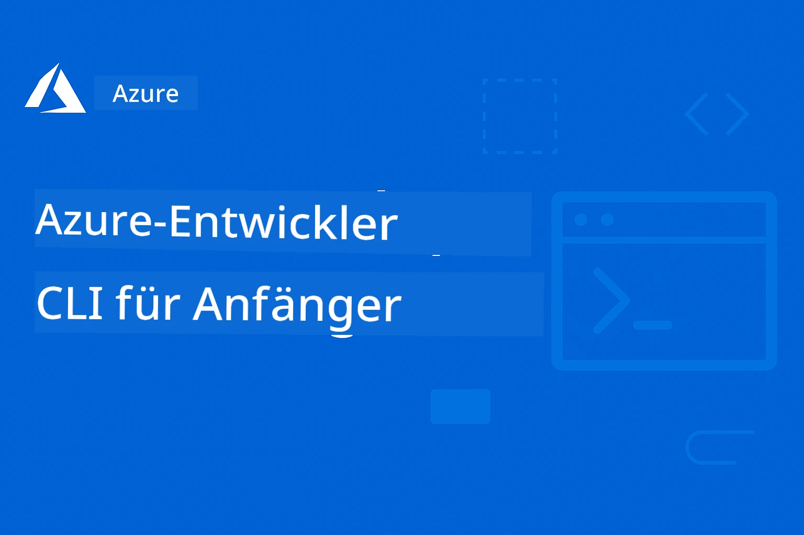

# AZD für Einsteiger: Eine strukturierte Lernreise

 

[](https://GitHub.com/microsoft/azd-for-beginners/watchers/)
[](https://GitHub.com/microsoft/azd-for-beginners/network/)
[](https://GitHub.com/microsoft/azd-for-beginners/stargazers/)

[](https://discord.com/invite/nkVh3dp)
[](https://discord.gg/nTYy5BXMWG)

---

### Automatisierte Übersetzungen (immer aktuell)

<!-- CO-OP TRANSLATOR LANGUAGES TABLE START -->
[Arabisch](../ar/README.md) | [Bengalisch](../bn/README.md) | [Bulgarisch](../bg/README.md) | [Birmanisch (Myanmar)](../my/README.md) | [Chinesisch (vereinfacht)](../zh-CN/README.md) | [Chinesisch (traditionell, Hongkong)](../zh-HK/README.md) | [Chinesisch (traditionell, Macau)](../zh-MO/README.md) | [Chinesisch (traditionell, Taiwan)](../zh-TW/README.md) | [Kroatisch](../hr/README.md) | [Tschechisch](../cs/README.md) | [Dänisch](../da/README.md) | [Niederländisch](../nl/README.md) | [Estnisch](../et/README.md) | [Finnisch](../fi/README.md) | [Französisch](../fr/README.md) | [Deutsch](./README.md) | [Griechisch](../el/README.md) | [Hebräisch](../he/README.md) | [Hindi](../hi/README.md) | [Ungarisch](../hu/README.md) | [Indonesisch](../id/README.md) | [Italienisch](../it/README.md) | [Japanisch](../ja/README.md) | [Kannada](../kn/README.md) | [Khmer](../km/README.md) | [Koreanisch](../ko/README.md) | [Litauisch](../lt/README.md) | [Malaiisch](../ms/README.md) | [Malayalam](../ml/README.md) | [Manipuri (Meitei Mayek)](../mni/README.md) | [Marathi](../mr/README.md) | [Nepalesisch](../ne/README.md) | [Nigerianisches Pidgin](../pcm/README.md) | [Norwegisch](../no/README.md) | [Persisch (Farsi)](../fa/README.md) | [Polnisch](../pl/README.md) | [Portugiesisch (Brasilien)](../pt-BR/README.md) | [Portugiesisch (Portugal)](../pt-PT/README.md) | [Punjabi (Gurmukhi)](../pa/README.md) | [Rumänisch](../ro/README.md) | [Russisch](../ru/README.md) | [Serbisch (Kyrillisch)](../sr/README.md) | [Slowakisch](../sk/README.md) | [Slowenisch](../sl/README.md) | [Spanisch](../es/README.md) | [Suaheli](../sw/README.md) | [Schwedisch](../sv/README.md) | [Tagalog (Filipino)](../tl/README.md) | [Tamil](../ta/README.md) | [Telugu](../te/README.md) | [Thailändisch](../th/README.md) | [Türkisch](../tr/README.md) | [Ukrainisch](../uk/README.md) | [Urdu](../ur/README.md) | [Vietnamesisch](../vi/README.md)

> **Bevorzugen Sie es, lokal zu klonen?**
>
> Dieses Repository enthält Übersetzungen in über 50 Sprachen, was die Download-Größe erheblich erhöht. Um ohne Übersetzungen zu klonen, verwenden Sie Sparse Checkout:
>
> **Bash / macOS / Linux:**
> ```bash
> git clone --filter=blob:none --sparse https://github.com/microsoft/AZD-for-beginners.git
> cd AZD-for-beginners
> git sparse-checkout set --no-cone '/*' '!translations' '!translated_images'
> ```
>
> **CMD (Windows):**
> ```cmd
> git clone --filter=blob:none --sparse https://github.com/microsoft/AZD-for-beginners.git
> cd AZD-for-beginners
> git sparse-checkout set --no-cone "/*" "!translations" "!translated_images"
> ```
>
> Das gibt Ihnen alles, was Sie für den Kurs benötigen, mit einem viel schnelleren Download.
<!-- CO-OP TRANSLATOR LANGUAGES TABLE END -->

## 🆕 Was ist heute neu in azd

> 📌 Dieser Kurs ist validiert gegen **`azd 1.27.1`** (Juli 2026). Führen Sie `azd version` aus, um Ihren Build zu prüfen, und `azd upgrade`, um das Neueste zu erhalten.

Azure Developer CLI hat sich über traditionelle Web-Apps und APIs hinaus entwickelt. Heute ist azd das zentrale Werkzeug zum Bereitstellen **jeder** Anwendung in Azure – einschließlich KI-gestützter Anwendungen und intelligenter Agenten.

Das bedeutet für Sie:

- **KI-Agenten sind jetzt erstklassige azd Workloads.** Sie können KI-Agentenprojekte mit dem gleichen `azd init` → `azd up` Workflow initialisieren, bereitstellen und verwalten, den Sie bereits kennen.
- **Ein vollständiger Agentenlebenszyklus aus der CLI.** Die `azure.ai.agents` Erweiterung deckt jetzt die gesamte Reise ab—`azd ai agent init` zum Scaffolden, `azd ai agent invoke` zum Testen (mit Antwortzeit-Ausgabe), `azd ai agent eval generate` und `azd ai agent optimize` zum Messen und Verbessern der Qualität sowie `azd ai agent delete` zum Aufräumen.
- **Mehr KI-Bausteine.** Neue Preview-Erweiterungen—`azure.ai.skills` und `azure.ai.connections`—ermöglichen es Ihnen, wiederverwendbare Agentenfähigkeiten und Foundry-Verbindungen direkt mit azd zu verwalten.
- **Microsoft Foundry-Integration** bringt Modelldeployment, Agenten-Hosting und KI-Dienstkonfiguration direkt in das azd-Vorlagen-Ökosystem.
- **Reibungslosere tägliche Grundlagen.** Neuere Versionen haben `azd init` idempotent gemacht (sicher erneut ausführbar), `azd auth login` löscht automatisch veraltete Tokens und eine freundliche `azd tool` Ersteinrichtungsabfrage hinzugefügt.
- **Der Kernworkflow hat sich nicht geändert.** Egal ob Sie eine Todo-App, einen Microservice oder eine Multi-Agent-KI-Lösung bereitstellen, die Befehle sind dieselben.

> **Hinweis für Aspire-Nutzer:** Microsoft nennt das Produkt jetzt einfach **Aspire** (ehemals ".NET Aspire"). Die azd-Unterstützung für Aspire bleibt unverändert – nur der Name wurde aktualisiert.

Wenn Sie azd schon verwendet haben, ist die KI-Unterstützung eine natürliche Erweiterung – kein separates Tool oder ein fortgeschrittener Track. Wenn Sie neu anfangen, lernen Sie einen Workflow, der für alles funktioniert.

---

## 🚀 Was ist Azure Developer CLI (azd)?

**Azure Developer CLI (azd)** ist ein entwicklerfreundliches Kommandozeilen-Werkzeug, das das Bereitstellen von Anwendungen in Azure vereinfacht. Statt Dutzende Azure-Ressourcen manuell zu erstellen und zu verbinden, können Sie ganze Anwendungen mit einem einzigen Befehl bereitstellen.

### Die Magie von `azd up`

```bash
# This single command does everything:
# ✅ Creates all Azure resources  
# ✅ Configures networking and security
# ✅ Builds your application code
# ✅ Deploys to Azure
# ✅ Gives you a working URL
azd up
```

**Das war's!** Kein Klicken im Azure-Portal, keine komplexen ARM-Templates, die Sie zuerst lernen müssen, keine manuelle Konfiguration - einfach funktionierende Anwendungen auf Azure.

---

## ❓ Azure Developer CLI vs Azure CLI: Was ist der Unterschied?

Das ist die häufigste Frage von Einsteigern. Hier ist die einfache Antwort:

| Merkmal | **Azure CLI (`az`)** | **Azure Developer CLI (`azd`)** |
|---------|---------------------|--------------------------------|
| **Zweck** | Einzelne Azure-Ressourcen verwalten | Komplette Anwendungen bereitstellen |
| **Einstellung** | Infrastrukturfokussiert | Anwendungsfokussiert |
| **Beispiel** | `az webapp create --name myapp...` | `azd up` |
| **Lernkurve** | Azure-Dienste müssen bekannt sein | Nur Ihre App kennen |
| **Am besten geeignet für** | DevOps, Infrastruktur | Entwickler, Prototypisierung |

### Einfacher Vergleich

- **Azure CLI** ist wie alle Werkzeuge zu haben, um ein Haus zu bauen - Hammer, Sägen, Nägel. Man kann alles bauen, muss aber Bauwissen haben.
- **Azure Developer CLI** ist wie einen Bauunternehmer zu engagieren - Sie beschreiben, was Sie wollen, und der Bauunternehmer kümmert sich um den Bau.

### Wann was verwenden

| Szenario | Verwenden Sie dies |
|----------|----------|
| "Ich möchte meine Web-App schnell bereitstellen" | `azd up` |
| "Ich muss nur ein Speicherkonto erstellen" | `az storage account create` |
| "Ich baue eine komplette KI-Anwendung" | `azd init --template azure-search-openai-demo` |
| "Ich muss eine bestimmte Azure-Ressource debuggen" | `az resource show` |
| "Ich will eine produktionsfertige Bereitstellung in Minuten" | `azd up --environment production` |

### Sie arbeiten zusammen!

AZD nutzt Azure CLI unter der Haube. Sie können beides verwenden:
```bash
# Deploy your app with AZD
azd up

# Then fine-tune specific resources with Azure CLI
az webapp config set --name myapp --always-on true
```

---

## 🌟 Vorlagen in Awesome AZD finden

Starten Sie nicht bei Null! **Awesome AZD** ist die Community-Sammlung einsatzbereiter Vorlagen:

| Ressource | Beschreibung |
|----------|-------------|
| 🔗 [**Awesome AZD Galerie**](https://azure.github.io/awesome-azd/) | Durchsuchen Sie 200+ Vorlagen mit Ein-Klick-Bereitstellung |
| 🔗 [**Ein Vorlage einreichen**](https://github.com/Azure/awesome-azd/issues) | Tragen Sie Ihre eigene Vorlage zur Community bei |
| 🔗 [**GitHub Repository**](https://github.com/Azure/awesome-azd) | Markieren und erkunden Sie den Quellcode |

### Beliebte KI-Vorlagen aus Awesome AZD

```bash
# RAG Chat with Microsoft Foundry Models + AI Search
azd init --template azure-search-openai-demo

# Quick AI Chat Application
azd init --template openai-chat-app-quickstart

# AI Agents with Foundry Agents
azd init --template get-started-with-ai-agents
```

---

## 🎯 In 3 Schritten starten

Bevor Sie starten, stellen Sie sicher, dass Ihr Rechner für die Vorlage, die Sie bereitstellen möchten, vorbereitet ist:

**Windows:**
```powershell
.\validate-setup.ps1
```

**macOS / Linux:**
```bash
bash ./validate-setup.sh
```

Wenn eine der erforderlichen Prüfungen fehlschlägt, beheben Sie das zuerst und fahren dann mit dem Schnellstart fort.

### Schritt 1: AZD installieren (2 Minuten)

**Windows:**
```powershell
winget install microsoft.azd
```

**macOS:**
```bash
brew tap azure/azd && brew install azd
```

**Linux:**
```bash
curl -fsSL https://aka.ms/install-azd.sh | bash
```

### Schritt 2: Für AZD anmelden

```bash
# Optional if you plan to use Azure CLI commands directly in this course
az login

# Required for AZD workflows
azd auth login
```

Wenn Sie nicht sicher sind, welche Sie brauchen, folgen Sie dem vollständigen Setup-Prozess in [Installation & Setup](docs/chapter-01-foundation/installation.md#authentication-setup).

### Schritt 3: Ihre erste App bereitstellen

```bash
# Initialize from a template
azd init --template todo-nodejs-mongo

# Deploy to Azure (creates everything!)
azd up
```

**🎉 Das war's!** Ihre App ist jetzt live auf Azure.

### Aufräumen (Nicht vergessen!)

```bash
# Remove all resources when done experimenting
azd down --force --purge
```

---

## 📚 Wie Sie diesen Kurs nutzen

Dieser Kurs ist auf **progressives Lernen** ausgelegt – starten Sie dort, wo Sie sich wohlfühlen, und arbeiten Sie sich nach oben:

| Ihre Erfahrung | Starten Sie hier |
|-----------------|------------|
| **Neu bei Azure** | [Kapitel 1: Grundlagen](#-chapter-1-foundation--quick-start) |
| **Kenntnisse in Azure, neu in AZD** | [Kapitel 1: Grundlagen](#-chapter-1-foundation--quick-start) |
| **KI-Anwendungen bereitstellen wollen** | [Kapitel 2: KI-Erst-Entwicklung](#-chapter-2-ai-first-development-recommended-for-ai-developers) |
| **Praktische Übungen wünschen** | [🎓 Interaktiver Workshop](workshop/README.md) – 3-4 Stunden geführtes Labor |
| **Produktionsmuster benötigen** | [Kapitel 8: Produktion & Enterprise](#-chapter-8-production--enterprise-patterns) |

### Schnelleinrichtung

1. **Fork dieses Repositories**: [](https://GitHub.com/microsoft/azd-for-beginners/fork)
2. **Klonen**: `git clone https://github.com/YOUR-USERNAME/azd-for-beginners.git`
3. **Hilfe erhalten**: [Azure Discord Community](https://discord.com/invite/ByRwuEEgH4)

> **Bevorzugen Sie es, lokal zu klonen?**

> Dieses Repository enthält Übersetzungen in über 50 Sprachen, was die Download-Größe erheblich erhöht. Um ohne Übersetzungen zu klonen, nutzen Sie Sparse Checkout:
> ```bash
> git clone --filter=blob:none --sparse https://github.com/microsoft/AZD-for-beginners.git
> cd AZD-for-beginners
> git sparse-checkout set --no-cone '/*' '!translations' '!translated_images'
> ```
> Das gibt Ihnen alles, was Sie für den Abschluss des Kurses benötigen, mit einem viel schnelleren Download.


## Kursübersicht

Beherrschen Sie Azure Developer CLI (azd) durch strukturierte Kapitel, die auf progressives Lernen ausgelegt sind. **Besonderer Fokus auf Bereitstellung von KI-Anwendungen mit Microsoft Foundry-Integration.**

### Warum dieser Kurs für moderne Entwickler unerlässlich ist

Basierend auf Einblicken der Microsoft Foundry Discord Community möchten **45% der Entwickler AZD für KI-Workloads nutzen**, stoßen jedoch auf Herausforderungen bei:
- Komplexen Multi-Service KI-Architekturen
- Best Practices für produktive KI-Bereitstellungen  
- Azure KI-Dienstintegration und Konfiguration
- Kostenoptimierung für KI-Workloads
- Fehlerbehebung bei KI-spezifischen Bereitstellungsproblemen

### Lernziele

Durch den Abschluss dieses strukturierten Kurses werden Sie:
- **AZD-Grundlagen meistern**: Kernkonzepte, Installation und Konfiguration
- **KI-Anwendungen bereitstellen**: Nutzen Sie AZD mit Microsoft Foundry-Diensten
- **Infrastruktur als Code implementieren**: Verwalten Sie Azure-Ressourcen mit Bicep-Vorlagen
- **Bereitstellungen beheben**: Lösen Sie häufige Probleme und debuggen Sie Fehler
- **Für die Produktion optimieren**: Sicherheit, Skalierung, Überwachung und Kostenmanagement
- **Multi-Agenten-Lösungen erstellen**: Komplexe KI-Architekturen bereitstellen

## Bevor Sie beginnen: Konten, Zugriff und Voraussetzungen

Bevor Sie Kapitel 1 starten, stellen Sie sicher, dass Sie Folgendes eingerichtet haben. Die Installationsschritte in diesem Leitfaden setzen voraus, dass diese Grundlagen bereits erledigt sind.

- **Ein Azure-Abonnement**: Sie können ein bestehendes Abonnement von der Arbeit oder Ihrem eigenen Konto nutzen oder eine [kostenlose Testversion](https://aka.ms/azurefreetrial) erstellen, um zu starten.
- **Berechtigung zum Erstellen von Azure-Ressourcen**: Für die meisten Übungen sollten Sie mindestens **Contributor**-Zugriff auf das Zielabonnement oder die Ressourcengruppe haben. Einige Kapitel setzen auch voraus, dass Sie Ressourcengruppen, verwaltete Identitäten und RBAC-Zuweisungen erstellen können.
- [**Ein GitHub-Konto**](https://github.com): Dies ist nützlich zum Forken des Repositories, zum Nachverfolgen Ihrer eigenen Änderungen und für die Nutzung von GitHub Codespaces für den Workshop.
- **Voraussetzungen für die Template-Laufzeit**: Einige Vorlagen benötigen lokale Tools wie Node.js, Python, Java oder Docker. Führen Sie vor Beginn den Setup-Validator aus, um fehlende Tools frühzeitig zu erkennen.
- **Grundkenntnisse im Terminal**: Sie müssen kein Experte sein, sollten sich aber mit Befehlen wie `git clone`, `azd auth login` und `azd up` vertraut fühlen.

> **Arbeiten Sie in einem Unternehmensabonnement?**
> Wenn Ihre Azure-Umgebung von einem Administrator verwaltet wird, bestätigen Sie im Voraus, dass Sie Ressourcen im Abonnement oder in der Ressourcengruppe bereitstellen können, die Sie verwenden möchten. Falls nicht, bitten Sie vor Beginn um ein Sandbox-Abonnement oder Contributor-Zugriff.

> **Neu bei Azure?**
> Beginnen Sie mit Ihrem eigenen Azure-Testabonnement oder einem Pay-as-you-go-Abonnement unter https://aka.ms/azurefreetrial, damit Sie die Übungen vollständig durchführen können, ohne auf Mandantenebenen-Genehmigungen warten zu müssen.

## 🗺️ Kursübersicht: Schnelle Navigation nach Kapitel

Jedes Kapitel hat ein eigenes README mit Lernzielen, Schnellstarts und Übungen:

| Kapitel | Thema | Lektionen | Dauer | Komplexität |
|---------|-------|---------|----------|------------|
| **[Kapitel 1: Grundlagen](docs/chapter-01-foundation/README.md)** | Einstieg | [AZD Grundlagen](docs/chapter-01-foundation/azd-basics.md) &#124; [Installation](docs/chapter-01-foundation/installation.md) &#124; [Erstes Projekt](docs/chapter-01-foundation/first-project.md) | 30-45 Min. | ⭐ |
| **[Kapitel 2: KI-Entwicklung](docs/chapter-02-ai-development/README.md)** | KI-Erste Apps | [Foundry Integration](docs/chapter-02-ai-development/microsoft-foundry-integration.md) &#124; [KI-Agenten](docs/chapter-02-ai-development/agents.md) &#124; [Modellbereitstellung](docs/chapter-02-ai-development/ai-model-deployment.md) &#124; [Workshop](docs/chapter-02-ai-development/ai-workshop-lab.md) | 1-2 Std. | ⭐⭐ |
| **[Kapitel 3: Konfiguration](docs/chapter-03-configuration/README.md)** | Auth & Sicherheit | [Konfiguration](docs/chapter-03-configuration/configuration.md) &#124; [Auth & Sicherheit](docs/chapter-03-configuration/authsecurity.md) | 45-60 Min. | ⭐⭐ |
| **[Kapitel 4: Infrastruktur](docs/chapter-04-infrastructure/README.md)** | IaC & Bereitstellung | [Bereitstellungsleitfaden](docs/chapter-04-infrastructure/deployment-guide.md) &#124; [Provisionierung](docs/chapter-04-infrastructure/provisioning.md) | 1-1,5 Std. | ⭐⭐⭐ |
| **[Kapitel 5: Multi-Agent](docs/chapter-05-multi-agent/README.md)** | KI-Agenten-Lösungen | [Einzelhandelsszenario](examples/retail-scenario.md) &#124; [Koordinationsmuster](docs/chapter-06-pre-deployment/coordination-patterns.md) | 2-3 Std. | ⭐⭐⭐⭐ |
| **[Kapitel 6: Vor der Bereitstellung](docs/chapter-06-pre-deployment/README.md)** | Planung & Validierung | [Preflight-Checks](docs/chapter-06-pre-deployment/preflight-checks.md) &#124; [Kapazitätsplanung](docs/chapter-06-pre-deployment/capacity-planning.md) &#124; [SKU-Auswahl](docs/chapter-06-pre-deployment/sku-selection.md) &#124; [App Insights](docs/chapter-06-pre-deployment/application-insights.md) | 1 Std. | ⭐⭐ |
| **[Kapitel 7: Fehlerbehebung](docs/chapter-07-troubleshooting/README.md)** | Debug & Fix | [Häufige Probleme](docs/chapter-07-troubleshooting/common-issues.md) &#124; [Debugging](docs/chapter-07-troubleshooting/debugging.md) &#124; [KI-Probleme](docs/chapter-07-troubleshooting/ai-troubleshooting.md) | 1-1,5 Std. | ⭐⭐ |
| **[Kapitel 8: Produktion](docs/chapter-08-production/README.md)** | Enterprise-Muster | [Produktionspraktiken](docs/chapter-08-production/production-ai-practices.md) | 2-3 Std. | ⭐⭐⭐⭐ |
| **[🎓 Workshop](workshop/README.md)** | Praktisches Labor | [Einführung](workshop/docs/instructions/0-Introduction.md) &#124; [Auswahl](workshop/docs/instructions/1-Select-AI-Template.md) &#124; [Validierung](workshop/docs/instructions/2-Validate-AI-Template.md) &#124; [Zerlegung](workshop/docs/instructions/3-Deconstruct-AI-Template.md) &#124; [Konfiguration](workshop/docs/instructions/4-Configure-AI-Template.md) &#124; [Anpassung](workshop/docs/instructions/5-Customize-AI-Template.md) &#124; [Abbau](workshop/docs/instructions/6-Teardown-Infrastructure.md) &#124; [Abschluss](workshop/docs/instructions/7-Wrap-up.md) | 3-4 Std. | ⭐⭐ |

**Gesamtdauer des Kurses:** ~10-14 Stunden | **Fähigkeitsfortschritt:** Anfänger → Produktionsbereit

---

## 📚 Lernkapitel

*Wählen Sie Ihren Lernpfad basierend auf Erfahrungsniveau und Zielen*

### 🚀 Kapitel 1: Grundlagen & Schnellstart
**Voraussetzungen**: Azure-Abonnement, Grundkenntnisse in der Befehlszeile  
**Dauer**: 30-45 Minuten  
**Komplexität**: ⭐

#### Was Sie lernen werden
- Verständnis der Azure Developer CLI-Grundlagen
- Installation von AZD auf Ihrer Plattform
- Ihre erste erfolgreiche Bereitstellung

#### Lernressourcen
- **🎯 Starten Sie hier**: [Was ist Azure Developer CLI?](#what-is-azure-developer-cli)
- **📖 Theorie**: [AZD Grundlagen](docs/chapter-01-foundation/azd-basics.md) - Kernkonzepte und Terminologie
- **⚙️ Setup**: [Installation & Einrichtung](docs/chapter-01-foundation/installation.md) - Plattform-spezifische Anleitungen
- **🛠️ Praktisch**: [Ihr erstes Projekt](docs/chapter-01-foundation/first-project.md) - Schritt-für-Schritt-Anleitung
- **📋 Schnellreferenz**: [Befehlsübersicht](resources/cheat-sheet.md)

#### Praktische Übungen
```bash
# Quick installation check
azd version

# Deploy your first application
azd init --template todo-nodejs-mongo
azd up
```

**💡 Kapitel-Ergebnis**: Erfolgreiche Bereitstellung einer einfachen Webanwendung auf Azure mit AZD

**✅ Erfolgskontrolle:**
```bash
# After completing Chapter 1, you should be able to:
azd version              # Shows installed version
azd init --template todo-nodejs-mongo  # Initializes project
azd up                  # Deploys to Azure
azd show                # Displays running app URL
# Application opens in browser and works
azd down --force --purge  # Cleans up resources
```

**📊 Zeitaufwand:** 30-45 Minuten  
**📈 Fähigkeitsniveau danach:** Kann grundlegende Anwendungen eigenständig bereitstellen
**📈 Fähigkeitsniveau danach:** Kann grundlegende Anwendungen eigenständig bereitstellen

---

### 🤖 Kapitel 2: KI-Erste Entwicklung (Empfohlen für KI-Entwickler)
**Voraussetzungen**: Kapitel 1 abgeschlossen  
**Dauer**: 1-2 Stunden  
**Komplexität**: ⭐⭐

#### Was Sie lernen werden
- Microsoft Foundry Integration mit AZD
- Bereitstellung KI-gestützter Anwendungen
- Verständnis von KI-Dienstkonfigurationen

#### Lernressourcen
- **🎯 Starten Sie hier**: [Microsoft Foundry Integration](docs/chapter-02-ai-development/microsoft-foundry-integration.md)
- **🤖 KI-Agenten**: [KI-Agenten-Leitfaden](docs/chapter-02-ai-development/agents.md) - Intelligente Agenten mit AZD bereitstellen
- **📖 Muster**: [KI-Modellbereitstellung](docs/chapter-02-ai-development/ai-model-deployment.md) - KI-Modelle bereitstellen und verwalten
- **🛠️ Workshop**: [KI-Workshop-Labor](docs/chapter-02-ai-development/ai-workshop-lab.md) - Machen Sie Ihre KI-Lösungen AZD-bereit
- **🎥 Interaktiver Leitfaden**: [Workshop-Materialien](workshop/README.md) - Browserbasiertes Lernen mit MkDocs * DevContainer Umgebung
- **📋 Vorlagen**: [Microsoft Foundry Vorlagen](#featured-microsoft-foundry-templates)
- **📝 Beispiele**: [AZD Bereitstellungsbeispiele](examples/README.md)

#### Praktische Übungen
```bash
# Deploy your first AI application
azd init --template azure-search-openai-demo
azd up

# Try additional AI templates
azd init --template openai-chat-app-quickstart
azd init --template agent-openai-python-prompty
```

**💡 Kapitel-Ergebnis**: Bereitstellung und Konfiguration einer KI-gestützten Chat-Anwendung mit RAG-Funktionalitäten

**✅ Erfolgskontrolle:**
```bash
# After Chapter 2, you should be able to:
azd init --template azure-search-openai-demo
azd up
# Test the AI chat interface
# Ask questions and get AI-powered responses with sources
# Verify search integration works
azd monitor  # Check Application Insights shows telemetry
azd down --force --purge
```

**📊 Zeitaufwand:** 1-2 Stunden  
**📈 Fähigkeitsniveau danach:** Kann produktionsreife KI-Anwendungen bereitstellen und konfigurieren  
**💰 Kostenbewusstsein:** Kenntnis über Entwicklungs­kosten von $80-150/Monat, Produktions­kosten von $300-3500/Monat

#### 💰 Kostenüberlegungen für KI-Bereitstellungen

**Entwicklungsumgebung (geschätzt $80-150/Monat):**
- Microsoft Foundry Modelle (Pay-as-you-go): $0-50/Monat (abhängig von der Token-Nutzung)
- KI-Suche (Basic Tier): $75/Monat
- Container-Apps (Consumption): $0-20/Monat
- Speicher (Standard): $1-5/Monat

**Produktionsumgebung (geschätzt $300-3.500+/Monat):**
- Microsoft Foundry Modelle (PTU für konsistente Leistung): $3.000+/Monat ODER Pay-as-you-go bei hohem Volumen
- KI-Suche (Standard Tier): $250/Monat
- Container-Apps (Dedicated): $50-100/Monat
- Application Insights: $5-50/Monat
- Speicher (Premium): $10-50/Monat

**💡 Tipps zur Kostenoptimierung:**
- Nutzen Sie **Free Tier** Microsoft Foundry Modelle zum Lernen (Azure OpenAI 50.000 Tokens/Monat enthalten)
- Führen Sie `azd down` aus, um Ressourcen bei nicht aktiver Entwicklung freizugeben
- Beginnen Sie mit nutzungsbasierter Abrechnung und wechseln Sie zu PTU nur für die Produktion
- Verwenden Sie `azd provision --preview` zur Kostenschätzung vor der Bereitstellung
- Aktivieren Sie Auto-Scaling: zahlen Sie nur für die tatsächliche Nutzung

**Kostenüberwachung:**
```bash
# Check estimated monthly costs
azd provision --preview

# Monitor actual costs in Azure Portal
az consumption budget list --resource-group <your-rg>
```

---

### ⚙️ Kapitel 3: Konfiguration & Authentifizierung
**Voraussetzungen**: Kapitel 1 abgeschlossen  
**Dauer**: 45-60 Minuten  
**Komplexität**: ⭐⭐

#### Was Sie lernen werden
- Umgebungskonfiguration und -verwaltung
- Authentifizierung und Sicherheitsbest Practices
- Benennung und Organisation von Ressourcen

#### Lernressourcen
- **📖 Konfiguration**: [Konfigurationsleitfaden](docs/chapter-03-configuration/configuration.md) - Umgebungs-Setup
- **🔐 Sicherheit**: [Authentifizierungsmuster und verwaltete Identität](docs/chapter-03-configuration/authsecurity.md) - Authentifizierungsmuster
- **📝 Beispiele**: [Datenbank-App-Beispiel](examples/database-app/README.md) - AZD-Datenbankbeispiele

#### Praktische Übungen
- Mehrere Umgebungen konfigurieren (Dev, Staging, Prod)
- Verwaltete Identitätsauthentifizierung einrichten
- Umgebungsspezifische Konfigurationen umsetzen

**💡 Kapitel-Ergebnis**: Verwaltung mehrerer Umgebungen mit ordnungsgemäßer Authentifizierung und Sicherheit

---

### 🏗️ Kapitel 4: Infrastruktur als Code & Bereitstellung
**Voraussetzungen**: Kapitel 1-3 abgeschlossen  
**Dauer**: 1-1,5 Stunden  
**Komplexität**: ⭐⭐⭐

#### Was Sie lernen werden
- Fortgeschrittene Bereitstellungsmuster
- Infrastruktur als Code mit Bicep
- Strategien zur Ressourcenbereitstellung

#### Lernressourcen
- **📖 Bereitstellung**: [Bereitstellungsleitfaden](docs/chapter-04-infrastructure/deployment-guide.md) - Komplette Workflows
- **🏗️ Provisionierung**: [Ressourcenbereitstellung](docs/chapter-04-infrastructure/provisioning.md) - Azure Ressourcenmanagement
- **📝 Beispiele**: [Container-App-Beispiel](../../examples/container-app) - Containerisierte Bereitstellungen

#### Praktische Übungen
- Eigene Bicep-Vorlagen erstellen
- Multi-Service-Anwendungen bereitstellen
- Blue-Green-Deployment-Strategien implementieren

**💡 Kapitel-Ergebnis**: Bereitstellung komplexer Multi-Service-Anwendungen mit kundenspezifischen Infrastrukturvorlagen

---

### 🎯 Kapitel 5: Multi-Agent KI-Lösungen (Fortgeschritten)
**Voraussetzungen**: Kapitel 1-2 abgeschlossen  
**Dauer**: 2-3 Stunden  
**Komplexität**: ⭐⭐⭐⭐

#### Was Sie lernen werden
- Multi-Agenten-Architekturmuster
- Agenten-Orchestrierung und Koordination
- Produktionsreife KI-Bereitstellungen

#### Lernressourcen
- **🤖 Beispielprojekt**: [Einzelhandel Multi-Agent Lösung](examples/retail-scenario.md) - Komplette Implementierung
- **🛠️ ARM-Vorlagen**: [ARM-Vorlagenpaket](../../examples/retail-multiagent-arm-template) - Ein-Klick-Bereitstellung
- **📖 Architektur**: [Multi-Agenten Koordinationsmuster](docs/chapter-06-pre-deployment/coordination-patterns.md) - Muster

#### Praktische Übungen
```bash
# Deploy the complete retail multi-agent solution
cd examples/retail-multiagent-arm-template
./deploy.sh

# Explore agent configurations
az deployment group show --resource-group <rg-name> --name <deployment-name>
```

**💡 Kapitel-Ergebnis**: Bereitstellung und Verwaltung einer produktionsreifen Multi-Agent KI-Lösung mit Kunden- und Inventaragenten

---

### 🔍 Kapitel 6: Validierung & Planung vor der Bereitstellung
**Voraussetzungen**: Kapitel 4 abgeschlossen  
**Dauer**: 1 Stunde  
**Komplexität**: ⭐⭐

#### Was Sie lernen werden
- Kapazitätsplanung und Ressourcenvalidierung
- SKU-Auswahlstrategien
- Pre-Flight-Checks und Automatisierung

#### Lernressourcen
- **📊 Planung**: [Kapazitätsplanung](docs/chapter-06-pre-deployment/capacity-planning.md) - Ressourcenvalidierung
- **💰 Auswahl**: [SKU-Auswahl](docs/chapter-06-pre-deployment/sku-selection.md) - Kosten-effiziente Entscheidungen
- **✅ Validierung**: [Pre-Flight-Checks](docs/chapter-06-pre-deployment/preflight-checks.md) - Automatisierte Skripte

#### Praktische Übungen
- Führen Sie Kapazitätsvalidierungsskripte aus
- Optimieren Sie die SKU-Auswahl hinsichtlich Kosten
- Implementieren Sie automatisierte Pre-Deployment-Checks

**💡 Kapitel-Ergebnis**: Validieren und optimieren Sie Deployments vor der Ausführung

---

### 🚨 Kapitel 7: Fehlerbehebung & Debugging
**Voraussetzungen**: Jedes Deployment-Kapitel abgeschlossen  
**Dauer**: 1-1,5 Stunden  
**Komplexität**: ⭐⭐

#### Was Sie lernen werden
- Systematische Debugging-Methoden
- Häufige Probleme und Lösungen
- KI-spezifische Fehlerbehebung

#### Lernressourcen
- **🔧 Häufige Probleme**: [Häufige Probleme](docs/chapter-07-troubleshooting/common-issues.md) - FAQ und Lösungen
- **🕵️ Debugging**: [Debugging-Anleitung](docs/chapter-07-troubleshooting/debugging.md) - Schritt-für-Schritt-Strategien
- **🤖 KI-Probleme**: [KI-spezifische Fehlerbehebung](docs/chapter-07-troubleshooting/ai-troubleshooting.md) - Probleme mit KI-Diensten

#### Praktische Übungen
- Diagnostizieren Sie Deployment-Fehler
- Beheben Sie Authentifizierungsprobleme
- Debuggen Sie die Konnektivität zu KI-Diensten

**💡 Kapitel-Ergebnis**: Diagnostizieren und beheben Sie häufige Deployment-Probleme eigenständig

---

### 🏢 Kapitel 8: Produktions- & Enterprise-Muster
**Voraussetzungen**: Kapitel 1-4 abgeschlossen  
**Dauer**: 2-3 Stunden  
**Komplexität**: ⭐⭐⭐⭐

#### Was Sie lernen werden
- Strategien für den Produktionseinsatz
- Enterprise-Sicherheitsmuster
- Monitoring und Kostenoptimierung

#### Lernressourcen
- **🏭 Produktion**: [Best Practices für Produktions-KI](docs/chapter-08-production/production-ai-practices.md) - Enterprise-Muster
- **📝 Beispiele**: [Microservices-Beispiel](../../examples/microservices) - Komplexe Architekturen
- **📊 Überwachung**: [Application Insights-Integration](docs/chapter-06-pre-deployment/application-insights.md) - Monitoring

#### Praktische Übungen
- Implementieren Sie Enterprise-Sicherheitsmuster
- Richten Sie umfassendes Monitoring ein
- Deployen Sie in Produktion mit geeigneter Governance

**💡 Kapitel-Ergebnis**: Setzen Sie unternehmensfertige Anwendungen mit vollständigen Produktionsfähigkeiten ein

---

## 🎓 Workshop-Übersicht: Praxisorientiertes Lernen

> **⚠️ WORKSHOP-STATUS: Aktive Entwicklung**  
> Die Workshop-Materialien werden derzeit entwickelt und verfeinert. Kernmodule sind funktionsfähig, einige fortgeschrittene Abschnitte sind noch unvollständig. Wir arbeiten aktiv daran, alle Inhalte abzuschließen. [Fortschritt verfolgen →](workshop/README.md)

### Interaktive Workshop-Materialien
**Umfassendes praxisorientiertes Lernen mit browserbasierten Werkzeugen und geführten Übungen**

Unsere Workshop-Materialien bieten ein strukturiertes, interaktives Lernerlebnis, das das oben beschriebene kapitelbasierte Curriculum ergänzt. Der Workshop ist sowohl für selbstgesteuertes Lernen als auch für geleitete Sitzungen ausgelegt.

#### 🛠️ Workshop-Funktionen
- **Browser-basierte Oberfläche**: Vollständiger MkDocs-gestützter Workshop mit Suche, Kopieren und Themenfunktionen
- **GitHub Codespaces Integration**: Ein-Klick-Entwicklungsumgebung
- **Strukturierter Lernpfad**: 8 Module mit geführten Übungen (insgesamt 3-4 Stunden)
- **Progressive Methodik**: Einführung → Auswahl → Validierung → Zerlegung → Konfiguration → Anpassung → Abriss → Abschluss
- **Interaktive DevContainer-Umgebung**: Vorgefertigte Werkzeuge und Abhängigkeiten

#### 📚 Workshop-Modulstruktur
Der Workshop folgt einer **8-moduligen progressiven Methodik**, die Sie von der Entdeckung bis zur Beherrschung der Bereitstellung führt:

| Modul | Thema | Was Sie tun werden | Dauer |
|--------|-------|----------------|----------|
| **0. Einführung** | Workshop-Übersicht | Lernen Sie die Lernziele, Voraussetzungen und den Workshop-Aufbau kennen | 15 Min |
| **1. Auswahl** | Template-Entdeckung | Erkunden Sie AZD-Templates und wählen Sie die passende KI-Vorlage für Ihr Szenario | 20 Min |
| **2. Validierung** | Deployment & Verifikation | Deployen Sie die Vorlage mit `azd up` und validieren Sie die Infrastruktur | 30 Min |
| **3. Zerlegung** | Struktur verstehen | Nutzen Sie GitHub Copilot, um Architektur, Bicep-Dateien und Code-Organisation zu erforschen | 30 Min |
| **4. Konfiguration** | azure.yaml Deep Dive | Beherrschen Sie die `azure.yaml`-Konfiguration, Lifecycle-Hooks und Umgebungsvariablen | 30 Min |
| **5. Anpassung** | Machen Sie es zu Ihrem eigenen | Aktivieren Sie KI-Suche, Tracing, Evaluierung und passen Sie es an Ihr Szenario an | 45 Min |
| **6. Abriss** | Aufräumen | Deprovisionieren Sie Ressourcen sicher mit `azd down --purge` | 15 Min |
| **7. Abschluss** | Nächste Schritte | Überprüfen Sie Erreichtes, Schlüsselk Konzepte und setzen Sie Ihren Lernweg fort | 15 Min |

**Workshop-Ablauf:**
```
Introduction → Selection → Validation → Deconstruction → Configuration → Customization → Teardown → Wrap-up
     ↓            ↓           ↓              ↓               ↓              ↓            ↓           ↓
  Overview    Find the     Deploy &      Explore        Master         Customize     Clean up    Review &
             right        verify        code &        azure.yaml      for your      resources   next steps
             template                   structure                     scenario
```

#### 🚀 Workshop starten
```bash
# Option 1: GitHub Codespaces (Recommended)
# Click "Code" → "Create codespace on main" in the repository

# Option 2: Local Development
git clone https://github.com/microsoft/azd-for-beginners.git
cd azd-for-beginners/workshop
# Follow the setup instructions in workshop/README.md
```

#### 🎯 Lernergebnisse des Workshops
Durch den Abschluss des Workshops werden die Teilnehmer:
- **Produktions-KI-Anwendungen deployen**: Nutzen Sie AZD mit Microsoft Foundry-Diensten
- **Multi-Agenten-Architekturen beherrschen**: Implementieren Sie koordinierte KI-Agenten-Lösungen
- **Sicherheits-Best-Practices umsetzen**: Konfigurieren Sie Authentifizierung und Zugriffssteuerung
- **Für Skalierung optimieren**: Entwerfen Sie kosteneffiziente, leistungsstarke Deployments
- **Fehler bei Deployments beheben**: Lösen Sie häufige Probleme eigenständig

#### 📖 Workshop-Ressourcen
- **🎥 Interaktiver Leitfaden**: [Workshop-Materialien](workshop/README.md) - Browserbasiertes Lernumfeld
- **Modul-für-Modul-Anleitungen**:
  - [0. Einführung](workshop/docs/instructions/0-Introduction.md) - Workshop-Übersicht und Ziele
  - [1. Auswahl](workshop/docs/instructions/1-Select-AI-Template.md) - KI-Templates finden und auswählen
  - [2. Validierung](workshop/docs/instructions/2-Validate-AI-Template.md) - Templates deployen und verifizieren
  - [3. Zerlegung](workshop/docs/instructions/3-Deconstruct-AI-Template.md) - Template-Architektur erforschen
  - [4. Konfiguration](workshop/docs/instructions/4-Configure-AI-Template.md) - azure.yaml beherrschen
  - [5. Anpassung](workshop/docs/instructions/5-Customize-AI-Template.md) - Für Ihr Szenario anpassen
  - [6. Abriss](workshop/docs/instructions/6-Teardown-Infrastructure.md) - Ressourcen aufräumen
  - [7. Abschluss](workshop/docs/instructions/7-Wrap-up.md) - Rückblick und nächste Schritte
- **🛠️ KI-Workshop-Labor**: [KI-Workshop-Labor](docs/chapter-02-ai-development/ai-workshop-lab.md) - KI-zentrierte Übungen
- **💡 Schnellstart**: [Workshop-Setup-Anleitung](workshop/README.md#quick-start) - Umgebungskonfiguration

**Perfekt für**: Firmenschulungen, Universitätskurse, selbstgesteuertes Lernen und Entwickler-Bootcamps.

---

## 📖 Tiefeneinblick: AZD-Fähigkeiten

Über die Grundlagen hinaus bietet AZD leistungsstarke Funktionen für Produktionseinsätze:

- **Template-basierte Deployments** - Nutzen Sie vorgefertigte Templates für gängige Anwendungsmuster
- **Infrastructure as Code** - Verwalten Sie Azure-Ressourcen mit Bicep oder Terraform  
- **Integrierte Workflows** - Provisionieren, deployen und überwachen Sie Anwendungen nahtlos
- **Entwicklerfreundlich** - Optimiert für Produktivität und Nutzererfahrung von Entwicklern

### **AZD + Microsoft Foundry: Perfekt für KI-Deployments**

**Warum AZD für KI-Lösungen?** AZD adressiert die wichtigsten Herausforderungen für KI-Entwickler:

- **KI-fertige Templates** - Vorgefertigte Vorlagen für Microsoft Foundry Modelle, Azure KI-Dienste und ML-Workloads
- **Sichere KI-Deployments** - Integrierte Sicherheitsmuster für KI-Dienste, API-Schlüssel und Modellendpunkte  
- **Produktions-KI-Muster** - Best Practices für skalierbare, kosteneffiziente KI-Anwendungs-Deployments
- **End-to-End KI-Workflows** - Von der Modellentwicklung bis zum Produktionseinsatz mit umfassendem Monitoring
- **Kostenoptimierung** - Intelligente Ressourcenallokation und Skalierungsstrategien für KI-Workloads
- **Microsoft Foundry-Integration** - Nahtlose Verbindung zum Microsoft Foundry Modellkatalog und Endpunkten

---

## 🎯 Templates- & Beispiele-Bibliothek

### Vorgestellt: Microsoft Foundry Templates
**Starten Sie hier, wenn Sie KI-Anwendungen deployen!**

> **Hinweis:** Diese Templates demonstrieren verschiedene KI-Muster. Einige sind externe Azure-Beispiele, andere lokale Implementierungen.

| Template | Kapitel | Komplexität | Dienste | Typ |
|----------|---------|------------|----------|------|
| [**Erste Schritte mit KI-Chat**](https://github.com/Azure-Samples/get-started-with-ai-chat) | Kapitel 2 | ⭐⭐ | AzureOpenAI + Azure AI Model Inference API + Azure AI Search + Azure Container Apps + Application Insights | Extern |
| [**Erste Schritte mit KI-Agenten**](https://github.com/Azure-Samples/get-started-with-ai-agents) | Kapitel 2 | ⭐⭐ | Foundry Agents + AzureOpenAI + Azure AI Search + Azure Container Apps + Application Insights| Extern |
| [**Azure Search + OpenAI Demo**](https://github.com/Azure-Samples/azure-search-openai-demo) | Kapitel 2 | ⭐⭐ | AzureOpenAI + Azure AI Search + App Service + Storage | Extern |
| [**OpenAI Chat App Schnellstart**](https://github.com/Azure-Samples/openai-chat-app-quickstart) | Kapitel 2 | ⭐ | AzureOpenAI + Container Apps + Application Insights | Extern |
| [**Agent OpenAI Python Prompty**](https://github.com/Azure-Samples/agent-openai-python-prompty) | Kapitel 5 | ⭐⭐⭐ | AzureOpenAI + Azure Functions + Prompty | Extern |
| [**Contoso Chat RAG**](https://github.com/Azure-Samples/contoso-chat) | Kapitel 8 | ⭐⭐⭐⭐ | AzureOpenAI + KI-Suche + Cosmos DB + Container Apps | Extern |
| [**Retail Multi-Agent Lösung**](examples/retail-scenario.md) | Kapitel 5 | ⭐⭐⭐⭐ | AzureOpenAI + KI-Suche + Storage + Container Apps + Cosmos DB | **Lokal** |

### Vorgestellt: Komplett-Szenarien zum Lernen
**Produktionsfertige Anwendungsvorlagen, abgestimmt auf Lernkapitel**

| Template | Lernkapitel | Komplexität | Wesentlicher Lerninhalt |
|----------|------------------|------------|--------------|
| [**openai-chat-app-quickstart**](https://github.com/Azure-Samples/openai-chat-app-quickstart) | Kapitel 2 | ⭐ | Grundlegende KI-Deployment-Muster |
| [**azure-search-openai-demo**](https://github.com/Azure-Samples/azure-search-openai-demo) | Kapitel 2 | ⭐⭐ | RAG-Implementierung mit Azure KI-Suche |
| [**ai-document-processing**](https://github.com/Azure-Samples/ai-document-processing) | Kapitel 4 | ⭐⭐ | Integration Dokumenten-Intelligenz |
| [**agent-openai-python-prompty**](https://github.com/Azure-Samples/agent-openai-python-prompty) | Kapitel 5 | ⭐⭐⭐ | Agenten-Framework und Funktionsaufrufe |
| [**contoso-chat**](https://github.com/Azure-Samples/contoso-chat) | Kapitel 8 | ⭐⭐⭐ | Enterprise-KI-Orchestrierung |
| [**retail-multi-agent-solution**](examples/retail-scenario.md) | Kapitel 5 | ⭐⭐⭐⭐ | Multi-Agenten-Architektur mit Kunden- und Lager-Agenten |

### Lernen nach Beispieltyp

> **📌 Lokale vs. Externe Beispiele:**  
> **Lokale Beispiele** (in diesem Repo) = Sofort einsatzbereit  
> **Externe Beispiele** (Azure Samples) = Aus verlinkten Repositories klonen

#### Lokale Beispiele (Sofort einsatzbereit)
- [**Retail Multi-Agent Lösung**](examples/retail-scenario.md) - Vollständige produktionsfertige Implementierung mit ARM-Templates
  - Multi-Agenten-Architektur (Kunden + Lager-Agenten)
  - Umfassendes Monitoring und Evaluation
  - One-Click-Deployment via ARM-Template

#### Lokale Beispiele - Container-Anwendungen (Kapitel 2-5)
**Umfassende Beispiele für Container-Deployments in diesem Repository:**
- [**Container-App-Beispiele**](examples/container-app/README.md) - Vollständige Anleitung für containerisierte Deployments
  - [Einfache Flask-API](../../examples/container-app/simple-flask-api) - Basis-REST-API mit Scale-to-Zero
  - [Microservices-Architektur](../../examples/container-app/microservices) - Produktionsreifes Multi-Service-Deployment
  - Schnellstart-, Produktions- und fortgeschrittene Deployment-Muster
  - Anleitung für Monitoring, Sicherheit und Kostenoptimierung

#### Externe Beispiele - Einfache Anwendungen (Kapitel 1-2)
**Klonen Sie diese Azure-Samples-Repositories, um zu starten:**
- [Einfache Web-App - Node.js + MongoDB](https://github.com/Azure-Samples/todo-nodejs-mongo) - Grundlegende Deployment-Muster
- [Statische Website - React SPA](https://github.com/Azure-Samples/todo-csharp-sql-swa-func) - Statische Inhaltsbereitstellung
- [Container App - Python Flask](https://github.com/Azure-Samples/container-apps-store-api-microservice) - REST API Deployment

#### Externe Beispiele - Datenbank-Integration (Kapitel 3-4)  
- [Datenbank-App - C# + SQL](https://github.com/Azure-Samples/todo-csharp-sql) - Datenbankkonnektivitätsmuster
- [Functions + Cosmos DB](https://github.com/Azure-Samples/todo-python-mongo-swa-func) - Serverless-Daten-Workflow

#### Externe Beispiele - Fortgeschrittene Muster (Kapitel 4-8)
- [Java-Microservices](https://github.com/Azure-Samples/java-microservices-aca-lab) - Multi-Service-Architekturen
- [Container Apps Jobs](https://github.com/Azure-Samples/container-apps-jobs) - Hintergrundverarbeitung  
- [Enterprise ML Pipeline](https://github.com/Azure-Samples/mlops-v2) - Produktionsreife ML-Muster

### Externe Template-Sammlungen
- [**Offizielle AZD Template-Galerie**](https://azure.github.io/awesome-azd/) - Kuratierte Sammlung offizieller und Community-Templates
- [**Azure Developer CLI Templates**](https://learn.microsoft.com/en-us/azure/developer/azure-developer-cli/azd-templates) - Microsoft Learn Template-Dokumentation
- [**Beispiele-Verzeichnis**](examples/README.md) - Lokale Lernbeispiele mit ausführlichen Erklärungen

---

## 📚 Lernressourcen & Referenzen

### Schnelle Verweise
- [**Befehlsübersicht**](resources/cheat-sheet.md) - Wichtige azd-Befehle, organisiert nach Kapiteln
- [**Glossar**](resources/glossary.md) - Azure- und azd-Begriffe  
- [**FAQ**](resources/faq.md) - Häufige Fragen, organisiert nach Lernkapiteln
- [**Studienführer**](resources/study-guide.md) - Umfassende Übungsaufgaben

### Praktische Workshops
- [**KI Workshop Lab**](docs/chapter-02-ai-development/ai-workshop-lab.md) - Machen Sie Ihre KI-Lösungen AZD-bereit für die Bereitstellung (2-3 Stunden)
- [**Interaktiver Workshop**](workshop/README.md) - 8-modulige geführte Übungen mit MkDocs und GitHub Codespaces
  - Folgt: Einführung → Auswahl → Validierung → Zerlegung → Konfiguration → Anpassung → Abbau → Abschluss

### Externe Lernressourcen
- [Azure Developer CLI Dokumentation](https://learn.microsoft.com/en-us/azure/developer/azure-developer-cli/)
- [Azure Architekturzentrum](https://learn.microsoft.com/en-us/azure/architecture/)
- [Azure Preiskalkulator](https://azure.microsoft.com/pricing/calculator/)
- [Azure Status](https://status.azure.com/)

### KI-Agenten-Fähigkeiten für Ihren Editor
- [**Microsoft Azure Skills auf skills.sh**](https://skills.sh/microsoft/github-copilot-for-azure) - 37 offene Agentenfähigkeiten für Azure KI, Foundry, Bereitstellung, Diagnostik, Kostenoptimierung und mehr. Installieren Sie sie in GitHub Copilot, Cursor, Claude Code oder einem beliebigen unterstützten Agenten:
  ```bash
  npx skills add microsoft/github-copilot-for-azure
  ```

---

## 🔧 Schnelle Fehlerbehebung

**Häufige Probleme, die Anfänger haben, und sofortige Lösungen:**

<details>
<summary><strong>❌ "azd: Befehl nicht gefunden"</strong></summary>

```bash
# Install AZD first
# Windows (PowerShell):
winget install microsoft.azd

# macOS:
brew tap azure/azd && brew install azd

# Linux:
curl -fsSL https://aka.ms/install-azd.sh | bash

# Verify installation
azd version
```
</details>

<details>
<summary><strong>❌ "Kein Abonnement gefunden" oder "Abonnement nicht gesetzt"</strong></summary>

```bash
# List available subscriptions
az account list --output table

# Set default subscription
az account set --subscription "<subscription-id-or-name>"

# Set for AZD environment
azd env set AZURE_SUBSCRIPTION_ID "<subscription-id>"

# Verify
az account show
```
</details>

<details>
<summary><strong>❌ "Unzureichendes Kontingent" oder "Kontingent überschritten"</strong></summary>

```bash
# Try different Azure region
azd env set AZURE_LOCATION "westus2"
azd up

# Or use smaller SKUs in development
# Edit infra/main.parameters.json:
{
  "sku": "B1"  // Instead of "P1V2"
}
```
</details>

<details>
<summary><strong>❌ "azd up" schlägt mitten im Vorgang fehl</strong></summary>

```bash
# Option 1: Clean and retry
azd down --force --purge
azd up

# Option 2: Just fix infrastructure
azd provision

# Option 3: Check detailed status
azd show

# Option 4: Check logs in Azure Monitor
azd monitor --logs
```
</details>

<details>
<summary><strong>❌ "Authentifizierung fehlgeschlagen" oder "Token abgelaufen"</strong></summary>

```bash
# Re-authenticate for AZD
azd auth logout
azd auth login

# Optional: refresh Azure CLI too if you are running az commands
az logout
az login

# Verify authentication
az account show
```
</details>

<details>
<summary><strong>❌ "Ressource existiert bereits" oder Namenskonflikte</strong></summary>

```bash
# AZD generates unique names, but if conflict:
azd down --force --purge

# Then retry with fresh environment
azd env new dev-v2
azd up
```
</details>

<details>
<summary><strong>❌ Vorlagebereitstellung dauert zu lange</strong></summary>

**Normale Wartezeiten:**
- Einfaches Web-App: 5-10 Minuten
- App mit Datenbank: 10-15 Minuten
- KI-Anwendungen: 15-25 Minuten (OpenAI-Provisionierung ist langsam)

```bash
# Check progress
azd show

# If stuck >30 minutes, check Azure Portal:
azd monitor --overview
# Look for failed deployments
```
</details>

<details>
<summary><strong>❌ "Zugriff verweigert" oder "Verboten"</strong></summary>

```bash
# Check your Azure role
az role assignment list --assignee $(az account show --query user.name -o tsv)

# You need at least "Contributor" role
# Ask your Azure admin to grant:
# - Contributor (for resources)
# - User Access Administrator (for role assignments)
```
</details>

<details>
<summary><strong>❌ Kann die URL der bereitgestellten Anwendung nicht finden</strong></summary>

```bash
# Show all service endpoints
azd show

# Or open Azure Portal
azd monitor

# Check specific service
azd env get-values
# Look for *_URL variables
```
</details>

### 📚 Umfassende Fehlerbehebungsressourcen

- **Leitfaden zu häufigen Problemen:** [Detaillierte Lösungen](docs/chapter-07-troubleshooting/common-issues.md)
- **KI-spezifische Probleme:** [KI-Fehlerbehebung](docs/chapter-07-troubleshooting/ai-troubleshooting.md)
- **Debugging-Leitfaden:** [Schritt-für-Schritt-Debugging](docs/chapter-07-troubleshooting/debugging.md)
- **Hilfe erhalten:** [Azure Discord](https://discord.gg/microsoft-azure) #azure-developer-cli

---

## 🎓 Kursabschluss & Zertifizierung

### Fortschrittsverfolgung
Verfolgen Sie Ihren Lernfortschritt durch jedes Kapitel:

- [ ] **Kapitel 1**: Grundlagen & Schnellstart ✅
- [ ] **Kapitel 2**: KI-zentrierte Entwicklung ✅  
- [ ] **Kapitel 3**: Konfiguration & Authentifizierung ✅
- [ ] **Kapitel 4**: Infrastruktur als Code & Bereitstellung ✅
- [ ] **Kapitel 5**: Multi-Agent-KI-Lösungen ✅
- [ ] **Kapitel 6**: Validierung & Planung vor der Bereitstellung ✅
- [ ] **Kapitel 7**: Fehlerbehebung & Debugging ✅
- [ ] **Kapitel 8**: Produktiv- & Enterprise-Pattern ✅

### Lernüberprüfung
Nach Abschluss jedes Kapitels, überprüfen Sie Ihr Wissen durch:
1. **Praktische Übung**: Führen Sie die praktische Bereitstellung des Kapitels durch
2. **Wissenscheck**: Überprüfen Sie den FAQ-Bereich Ihres Kapitels
3. **Community-Diskussion**: Teilen Sie Ihre Erfahrungen im Azure Discord
4. **Nächstes Kapitel**: Gehen Sie zum nächsten Komplexitätslevel über

### Vorteile des Kursabschlusses
Nach Abschluss aller Kapitel haben Sie:
- **Produktiverfahrung**: Echt eingesetzte KI-Anwendungen in Azure
- **Professionelle Fähigkeiten**: Enterprise-taugliche Bereitstellungsfähigkeiten  
- **Anerkennung in der Community**: Aktives Mitglied der Azure Entwickler-Community
- **Karriereförderung**: Gefragtes AZD- und KI-Bereitstellungsexpertise

---

## 🤝 Gemeinschaft & Unterstützung

### Hilfe & Support erhalten
- **Technische Probleme**: [Fehler melden und Funktionen anfragen](https://github.com/microsoft/azd-for-beginners/issues)
- **Lernfragen**: [Microsoft Azure Discord Community](https://discord.gg/microsoft-azure) und [](https://discord.gg/nTYy5BXMWG)
- **KI-spezifische Hilfe**: Treten Sie bei in den [](https://discord.gg/nTYy5BXMWG)
- **Dokumentation**: [Offizielle Azure Developer CLI Dokumentation](https://learn.microsoft.com/en-us/azure/developer/azure-developer-cli/)

### Community-Einblicke vom Microsoft Foundry Discord

**Aktuelle Umfrageergebnisse aus dem #Azure-Kanal:**
- **45%** der Entwickler möchten AZD für KI-Workloads einsetzen
- **Top-Herausforderungen**: Multi-Service-Bereitstellungen, Anmeldeinformationenverwaltung, Produktionsreife  
- **Meistgefragt**: KI-spezifische Vorlagen, Fehlerbehebungsleitfäden, Best Practices

**Treten Sie unserer Community bei, um:**
- Ihre AZD + KI-Erfahrungen zu teilen und Hilfe zu erhalten
- Frühzugang zu neuen KI-Vorlagen zu bekommen
- Zu Best Practices für KI-Bereitstellung beizutragen
- Die zukünftige KI + AZD-Feature-Entwicklung zu beeinflussen

### Beitrag zum Kurs
Wir freuen uns über Beiträge! Bitte lesen Sie unseren [Leitfaden für Beiträge](CONTRIBUTING.md) für Details zu:
- **Inhaltsverbesserungen**: Bestehende Kapitel und Beispiele verbessern
- **Neue Beispiele**: Realwelt-Szenarien und Vorlagen hinzufügen  
- **Übersetzungen**: Unterstützung zur Mehrsprachigkeit leisten
- **Fehlerberichte**: Genauigkeit und Klarheit verbessern
- **Community-Standards**: Unsere inklusiven Gemeinschaftsrichtlinien einhalten

---

## 📄 Kursinformationen

### Lizenz
Dieses Projekt ist unter der MIT-Lizenz lizenziert - siehe die [LICENSE](../../LICENSE) Datei für Details.

### Verwandte Microsoft Lernressourcen

Unser Team erstellt weitere umfassende Lernkurse:

<!-- CO-OP TRANSLATOR OTHER COURSES START -->
### LangChain
[](https://aka.ms/langchain4j-for-beginners)
[](https://aka.ms/langchainjs-for-beginners?WT.mc_id=m365-94501-dwahlin)
[](https://github.com/microsoft/langchain-for-beginners?WT.mc_id=m365-94501-dwahlin)
---

### Azure / Edge / MCP / Agenten
[](https://github.com/microsoft/AZD-for-beginners?WT.mc_id=academic-105485-koreyst)
[](https://github.com/microsoft/edgeai-for-beginners?WT.mc_id=academic-105485-koreyst)
[](https://github.com/microsoft/mcp-for-beginners?WT.mc_id=academic-105485-koreyst)
[](https://github.com/microsoft/ai-agents-for-beginners?WT.mc_id=academic-105485-koreyst)

---
 
### Generative KI Reihe
[](https://github.com/microsoft/generative-ai-for-beginners?WT.mc_id=academic-105485-koreyst)
[-9333EA?style=for-the-badge&labelColor=E5E7EB&color=9333EA)](https://github.com/microsoft/Generative-AI-for-beginners-dotnet?WT.mc_id=academic-105485-koreyst)
[-C084FC?style=for-the-badge&labelColor=E5E7EB&color=C084FC)](https://github.com/microsoft/generative-ai-for-beginners-java?WT.mc_id=academic-105485-koreyst)
[-E879F9?style=for-the-badge&labelColor=E5E7EB&color=E879F9)](https://github.com/microsoft/generative-ai-with-javascript?WT.mc_id=academic-105485-koreyst)

---
 
### Kernlernen
[](https://aka.ms/ml-beginners?WT.mc_id=academic-105485-koreyst)
[](https://aka.ms/datascience-beginners?WT.mc_id=academic-105485-koreyst)
[](https://aka.ms/ai-beginners?WT.mc_id=academic-105485-koreyst)
[](https://github.com/microsoft/Security-101?WT.mc_id=academic-96948-sayoung)
[](https://aka.ms/webdev-beginners?WT.mc_id=academic-105485-koreyst)
[](https://aka.ms/iot-beginners?WT.mc_id=academic-105485-koreyst)
[](https://github.com/microsoft/xr-development-for-beginners?WT.mc_id=academic-105485-koreyst)

---
 
### Copilot Reihe
[](https://aka.ms/GitHubCopilotAI?WT.mc_id=academic-105485-koreyst)
[](https://github.com/microsoft/mastering-github-copilot-for-dotnet-csharp-developers?WT.mc_id=academic-105485-koreyst)
[](https://github.com/microsoft/CopilotAdventures?WT.mc_id=academic-105485-koreyst)
<!-- CO-OP TRANSLATOR OTHER COURSES END -->

---

## 🗺️ Kursnavigation

**🚀 Bereit zum Lernen?**

**Anfänger**: Beginnen Sie mit [Kapitel 1: Grundlagen & Schnellstart](#-chapter-1-foundation--quick-start)  
**KI-Entwickler**: Springen Sie zu [Kapitel 2: KI-zentrierte Entwicklung](#-chapter-2-ai-first-development-recommended-for-ai-developers)  
**Erfahrene Entwickler**: Starten Sie mit [Kapitel 3: Konfiguration & Authentifizierung](#️-chapter-3-configuration--authentication)

**Nächste Schritte**: [Beginnen Sie Kapitel 1 - AZD Grundlagen](docs/chapter-01-foundation/azd-basics.md) →

---

<!-- CO-OP TRANSLATOR DISCLAIMER START -->
**Haftungsausschluss**:
Dieses Dokument wurde mit dem KI-Übersetzungsdienst [Co-op Translator](https://github.com/Azure/co-op-translator) übersetzt. Obwohl wir uns um Genauigkeit bemühen, beachten Sie bitte, dass automatisierte Übersetzungen Fehler oder Ungenauigkeiten enthalten können. Das Originaldokument in seiner Ursprungssprache gilt als maßgebliche Quelle. Bei kritischen Informationen wird eine professionelle menschliche Übersetzung empfohlen. Wir übernehmen keine Haftung für Missverständnisse oder Fehlinterpretationen, die aus der Verwendung dieser Übersetzung entstehen.
<!-- CO-OP TRANSLATOR DISCLAIMER END -->