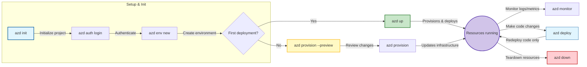
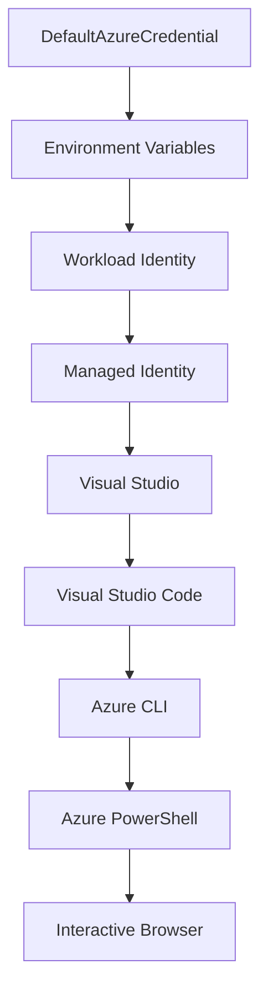

# AZD Grundlagen – Kernkonzepte und Grundlagen

**Kapitel-Navigation:**
- **📚 Kurs-Startseite**: [AZD für Anfänger](../../README.md)
- **📖 Aktuelles Kapitel**: Kapitel 1 – Grundlagen & Schnellstart
- **⬅️ Vorheriges**: [Kursübersicht](../../README.md#-chapter-1-foundation--quick-start)
- **➡️ Nächstes**: [Installation & Einrichtung](installation.md)
- **🚀 Nächstes Kapitel**: [Kapitel 2: AI-First Entwicklung](../chapter-02-ai-development/microsoft-foundry-integration.md)

## Einführung

> Überprüft gegen `azd 1.37.2` (November 2026). Bash-Befehle verwenden zitierte Platzhalter, die Sie ersetzen müssen. Template-Workflows verwenden `.`, um das aktuelle Verzeichnis zu initialisieren; ohne ein Verzeichnis-Argument erzeugt die Template-Initialisierung ein Unterverzeichnis und ändert nicht das aktuelle Arbeitsverzeichnis der Shell. Fortgeschrittene Snippets sind illustrativ, keine vollständigen Projekte.

Diese Lektion stellt Ihnen die Azure Developer CLI (azd) vor, ein leistungsfähiges Kommandozeilen-Tool, das Ihre Reise von der lokalen Entwicklung zur Azure-Bereitstellung beschleunigt. Sie lernen die grundlegenden Konzepte, Kernfunktionen kennen und verstehen, wie azd die Bereitstellung Cloud-nativer Anwendungen vereinfacht.

## Lernziele

Am Ende dieser Lektion werden Sie:
- Verstehen, was Azure Developer CLI ist und wofür sie hauptsächlich vorgesehen ist
- Die Kernkonzepte von Templates, Umgebungen und Services kennenlernen
- Wichtige Funktionen erkunden, einschließlich template-basierter Entwicklung und Infrastructure as Code
- Die azd-Projektstruktur und den Workflow verstehen
- Darauf vorbereitet sein, azd für Ihre Entwicklungsumgebung zu installieren und zu konfigurieren

## Lernergebnisse

Nach Abschluss dieser Lektion werden Sie in der Lage sein:
- Die Rolle von azd in modernen Cloud-Entwicklungs-Workflows zu erklären
- Die Komponenten einer azd-Projektstruktur zu identifizieren
- Zu beschreiben, wie Templates, Umgebungen und Services zusammenarbeiten
- Die Vorteile von Infrastructure as Code mit azd zu verstehen
- Verschiedene azd-Befehle und ihre Zwecke zu erkennen

## Was ist Azure Developer CLI (azd)?

Azure Developer CLI (azd) ist ein Kommandozeilen-Tool, das Ihre Reise von der lokalen Entwicklung zur Azure-Bereitstellung beschleunigt. Es vereinfacht den Prozess des Erstellens, Bereitstellens und Verwaltens Cloud-nativer Anwendungen auf Azure.

### Was können Sie mit azd bereitstellen?

azd unterstützt eine breite Palette von Workloads – und die Liste wächst ständig. Heute können Sie azd verwenden, um zu bereitstellen:

| Workload-Typ | Beispiele | Gleicher Workflow? |
|---------------|----------|----------------|
| **Traditionelle Anwendungen** | Web-Apps, REST-APIs, statische Webseiten | ✅ `azd up` |
| **Services und Microservices** | Container-Apps, Funktions-Apps, Multi-Service-Backends | ✅ `azd up` |
| **KI-gestützte Anwendungen** | Chat-Apps mit Microsoft Foundry Models, RAG-Lösungen mit AI Search | ✅ `azd up` |
| **Intelligente Agenten** | Foundry-gehostete Agenten, Multi-Agent-Orchestrierungen | ✅ `azd up` |

Die zentrale Erkenntnis ist: **Der Lebenszyklus von azd bleibt unabhängig davon gleich, was Sie bereitstellen.** Sie initialisieren ein Projekt, stellen Infrastruktur bereit, deployen Ihren Code, überwachen Ihre App und räumen auf – egal ob es sich um eine einfache Webseite oder einen komplexen KI-Agenten handelt.

Diese Kontinuität ist bewusst gestaltet. azd behandelt KI-Funktionen als eine weitere Art von Service, die Ihre Anwendung nutzen kann, nicht als etwas grundsätzlich anderes. Ein Chat-Endpunkt, der von Microsoft Foundry Models unterstützt wird, ist aus Sicht von azd einfach ein weiterer Service, den Sie konfigurieren und bereitstellen.

### 🎯 Warum AZD verwenden? Ein Vergleich aus der Praxis

Vergleichen wir die Bereitstellung einer einfachen Web-App mit Datenbank:

#### ❌ OHNE AZD: Manuelle Azure-Bereitstellung (30+ Minuten)

**Illustrierender Bash-Vergleich, kein ausführbarer Anwendungstarter.** Dies setzt vorhandenen Anwendungscode, eindeutige Ressourcennamen, Azure CLI-Authentifizierung und notwendige CLI-Erweiterungen voraus. Verwenden Sie die untenstehende Template-Übung für den unterstützten End-to-End-Pfad.

```bash
# Step 1: Create resource group
az group create --name myapp-rg --location eastus

# Step 2: Create App Service Plan
az appservice plan create --name myapp-plan \
  --resource-group myapp-rg \
  --sku B1 --is-linux

# Step 3: Create Web App
az webapp create --name myapp-web-unique123 \
  --resource-group myapp-rg \
  --plan myapp-plan \
  --runtime "NODE:22-lts"

# Step 4: Create Cosmos DB account (10-15 minutes)
az cosmosdb create --name myapp-cosmos-unique123 \
  --resource-group myapp-rg \
  --kind MongoDB

# Step 5: Create database
az cosmosdb mongodb database create \
  --account-name myapp-cosmos-unique123 \
  --resource-group myapp-rg \
  --name tododb

# Step 6: Create collection
az cosmosdb mongodb collection create \
  --account-name myapp-cosmos-unique123 \
  --resource-group myapp-rg \
  --database-name tododb \
  --name todos

# Step 7: Get connection string
CONN_STR=$(az cosmosdb keys list \
  --name myapp-cosmos-unique123 \
  --resource-group myapp-rg \
  --type connection-strings \
  --query "connectionStrings[0].connectionString" -o tsv)

# Step 8: Configure app settings
az webapp config appsettings set \
  --name myapp-web-unique123 \
  --resource-group myapp-rg \
  --settings MONGODB_URI="$CONN_STR"

# Step 9: Enable logging
az webapp log config --name myapp-web-unique123 \
  --resource-group myapp-rg \
  --application-logging filesystem \
  --detailed-error-messages true

# Step 10: Set up Application Insights
az monitor app-insights component create \
  --app myapp-insights \
  --location eastus \
  --resource-group myapp-rg

# Step 11: Link App Insights to Web App
INSTRUMENTATION_KEY=$(az monitor app-insights component show \
  --app myapp-insights \
  --resource-group myapp-rg \
  --query "instrumentationKey" -o tsv)

az webapp config appsettings set \
  --name myapp-web-unique123 \
  --resource-group myapp-rg \
  --settings APPINSIGHTS_INSTRUMENTATIONKEY="$INSTRUMENTATION_KEY"

# Step 12: Build application locally
npm install
npm run build

# Step 13: Create deployment package
zip -r app.zip . -x "*.git*" "node_modules/*"

# Step 14: Deploy application
az webapp deployment source config-zip \
  --resource-group myapp-rg \
  --name myapp-web-unique123 \
  --src app.zip

# Step 15: Wait and pray it works 🙏
# (No automated validation, manual testing required)
```

**Probleme:**
- ❌ 15+ Befehle merken und in Reihenfolge ausführen
- ❌ 30-45 Minuten manuelle Arbeit
- ❌ Leicht Fehler durch Tippfehler oder falsche Parameter
- ❌ Anmeldedaten erfordern explizite Handhabung; Debug-Logs und Shell-Trace können sie offenbaren
- ❌ Keine automatisierte Rückrollfunktion bei Fehlern
- ❌ Schwer für Teammitglieder reproduzierbar
- ❌ Jedes Mal anders (nicht reproduzierbar)

#### ✅ MIT AZD: Automatisierte Bereitstellung (5 Befehle, 10-15 Minuten)

```bash
# Step 1: Initialize from template
azd init --template todo-nodejs-mongo .

# Step 2: Authenticate
azd auth login

# Step 3: Select the environment created during init
azd env select dev

# Step 4: Preview changes (optional but recommended)
azd provision --preview

# Step 5: Deploy everything
azd up

# ✨ Done! Everything is deployed, configured, and monitored
```

**Vorteile:**
- ✅ **5 Befehle** statt 15+ manuelle Schritte
- ✅ **10-15 Minuten** Gesamtzeit (meist Wartezeit auf Azure)
- ✅ **Weniger manuelle Fehler** – konsistenter, template-basierter Workflow
- ✅ **Sichere Geheimnisverarbeitung** – viele Templates verwenden von Azure verwalteten Geheimnisspeicher
- ✅ **Wiederholbare Bereitstellungen** – derselbe Workflow jedes Mal
- ✅ **Wiederholbare Infrastrukturdefinitionen** – abhängig von Kontingenten, Regionen-Verfügbarkeit und Template-Versionen
- ✅ **Team-fähig** – jeder kann mit denselben Befehlen deployen
- ✅ **Infrastructure as Code** – versionierte Bicep-Templates
- ✅ **Template-definiertes Monitoring** – Application Insights bei Template-Einbindung

### Zeit und Zuverlässigkeit

Die oben genannten Zeiten sind Schätzungen, keine Benchmarks. azd reduziert die notwendigen Befehle, garantiert jedoch nicht die Dauer, eliminiert Fehler nicht oder sorgt für automatische Rückrollfunktionen. Bewahren Sie funktionierende Versionen im Quellcode-Verwaltungssystem auf und testen Sie Wiederherstellungsverfahren.

## Kernkonzepte

### Templates
Templates sind die Grundlage von azd. Sie enthalten:
- **Anwendungscode** – Ihr Quellcode und Abhängigkeiten
- **Infrastrukturdefinitionen** – Azure-Ressourcen, definiert in Bicep oder Terraform
- **Konfigurationsdateien** – Einstellungen und Umgebungsvariablen
- **Bereitstellungsskripte** – Automatisierte Deploy-Workflows

### Umgebungen
Umgebungen repräsentieren verschiedene Bereitstellungsziele:
- **Entwicklung** – Für Tests und Entwicklung
- **Staging** – Vorproduktionsumgebung
- **Produktion** – Live-Produktionsumgebung

Jede Umgebung verwaltet ihre eigenen:
- Umgebungsnamen und Werte; die Ressourcenzuordnung hängt vom Infrastruktur-Template ab
- Konfigurationseinstellungen
- Bereitstellungsstatus

### Services
Services in `azure.yaml` beschreiben bereitstellbare Anwendungsbestandteile:
- **Frontend** – Webanwendungen, SPAs
- **Backend** – APIs, Microservices

Datenbanken und Speicher werden normalerweise als Infrastruktur-Ressourcen bereitgestellt, nicht als erfundene Service-Hosts wie `host: postgres`.

## Schlüsselfunktionen

### 1. Template-gesteuerte Entwicklung
```bash
# Browse available templates
azd template list

# Initialize from a template
azd init --template "<template-name>" .
```

### 2. Infrastructure as Code
- **Bicep** – Azures domänenspezifische Sprache
- **Terraform** – Multi-Cloud-Infrastruktur-Tool
- Bicep wird in ARM-Templates kompiliert; rohes ARM-JSON ist kein separates integriertes `infra.provider`.

### 3. Integrierte Workflows
```bash
# Complete deployment workflow
azd up            # Provision + Deploy this is hands off for first time setup

# 🧪 NEW: Preview infrastructure changes before deployment (SAFE)
azd provision --preview    # Simulate infrastructure deployment without making changes

azd provision     # Create Azure resources if you update the infrastructure use this
azd deploy        # Deploy application code or redeploy application code once update
azd down          # Clean up resources
```

#### 🛡️ Sichere Infrastrukturplanung mit Vorschau
Der `azd provision --preview`-Befehl ist ein Wendepunkt für sichere Deployments:
- **Dry-run-Analyse** – Zeigt, was erstellt, geändert oder gelöscht wird
- **Kein Infrastruktur-Apply** – Prüft Anbieteränderungen; prüfen Sie Projekt-Hooks zuerst, da Hooks Befehle mit Seiteneffekten ausführen können
- **Team-Zusammenarbeit** – Vorschauergebnisse vor der Bereitstellung teilen
- **Kostenplanungseingabe** – Vorgeschlagene SKUs prüfen, dann mit dem Azure-Preisrechner kalkulieren; Vorschau berechnet keine Preise

```bash
# Example preview workflow
azd provision --preview           # See what will change
# Review the output, discuss with team
azd provision                     # Apply changes with confidence
```

### 📊 Visualisierung: AZD-Entwicklungsworkflow



**Workflow-Erklärung:**
1. **Init** – Start mit Template oder neuem Projekt
2. **Auth** – Authentifizierung bei Azure
3. **Environment** – Erstellen einer isolierten Bereitstellungsumgebung
4. **Preview** – 🆕 Immer zuerst Infrastrukturänderungen vorschauen (sichere Praxis)
5. **Provision** – Azure-Ressourcen erstellen/aktualisieren
6. **Deploy** – Anwendungscode bereitstellen
7. **Monitor** – Anwendungsleistung beobachten
8. **Iterate** – Änderungen vornehmen und Code neu deployen
9. **Cleanup** – Ressourcen entfernen, wenn sie nicht mehr benötigt werden

### 4. Umweltverwaltung
```bash
# Create and manage environments
azd env new "<environment-name>"
azd env select "<environment-name>"
azd env list
```

### 5. Erweiterungen und KI-Befehle

azd verwendet ein Erweiterungssystem, um Funktionen über die Kern-CLI hinaus hinzuzufügen. Das ist besonders nützlich für KI-Workloads:

```bash
# List available extensions
azd extension list

# Install the GA Foundry bundle (requires azd >= 1.37.0)
azd ext install microsoft.foundry

# Initialize an AI agent project interactively
azd ai agent init

# Test a deployed agent (shows latency and time-to-first-byte)
azd ai agent invoke

# Start the MCP server for AI-assisted development (Alpha)
azd mcp start
```

**Der Lebenszyklus eines Agenten, von Anfang bis Ende.** Das GA-`microsoft.foundry`-Bundle beinhaltet `azure.ai.agents` und sechs weitere Kern-Erweiterungen. Installieren Sie `azure.ai.evaluations` separat zur Evaluation. Verwenden Sie `azd >= 1.37.0` für diesen Workflow. Sie brauchen nicht alle von Anfang an:

| Phase | Befehl | Was er tut |
|-------|---------|--------------|
| **Scaffold** | `azd ai agent init --template <path-to-azure.yaml>` | Verwenden Sie eine aktuelle Agenten-Projektvorlage |
| **Lokal ausführen** | `azd ai agent run`, dann `azd ai agent invoke --local "Test prompt"` in einem anderen Terminal | Lokale Aktivität im Agent Inspector inspizieren; Modellaufrufe nutzen weiterhin Azure |
| **Bereitstellen** | `azd deploy` | Für code-basierte Agenten, Quellcode für einen Remote-Foundry-Build hochladen |
| **Testen** | `azd ai agent invoke` | Agent aufrufen und Antwortzeit ansehen |
| **Messen** | `azd ai eval init`, `generate`, `run start` | Evaluierungen mit der separaten Erweiterung konfigurieren, deployen und ausführen |
| **Verbessern** | `azd ai agent optimize --eval <evaluation-name> --optimize-model <optimizer-deployment>` | Kompatible Evaluierung wiederverwenden, um Agenten zu optimieren |
| **Inspektieren** | `azd ai agent endpoint show` | Live-Endpunktkonfiguration ansehen |
| **Bereinigen** | `azd ai agent delete` | Gehosteten Agenten und alle seine Versionen löschen |

> Beginnen Sie mit dem [GA hosted-agent walkthrough](../chapter-02-ai-development/microsoft-foundry-integration.md#hosted-agent-walkthrough-ga), der Voraussetzungen, Bereitstellung und sichere Bereinigung behandelt. Erweiterungen werden ausführlicher im Referenzdokument [AZD AI CLI-Befehle](../chapter-08-production/production-ai-practices.md#azd-ai-cli-commands-and-extensions) erläutert.

## 📁 Projektstruktur

Eine typische azd-Projektstruktur:
```
my-app/
├── .azure/                  # Local environments and selected-environment config
│   ├── config.json
│   └── dev/.env
├── .devcontainer/          # Development container config
├── .github/workflows/      # GitHub Actions
├── .vscode/               # VS Code settings
├── infra/                 # Infrastructure code
│   ├── main.bicep        # Main infrastructure template
│   ├── main.parameters.json
│   └── modules/          # Reusable modules
├── src/                  # Application source code
│   ├── api/             # Backend services
│   └── web/             # Frontend application
├── azure.yaml           # azd project configuration
└── README.md
```

## 🔧 Konfigurationsdateien

### azure.yaml
Die Hauptkonfigurationsdatei des Projekts:
```yaml
name: my-awesome-app
metadata:
  template: my-template@1.0.0

services:
  web:
    project: ./src/web
    language: js
    host: appservice
  api:
    project: ./src/api
    language: js
    host: appservice

hooks:
  preprovision:
    shell: pwsh
    run: echo "Preparing to provision..."
```

### .azure/config.json
Projekt-lokale Auswahl der Standardumgebung (illustrativ; von azd verwaltet):
```json
{
  "defaultEnvironment": "dev"
}
```

## 🎪 Häufige Workflows mit praktischen Übungen

> **💡 Lerntipp:** Folgen Sie diesen Übungen in Reihenfolge, um Ihre AZD-Fähigkeiten schrittweise aufzubauen.

### 🎯 Übung 1: Initialisieren Sie Ihr erstes Projekt

**Ziel:** Erstellen Sie ein AZD-Projekt und erkunden seine Struktur

**Schritte:**
```bash
# Use a proven template
mkdir azd-basics-practice
cd azd-basics-practice
# Choose "dev" for the environment name when prompted
azd init --template todo-nodejs-mongo .

# Explore the generated files
ls -la  # View all files including hidden ones

# Key files created:
# - azure.yaml (main config)
# - infra/ (infrastructure code)
# - src/ (application code)
```

**✅ Erfolg:** Sie haben azure.yaml, infra/ und src/ Verzeichnisse

---

### 🎯 Übung 2: Bereitstellung auf Azure

**Ziel:** End-to-End-Bereitstellung abschließen

**Schritte:**
```bash
# 1. Authenticate
azd auth login

# 2. Select the dev environment created in Exercise 1
azd env select dev
azd env set AZURE_LOCATION eastus

# 3. Preview changes (RECOMMENDED)
azd provision --preview

# 4. Deploy everything
azd up

# 5. Verify deployment
azd show    # View your app URL
```

**Erwartete Zeit:** 10-15 Minuten  
**✅ Erfolg:** Anwendungs-URL öffnet sich im Browser

---

### 🎯 Übung 3: Mehrere Umgebungen

**Ziel:** Deployment in dev und staging

**Schritte:**
```bash
# Already have dev, create staging
azd env new staging
azd env set AZURE_LOCATION westus2
azd up

# Switch between them
azd env list
azd env select dev
```

**✅ Erfolg:** Zwei getrennte Ressourcengruppen im Azure-Portal

**Bereinigung:** Übung 3 erzeugt eine zweite abrechenbare Bereitstellung. Löschen Sie beide nach Abschluss:

```bash
azd down --environment dev
azd down --environment staging
```

---

### 🛡️ Zerstörerische Bereinigung: `azd down --force --purge`

Wenn Sie gezielt die Azure-Ressourcen der ausgewählten Umgebung löschen möchten:

```bash
azd down --force --purge
```

**Was es tut:**
- `--force`: Keine Bestätigungsabfragen
- `--purge`: Löscht auch dauerhaft unterstützte soft-gelöschte Ressourcen (z. B. Key Vaults), soweit die Purge Protection dies zulässt. Löscht nicht das lokale `.azure/` Verzeichnis.

**Anwendung:** Wenn Sie eine entbehrliche Umgebung nicht mehr benötigen. Behandeln Sie die zerstörerische Bereinigung nicht als erste Reaktion auf Authentifizierungs-, Kontingent- oder Konfigurationsfehler.

---

## 🎪 Original Workflow-Referenz

### Start eines neuen Projekts
```bash
# Method 1: Use existing template
azd init --template todo-nodejs-mongo .

# Method 2: Start from scratch
azd init

# Method 3: Use current directory
azd init .
```

### Entwicklungszyklus
```bash
# Set up development environment
azd auth login
azd env new dev
azd env select dev

# Deploy everything
azd up

# Make changes and redeploy
azd deploy

# Clean up when done
azd down --force --purge # Deletes this environment's discovered Azure resources; review before forcing deletion.
```

## Verständnis von `azd down --force --purge`
Der `azd down --force --purge` Befehl ist eine mächtige Möglichkeit, Ihre azd-Umgebung und alle zugehörigen Ressourcen vollständig abzureißen. Hier eine Aufschlüsselung, was jede Option bewirkt:
```
--force
```
- Überspringt Bestätigungsabfragen.
- Nützlich für Automatisierung oder Skripte, bei denen manuelle Eingabe nicht möglich ist.
- Umgeht keine Berechtigungen, Purge Protection oder Löschfehler.

```
--purge
```
Löscht unterstützte soft-gelöschte Azure-Ressourcen dauerhaft ohne weitere Bestätigung. Purge Protection und Berechtigungen bleiben wirksam. Entfernt **nicht** lokale Umgebungen oder den `.azure/` Ordner.


### Warum beide verwenden?
Verwenden Sie beide nur, wenn Sie die Azure-Ressourcen der ausgewählten Umgebung und wiederherstellbare Ressourcen dauerhaft löschen möchten. Dies ist eine zerstörerische Bereinigung, keine allgemeine Reparatur oder ein Reset des lokalen Zustands.

Es ist besonders hilfreich nach manuellen Resource-Löschungen im Azure-Portal oder beim Wechsel von Templates, Umgebungen oder Benennungskonventionen von Ressourcengruppen.


### Verwaltung mehrerer Umgebungen
```bash
# Create staging environment
azd env new staging
azd env select staging
azd up

# Switch back to dev
azd env select dev

# Compare environments
azd env list
```

## 🔐 Authentifizierung und Zugangsdaten

Unterscheiden Sie Deployment-Authentifizierung (`azd auth login`) von Anwendungs-SDK-Authentifizierung (`DefaultAzureCredential`). Sie sind separat. azd verwendet standardmäßig keine Azure CLI-Anmeldedaten.

### Azure CLI Authentifizierung (`az login`)

Führen Sie für azd `azd auth login` aus. Die folgenden Azure CLI-Befehle sind optional und authentifizieren die `az` Befehle separat:

```bash
# Interactive login (opens browser)
az login

# Login with specific tenant
az login --tenant "<tenant-id>"

# Login with service principal
az login --service-principal -u "<app-id>" -p "<password>" --tenant "<tenant-id>"

# Check current login status
az account show

# List available subscriptions
az account list --output table

# Set default subscription
az account set --subscription "<subscription-id>"
```

### Authentifizierungsablauf
1. **Interaktive Anmeldung**: Öffnet den Standardbrowser für die Authentifizierung
2. **Gerätecode-Fluss**: Für Umgebungen ohne Browserzugang
3. **Dienstprinzipal**: Für Automatisierungs- und CI/CD-Szenarien
4. **Verwaltete Identität**: Für Azure-gehostete Anwendungen

### DefaultAzureCredential-Kette

`DefaultAzureCredential` ist ein Anmeldetyp, der ein vereinfachtes Authentifizierungserlebnis bietet, indem er automatisch mehrere Anmeldequellen in einer bestimmten Reihenfolge ausprobiert:

#### Anwendung SDK-Anmeldekette

Die genaue Kette hängt vom Azure Identity SDK, der Sprache, Version, installierten Plugins und Optionen ab. Dieses Diagramm ist konzeptionell, keine feste azd-Authentifizierungsreihenfolge; neuere SDKs können auch Azure Developer CLI-Anmeldedaten enthalten.


#### 1. Umgebungsvariablen
```bash
# Set environment variables for service principal
export AZURE_CLIENT_ID="<app-id>"
export AZURE_CLIENT_SECRET="<password>"
export AZURE_TENANT_ID="<tenant-id>"
```

#### 2. Workload-Identität (Kubernetes/GitHub Actions)
Wird automatisch verwendet in:
- Azure Kubernetes Service (AKS) mit Workload-Identität
- GitHub Actions mit OIDC-Föderation
- Andere föderierte Identitätsszenarien

#### 3. Verwaltete Identität
Für Azure-Ressourcen wie:
- Virtuelle Maschinen
- App Service
- Azure Functions
- Containerinstanzen

```bash
# Inspect a deployed Container App's configured identity (requires az login)
az containerapp show --name "<app-name>" --resource-group "<rg-name>" --query identity
```

#### 4. Integration von Entwicklerwerkzeugen
- **Visual Studio**: Verwendet automatisch das angemeldete Konto
- **VS Code**: Unterstützung hängt vom SDK und dessen unterstütztem Broker/Plugin-Setup ab
- **Azure CLI**: Verwendet `az login` Anmeldedaten (häufigste für lokale Entwicklung)

### AZD-Authentifizierungseinrichtung

```bash
# Method 1: Direct azd authentication (recommended)
azd auth login

# Method 2: Direct azd authentication
azd auth login --use-device-code  # For headless environments

# Method 3: Check authentication status
azd auth login --check-status

# Method 4: Logout and re-authenticate
azd auth logout
azd auth login
```

### Best Practices für Authentifizierung

#### Für lokale Entwicklung
```bash
# 1. Log in to azd
azd auth login

# 2. Select the subscription for this initialized environment
azd env set AZURE_SUBSCRIPTION_ID "<subscription-id>"

# 3. Check azd sign-in details (read the status message)
azd auth login --check-status
```

#### Für CI/CD-Pipelines
```yaml
# Partial GitHub Actions steps: assumes checkout, azd installation,
# required AZURE_* environment values, and pipeline secret configuration.
- name: Deploy with azd
  run: |
    azd auth login --client-id ${{ secrets.AZURE_CLIENT_ID }} \
                    --client-secret ${{ secrets.AZURE_CLIENT_SECRET }} \
                    --tenant-id ${{ secrets.AZURE_TENANT_ID }}
    azd up --no-prompt
```

#### Für Produktionsumgebungen
- Verwenden Sie **verwaltete Identität**, wenn Sie auf Azure-Ressourcen ausführen
- Verwenden Sie **Dienstprinzipal** für Automatisierungsszenarien
- Vermeiden Sie das Speichern von Anmeldeinformationen im Code oder in Konfigurationsdateien
- Verwenden Sie **Azure Key Vault** für sensible Konfigurationen

### Häufige Authentifizierungsprobleme und Lösungen

#### Problem: "Kein Abonnement gefunden"
```bash
# Solution: Set default subscription
az account list --output table
az account set --subscription "<subscription-id>"
azd env set AZURE_SUBSCRIPTION_ID "<subscription-id>"
```

#### Problem: "Unzureichende Berechtigungen"
```bash
# Solution: Check and assign required roles
az role assignment list --assignee $(az account show --query user.name --output tsv)

# Common required roles:
# - Contributor (for resource management)
# - User Access Administrator (for role assignments)
```

#### Problem: "Token abgelaufen"
```bash
# Solution: Re-authenticate
az logout
az login
azd auth logout
azd auth login
```

### Authentifizierung in verschiedenen Szenarien

#### Lokale Entwicklung
```bash
# Personal development account
az login
azd auth login
```

#### Team-Entwicklung
```bash
# Use specific tenant for organization
az login --tenant contoso.onmicrosoft.com
azd auth login --tenant-id "<tenant-id>"
```

#### Mandantenszenarien
```bash
# Switch between tenants
az login --tenant tenant1.onmicrosoft.com
azd auth login --tenant-id "<tenant-1-id>"
# Select an environment configured with tenant 1's subscription
azd env select tenant1-dev
# Deploy to tenant 1
azd up

az login --tenant tenant2.onmicrosoft.com  
azd auth login --tenant-id "<tenant-2-id>"
azd env select tenant2-dev
# Deploy to tenant 2
azd up
```

### Sicherheitsüberlegungen

1. **Anmeldeinformationen speichern**: Niemals Anmeldeinformationen im Quellcode speichern
2. **Bereichsbeschränkung**: Verwenden Sie das Prinzip der geringsten Berechtigung für Dienstprinzipale
3. **Token-Rotation**: Rotieren Sie regelmäßig Dienstprinzipal-Geheimnisse
4. **Audit-Trail**: Überwachen Sie Authentifizierungs- und Bereitstellungsaktivitäten
5. **Netzwerksicherheit**: Verwenden Sie private Endpunkte, wenn möglich

### Fehlerbehebung bei Authentifizierung

```bash
# Debug authentication issues
azd auth login --check-status
az account show
az account get-access-token

# Common diagnostic commands
whoami                          # Current user context
az ad signed-in-user show      # Microsoft Entra ID user details
az group list                  # Test resource access
```

## Befehlserkennung

### Erkennung
```bash
azd template list              # Browse templates
azd template list --help       # Template discovery options
azd init --help               # Initialization options
```

### Projektverwaltung
```bash
azd show                     # Project overview
azd env list                # Available environments and selected default
azd config show            # Configuration settings
```

### Überwachung
```bash
azd monitor                  # Open Azure portal monitoring
azd monitor --logs           # View application logs
azd monitor --live           # View live metrics
azd pipeline config          # Set up CI/CD
```

## Best Practices

### 1. Verwenden Sie aussagekräftige Namen
```bash
# Good
azd env new production-east
azd init --template todo-nodejs-mongo .

# Avoid
azd env new env1
azd init --template template1 .
```

### 2. Nutzen Sie Vorlagen
- Beginnen Sie mit vorhandenen Vorlagen
- Passen Sie sie an Ihre Bedürfnisse an
- Erstellen Sie wiederverwendbare Vorlagen für Ihre Organisation

### 3. Umgebungstrennung
- Verwenden Sie separate Umgebungen für Entwicklung/Staging/Produktion
- Setzen Sie nie direkt von der lokalen Maschine in die Produktion ein
- Verwenden Sie CI/CD-Pipelines für Produktionsbereitstellungen

### 4. Konfigurationsverwaltung
- Verwenden Sie verwaltete Identität und Key Vault für Geheimnisse; gewöhnliche `azd env set` Werte sind lokal im Klartext
- Halten Sie die Konfiguration in der Versionskontrolle
- Dokumentieren Sie umgebungsspezifische Einstellungen

## Lernfortschritt

### Anfänger (Woche 1-2)
1. Installieren Sie azd und authentifizieren Sie sich
2. Stellen Sie eine einfache Vorlage bereit
3. Verstehen Sie die Projektstruktur
4. Lernen Sie grundlegende Befehle (up, down, deploy)

### Mittelstufe (Woche 3-4)
1. Passen Sie Vorlagen an
2. Verwalten Sie mehrere Umgebungen
3. Verstehen Sie Infrastrukturcode
4. Richten Sie CI/CD-Pipelines ein

### Fortgeschrittene (Woche 5+)
1. Erstellen Sie benutzerdefinierte Vorlagen
2. Fortgeschrittene Infrastrukturmuster
3. Bereitstellungen in mehreren Regionen
4. Enterprise-Grade-Konfigurationen

## Nächste Schritte

**📖 Fahren Sie mit Kapitel 1 fort:**
- [Installation & Einrichtung](installation.md) - Installieren und konfigurieren Sie azd
- [Ihr erstes Projekt](first-project.md) - Absolvieren Sie das Praxistutorial
- [Konfigurationsanleitung](../chapter-03-configuration/configuration.md) - Erweiterte Konfigurationsoptionen

**🎯 Bereit für das nächste Kapitel?**
- [Kapitel 2: KI-zentrierte Entwicklung](../chapter-02-ai-development/microsoft-foundry-integration.md) - Beginnen Sie mit dem Aufbau von KI-Anwendungen

## Zusätzliche Ressourcen

- [Azure Developer CLI Übersicht](https://learn.microsoft.com/en-us/azure/developer/azure-developer-cli/)
- [Vorlagengalerie](https://azure.github.io/awesome-azd/)
- [Community-Beispiele](https://github.com/Azure-Samples)

---

## 🙋 Häufig gestellte Fragen

### Allgemeine Fragen

**F: Was ist der Unterschied zwischen AZD und Azure CLI?**

A: Azure CLI (`az`) dient zur Verwaltung einzelner Azure-Ressourcen. AZD (`azd`) verwaltet komplette Anwendungen:

```bash
# Azure CLI - Low-level resource management
az webapp create --name myapp --resource-group rg
az sql server create --name myserver --resource-group rg
# ...many more commands needed

# AZD - Application-level management
azd up  # Deploys entire app with all resources
```

**Denken Sie daran:**
- `az` = Arbeiten mit einzelnen Lego-Bausteinen
- `azd` = Arbeiten mit kompletten Lego-Sets

---

**F: Muss ich Bicep oder Terraform kennen, um AZD zu verwenden?**

A: Nein! Beginnen Sie mit Vorlagen:
```bash
# Use existing template - no IaC knowledge needed
azd init --template todo-nodejs-mongo .
azd up
```

Sie können Bicep später lernen, um die Infrastruktur anzupassen. Vorlagen bieten brauchbare Beispiele zum Lernen.

---

**F: Wie viel kostet es, AZD-Vorlagen auszuführen?**

A: Die Kosten variieren je nach Region, SKU, Betriebszeit, Datenbankmodus und Modellauslastung. Eine Entwicklungsumgebung kann beträchtliche monatliche Kosten verursachen, auch im Leerlauf; gehen Sie nicht von einem universellen Bereich von $50-150 aus:

```bash
# Preview resource changes (not prices)
azd provision --preview

# Always cleanup when not using
azd down --force --purge  # Removes all resources
```

**Profi-Tipp:** Nutzen Sie kostenlose Stufen, wo verfügbar:
- App Service: F1 (kostenlos) Stufe
- Azure OpenAI: keine allgemeine garantierte monatliche kostenlose Tokenanzahl; prüfen Sie aktuelle Modelle und Preisangebote
- Cosmos DB: Berechtigte Provisioned-Throughput-Konten können in die kostenlose Stufe wechseln; Serverless-Vorlagen qualifizieren sich nicht automatisch

---

**F: Kann ich AZD mit vorhandenen Azure-Ressourcen verwenden?**

A: Ja, aber es ist einfacher, frisch zu starten. AZD funktioniert am besten, wenn es den kompletten Lebenszyklus verwaltet. Für vorhandene Ressourcen:

```bash
# Option 1: Import existing resources (advanced)
azd init
# Then modify infra/ to reference existing resources

# Option 2: Start fresh (recommended)
azd init --template "<verified-template-name>" .
azd up  # Creates new environment
```

---

**F: Wie teile ich mein Projekt mit Teammitgliedern?**

A: Comitten Sie das AZD-Projekt in Git (aber NICHT den .azure-Ordner):

```bash
# Already in .gitignore by default
.azure/        # Contains secrets and environment data
*.env          # Environment variables

# Team members then:
git clone "<your-repo>"
# Change into the cloned repository before running the remaining commands.
azd auth login
azd env new "<their-name>-dev"
azd up
```

Alle erhalten identische Infrastruktur aus den gleichen Vorlagen.

---

### Fragen zur Fehlerbehebung

**F: „azd up“ schlug mitten im Prozess fehl. Was soll ich tun?**

A: Prüfen Sie den Fehler, beheben Sie ihn und versuchen Sie es erneut:

```bash
# Capture detailed diagnostics (redact sensitive values before sharing)
azd up --debug

# Common fixes:

# 1. If quota exceeded:
azd env set AZURE_LOCATION "westus2"  # Try different region

# 2. If resource name conflict:
azd down --force --purge  # Clean slate
azd up  # Retry

# 3. If auth expired:
az login
azd auth login
azd up
```

**Häufigstes Problem:** Falsches Azure-Abonnement ausgewählt
```bash
az account list --output table
az account set --subscription "<correct-subscription>"
azd env set AZURE_SUBSCRIPTION_ID "<correct-subscription-id>"
```

---

**F: Wie kann ich nur Codeänderungen ohne erneute Bereitstellung der Infrastruktur bereitstellen?**

A: Verwenden Sie `azd deploy` anstelle von `azd up`:

```bash
azd up          # First time: provision + deploy (slow)

# Make code changes...

azd deploy      # Subsequent times: deploy only (fast)
```

Geschwindigkeitsvergleich:
- `azd up`: 10-15 Minuten (stellt Infrastruktur bereit)
- `azd deploy`: 2-5 Minuten (nur Code)

---

**F: Kann ich die Infrastrukturvorlagen anpassen?**

A: Ja! Bearbeiten Sie die Bicep-Dateien in `infra/`:

```bash
# After azd init
cd infra/
code main.bicep  # Edit in VS Code

# Preview changes
azd provision --preview

# Apply changes
azd provision
```

**Tipp:** Starten Sie klein – ändern Sie zuerst SKUs:
```bicep
// infra/main.bicep
sku: {
  name: 'B1'  // Change to 'P1V2' for production
}
```

---

**F: Wie lösche ich alles, was AZD erstellt hat?**

A: Ein Befehl entfernt alle Ressourcen:

```bash
azd down --force --purge

# This deletes:
# - Azure resources/resource groups discovered for the selected environment
# - Supported soft-deleted resources, if purge protection allows
# Local .azure files remain; shared/external resources may remain too.
```

**Führen Sie dies immer aus, wenn:**
- Ein Test einer Vorlage abgeschlossen ist
- Sie zu einem anderen Projekt wechseln
- Sie neu starten möchten

**Kostenkontrolle:** Bestätigen Sie die Löschung in Azure und prüfen Sie auf zurückbehaltene/geteilte Ressourcen. Bereits angefallene Kosten bleiben bestehen.

---

**F: Was, wenn ich versehentlich Ressourcen im Azure-Portal gelöscht habe?**

A: AZD-Zustand kann aus dem Gleichgewicht geraten. Vorgehensweise für Neuanfang:

```bash
# 1. Delete remaining resources only if that is your intent
azd down --force --purge

# 2. Start fresh
azd up

# Alternative: Let AZD detect and fix
azd provision  # Will create missing resources
```

---

### Fortgeschrittene Fragen

**F: Kann ich AZD in CI/CD-Pipelines verwenden?**

A: Ja! Beispiel GitHub Actions:

```yaml
# .github/workflows/deploy.yml
name: Deploy with AZD

on:
  push:
    branches: [main]

jobs:
  deploy:
    runs-on: ubuntu-latest
    steps:
      - uses: actions/checkout@v4
      
      - name: Install azd
        run: curl -fsSL https://aka.ms/install-azd.sh | bash
      
      - name: Azure Login
        run: |
          azd auth login \
            --client-id ${{ secrets.AZURE_CLIENT_ID }} \
            --client-secret ${{ secrets.AZURE_CLIENT_SECRET }} \
            --tenant-id ${{ secrets.AZURE_TENANT_ID }}
      
      - name: Deploy
        env:
          AZURE_ENV_NAME: dev
          AZURE_LOCATION: ${{ vars.AZURE_LOCATION }}
          AZURE_SUBSCRIPTION_ID: ${{ vars.AZURE_SUBSCRIPTION_ID }}
        run: azd up --no-prompt
```

---

**F: Wie gehe ich mit Geheimnissen und sensiblen Daten um?**

A: Verwenden Sie Key Vault explizit. `azd env set` schreibt gewöhnliche Werte in die lokale Umgebungsdatei; es erstellt nicht automatisch einen Tresor, weist Rollen zu oder injiziert Geheimnisse in Ihre Anwendung.

```bash
# Interactive: create/select a Key Vault secret and save its reference
azd env set-secret DATABASE_PASSWORD
```

Sie benötigen entsprechende Tresorberechtigungen. Ihre Infrastruktur/Anwendung muss das Geheimnis an seinen Verbraucher weiterleiten und der Laufzeitidentität Zugriff gewähren. Geben Sie aufgelöste geheime Werte nicht in Protokollen aus.

**Niemals committen:**
- `.azure/` Ordner (enthält Umgebungsdaten)
- `.env` Dateien (lokale Geheimnisse)
- Verbindungszeichenfolgen

---

**F: Kann ich in mehrere Regionen bereitstellen?**

A: Ja, erstellen Sie für jede Region eine Umgebung:

```bash
# East US environment
azd env new prod-eastus
azd env set AZURE_LOCATION eastus
azd up

# West Europe environment
azd env new prod-westeurope
azd env set AZURE_LOCATION westeurope
azd up

# Each environment is independent
azd env list
```

Für echte Multi-Region-Anwendungen passen Sie Bicep-Vorlagen an, um gleichzeitig in mehreren Regionen bereitzustellen.

---

**F: Wo bekomme ich Hilfe, wenn ich feststecke?**

1. **AZD-Dokumentation:** https://learn.microsoft.com/azure/developer/azure-developer-cli/
2. **GitHub Issues:** https://github.com/Azure/azure-dev/issues
3. **Discord:** [Azure Discord](https://discord.gg/microsoft-azure) - #azure-developer-cli Kanal
4. **Stack Overflow:** Tag `azure-developer-cli`
5. **Dieser Kurs:** [Fehlerbehebungshandbuch](../chapter-07-troubleshooting/common-issues.md)

**Profi-Tipp:** Vor dem Fragen ausführen:
```bash
azd show       # Shows current state
azd version    # Shows your version
```
Fügen Sie diese Infos in Ihre Frage für schnellere Hilfe ein.

---

## 🎓 Was kommt als Nächstes?

Sie verstehen jetzt die AZD-Grundlagen. Wählen Sie Ihren Weg:

### 🎯 Für Anfänger:
1. **Weiter:** [Installation & Einrichtung](installation.md) - Installieren Sie AZD auf Ihrem Rechner
2. **Dann:** [Ihr erstes Projekt](first-project.md) - Stellen Sie Ihre erste App bereit
3. **Üben:** Absolvieren Sie alle 3 Übungen in dieser Lektion

### 🚀 Für KI-Entwickler:
1. **Springen Sie zu:** [Kapitel 2: KI-zentrierte Entwicklung](../chapter-02-ai-development/microsoft-foundry-integration.md)
2. **Bereitstellen:** Beginnen Sie in einem leeren Projektverzeichnis mit `azd init --template get-started-with-ai-chat .`
3. **Lernen Sie:** Bauen Sie auf, während Sie bereitstellen

### 🏗️ Für erfahrene Entwickler:
1. **Überblick:** [Konfigurationsanleitung](../chapter-03-configuration/configuration.md) - Erweiterte Einstellungen
2. **Erkunden:** [Infrastructure as Code](../chapter-04-infrastructure/provisioning.md) - Tiefgehender Bicep-Einblick
3. **Erstellen:** Erstellen Sie benutzerdefinierte Vorlagen für Ihren Stack

---

**Kapitelnavigation:**
- **📚 Kursstartseite**: [AZD für Anfänger](../../README.md)
- **📖 Aktuelles Kapitel**: Kapitel 1 - Grundlagen & Schnellstart  
- **⬅️ Vorheriges**: [Kursübersicht](../../README.md#-chapter-1-foundation--quick-start)
- **➡️ Nächstes**: [Installation & Einrichtung](installation.md)
- **🚀 Nächstes Kapitel**: [Kapitel 2: KI-zentrierte Entwicklung](../chapter-02-ai-development/microsoft-foundry-integration.md)

---

<!-- CO-OP TRANSLATOR DISCLAIMER START -->
**Haftungsausschluss**:
Dieses Dokument wurde mit dem KI-Übersetzungsdienst [Co-op Translator](https://github.com/Azure/co-op-translator) übersetzt. Obwohl wir uns um Genauigkeit bemühen, beachten Sie bitte, dass automatisierte Übersetzungen Fehler oder Ungenauigkeiten enthalten können. Das Originaldokument in seiner Ursprungssprache gilt als maßgebliche Quelle. Bei kritischen Informationen wird eine professionelle menschliche Übersetzung empfohlen. Wir übernehmen keine Haftung für Missverständnisse oder Fehlinterpretationen, die aus der Verwendung dieser Übersetzung entstehen.
<!-- CO-OP TRANSLATOR DISCLAIMER END -->