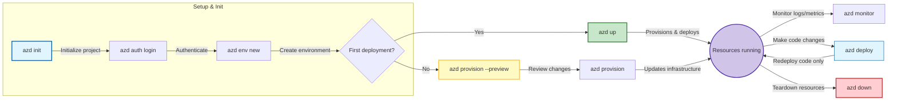
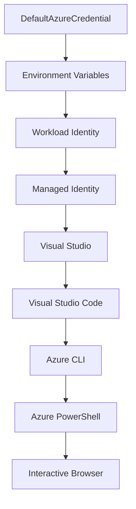

# AZD Grundlagen – Kernkonzepte und Grundlagen

**Kapitelnavigation:**
- **📚 Kursstartseite**: [AZD für Einsteiger](../../README.md)
- **📖 Aktuelles Kapitel**: Kapitel 1 – Grundlagen & Schnellstart
- **⬅️ Vorheriges**: [Kursübersicht](../../README.md#-chapter-1-foundation--quick-start)
- **➡️ Nächstes**: [Installation & Einrichtung](installation.md)
- **🚀 Nächstes Kapitel**: [Kapitel 2: KI-basiertes Entwickeln](../chapter-02-ai-development/microsoft-foundry-integration.md)

## Einführung

> Geprüft anhand von `azd 1.37.2` (November 2026). Bash-Befehle verwenden zitierte Platzhalter, die Sie ersetzen müssen. Vorlagen-Workflows nutzen `.` zur Initialisierung des aktuellen Verzeichnisses; ohne ein Verzeichnis-Argument erstellt die Vorlageninitialisierung ein Unterverzeichnis und ändert nicht das Arbeitsverzeichnis Ihrer Shell. Fortgeschrittene Schnipsel sind illustrativ, keine vollständigen Projekte.

Diese Lektion stellt Ihnen die Azure Developer CLI (azd) vor, ein leistungsfähiges Kommandozeilentool, das Ihre Reise von der lokalen Entwicklung bis zur Azure-Bereitstellung beschleunigt. Sie lernen die grundlegenden Konzepte, Kernfunktionen und verstehen, wie azd die Bereitstellung von Cloud-nativen Anwendungen vereinfacht.

## Lernziele

Am Ende dieser Lektion werden Sie:
- Verstehen, was Azure Developer CLI ist und welchen Zweck es primär erfüllt
- Die Kernkonzepte von Vorlagen, Umgebungen und Diensten kennenlernen
- Wichtige Funktionen wie vorlagenbasierte Entwicklung und Infrastructure as Code erkunden
- Die azd-Projektstruktur und den Workflow verstehen
- Bereit sein, azd für Ihre Entwicklungsumgebung zu installieren und zu konfigurieren

## Lernergebnisse

Nach Abschluss dieser Lektion sind Sie in der Lage:
- Die Rolle von azd in modernen Cloud-Entwicklungs-Workflows zu erklären
- Die Komponenten einer azd-Projektstruktur zu identifizieren
- Zu beschreiben, wie Vorlagen, Umgebungen und Dienste zusammenarbeiten
- Die Vorteile von Infrastructure as Code mit azd zu verstehen
- Verschiedene azd-Befehle und deren Zweck zu erkennen

## Was ist Azure Developer CLI (azd)?

Azure Developer CLI (azd) ist ein Kommandozeilentool, das Ihre Reise von der lokalen Entwicklung bis zur Azure-Bereitstellung beschleunigt. Es vereinfacht den Prozess des Erstellens, Bereitstellens und Verwaltens von Cloud-nativen Anwendungen auf Azure.

### Was können Sie mit azd bereitstellen?

azd unterstützt eine Vielzahl von Workloads – und die Liste wächst stetig. Heute können Sie azd verwenden, um bereitzustellen:

| Workload-Typ | Beispiele | Gleicher Workflow? |
|-------------|-----------|-------------------|
| **Traditionelle Anwendungen** | Web-Apps, REST APIs, statische Websites | ✅ `azd up` |
| **Dienste und Microservices** | Container Apps, Function Apps, Multiservice-Backends | ✅ `azd up` |
| **KI-gestützte Anwendungen** | Chat-Apps mit Microsoft Foundry Models, RAG-Lösungen mit AI Search | ✅ `azd up` |
| **Intelligente Agenten** | Foundry-gehostete Agenten, Multi-Agent-Orchestrierungen | ✅ `azd up` |

Der wichtige Punkt ist, dass **der azd-Lebenszyklus gleich bleibt, unabhängig davon, was Sie bereitstellen**. Sie initialisieren ein Projekt, stellen Infrastruktur bereit, deployen Ihren Code, überwachen Ihre App und bereinigen – egal ob es sich um eine einfache Website oder einen komplexen KI-Agenten handelt.

Diese Kontinuität ist absichtlich so gestaltet. azd behandelt KI-Fähigkeiten als eine weitere Art von Dienst, den Ihre Anwendung nutzen kann, nicht als etwas grundsätzlich anderes. Ein Chat-Endpunkt, der durch Microsoft Foundry Models unterstützt wird, ist aus azd-Sicht einfach ein weiterer Dienst zur Konfiguration und Bereitstellung.

### 🎯 Warum AZD verwenden? Ein Praxisvergleich

Vergleichen wir die Bereitstellung einer einfachen Web-App mit Datenbank:

#### ❌ OHNE AZD: Manuelle Azure-Bereitstellung (über 30 Minuten)

**Illustrativer Bash-Vergleich, kein lauffähiger Starter.** Dies setzt vorhandenen Anwendungscode, eindeutige Ressourcennamen, Azure CLI-Authentifizierung sowie erforderliche CLI-Erweiterungen voraus. Nutzen Sie die Vorlage unten für den unterstützten Ende-zu-Ende-Pfad.

```bash
# Step 1: Create resource group
az group create --name myapp-rg --location eastus

# Step 2: Create App Service Plan
az appservice plan create --name myapp-plan \
  --resource-group myapp-rg \
  --sku B1 --is-linux

# Step 3: Create Web App
az webapp create --name myapp-web-unique123 \
  --resource-group myapp-rg \
  --plan myapp-plan \
  --runtime "NODE:22-lts"

# Step 4: Create Cosmos DB account (10-15 minutes)
az cosmosdb create --name myapp-cosmos-unique123 \
  --resource-group myapp-rg \
  --kind MongoDB

# Step 5: Create database
az cosmosdb mongodb database create \
  --account-name myapp-cosmos-unique123 \
  --resource-group myapp-rg \
  --name tododb

# Step 6: Create collection
az cosmosdb mongodb collection create \
  --account-name myapp-cosmos-unique123 \
  --resource-group myapp-rg \
  --database-name tododb \
  --name todos

# Step 7: Get connection string
CONN_STR=$(az cosmosdb keys list \
  --name myapp-cosmos-unique123 \
  --resource-group myapp-rg \
  --type connection-strings \
  --query "connectionStrings[0].connectionString" -o tsv)

# Step 8: Configure app settings
az webapp config appsettings set \
  --name myapp-web-unique123 \
  --resource-group myapp-rg \
  --settings MONGODB_URI="$CONN_STR"

# Step 9: Enable logging
az webapp log config --name myapp-web-unique123 \
  --resource-group myapp-rg \
  --application-logging filesystem \
  --detailed-error-messages true

# Step 10: Set up Application Insights
az monitor app-insights component create \
  --app myapp-insights \
  --location eastus \
  --resource-group myapp-rg

# Step 11: Link App Insights to Web App
INSTRUMENTATION_KEY=$(az monitor app-insights component show \
  --app myapp-insights \
  --resource-group myapp-rg \
  --query "instrumentationKey" -o tsv)

az webapp config appsettings set \
  --name myapp-web-unique123 \
  --resource-group myapp-rg \
  --settings APPINSIGHTS_INSTRUMENTATIONKEY="$INSTRUMENTATION_KEY"

# Step 12: Build application locally
npm install
npm run build

# Step 13: Create deployment package
zip -r app.zip . -x "*.git*" "node_modules/*"

# Step 14: Deploy application
az webapp deployment source config-zip \
  --resource-group myapp-rg \
  --name myapp-web-unique123 \
  --src app.zip

# Step 15: Wait and pray it works 🙏
# (No automated validation, manual testing required)
```

**Probleme:**
- ❌ Über 15 Befehle merken und in der richtigen Reihenfolge ausführen
- ❌ 30-45 Minuten manuelle Arbeit
- ❌ Fehleranfällig (Tippfehler, falsche Parameter)
- ❌ Anmeldedaten erfordern explizite Behandlung; Debug-Logs und Shell-Tracing können sie offenlegen
- ❌ Keine automatische Rücknahme bei Fehlern
- ❌ Schwer für Teammitglieder reproduzierbar
- ❌ Unterschiedlich bei jedem Durchlauf (nicht reproduzierbar)

#### ✅ MIT AZD: Automatisierte Bereitstellung (5 Befehle, 10-15 Minuten)

```bash
# Step 1: Initialize from template
azd init --template todo-nodejs-mongo .

# Step 2: Authenticate
azd auth login

# Step 3: Select the environment created during init
azd env select dev

# Step 4: Preview changes (optional but recommended)
azd provision --preview

# Step 5: Deploy everything
azd up

# ✨ Done! Everything is deployed, configured, and monitored
```

**Vorteile:**
- ✅ **5 Befehle** vs. 15+ manuelle Schritte
- ✅ **10-15 Minuten** Gesamtzeit (meistens Warten auf Azure)
- ✅ **Weniger manuelle Fehler** – konsistenter, vorlagengetriebener Workflow
- ✅ **Sichere Geheimnisverwaltung** – viele Vorlagen nutzen Azure-verwalteten geheimes Speicher
- ✅ **Wiederholbare Bereitstellungen** – jedes Mal derselbe Workflow
- ✅ **Wiederholbare Infrastrukturdefinitionen** – abhängig von Kontingenten, Regionsverfügbarkeit und Vorlagenversionen
- ✅ **Teambereit** – jeder kann mit denselben Befehlen deployen
- ✅ **Infrastructure as Code** – versionierte Bicep-Vorlagen
- ✅ **Vorlagendefiniertes Monitoring** – Application Insights bei Vorlage inklusive

### Zeit und Zuverlässigkeit

Die oben genannten Zeiten sind Schätzungen, keine Benchmarks. azd reduziert die zu koordinierenden Befehle, garantiert jedoch nicht die Dauer der Bereitstellung, beseitigt Fehler nicht und bietet keine automatische Rücknahme von Anwendung/Datenbank. Behalten Sie funktionierende Versionen im Quellcode und testen Sie Wiederherstellungsverfahren.

## Kernkonzepte

### Vorlagen
Vorlagen bilden die Grundlage von azd. Sie enthalten:
- **Anwendungscode** – Ihr Quellcode und Abhängigkeiten
- **Infrastrukturdefinitionen** – Azure-Ressourcen, definiert in Bicep oder Terraform
- **Konfigurationsdateien** – Einstellungen und Umgebungsvariablen
- **Bereitstellungsskripte** – Automatisierte Bereitstellungs-Workflows

### Umgebungen
Umgebungen stehen für unterschiedliche Bereitstellungsziele:
- **Entwicklung** – Zum Testen und Entwickeln
- **Staging** – Vorproduktionsumgebung
- **Produktion** – Live-Produktionsumgebung

Jede Umgebung pflegt ihre eigenen:
- Umgebungsnamen und Werte; Ressourcenisolation hängt von der Infrastrukturvorlage ab
- Konfigurationseinstellungen
- Bereitstellungsstatus

### Dienste
Dienste in `azure.yaml` beschreiben deploybare Anwendungskomponenten:
- **Frontend** – Webanwendungen, SPAs
- **Backend** – APIs, Microservices

Datenbanken und Speicher werden normalerweise als Infrastrukturressourcen bereitgestellt, nicht als erfundene Service-Hosts wie `host: postgres`.

## Hauptfunktionen

### 1. Vorlagengetriebene Entwicklung
```bash
# Browse available templates
azd template list

# Initialize from a template
azd init --template "<template-name>" .
```

### 2. Infrastructure as Code
- **Bicep** – Azures domänenspezifische Sprache
- **Terraform** – Multi-Cloud-Infrastruktur-Tool
- Bicep kompiliert zu ARM-Vorlagen; rohes ARM-JSON ist kein separates eingebautes `infra.provider`.

### 3. Integrierte Workflows
```bash
# Complete deployment workflow
azd up            # Provision + Deploy this is hands off for first time setup

# 🧪 NEW: Preview infrastructure changes before deployment (SAFE)
azd provision --preview    # Simulate infrastructure deployment without making changes

azd provision     # Create Azure resources if you update the infrastructure use this
azd deploy        # Deploy application code or redeploy application code once update
azd down          # Clean up resources
```

#### 🛡️ Sichere Infrastrukturplanung mit Vorschau
Der `azd provision --preview`-Befehl ist ein Game-Changer für sichere Bereitstellungen:
- **Trockenlauf-Analyse** – Zeigt, was erstellt, geändert oder gelöscht wird
- **Keine Infrastruktur-Anwendung** – Bewertet Provider-Änderungen; prüfen Sie zuerst Projekthooks, da Hooks Befehle mit Nebenwirkungen ausführen können
- **Zusammenarbeit im Team** – Vorschauergebnisse vor der Bereitstellung teilen
- **Kostenplanung** – Vorgeschlagene SKUs prüfen und mit Azure Preiskalkulator bewerten; Vorschau berechnet keine Preise

```bash
# Example preview workflow
azd provision --preview           # See what will change
# Review the output, discuss with team
azd provision                     # Apply changes with confidence
```

### 📊 Visualisierung: AZD Entwicklungs-Workflow



**Workflow-Erklärung:**
1. **Init** – Start mit Vorlage oder neuem Projekt
2. **Auth** – Authentifizierung bei Azure
3. **Environment** – Erstelle isolierte Bereitstellungsumgebung
4. **Preview** – 🆕 Immer erst Infrastrukturänderungen vorschauen (sicherer Ablauf)
5. **Provision** – Azure-Ressourcen erstellen/aktualisieren
6. **Deploy** – Anwendungscode bereitstellen
7. **Monitor** – Anwendungsleistung beobachten
8. **Iterate** – Änderungen vornehmen und Code erneut deployen
9. **Cleanup** – Ressourcen entfernen, wenn fertig

### 4. Verwaltung von Umgebungen
```bash
# Create and manage environments
azd env new "<environment-name>"
azd env select "<environment-name>"
azd env list
```

### 5. Erweiterungen und KI-Befehle

azd verwendet ein Erweiterungssystem, um Kapazitäten über das Kern-CLI hinaus hinzuzufügen. Das ist besonders nützlich für KI-Workloads:

```bash
# List available extensions
azd extension list

# Install the Foundry agents extension
azd extension install azure.ai.agents

# Initialize an AI agent project interactively
azd ai agent init

# Test a deployed agent (shows latency and time-to-first-byte)
azd ai agent invoke

# Start the MCP server for AI-assisted development (Alpha)
azd mcp start
```

**Der Agent-Lebenszyklus, Ende-zu-Ende.** Verwenden Sie `azure.ai.agents` für Agent-Lebenszyklus-Operationen und installieren Sie `azure.ai.evaluations` separat für Bewertungen. Nutzen Sie `azd >= 1.37.0` für den kombinierten Workflow. Nicht alle sind am ersten Tag nötig:

| Phase | Befehl | Funktion |
|-------|---------|----------|
| **Scaffold** | `azd ai agent init --template <path-to-azure.yaml>` | Aktuelles Agenten-Projektvorlage übernehmen |
| **Test** | `azd ai agent invoke` | Agent aufrufen und Antwortzeit anzeigen |
| **Messen** | `azd ai eval init`, `generate`, `run start` | Konfigurieren, bereitstellen und Bewertungen mit separater Erweiterung ausführen |
| **Verbessern** | `azd ai agent optimize --eval <evaluation-name> --optimize-model <optimizer-deployment>` | Kompatible Bewertung wiederverwenden, um Agent zu optimieren |
| **Inspektieren** | `azd ai agent endpoint show` | Live-Endpunkt-Konfiguration ansehen |
| **Bereinigen** | `azd ai agent delete` | Einen gehosteten Agenten und alle Versionen löschen |

> Erweiterungen werden ausführlich behandelt in [Kapitel 2: KI-basiertes Entwickeln](../chapter-02-ai-development/agents.md) und der [AZD KI CLI Befehle](../chapter-08-production/production-ai-practices.md#azd-ai-cli-commands-and-extensions) Referenz.

## 📁 Projektstruktur

Eine typische azd-Projektstruktur:
```
my-app/
├── .azure/                  # Local environments and selected-environment config
│   ├── config.json
│   └── dev/.env
├── .devcontainer/          # Development container config
├── .github/workflows/      # GitHub Actions
├── .vscode/               # VS Code settings
├── infra/                 # Infrastructure code
│   ├── main.bicep        # Main infrastructure template
│   ├── main.parameters.json
│   └── modules/          # Reusable modules
├── src/                  # Application source code
│   ├── api/             # Backend services
│   └── web/             # Frontend application
├── azure.yaml           # azd project configuration
└── README.md
```

## 🔧 Konfigurationsdateien

### azure.yaml
Die Hauptprojekt-Konfigurationsdatei:
```yaml
name: my-awesome-app
metadata:
  template: my-template@1.0.0

services:
  web:
    project: ./src/web
    language: js
    host: appservice
  api:
    project: ./src/api
    language: js
    host: appservice

hooks:
  preprovision:
    shell: pwsh
    run: echo "Preparing to provision..."
```

### .azure/config.json
Projektlokale Auswahl der Standardumgebung (illustriert; von azd verwaltet):
```json
{
  "defaultEnvironment": "dev"
}
```

## 🎪 Übliche Workflows mit praktischen Übungen

> **💡 Lerntipp:** Folgen Sie diesen Übungen der Reihe nach, um Ihre AZD-Fähigkeiten schrittweise aufzubauen.

### 🎯 Übung 1: Initialisieren Sie Ihr erstes Projekt

**Ziel:** Ein AZD-Projekt erstellen und dessen Struktur erkunden

**Schritte:**
```bash
# Use a proven template
mkdir azd-basics-practice
cd azd-basics-practice
# Choose "dev" for the environment name when prompted
azd init --template todo-nodejs-mongo .

# Explore the generated files
ls -la  # View all files including hidden ones

# Key files created:
# - azure.yaml (main config)
# - infra/ (infrastructure code)
# - src/ (application code)
```

**✅ Erfolg:** Sie haben die Verzeichnisse azure.yaml, infra/ und src/

---

### 🎯 Übung 2: Bereitstellung zu Azure

**Ziel:** End-to-End-Bereitstellung durchführen

**Schritte:**
```bash
# 1. Authenticate
azd auth login

# 2. Select the dev environment created in Exercise 1
azd env select dev
azd env set AZURE_LOCATION eastus

# 3. Preview changes (RECOMMENDED)
azd provision --preview

# 4. Deploy everything
azd up

# 5. Verify deployment
azd show    # View your app URL
```

**Erwartete Zeit:** 10-15 Minuten  
**✅ Erfolg:** Anwendungs-URL öffnet sich im Browser

---

### 🎯 Übung 3: Mehrere Umgebungen

**Ziel:** In dev- und staging-Umgebung bereitstellen

**Schritte:**
```bash
# Already have dev, create staging
azd env new staging
azd env set AZURE_LOCATION westus2
azd up

# Switch between them
azd env list
azd env select dev
```

**✅ Erfolg:** Zwei separate Ressourcengruppen im Azure-Portal

**Bereinigung:** Übung 3 erstellt eine zweite abrechenbare Bereitstellung. Löschen Sie beide, wenn fertig:

```bash
azd down --environment dev
azd down --environment staging
```

---

### 🛡️ Zerstörerische Bereinigung: `azd down --force --purge`

Wenn Sie absichtlich die Azure-Ressourcen der ausgewählten Umgebung löschen möchten:

```bash
azd down --force --purge
```

**Was es bewirkt:**
- `--force`: Keine Bestätigungsabfragen
- `--purge`: Löscht auch dauerhaft unterstützte, soft-gelöschte Ressourcen (z. B. Key Vaults), sofern Löschschutz dies gestattet. Das lokale `.azure/`-Verzeichnis wird nicht gelöscht.

**Verwendung:** Wenn die entbehrliche Umgebung nicht mehr benötigt wird. Behandeln Sie zerstörerische Bereinigung nicht als erste Reaktion auf Authentifizierungs-, Kontingent- oder Konfigurationsfehler.

---

## 🎪 Ursprüngliche Workflow-Referenz

### Neues Projekt starten
```bash
# Method 1: Use existing template
azd init --template todo-nodejs-mongo .

# Method 2: Start from scratch
azd init

# Method 3: Use current directory
azd init .
```

### Entwicklungszyklus
```bash
# Set up development environment
azd auth login
azd env new dev
azd env select dev

# Deploy everything
azd up

# Make changes and redeploy
azd deploy

# Clean up when done
azd down --force --purge # Deletes this environment's discovered Azure resources; review before forcing deletion.
```

## Verständnis von `azd down --force --purge`
Der `azd down --force --purge`-Befehl ist eine leistungsfähige Möglichkeit, Ihre azd-Umgebung und alle zugehörigen Ressourcen vollständig abzubauen. Hier eine Übersicht, was jede Option bewirkt:
```
--force
```
- Überspringt Bestätigungsabfragen.
- Nützlich für Automatisierung oder Skripting, wenn manuelle Eingaben nicht möglich sind.
- Umgeht nicht Berechtigungen, Löschschutz oder Löschfehler.

```
--purge
```
Löscht dauerhaft unterstützte soft-gelöschte Azure-Ressourcen ohne weitere Bestätigung. Löschschutz und Berechtigungen gelten weiterhin. Entfernt **nicht** lokale Umgebungen oder das `.azure/`-Verzeichnis.


### Warum beide verwenden?
Verwenden Sie beide nur, wenn Sie die Azure-Ressourcen der ausgewählten Umgebung löschen und wiederherstellbare Ressourcen endgültig entfernen möchten. Das ist zerstörerische Bereinigung, keine allgemeine Reparatur oder lokaler Reset.

Besonders hilfreich nach manuellen Ressourcenlöschungen im Azure-Portal oder beim Wechsel von Vorlagen, Umgebungen oder Namenskonventionen für Ressourcengruppen.


### Verwaltung mehrerer Umgebungen
```bash
# Create staging environment
azd env new staging
azd env select staging
azd up

# Switch back to dev
azd env select dev

# Compare environments
azd env list
```

## 🔐 Authentifizierung und Anmeldedaten

Unterscheiden Sie die Deployment-Authentifizierung (`azd auth login`) von der Anwendungs-SDK-Authentifizierung (`DefaultAzureCredential`). Sie sind getrennt. azd verwendet standardmäßig keine Azure CLI-Anmeldedaten.

### Azure CLI Authentifizierung (`az login`)

Führen Sie `azd auth login` für azd aus. Die folgenden Azure CLI-Befehle sind optional und authentifizieren `az`-Befehle separat:

```bash
# Interactive login (opens browser)
az login

# Login with specific tenant
az login --tenant "<tenant-id>"

# Login with service principal
az login --service-principal -u "<app-id>" -p "<password>" --tenant "<tenant-id>"

# Check current login status
az account show

# List available subscriptions
az account list --output table

# Set default subscription
az account set --subscription "<subscription-id>"
```

### Authentifizierungsablauf
1. **Interaktive Anmeldung**: Öffnet Ihren Standardbrowser zur Authentifizierung
2. **Gerätecode-Flow**: Für Umgebungen ohne Browserzugang
3. **Service Principal**: Für Automatisierung und CI/CD-Szenarien
4. **Managed Identity**: Für Azure-gehostete Anwendungen

### DefaultAzureCredential-Kette

`DefaultAzureCredential` ist ein Anmeldedatentyp, der eine vereinfachte Authentifizierung bietet, indem er automatisch mehrere Anmeldedatenquellen in einer bestimmten Reihenfolge versucht:

#### Anmeldedatenkette für Anwendungssdk

Die genaue Kette hängt von der Sprache des Azure Identity SDK, der Version, den installierten Plugins und Optionen ab. Dieses Diagramm ist konzeptionell und keine feste azd-Authentifizierungssequenz; neuere SDKs können auch Azure Developer CLI-Anmeldeinformationen enthalten.


#### 1. Umgebungsvariablen
```bash
# Set environment variables for service principal
export AZURE_CLIENT_ID="<app-id>"
export AZURE_CLIENT_SECRET="<password>"
export AZURE_TENANT_ID="<tenant-id>"
```

#### 2. Workload-Identität (Kubernetes/GitHub Actions)
Wird automatisch verwendet in:
- Azure Kubernetes Service (AKS) mit Workload-Identität
- GitHub Actions mit OIDC-Föderation
- Weitere föderierte Identitätsszenarien

#### 3. Verwaltete Identität
Für Azure-Ressourcen wie:
- Virtuelle Maschinen
- App Service
- Azure Functions
- Container Instances

```bash
# Inspect a deployed Container App's configured identity (requires az login)
az containerapp show --name "<app-name>" --resource-group "<rg-name>" --query identity
```

#### 4. Integration von Entwickler-Tools
- **Visual Studio**: Verwendet automatisch das angemeldete Konto
- **VS Code**: Unterstützung hängt vom SDK und dem unterstützten Broker/Plugin-Setup ab
- **Azure CLI**: Verwendet `az login`-Anmeldeinformationen (am gebräuchlichsten für die lokale Entwicklung)

### AZD-Authentifizierungseinrichtung

```bash
# Method 1: Direct azd authentication (recommended)
azd auth login

# Method 2: Direct azd authentication
azd auth login --use-device-code  # For headless environments

# Method 3: Check authentication status
azd auth login --check-status

# Method 4: Logout and re-authenticate
azd auth logout
azd auth login
```

### Beste Praktiken zur Authentifizierung

#### Für die lokale Entwicklung
```bash
# 1. Log in to azd
azd auth login

# 2. Select the subscription for this initialized environment
azd env set AZURE_SUBSCRIPTION_ID "<subscription-id>"

# 3. Check azd sign-in details (read the status message)
azd auth login --check-status
```

#### Für CI/CD-Pipelines
```yaml
# Partial GitHub Actions steps: assumes checkout, azd installation,
# required AZURE_* environment values, and pipeline secret configuration.
- name: Deploy with azd
  run: |
    azd auth login --client-id ${{ secrets.AZURE_CLIENT_ID }} \
                    --client-secret ${{ secrets.AZURE_CLIENT_SECRET }} \
                    --tenant-id ${{ secrets.AZURE_TENANT_ID }}
    azd up --no-prompt
```

#### Für Produktionsumgebungen
- Verwenden Sie **Managed Identity**, wenn Sie auf Azure-Ressourcen ausführen
- Verwenden Sie **Service Principal** für Automatisierungsszenarien
- Vermeiden Sie das Speichern von Anmeldeinformationen im Code oder in Konfigurationsdateien
- Verwenden Sie **Azure Key Vault** für sensible Konfigurationen

### Häufige Authentifizierungsprobleme und Lösungen

#### Problem: "Keine Abonnement gefunden"
```bash
# Solution: Set default subscription
az account list --output table
az account set --subscription "<subscription-id>"
azd env set AZURE_SUBSCRIPTION_ID "<subscription-id>"
```

#### Problem: "Unzureichende Berechtigungen"
```bash
# Solution: Check and assign required roles
az role assignment list --assignee $(az account show --query user.name --output tsv)

# Common required roles:
# - Contributor (for resource management)
# - User Access Administrator (for role assignments)
```

#### Problem: "Token abgelaufen"
```bash
# Solution: Re-authenticate
az logout
az login
azd auth logout
azd auth login
```

### Authentifizierung in verschiedenen Szenarien

#### Lokale Entwicklung
```bash
# Personal development account
az login
azd auth login
```

#### Team-Entwicklung
```bash
# Use specific tenant for organization
az login --tenant contoso.onmicrosoft.com
azd auth login --tenant-id "<tenant-id>"
```

#### Multi-Tenant-Szenarien
```bash
# Switch between tenants
az login --tenant tenant1.onmicrosoft.com
azd auth login --tenant-id "<tenant-1-id>"
# Select an environment configured with tenant 1's subscription
azd env select tenant1-dev
# Deploy to tenant 1
azd up

az login --tenant tenant2.onmicrosoft.com  
azd auth login --tenant-id "<tenant-2-id>"
azd env select tenant2-dev
# Deploy to tenant 2
azd up
```

### Sicherheitsüberlegungen

1. **Anmeldeinformationsspeicherung**: Speichern Sie niemals Anmeldeinformationen im Quellcode
2. **Einschränkung des Umfangs**: Verwenden Sie das Prinzip der geringsten Berechtigung für Service Principals
3. **Token-Rotation**: Drehen Sie regelmäßig die Geheimnisse von Service Principals
4. **Audit-Trail**: Überwachen Sie Authentifizierungs- und Bereitstellungsaktivitäten
5. **Netzwerksicherheit**: Verwenden Sie nach Möglichkeit private Endpunkte

### Fehlerbehebung bei der Authentifizierung

```bash
# Debug authentication issues
azd auth login --check-status
az account show
az account get-access-token

# Common diagnostic commands
whoami                          # Current user context
az ad signed-in-user show      # Microsoft Entra ID user details
az group list                  # Test resource access
```

## Befehlsentdeckung

### Entdeckung
```bash
azd template list              # Browse templates
azd template list --help       # Template discovery options
azd init --help               # Initialization options
```

### Projektmanagement
```bash
azd show                     # Project overview
azd env list                # Available environments and selected default
azd config show            # Configuration settings
```

### Überwachung
```bash
azd monitor                  # Open Azure portal monitoring
azd monitor --logs           # View application logs
azd monitor --live           # View live metrics
azd pipeline config          # Set up CI/CD
```

## Beste Praktiken

### 1. Verwenden Sie aussagekräftige Namen
```bash
# Good
azd env new production-east
azd init --template todo-nodejs-mongo .

# Avoid
azd env new env1
azd init --template template1 .
```

### 2. Nutzen Sie Vorlagen
- Beginnen Sie mit vorhandenen Vorlagen
- Passen Sie sie an Ihre Bedürfnisse an
- Erstellen Sie wiederverwendbare Vorlagen für Ihre Organisation

### 3. Umgebungstrennung
- Verwenden Sie separate Umgebungen für Entwicklung/Stage/Produktion
- Setzen Sie nie direkt von der lokalen Maschine in die Produktion ein
- Verwenden Sie CI/CD-Pipelines für Produktionsbereitstellungen

### 4. Konfigurationsverwaltung
- Verwenden Sie verwaltete Identität und Key Vault für Geheimnisse; gewöhnliche `azd env set`-Werte sind lokal im Klartext
- Halten Sie Konfigurationen in der Versionsverwaltung
- Dokumentieren Sie umgebungsspezifische Einstellungen

## Lernfortschritt

### Anfänger (Woche 1-2)
1. Installieren Sie azd und authentifizieren Sie sich
2. Stellen Sie eine einfache Vorlage bereit
3. Verstehen Sie die Projektstruktur
4. Lernen Sie grundlegende Befehle (up, down, deploy)

### Fortgeschrittene (Woche 3-4)
1. Passen Sie Vorlagen an
2. Verwalten Sie mehrere Umgebungen
3. Verstehen Sie Infrastrukturcode
4. Richten Sie CI/CD-Pipelines ein

### Profi (Woche 5+)
1. Erstellen Sie benutzerdefinierte Vorlagen
2. Erweiterte Infrastrukturmuster
3. Multi-Region-Bereitstellungen
4. Enterprise-Grade-Konfigurationen

## Nächste Schritte

**📖 Fahren Sie mit Kapitel 1 fort:**
- [Installation & Einrichtung](installation.md) - Installieren und konfigurieren Sie azd
- [Ihr erstes Projekt](first-project.md) - Abschließen des praktischen Tutorials
- [Konfigurationshandbuch](../chapter-03-configuration/configuration.md) - Erweiterte Konfigurationsoptionen

**🎯 Bereit für das nächste Kapitel?**
- [Kapitel 2: KI-First-Entwicklung](../chapter-02-ai-development/microsoft-foundry-integration.md) - Beginnen Sie mit dem Erstellen von KI-Anwendungen

## Zusätzliche Ressourcen

- [Azure Developer CLI Übersicht](https://learn.microsoft.com/en-us/azure/developer/azure-developer-cli/)
- [Vorlagengalerie](https://azure.github.io/awesome-azd/)
- [Community-Beispiele](https://github.com/Azure-Samples)

---

## 🙋 Häufig gestellte Fragen

### Allgemeine Fragen

**F: Was ist der Unterschied zwischen AZD und Azure CLI?**

A: Azure CLI (`az`) dient der Verwaltung einzelner Azure-Ressourcen. AZD (`azd`) verwaltet ganze Anwendungen:

```bash
# Azure CLI - Low-level resource management
az webapp create --name myapp --resource-group rg
az sql server create --name myserver --resource-group rg
# ...many more commands needed

# AZD - Application-level management
azd up  # Deploys entire app with all resources
```

**Man kann es sich so vorstellen:**
- `az` = Arbeiten mit einzelnen Legosteinen
- `azd` = Arbeiten mit kompletten Legosets

---

**F: Muss ich Bicep oder Terraform kennen, um AZD zu benutzen?**

A: Nein! Beginnen Sie mit Vorlagen:
```bash
# Use existing template - no IaC knowledge needed
azd init --template todo-nodejs-mongo .
azd up
```

Sie können Bicep später lernen, um die Infrastruktur anzupassen. Vorlagen bieten funktionierende Beispiele zum Lernen.

---

**F: Wie viel kostet der Betrieb von AZD-Vorlagen?**

A: Die Kosten variieren je nach Region, SKU, Verfügbarkeit, Datenbankmodus und Modellnutzung. Eine Entwicklungsumgebung kann auch im Leerlauf erhebliche monatliche Kosten verursachen; verlassen Sie sich nicht auf einen universellen Bereich von 50-150 $:

```bash
# Preview resource changes (not prices)
azd provision --preview

# Always cleanup when not using
azd down --force --purge  # Removes all resources
```

**Profi-Tipp:** Nutzen Sie kostenlose Stufen, wo verfügbar:
- App Service: F1 (kostenlose) Stufe
- Azure OpenAI: Keine pauschale kostenlose Token-Garantie monatlich; prüfen Sie Preise für Modell und Angebot
- Cosmos DB: Berechtigte Konten mit bereitgestelltem Durchsatz können kostenlose Stufen wählen; serverlose Vorlagen qualifizieren sich nicht automatisch

---

**F: Kann ich AZD mit bestehenden Azure-Ressourcen verwenden?**

A: Ja, aber es ist einfacher, neu zu starten. AZD funktioniert am besten, wenn es den gesamten Lebenszyklus verwaltet. Für bestehende Ressourcen:

```bash
# Option 1: Import existing resources (advanced)
azd init
# Then modify infra/ to reference existing resources

# Option 2: Start fresh (recommended)
azd init --template "<verified-template-name>" .
azd up  # Creates new environment
```

---

**F: Wie teile ich mein Projekt mit Teammitgliedern?**

A: Übergeben Sie das AZD-Projekt an Git (aber NICHT den .azure-Ordner):

```bash
# Already in .gitignore by default
.azure/        # Contains secrets and environment data
*.env          # Environment variables

# Team members then:
git clone "<your-repo>"
# Change into the cloned repository before running the remaining commands.
azd auth login
azd env new "<their-name>-dev"
azd up
```

Jeder erhält identische Infrastruktur aus den gleichen Vorlagen.

---

### Problembehandlungsfragen

**F: „azd up“ schlug mitten im Vorgang fehl. Was soll ich tun?**

A: Prüfen Sie den Fehler, beheben Sie ihn und versuchen Sie es erneut:

```bash
# Capture detailed diagnostics (redact sensitive values before sharing)
azd up --debug

# Common fixes:

# 1. If quota exceeded:
azd env set AZURE_LOCATION "westus2"  # Try different region

# 2. If resource name conflict:
azd down --force --purge  # Clean slate
azd up  # Retry

# 3. If auth expired:
az login
azd auth login
azd up
```

**Häufigstes Problem:** Falsches Azure-Abonnement ausgewählt
```bash
az account list --output table
az account set --subscription "<correct-subscription>"
azd env set AZURE_SUBSCRIPTION_ID "<correct-subscription-id>"
```

---

**F: Wie kann ich nur Codeänderungen bereitstellen, ohne die Bereitstellung neu anzulegen?**

A: Verwenden Sie `azd deploy` anstelle von `azd up`:

```bash
azd up          # First time: provision + deploy (slow)

# Make code changes...

azd deploy      # Subsequent times: deploy only (fast)
```

Geschwindigkeitsvergleich:
- `azd up`: 10–15 Minuten (richtet Infrastruktur ein)
- `azd deploy`: 2–5 Minuten (nur Code)

---

**F: Kann ich die Infrastrukturvorlagen anpassen?**

A: Ja! Bearbeiten Sie die Bicep-Dateien in `infra/`:

```bash
# After azd init
cd infra/
code main.bicep  # Edit in VS Code

# Preview changes
azd provision --preview

# Apply changes
azd provision
```

**Tipp:** Beginnen Sie klein – ändern Sie zuerst SKUs:
```bicep
// infra/main.bicep
sku: {
  name: 'B1'  // Change to 'P1V2' for production
}
```

---

**F: Wie lösche ich alles, was AZD erstellt hat?**

A: Ein Befehl entfernt alle Ressourcen:

```bash
azd down --force --purge

# This deletes:
# - Azure resources/resource groups discovered for the selected environment
# - Supported soft-deleted resources, if purge protection allows
# Local .azure files remain; shared/external resources may remain too.
```

**Führen Sie dies immer aus, wenn:**
- Ein Test einer Vorlage abgeschlossen ist
- Sie zu einem anderen Projekt wechseln
- Sie frisch starten möchten

**Kostencheck:** Bestätigen Sie die Löschung in Azure und prüfen Sie auf verbleibende/geteilte Ressourcen. Bereits entstandene Kosten bleiben bestehen.

---

**F: Was, wenn ich versehentlich Ressourcen im Azure-Portal gelöscht habe?**

A: Der AZD-Status kann aus dem Gleichgewicht geraten. Vorgehensweise für eine saubere Basis:

```bash
# 1. Delete remaining resources only if that is your intent
azd down --force --purge

# 2. Start fresh
azd up

# Alternative: Let AZD detect and fix
azd provision  # Will create missing resources
```

---

### Fortgeschrittene Fragen

**F: Kann ich AZD in CI/CD-Pipelines verwenden?**

A: Ja! Beispiel für GitHub Actions:

```yaml
# .github/workflows/deploy.yml
name: Deploy with AZD

on:
  push:
    branches: [main]

jobs:
  deploy:
    runs-on: ubuntu-latest
    steps:
      - uses: actions/checkout@v4
      
      - name: Install azd
        run: curl -fsSL https://aka.ms/install-azd.sh | bash
      
      - name: Azure Login
        run: |
          azd auth login \
            --client-id ${{ secrets.AZURE_CLIENT_ID }} \
            --client-secret ${{ secrets.AZURE_CLIENT_SECRET }} \
            --tenant-id ${{ secrets.AZURE_TENANT_ID }}
      
      - name: Deploy
        env:
          AZURE_ENV_NAME: dev
          AZURE_LOCATION: ${{ vars.AZURE_LOCATION }}
          AZURE_SUBSCRIPTION_ID: ${{ vars.AZURE_SUBSCRIPTION_ID }}
        run: azd up --no-prompt
```

---

**F: Wie gehe ich mit Geheimnissen und sensiblen Daten um?**

A: Verwenden Sie Key Vault explizit. `azd env set` schreibt gewöhnliche Werte in die lokale Umgebungsdatei; es erstellt nicht automatisch ein Vault, weist keine Rollen zu oder injiziert Geheimnisse in Ihre Anwendung.

```bash
# Interactive: create/select a Key Vault secret and save its reference
azd env set-secret DATABASE_PASSWORD
```

Sie benötigen entsprechende Berechtigungen im Vault. Ihre Infrastruktur/Anwendung muss das Geheimnis noch an den Verbraucher weiterleiten und der Laufzeitidentität Zugriff gewähren. Geben Sie aufgelöste Geheimniswerte nicht in Protokollen aus.

**Nie committen:**
- `.azure/`-Ordner (enthält Umgebungsdaten)
- `.env`-Dateien (lokale Geheimnisse)
- Verbindungszeichenfolgen

---

**F: Kann ich in mehrere Regionen bereitstellen?**

A: Ja, erstellen Sie eine Umgebung pro Region:

```bash
# East US environment
azd env new prod-eastus
azd env set AZURE_LOCATION eastus
azd up

# West Europe environment
azd env new prod-westeurope
azd env set AZURE_LOCATION westeurope
azd up

# Each environment is independent
azd env list
```

Für echte Multi-Region-Apps passen Sie Bicep-Vorlagen an, um gleichzeitig in mehrere Regionen bereitzustellen.

---

**F: Wo bekomme ich Hilfe, wenn ich nicht weiterkomme?**

1. **AZD-Dokumentation:** https://learn.microsoft.com/azure/developer/azure-developer-cli/
2. **GitHub Issues:** https://github.com/Azure/azure-dev/issues
3. **Discord:** [Azure Discord](https://discord.gg/microsoft-azure) - Kanal #azure-developer-cli
4. **Stack Overflow:** Tag `azure-developer-cli`
5. **Dieser Kurs:** [Problembehebungshandbuch](../chapter-07-troubleshooting/common-issues.md)

**Profi-Tipp:** Führen Sie vor der Frage aus:
```bash
azd show       # Shows current state
azd version    # Shows your version
```
 Fügen Sie diese Informationen Ihrer Frage hinzu für schnellere Hilfe.

---

## 🎓 Was kommt als Nächstes?

Sie verstehen jetzt die Grundlagen von AZD. Wählen Sie Ihren Weg:

### 🎯 Für Anfänger:
1. **Weiter:** [Installation & Einrichtung](installation.md) - Installieren Sie AZD auf Ihrem Computer
2. **Dann:** [Ihr erstes Projekt](first-project.md) - Stellen Sie Ihre erste App bereit
3. **Übung:** Schließen Sie alle 3 Übungen in dieser Lektion ab

### 🚀 Für KI-Entwickler:
1. **Springen Sie zu:** [Kapitel 2: KI-First-Entwicklung](../chapter-02-ai-development/microsoft-foundry-integration.md)
2. **Bereitstellen:** Beginnen Sie in einem leeren Projektverzeichnis mit `azd init --template get-started-with-ai-chat .`
3. **Lernen:** Bauen Sie während der Bereitstellung

### 🏗️ Für erfahrene Entwickler:
1. **Überprüfen:** [Konfigurationshandbuch](../chapter-03-configuration/configuration.md) - Erweiterte Einstellungen
2. **Erkunden:** [Infrastructure as Code](../chapter-04-infrastructure/provisioning.md) - Bicep-Deep Dive
3. **Erstellen:** Erstellen Sie benutzerdefinierte Vorlagen für Ihren Stack

---

**Kapitel-Navigation:**
- **📚 Kursstartseite**: [AZD für Anfänger](../../README.md)
- **📖 Aktuelles Kapitel**: Kapitel 1 - Grundlagen & Schnellstart  
- **⬅️ Vorheriges**: [Kursübersicht](../../README.md#-chapter-1-foundation--quick-start)
- **➡️ Nächstes**: [Installation & Einrichtung](installation.md)
- **🚀 Nächstes Kapitel**: [Kapitel 2: KI-First-Entwicklung](../chapter-02-ai-development/microsoft-foundry-integration.md)

---

<!-- CO-OP TRANSLATOR DISCLAIMER START -->
**Haftungsausschluss**:
Dieses Dokument wurde mit dem KI-Übersetzungsdienst [Co-op Translator](https://github.com/Azure/co-op-translator) übersetzt. Obwohl wir uns um Genauigkeit bemühen, beachten Sie bitte, dass automatisierte Übersetzungen Fehler oder Ungenauigkeiten enthalten können. Das Originaldokument in seiner Ursprungssprache gilt als maßgebliche Quelle. Bei kritischen Informationen wird eine professionelle menschliche Übersetzung empfohlen. Wir übernehmen keine Haftung für Missverständnisse oder Fehlinterpretationen, die aus der Verwendung dieser Übersetzung entstehen.
<!-- CO-OP TRANSLATOR DISCLAIMER END -->