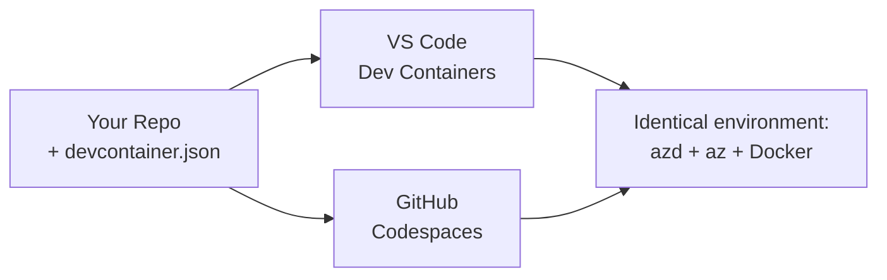

# Dev Containers & GitHub Codespaces für azd

**Kapitel-Navigation:**
- **📚 Kursstartseite**: [AZD Für Anfänger](../../README.md)
- **📖 Aktuelles Kapitel**: Kapitel 1 - Grundlagen & Schnellstart
- **⬅️ Vorheriges**: [Bring Your Own App](bring-your-own-app.md)
- **🚀 Nächstes Kapitel**: [Kapitel 2: KI-zentrierte Entwicklung](../chapter-02-ai-development/README.md)

> Ziel der Befehls- und Konfigurationsprüfung: `azd 1.37.2` (November 2026). Container-Builds und Azure-Bereitstellungen wurden nicht im Rahmen dieser Prüfung ausgeführt.

## Einführung

Die Installation von azd, der richtigen Laufzeitumgebung, Docker und der Azure CLI auf jedem Rechner ist eine mühsame Aufgabe – und der Hauptgrund, warum ein Tutorial, das „auf meinem Rechner funktioniert“, bei jemand anderem fehlschlägt. Ein **Dev Container** löst dieses Problem, indem er deine gesamte Toolchain in einer Datei beschreibt. Jeder, der das Projekt in VS Code oder GitHub Codespaces öffnet, erhält exakt dieselbe Umgebung mit azd bereits vorinstalliert. Diese Lektion zeigt dir, wie du einen hinzufügst.

## Lernziele

Am Ende dieser Lektion wirst du:
- Verstehen, was ein Dev Container ist und warum er bei azd hilft
- Eine minimale `.devcontainer/devcontainer.json` zu einem Projekt hinzufügen
- azd, die Azure CLI und Docker über Dev Container *Features* einbinden
- Das Projekt in GitHub Codespaces oder VS Code öffnen

## Lernergebnisse

Nach Abschluss dieser Lektion wirst du in der Lage sein:
- Eine `devcontainer.json` für ein azd-Projekt zu erstellen
- azd und Azure-Tools ohne manuelle Installationen hinzuzufügen
- `azd up` innerhalb eines Containers oder Codespaces auszuführen

---

## Was ist ein Dev Container?

Ein Dev Container ist eine Docker-basierte Entwicklungsumgebung, definiert durch eine `.devcontainer/devcontainer.json`-Datei in deinem Repository. Wenn du das Projekt öffnest:

- **VS Code** (mit der Dev Containers-Erweiterung) baut den Container und verbindet sich mit ihm.
- **GitHub Codespaces** baut denselben Container in der Cloud und bietet dir einen browserbasierten Editor.

So oder so erhält jeder Mitwirkende identische Werkzeuge – kein "Hast du azd installiert?"-Fehlerbehebung mehr.



---

## Schritt 1: Erstelle die devcontainer-Datei

Erstelle `.devcontainer/devcontainer.json` im Stammverzeichnis deines Projekts:

```json
{
  "name": "azd-project",
  "image": "mcr.microsoft.com/devcontainers/base:bookworm",
  "features": {
    "ghcr.io/devcontainers/features/azure-cli:1": {},
    "ghcr.io/azure/azure-dev/azd:0": { "version": "1.37.2" },
    "ghcr.io/devcontainers/features/docker-in-docker:2": {},
    "ghcr.io/devcontainers/features/node:1": {}
  },
  "customizations": {
    "vscode": {
      "extensions": [
        "ms-azuretools.azure-dev",
        "ms-azuretools.vscode-bicep"
      ]
    }
  },
  "forwardPorts": [3000],
  "postCreateCommand": "azd version"
}
```

Was jeder Teil bewirkt:

| Schlüssel | Zweck |
|-----|---------|
| `image` | Das Basissystem für den Container |
| `features` | Vorgefertigte Installer – hier: Azure CLI, **azd**, Docker und Node.js |
| `customizations.vscode.extensions` | Installiert automatisch die azd- und Bicep-VS Code-Erweiterungen |
| `forwardPorts` | Öffnet den Port deiner App im Browser |
| `postCreateCommand` | Wird einmal nach dem Container-Build ausgeführt (hier ein Funktionstest) |

> Die Feature-Version (`azd:0`) und die installierte CLI-Version sind unterschiedlich. Setze die `version`-Option des Features auf `"1.37.2"`, um die CLI zu fixieren; verwende keine CLI-Version als Feature-Tag.

---

## Schritt 2: Passe das Feature an die Sprache deiner App an

Tausche das `node` Feature gegen das, was deine App verwendet:

```jsonc
// Python project
"ghcr.io/devcontainers/features/python:1": {},

// .NET project
"ghcr.io/devcontainers/features/dotnet:2": {},

// Java project
"ghcr.io/devcontainers/features/java:1": {},

// Go project
"ghcr.io/devcontainers/features/go:1": {}
```

Behalte `docker-in-docker`, wenn du lokal Images baust. Ein konfiguriertes Remote-ACR-Build (`docker.remoteBuild: true`) ist eine Alternative; der Hosttyp allein erfordert nicht immer lokales Docker.

---

## Schritt 3: Öffnen

**In VS Code:**
1. Installiere die **Dev Containers**-Erweiterung.
2. Öffne den Projektordner.
3. Klicke bei Aufforderung auf **Im Container erneut öffnen** (oder führe *Dev Containers: Reopen in Container* aus).

**In GitHub Codespaces:**
1. Push das Repository zu GitHub.
2. Klicke auf **Code → Codespaces → Create codespace on main**.
3. Warte, bis der Container gebaut ist – azd ist im Terminal einsatzbereit.

---

## Schritt 4: Bereitstellen aus dem Container heraus

Der Container hat azd vorinstalliert, so dass der normale Workflow einfach funktioniert:

```bash
azd auth login --use-device-code   # device code is handy inside Codespaces
azd up
```

> **Warum `--use-device-code`?** In einem Remote-Container oder Codespace gibt es keinen lokalen Browser für Umleitungen, daher ist die Geräte-Code-Anmeldung der zuverlässige Weg. Du wirst einen Code in einen Browsertab einfügen, um die Anmeldung abzuschließen.

---

## Häufige Stolperfallen

| Stolperfalle | Lösung |
|---------|-----|
| `azd up` kann kein Image bauen | Füge das `docker-in-docker`-Feature hinzu |
| Browser-Anmeldung hängt in Codespaces | Verwende `azd auth login --use-device-code` |
| Tools unterscheiden sich zwischen Teammitgliedern | Fixiere die CLI über die `version`-Option des azd-Features und fixiere die Sprachlaufzeiten |
| App im Browser nicht erreichbar | Füge den Port zu `forwardPorts` hinzu |

---

## Zusammenfassung

- Ein Dev Container macht deine azd-Toolchain für alle reproduzierbar.
- Füge azd, die Azure CLI und Docker über Dev Container *Features* hinzu.
- Passe das Sprachfeature an deine App an und behalte `docker-in-docker` für Container-Hosts bei.
- Verwende Geräte-Code-Anmeldung, wenn du in Codespaces arbeitest.

---

## 🔗 Navigation

| Richtung | Ressource |
|-----------|----------|
| **Vorheriges** | [Bring Your Own App](bring-your-own-app.md) |
| **Kapitelstartseite** | [Kapitel 1: Grundlagen & Schnellstart](README.md) |
| **Nächstes Kapitel** | [Kapitel 2: KI-zentrierte Entwicklung](../chapter-02-ai-development/README.md) |

## 📖 Verwandte Ressourcen

- [Installation & Einrichtung](installation.md)
- [Befehlsübersicht](../../resources/cheat-sheet.md)
- [Offizielle Dev Containers-Spezifikation](https://containers.dev/)
- [azd Dev Container Feature](https://github.com/Azure/azure-dev/tree/main/ext/devcontainer)

---

<!-- CO-OP TRANSLATOR DISCLAIMER START -->
**Haftungsausschluss**:
Dieses Dokument wurde mit dem KI-Übersetzungsdienst [Co-op Translator](https://github.com/Azure/co-op-translator) übersetzt. Obwohl wir uns um Genauigkeit bemühen, beachten Sie bitte, dass automatisierte Übersetzungen Fehler oder Ungenauigkeiten enthalten können. Das Originaldokument in seiner Ursprungssprache gilt als maßgebliche Quelle. Bei kritischen Informationen wird eine professionelle menschliche Übersetzung empfohlen. Wir übernehmen keine Haftung für Missverständnisse oder Fehlinterpretationen, die aus der Verwendung dieser Übersetzung entstehen.
<!-- CO-OP TRANSLATOR DISCLAIMER END -->