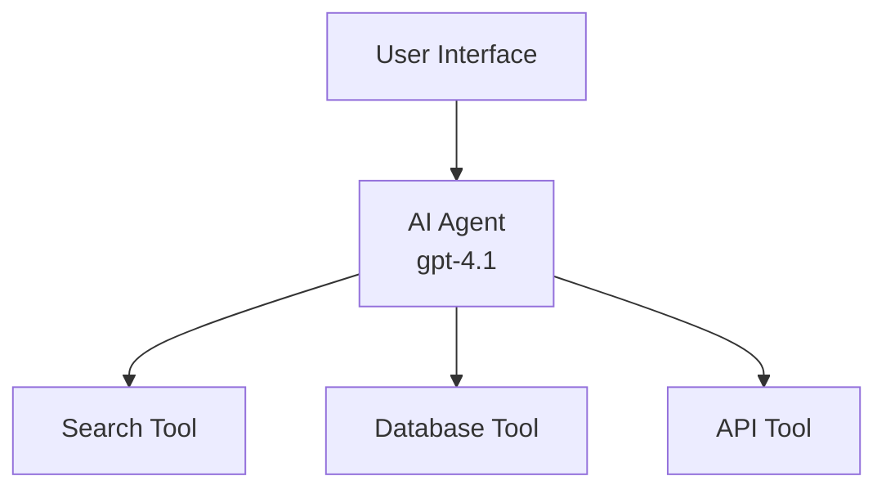
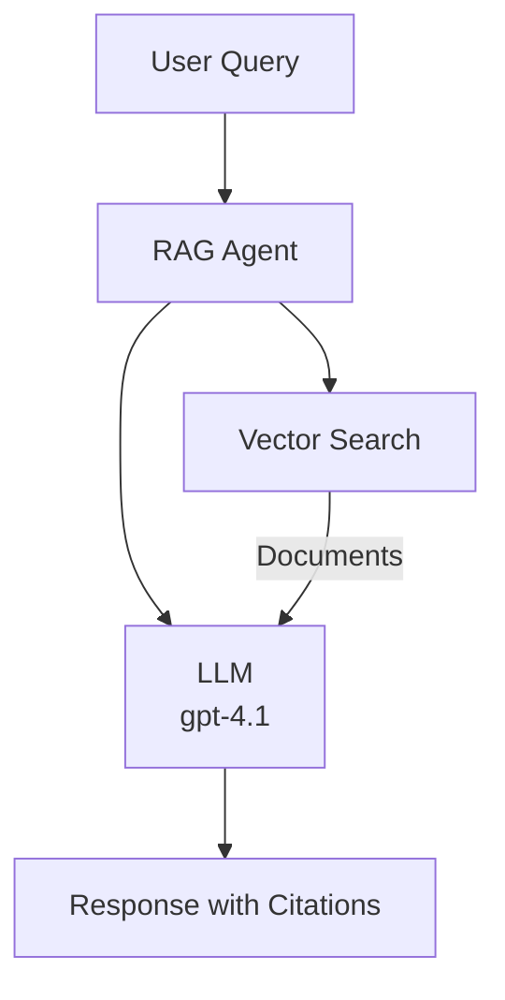
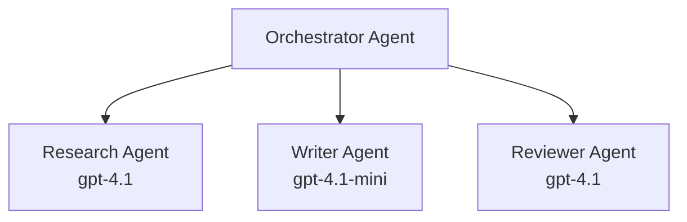

# KI-Agenten mit Azure Developer CLI

**Kapitel Navigation:**
- **📚 Kurs Startseite**: [AZD Für Anfänger](../../README.md)
- **📖 Aktuelles Kapitel**: Kapitel 2 - KI-First Entwicklung
- **⬅️ Vorheriges**: [Microsoft Foundry Integration](microsoft-foundry-integration.md)
- **➡️ Nächstes**: [KI-Modellbereitstellung](ai-model-deployment.md)
- **🚀 Fortgeschritten**: [Multi-Agenten-Lösungen](../../examples/retail-scenario.md)

---

## Einführung

KI-Agenten sind autonome Programme, die ihre Umgebung wahrnehmen, Entscheidungen treffen und Maßnahmen ergreifen können, um bestimmte Ziele zu erreichen. Im Gegensatz zu einfachen Chatbots, die auf Eingaben reagieren, können Agenten:

- **Werkzeuge verwenden** – APIs aufrufen, Datenbanken durchsuchen, Code ausführen
- **Planen und schlussfolgern** – Komplexe Aufgaben in Schritte zerlegen
- **Aus dem Kontext lernen** – Erinnerung behalten und Verhalten anpassen
- **Zusammenarbeiten** – Mit anderen Agenten arbeiten (Multi-Agenten-Systeme)

Dieser Leitfaden zeigt Ihnen, wie Sie KI-Agenten mit Azure Developer CLI (azd) in Azure bereitstellen.

Die Nutzung von Gesprächskontext ist kein Modelltraining: Persistente Speicherung, Zugriffskontrolle und Aufbewahrung müssen von der Anwendung implementiert/konfiguriert werden.

> **Foundry GA Update (2026-11-09):** Installieren Sie das allgemein verfügbare `microsoft.foundry` 1.0-Bundle mit `azd >= 1.37.0`. Evaluierungen werden separat installiert; optionale Vorschaufunktionen und der klassische SDK-Ausschnitt unten werden durch die Bundle-Ankündigung nicht auf GA gehoben. Diese Anleitung basiert auf der [GA-Ankündigung](https://devblogs.microsoft.com/azure-sdk/microsoft-foundry-azure-developer-cli-ga/) und Dokumentation, nicht auf einer Live-Azure-Bereitstellung.

## Lernziele

Nach Abschluss dieses Leitfadens werden Sie:
- Verstehen, was KI-Agenten sind und wie sie sich von Chatbots unterscheiden
- Vorgefertigte KI-Agenten-Vorlagen mit AZD bereitstellen
- Foundry Agenten für benutzerdefinierte Agenten konfigurieren
- Grundlegende Agentenmuster (Werkzeugnutzung, RAG, Multi-Agent) implementieren
- Bereitgestellte Agenten überwachen und debuggen

## Lernergebnisse

Nach Abschluss können Sie:
- KI-Agentenanwendungen mit einem einzigen Befehl in Azure bereitstellen
- Agenten-Tools und Fähigkeiten konfigurieren
- Retrieval-Augmented Generation (RAG) mit Agenten implementieren
- Multi-Agenten-Architekturen für komplexe Abläufe entwerfen
- Häufige Probleme bei der Agentenbereitstellung beheben

---

## 🤖 Was macht einen Agenten anders als einen Chatbot?

| Merkmal | Chatbot | KI-Agent |
|---------|---------|----------|
| **Verhalten** | Reagiert auf Eingaben | Ergreift autonome Maßnahmen |
| **Werkzeuge** | Kann Rückgriff auf Tools haben | Nutzt typischerweise Werkzeuge in einem zielgerichteten Zyklus |
| **Erinnerung** | Anwendungsabhängig | Persistente Erinnerung nur wenn explizit implementiert |
| **Planung** | Einzelne Antwort | Mehrstufiges Denken |
| **Zusammenarbeit** | Einzelne Entität | Kann mit anderen Agenten zusammenarbeiten |

### Einfache Analogie

- **Chatbot** = Eine hilfsbereite Person am Informationsschalter, die Fragen beantwortet
- **KI-Agent** = Ein persönlicher Assistent, der Anrufe tätigt, Termine bucht und Aufgaben für Sie erledigt

---

## 🚀 Schnellstart: Ihren ersten Agenten bereitstellen

Wählen Sie eine Option in einem **neuen leeren Arbeitsverzeichnis**. Das folgende `.` wird dort initialisiert; ohne explizites Ziel erstellt aktuelles AZD möglicherweise ein untergeordnetes Verzeichnis mit Vorlagennamen und wechselt nicht Ihr Shell-Verzeichnis. Halten Sie separate Vorlagen/Umgebungen in separaten Verzeichnissen.

Die unten genannten Zeit- und Kostenangaben sind illustrativ, keine validierten Angebote. Überprüfen Sie die aktuellen Voraussetzungen, Preise, Modellkontingente und optionale Dienste jedes Beispiels vor der Bereitstellung.

### Option 1: Foundry Agents Vorlage (empfohlen)

```bash
# Initialize the AI agents template
azd init --template get-started-with-ai-agents .

# Deploy to Azure
azd up
```

**Was bereitgestellt wird:** Die aktuelle Infrastruktur und ausgewählte Optionen der Beispiels bestimmen Modell, Werkzeuge, Hosting und Überwachungsressourcen. Überprüfen Sie die README und `infra/` vor der Bereitstellung; gehen Sie nicht davon aus, dass jede Agentenvorlage Suche oder eine Web-Oberfläche enthält.

**Zeit:** ~15-20 Minuten
**Kosten:** ~$100-150/Monat (Entwicklung)

### Option 2: Kreative Schreibagenten mit Prompty

```bash
# Initialize the Prompty-based agent template
azd init --template https://github.com/Azure-Samples/contoso-creative-writer .

# Deploy to Azure
azd up
```

**Was bereitgestellt wird:** Ein FastAPI/Prompty Multi-Agenten-Schreibbeispiel mit Azure OpenAI, Bing Grounding und Azure AI Search. Das frühere `agent-openai-python-prompty` Repository verweist hierher; es ist keine minimalistische Azure Functions Wetter-Agent Vorlage. Folgen Sie der aktuellen README für Hosting-, Modellkontingent- und Bing Grounding Voraussetzungen.

**Zeit:** ~10-15 Minuten
**Kosten:** ~$50-100/Monat (Entwicklung)

### Option 3: RAG Chat Agent

```bash
# Initialize RAG chat template
azd init --template azure-search-openai-demo .

# Deploy to Azure
azd up
```

**Was bereitgestellt wird:**
- ✅ Microsoft Foundry Modelle
- ✅ Azure AI Suche mit Beispieldaten
- ✅ Dokumentenverarbeitungspipeline
- ✅ Chat-Schnittstelle mit Zitaten

**Zeit:** ~15-25 Minuten
**Kosten:** ~$80-150/Monat (Entwicklung)

### Option 4: Gehosteter Agent mit GA Foundry Bundle

Verwenden Sie die [komplette gehostete Agenten-Anleitung](microsoft-foundry-integration.md#hosted-agent-walkthrough-ga) für das einfache Python Agent Framework Responses API Beispiel. Dieser Code-Bereitstellungspfad benötigt Python 3.13+, aktuelle uv, Foundry-Berechtigungen und regionales Modellkontingent. Authentifizieren Sie lokale SDK-Aufrufe separat, wenn Sie Azure CLI-Anmeldeinformationen verwenden.

```bash
azd auth login
azd ext install microsoft.foundry
```

Initialisieren Sie die Vorlage im leeren Verzeichnis:

```text
azd ai agent init --template https://github.com/microsoft-foundry/foundry-samples/blob/main/samples/python/hosted-agents/agent-framework/responses/01-basic/azure.yaml --deploy-mode code --src .
```

Wählen Sie ein neues oder bestehendes Projekt, prüfen Sie `azure.yaml` und führen Sie `azd provision` aus. Verwenden Sie `azd ai agent run`, um den Agent Inspector zu öffnen, und in einem anderen Terminal im selben Verzeichnis `azd ai agent invoke --local "Explain how this agent is hosted."`. Nach der lokalen Prüfung verwenden Sie `azd deploy` und `azd ai agent invoke "Explain how this agent is hosted."`, um die bereitgestellte Antwort zu vergleichen. Foundry erstellt den hochgeladenen Quellcode remote; ein lokaler Containerbuild ist nicht erforderlich.

**Wann verwende ich `azd ai agent init` vs `azd init --template`:**

| Ansatz | Am besten für | Funktionsweise |
|----------|----------|------|
| `azd init --template` | Start mit einer funktionierenden Beispiel-App | Klont ein vollstängiges Vorlagenrepo mit Code + Infrastruktur |
| `azd ai agent init --template` | Übernahme eines aktuellen Foundry-Agentenprojekts | Nutzt ein `azure.yaml` Projekt-Dokument und dessen Definitionen |

> **Tipp:** Optionen 1-3 starten mit vollständigen Anwendungsvorlagen; Option 4 zeigt den GA-Workflow für gehostete Agenten. Keine Initialisierung migriert automatisch Legacy-Agent-Manifestdateien. Um eine direkte Agentendefinition zu einem bestehenden Projekt hinzuzufügen, siehe [Initialisierungs- und Migrationsanleitung](../chapter-08-production/production-ai-practices.md#initializing-agent-projects-with-azd-ai-agent-init).

Installieren Sie `azure.ai.evaluations` separat, um Testdaten/-kriterien zu generieren und zu prüfen, eine Evaluierung zu konfigurieren und sie mit `azd ai eval` auszuführen. Die Optimierung kann eine kompatible Evaluierung wiederverwenden; überprüfen Sie Kandidaten, bevor Sie explizit eine bereitstellen. Folgen Sie dem [Evaluierungsworkflow](../chapter-08-production/production-ai-practices.md#evaluation-migration-and-quality-checks) und der [Optimierungs-Migration](../chapter-08-production/production-ai-practices.md#optimization-configuration-migration) vor der Wiederverwendung älterer Beispiele. Zur Bereinigung bleiben Ressourcen eines wiederverwendeten Foundry-Projekts nach `azd down` erhalten; eine neu erstellte Ressourcengruppe wird gelöscht. Siehe die [Bereinigungsanleitung](microsoft-foundry-integration.md#7-clean-up-deliberately).

---

## 🏗️ Agenten-Architekturmuster

### Muster 1: Einzelner Agent mit Werkzeugen

Das einfachste Agentenmuster – ein Agent, der mehrere Werkzeuge verwenden kann.



**Am besten geeignet für:**
- Kunden-Support-Bots
- Forschungsassistenten
- Datenanalyse-Agenten

**Verwandtes Anwendungsbeispiel:** `azure-search-openai-demo` demonstriert RAG, keinen generischen Agenten-Werkzeugzyklus.

### Muster 2: RAG Agent (Retrieval-Augmented Generation)

Ein Agent, der relevante Dokumente abruft, bevor er Antworten generiert.



**Am besten geeignet für:**
- Unternehmenswissenbanken
- Dokumenten-Q&A-Systeme
- Compliance- und Rechtsforschung

**AZD Vorlage:** `azure-search-openai-demo`

### Muster 3: Multi-Agenten-System

Mehrere spezialisierte Agenten, die gemeinsam an komplexen Aufgaben arbeiten.



**Am besten geeignet für:**
- Komplexe Inhaltserstellung
- Mehrstufige Workflows
- Aufgaben, die unterschiedliche Expertise erfordern

**Mehr erfahren:** [Multi-Agenten-Koordinationsmuster](../chapter-06-pre-deployment/coordination-patterns.md)

---

## ⚙️ Konfiguration von Agenten-Werkzeugen

Agenten werden mächtig, wenn sie Werkzeuge nutzen können. So konfigurieren Sie gängige Werkzeuge:

### Werkzeugkonfiguration in Foundry Agenten

Dieser **klassische Agent Service SDK-Ausschnitt** richtet sich an `azure-ai-projects==1.0.0` und `azure-ai-agents==1.1.0` mit `azure-identity`. Es ist nicht die neuere versionierte-agent/Responses API, die manche aktuelle Foundry-Vorlagen verwenden, noch die `azure.ai.agents` AZD Erweiterung (ein anderes Paket). Mischen Sie diese API-Generationen nicht. Setzen Sie `PROJECT_ENDPOINT` auf einen klassischen Foundry Projektendpunkt und `MODEL_DEPLOYMENT_NAME` auf eine bestehende unterstützte Modellbereitstellung; authentifizieren Sie sich lokal mit `az login` und erteilen Sie die erforderlichen Projektberechtigungen.

```python
# agent_config.py
import os
from azure.ai.projects import AIProjectClient
from azure.ai.agents.models import FunctionTool
from azure.identity import DefaultAzureCredential

def search_knowledge_base(query: str) -> str:
    """Search the demonstration knowledge base.

    :param query: Search text.
    :return: Matching demonstration information.
    """
    # Local fixture only, not a production search implementation.
    return "Demo policy: returns are accepted within 30 days."

project_client = AIProjectClient(
    endpoint=os.environ["PROJECT_ENDPOINT"],
    credential=DefaultAzureCredential(),
)
search_tool = FunctionTool(functions={search_knowledge_base})
project_client.agents.enable_auto_function_calls(search_tool)
agent = project_client.agents.create_agent(
    model=os.environ["MODEL_DEPLOYMENT_NAME"],
    name="Support Agent",
    instructions="Use search_knowledge_base for policy questions. Label results as demo data.",
    tools=search_tool.definitions,
)
```

Das Registrieren eines Funktionsschemas führt keinen Python-Code auf dem Dienst aus. In diesem SDK führen `enable_auto_function_calls` plus `agents.runs.create_and_process(...)` registrierte Rückrufe in Ihrem Client-Prozess aus. Siehe das [veröffentlichte SDK-Beispiel](https://github.com/Azure/azure-sdk-for-python/blob/azure-ai-agents_1.1.0/sdk/ai/azure-ai-agents/samples/agents_tools/sample_agents_auto_function_call.py). Schließen Sie den Client und löschen Sie Demonstrationsagenten/Threads nach Gebrauch.

### Umgebungs-Konfiguration

Die folgenden Namen sind **illustrative benutzerdefinierte Vorlage-Eingaben**, keine eingebauten AZD-Schalter. Leiten Sie jede Eingabe über `infra/main.parameters.json`, Infrastruktur und Anwendungs-Code weiter. Allein `azd env set` ändert keine Agenten-Werkzeuge oder Anweisungen.

```bash
# Set up agent-specific environment variables
azd env set AZURE_OPENAI_MODEL "gpt-4.1"
azd env set AGENT_INSTRUCTIONS "You are a helpful assistant..."
azd env set ENABLE_CODE_INTERPRETER "true"
azd env set ENABLE_FILE_SEARCH "true"

# Apply wired infrastructure and application changes
azd up
```

---

## 📊 Agenten überwachen

### Application Insights Integration

Wenn Ihre gewählte Vorlage Application Insights bereitstellt und Instrumentierung konfiguriert:

```bash
# Open monitoring dashboard
azd monitor --overview

# Open the Application Insights logs view (not a streaming log tail)
azd monitor --logs

# View live metrics
azd monitor --live
```

### Wichtige Metriken zur Überwachung

| Metrik | Beschreibung | Ziel |
|--------|-------------|--------|
| Antwortverzögerung | Zeit zur Generierung der Antwort | < 5 Sekunden |
| Token-Verbrauch | Tokens pro Anfrage | Kosten überwachen |
| Erfolgsrate Werkzeugaufrufe | % erfolgreicher Werkzeugausführungen | > 95% |
| Fehlerquote | Fehlgeschlagene Agentenanfragen | < 1% |
| Nutzerzufriedenheit | Feedbackbewertung | > 4.0/5.0 |

### Benutzerdefinierte Agentenprotokollierung

```python
import os
from azure.monitor.opentelemetry import configure_azure_monitor
from opentelemetry import trace

# Configure Azure Monitor with OpenTelemetry
configure_azure_monitor(
    connection_string=os.environ["APPLICATIONINSIGHTS_CONNECTION_STRING"]
)

tracer = trace.get_tracer(__name__)

def log_agent_interaction(user_query, agent_response, tools_used, latency_ms):
    with tracer.start_as_current_span("agent_interaction") as span:
        span.set_attributes({
            "query_length": len(user_query),  # Do not log raw prompts or personal data
            "response_length": len(agent_response),
            "tools_used": tools_used,
            "latency_ms": latency_ms
        })
```

> **Hinweis:** Installieren Sie das benötigte Paket: `pip install azure-monitor-opentelemetry`. Es bringt die OpenTelemetry-Abhängigkeiten; der Import-Namespace ist keine Voraussetzung zur Installation eines Pakets namens `opentelemetry`.

---

## 💰 Kostenüberlegungen

### Geschätzte monatliche Kosten pro Muster

Dies sind illustrativ geplante Bereiche, keine Angebote oder Ausgabenlimits. Region, Modell-Tokens, Such-/Compute-SKUs, Werkzeug-Sitzungen, Speicher und Datenverkehr können diese überschreiten. Prüfen Sie die Kostenhinweise der Vorlage und Azure-Preise vor `azd up`.

| Muster | Entwicklungsumgebung | Produktion |
|---------|-----------------|------------|
| Einzelner Agent | $50-100 | $200-500 |
| RAG Agent | $80-150 | $300-800 |
| Multi-Agent (2-3 Agenten) | $150-300 | $500-1.500 |
| Enterprise Multi-Agent | $300-500 | $1.500-5.000+ |

### Spartipps bei den Kosten

1. **Verwenden Sie gpt-4.1-mini für einfache Aufgaben** (nur wenn Ihre Vorlage diesen Input nutzt)
   ```bash
   azd env set AZURE_OPENAI_MODEL "gpt-4.1-mini"
   ```

2. **Implementieren Sie Scoped Caching für sichere wiederholte Abfragen.** Integrieren Sie Mandanten-/Benutzerautorisierung, Modellbereitstellung, Anweisungen und Abrufversion im Cache-Schlüssel; setzen Sie eine Ablaufzeit. Teilen Sie private Konversationsantworten nicht über einen prozessweiten reine-Lese-Cache. Das SDK-Agent-Objekt hat keine generische `agent.run()` Methode.

3. **Setzen Sie Token-Limits pro Lauf**
   ```python
   # Set max_completion_tokens when running the agent, not during creation
   run = project_client.agents.runs.create_and_process(
       thread_id=thread.id,
       agent_id=agent.id,
       max_completion_tokens=1000  # Budget across the run; may finish as incomplete
   )
   ```

4. **Skalieren Sie berechtigte Container Apps bei Nichtbenutzung auf null**
   ```bash
   # Custom-template input: must map to template.scale.minReplicas
   azd env set MIN_REPLICAS "0"
   ```
   Wenden Sie die Infrastrukturänderung mit `azd provision` oder `azd up` an. Skalierung auf null benötigt einen geeigneten Auslöser und stoppt nicht Such-, Speicher- oder Modell-/Werkzeugkosten.

---

## 🔧 Agenten Fehlerbehebung

### Häufige Probleme und Lösungen

<details>
<summary><strong>❌ Agent reagiert nicht auf Werkzeugaufrufe</strong></summary>

```bash
# Inspect the application deployment (not the agent's registered tools)
azd show

# Verify OpenAI deployment
az cognitiveservices account deployment list \
  --name $AZURE_OPENAI_NAME \
  --resource-group $RG_NAME

# Check agent logs
azd monitor --logs
```

**Häufige Ursachen:**
- Unstimmigkeit der Werkzeug-Funktionssignatur
- Fehlende erforderliche Berechtigungen
- API-Endpunkt nicht zugänglich
</details>

<details>
<summary><strong>❌ Hohe Latenz bei Agentenantworten</strong></summary>

```bash
# Check Application Insights for bottlenecks
azd monitor --live

# Consider using a faster model
azd env set AZURE_OPENAI_MODEL "gpt-4.1-mini"
azd up
```

**Optimierungstipps:**
- Streaming-Antworten verwenden
- Antwort-Caching implementieren
- Kontextfenstergröße verringern
</details>

<details>
<summary><strong>❌ Agent gibt falsche oder halluzinierte Informationen zurück</strong></summary>

```python
# Improve with better system prompts
instructions = """
You are a helpful assistant. IMPORTANT:
- Only answer based on provided context
- If you don't know, say "I don't know"
- Always cite your sources
- Never make up information
"""

# Use these instructions in the agent definition.
# For classic file search, first upload/index documents in a vector store,
# then use FileSearchTool(vector_store_ids=[...]) and pass both its
# .definitions and .resources when creating the agent.
```
Anweisungen und Abruf minimieren Risiken; keine garantiert Faktenantworten. Bewerten Sie fundierte und außerhalb des Bereichs liegende Fragen gegen bekannte Antworten.
</details>

<details>
<summary><strong>❌ Token-Limit-Überschreitungsfehler</strong></summary>

```python
# Implement context window management
def truncate_context(messages, max_tokens=8000, model="gpt-4.1"):
    """Approximate content-only budget for objects with .content strings."""
    import tiktoken
    encoding = tiktoken.encoding_for_model(model)
    total_tokens = 0
    truncated = []
    
    for msg in reversed(messages):
        msg_tokens = len(encoding.encode(msg.content))
        if total_tokens + msg_tokens > max_tokens:
            break
        truncated.insert(0, msg)
        total_tokens += msg_tokens
    
    return truncated
```
Dieses Hilfswerkzeug schließt Rollen-/Werkzeugschemas, Systemanweisungen, Bild-Tokens und Protokoll-Overhead aus. Reservieren Sie Platz für diese und den Abschluss; teilen Sie Werkzeugaufruf-/Ergebnis-Paare nicht oder verwerfen Sie erforderliche Systemanweisungen nicht. Installieren Sie `tiktoken` separat. Es ist kein allgemeiner Kontextfenster-Validator.
</details>

---

## 🎓 Praktische Übungen

### Übung 1: Grundlegenden Agenten bereitstellen (20 Minuten)

**Ziel:** Ihren ersten KI-Agenten mit AZD bereitstellen

```bash
# Step 1: Initialize template
azd init --template get-started-with-ai-agents .

# Step 2: Login to Azure
azd auth login
# If you work across tenants, add --tenant-id <tenant-id>

# Step 3: Deploy
azd up

# Step 4: Test the agent
# Expected output after deployment:
#   Deployment Complete!
#   Endpoint: https://<app-name>.<region>.azurecontainerapps.io
# Open the URL shown in the output and try asking a question

# Step 5: View monitoring
azd monitor --overview

# Step 6: Review the listed resources and confirm cleanup
azd down
```

**Erfolgskriterien:**
- [ ] Agent antwortet auf Fragen
- [ ] Kann über `azd monitor` auf das Überwachungs-Dashboard zugreifen
- [ ] Ressourcen wurden erfolgreich bereinigt

### Übung 2: Füge ein benutzerdefiniertes Tool hinzu (30 Minuten)

**Ziel:** Einen Agenten mit einem benutzerdefinierten Tool erweitern

**Ausgangspunkt:** Verwenden Sie den klassischen SDK-Client aus [Tool Konfiguration](#tool-configuration-in-foundry-agents), nicht eine beliebige Vorlage mit einer anderen SDK-Generierung.

1. Fügen Sie diesen deterministischen Fixture zu `agent_config.py` hinzu:
   ```python
   def get_weather(location: str) -> str:
       """Return demonstration weather, not live conditions.

       :param location: City name.
       :return: A clearly labelled fixture.
       """
       print(f"TOOL_CALLED: {location}")
       return f"Demo weather in {location}: Sunny, 72°F (fixture, not live)"
   ```
2. Ersetzen Sie den Registrierungs- und Erstellungsabschnitt für das Such-Tool durch:
   ```python
   weather_tool = FunctionTool(functions={get_weather})
   project_client.agents.enable_auto_function_calls(weather_tool)
   agent = project_client.agents.create_agent(
       model=os.environ["MODEL_DEPLOYMENT_NAME"],
       name="Weather Agent",
       instructions="Call get_weather for weather questions; explain that it returns demo data.",
       tools=weather_tool.definitions,
   )
   thread = project_client.agents.threads.create()
   try:
       project_client.agents.messages.create(
           thread_id=thread.id, role="user", content="Use get_weather for Seattle."
       )
       run = project_client.agents.runs.create_and_process(
           thread_id=thread.id, agent_id=agent.id
       )
       if run.status != "completed":
           raise RuntimeError(f"Run status: {run.status}; error: {run.last_error}")
       for message in project_client.agents.messages.list(thread_id=thread.id):
           for text in message.text_messages:
               print(text.text.value)
   finally:
       project_client.agents.threads.delete(thread.id)
       project_client.agents.delete_agent(agent.id)
       project_client.close()
   ```
3. Führen Sie es lokal aus (dies ruft das bestehende Azure-Projekt auf und verursacht Modellkosten):
   ```bash
   python agent_config.py
   # Expected: TOOL_CALLED: Seattle, then a completed answer labelled demo data.
   ```

**Erfolgskriterien:**
- [ ] Agent erkennt wetterbezogene Anfragen
- [ ] Tool wird korrekt aufgerufen
- [ ] Antwort enthält Wetterinformationen

### Übung 3: Erstellen Sie einen RAG-Agenten (45 Minuten)

**Ziel:** Erstellen Sie einen Agenten, der Fragen aus Ihren Dokumenten beantwortet

```bash
# Step 1: Deploy RAG template
azd init --template azure-search-openai-demo .
azd up

# Step 2: Upload your documents
# For the sample's local ingestion path, place supported files in data/.
# Run from the sample root after following its Python environment setup:
./scripts/prepdocs.sh
# Windows PowerShell equivalent: .\\scripts\\prepdocs.ps1

# Step 3: Test with domain-specific questions
# Open the web app URL from the azd up output
# Ask questions about your uploaded documents
# Responses should include citation references like [doc.pdf]
```

**Erfolgskriterien:**
- [ ] Agent antwortet aus hochgeladenen Dokumenten
- [ ] Antworten enthalten Zitate
- [ ] Fragen außerhalb des Anwendungsbereichs werden ohne unbelegte Behauptungen behandelt (keine Garantie für jede zukünftige Frage)

Wenn `USE_CLOUD_INGESTION=true`, verwenden Sie stattdessen den Cloud-Ingestions-/Upload-Workflow des Beispiels; der lokale Wrapper überspringt die Ingestion absichtlich. Nach dem Testen führen Sie `azd down` in der RAG-Umgebung aus und prüfen die zu löschenden Ressourcen.

---

## 📚 Nächste Schritte

Jetzt, da Sie AI-Agenten verstehen, erkunden Sie diese fortgeschrittenen Themen:

| Thema | Beschreibung | Link |
|-------|-------------|------|
| **Multi-Agenten-Systeme** | Systeme mit mehreren zusammenarbeitenden Agenten aufbauen | [Retail Multi-Agent Beispiel](../../examples/retail-scenario.md) |
| **Koordinationsmuster** | Orchestrierungs- und Kommunikationsmuster lernen | [Koordinationsmuster](../chapter-06-pre-deployment/coordination-patterns.md) |
| **Produktive Bereitstellung** | Einsatz von Agenten auf Unternehmensebene | [Produktive AI-Praktiken](../chapter-08-production/production-ai-practices.md) |
| **Agentenbewertung** | Leistung des Agenten testen und bewerten | [AI Fehlerbehebung](../chapter-07-troubleshooting/ai-troubleshooting.md) |
| **AI Workshop Lab** | Praxis: Machen Sie Ihre AI-Lösung AZD-bereit | [AI Workshop Lab](ai-workshop-lab.md) |

---

## 📖 Zusätzliche Ressourcen

### Offizielle Dokumentation
- [Microsoft Foundry Agent Service](https://learn.microsoft.com/azure/ai-services/agents/)
- [Microsoft Foundry Agent Service Schnellstart](https://learn.microsoft.com/azure/ai-services/agents/quickstart)
- [Semantic Kernel Agent Framework](https://learn.microsoft.com/semantic-kernel/)

### AZD-Vorlagen für Agenten
- [Erste Schritte mit AI-Agenten](https://github.com/Azure-Samples/get-started-with-ai-agents)
- [Kreative Schreibagenten mit Prompty](https://github.com/Azure-Samples/contoso-creative-writer)
- [Azure Search OpenAI Demo](https://github.com/Azure-Samples/azure-search-openai-demo)

### Community-Ressourcen
- [Awesome AZD - Agenten Vorlagen](https://azure.github.io/awesome-azd/?tags=ai-agents)
- [Azure AI Discord](https://discord.gg/microsoft-azure)
- [Microsoft Foundry Discord](https://discord.gg/nTYy5BXMWG)

### Agenten-Fähigkeiten für Ihren Editor
- [**Microsoft Azure Agent Skills**](https://skills.sh/microsoft/github-copilot-for-azure) - Installieren Sie wiederverwendbare AI-Agenten-Fähigkeiten für die Azure-Entwicklung in GitHub Copilot, Cursor oder jedem unterstützten Agenten. Enthält Fähigkeiten für [Azure AI](https://skills.sh/microsoft/github-copilot-for-azure/azure-ai), [Microsoft Foundry](https://skills.sh/microsoft/github-copilot-for-azure/microsoft-foundry), [Bereitstellung](https://skills.sh/microsoft/github-copilot-for-azure/azure-deploy) und [Diagnostik](https://skills.sh/microsoft/github-copilot-for-azure/azure-diagnostics):
  ```bash
  npx skills add microsoft/github-copilot-for-azure
  ```

---

**Navigation**
- **Vorherige Lektion**: [Microsoft Foundry Integration](microsoft-foundry-integration.md)
- **Nächste Lektion**: [AI Modellbereitstellung](ai-model-deployment.md)

---

<!-- CO-OP TRANSLATOR DISCLAIMER START -->
**Haftungsausschluss**:
Dieses Dokument wurde mit dem KI-Übersetzungsdienst [Co-op Translator](https://github.com/Azure/co-op-translator) übersetzt. Obwohl wir uns um Genauigkeit bemühen, beachten Sie bitte, dass automatisierte Übersetzungen Fehler oder Ungenauigkeiten enthalten können. Das Originaldokument in seiner Ursprungssprache gilt als maßgebliche Quelle. Bei kritischen Informationen wird eine professionelle menschliche Übersetzung empfohlen. Wir übernehmen keine Haftung für Missverständnisse oder Fehlinterpretationen, die aus der Verwendung dieser Übersetzung entstehen.
<!-- CO-OP TRANSLATOR DISCLAIMER END -->