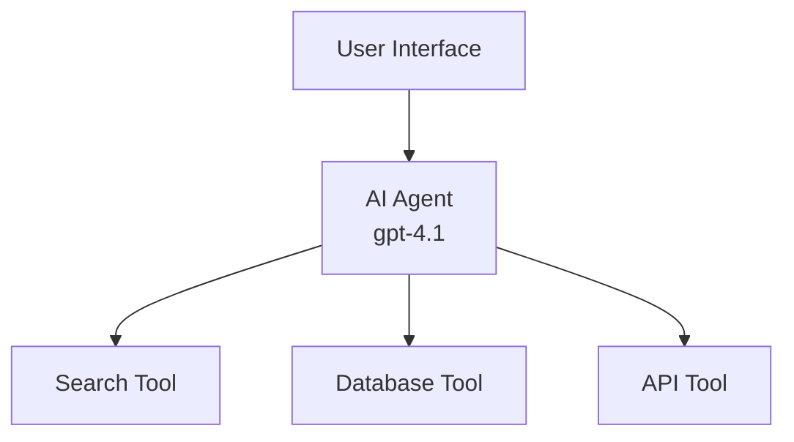
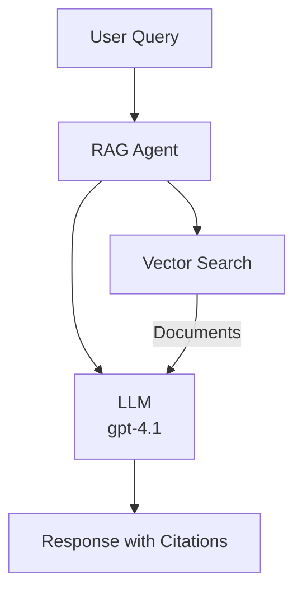
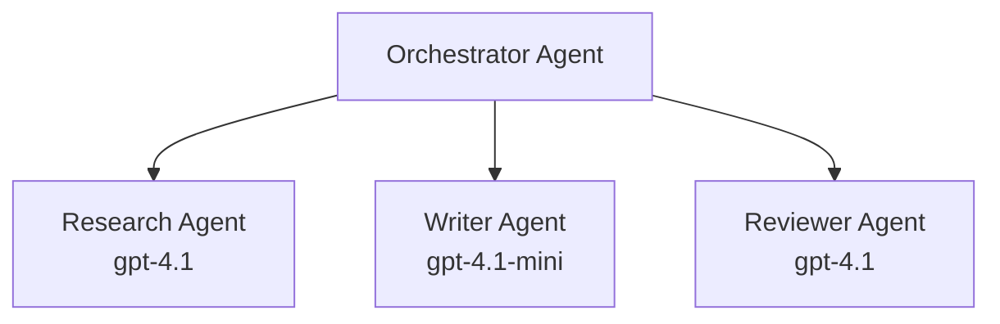

# KI-Agenten mit Azure Developer CLI

**Kapitel-Navigation:**
- **📚 Kursstartseite**: [AZD für Anfänger](../../README.md)
- **📖 Aktuelles Kapitel**: Kapitel 2 - KI-Erst-Entwicklung
- **⬅️ Zurück**: [Microsoft Foundry Integration](microsoft-foundry-integration.md)
- **➡️ Weiter**: [KI-Modellbereitstellung](ai-model-deployment.md)
- **🚀 Fortgeschrittene**: [Multi-Agenten-Lösungen](../../examples/retail-scenario.md)

---

## Einführung

KI-Agenten sind autonome Programme, die ihre Umgebung wahrnehmen, Entscheidungen treffen und Aktionen ausführen können, um bestimmte Ziele zu erreichen. Anders als einfache Chatbots, die auf Eingaben reagieren, können Agenten:

- **Werkzeuge verwenden** - APIs aufrufen, Datenbanken durchsuchen, Code ausführen
- **Planen und schlussfolgern** - Komplexe Aufgaben in Schritte unterteilen
- **Aus dem Kontext lernen** - Erinnerungen behalten und Verhalten anpassen
- **Zusammenarbeiten** - Mit anderen Agenten arbeiten (Multi-Agenten-Systeme)

Dieser Leitfaden zeigt Ihnen, wie Sie KI-Agenten mit Azure Developer CLI (azd) in Azure bereitstellen.

Die Nutzung von Gesprächskontext ist kein Modelltraining: Persistentes Gedächtnis, Zugriffskontrolle und Speicherung müssen von der Anwendung implementiert/konfiguriert werden.

> **Releasereview (2026-11-04):** CLI-Beispiele wurden gegen `azd` `1.37.2`, `azure.ai.agents` `1.0.0-beta.23`, und `azure.ai.evaluations` `1.0.0-beta.2` Dokumentation/Quelle geprüft, nicht gegen eine Live Azure-Bereitstellung. Verwenden Sie `azd >= 1.37.0` für den kombinierten Workflow. Siehe [aktuelle Änderungen und Korrekturen](../chapter-08-production/production-ai-practices.md#recent-release-changes-and-fixes) vor dem Upgrade älterer Projekte.

## Lernziele

Nach Abschluss dieses Leitfadens werden Sie:
- Verstehen, was KI-Agenten sind und wie sie sich von Chatbots unterscheiden
- Vorgefertigte KI-Agenten-Vorlagen mit AZD bereitstellen
- Foundry-Agenten für benutzerdefinierte Agenten konfigurieren
- Grundlegende Agentenmuster implementieren (Werkzeugnutzung, RAG, Multi-Agent)
- Bereitgestellte Agenten überwachen und debuggen

## Lernergebnisse

Nach Abschluss sind Sie in der Lage:
- KI-Agenten-Anwendungen mit einem einzigen Befehl in Azure bereitzustellen
- Agenten-Werkzeuge und -Fähigkeiten zu konfigurieren
- Retrieval-Augmented Generation (RAG) mit Agenten zu implementieren
- Multi-Agenten-Architekturen für komplexe Workflows zu entwerfen
- Häufige Probleme bei der Agentenbereitstellung zu beheben

---

## 🤖 Was unterscheidet einen Agenten von einem Chatbot?

| Merkmal | Chatbot | KI-Agent |
|---------|---------|----------|
| **Verhalten** | Reagiert auf Eingaben | Führt autonome Aktionen aus |
| **Werkzeuge** | Kann Abruf oder Werkzeuge verwenden | Nutzt typischerweise Werkzeuge in einem zielgerichteten Zyklus |
| **Gedächtnis** | Anwendungsabhängig | Persistentes Gedächtnis nur wenn explizit implementiert |
| **Planung** | Einzelne Antwort | Mehrstufiges Schlussfolgern |
| **Zusammenarbeit** | Einzelentität | Kann mit anderen Agenten zusammenarbeiten |

### Einfache Analogie

- **Chatbot** = Eine hilfreiche Person, die Fragen an einem Informationsschalter beantwortet
- **KI-Agent** = Ein persönlicher Assistent, der Anrufe tätigen, Termine buchen und Aufgaben für Sie erledigen kann

---

## 🚀 Schnellstart: Ihren ersten Agenten bereitstellen

Wählen Sie eine Option in einem **neuen, leeren Arbeitsverzeichnis**. Der nachstehende `.` initialisiert dort; ohne explizites Ziel kann das aktuelle AZD ein Unterverzeichnis mit dem Vorlagennamen erstellen und ändert nicht das Shell-Verzeichnis. Halten Sie separate Vorlagen/Umgebungen in getrennten Verzeichnissen.

Die nachstehenden Zeit-/Kostenangaben sind illustrativ, keine verbindlichen Angebote. Prüfen Sie vor der Bereitstellung die aktuellen Voraussetzungen, Preise, Modellkontingente und optionale Dienste jeder Beispielanwendung.

### Option 1: Foundry-Agenten Vorlage (Empfohlen)

```bash
# Initialize the AI agents template
azd init --template get-started-with-ai-agents .

# Deploy to Azure
azd up
```

**Was bereitgestellt wird:** Die aktuelle Infrastruktur und gewählte Optionen der Beispielanwendung bestimmen Modell, Werkzeuge, Hosting und Überwachungsressourcen. Überprüfen Sie das README und `infra/` vor der Bereitstellung; gehen Sie nicht davon aus, dass jede Agenten-Vorlage Suche oder eine Webschnittstelle enthält.

**Zeit:** ~15-20 Minuten
**Kosten:** ~$100-150/Monat (Entwicklung)

### Option 2: Kreativschreib-Agenten mit Prompty

```bash
# Initialize the Prompty-based agent template
azd init --template https://github.com/Azure-Samples/contoso-creative-writer .

# Deploy to Azure
azd up
```

**Was bereitgestellt wird:** Eine FastAPI/Prompty Multi-Agenten-Schreiblösung unter Verwendung von Azure OpenAI, Bing Grounding und Azure AI Search. Das frühere `agent-openai-python-prompty` Repository leitet hierhin um; es ist keine minimalistische Azure Functions Wetter-Agent Vorlage. Folgen Sie dem aktuellen README für Hosting-, Modellkontingent- und Bing-Grounding-Voraussetzungen.

**Zeit:** ~10-15 Minuten
**Kosten:** ~$50-100/Monat (Entwicklung)

### Option 3: RAG Chat Agent

```bash
# Initialize RAG chat template
azd init --template azure-search-openai-demo .

# Deploy to Azure
azd up
```

**Was bereitgestellt wird:**
- ✅ Microsoft Foundry-Modelle
- ✅ Azure AI Search mit Beispieldaten
- ✅ Dokumentenverarbeitungspipeline
- ✅ Chat-Oberfläche mit Zitaten

**Zeit:** ~15-25 Minuten
**Kosten:** ~$80-150/Monat (Entwicklung)

### Option 4: AZD AI Agent Init (Vorschau Projektvorlage)

Verwenden Sie `azd ai agent init` interaktiv oder übernehmen Sie ein aktuelles `azure.yaml` Agentenprojekt mit `--template`/`-t`. Die alte `--manifest`/`-m` Option ist ein veralteter Alias, kein Konverter für Legacy-Manifeste.

```bash
# Install the AI agents extension
azd extension install azure.ai.agents

# Optional: verify the installed preview version
azd extension show azure.ai.agents

# Initialize from a current agent project template (supply your template path)
azd ai agent init --template ./templates/support-agent/azure.yaml

# Deploy to Azure
azd up

# Test the deployed agent (shows latency + time-to-first-byte)
azd ai agent invoke
```

**Wann Sie `azd ai agent init` vs. `azd init --template` verwenden sollten:**

| Ansatz | Am besten für | Funktionsweise |
|----------|----------|------|
| `azd init --template` | Start mit einer funktionierenden Beispiel-App | Klont ein komplettes Vorlagen-Repository mit Code + Infrastruktur |
| `azd ai agent init --template` | Übernahme eines aktuellen Foundry-Agentenprojekts | Verwendet ein `azure.yaml` Projekt-Dokument und dessen Definitionen |

> **Tipp:** Verwenden Sie `azd init --template` beim Lernen (Optionen 1-3 oben). Nutzen Sie `azd ai agent init` für den Foundry-Agenten-Workflow. Um eine direkte Agentendefinition zu einem bestehenden Projekt hinzuzufügen, siehe [Initialisierungs- und Migrationsanleitung](../chapter-08-production/production-ai-practices.md#initializing-agent-projects-with-azd-ai-agent-init).

Nach `azd up` verwenden Sie `azd ai agent invoke` zum Testen, die separate `azure.ai.evaluations`-Erweiterung (`azd ai eval init`, `generate` und `run start`) zur Qualitätsmessung und `azd ai agent optimize` zur Verbesserung mithilfe der neuen Evaluierungskonfiguration. Die Agenten beta.22 ersetzten den Legacy-Evaluierungsworkflow und änderten das `--config`-Format der Optimierung. Siehe [Evaluierungsmigration](../chapter-08-production/production-ai-practices.md#evaluation-migration-and-quality-checks) und [Optimierungsmigration](../chapter-08-production/production-ai-practices.md#optimization-configuration-migration) bevor Sie ältere Beispiele wiederverwenden.

---

## 🏗️ Agenten-Architekturmuster

### Muster 1: Einzelner Agent mit Werkzeugen

Das einfachste Agentenmuster – ein Agent, der mehrere Werkzeuge benutzen kann.



**Am besten geeignet für:**
- Kundenservice-Bots
- Forschungsassistenten
- Datenanalyse-Agenten

**Verwandte Anwendungsbeispiele:** `azure-search-openai-demo` zeigt RAG, aber keinen generischen Agenten-Schleifen mit beliebigen Werkzeugen.

### Muster 2: RAG-Agent (Retrieval-Augmented Generation)

Ein Agent, der relevante Dokumente abruft, bevor er Antworten generiert.



**Am besten geeignet für:**
- Unternehmens-Wissensdatenbanken
- Dokumenten-Q&A-Systeme
- Compliance- und Rechtsforschung

**AZD-Vorlage:** `azure-search-openai-demo`

### Muster 3: Multi-Agenten-System

Mehrere spezialisierte Agenten arbeiten zusammen an komplexen Aufgaben.



**Am besten geeignet für:**
- Komplexe Inhaltsgenerierung
- Mehrstufige Workflows
- Aufgaben, die unterschiedliche Fachkenntnisse erfordern

**Mehr erfahren:** [Multi-Agenten-Koordinationsmuster](../chapter-06-pre-deployment/coordination-patterns.md)

---

## ⚙️ Konfigurieren von Agenten-Werkzeugen

Agenten werden mächtig, wenn sie Werkzeuge verwenden können. So konfigurieren Sie gebräuchliche Werkzeuge:

### Werkzeugkonfiguration in Foundry-Agenten

Dieses **klassische Agent Service SDK-Fragment** zielt auf `azure-ai-projects==1.0.0` und `azure-ai-agents==1.1.0` mit `azure-identity` ab. Es ist nicht die neuere versionierte agent/Responses API, die in einigen aktuellen Foundry-Vorlagen verwendet wird, noch die `azure.ai.agents` AZD-Erweiterung (ein anderes Paket). Mischen Sie diese API-Generationen nicht. Setzen Sie `PROJECT_ENDPOINT` auf einen klassischen Foundry-Projektendpunkt und `MODEL_DEPLOYMENT_NAME` auf eine vorhandene unterstützte Modellbereitstellung; authentifizieren Sie lokal mit `az login` und gewähren Sie die erforderlichen Projektberechtigungen.

```python
# agent_config.py
import os
from azure.ai.projects import AIProjectClient
from azure.ai.agents.models import FunctionTool
from azure.identity import DefaultAzureCredential

def search_knowledge_base(query: str) -> str:
    """Search the demonstration knowledge base.

    :param query: Search text.
    :return: Matching demonstration information.
    """
    # Local fixture only, not a production search implementation.
    return "Demo policy: returns are accepted within 30 days."

project_client = AIProjectClient(
    endpoint=os.environ["PROJECT_ENDPOINT"],
    credential=DefaultAzureCredential(),
)
search_tool = FunctionTool(functions={search_knowledge_base})
project_client.agents.enable_auto_function_calls(search_tool)
agent = project_client.agents.create_agent(
    model=os.environ["MODEL_DEPLOYMENT_NAME"],
    name="Support Agent",
    instructions="Use search_knowledge_base for policy questions. Label results as demo data.",
    tools=search_tool.definitions,
)
```

Das Registrieren eines Funktionsschemas führt in diesem SDK keinen Python-Code auf dem Dienst aus. In diesem SDK führen `enable_auto_function_calls` plus `agents.runs.create_and_process(...)` registrierte Rückrufe im Clientprozess aus. Siehe das [veröffentlichte SDK-Beispiel](https://github.com/Azure/azure-sdk-for-python/blob/azure-ai-agents_1.1.0/sdk/ai/azure-ai-agents/samples/agents_tools/sample_agents_auto_function_call.py). Schließen Sie den Client und löschen Sie Demonstrationsagenten/-threads, wenn Sie fertig sind.

### Umgebungs-Konfiguration

Die folgenden Namen sind **illustrierte benutzerdefinierte Eingaben der Vorlage**, keine eingebauten AZD-Schalter. Verdrahten Sie jeden Wert zuerst durch `infra/main.parameters.json`, Infrastruktur und Anwendungscode. `azd env set` allein ändert nicht die Werkzeuge oder Anweisungen eines Agenten.

```bash
# Set up agent-specific environment variables
azd env set AZURE_OPENAI_MODEL "gpt-4.1"
azd env set AGENT_INSTRUCTIONS "You are a helpful assistant..."
azd env set ENABLE_CODE_INTERPRETER "true"
azd env set ENABLE_FILE_SEARCH "true"

# Apply wired infrastructure and application changes
azd up
```

---

## 📊 Agenten überwachen

### Application Insights Integration

Wenn Ihre gewählte Vorlage Application Insights bereitstellt und Instrumentierung konfiguriert:

```bash
# Open monitoring dashboard
azd monitor --overview

# Open the Application Insights logs view (not a streaming log tail)
azd monitor --logs

# View live metrics
azd monitor --live
```

### Wichtige Metriken zum Nachverfolgen

| Metrik | Beschreibung | Ziel |
|--------|-------------|--------|
| Antwortlatenz | Zeit zur Generierung der Antwort | < 5 Sekunden |
| Token-Nutzung | Tokens pro Anfrage | Beobachten zur Kostenkontrolle |
| Erfolgsrate von Werkzeugaufrufen | % erfolgreicher Werkzeugausführungen | > 95% |
| Fehlerquote | Fehlgeschlagene Agentenanfragen | < 1% |
| Nutzerzufriedenheit | Feedback-Bewertungen | > 4,0/5,0 |

### Benutzerdefiniertes Logging für Agenten

```python
import os
from azure.monitor.opentelemetry import configure_azure_monitor
from opentelemetry import trace

# Configure Azure Monitor with OpenTelemetry
configure_azure_monitor(
    connection_string=os.environ["APPLICATIONINSIGHTS_CONNECTION_STRING"]
)

tracer = trace.get_tracer(__name__)

def log_agent_interaction(user_query, agent_response, tools_used, latency_ms):
    with tracer.start_as_current_span("agent_interaction") as span:
        span.set_attributes({
            "query_length": len(user_query),  # Do not log raw prompts or personal data
            "response_length": len(agent_response),
            "tools_used": tools_used,
            "latency_ms": latency_ms
        })
```

> **Hinweis:** Installieren Sie das erforderliche Paket: `pip install azure-monitor-opentelemetry`. Es bringt die OpenTelemetry-Abhängigkeiten mit; der Import-Namespace ist keine Voraussetzung, um ein Paket namens `opentelemetry` zu installieren.

---

## 💰 Kostenüberlegungen

### Geschätzte monatliche Kosten nach Muster

Dies sind illustrative Planungsbereiche, keine Angebote oder Ausgabengrenzen. Region, Modelltoken, Search/Compute-SKUs, Werkzeugsessions, Speicher und Traffic können diese überschreiten. Prüfen Sie die Kostenhinweise der Vorlage und Azure-Preise vor `azd up`.

| Muster | Entwicklungsumgebung | Produktion |
|---------|-----------------|------------|
| Einzelner Agent | $50-100 | $200-500 |
| RAG-Agent | $80-150 | $300-800 |
| Multi-Agent (2-3 Agenten) | $150-300 | $500-1.500 |
| Unternehmens-Multi-Agent | $300-500 | $1.500-5.000+ |

### Tipps zur Kostenoptimierung

1. **Verwenden Sie gpt-4.1-mini für einfache Aufgaben** (nur wenn Ihre Vorlage diesen Eingang verwendet)
   ```bash
   azd env set AZURE_OPENAI_MODEL "gpt-4.1-mini"
   ```

2. **Implementieren Sie scoped Caching für sichere, wiederholte Abfragen.** Schließen Sie Mandanten-/Benutzerautorisierung, Modell-Bereitstellung, Anweisungen und Retrieval-Version in den Cache-Key ein; setzen Sie eine Ablaufzeit. Teilen Sie keine privaten Gesprächsantworten über einen prozessweiten, nur-Lese-Cache. Das SDK-Agent-Objekt verfügt nicht über eine generische `agent.run()` Methode.

3. **Setzen Sie Token-Limits pro Lauf**
   ```python
   # Set max_completion_tokens when running the agent, not during creation
   run = project_client.agents.runs.create_and_process(
       thread_id=thread.id,
       agent_id=agent.id,
       max_completion_tokens=1000  # Budget across the run; may finish as incomplete
   )
   ```

4. **Skalieren Sie geeignete Container-Apps bei Nichtbenutzung auf null**
   ```bash
   # Custom-template input: must map to template.scale.minReplicas
   azd env set MIN_REPLICAS "0"
   ```
   Wenden Sie die Infrastrukturänderung mit `azd provision` oder `azd up` an. Die Skalierung auf null benötigt einen passenden Trigger und stoppt nicht Such-, Speicher- oder Modell-/Werkzeuggebühren.

---

## 🔧 Fehlerbehebung bei Agenten

### Häufige Probleme und Lösungen

<details>
<summary><strong>❌ Agent reagiert nicht auf Werkzeugaufrufe</strong></summary>

```bash
# Inspect the application deployment (not the agent's registered tools)
azd show

# Verify OpenAI deployment
az cognitiveservices account deployment list \
  --name $AZURE_OPENAI_NAME \
  --resource-group $RG_NAME

# Check agent logs
azd monitor --logs
```

**Häufige Ursachen:**
- Unstimmigkeit in der Funktionssignatur des Werkzeugs
- Fehlende erforderliche Berechtigungen
- API-Endpunkt nicht erreichbar
</details>

<details>
<summary><strong>❌ Hohe Latenz bei Agentenantworten</strong></summary>

```bash
# Check Application Insights for bottlenecks
azd monitor --live

# Consider using a faster model
azd env set AZURE_OPENAI_MODEL "gpt-4.1-mini"
azd up
```

**Optimierungstipps:**
- Streaming-Antworten verwenden
- Antwort-Caching implementieren
- Kontextfenstergröße reduzieren
</details>

<details>
<summary><strong>❌ Agent liefert falsche oder halluzinierte Informationen zurück</strong></summary>

```python
# Improve with better system prompts
instructions = """
You are a helpful assistant. IMPORTANT:
- Only answer based on provided context
- If you don't know, say "I don't know"
- Always cite your sources
- Never make up information
"""

# Use these instructions in the agent definition.
# For classic file search, first upload/index documents in a vector store,
# then use FileSearchTool(vector_store_ids=[...]) and pass both its
# .definitions and .resources when creating the agent.
```
 Anweisungen und Retrieval reduzieren das Risiko; keine der beiden garantiert faktische Antworten. Bewerten Sie begründete und außerhalb des Umfangs liegende Fragen anhand bekannter Antworten.
</details>

<details>
<summary><strong>❌ Token-Limit-Überschreitungsfehler</strong></summary>

```python
# Implement context window management
def truncate_context(messages, max_tokens=8000, model="gpt-4.1"):
    """Approximate content-only budget for objects with .content strings."""
    import tiktoken
    encoding = tiktoken.encoding_for_model(model)
    total_tokens = 0
    truncated = []
    
    for msg in reversed(messages):
        msg_tokens = len(encoding.encode(msg.content))
        if total_tokens + msg_tokens > max_tokens:
            break
        truncated.insert(0, msg)
        total_tokens += msg_tokens
    
    return truncated
```
 Dieser Helfer schließt Rollen-/Werkzeugschemas, Systemanweisungen, Bild-Token und Protokolloverhead aus. Reservieren Sie Platz dafür und für die Ausgabe; teilen Sie Werkzeugaufruf-/Ergebnis-Paare nicht auf und verwerfen Sie keine erforderlichen Systemanweisungen. Installieren Sie `tiktoken` separat. Es ist kein allgemeiner Kontextfenster-Validator.
</details>

---

## 🎓 Praktische Übungen

### Übung 1: Grundlegenden Agenten bereitstellen (20 Minuten)

**Ziel:** Ihren ersten KI-Agenten mit AZD bereitstellen

```bash
# Step 1: Initialize template
azd init --template get-started-with-ai-agents .

# Step 2: Login to Azure
azd auth login
# If you work across tenants, add --tenant-id <tenant-id>

# Step 3: Deploy
azd up

# Step 4: Test the agent
# Expected output after deployment:
#   Deployment Complete!
#   Endpoint: https://<app-name>.<region>.azurecontainerapps.io
# Open the URL shown in the output and try asking a question

# Step 5: View monitoring
azd monitor --overview

# Step 6: Clean up
azd down --force --purge
```

**Erfolgskriterien:**
- [ ] Agent antwortet auf Fragen
- [ ] Zugriff auf Monitoring-Dashboard über `azd monitor` möglich
- [ ] Ressourcen erfolgreich bereinigt

### Übung 2: Ein benutzerdefiniertes Werkzeug hinzufügen (30 Minuten)

**Ziel:** Einen Agenten mit einem benutzerdefinierten Werkzeug erweitern

**Ausgangspunkt:** Verwenden Sie den klassischen SDK-Client aus [Werkzeugkonfiguration](#tool-configuration-in-foundry-agents), nicht eine beliebige Vorlage mit einer anderen SDK-Generation.

1. Fügen Sie diese deterministische Testvorrichtung zu `agent_config.py` hinzu:
   ```python
   def get_weather(location: str) -> str:
       """Return demonstration weather, not live conditions.

       :param location: City name.
       :return: A clearly labelled fixture.
       """
       print(f"TOOL_CALLED: {location}")
       return f"Demo weather in {location}: Sunny, 72°F (fixture, not live)"
   ```
2. Ersetzen Sie den Registrierungs- und Erstellungsblock des Suchtools durch:
   ```python
   weather_tool = FunctionTool(functions={get_weather})
   project_client.agents.enable_auto_function_calls(weather_tool)
   agent = project_client.agents.create_agent(
       model=os.environ["MODEL_DEPLOYMENT_NAME"],
       name="Weather Agent",
       instructions="Call get_weather for weather questions; explain that it returns demo data.",
       tools=weather_tool.definitions,
   )
   thread = project_client.agents.threads.create()
   try:
       project_client.agents.messages.create(
           thread_id=thread.id, role="user", content="Use get_weather for Seattle."
       )
       run = project_client.agents.runs.create_and_process(
           thread_id=thread.id, agent_id=agent.id
       )
       if run.status != "completed":
           raise RuntimeError(f"Run status: {run.status}; error: {run.last_error}")
       for message in project_client.agents.messages.list(thread_id=thread.id):
           for text in message.text_messages:
               print(text.text.value)
   finally:
       project_client.agents.threads.delete(thread.id)
       project_client.agents.delete_agent(agent.id)
       project_client.close()
   ```
3. Lokale Ausführung (dies ruft das vorhandene Azure-Projekt auf und verursacht Modellkosten):
   ```bash
   python agent_config.py
   # Expected: TOOL_CALLED: Seattle, then a completed answer labelled demo data.
   ```

**Erfolgskriterien:**
- [ ] Der Agent erkennt wetterbezogene Anfragen
- [ ] Das Tool wird korrekt aufgerufen
- [ ] Die Antwort enthält Wetterinformationen

### Übung 3: Erstellen eines RAG-Agenten (45 Minuten)

**Ziel:** Erstellen Sie einen Agenten, der Fragen aus Ihren Dokumenten beantwortet

```bash
# Step 1: Deploy RAG template
azd init --template azure-search-openai-demo .
azd up

# Step 2: Upload your documents
# For the sample's local ingestion path, place supported files in data/.
# Run from the sample root after following its Python environment setup:
./scripts/prepdocs.sh
# Windows PowerShell equivalent: .\\scripts\\prepdocs.ps1

# Step 3: Test with domain-specific questions
# Open the web app URL from the azd up output
# Ask questions about your uploaded documents
# Responses should include citation references like [doc.pdf]
```

**Erfolgskriterien:**
- [ ] Agent antwortet auf Grundlage der hochgeladenen Dokumente
- [ ] Antworten enthalten Zitate
- [ ] Testfragen außerhalb des Geltungsbereichs werden ohne unzulässige Behauptungen behandelt (keine Garantie für jede zukünftige Frage)

Wenn `USE_CLOUD_INGESTION=true`, verwenden Sie stattdessen den Cloud-Ingestion-/Upload-Workflow des Beispiels; der lokale Wrapper überspringt die Ingestion absichtlich. Nach dem Testen führen Sie `azd down` in der RAG-Umgebung aus und prüfen die zu löschenden Ressourcen.

---

## 📚 Nächste Schritte

Jetzt, da Sie AI-Agenten verstehen, erkunden Sie diese fortgeschrittenen Themen:

| Thema | Beschreibung | Link |
|-------|-------------|------|
| **Multi-Agenten-Systeme** | Systeme mit mehreren zusammenarbeitenden Agenten erstellen | [Retail Multi-Agent Example](../../examples/retail-scenario.md) |
| **Koordinationsmuster** | Erlernen von Orchestrierungs- und Kommunikationsmustern | [Coordination Patterns](../chapter-06-pre-deployment/coordination-patterns.md) |
| **Produktiv-Einsatz** | Unternehmensgerechte Agenten-Bereitstellung | [Production AI Practices](../chapter-08-production/production-ai-practices.md) |
| **Agentenbewertung** | Testen und Bewerten der Agentenleistung | [AI Troubleshooting](../chapter-07-troubleshooting/ai-troubleshooting.md) |
| **AI Workshop Lab** | Praxis: Bereiten Sie Ihre KI-Lösung AZD-fähig vor | [AI Workshop Lab](ai-workshop-lab.md) |

---

## 📖 Zusätzliche Ressourcen

### Offizielle Dokumentation
- [Microsoft Foundry Agent Service](https://learn.microsoft.com/azure/ai-services/agents/)
- [Microsoft Foundry Agent Service Schnellstart](https://learn.microsoft.com/azure/ai-services/agents/quickstart)
- [Semantic Kernel Agent Framework](https://learn.microsoft.com/semantic-kernel/)

### AZD-Vorlagen für Agenten
- [Erste Schritte mit AI-Agenten](https://github.com/Azure-Samples/get-started-with-ai-agents)
- [Kreatives Schreiben mit Prompty-Agenten](https://github.com/Azure-Samples/contoso-creative-writer)
- [Azure Search OpenAI Demo](https://github.com/Azure-Samples/azure-search-openai-demo)

### Community-Ressourcen
- [Awesome AZD - Agenten-Vorlagen](https://azure.github.io/awesome-azd/?tags=ai-agents)
- [Azure AI Discord](https://discord.gg/microsoft-azure)
- [Microsoft Foundry Discord](https://discord.gg/nTYy5BXMWG)

### Agenten-Fähigkeiten für Ihren Editor
- [**Microsoft Azure Agenten-Fähigkeiten**](https://skills.sh/microsoft/github-copilot-for-azure) - Installieren Sie wiederverwendbare KI-Agenten-Fähigkeiten für Azure-Entwicklung in GitHub Copilot, Cursor oder jedem unterstützten Agenten. Enthält Fähigkeiten für [Azure AI](https://skills.sh/microsoft/github-copilot-for-azure/azure-ai), [Microsoft Foundry](https://skills.sh/microsoft/github-copilot-for-azure/microsoft-foundry), [Bereitstellung](https://skills.sh/microsoft/github-copilot-for-azure/azure-deploy) und [Diagnose](https://skills.sh/microsoft/github-copilot-for-azure/azure-diagnostics):
  ```bash
  npx skills add microsoft/github-copilot-for-azure
  ```

---

**Navigation**
- **Vorherige Lektion**: [Microsoft Foundry Integration](microsoft-foundry-integration.md)
- **Nächste Lektion**: [KI-Modell-Bereitstellung](ai-model-deployment.md)

---

<!-- CO-OP TRANSLATOR DISCLAIMER START -->
**Haftungsausschluss**:
Dieses Dokument wurde mit dem KI-Übersetzungsdienst [Co-op Translator](https://github.com/Azure/co-op-translator) übersetzt. Obwohl wir uns um Genauigkeit bemühen, beachten Sie bitte, dass automatisierte Übersetzungen Fehler oder Ungenauigkeiten enthalten können. Das Originaldokument in seiner Ursprungssprache gilt als maßgebliche Quelle. Bei kritischen Informationen wird eine professionelle menschliche Übersetzung empfohlen. Wir übernehmen keine Haftung für Missverständnisse oder Fehlinterpretationen, die aus der Verwendung dieser Übersetzung entstehen.
<!-- CO-OP TRANSLATOR DISCLAIMER END -->