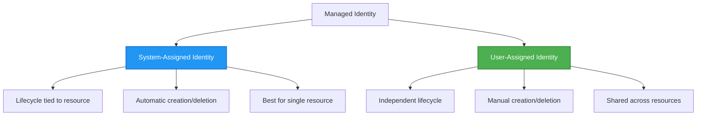

# Authentifizierungsmuster und Managed Identity

⏱️ **Geschätzte Zeit**: 45-60 Minuten Lesezeit; zusätzliche Zeit für die Übungen einplanen | 💰 **Kostenimpact**: Identity/RBAC sind kostenlos; bereitgestellte Compute-, Speicher- und Key Vault-Ressourcen werden berechnet | ⭐ **Komplexität**: Mittelstufe

> Überprüft anhand von `azd 1.37.2` (November 2026). Diese Lektion enthält **illustrierende Integrationsfragmente, kein vollständiges, herunterladbares `secure-app`-Template**. Erstellen Sie die referenzierten Dateien, stellen Sie passende Infrastruktur bereit und ersetzen Sie Platzhalter vor der Bereitstellung. Keine Azure-Ressourcen wurden während der Überprüfung bereitgestellt.

**📚 Lernpfad:**
- ← Vorherige: [Konfigurationsmanagement](configuration.md) - Verwaltung von Umgebungsvariablen und Geheimnissen
- 🎯 **Sie sind hier**: Authentifizierung & Sicherheit (Managed Identity, Key Vault, sichere Muster)
- → Nächste: [Infrastructure as Code](../chapter-04-infrastructure/README.md) - Ressourcen bereitstellen und deployen
- 🏠 [Kursübersicht](../../README.md)

---

## Was Sie lernen werden

Durch den Abschluss dieser Lektion werden Sie:
- Azure-Authentifizierungsmuster verstehen (Schlüssel, Verbindungszeichenfolgen, Managed Identity)
- **Managed Identity** für passwortlose Authentifizierung implementieren
- Geheimnisse mit **Azure Key Vault** Integration absichern
- **Rollenbasierte Zugriffskontrolle (RBAC)** für AZD-Bereitstellungen konfigurieren
- Sicherheits-Best Practices in Container Apps und Azure-Diensten anwenden
- Von schlüsselbasierter zu identitätsbasierter Authentifizierung migrieren

## Warum Managed Identity wichtig ist

### Das Problem: Traditionelle Authentifizierung

**Vor Managed Identity:**
```javascript
// ❌ SECURITY RISK: Hardcoded secrets in code
const connectionString = "Server=mydb.database.windows.net;User=admin;Password=P@ssw0rd123";
const storageKey = "xK7mN9pQ2wR5tY8uI0oP3aS6dF1gH4jK...";
const cosmosKey = "C2x7B9n4M1p8Q5w3E6r0T2y5U8i1O4p7...";
```

**Probleme:**
- 🔴 **Offenliegende Geheimnisse** im Code, Konfigurationsdateien, Umgebungsvariablen
- 🔴 **Anmeldeinformationen müssen rotiert** werden, was Codeänderungen und erneutes Deployment erfordert
- 🔴 **Audit-Albträume** – wer hat wann auf was zugegriffen?
- 🔴 **Wildwuchs** – Geheimnisse sind über mehrere Systeme verstreut
- 🔴 **Compliance-Risiken** – Versagen bei Sicherheitsprüfungen

### Die Lösung: Managed Identity

**Nach Managed Identity:**
```javascript
// ✅ SECURE: No secrets in code
const credential = new DefaultAzureCredential();
const client = new BlobServiceClient(
  "https://mystorageaccount.blob.core.windows.net",
  credential  // Azure automatically handles authentication
);
```

**Vorteile:**
- ✅ **Keine Geheimnisse** im Code oder in der Konfiguration
- ✅ **Automatische Rotation** – Azure übernimmt diese
- ✅ **Vollständiger Audit-Trail** in Microsoft Entra ID-Protokollen
- ✅ **Zentrale Sicherheit** – Management im Azure Portal
- ✅ **Compliance-fähig** – erfüllt Sicherheitsstandards

**Analogie**: Traditionelle Authentifizierung ist wie das Tragen vieler physischer Schlüssel für verschiedene Türen. Managed Identity ist wie ein Sicherheitsausweis, der automatisch basierend darauf, wer Sie sind, Zugang gewährt – keine Schlüssel, die verloren gehen, kopiert oder rotiert werden müssen.

---

## Architekturüberblick

### Authentifizierungsfluss mit Managed Identity

```mermaid
sequenceDiagram
    participant App as Your Application<br/>(Container App)
    participant MI as Managed Identity<br/>(Microsoft Entra ID)
    participant KV as Key Vault
    participant Storage as Azure Storage
    participant DB as Azure SQL
    
    App->>MI: Request access token<br/>(automatic)
    MI->>MI: Verify identity<br/>(no password needed)
    MI-->>App: Return token for requested audience<br/>(lifetime varies)
    
    App->>KV: Get secret<br/>(using token)
    KV->>KV: Check RBAC permissions
    KV-->>App: Return secret value
    
    App->>Storage: Upload blob<br/>(using token)
    Storage->>Storage: Check RBAC permissions
    Storage-->>App: Success
    
    App->>DB: Query data<br/>(using token)
    DB->>DB: Check SQL permissions
    DB-->>App: Return results
    
    Note over App,DB: Request a separate token for each service audience;<br/>SDK credentials handle caching and renewal
```

### Arten von Managed Identities



| Merkmal | Systemzugewiesen | Benutzerzugewiesen |
|---------|----------------|---------------|
| **Lebenszyklus** | An Ressource gebunden | Unabhängig |
| **Erstellung** | Automatisch mit Ressource | Manuelle Erstellung |
| **Löschung** | Wird mit Ressource gelöscht | Besteht nach Löschung der Ressource fort |
| **Freigabe** | Nur eine Ressource | Mehrere Ressourcen |
| **Anwendungsfall** | Einfache Szenarien | Komplexe Multi-Ressourcen-Szenarien |
| **Vorlagenauswahl** | In Infrastruktur definiert | In Infrastruktur definiert |

---

## Voraussetzungen

### Benötigte Tools

Sie sollten diese bereits aus vorherigen Lektionen installiert haben:

```bash
# Verify Azure Developer CLI
azd version
# ✅ Expected: azd version 1.0.0 or higher

# Verify Azure CLI
az --version
# ✅ Expected: azure-cli 2.50.0 or higher
```

### Azure-Anforderungen

- Aktives Azure-Abonnement
- Berechtigungen zum:
  - Erstellen von Managed Identities
  - Zuweisen von RBAC-Rollen
  - Erstellen von Key Vault-Ressourcen
  - Bereitstellen von Container Apps

### Wissenstechnische Voraussetzungen

Sie sollten abgearbeitet haben:
- [Installationsanleitung](../chapter-01-foundation/installation.md) – AZD-Setup
- [AZD Grundlagen](../chapter-01-foundation/azd-basics.md) – Kernkonzepte
- [Konfigurationsmanagement](configuration.md) – Umgebungsvariablen

---

## Lektion 1: Authentifizierungsmuster verstehen

### Muster 1: Verbindungszeichenfolgen (Legacy – vermeiden)

**Funktionsweise:**
```bash
# Connection string contains credentials
STORAGE_CONNECTION_STRING="DefaultEndpointsProtocol=https;AccountName=myaccount;AccountKey=xK7mN9pQ2wR5..."
COSMOS_CONNECTION_STRING="AccountEndpoint=https://myaccount.documents.azure.com:443/;AccountKey=C2x7..."
SQL_CONNECTION_STRING="Server=myserver.database.windows.net;User=admin;Password=P@ssw0rd..."
```

**Probleme:**
- ❌ Geheimnisse sind in Umgebungsvariablen sichtbar
- ❌ Werden in Bereitstellungssystemen protokolliert
- ❌ Schwer zu rotieren
- ❌ Kein Audit-Trail des Zugriffs

**Wann verwenden:** Wenn der Ziel-Service schlüsselbasierte Authentifizierung verlangt. Verwenden Sie Identität, wo unterstützt; speichern Sie sonst Schlüssel sicher und rotieren Sie sie, auch in der Produktion.

---

### Muster 2: Key Vault-Referenzen (Besser)

**Funktionsweise:**
**Teilfragmente in Bicep:** Erforderliche Vault-Felder, Container App-Identität und deren `configuration.secrets`-Eintrag sind ausgelassen. `secretRef` benennt ein Geheimnis der Container App; es ist **nicht selbst** eine Key Vault-URI. Um Key Vault zu verwenden, definieren Sie dieses benannte Geheimnis mit `keyVaultUrl` und einem autorisierten `identity`.

```bicep
// Store secret in Key Vault
resource keyVault 'Microsoft.KeyVault/vaults@2023-02-01' = {
  name: 'mykv'
  properties: {
    enableRbacAuthorization: true
  }
}

// Reference in Container App
env: [
  {
    name: 'STORAGE_KEY'
    secretRef: 'storage-key'  // References Key Vault
  }
]
```

**Vorteile:**
- ✅ Geheimnisse sind sicher im Key Vault gespeichert
- ✅ Zentrale Verwaltung von Geheimnissen
- ✅ Rotation ohne Codeänderungen

**Einschränkungen:**
- ⚠️ Es werden weiterhin Schlüssel/Passwörter verwendet
- ⚠️ Key Vault-Zugriff muss verwaltet werden

**Wann verwenden:** Übergangsschritt von Verbindungszeichenfolgen zu Managed Identity.

---

### Muster 3: Managed Identity (Best Practice)

**Funktionsweise:**
**Teilweises Bicep:** Verschmelzen Sie den Identitätsblock in eine vollständige Container-App und liefern Sie `storageAccount` und die Rollendefinition. Eine Rollenzuweisung benötigt ebenfalls eine deterministische `name`.

```bicep
// Enable managed identity
resource containerApp 'Microsoft.App/containerApps@2023-05-01' = {
  name: 'myapp'
  identity: {
    type: 'SystemAssigned'  // Automatically creates identity
  }
}

// Grant permissions
resource roleAssignment 'Microsoft.Authorization/roleAssignments@2022-04-01' = {
  name: guid(storageAccount.id, containerApp.id, storageBlobDataContributorRole)
  scope: storageAccount
  properties: {
    roleDefinitionId: storageBlobDataContributorRole
    principalId: containerApp.identity.principalId
    principalType: 'ServicePrincipal'
  }
}
```

**Anwendungscode:**
```javascript
// No secrets needed!
const { DefaultAzureCredential } = require('@azure/identity');
const { BlobServiceClient } = require('@azure/storage-blob');

const credential = new DefaultAzureCredential();
const blobServiceClient = new BlobServiceClient(
  'https://mystorageaccount.blob.core.windows.net',
  credential
);
```

**Vorteile:**
- ✅ Keine Geheimnisse in Code/Konfiguration
- ✅ Automatische Anmeldeinformationsrotation
- ✅ Vollständiger Audit-Trail
- ✅ Berechtigungen basierend auf RBAC
- ✅ Compliance-fähig

**Wann verwenden:** Bevorzugt für Azure-gehostete Anwendungen, die Dienste nutzen, die Microsoft Entra-Authentifizierung unterstützen.

---

### Muster 4: Dienstprinzipale (CI/CD & Automatisierung)

Managed Identity ist der Goldstandard *für Ressourcen, die innerhalb von Azure laufen*. Aber wie sieht es mit Dingen aus, die **außerhalb** von Azure laufen – wie eine CI/CD-Pipeline auf einem Build-Agent oder ein Skript auf Ihrem Laptop, das Ihren interaktiven Login nicht verwenden kann? Hier kommt ein **Dienstprinzipal** ins Spiel: eine nicht-menschliche Identität mit eigenen Anmeldeinformationen, mit der sich ein automatisierter Prozess anmelden kann.

**Funktionsweise:**

Erstellen Sie einen Dienstprinzipal mit Gültigkeit für eine Ressourcengruppe (Minimalberechtigung):

```bash
az ad sp create-for-rbac \
  --name "myapp-cicd" \
  --role contributor \
  --scopes "/subscriptions/<sub-id>/resourceGroups/<rg-name>"
```

Dies gibt eine Client-ID, ein Client-Geheimnis und eine Mandanten-ID aus. azd kann sich damit non-interaktiv anmelden:

```bash
azd auth login \
  --client-id "<appId>" \
  --client-secret "<password>" \
  --tenant-id "<tenant>"
```

**Bevorzugen Sie föderierte Anmeldeinformationen (OIDC) gegenüber Geheimnissen.** Anstelle eines langlebigen Client-Geheimnisses konfigurieren Sie eine föderierte Anmeldeinformation, damit die Pipeline ein kurzlebiges Token austauscht – kein Geheimnis zum Leaken oder Rotieren:

```bash
azd auth login \
  --client-id "<appId>" \
  --federated-credential-provider "github" \
  --tenant-id "<tenant>"
```

> `azd pipeline config` richtet das für Sie automatisch ein. Siehe die CI/CD-Durchläufe in [Kapitel 8](../chapter-08-production/production-ai-practices.md).

**Vorteile:**
- ✅ Funktioniert außerhalb von Azure (Build-Agenten, lokale Umgebung, andere Clouds)
- ✅ Kann auf eine einzelne Ressourcengruppe mit einer Rolle beschränkt werden
- ✅ Föderierte (OIDC) Variante nutzt kein gespeichertes Geheimnis

**Einschränkungen:**
- ⚠️ Geheimnis-basierte Variante erfordert sorgfältige Speicherung und Rotation
- ⚠️ Ein geleaktes Geheimnis gewährt alle Berechtigungen des Dienstprinzips – halten Sie Bereiche eng

**Wann verwenden:** CI/CD-Pipelines und Automatisierung, die Managed Identity nicht nutzen können. Bevorzugen Sie immer die **föderierte/OIDC** Variante gegenüber einem Client-Geheimnis und bevorzugen Sie Managed Identity, wann immer die Workload in Azure läuft.

**Sichere Speicherung von Anmeldeinformationen:**
- Niemals Geheimnisse commiten – verwenden Sie den geheimen Speicher Ihrer Pipeline (GitHub Actions Secrets, Azure DevOps Variablengruppen / Key Vault).
- Beschränken Sie den Dienstprinzipal auf die kleinste Rolle und Ressourcengruppe, die benötigt wird.
- Legen Sie ein Ablaufdatum fest und rotieren Sie, oder eliminieren Sie das Geheimnis vollständig mit OIDC.

---

## Lektion 2: Managed Identity mit AZD implementieren

### Schritt-für-Schritt-Implementierung

Die folgenden Fragmente zeigen, wie Managed Identity in ein Container App-Projekt integriert wird. Sie sind **kein Einfach-Kopieren-und-Ausführen-Starter**: Das Storage-Modul, die komplette Managed Environment/Registry-Infrastruktur, Dockerfile und Parameterdatei werden hier nicht vollständig bereitgestellt. Beginnen Sie mit einer funktionierenden Container Apps-Vorlage und integrieren Sie diese Muster, wobei Sie deren Registry-Konfiguration und Servicetags beibehalten.

### Projektstruktur

```
secure-app/
├── azure.yaml                 # AZD configuration
├── infra/
│   ├── main.bicep            # Main infrastructure
│   ├── core/
│   │   ├── identity.bicep    # Managed identity setup
│   │   ├── keyvault.bicep    # Key Vault configuration
│   │   └── storage.bicep     # Storage with RBAC
│   └── app/
│       └── container-app.bicep
└── src/
    ├── app.js                # Application code
    ├── package.json
    └── Dockerfile
```

### 1. AZD konfigurieren (azure.yaml)

```yaml
name: secure-app
metadata:
  template: secure-app@1.0.0

services:
  api:
    project: ./src
    language: js
    host: containerapp

# Managed identity must be enabled in the infrastructure, not by this YAML.
```

### 2. Infrastruktur: Managed Identity aktivieren

**Datei: `infra/main.bicep`**

```bicep
targetScope = 'subscription'

param environmentName string
param location string = 'eastus'
param containerAppsEnvironmentId string
param containerImage string

var tags = { 'azd-env-name': environmentName }

// Resource group
resource rg 'Microsoft.Resources/resourceGroups@2021-04-01' = {
  name: 'rg-${environmentName}'
  location: location
  tags: tags
}

// Storage Account
module storage './core/storage.bicep' = {
  name: 'storage'
  scope: rg
  params: {
    name: 'st${uniqueString(rg.id)}'
    location: location
    tags: tags
  }
}

// Key Vault
module keyVault './core/keyvault.bicep' = {
  name: 'keyvault'
  scope: rg
  params: {
    name: 'kv-${uniqueString(rg.id)}'
    location: location
    tags: tags
  }
}

// Container App with Managed Identity
module containerApp './app/container-app.bicep' = {
  name: 'container-app'
  scope: rg
  params: {
    name: 'ca-${environmentName}'
    location: location
    tags: tags
    storageAccountName: storage.outputs.name
    keyVaultName: keyVault.outputs.name
    containerAppsEnvironmentId: containerAppsEnvironmentId
    containerImage: containerImage
  }
}

// Grant Container App access to Storage
module storageRoleAssignment './core/role-assignment.bicep' = {
  name: 'storage-role'
  scope: rg
  params: {
    principalId: containerApp.outputs.identityPrincipalId
    roleDefinitionId: 'ba92f5b4-2d11-453d-a403-e96b0029c9fe'  // Storage Blob Data Contributor
    targetResourceType: 'storage'
    targetResourceName: storage.outputs.name
  }
}

// Grant Container App access to Key Vault
module kvRoleAssignment './core/role-assignment.bicep' = {
  name: 'kv-role'
  scope: rg
  params: {
    principalId: containerApp.outputs.identityPrincipalId
    roleDefinitionId: '4633458b-17de-408a-b874-0445c86b69e6'  // Key Vault Secrets User
    targetResourceType: 'keyvault'
    targetResourceName: keyVault.outputs.name
  }
}

// Outputs
output AZURE_STORAGE_ACCOUNT_NAME string = storage.outputs.name
output AZURE_KEY_VAULT_NAME string = keyVault.outputs.name
output APP_URL string = containerApp.outputs.url
```

### 3. Container App mit systemzugewiesener Identität

**Datei: `infra/app/container-app.bicep`**

```bicep
param name string
param location string
param tags object = {}
param storageAccountName string
param keyVaultName string
param containerAppsEnvironmentId string
param containerImage string

resource containerApp 'Microsoft.App/containerApps@2023-05-01' = {
  name: name
  location: location
  tags: union(tags, { 'azd-service-name': 'api' })
  identity: {
    type: 'SystemAssigned'  // 🔑 Enable managed identity
  }
  properties: {
    managedEnvironmentId: containerAppsEnvironmentId
    configuration: {
      ingress: {
        external: true
        targetPort: 3000
      }
    }
    template: {
      containers: [
        {
          name: 'api'
          image: containerImage // Must exist; configure registry credentials for private images
          resources: {
            cpu: json('0.5')
            memory: '1Gi'
          }
          env: [
            {
              name: 'AZURE_STORAGE_ACCOUNT_NAME'
              value: storageAccountName
            }
            {
              name: 'AZURE_KEY_VAULT_NAME'
              value: keyVaultName
            }
            // 🔑 No secrets - managed identity handles authentication!
          ]
        }
      ]
    }
  }
}

// Output the identity for RBAC assignments
output identityPrincipalId string = containerApp.identity.principalId
output id string = containerApp.id
output url string = 'https://${containerApp.properties.configuration.ingress.fqdn}'
```

### 4. RBAC Rollenzuweisungs-Modul

**Datei: `infra/core/role-assignment.bicep`**

```bicep
param principalId string
param roleDefinitionId string  // Azure built-in role ID
@allowed(['storage', 'keyvault'])
param targetResourceType string
param targetResourceName string

// Typed existing resources give Bicep a valid resource scope, not a string ID.
resource storageTarget 'Microsoft.Storage/storageAccounts@2023-01-01' existing = {
  name: targetResourceName
}
resource vaultTarget 'Microsoft.KeyVault/vaults@2023-02-01' existing = {
  name: targetResourceName
}

resource storageAssignment 'Microsoft.Authorization/roleAssignments@2022-04-01' = if (targetResourceType == 'storage') {
  name: guid(storageTarget.id, principalId, roleDefinitionId)
  scope: storageTarget
  properties: {
    roleDefinitionId: subscriptionResourceId('Microsoft.Authorization/roleDefinitions', roleDefinitionId)
    principalId: principalId
    principalType: 'ServicePrincipal'
  }
}

resource vaultAssignment 'Microsoft.Authorization/roleAssignments@2022-04-01' = if (targetResourceType == 'keyvault') {
  name: guid(vaultTarget.id, principalId, roleDefinitionId)
  scope: vaultTarget
  properties: {
    roleDefinitionId: subscriptionResourceId('Microsoft.Authorization/roleDefinitions', roleDefinitionId)
    principalId: principalId
    principalType: 'ServicePrincipal'
  }
}

// This module assigns at the target resource scope, not the whole resource group.
```

### 5. Anwendungscode mit Managed Identity

**Datei: `src/app.js`**

```javascript
const express = require('express');
const { DefaultAzureCredential } = require('@azure/identity');
const { BlobServiceClient } = require('@azure/storage-blob');
const { SecretClient } = require('@azure/keyvault-secrets');

const app = express();
const PORT = process.env.PORT || 3000;

// 🔑 Initialize credential (works automatically with managed identity)
const credential = new DefaultAzureCredential();

// Azure Storage setup
const storageAccountName = process.env.AZURE_STORAGE_ACCOUNT_NAME;
const blobServiceClient = new BlobServiceClient(
  `https://${storageAccountName}.blob.core.windows.net`,
  credential  // No keys needed!
);

// Key Vault setup
const keyVaultName = process.env.AZURE_KEY_VAULT_NAME;
const secretClient = new SecretClient(
  `https://${keyVaultName}.vault.azure.net`,
  credential  // No keys needed!
);

// Health check
app.get('/health', (req, res) => {
  res.json({ status: 'healthy', authentication: 'managed-identity' });
});

// Upload file to blob storage
app.post('/upload', async (req, res) => {
  try {
    const containerClient = blobServiceClient.getContainerClient('uploads');
    await containerClient.createIfNotExists();
    
    const blobName = `file-${Date.now()}.txt`;
    const blockBlobClient = containerClient.getBlockBlobClient(blobName);
    
    const content = 'Hello from managed identity!';
    await blockBlobClient.upload(content, Buffer.byteLength(content));
    
    res.json({
      success: true,
      blobName: blobName,
      message: 'File uploaded using managed identity!'
    });
  } catch (error) {
    console.error('Upload error:', error);
    res.status(500).json({ error: error.message });
  }
});

// Get secret from Key Vault
app.get('/secret/:name', async (req, res) => {
  try {
    const secretName = req.params.name;
    const secret = await secretClient.getSecret(secretName);
    
    res.json({
      name: secretName,
      retrieved: secret.value !== undefined, // Never return the secret value to callers
      message: 'Secret retrieved using managed identity!'
    });
  } catch (error) {
    console.error('Secret error:', error);
    res.status(500).json({ error: error.message });
  }
});

// List blob containers (demonstrates read access)
app.get('/containers', async (req, res) => {
  try {
    const containers = [];
    for await (const container of blobServiceClient.listContainers()) {
      containers.push(container.name);
    }
    
    res.json({
      containers: containers,
      count: containers.length,
      message: 'Containers listed using managed identity!'
    });
  } catch (error) {
    console.error('List error:', error);
    res.status(500).json({ error: error.message });
  }
});

app.listen(PORT, () => {
  console.log(`Secure API listening on port ${PORT}`);
  console.log('Authentication: Managed Identity (passwordless)');
});
```

**Datei: `src/package.json`**

```json
{
  "name": "secure-app",
  "version": "1.0.0",
  "dependencies": {
    "express": "^4.18.2",
    "@azure/identity": "^4.0.0",
    "@azure/storage-blob": "^12.17.0",
    "@azure/keyvault-secrets": "^4.7.0"
  },
  "scripts": {
    "start": "node app.js"
  }
}
```

### 6. Bereitstellen und testen

Führen Sie diese Befehle **erst aus**, nachdem Sie die fehlende Infrastruktur, das Dockerfile und passende `main.parameters.json` in Ihrem eigenen Projekt vervollständigt haben. Authentifizieren Sie azd mit `azd auth login`; melden Sie sich zusätzlich mit `az login` für die späteren Azure CLI-Prüfungen an. Die gezeigten Endpunkte sind Demonstrationen und erfordern angemessene Zugangskontrollen vor der öffentlichen Nutzung.

```bash
# Initialize AZD environment
azd init

# Deploy infrastructure and application
azd up

# Get the app URL
APP_URL=$(azd env get-value APP_URL)

# Test health check
curl $APP_URL/health
```

**✅ Erwartete Ausgabe:**
```json
{
  "status": "healthy",
  "authentication": "managed-identity"
}
```

**Blob-Upload testen:**
```bash
curl -X POST $APP_URL/upload
```

**✅ Erwartete Ausgabe:**
```json
{
  "success": true,
  "blobName": "file-1700404800000.txt",
  "message": "File uploaded using managed identity!"
}
```

**Container-Auflistung testen:**
```bash
curl $APP_URL/containers
```

**✅ Erwartete Ausgabe:**
```json
{
  "containers": ["uploads"],
  "count": 1,
  "message": "Containers listed using managed identity!"
}
```

---

## Gängige Azure RBAC-Rollen

### Eingebaute Rollen-IDs für Managed Identity

| Dienst | Rollenname | Rollen-ID | Berechtigungen |
|---------|-----------|---------|-------------|
| **Storage** | Storage Blob Data Reader | `2a2b9908-6ea1-4ae2-8e65-a410df84e7d1` | Blobs und Container lesen |
| **Storage** | Storage Blob Data Contributor | `ba92f5b4-2d11-453d-a403-e96b0029c9fe` | Blobs lesen, schreiben, löschen |
| **Storage** | Storage Queue Data Contributor | `974c5e8b-45b9-4653-ba55-5f855dd0fb88` | Warteschlangen/Nachrichten lesen, schreiben, löschen |
| **Key Vault** | Key Vault Secrets User | `4633458b-17de-408a-b874-0445c86b69e6` | Geheimnisse lesen |
| **Key Vault** | Key Vault Secrets Officer | `b86a8fe4-44ce-4948-aee5-eccb2c155cd7` | Geheimnisse lesen, schreiben, löschen |
| **Cosmos DB** | Cosmos DB Built-in Data Reader | `00000000-0000-0000-0000-000000000001` | Cosmos DB-Daten lesen |
| **Cosmos DB** | Cosmos DB Built-in Data Contributor | `00000000-0000-0000-0000-000000000002` | Cosmos DB-Daten lesen, schreiben |
| **SQL-Datenbank** | SQL DB Contributor | `9b7fa17d-e63e-47b0-bb0a-15c516ac86ec` | Datenbankressourcen verwalten; gewährt keinen SQL-Datenzugriff |
| **Service Bus** | Azure Service Bus Data Owner | `090c5cfd-751d-490a-894a-3ce6f1109419` | Nachrichten senden, empfangen, verwalten |

### So finden Sie Rollen-IDs

Die beiden oben aufgeführten Cosmos DB für NoSQL-IDs sind **native Cosmos Data-Plane-Rollendefinitionen**, keine Azure RBAC-Abonnement-Rollen-IDs. Weisen Sie sie mit `az cosmosdb sql role assignment create` (oder `Microsoft.DocumentDB/databaseAccounts/sqlRoleAssignments`) zu, nicht mit `az role assignment create`. SQL-Datenzugriff erfordert einen Entra-Datenbankbenutzer und SQL-Berechtigungen.

```bash
# List all built-in roles
az role definition list --query "[].{Name:roleName, ID:name}" --output table

# Search for specific role
az role definition list --query "[?contains(roleName, 'Storage Blob')].{Name:roleName, ID:name}" --output table

# Get role details
az role definition list --name "Storage Blob Data Contributor"
```

---

## Praktische Übungen

**Integrationsvoraussetzungen für alle drei Übungen:** eine funktionierende Container App-Vorlage in Ihrem eigenen Projekt, passende Bicep-Ressourcen, Azure CLI/azd-Anmeldung und Berechtigung zum Zuweisen der erforderlichen Rollen. Dies sind geführte Anpassungen, keine eigenständigen lokalen Starter; ersetzen Sie die Beispielressourcennamen durch Ihre bereitgestellten Namen.

### Übung 1: Managed Identity für bestehende App aktivieren ⭐⭐ (Mittel)

**Ziel**: Managed Identity zu einer bestehenden Container App-Bereitstellung hinzufügen

**Szenario**: Sie haben eine Container App, die Verbindungszeichenfolgen nutzt. Konvertieren Sie diese zu Managed Identity.

**Ausgangspunkt**: Container App mit dieser Konfiguration:

```bicep
// ❌ Current: Using connection string
env: [
  {
    name: 'STORAGE_CONNECTION_STRING'
    secretRef: 'storage-connection'
  }
]
```

**Schritte**:

1. **Managed Identity in Bicep aktivieren:**

```bicep
resource containerApp 'Microsoft.App/containerApps@2023-05-01' = {
  name: 'myapp'
  identity: {
    type: 'SystemAssigned'  // Add this
  }
  // ... rest of configuration
}
```

2. **Storage-Zugriff gewähren:**

```bicep
// Get storage account reference
resource storageAccount 'Microsoft.Storage/storageAccounts@2023-01-01' existing = {
  name: storageAccountName
}

// Assign role
resource roleAssignment 'Microsoft.Authorization/roleAssignments@2022-04-01' = {
  name: guid(containerApp.id, 'ba92f5b4-2d11-453d-a403-e96b0029c9fe', storageAccount.id)
  scope: storageAccount
  properties: {
    roleDefinitionId: subscriptionResourceId('Microsoft.Authorization/roleDefinitions', 'ba92f5b4-2d11-453d-a403-e96b0029c9fe')
    principalId: containerApp.identity.principalId
    principalType: 'ServicePrincipal'
  }
}
```

3. **Anwendungscode aktualisieren:**

**Davor (Verbindungszeichenfolge):**
```javascript
const { BlobServiceClient } = require('@azure/storage-blob');

const blobServiceClient = BlobServiceClient.fromConnectionString(
  process.env.STORAGE_CONNECTION_STRING
);
```

**Danach (Managed Identity):**
```javascript
const { DefaultAzureCredential } = require('@azure/identity');
const { BlobServiceClient } = require('@azure/storage-blob');

const credential = new DefaultAzureCredential();
const blobServiceClient = new BlobServiceClient(
  `https://${process.env.STORAGE_ACCOUNT_NAME}.blob.core.windows.net`,
  credential
);
```

4. **Umgebungsvariablen aktualisieren:**

```bicep
env: [
  {
    name: 'STORAGE_ACCOUNT_NAME'
    value: storageAccountName  // Just the name, no secrets!
  }
  // Remove STORAGE_CONNECTION_STRING
]
```

5. **Bereitstellen und testen:**

```bash
# Redeploy
azd up

# Test that it still works
APP_URL=$(azd show --output json | jq -er '.services.api.ingressUrl')
curl --fail -X POST "$APP_URL/upload"
```

**✅ Erfolgskriterien:**
- ✅ Anwendung wird fehlerfrei bereitgestellt
- ✅ Storage-Operationen funktionieren (Upload, Auflisten, Download)
- ✅ Keine Verbindungszeichenfolgen in Umgebungsvariablen
- ✅ Identität sichtbar im Azure Portal unter der "Identität"-Blade

**Verifikation:**

```bash
# Check managed identity is enabled
az containerapp show \
  --name myapp \
  --resource-group rg-myapp \
  --query "identity.type"
# ✅ Expected: "SystemAssigned"

# Check role assignment
az role assignment list \
  --assignee $(az containerapp show --name myapp --resource-group rg-myapp --query "identity.principalId" -o tsv) \
  --scope /subscriptions/{sub-id}/resourceGroups/rg-myapp/providers/Microsoft.Storage/storageAccounts/mystorageaccount
# ✅ Expected: Shows "Storage Blob Data Contributor" role
```

**Zeit**: 20-30 Minuten

---

### Übung 2: Multi-Service-Zugriff mit benutzerzugewiesener Identität ⭐⭐⭐ (Fortgeschritten)

**Ziel**: Eine benutzerzugewiesene Identität erstellen, die von mehreren Container Apps geteilt wird

**Szenario**: Sie haben 3 Microservices, die alle Zugriff auf dasselbe Storage-Konto und Key Vault benötigen.

**Schritte**:

1. **Benutzerzugewiesene Identität erstellen:**

**Datei: `infra/core/identity.bicep`**

```bicep
param name string
param location string
param tags object = {}

resource userAssignedIdentity 'Microsoft.ManagedIdentity/userAssignedIdentities@2023-01-31' = {
  name: name
  location: location
  tags: tags
}

output id string = userAssignedIdentity.id
output principalId string = userAssignedIdentity.properties.principalId
output clientId string = userAssignedIdentity.properties.clientId
```

2. **Rollen für benutzerzugewiesene Identität zuweisen:**

```bicep
// In main.bicep
module userIdentity './core/identity.bicep' = {
  name: 'user-identity'
  scope: rg
  params: {
    name: 'id-${environmentName}'
    location: location
    tags: tags
  }
}

// Grant Storage access
resource storageRoleAssignment 'Microsoft.Authorization/roleAssignments@2022-04-01' = {
  name: guid(storageAccount.id, environmentName, 'storage-contributor')
  scope: storageAccount
  properties: {
    roleDefinitionId: subscriptionResourceId('Microsoft.Authorization/roleDefinitions', 'ba92f5b4-2d11-453d-a403-e96b0029c9fe')
    principalId: userIdentity.outputs.principalId
    principalType: 'ServicePrincipal'
  }
}

// Grant Key Vault access
resource kvRoleAssignment 'Microsoft.Authorization/roleAssignments@2022-04-01' = {
  name: guid(keyVault.id, environmentName, 'kv-secrets-user')
  scope: keyVault
  properties: {
    roleDefinitionId: subscriptionResourceId('Microsoft.Authorization/roleDefinitions', '4633458b-17de-408a-b874-0445c86b69e6')
    principalId: userIdentity.outputs.principalId
    principalType: 'ServicePrincipal'
  }
}
```

3. **Identity mehreren Container-Apps zuweisen:**

```bicep
resource apiGateway 'Microsoft.App/containerApps@2023-05-01' = {
  name: 'api-gateway'
  identity: {
    type: 'UserAssigned'
    userAssignedIdentities: {
      '${userIdentity.outputs.id}': {}
    }
  }
  // ... rest of config
}

resource productService 'Microsoft.App/containerApps@2023-05-01' = {
  name: 'product-service'
  identity: {
    type: 'UserAssigned'
    userAssignedIdentities: {
      '${userIdentity.outputs.id}': {}
    }
  }
  // ... rest of config
}

resource orderService 'Microsoft.App/containerApps@2023-05-01' = {
  name: 'order-service'
  identity: {
    type: 'UserAssigned'
    userAssignedIdentities: {
      '${userIdentity.outputs.id}': {}
    }
  }
  // ... rest of config
}
```

4. **Anwendungscode (alle Services verwenden dasselbe Muster):**

```javascript
const { ManagedIdentityCredential } = require('@azure/identity');
const { BlobServiceClient } = require('@azure/storage-blob');

// For user-assigned identity, specify the client ID
const credential = new ManagedIdentityCredential(
  process.env.AZURE_CLIENT_ID  // User-assigned identity client ID
);

// Alternative (choose ONE credential declaration):
// const { DefaultAzureCredential } = require('@azure/identity');
// const credential = new DefaultAzureCredential({
//   managedIdentityClientId: process.env.AZURE_CLIENT_ID
// });

const blobServiceClient = new BlobServiceClient(
  `https://${process.env.STORAGE_ACCOUNT_NAME}.blob.core.windows.net`,
  credential
);
```

Setzen Sie die Laufzeitwerte `AZURE_CLIENT_ID` auf `userIdentity.outputs.clientId` und `STORAGE_ACCOUNT_NAME` auf Ihren Speichernamen in Bicep für jede Container-App. Das bloße Zuweisen der Identität oder das Ausführen von `azd env set` konfiguriert diese Laufzeitwerte nicht.

5. **Bereitstellen und überprüfen:**

```bash
azd up

# Test all services can access storage
# Replace with the actual ingress URLs reported for your three services
curl --fail -X POST "$API_GATEWAY_URL/upload"
curl --fail -X POST "$PRODUCT_SERVICE_URL/upload"
curl --fail -X POST "$ORDER_SERVICE_URL/upload"
```

**✅ Erfolgskriterien:**
- ✅ Eine Identität, die über 3 Dienste geteilt wird
- ✅ Alle Dienste können auf Storage und Key Vault zugreifen
- ✅ Die Identität bleibt erhalten, wenn Sie einen Dienst löschen
- ✅ Zentralisiertes Berechtigungsmanagement

**Vorteile der benutzerzugewiesenen Identität:**
- Eine einzelne Identität zur Verwaltung
- Konsistente Berechtigungen über Dienste hinweg
- Überlebt das Löschen eines Dienstes
- Besser für komplexe Architekturen

**Zeit**: 30-40 Minuten

---

### Übung 3: Implementierung der Key Vault Secret Rotation ⭐⭐⭐ (Fortgeschritten)

**Ziel**: Drittanbieter-API-Schlüssel im Key Vault speichern und mit verwalteter Identität darauf zugreifen

**Szenario**: Ihre App muss eine externe API (OpenAI, Stripe, SendGrid) aufrufen, die API-Schlüssel benötigt.

**Schritte**:

1. **Key Vault mit RBAC erstellen:**

**Datei: `infra/core/keyvault.bicep`**

```bicep
param name string
param location string
param tags object = {}

resource keyVault 'Microsoft.KeyVault/vaults@2023-02-01' = {
  name: name
  location: location
  tags: tags
  properties: {
    enableRbacAuthorization: true  // Use RBAC instead of access policies
    sku: {
      family: 'A'
      name: 'standard'
    }
    tenantId: subscription().tenantId
    enableSoftDelete: true
    softDeleteRetentionInDays: 90
  }
}

// Allow Container App to read secrets
output id string = keyVault.id
output name string = keyVault.name
output uri string = keyVault.properties.vaultUri
```

2. **Secrets im Key Vault speichern:**

```bash
# Get Key Vault name
KV_NAME=$(azd env get-value AZURE_KEY_VAULT_NAME)

# Store third-party API keys
az keyvault secret set \
  --vault-name $KV_NAME \
  --name "OpenAI-ApiKey" \
  --value "sk-proj-xxxxxxxxxxxxx"

az keyvault secret set \
  --vault-name $KV_NAME \
  --name "Stripe-ApiKey" \
  --value "sk_live_xxxxxxxxxxxxx"

az keyvault secret set \
  --vault-name $KV_NAME \
  --name "SendGrid-ApiKey" \
  --value "SG.xxxxxxxxxxxxx"
```

3. **Anwendungscode zum Abrufen der Secrets:**

**Datei: `src/config.js`**

```javascript
const { DefaultAzureCredential } = require('@azure/identity');
const { SecretClient } = require('@azure/keyvault-secrets');

class Config {
  constructor() {
    this.credential = new DefaultAzureCredential();
    this.secretClient = new SecretClient(
      `https://${process.env.AZURE_KEY_VAULT_NAME}.vault.azure.net`,
      this.credential
    );
    this.cache = {};
  }

  async getSecret(secretName) {
    // Check cache first
    if (this.cache[secretName]) {
      return this.cache[secretName];
    }

    try {
      const secret = await this.secretClient.getSecret(secretName);
      this.cache[secretName] = secret.value;
      console.log(`✅ Retrieved secret: ${secretName}`);
      return secret.value;
    } catch (error) {
      console.error(`❌ Failed to get secret ${secretName}:`, error.message);
      throw error;
    }
  }

  async getOpenAIKey() {
    return this.getSecret('OpenAI-ApiKey');
  }

  async getStripeKey() {
    return this.getSecret('Stripe-ApiKey');
  }

  async getSendGridKey() {
    return this.getSecret('SendGrid-ApiKey');
  }
}

module.exports = new Config();
```

4. **Secrets in der Anwendung verwenden:**

**Datei: `src/app.js`**

Dieses **Ersatz-Anwendungsfragment** benötigt `npm install openai`, einen echten Drittanbieterschlüssel, ein zugängliches Modell und die Infrastruktur Ihres Arbeitsprojekts. Es ruft OpenAI direkt auf, nicht eine Azure OpenAI-Bereitstellung. Die untenstehenden Platzhalterschlüssel autorisieren keine Anfrage.

```javascript
const express = require('express');
const config = require('./config');
const { OpenAI } = require('openai');

const app = express();

// Initialize OpenAI with key from Key Vault
let openaiClient;

async function initializeServices() {
  const openaiKey = await config.getOpenAIKey();
  openaiClient = new OpenAI({ apiKey: openaiKey });
  console.log('✅ Services initialized with secrets from Key Vault');
}

app.post('/chat', async (req, res) => {
  try {
    const completion = await openaiClient.chat.completions.create({
      model: 'gpt-4.1',
      messages: [{ role: 'user', content: 'Hello!' }]
    });
    
    res.json({
      response: completion.choices[0].message.content,
      authentication: 'Key from Key Vault via Managed Identity'
    });
  } catch (error) {
    res.status(500).json({ error: error.message });
  }
});

// Start listening only after initialization succeeds.
initializeServices().then(() => {
  app.listen(3000, () => console.log('Key Vault demo running'));
}).catch(error => {
  console.error('Initialization failed:', error.message);
  process.exitCode = 1;
});
```

5. **Bereitstellen und testen:**

```bash
azd up

# Test that API keys work
curl -X POST https://myapp.azurecontainerapps.io/chat \
  -H "Content-Type: application/json" \
  -d '{"message":"Hello AI"}'
```

**✅ Erfolgskriterien:**
- ✅ Keine API-Schlüssel im Code oder in Umgebungsvariablen
- ✅ Anwendung ruft Schlüssel aus Key Vault ab
- ✅ Drittanbieter-APIs funktionieren korrekt
- ✅ Schlüssel können ohne Codeänderungen rotiert werden

**Ein Secret rotieren:**

```bash
# Update secret in Key Vault
az keyvault secret set \
  --vault-name $KV_NAME \
  --name "OpenAI-ApiKey" \
  --value "sk-proj-NEW_KEY_HERE"

# Find the active revision name, then restart it to clear the in-process cache
az containerapp revision list --name myapp --resource-group rg-myapp --output table
az containerapp revision restart \
  --name myapp \
  --resource-group rg-myapp \
  --revision "<active-revision-name>"
```

**Zeit**: 25-35 Minuten

---

## Wissenscheckpoint

### 1. Authentifizierungsmuster ✓

Testen Sie Ihr Verständnis:

- [ ] **Q1**: Was sind die drei Hauptauthentifizierungsmuster? 
  - **A**: Verbindungszeichenfolgen (Legacy), Key Vault-Verweise (Übergang), Managed Identity (am besten)

- [ ] **Q2**: Warum ist die verwaltete Identität besser als Verbindungszeichenfolgen?
  - **A**: Keine Geheimnisse im Code, automatische Rotation, vollständige Audit-Trail, RBAC-Berechtigungen

- [ ] **Q3**: Wann verwendet man eine benutzerzugewiesene Identität statt einer systemzugewiesenen?
  - **A**: Wenn die Identität über mehrere Ressourcen geteilt wird oder der Lebenszyklus der Identität unabhängig vom Ressourcen-Lebenszyklus ist

**Praktische Überprüfung:**
```bash
# Check what type of identity your app uses
az containerapp show \
  --name myapp \
  --resource-group rg-myapp \
  --query "identity.type"

# List all role assignments for the identity
az role assignment list \
  --assignee $(az containerapp show --name myapp --resource-group rg-myapp --query "identity.principalId" -o tsv)
```

---

### 2. RBAC und Berechtigungen ✓

Testen Sie Ihr Verständnis:

- [ ] **Q1**: Was ist die Rollen-ID für "Storage Blob Data Contributor"?
  - **A**: `ba92f5b4-2d11-453d-a403-e96b0029c9fe`

- [ ] **Q2**: Welche Berechtigungen gibt "Key Vault Secrets User"? 
  - **A**: Nur Lesezugriff auf Secrets (kann nicht erstellen, aktualisieren oder löschen)

- [ ] **Q3**: Wie gewähren Sie einer Container-App Zugriff auf Azure SQL?
  - **A**: Microsoft Entra-Authentifizierung konfigurieren, die Identität als Datenbankbenutzer erstellen und die notwendigen SQL-Berechtigungen vergeben. "SQL DB Contributor" verwaltet nur Azure-Ressourcen, berechtigt aber nicht zu Abfragen.

**Praktische Überprüfung:**
```bash
# Find specific role
az role definition list --name "Storage Blob Data Contributor"

# Check what roles are assigned to your identity
PRINCIPAL_ID=$(az containerapp show --name myapp --resource-group rg-myapp --query "identity.principalId" -o tsv)
az role assignment list --assignee $PRINCIPAL_ID --output table
```

---

### 3. Key Vault-Integration ✓

Testen Sie Ihr Verständnis:

- [ ] **Q1**: Wie aktiviert man RBAC für Key Vault anstelle von Zugriffspolicen?
  - **A**: Setzen Sie `enableRbacAuthorization: true` in Bicep

- [ ] **Q2**: Welche Azure SDK-Bibliothek behandelt die Authentifizierung mit managed identity?
  - **A**: `@azure/identity` mit der `DefaultAzureCredential` Klasse

- [ ] **Q3**: Wie lange bleiben Key Vault-Secrets im Cache?
  - **A**: Anwendungsabhängig; implementieren Sie Ihre eigene Cache-Strategie

**Praktische Überprüfung:**
```bash
# Test Key Vault access
az keyvault secret show \
  --vault-name $KV_NAME \
  --name "OpenAI-ApiKey" \
  --query "{name:name,enabled:attributes.enabled}"

# Check RBAC is enabled
az keyvault show \
  --name $KV_NAME \
  --query "properties.enableRbacAuthorization"
# ✅ Expected: true
```

---

## Sicherheits-Best Practices

### ✅ TUN SIE:

1. **Verwenden Sie in der Produktion immer verwaltete Identität**
   ```bicep
   identity: {
     type: 'SystemAssigned'
   }
   ```

2. **Nutzen Sie RBAC-Rollen mit minimalen Rechten**
   - Verwenden Sie nach Möglichkeit "Reader"-Rollen
   - Vermeiden Sie "Owner" oder "Contributor", wenn nicht notwendig

3. **Speichern Sie Drittanbieter-Schlüssel im Key Vault**
   ```javascript
   const apiKey = await secretClient.getSecret('ThirdPartyApiKey');
   ```

4. **Aktivieren Sie Audit-Logging** (Teilfragment der Ressource; mit Ihrem Vault- und Workspace-Setup zusammenführen)
   ```bicep
   resource vaultDiagnostics 'Microsoft.Insights/diagnosticSettings@2021-05-01-preview' = {
     name: 'vault-audit'
     scope: keyVault
     properties: {
       workspaceId: logAnalytics.id
       logs: [{ category: 'AuditEvent', enabled: true }]
     }
   }
   ```

5. **Verwenden Sie unterschiedliche Identitäten für Dev/Staging/Prod**
   ```bash
   azd env new dev
   azd env new staging
   azd env new prod
   ```

6. **Rotieren Sie Secrets regelmäßig**
   - Setzen Sie Ablaufdaten für Key Vault-Secrets
   - Automatisieren Sie Rotation mit Azure Functions

### ❌ TUN SIE NICHT:

1. **Hardcodieren Sie niemals Secrets**
   ```javascript
   // ❌ BAD
   const apiKey = "sk-proj-xxxxxxxxxxxxx";
   ```

2. **Verwenden Sie keine Verbindungszeichenfolgen in der Produktion**
   ```javascript
   // ❌ BAD
   BlobServiceClient.fromConnectionString(process.env.STORAGE_CONNECTION_STRING)
   ```

3. **Vergeben Sie keine übermäßigen Berechtigungen**
   ```bicep
   // ❌ BAD - too much access
   roleDefinitionId: subscriptionResourceId('Microsoft.Authorization/roleDefinitions', '8e3af657-a8ff-443c-a75c-2fe8c4bcb635')
   
   // ✅ GOOD - least privilege
   roleDefinitionId: subscriptionResourceId('Microsoft.Authorization/roleDefinitions', '2a2b9908-6ea1-4ae2-8e65-a410df84e7d1')
   ```

4. **Protokollieren Sie keine Secrets**
   ```javascript
   // ❌ BAD
   console.log('API Key:', apiKey);
   
   // ✅ GOOD
   console.log('API Key retrieved successfully');
   ```

5. **Teilen Sie Produktionsidentitäten nicht über Umgebungen hinweg**
   ```bicep
   // ❌ BAD - same identity for dev and prod
   // ✅ GOOD - separate identities per environment
   ```

---

## Fehlerbehebung

### Problem: "Unauthorized" bei Zugriff auf Azure Storage

**Symptome:**
```
Error: Unauthorized (403)
AuthorizationPermissionMismatch: This request is not authorized to perform this operation
```

**Diagnose:**

```bash
# Check if managed identity is enabled
az containerapp show \
  --name myapp \
  --resource-group rg-myapp \
  --query "identity.type"
# ✅ Expected: "SystemAssigned" or "UserAssigned"

# Check role assignments
PRINCIPAL_ID=$(az containerapp show --name myapp --resource-group rg-myapp --query "identity.principalId" -o tsv)
az role assignment list --assignee $PRINCIPAL_ID

# Expected: Should see "Storage Blob Data Contributor" or similar role
```

**Lösungen:**

1. **Erteilen Sie die korrekte RBAC-Rolle:**
```bash
STORAGE_ID=$(az storage account show --name mystorageaccount --resource-group rg-myapp --query "id" -o tsv)
az role assignment create \
  --assignee $PRINCIPAL_ID \
  --role "Storage Blob Data Contributor" \
  --scope $STORAGE_ID
```

2. **Warten Sie auf Propagation (kann 5-10 Minuten dauern):**
```bash
# Check role assignment status
az role assignment list --assignee $PRINCIPAL_ID --scope $STORAGE_ID
```

3. **Verifizieren Sie, dass der Anwendungscode die richtigen Anmeldeinformationen verwendet:**
```javascript
// Make sure you're using DefaultAzureCredential
const credential = new DefaultAzureCredential();
```

---

### Problem: Zugriff auf Key Vault verweigert

**Symptome:**
```
Error: Forbidden (403)
The user, group or application does not have secrets get permission
```

**Diagnose:**

```bash
# Check Key Vault RBAC is enabled
az keyvault show \
  --name $KV_NAME \
  --query "properties.enableRbacAuthorization"
# ✅ Expected: true

# Check role assignments
az role assignment list \
  --assignee $PRINCIPAL_ID \
  --scope /subscriptions/{sub-id}/resourceGroups/rg-myapp/providers/Microsoft.KeyVault/vaults/$KV_NAME
```

**Lösungen:**

1. **Aktivieren Sie RBAC im Key Vault:**
```bash
az keyvault update \
  --name $KV_NAME \
  --enable-rbac-authorization true
```

2. **Gewähren Sie die Rolle "Key Vault Secrets User":**
```bash
KV_ID=$(az keyvault show --name $KV_NAME --query "id" -o tsv)
az role assignment create \
  --assignee $PRINCIPAL_ID \
  --role "Key Vault Secrets User" \
  --scope $KV_ID
```

---

### Problem: DefaultAzureCredential schlägt lokal fehl

**Symptome:**
```
Error: DefaultAzureCredential failed to retrieve a token
CredentialUnavailableError: No credential available
```

**Diagnose:**

```bash
# Check if you're logged in
az account show

# Check Azure CLI authentication
az ad signed-in-user show
```

**Lösungen:**

1. **Melden Sie sich bei Azure CLI an:**
```bash
az login
```

2. **Setzen Sie das Azure-Abonnement:**
```bash
az account set --subscription "Your Subscription Name"
```

3. **Für lokale Entwicklung verwenden Sie Umgebungsvariablen:**
```bash
export AZURE_TENANT_ID="your-tenant-id"
export AZURE_CLIENT_ID="your-client-id"
export AZURE_CLIENT_SECRET="your-client-secret"
```

4. **Oder verwenden Sie lokal eine andere Anmeldeinformation:**
```javascript
const { DefaultAzureCredential, AzureCliCredential } = require('@azure/identity');

// Use AzureCliCredential for local dev
const credential = process.env.NODE_ENV === 'production' 
  ? new DefaultAzureCredential()
  : new AzureCliCredential();
```

---

### Problem: Rollenzuweisung benötigt zu lange zur Propagation

**Symptome:**
- Rolle wurde erfolgreich zugewiesen
- Trotzdem 403-Fehler
- Zugriff ist intermittierend (manchmal funktioniert's, manchmal nicht)

**Erklärung:**
Azure RBAC-Änderungen können 5-10 Minuten benötigen, um global zu propagieren.

**Lösung:**

```bash
# Wait and retry
echo "Waiting for RBAC propagation..."
sleep 300  # Wait 5 minutes

# Test access
curl --fail -X POST "$APP_URL/upload"

# If still failing, restart the app
az containerapp revision restart \
  --name myapp \
  --resource-group rg-myapp \
  --revision "<active-revision-name>"
```

---

## Kostenüberlegungen

### Kosten für verwaltete Identität

| Ressource | Kosten |
|----------|------|
| **Verwaltete Identität** | 🆓 **KOSTENLOS** - Keine Gebühren |
| **RBAC Rollenzuweisungen** | 🆓 **KOSTENLOS** - Keine Gebühren |
| **Microsoft Entra ID Tokenanfragen** | 🆓 **KOSTENLOS** - Inklusive |
| **Key Vault Operationen** | $0,03 pro 10.000 Operationen |
| **Key Vault Geheimspeicherung** | Überprüfen Sie die aktuellen Preise; gehen Sie nicht davon aus, dass pro Secret monatliche Gebühren anfallen |

**Managed identity spart Geld durch:**
- ✅ Eliminierung von Key Vault-Operationen für Service-zu-Service-Authentifizierung
- ✅ Verringerung von Sicherheitsvorfällen (keine geleakten Anmeldeinformationen)
- ✅ Verringerung des betrieblichen Aufwands (keine manuelle Rotation)

Die Anzahl der Anwendungsanfragen entspricht nicht der Anzahl der Key Vault-Operationen: Caching- und Rotationsmuster bestimmen die Kosten für Secret-Lesungen. Identität entfernt keine Compute-/Storage-Gebühren. Prüfen Sie die [Key Vault Preise](https://azure.microsoft.com/pricing/details/key-vault/) und den Azure Preisrechner für Ihre Region, anstatt monatliche Einsparungen allein anhand der Anfragen zu vermuten.

---

## Mehr erfahren

### Offizielle Dokumentation
- [Azure Managed Identity](https://learn.microsoft.com/entra/identity/managed-identities-azure-resources/overview)
- [Azure RBAC](https://learn.microsoft.com/azure/role-based-access-control/overview)
- [Azure Key Vault](https://learn.microsoft.com/azure/key-vault/general/overview)
- [DefaultAzureCredential](https://learn.microsoft.com/dotnet/api/azure.identity.defaultazurecredential)

### SDK Dokumentation
- [@azure/identity (Node.js)](https://www.npmjs.com/package/@azure/identity)
- [Azure.Identity (C#)](https://www.nuget.org/packages/Azure.Identity/)
- [azure-identity (Python)](https://pypi.org/project/azure-identity/)

### Nächste Schritte in diesem Kurs
- ← Vorheriger: [Konfigurationsmanagement](configuration.md)
- → Nächster: [Infrastructure as Code](../chapter-04-infrastructure/README.md)
- 🏠 [Kursstartseite](../../README.md)

### Verwandte Beispiele
- [Microsoft Foundry Models Chat Beispiel](../../../../examples/azure-openai-chat) - Verwendet managed identity für Microsoft Foundry Models
- [Microservices Beispiel](../../../../examples/microservices) - Authentifizierungsmuster für mehrere Dienste

---

## Zusammenfassung

**Sie haben gelernt:**
- ✅ Drei Authentifizierungsmuster (Verbindungszeichenfolgen, Key Vault, managed identity)
- ✅ Wie man managed identity in AZD aktiviert und konfiguriert
- ✅ RBAC Rollenzuweisungen für Azure-Dienste
- ✅ Key Vault Integration für Drittanbieter-Geheimnisse
- ✅ Benutzerzugewiesene vs. systemzugewiesene Identitäten
- ✅ Sicherheits-Best Practices und Fehlerbehebung

**Wichtige Erkenntnisse:**
1. **Verwenden Sie in der Produktion immer verwaltete Identität** - Keine Geheimnisse, automatische Rotation
2. **Nutzen Sie RBAC-Rollen mit minimalen Rechten** - Gewähren Sie nur notwendige Berechtigungen
3. **Speichern Sie Drittanbieter-Schlüssel im Key Vault** - Zentrale Geheimnisverwaltung
4. **Trennen Sie Identitäten pro Umgebung** - Isolation von Dev, Staging, Prod
5. **Aktivieren Sie Audit-Logging** - Verfolgen, wer was zugegriffen hat

**Nächste Schritte:**
1. Schließen Sie die obenstehenden praktischen Übungen ab
2. Migrieren Sie eine bestehende App von Verbindungszeichenfolgen zu managed identity
3. Überprüfen Sie den Anfänger-Bereitstellungsablauf: [Erstes Projekt](../chapter-01-foundation/first-project.md)

---

<!-- CO-OP TRANSLATOR DISCLAIMER START -->
**Haftungsausschluss**:
Dieses Dokument wurde mit dem KI-Übersetzungsdienst [Co-op Translator](https://github.com/Azure/co-op-translator) übersetzt. Obwohl wir uns um Genauigkeit bemühen, beachten Sie bitte, dass automatisierte Übersetzungen Fehler oder Ungenauigkeiten enthalten können. Das Originaldokument in seiner Ursprungssprache gilt als maßgebliche Quelle. Bei kritischen Informationen wird eine professionelle menschliche Übersetzung empfohlen. Wir übernehmen keine Haftung für Missverständnisse oder Fehlinterpretationen, die aus der Verwendung dieser Übersetzung entstehen.
<!-- CO-OP TRANSLATOR DISCLAIMER END -->