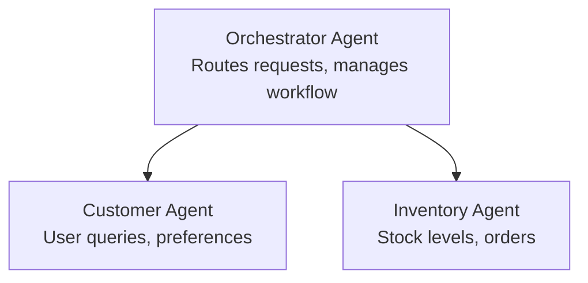

# Kapitel 5: Multi-Agenten KI-Lösungen

**📚 Kurs**: [AZD Für Einsteiger](../../README.md) | **⏱️ Dauer**: 2-3 Stunden | **⭐ Komplexität**: Fortgeschritten

---

## Übersicht

Dieses Kapitel behandelt fortgeschrittene Multi-Agenten-Architektur-Pattern, Agentenorchestrierung und produktionsreife KI-Bereitstellungen für komplexe Szenarien.

> Befehlsleitung geprüft anhand des veröffentlichten `azd 1.37.2` Referenz. Cloud-Bereitstellungen wurden nicht ausgeführt.

## Lernziele

Durch das Abschließen dieses Kapitels werden Sie:
- Multi-Agenten-Architektur-Pattern verstehen
- Koordinierte KI-Agenten-Systeme bereitstellen
- Agent-zu-Agent-Kommunikation implementieren
- Produktionsreife Multi-Agenten-Lösungen erstellen

---

## 📚 Lektionen

| # | Lektion | Beschreibung | Zeit |
|---|--------|-------------|------|
| 1 | [Multi-Agent Grundlagen](multi-agent-basics.md) | Praxis: Bereitstellung einer funktionierenden Multi-Agenten-App mit `azd up` | 45 Min |
| 2 | [Koordinations-Pattern](../chapter-06-pre-deployment/coordination-patterns.md) | Agentenorchestrierungsstrategien (geht in Kapitel 6 weiter) | 30 Min |
| 3 | [ARM Template Bereitstellung](../../examples/retail-multiagent-arm-template/README.md) | Beispiel für Ein-Klick-Bereitstellung | 30 Min |

> **Beginnen Sie mit Lektion 1.** Sie ist die einzige durchgehend praktische, einsatzbare Lektion in diesem Kapitel. Lektion 2 gehört zu Kapitel 6 (sie wird mit der Vorbereitungsplanung geteilt), und die [Retail Multi-Agent Lösung](../../examples/retail-scenario.md) ist eine Architekturvorlage — ein Design-Referenz, kein Ein-Kommando-Template.

---

## 🚀 Schnellstart

```bash
# Option 1: Deploy the multi-agent template used in Lesson 1
azd init --template Azure-Samples/contoso-creative-writer .
azd up

# Option 2: Initialize a Foundry agent interactively with the GA bundle
azd ext install microsoft.foundry
azd ai agent init
azd up
```

> **Welcher Ansatz?** Verwenden Sie `azd init --template`, um mit einem funktionierenden Beispiel zu starten. Nutzen Sie `azd ai agent init` interaktiv oder `azd ai agent init --template <path-to-azure.yaml>`, um ein aktuelles Agentenprojekt zu übernehmen. Siehe die [AZD AI CLI Referenz](../chapter-08-production/production-ai-practices.md#azd-ai-cli-commands-and-extensions) für Versionsanforderungen und Migrationshinweise.

Führen Sie diese Alternativen in separaten leeren Ordnern aus. Der GA Foundry Workflow benötigt `azd >= 1.37.0`; sein interaktiver Ablauf erstellt die benutzerdefinierte Service Bus-Pipeline in der Koordinationslektion nicht. Für lokale Tests, Code-Bereitstellung und Bereinigung von Neu-gegen-Wiederverwendet-Projekten folgen Sie dem [hosted-agent Walkthrough](../chapter-02-ai-development/microsoft-foundry-integration.md#hosted-agent-walkthrough-ga).

---

## 🤖 Multi-Agenten-Architektur



---

## 🎯 Vorgestellte Lösung: Retail Multi-Agent

Die [Retail Multi-Agent Lösung](../../examples/retail-scenario.md) zeigt:

- **Kundenagent**: Verwaltet Nutzerinteraktionen und Präferenzen
- **Inventaragent**: Verwaltet Lagerbestand und Bestellverarbeitung
- **Orchestrator**: Koordiniert zwischen Agenten
- **Gemeinsamer Speicher**: Kontextverwaltung über Agenten hinweg

### Verwendete Dienste

| Dienst | Zweck |
|---------|---------|
| Microsoft Foundry Modelle | Sprachverständnis |
| Azure AI Search | Produktkatalog |
| Cosmos DB | Agentenzustand und -speicher |
| Container Apps | Agenten-Hosting |
| Application Insights | Überwachung |

---

## 🔗 Navigation

| Richtung | Kapitel |
|-----------|---------|
| **Vorheriges** | [Kapitel 4: Infrastruktur](../chapter-04-infrastructure/README.md) |
| **Nächstes** | [Kapitel 6: Vorbereitungen vor der Bereitstellung](../chapter-06-pre-deployment/README.md) |

---

## 📖 Verwandte Ressourcen

- [KI-Agenten Leitfaden](../chapter-02-ai-development/agents.md)
- [KI-Produktionspraktiken](../chapter-08-production/production-ai-practices.md)
- [KI-Fehlerbehebung](../chapter-07-troubleshooting/ai-troubleshooting.md)

---

<!-- CO-OP TRANSLATOR DISCLAIMER START -->
**Haftungsausschluss**:
Dieses Dokument wurde mit dem KI-Übersetzungsdienst [Co-op Translator](https://github.com/Azure/co-op-translator) übersetzt. Obwohl wir uns um Genauigkeit bemühen, beachten Sie bitte, dass automatisierte Übersetzungen Fehler oder Ungenauigkeiten enthalten können. Das Originaldokument in seiner Ursprungssprache gilt als maßgebliche Quelle. Bei kritischen Informationen wird eine professionelle menschliche Übersetzung empfohlen. Wir übernehmen keine Haftung für Missverständnisse oder Fehlinterpretationen, die aus der Verwendung dieser Übersetzung entstehen.
<!-- CO-OP TRANSLATOR DISCLAIMER END -->