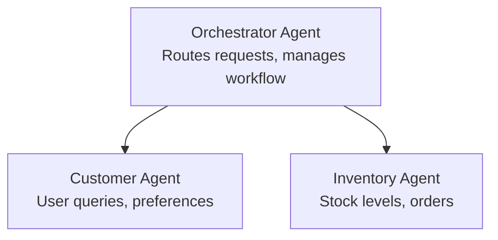

# Kapitel 5: Multi-Agenten KI-Lösungen

**📚 Kurs**: [AZD Für Anfänger](../../README.md) | **⏱️ Dauer**: 2-3 Stunden | **⭐ Komplexität**: Fortgeschritten

---

## Überblick

Dieses Kapitel behandelt fortgeschrittene Multi-Agenten-Architekturpatterns, Agenten-Orchestrierung und produktionsbereite KI-Bereitstellungen für komplexe Szenarien.

> Befehlsanleitung geprüft gegen das veröffentlichte `azd 1.37.2` Referenzdokument. Cloud-Bereitstellungen wurden nicht durchgeführt.

## Lernziele

Nach Abschluss dieses Kapitels werden Sie:
- Multi-Agenten-Architekturpatterns verstehen
- Koordinierte KI-Agenten-Systeme bereitstellen
- Agent-zu-Agent-Kommunikation implementieren
- Produktionsbereite Multi-Agenten-Lösungen entwickeln

---

## 📚 Lektionen

| # | Lektion | Beschreibung | Zeit |
|---|--------|-------------|------|
| 1 | [Multi-Agenten Grundlagen](multi-agent-basics.md) | Praxis: Bereitstellung einer funktionierenden Multi-Agenten-App mit `azd up` | 45 Min |
| 2 | [Koordinationsmuster](../chapter-06-pre-deployment/coordination-patterns.md) | Agenten-Orchestrierungsstrategien (Fortsetzung in Kapitel 6) | 30 Min |
| 3 | [ARM Template Bereitstellung](../../examples/retail-multiagent-arm-template/README.md) | Ein-Klick-Bereitstellungsbeispiel | 30 Min |

> **Beginnen Sie mit Lektion 1.** Sie ist die einzige vollständig praxisorientierte, bereitstellbare Lektion in diesem Kapitel. Lektion 2 befindet sich in Kapitel 6 (wird mit Pre-Deployment-Planung geteilt), und die [Retail Multi-Agent Lösung](../../examples/retail-scenario.md) ist ein Architektur-Blueprint — eine Designreferenz, kein Ein-Befehl-Template.

---

## 🚀 Schnellstart

```bash
# Option 1: Deploy the multi-agent template used in Lesson 1
azd init --template Azure-Samples/contoso-creative-writer .
azd up

# Option 2: Initialize a Foundry agent interactively (requires azure.ai.agents)
azd extension install azure.ai.agents
azd ai agent init
azd up
```

> **Welche Herangehensweise?** Verwenden Sie `azd init --template`, um mit einer funktionierenden Vorlage zu starten. Verwenden Sie `azd ai agent init` interaktiv oder `azd ai agent init --template <path-to-azure.yaml>`, um ein aktuelles Agentenprojekt zu übernehmen. Siehe die [AZD AI CLI Referenz](../chapter-08-production/production-ai-practices.md#azd-ai-cli-commands-and-extensions) für Versionsanforderungen und Evaluierungs-Migration.

Führen Sie diese Alternativen in separaten leeren Ordnern aus. Die Agents-Erweiterung `1.0.0-beta.23` benötigt `azd >= 1.37.0`; deren interaktiver Ablauf erzeugt nicht die benutzerdefinierte Service-Bus-Pipeline in der Koordinationslektion.

---

## 🤖 Multi-Agenten Architektur



---

## 🎯 Vorgestellte Lösung: Retail Multi-Agent

Die [Retail Multi-Agent Lösung](../../examples/retail-scenario.md) demonstriert:

- **Kunden-Agent**: Handhabt Benutzerinteraktionen und Präferenzen
- **Inventar-Agent**: Verwaltert Lagerbestand und Bestellabwicklung
- **Orchestrator**: Koordiniert zwischen Agenten
- **Gemeinsamer Speicher**: Kontextverwaltung über Agenten hinweg

### Eingesetzte Dienste

| Dienst | Zweck |
|---------|---------|
| Microsoft Foundry Modelle | Sprachverständnis |
| Azure AI Search | Produktkatalog |
| Cosmos DB | Agentenzustand und Speicher |
| Container Apps | Agenten-Hosting |
| Application Insights | Überwachung |

---

## 🔗 Navigation

| Richtung | Kapitel |
|-----------|---------|
| **Vorheriges** | [Kapitel 4: Infrastruktur](../chapter-04-infrastructure/README.md) |
| **Nächstes** | [Kapitel 6: Pre-Deployment](../chapter-06-pre-deployment/README.md) |

---

## 📖 Verwandte Ressourcen

- [KI-Agenten Leitfaden](../chapter-02-ai-development/agents.md)
- [Produktions-KI Praktiken](../chapter-08-production/production-ai-practices.md)
- [KI Fehlerbehebung](../chapter-07-troubleshooting/ai-troubleshooting.md)

---

<!-- CO-OP TRANSLATOR DISCLAIMER START -->
**Haftungsausschluss**:
Dieses Dokument wurde mit dem KI-Übersetzungsdienst [Co-op Translator](https://github.com/Azure/co-op-translator) übersetzt. Obwohl wir uns um Genauigkeit bemühen, beachten Sie bitte, dass automatisierte Übersetzungen Fehler oder Ungenauigkeiten enthalten können. Das Originaldokument in seiner Ursprungssprache gilt als maßgebliche Quelle. Bei kritischen Informationen wird eine professionelle menschliche Übersetzung empfohlen. Wir übernehmen keine Haftung für Missverständnisse oder Fehlinterpretationen, die aus der Verwendung dieser Übersetzung entstehen.
<!-- CO-OP TRANSLATOR DISCLAIMER END -->