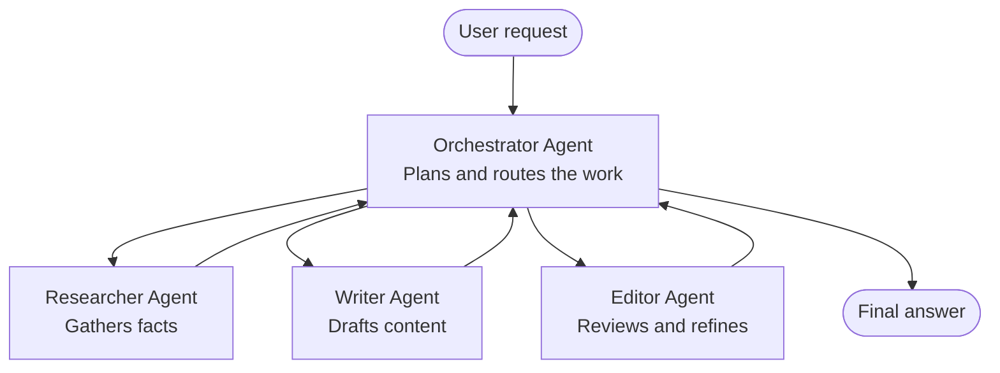

# Grundlagen zu Multi-Agenten – Setzen Sie Ihr erstes koordiniertes KI-System ein

**Kapitelübersicht:**
- **📚 Kursstartseite**: [AZD für Anfänger](../../README.md)
- **📖 Aktuelles Kapitel**: Kapitel 5 - Multi-Agenten-KI-Lösungen
- **⬅️ Zurück**: [Kapitel 4: Infrastruktur](../chapter-04-infrastructure/README.md)
- **➡️ Weiter**: [Koordinationsmuster](../chapter-06-pre-deployment/coordination-patterns.md)

> Befehlsanleitung geprüft anhand der veröffentlichten `azd 1.37.2` Referenz. Cloud-Bereitstellungen wurden nicht durchgeführt.

## Einführung

In den vorherigen Kapiteln haben Sie eine einzelne Anwendung bereitgestellt – und in Kapitel 2 einen einzelnen KI-Agenten. Diese Lektion geht den nächsten Schritt: die Bereitstellung eines **Multi-Agenten-Systems**, bei dem mehrere spezialisierte Agenten zusammenarbeiten, um ein Problem zu lösen, das kein einzelner Agent allein gut bewältigen könnte.

Die gute Nachricht für Anfänger: **Sie brauchen keine neuen Befehle.** Eine Multi-Agenten-Lösung ist weiterhin ein azd-Projekt. Sie werden `azd init`, `azd up`, testen und `azd down` — genau den Workflow, den Sie bereits kennen. Was sich ändert, ist die *Struktur* der App im Inneren.

## Lernziele

Am Ende dieser Lektion können Sie:
- Verstehen, was „Multi-Agent“ bedeutet und wann sich die zusätzliche Komplexität lohnt
- Die gängigen Rollen in einem Multi-Agenten-System erkennen (Orchestrator + Spezialisten)
- Eine echte, funktionierende Multi-Agenten-Vorlage mit `azd up` bereitstellen
- Die Azure-Ressourcen verstehen, die eine Multi-Agenten-App unterstützen
- Wissen, wie man die Lösung sicher überprüft, anpasst und abbaut

## Lernergebnisse

Nach Abschluss dieser Lektion sind Sie in der Lage:
- Den Unterschied zwischen einem einzelnen Agenten und einem Multi-Agenten-System zu erklären
- Zwischen einem einzelnen Agenten mit Tools und einem echten Multi-Agenten-Design zu wählen
- Eine Multi-Agenten-Vorlage mit azd vollständig bereitzustellen und zu testen
- Zu erkennen, wo jeder Agent ausgeführt wird und wie sie kommunizieren
- Alle Ressourcen aufzuräumen, um fortlaufende Kosten zu vermeiden

---

## Was ist ein Multi-Agenten-System?

Ein einzelner KI-Agent ist ein Modell mit einer Reihe von Anweisungen und (optional) einigen Tools. Das funktioniert gut für fokussierte Aufgaben. Aber wenn eine Aufgabe wächst — Recherche, dann Schreiben, dann Redigieren, dann Faktenprüfung — macht es den Agenten langsamer, weniger zuverlässig und schwerer zu debuggen, wenn alles in eine Eingabeaufforderung gepackt wird.

Ein **Multi-Agenten-System** teilt die Arbeit in Spezialisten auf, die jeweils eine Aufgabe gut erledigen, koordiniert von einem Orchestrator:



### Die zwei Rollen, die Sie immer sehen werden

| Rolle | Aufgabe | Beispiel |
|------|---------|----------|
| **Orchestrator** | Entscheidet *was als nächstes passiert* und verteilt die Arbeit zwischen den Agenten | "Erst recherchieren, dann schreiben, dann redigieren" |
| **Spezialist** | Erledigt eine fokussierte Aufgabe und liefert ein Ergebnis zurück | Ein „Forscher“, der nur Fakten sammelt |

### Brauchen Sie wirklich mehrere Agenten?

Beginnen Sie einfach. Greifen Sie nur zu Multi-Agenten **wenn** eine dieser Bedingungen zutrifft:

- ✅ Die Aufgabe hat **unterschiedliche Phasen**, die von verschiedenen Anweisungen profitieren (Recherche vs. Schreiben vs. Überprüfung)
- ✅ Sie möchten, dass Spezialisten **parallel** arbeiten, um Zeit zu sparen
- ✅ Verschiedene Schritte benötigen **verschiedene Tools oder Datenquellen**
- ✅ Sie benötigen, dass jeder Schritt **unabhängig testbar und debugbar** ist

Wenn Ihre Aufgabe eine einzige Frage-Antwort ist oder ein einfacher Tool-Aufruf, ist ein **einzelner Agent mit Tools** (Kapitel 2) einfacher, günstiger und leichter zu betreiben.

> **Anfängertipp:** „Mehr Agenten“ ist nicht „besser“. Jeder Agent fügt Latenz, Kosten und einen neuen Punkt zur Überwachung hinzu. Fügen Sie Agenten nur hinzu, wenn das Problem sich klar in Teile gliedert.

---

## Zwei Wege, Multi-Agenten auf Azure zu bauen

| Ansatz | Was es ist | Am besten geeignet für |
|--------|------------|---------------------|
| **Einzelner Agent + Tools** | Ein Foundry-Agent, der Funktionen/Tools aufruft | Einfache Workflows, Einstieg |
| **Mehrere koordinierte Agenten** | Mehrere Agenten mit einem Orchestrator | Unterschiedliche Phasen, parallele Arbeit, Spezialisierung |

Diese Lektion konzentriert sich auf die zweite Methode mit einer **fertigen Vorlage**, damit Sie ein echtes Multi-Agenten-System laufen sehen, bevor Sie Ihr eigenes bauen.

---

## Praxis: Bereitstellen einer funktionsfähigen Multi-Agenten-App

Wir werden **Contoso Creative Writer** bereitstellen, ein offizielles Azure-Beispiel, das Forschungs-, Produkt-, Schreib- und Redaktionsagenten koordiniert, um einen Artikel zu erzeugen. Prüfen Sie vor dem Fortfahren die [Voraussetzungen und Kosten der Vorlage](https://github.com/Azure-Samples/contoso-creative-writer#azure-account-requirements): Sie benötigt Modellkontingent, Azure AI Search, Bing Grounding-Zugriff, Python, Docker und Bash-kompatible Hooks. Modell- und Regionenverfügbarkeit hängen von Ihrem Abonnement ab; eine Bereitstellung ist nicht garantiert, nur weil eine bestimmte Region gewählt wurde.

### Schritt 1: Vorlage initialisieren

```bash
# Create a working folder
mkdir creative-writer && cd creative-writer

# Initialize from the official multi-agent template
azd init --template Azure-Samples/contoso-creative-writer .
```

> Entdecken Sie jederzeit weitere Multi-Agenten-Vorlagen in der [Awesome AZD AI Galerie](https://azure.github.io/awesome-azd/?tags=ai). Weitere anfängerfreundliche Optionen sind `get-started-with-ai-agents` und `azure-ai-travel-agents`.

### Schritt 2: Authentifizieren

```bash
# Required for azd workflows
azd auth login

# Also required by this sample's Azure CLI hooks
az login
```

### Schritt 3: Umgebung prüfen

```bash
# init normally creates/selects an environment; confirm it before proceeding
azd env list
# Only if you need an additional environment:
# azd env new dev
```

### Schritt 4: Vorschau anzeigen, dann bereitstellen

```bash
# See what will be created before spending anything (recommended)
azd provision --preview

# Provision infrastructure and deploy all agents in one step
azd up
```

`azd up` fordert fehlende Abonnement- und Regionsangaben an, dann werden Ressourcen bereitgestellt und die Anwendung bereitgestellt. Die Vorschau reserviert keine Quote und garantiert keinen Erfolg; Template-Hooks können während einer Bereitstellungsvorschau weiterhin ausgeführt werden, daher sollten Sie diese zuerst prüfen. So verlängern Sie die Wartezeit von azd für jede **Servicebereitstellung** (nicht Modellbereitstellung):

```bash
azd deploy --timeout 1800
```

Ein Timeout stoppt das Warten von azd; es bricht die Bereitstellung in Azure nicht ab. Überprüfen Sie den Ressourcenstatus, bevor Sie es erneut versuchen.

> **Hinweis zu Kosten und Kapazität:** Multi-Agenten-Apps stellen KI-Modelle bereit, die Quoten verbrauchen und Kosten verursachen. Falls `azd up` aufgrund der Modellquote fehlschlägt, siehe [KI-Fehlerbehebung](../chapter-07-troubleshooting/ai-troubleshooting.md) für Region- und Quotenbehebungen und Kapitel 6 [Kapazitätsplanung](../chapter-06-pre-deployment/capacity-planning.md).

---

## Verstehen, was Sie bereitgestellt haben

Eine typische Multi-Agenten-App wie diese stellt eine Reihe von Azure-Ressourcen bereit, die direkt den Verantwortlichkeiten im obigen Diagramm entsprechen:

| Ressource | Warum sie da ist |
|----------|-----------------|
| **Microsoft Foundry / Modelle** | Hosten die Sprachmodelle, die jeder Agent verwendet |
| **Azure AI Search** | Bietet dem Forscher-Agenten fundierte Daten zur Suche |
| **Container Apps** (oder App Service) | Hosten den Orchestrator- und Agent-Code |
| **Cosmos DB** (in einigen Beispielen) | Speichert den gemeinsam genutzten Zustand/Speicher, der zwischen Agenten weitergegeben wird |
| **Application Insights** | Verfolgt Anfragen *über* Agenten hinweg, sodass Sie den Ablauf debuggen können |

### Wie die Agenten miteinander kommunizieren

In den meisten azd Multi-Agenten-Beispielen **läuft der Orchestrator im Anwendungscode** (zum Beispiel unter Verwendung eines Frameworks wie Semantic Kernel oder des Microsoft Agent Framework). Der Orchestrator ruft jeden Spezialisten-Agenten nacheinander auf, übergibt die Ergebnisse und stellt die endgültige Antwort zusammen. Die Agenten teilen Kontext durch:

- **Funktions-/Werkzeugaufrufe** — der Orchestrator ruft einen Spezialisten auf und erhält ein Ergebnis zurück
- **Gemeinsamer Speicher** — eine Datenbank (oft Cosmos DB) hält einen Zustand, den beide Agenten lesen können
- **Nachrichten/Ereignisse** — für lose Kopplung kommunizieren Agenten über eine Warteschlange oder Service Bus

> **Warum das für das Debugging wichtig ist:** Da jeder Schritt separat ist, zeigt Application Insights Ihnen, *welcher* Agent langsam war oder fehlgeschlagen ist. Das ist ein Hauptgrund, warum Arbeit auf mehrere Agenten aufgeteilt wird.

---

## Überprüfen Sie die Bereitstellung

Stellen Sie sicher, dass das System tatsächlich funktioniert, bevor Sie weitermachen:

```bash
# Show the deployed endpoints
azd show

# Open the app's monitoring dashboard
azd monitor

# Open Application Insights Logs (not a terminal log stream)
azd monitor --logs
```

Öffnen Sie dann die App-URL aus `azd show` und fordern Sie einen kurzen Artikel an. Verwenden Sie die Debug-Ansicht der Probe, um den Agenten-Workflow zu prüfen. Die Transaktionssuche in Application Insights kann die einzelnen Schritte nur anzeigen, wenn die Probe sie instrumentiert und korreliert; azd fügt Agent-Spans nicht automatisch hinzu.

**Erfolgskriterien:**
- ✅ `azd show` listet einen erreichbaren Endpunkt auf
- ✅ Eine Anfrage liefert ein Ergebnis, das eindeutig mehrere Phasen durchlaufen hat
- ✅ Die Debug-Ansicht zeigt mehrere Agentenschritte; wenn das Tracing aktiviert ist, überprüfen Sie die entsprechende Telemetrie nach der Erfassung

---

## Anpassen: Einen Agenten hinzufügen oder anpassen

Da jeder Agent nur Anweisungen plus Werkzeuge ist, ist das Anpassen überschaubar:

1. **Finden Sie die Agent-Definitionen** im Template (oft eine `prompts/`, `agents/` oder `*.prompty` Dateiensammlung).
2. **Passen Sie die Anweisungen eines Agenten an** — zum Beispiel sagen Sie dem Editor-Agenten, einen bestimmten Ton oder Wortanzahl durchzusetzen.
3. **Nur den Code neu bereitstellen** (die Infrastruktur bleibt unverändert):

   ```bash
   azd deploy
   ```

Um mit Ihrem *eigenen* Foundry-Agenten-Projekt weiterzumachen, verwenden Sie das GA-Bundle mit AZD 1.37.0+ in einem separaten leeren Verzeichnis:

```bash
azd ext install microsoft.foundry
azd ai agent init
azd up
azd ai agent invoke      # test, with response timing
```

Siehe die [GA gehostete Agent-Durchführung](../chapter-02-ai-development/microsoft-foundry-integration.md#hosted-agent-walkthrough-ga) für lokalen Agent Inspector-Test, Remote-Code-Bereitstellung und Bereinigungsverantwortung. Die [AZD AI CLI-Referenz](../chapter-08-production/production-ai-practices.md#azd-ai-cli-commands-and-extensions) behandelt außerdem die separate Evaluations-Erweiterung, Optimierung und Agent-Löschung.

---

## Aufräumen

Multi-Agenten-Apps betreiben mehrere abrechenbare Dienste. Räumen Sie alles auf, wenn Sie fertig sind:

```bash
# Review the resources and confirm deletion interactively
azd down
```

Das Löschen ist destruktiv. Für ein einmaliges Labor überspringt `azd down --force --purge` die Löschung und unterstützte Soft-Delete-Bestätigung für die Freigabe; das Löschen ist dort, wo unterstützt, unwiderruflich und kann durch Löschschutz blockiert werden. Die Soft-Löschung betrifft Wiederherstellung/Namenswiederverwendung und ist keine Begründung für fortlaufende Kosten. Prüfen Sie nach der Bereinigung, ob Ressourcen und Abrechnung noch bestehen.

Wenn Sie außerdem einen gehosteten Agenten gegen ein bestehendes Foundry-Projekt initialisiert haben, lässt `azd down` die Agenten und andere Ressourcen dieses Projekts im Einsatz. Entfernen Sie nur separat gewünschte Ressourcen, die Sie besitzen. Für ein neues Foundry-Projekt, das von dessen AZD-Umgebung erstellt wurde, löscht `azd down` die Ressourcengruppe und alles darin.

---

## Eine Anmerkung zu Produktions-Multi-Agenten-Systemen

Die [Retail Multi-Agent Solution](../../examples/retail-scenario.md) in diesem Repository ist ein **Architektur-Blueprint**, keine Ein-Kommando-Vorlage – sie dokumentiert, wie ein Produktions-Handelssystem *gebaut* würde (und macht deutlich, dass ein vollständiger Aufbau ein erheblicher Aufwand ist). Verwenden Sie es als Design-Referenz *nachdem* Sie hier eine funktionierende Beispielanwendung bereitgestellt haben. Für Produktionsbelange (Robustheit, Kosten, Überwachung, Governance) wenden Sie sich bitte an [Kapitel 8: Produktions-AI-Praktiken](../chapter-08-production/production-ai-practices.md).

---

## Zusammenfassung

- Ein Multi-Agenten-System teilt die Arbeit unter Spezialisten auf, die von einem Koordinator gelenkt werden.
- Verwenden Sie es nur, wenn die Aufgabe unterschiedliche Phasen, Parallelität oder verschiedene Werkzeuge pro Schritt aufweist – andernfalls bevorzugen Sie einen einzelnen Agenten.
- Der azd-Workflow bleibt unverändert: `azd init` → `azd up` → test → `azd down`.
- Eine echte Vorlage wie `contoso-creative-writer` ermöglicht es Ihnen, heute eine funktionierende Multi-Agent-Anwendung zu sehen und anzupassen.
- Application Insights Tracing über Agenten hinweg ist einer der größten praktischen Vorteile des Multi-Agenten-Designs.

---

## 🔗 Navigation

| Richtung | Lektion |
|-----------|--------|
| **Vorherige** | [Kapitel 4: Infrastruktur](../chapter-04-infrastructure/README.md) |
| **Nächste** | [Koordinationsmuster](../chapter-06-pre-deployment/coordination-patterns.md) |

## 📖 Verwandte Ressourcen

- [AI-Agenten-Leitfaden](../chapter-02-ai-development/agents.md)
- [Koordinationsmuster](../chapter-06-pre-deployment/coordination-patterns.md)
- [Produktions-KI-Praktiken](../chapter-08-production/production-ai-practices.md)
- [KI-Fehlerbehebung](../chapter-07-troubleshooting/ai-troubleshooting.md)

---

<!-- CO-OP TRANSLATOR DISCLAIMER START -->
**Haftungsausschluss**:
Dieses Dokument wurde mit dem KI-Übersetzungsdienst [Co-op Translator](https://github.com/Azure/co-op-translator) übersetzt. Obwohl wir uns um Genauigkeit bemühen, beachten Sie bitte, dass automatisierte Übersetzungen Fehler oder Ungenauigkeiten enthalten können. Das Originaldokument in seiner Ursprungssprache gilt als maßgebliche Quelle. Bei kritischen Informationen wird eine professionelle menschliche Übersetzung empfohlen. Wir übernehmen keine Haftung für Missverständnisse oder Fehlinterpretationen, die aus der Verwendung dieser Übersetzung entstehen.
<!-- CO-OP TRANSLATOR DISCLAIMER END -->