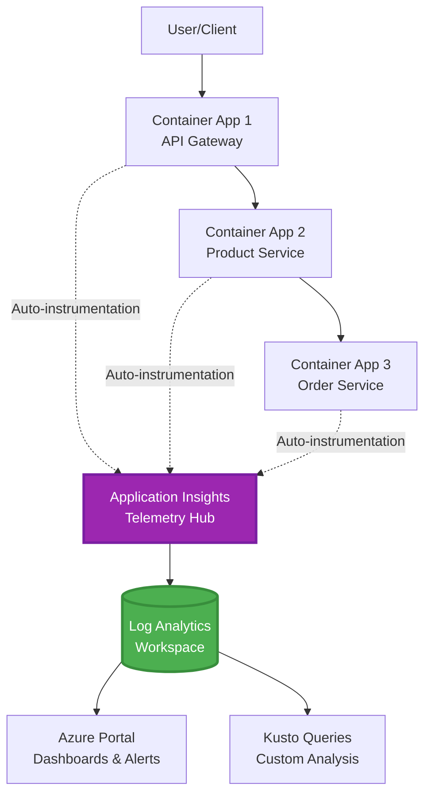
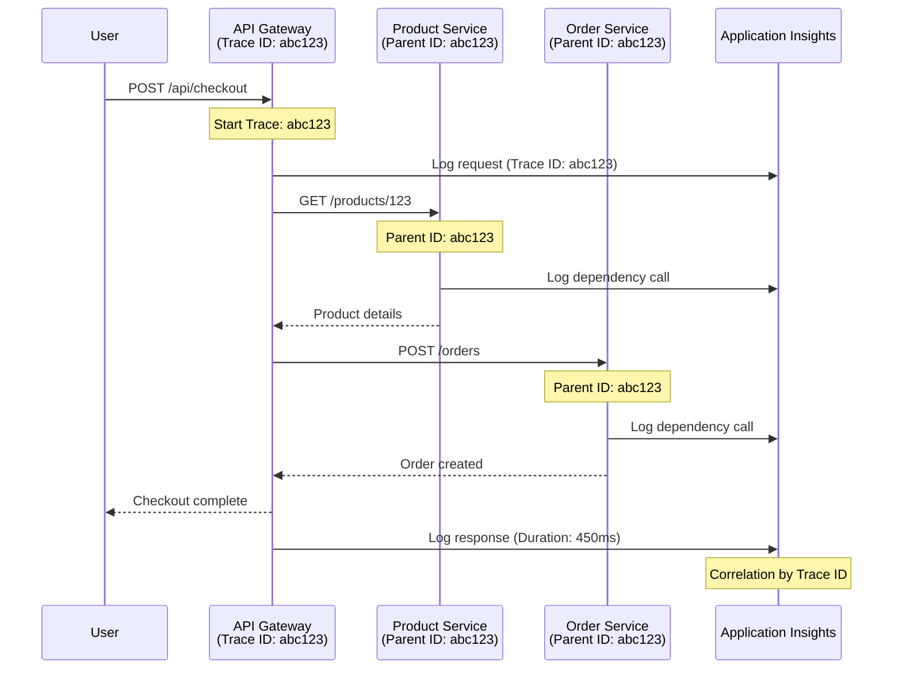

# Application Insights-Integration mit AZD

⏱️ **Geschätzte Zeit**: 40-50 Minuten | 💰 **Kostenimpact**: ca. 5-15 $/Monat | ⭐ **Komplexität**: Mittelstufe

**📚 Lernpfad:**
- ← Vorheriger Schritt: [Preflight Checks](preflight-checks.md) - Validierung vor der Bereitstellung
- 🎯 **Sie sind hier**: Application Insights-Integration (Monitoring, Telemetrie, Debugging)
- → Nächster Schritt: [Deployment Guide](../chapter-04-infrastructure/deployment-guide.md) - Bereitstellung in Azure
- 🏠 [Kurs-Startseite](../../README.md)

---

## Was Sie lernen werden

Durch den Abschluss dieser Lektion werden Sie:
- Application Insights in der AZD-Infrastruktur deklarieren und SDK-Instrumentierung konfigurieren
- Verteiltes Tracing für Microservices konfigurieren
- Benutzerdefinierte Telemetrie (Metriken, Ereignisse, Abhängigkeiten) implementieren
- Live-Metriken für die Echtzeitüberwachung einrichten
- Alarme und Dashboards aus AZD-Bereitstellungen erstellen
- Produktionsprobleme mit Telemetrie-Abfragen debuggen
- Kosten- und Sampling-Strategien optimieren
- KI/LLM-Anwendungen überwachen (Tokens, Latenz, Kosten)

## Warum Application Insights mit AZD wichtig ist

### Die Herausforderung: Produktions-Observability

**Ohne Application Insights:**
```
❌ No visibility into production behavior
❌ Manual log aggregation across services
❌ Reactive debugging (wait for customer complaints)
❌ No performance metrics
❌ Cannot trace requests across services
❌ Unknown failure rates and bottlenecks
```

**Mit Application Insights + AZD:**
```
✅ Automatic telemetry collection
✅ Centralized logs from all services
✅ Proactive issue detection
✅ End-to-end request tracing
✅ Performance metrics and insights
✅ Real-time dashboards
✅ AZD provisions the monitoring declared in your templates
```

**Analog**: Application Insights ist wie ein „Black Box“ Flugschreiber + Cockpit-Dashboard für Ihre Anwendung. Sie sehen alles in Echtzeit und können Vorfälle nachspielen.

---

## Architekturübersicht

### Application Insights in der AZD-Architektur



### Was wird automatisch überwacht

Unterstützte Auto-Instrumentierung erfasst Anfragen/Abhängigkeiten für instrumentierte Bibliotheken. Benutzerdefinierte Ereignisse und Metriken benötigen Anwendungscode; Verfügbarkeitstests müssen separat konfiguriert werden. Es werden nicht alle unten aufgeführten Daten nur wegen der Ressource erfasst.

| Telemetrie-Typ | Was erfasst wird | Anwendungsfall |
|--------------|-----------------|--------------|
| **Anfragen** | HTTP-Anfragen, Statuscodes, Dauer | API-Leistungsüberwachung |
| **Abhängigkeiten** | Externe Aufrufe (Datenbank, APIs, Speicher) | Engpass-Identifikation |
| **Ausnahmen** | Unbehandelte Fehler mit Stacktraces | Fehlerbehebung |
| **Benutzerdefinierte Ereignisse** | Geschäftliche Ereignisse (Registrierung, Kauf) | Analysen und Trichter |
| **Metriken** | Leistungszähler, benutzerdefinierte Metriken | Kapazitätsplanung |
| **Spuren** | Protokollnachrichten mit Schweregrad | Debugging und Auditierung |
| **Verfügbarkeit** | Verfügbarkeits- und Antwortzeittests | SLA-Überwachung |

---

## Voraussetzungen

### Erforderliche Werkzeuge

```bash
# Verify Azure Developer CLI
azd version
# Command reference baseline: azd 1.37.2

# Verify Azure CLI
az --version
# ✅ Expected: azure-cli 2.50.0 or higher
```

### Azure-Anforderungen

- Aktives Azure-Abonnement
- Berechtigungen zum Erstellen von:
  - Application Insights-Ressourcen
  - Log Analytics-Arbeitsbereichen
  - Container Apps
  - Ressourcengruppen

### Wissensvoraussetzungen

Sie sollten abgeschlossen haben:
- [AZD Grundlagen](../chapter-01-foundation/azd-basics.md) - Kernkonzepte von AZD
- [Konfiguration](../chapter-03-configuration/configuration.md) - Umgebungseinrichtung
- [Erstes Projekt](../chapter-01-foundation/first-project.md) - Grundlegende Bereitstellung

---

## Lektion 1: Automatisches Application Insights mit AZD

### Wie AZD Application Insights bereitstellt

AZD stellt Application Insights **nur bereit, wenn es in der Projektinfrastruktur deklariert wird**. `azure.yaml` erstellt allein keine Überwachung oder Instrumentierung des Anwendungscodes.

> **Beispielumfang:** Diese Lektion enthält Integrationsfragmente, kein vollständiges `monitored-app`-Projekt in diesem Repository. Stellen Sie eine Hauptvorlage und Parameterzuordnung, eine Container Apps-Umgebung, Registry/Image- und Identitätskonfiguration, Dockerfile sowie Dienst-Tags vor der Bereitstellung bereit. Spätere Lektionen zeigen alternative/Erweiterungsfragmente, keine Dateien, die ungeändert zusammen eingefügt werden können. Beginnen Sie mit einem funktionierenden [Microservices-Beispiel](../../../../examples/microservices), wenn Sie eine lauffähige Basis benötigen.

### Projektstruktur

```
monitored-app/
├── azure.yaml                     # AZD configuration
├── infra/
│   ├── main.bicep                # Main infrastructure
│   ├── core/
│   │   └── monitoring.bicep      # Application Insights + Log Analytics
│   └── app/
│       └── api.bicep             # Container App with monitoring
└── src/
    ├── app.py                    # Application with telemetry
    ├── requirements.txt
    └── Dockerfile
```

---

### Schritt 1: AZD konfigurieren (azure.yaml)

**Datei: `azure.yaml`**

```yaml
name: monitored-app
metadata:
  template: monitored-app@1.0.0

services:
  api:
    project: ./src
    language: python
    host: containerapp

# Monitoring must be declared in infra/ and enabled in application code.
```

Dies deklariert den bereitstellbaren Dienst. Die folgende Bicep- und SDK-Konfiguration stellt die Überwachung bereit; azd fügt sie nicht implizit hinzu.

---

### Schritt 2: Überwachungsinfrastruktur (Bicep)

**Datei: `infra/core/monitoring.bicep`**

```bicep
param logAnalyticsName string
param applicationInsightsName string
param location string = resourceGroup().location
param tags object = {}

// Log Analytics Workspace (required for Application Insights)
resource logAnalytics 'Microsoft.OperationalInsights/workspaces@2022-10-01' = {
  name: logAnalyticsName
  location: location
  tags: tags
  properties: {
    sku: {
      name: 'PerGB2018'  // Pay-as-you-go pricing
    }
    retentionInDays: 30  // Keep logs for 30 days
    features: {
      enableLogAccessUsingOnlyResourcePermissions: true
    }
  }
}

// Application Insights
resource applicationInsights 'Microsoft.Insights/components@2020-02-02' = {
  name: applicationInsightsName
  location: location
  tags: tags
  kind: 'web'
  properties: {
    Application_Type: 'web'
    WorkspaceResourceId: logAnalytics.id
    IngestionMode: 'LogAnalytics'
    publicNetworkAccessForIngestion: 'Enabled'
    publicNetworkAccessForQuery: 'Enabled'
  }
}

// Outputs for Container Apps
output logAnalyticsWorkspaceId string = logAnalytics.id
output logAnalyticsWorkspaceName string = logAnalytics.name
output applicationInsightsConnectionString string = applicationInsights.properties.ConnectionString
output applicationInsightsInstrumentationKey string = applicationInsights.properties.InstrumentationKey
output applicationInsightsName string = applicationInsights.name
output applicationInsightsId string = applicationInsights.id
```

---

### Schritt 3: Container App mit Application Insights verbinden

**Datei: `infra/app/api.bicep`**

```bicep
param name string
param location string
param tags object = {}
param containerAppsEnvironmentId string
param containerImage string
param applicationInsightsConnectionString string

resource containerApp 'Microsoft.App/containerApps@2023-05-01' = {
  name: name
  location: location
  tags: tags
  properties: {
    managedEnvironmentId: containerAppsEnvironmentId
    configuration: {
      ingress: {
        external: true
        targetPort: 8000
      }
      secrets: [
        {
          name: 'appinsights-connection-string'
          value: applicationInsightsConnectionString
        }
      ]
    }
    template: {
      containers: [
        {
          name: 'api'
          image: containerImage // Supply an accessible image and registry authentication
          resources: {
            cpu: json('0.5')
            memory: '1Gi'
          }
          env: [
            {
              name: 'APPLICATIONINSIGHTS_CONNECTION_STRING'
              secretRef: 'appinsights-connection-string'
            }
            {
              name: 'APPLICATIONINSIGHTS_ENABLED'
              value: 'true'
            }
          ]
        }
      ]
    }
  }
}

output uri string = 'https://${containerApp.properties.configuration.ingress.fqdn}'
```

---

### Schritt 4: Anwendungscode mit Telemetrie

**Datei: `src/app.py`**

```python
from flask import Flask, request, jsonify
from azure.monitor.opentelemetry import configure_azure_monitor
import logging
import os

app = Flask(__name__)

# Get Application Insights connection string
connection_string = os.environ.get('APPLICATIONINSIGHTS_CONNECTION_STRING')

if connection_string:
    # Azure Monitor OpenTelemetry instruments supported libraries, including Flask.
    configure_azure_monitor(
        connection_string=connection_string,
        logger_name=__name__,
        enable_live_metrics=True
    )
    logger = logging.getLogger(__name__)
    logger.setLevel(logging.INFO)
    
    print("✅ Application Insights enabled")
else:
    logger = logging.getLogger(__name__)
    logger.setLevel(logging.INFO)
    print("⚠️ Application Insights not configured")

@app.route('/health')
def health():
    logger.info('Health check endpoint called')
    return jsonify({'status': 'healthy', 'monitoring': 'enabled' if connection_string else 'disabled'})

@app.route('/api/products')
def get_products():
    logger.info('Fetching products')
    
    # In-memory fixture: this is not a database dependency call.
    products = [
        {'id': 1, 'name': 'Laptop', 'price': 999.99},
        {'id': 2, 'name': 'Mouse', 'price': 29.99},
        {'id': 3, 'name': 'Keyboard', 'price': 79.99}
    ]
    
    logger.info(f'Returned {len(products)} products')
    return jsonify(products)

@app.route('/api/error-test')
def error_test():
    """Test error tracking"""
    logger.error('Testing error tracking')
    try:
        raise ValueError('This is a test exception')
    except Exception as e:
        logger.exception('Exception occurred in error-test endpoint')
        return jsonify({'error': str(e)}), 500

@app.route('/api/slow')
def slow_endpoint():
    """Test performance tracking"""
    import time
    logger.info('Slow endpoint called')
    time.sleep(3)  # Simulate slow operation
    logger.warning('Endpoint took 3 seconds to respond')
    return jsonify({'message': 'Slow operation completed'})

if __name__ == '__main__':
    app.run(host='0.0.0.0', port=8000)
```

**Datei: `src/requirements.txt`**

```txt
Flask
azure-monitor-opentelemetry
gunicorn
requests
openai
```

Lösen Sie diese Abhängigkeiten in Ihrem Projekt, testen Sie sie zusammen und sperren Sie die ermittelten Versionen. Neue Projekte sollten Azure Monitor OpenTelemetry verwenden, nicht die eingestellten OpenCensus Python Exporter.

---

### Schritt 5: Bereitstellen und Überprüfen

```bash
# Deploy only after completing and wiring the infrastructure fragments above
azd up

# Get app URL
APP_URL=$(azd env get-value API_URL) # Requires this output in main.bicep

# Generate telemetry
curl $APP_URL/health
curl $APP_URL/api/products
curl $APP_URL/api/error-test
curl $APP_URL/api/slow
```

**✅ Erwartete Ausgabe:**
```json
{
  "status": "healthy",
  "monitoring": "enabled"
}
```

---

### Schritt 6: Telemetrie im Azure-Portal ansehen

```bash
# Get Application Insights details
azd env get-values | grep APPLICATIONINSIGHTS

# Open in Azure Portal
az monitor app-insights component show \
  --app $(azd env get-values | grep APPLICATIONINSIGHTS_NAME | cut -d '=' -f2 | tr -d '"') \
  --resource-group $(azd env get-values | grep AZURE_RESOURCE_GROUP | cut -d '=' -f2 | tr -d '"') \
  --query "appId" -o tsv
```

**Navigieren Sie zu Azure-Portal → Application Insights → Transaktionssuche**

Sie sollten Folgendes sehen:
- ✅ HTTP-Anfragen mit Statuscodes
- ✅ Anfragedauer (3+ Sekunden für `/api/slow`)
- ✅ Ausnahme-Details aus `/api/error-test`
- ✅ Benutzerdefinierte Log-Nachrichten

---

## Lektion 2: Benutzerdefinierte Telemetrie und Ereignisse

### Geschäftsereignisse verfolgen

Fügen wir benutzerdefinierte Telemetrie für geschäftskritische Ereignisse hinzu.

**Datei: `src/telemetry.py`**

```python
from contextlib import contextmanager
from azure.monitor.opentelemetry import configure_azure_monitor
from opentelemetry import metrics, trace
from opentelemetry.trace import SpanKind
import logging
import os

class TelemetryClient:
    """Custom telemetry client for Application Insights"""
    
    def __init__(self, connection_string=None):
        self.connection_string = connection_string or os.environ.get('APPLICATIONINSIGHTS_CONNECTION_STRING')
        
        # Configure once per process. If app.py already calls this, keep only
        # one configure_azure_monitor call and use logger_name='telemetry'.
        if self.connection_string:
            configure_azure_monitor(
                connection_string=self.connection_string,
                logger_name=__name__,
                enable_live_metrics=True
            )
        self.logger = logging.getLogger(__name__)
        self.logger.setLevel(logging.INFO)
        self.tracer = trace.get_tracer(__name__)
        self.meter = metrics.get_meter(__name__)
        self.instruments = {}
    
    def track_event(self, event_name: str, properties: dict = None):
        """Track custom business event"""
        properties = properties or {}
        self.logger.info(
            f"CustomEvent: {event_name}",
            extra={
                # OTel log attributes become customDimensions in App Insights.
                    'event_name': event_name,
                    **properties
            }
        )
    
    def track_metric(self, metric_name: str, value: float, properties: dict = None):
        """Track custom metric"""
        properties = properties or {}
        if metric_name not in self.instruments:
            self.instruments[metric_name] = self.meter.create_histogram(metric_name)
        self.instruments[metric_name].record(value, attributes=properties)
    
    @contextmanager
    def track_dependency(self, name: str):
        """Time the real operation inside a client span; exceptions mark failure."""
        with self.tracer.start_as_current_span(name, kind=SpanKind.CLIENT) as span:
            yield span

# Global telemetry client
telemetry = TelemetryClient()
```

### Anwendung mit benutzerdefinierten Ereignissen aktualisieren

**Datei: `src/app.py` (erweitert)**

Fügen Sie diese Routen zur bestehenden Flask-Anwendung hinzu; behalten Sie die vorherigen Health-/Test-Routen. Der gekürzte Block unten zeigt zur Klarheit eine separate App. Die Telemetrieinitialisierung befindet sich jetzt in `telemetry.py`—exporter nicht doppelt initialisieren.

```python
from flask import Flask, request, jsonify
from telemetry import telemetry
import time
import random
import os

app = Flask(__name__)

@app.route('/api/purchase', methods=['POST'])
def purchase():
    """Track purchase event with custom telemetry"""
    data = request.get_json(silent=True) or {}
    product_id = data.get('product_id')
    quantity = data.get('quantity', 1)
    price = data.get('price', 0)
    if not isinstance(quantity, int) or quantity < 1 or \
       not isinstance(price, (int, float)) or price < 0:
        return jsonify({'error': 'quantity and price must be non-negative numbers; quantity >= 1'}), 400
    
    # Track business event
    telemetry.track_event('Purchase', {
        'product_id': product_id,
        'quantity': quantity,
        'total_amount': price * quantity,
        'user_id': request.headers.get('X-User-Id', 'anonymous')
    })
    
    # Track revenue metric
    telemetry.track_metric('Revenue', price * quantity, {
        'product_id': product_id,
        'currency': 'USD'
    })
    
    return jsonify({
        'order_id': f'ORD-{random.randint(1000, 9999)}',
        'status': 'confirmed',
        'total': price * quantity
    })

@app.route('/api/search')
def search():
    """Track search queries"""
    query = request.args.get('q', '')
    
    start_time = time.time()
    
    # Simulate search (would be real database query)
    results = [{'id': 1, 'name': f'Result for {query}'}]
    
    duration = (time.time() - start_time) * 1000  # Convert to ms
    
    # Track search event
    telemetry.track_event('Search', {
        'query': query,
        'results_count': len(results),
        'duration_ms': duration
    })
    
    # Track search performance metric
    telemetry.track_metric('SearchDuration', duration, {
        'query_length': len(query)
    })
    
    return jsonify({'results': results, 'count': len(results)})

@app.route('/api/external-call')
def external_call():
    """Track external API dependency"""
    import requests
    
    try:
        # Set an actual test endpoint; api.example.com is not a working API.
        with telemetry.track_dependency('ExternalAPI'):
            response = requests.get(os.environ['EXTERNAL_API_URL'], timeout=5)
            response.raise_for_status()
            result = response.json()
    except Exception as e:
        return jsonify({'error': 'External dependency failed'}), 502
    
    return jsonify(result)

if __name__ == '__main__':
    app.run(host='0.0.0.0', port=8000)
```

### Benutzerdefinierte Telemetrie testen

```bash
# Track purchase event
curl -X POST $APP_URL/api/purchase \
  -H "Content-Type: application/json" \
  -H "X-User-Id: user123" \
  -d '{"product_id": 1, "quantity": 2, "price": 29.99}'

# Track search event
curl "$APP_URL/api/search?q=laptop"

# Track external dependency
curl $APP_URL/api/external-call
```

**Im Azure-Portal anzeigen:**

Navigieren Sie zu Application Insights → Logs und führen Sie dann aus:

```kusto
// View purchase events
traces
| where customDimensions.event_name == "Purchase"
| project 
    timestamp,
    product_id = tostring(customDimensions.product_id),
    total_amount = todouble(customDimensions.total_amount),
    user_id = tostring(customDimensions.user_id)
| order by timestamp desc

// Revenue recorded in Purchase events (not a billing ledger)
traces
| where customDimensions.event_name == "Purchase"
| summarize TotalRevenue = sum(todouble(customDimensions.total_amount)) by bin(timestamp, 1h)
| render timechart

// View search performance
traces
| where customDimensions.event_name == "Search"
| summarize 
    AvgDuration = avg(todouble(customDimensions.duration_ms)),
    SearchCount = count()
  by bin(timestamp, 5m)
| render timechart
```

---

## Lektion 3: Verteiltes Tracing für Microservices

### Cross-Service Tracing aktivieren

Mit kompatibler Instrumentierung und W3C Trace-Context-Propgation korreliert Application Insights Anfragen über Dienste hinweg. Das Teilen einer Verbindungszeichenfolge alleine erzeugt keine Parent-Child-Spans. Der folgende Architektur-Ausschnitt verweist auf Module, die Sie implementieren müssen.

**Datei: `infra/main.bicep`**

```bicep
targetScope = 'subscription'

param environmentName string
param location string = 'eastus'

var tags = { 'azd-env-name': environmentName }

resource rg 'Microsoft.Resources/resourceGroups@2021-04-01' = {
  name: 'rg-${environmentName}'
  location: location
  tags: tags
}

// Monitoring (shared by all services)
module monitoring './core/monitoring.bicep' = {
  name: 'monitoring'
  scope: rg
  params: {
    logAnalyticsName: 'log-${environmentName}'
    applicationInsightsName: 'appi-${environmentName}'
    location: location
    tags: tags
  }
}

// API Gateway
module apiGateway './app/api-gateway.bicep' = {
  name: 'api-gateway'
  scope: rg
  params: {
    name: 'ca-gateway-${environmentName}'
    location: location
    tags: union(tags, { 'azd-service-name': 'gateway' })
    applicationInsightsConnectionString: monitoring.outputs.applicationInsightsConnectionString
  }
}

// Product Service
module productService './app/product-service.bicep' = {
  name: 'product-service'
  scope: rg
  params: {
    name: 'ca-products-${environmentName}'
    location: location
    tags: union(tags, { 'azd-service-name': 'products' })
    applicationInsightsConnectionString: monitoring.outputs.applicationInsightsConnectionString
  }
}

// Order Service
module orderService './app/order-service.bicep' = {
  name: 'order-service'
  scope: rg
  params: {
    name: 'ca-orders-${environmentName}'
    location: location
    tags: union(tags, { 'azd-service-name': 'orders' })
    applicationInsightsConnectionString: monitoring.outputs.applicationInsightsConnectionString
  }
}

output APPLICATIONINSIGHTS_CONNECTION_STRING string = monitoring.outputs.applicationInsightsConnectionString
output GATEWAY_URL string = apiGateway.outputs.uri
```

### End-to-End-Transaktion anzeigen



**End-to-End-Spur abfragen:**

```kusto
// Find complete request flow
let traceId = "abc123...";  // Copy operation_Id from a request in Application Insights
dependencies
| union requests
| where operation_Id == traceId
| project 
    timestamp,
    type = itemType,
    name,
    duration,
    success,
    cloud_RoleName
| order by timestamp asc
```

---

## Lektion 4: Live-Metriken und Echtzeitüberwachung

### Live-Metriken-Stream aktivieren

Live Metrics liefert nahezu Echtzeit-Telemetrie, wenn vom SDK unterstützt und aktiviert. Es ist keine Latenz-SLA. Das oben konfigurierte Python OpenTelemetry nimmt mit `enable_live_metrics=True` teil.

**Live Metrics aufrufen:**

```bash
# Get Application Insights resource
APPI_NAME=$(azd env get-values | grep APPLICATIONINSIGHTS_NAME | cut -d '=' -f2 | tr -d '"')

# Get resource group
RG_NAME=$(azd env get-values | grep AZURE_RESOURCE_GROUP | cut -d '=' -f2 | tr -d '"')

echo "Navigate to: Azure Portal → Resource Groups → $RG_NAME → $APPI_NAME → Live Metrics"
```

**Was Sie in Echtzeit sehen:**
- ✅ Eingehende Anfragelast (Anfragen/Sekunde)
- ✅ Ausgehende Abhängigkeitsaufrufe
- ✅ Anzahl der Ausnahmen
- ✅ CPU- und Speicherverbrauch
- ✅ Aktive Serveranzahl
- ✅ Beispieltelemetrie

### Last zum Testen erzeugen

```bash
# Generate load to see live metrics
for i in {1..100}; do
  curl --silent --max-time 10 "$APP_URL/api/products"
  curl --silent --max-time 10 "$APP_URL/api/search?q=test$i"
done

# Watch live metrics in Azure Portal
# You should see request rate spike
```

---

## Praktische Übungen

### Übung 1: Alarme einrichten ⭐⭐ (Mittel)

**Ziel**: Alarme für hohe Fehlerquoten und langsame Antwortzeiten erstellen.

**Schritte:**

1. **Alarm für Fehlerquote erstellen:**

```bash
# Get Application Insights resource ID
APPI_ID=$(az monitor app-insights component show \
  --app $APPI_NAME \
  --resource-group $RG_NAME \
  --query "id" -o tsv)

# Create metric alert for failed requests
az monitor metrics alert create \
  --name "High-Error-Rate" \
  --resource-group $RG_NAME \
  --scopes $APPI_ID \
  --condition "count requests/failed > 10" \
  --window-size 5m \
  --evaluation-frequency 1m \
  --description "Alert when failed request count exceeds 10 per 5 minutes"
```

2. **Alarm für langsame Antworten erstellen:**

```bash
az monitor metrics alert create \
  --name "Slow-Responses" \
  --resource-group $RG_NAME \
  --scopes $APPI_ID \
  --condition "avg requests/duration > 3000" \
  --window-size 5m \
  --evaluation-frequency 1m \
  --description "Alert when average response time exceeds 3 seconds"
```

3. **Alarm via Bicep erstellen (bevorzugt für AZD):**

**Datei: `infra/core/alerts.bicep`**

```bicep
param applicationInsightsId string
param actionGroupId string = ''
param location string = resourceGroup().location

// High error rate alert
resource errorRateAlert 'Microsoft.Insights/metricAlerts@2018-03-01' = {
  name: 'high-error-rate'
  location: 'global'
  properties: {
    description: 'Alert when error rate exceeds threshold'
    severity: 2
    enabled: true
    scopes: [
      applicationInsightsId
    ]
    evaluationFrequency: 'PT1M'
    windowSize: 'PT5M'
    criteria: {
      'odata.type': 'Microsoft.Azure.Monitor.SingleResourceMultipleMetricCriteria'
      allOf: [
        {
          name: 'Error rate'
          metricName: 'requests/failed'
          operator: 'GreaterThan'
          threshold: 10
          timeAggregation: 'Count'
        }
      ]
    }
    actions: actionGroupId != '' ? [
      {
        actionGroupId: actionGroupId
      }
    ] : []
  }
}

// Slow response alert
resource slowResponseAlert 'Microsoft.Insights/metricAlerts@2018-03-01' = {
  name: 'slow-responses'
  location: 'global'
  properties: {
    description: 'Alert when response time is too high'
    severity: 3
    enabled: true
    scopes: [
      applicationInsightsId
    ]
    evaluationFrequency: 'PT1M'
    windowSize: 'PT5M'
    criteria: {
      'odata.type': 'Microsoft.Azure.Monitor.SingleResourceMultipleMetricCriteria'
      allOf: [
        {
          name: 'Response duration'
          metricName: 'requests/duration'
          operator: 'GreaterThan'
          threshold: 3000
          timeAggregation: 'Average'
        }
      ]
    }
  }
}

output errorAlertId string = errorRateAlert.id
output slowResponseAlertId string = slowResponseAlert.id
```

4. **Alarme testen:**

```bash
# Generate errors
for i in {1..20}; do
  curl $APP_URL/api/error-test
done

# Generate slow responses
for i in {1..10}; do
  curl $APP_URL/api/slow
done

# Check rule configuration (not fired/resolved alert-instance history)
az monitor metrics alert list \
  --resource-group $RG_NAME \
  --query "[].{Name:name, Enabled:enabled}" \
  --output table
```

**✅ Erfolgskriterien:**
- ✅ Alarme erfolgreich erstellt
- ✅ Alarme werden bei Überschreiten der Grenzwerte ausgelöst
- ✅ Alarmhistorie im Azure-Portal einsehbar
- ✅ In AZD-Bereitstellung integriert

**Zeitaufwand**: 20-25 Minuten

---

### Übung 2: Benutzerdefiniertes Dashboard erstellen ⭐⭐ (Mittel)

**Ziel**: Ein Dashboard erstellen, das wichtige Anwendungsmetriken zeigt.

**Schritte:**

1. **Dashboard über Azure-Portal erstellen:**

Navigieren Sie zu: Azure-Portal → Dashboards → Neues Dashboard

2. **Kacheln für wichtige Metriken hinzufügen:**

- Anfragelast (letzte 24 Stunden)
- Durchschnittliche Antwortzeit
- Fehlerquote
- Top 5 der langsamsten Operationen
- Geographische Verteilung der Nutzer

3. **Dashboard über Bicep erstellen:**

**Datei: `infra/core/dashboard.bicep`**

```bicep
param dashboardName string
param applicationInsightsId string
param location string = resourceGroup().location

resource dashboard 'Microsoft.Portal/dashboards@2020-09-01-preview' = {
  name: dashboardName
  location: location
  properties: {
    lenses: [
      {
        order: 0
        parts: [
          // Request count
          {
            position: {
              x: 0
              y: 0
              rowSpan: 4
              colSpan: 6
            }
            metadata: {
              type: 'Extension/Microsoft_OperationsManagementSuite_Workspace/PartType/LogsDashboardPart'
              inputs: [
                {
                  name: 'resourceId'
                  value: applicationInsightsId
                }
                {
                  name: 'query'
                  value: '''
                    requests
                    | summarize RequestCount = count() by bin(timestamp, 1h)
                    | render timechart
                  '''
                }
              ]
            }
          }
          // Error rate
          {
            position: {
              x: 6
              y: 0
              rowSpan: 4
              colSpan: 6
            }
            metadata: {
              type: 'Extension/Microsoft_OperationsManagementSuite_Workspace/PartType/LogsDashboardPart'
              inputs: [
                {
                  name: 'resourceId'
                  value: applicationInsightsId
                }
                {
                  name: 'query'
                  value: '''
                    requests
                    | summarize 
                        Total = count(),
                        Failed = countif(success == false)
                    | extend ErrorRate = (Failed * 100.0) / Total
                    | project ErrorRate
                  '''
                }
              ]
            }
          }
        ]
      }
    ]
  }
}

output dashboardId string = dashboard.id
```

4. **Dashboard bereitstellen:**

```bicep
// Add to a subscription-scoped main.bicep with rg and monitoring declared
module dashboard './core/dashboard.bicep' = {
  name: 'dashboard'
  scope: rg
  params: {
    dashboardName: 'dashboard-${environmentName}'
    applicationInsightsId: monitoring.outputs.applicationInsightsId
    location: location
  }
}
```

```bash
# Deploy
azd up
```

**✅ Erfolgskriterien:**
- ✅ Dashboard zeigt wichtige Metriken an
- ✅ Kann im Azure-Portal-Startbildschirm angepinnt werden
- ✅ Aktualisiert sich in Echtzeit
- ✅ Bereitstellbar via AZD

**Zeitaufwand**: 25-30 Minuten

---

### Übung 3: KI/LLM-Anwendung überwachen ⭐⭐⭐ (Fortgeschritten)

**Ziel**: Microsoft Foundry Modelle Nutzung verfolgen (Tokens, Kosten, Latenz).

**Schritte:**

1. **KI-Überwachung Wrapper erstellen:**

**Datei: `src/ai_telemetry.py`**

```python
from telemetry import telemetry
from openai import AzureOpenAI
import time

class MonitoredAzureOpenAI:
    """Microsoft Foundry Models client with automatic telemetry"""
    
    def __init__(self, api_key, endpoint, input_usd_per_million,
                 output_usd_per_million, api_version="2024-10-21"):
        self.client = AzureOpenAI(
            api_key=api_key,
            api_version=api_version,
            azure_endpoint=endpoint
        )
        self.input_rate = input_usd_per_million
        self.output_rate = output_usd_per_million
    
    def chat_completion(self, model: str, messages: list, **kwargs):
        """Track chat completion with telemetry"""
        start_time = time.time()
        
        try:
            # Call Microsoft Foundry Models
            response = self.client.chat.completions.create(
                model=model,
                messages=messages,
                **kwargs
            )
            
            duration = (time.time() - start_time) * 1000  # ms
            
            # Extract usage
            usage = response.usage
            prompt_tokens = usage.prompt_tokens
            completion_tokens = usage.completion_tokens
            total_tokens = usage.total_tokens
            
            # Approximation: supply actual deployment/region/contract rates.
            # Cached input, batch, provisioned and other charges need separate accounting.
            prompt_cost = (prompt_tokens / 1_000_000) * self.input_rate
            completion_cost = (completion_tokens / 1_000_000) * self.output_rate
            total_cost = prompt_cost + completion_cost
            
            # Track custom event
            telemetry.track_event('OpenAI_Request', {
                'model': model,
                'prompt_tokens': prompt_tokens,
                'completion_tokens': completion_tokens,
                'total_tokens': total_tokens,
                'duration_ms': duration,
                'cost_usd': total_cost,
                'success': True
            })
            
            # Track metrics
            telemetry.track_metric('OpenAI_Tokens', total_tokens, {
                'model': model,
                'type': 'total'
            })
            
            telemetry.track_metric('OpenAI_Cost', total_cost, {
                'model': model,
                'currency': 'USD'
            })
            
            telemetry.track_metric('OpenAI_Duration', duration, {
                'model': model
            })
            
            return response
            
        except Exception as e:
            duration = (time.time() - start_time) * 1000
            
            telemetry.track_event('OpenAI_Request', {
                'model': model,
                'duration_ms': duration,
                'success': False,
                'error': str(e)
            })
            
            raise
```

2. **Überwachten Client verwenden:**

```python
from flask import Flask, request, jsonify
from ai_telemetry import MonitoredAzureOpenAI
import os

app = Flask(__name__)

# Initialize monitored OpenAI client
openai_client = MonitoredAzureOpenAI(
    api_key=os.environ['AZURE_OPENAI_API_KEY'],
    endpoint=os.environ['AZURE_OPENAI_ENDPOINT'],
    input_usd_per_million=float(os.environ['INPUT_USD_PER_MILLION']),
    output_usd_per_million=float(os.environ['OUTPUT_USD_PER_MILLION'])
)

@app.route('/api/chat', methods=['POST'])
def chat():
    data = request.json
    user_message = data.get('message')
    
    # Call with automatic monitoring
    response = openai_client.chat_completion(
        model=os.environ['AZURE_OPENAI_DEPLOYMENT'], # Deployment name, not catalog ID
        messages=[
            {'role': 'user', 'content': user_message}
        ]
    )
    
    return jsonify({
        'response': response.choices[0].message.content,
        'tokens': response.usage.total_tokens
    })
```

3. **KI-Metriken abfragen:**

```kusto
// Total AI spend over time
traces
| where customDimensions.event_name == "OpenAI_Request"
| where tobool(customDimensions.success) == true
| summarize TotalCost = sum(todouble(customDimensions.cost_usd)) by bin(timestamp, 1h)
| render timechart

// Token usage by model
traces
| where customDimensions.event_name == "OpenAI_Request"
| summarize 
    TotalTokens = sum(toint(customDimensions.total_tokens)),
    RequestCount = count()
  by Model = tostring(customDimensions.model)

// Average latency
traces
| where customDimensions.event_name == "OpenAI_Request"
| summarize AvgDuration = avg(todouble(customDimensions.duration_ms))
| project AvgDurationSeconds = AvgDuration / 1000

// Cost per request
traces
| where customDimensions.event_name == "OpenAI_Request"
| extend Cost = todouble(customDimensions.cost_usd)
| summarize 
    TotalCost = sum(Cost),
    RequestCount = count(),
    AvgCostPerRequest = avg(Cost)
```

**✅ Erfolgskriterien:**
- ✅ Jeder OpenAI-Aufruf wird automatisch getrackt
- ✅ Token-Nutzung und Kosten sichtbar
- ✅ Latenz überwacht
- ✅ Budgetalarme können eingerichtet werden

**Zeitaufwand**: 35-45 Minuten

---

## Kostenoptimierung

### Sampling-Strategien

Steuern Sie die Kosten durch Sampling der Telemetrie:

```python
import os

# Configure before the one configure_azure_monitor() call in your process.
os.environ["OTEL_TRACES_SAMPLER"] = "microsoft.fixed_percentage"
os.environ["OTEL_TRACES_SAMPLER_ARG"] = "0.1" # 10% trace sampling
```

Trace-Sampling reduziert nicht jede Telemetrie-Kategorie um 90 %. Metriken und eigenständig gesendete Logs benötigen eigene Volumenkontrollen. Wählen Sie die Rate nach Beobachtungsbedarf, nicht pauschal für Produktion.

Setzen Sie das SDK-Sampling explizit; die `SamplingPercentage`-Eigenschaft der Komponente ersetzt nicht die Konfiguration des Python OpenTelemetry-Samplers.

### Datenaufbewahrung

```bicep
resource logAnalytics 'Microsoft.OperationalInsights/workspaces@2022-10-01' = {
  name: logAnalyticsName
  properties: {
    retentionInDays: 30  // Minimum (cheapest)
    // Options: 30, 31, 60, 90, 120, 180, 270, 365, 550, 730
  }
}
```

### Monatliche Kostenschätzungen

| Datenvolumen | Aufbewahrung | Monatliche Kosten |
|-------------|--------------|-------------------|
| 1 GB/Monat | 30 Tage | ca. 2-5 $ |
| 5 GB/Monat | 30 Tage | ca. 10-15 $ |
| 10 GB/Monat | 90 Tage | ca. 25-40 $ |
| 50 GB/Monat | 90 Tage | ca. 100-150 $ |

Diese Zahlen sind illustrativ, keine Angebote. Prüfen Sie Aufnahme-, Speicher-, Alarm- und Testpreise in Ihrer Region und Vereinbarung; kostenlose Freikontingente werden gemäß Azure Monitor Preise geteilt/gescoped, nicht garantiert pro Application Insights Ressource.

---

## Wissenscheck

### 1. Grundlegende Integration ✓

Testen Sie Ihr Verständnis:

- [ ] **F1**: Wie stellt AZD Application Insights bereit?
  - **A**: Es stellt die Monitoring-Ressourcen bereit, die explizit in den Bicep/Terraform-Vorlagen des Projekts deklariert sind.

- [ ] **F2**: Welche Umgebungsvariable aktiviert Application Insights?
  - **A**: `APPLICATIONINSIGHTS_CONNECTION_STRING`

- [ ] **F3**: Was sind die drei Haupttelemetriearten?
  - **A**: Anfragen (HTTP-Aufrufe), Abhängigkeiten (externe Aufrufe), Ausnahmen (Fehler)

**Praktische Überprüfung:**
```bash
# Check if Application Insights is configured
azd env get-values | grep APPLICATIONINSIGHTS

# Verify telemetry is flowing
az monitor app-insights metrics show \
  --app $APPI_NAME \
  --resource-group $RG_NAME \
  --metric "requests/count"
```

---

### 2. Benutzerdefinierte Telemetrie ✓

Testen Sie Ihr Verständnis:

- [ ] **F1**: Wie verfolgen Sie benutzerdefinierte Geschäftereignisse?
  - **A**: Der Wrapper dieser Lektion schreibt strukturierte OTel-Logs mit `event_name`-Attributen, abfragbar in `traces`; diese werden nicht automatisch mit `customEvents` erzeugt.

- [ ] **F2**: Was ist der Unterschied zwischen Ereignissen und Metriken?
  - **A**: Ereignisse sind diskrete Vorkommnisse, Metriken sind numerische Messwerte.

- [ ] **F3**: Wie korrelieren Sie Telemetrie über Dienste hinweg?
  - **A**: Application Insights nutzt automatisch `operation_Id` für die Korrelation.

**Praktische Überprüfung:**
```kusto
// Verify custom events
traces
| where customDimensions.event_name != ""
| summarize count() by tostring(customDimensions.event_name)
```

---

### 3. Produktionsüberwachung ✓

Testen Sie Ihr Verständnis:

- [ ] **F1**: Was ist Sampling und warum sollte man es verwenden?
  - **A**: Sampling reduziert das Datenvolumen (und Kosten), indem nur ein Prozentsatz der Telemetrie erfasst wird.

- [ ] **F2**: Wie richten Sie Alarme ein?
  - **A**: Verwenden Sie Metrikalarme in Bicep oder im Azure-Portal basierend auf Application Insights-Metriken.

- [ ] **F3**: Was ist der Unterschied zwischen Log Analytics und Application Insights?
  - **A**: Application Insights speichert Daten im Log Analytics-Arbeitsbereich; App Insights bietet anwendungsspezifische Ansichten.

**Praktische Überprüfung:**
```bash
# Check the sampler configured for the running application, not only the ARM component.
az containerapp show --name "$APP_NAME" --resource-group "$RG_NAME" \
  --query "properties.template.containers[].env[?starts_with(name, 'OTEL_TRACES_SAMPLER')]"
```

---

## Beste Praktiken

### ✅ TUN SIE:

1. **Verwenden Sie Korrelation-IDs**
   ```python
   logger.info('Processing order', extra={
           'order_id': order_id,
           'user_id': user_id
   })
   ```

2. **Richten Sie Alarme für kritische Metriken ein**
   ```bicep
   // Error rate, slow responses, availability
   ```

3. **Verwenden Sie strukturierte Protokollierung**
   ```python
   # ✅ GOOD: Structured
   logger.info('User signup', extra={'user_id': 'pseudonymous-id'})
   
   # ❌ BAD: Unstructured
   logger.info(f'User 123 signed up')
   ```

4. **Überwachen Sie Abhängigkeiten**
   ```python
   # Automatically track database calls, HTTP requests, etc.
   ```

5. **Nutzen Sie Live Metrics während Bereitstellungen**

### ❌ TUN SIE NICHT:

1. **Protokollieren Sie keine sensiblen Daten**
   ```python
   # ❌ BAD
   logger.info(f'Login: {username}:{password}')
   
   # ✅ GOOD
   logger.info('Login attempt', extra={'result': 'failed'})
   ```

2. **Wählen Sie kein Sampling ohne Messung des Volumens und der Diagnoseanforderungen**
   ```python
   # ❌ Expensive
   # 100% traces may be appropriate for a small workload or investigation.
   
   # ✅ Cost-effective
   # A lower trace rate reduces visibility; validate coverage before enabling.
   ```

3. **Ignorieren Sie keine Dead Letter Queues**

4. **Vergessen Sie nicht, Aufbewahrungsgrenzen für Daten festzulegen**

---

## Fehlerbehebung

### Problem: Keine Telemetrie sichtbar

**Diagnose:**
```bash
# Check connection string is set
azd env get-values | grep APPLICATIONINSIGHTS

# Check application logs via Azure Monitor
azd monitor --logs

# Or use Azure CLI for Container Apps:
az containerapp logs show --name $APP_NAME --resource-group $RG_NAME --tail 50
```

**Lösung:**
```bash
# Verify connection string in Container App
az containerapp show \
  --name $APP_NAME \
  --resource-group $RG_NAME \
  --query "properties.template.containers[0].env" \
  | grep -i applicationinsights
```

---

### Problem: Hohe Kosten

**Diagnose:**
```bash
# Query ingestion volume in the linked Log Analytics workspace.
# WORKSPACE_ID is the workspace customer ID (GUID), not its ARM resource ID.
az monitor log-analytics query --workspace "$WORKSPACE_ID" \
  --analytics-query "Usage | where TimeGenerated > ago(30d) | where IsBillable == true | summarize IngestedMB=sum(Quantity) by DataType"
```

**Lösung:**
- Senken Sie die Sampling-Rate
- Verkürzen Sie den Aufbewahrungszeitraum
- Entfernen Sie ausführliches Logging

---

## Mehr erfahren

### Offizielle Dokumentation
- [Application Insights Übersicht](https://learn.microsoft.com/azure/azure-monitor/app/app-insights-overview)
- [Azure Monitor OpenTelemetry Einrichtung](https://learn.microsoft.com/azure/azure-monitor/app/opentelemetry-enable?tabs=python)
- [Kusto Query Language](https://learn.microsoft.com/azure/data-explorer/kusto/query/)
- [AZD Monitoring](https://learn.microsoft.com/azure/developer/azure-developer-cli/monitor-your-app)

### Nächste Schritte in diesem Kurs
- ← Vorheriger: [Preflight Checks](preflight-checks.md)
- → Nächster: [Bereitstellungsanleitung](../chapter-04-infrastructure/deployment-guide.md)
- 🏠 [Kurs Startseite](../../README.md)

### Verwandte Beispiele
- [Microsoft Foundry Models Beispiel](../../../../examples/azure-openai-chat) - KI-Telemetrie
- [Microservices Beispiel](../../../../examples/microservices) - Verteiltes Tracing

---

## Zusammenfassung

**Sie haben gelernt:**
- ✅ Automatische Bereitstellung von Application Insights mit AZD
- ✅ Benutzerdefinierte Telemetrie (Ereignisse, Metriken, Abhängigkeiten)
- ✅ Verteiltes Tracing über Microservices hinweg
- ✅ Live-Metriken und Echtzeit-Überwachung
- ✅ Warnungen und Dashboards
- ✅ AI/LLM-Anwendungsüberwachung
- ✅ Kostenoptimierungsstrategien

**Wichtige Erkenntnisse:**
1. **Überwachen Sie explizit** - AZD stellt Ihre Templates bereit; SDK-Instrumentierung sendet Telemetrie
2. **Verwenden Sie strukturiertes Logging** - Erleichtert Abfragen
3. **Verfolgen Sie Geschäftsvorfälle** - Nicht nur technische Metriken
4. **Überwachen Sie KI-Kosten** - Verfolgen Sie Token und Ausgaben
5. **Richten Sie Warnungen ein** - Seien Sie proaktiv, nicht reaktiv
6. **Optimieren Sie Kosten** - Nutzen Sie Sampling- und Aufbewahrungsgrenzen

**Nächste Schritte:**
1. Schließen Sie die praktischen Übungen ab
2. Fügen Sie Application Insights zu Ihren AZD-Projekten hinzu
3. Erstellen Sie benutzerdefinierte Dashboards für Ihr Team
4. Lernen Sie die [Bereitstellungsanleitung](../chapter-04-infrastructure/deployment-guide.md)

---

<!-- CO-OP TRANSLATOR DISCLAIMER START -->
**Haftungsausschluss**:
Dieses Dokument wurde mit dem KI-Übersetzungsdienst [Co-op Translator](https://github.com/Azure/co-op-translator) übersetzt. Obwohl wir uns um Genauigkeit bemühen, beachten Sie bitte, dass automatisierte Übersetzungen Fehler oder Ungenauigkeiten enthalten können. Das Originaldokument in seiner Ursprungssprache gilt als maßgebliche Quelle. Bei kritischen Informationen wird eine professionelle menschliche Übersetzung empfohlen. Wir übernehmen keine Haftung für Missverständnisse oder Fehlinterpretationen, die aus der Verwendung dieser Übersetzung entstehen.
<!-- CO-OP TRANSLATOR DISCLAIMER END -->