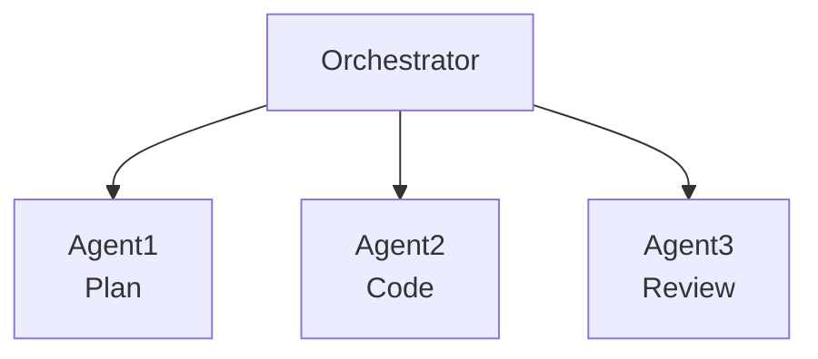
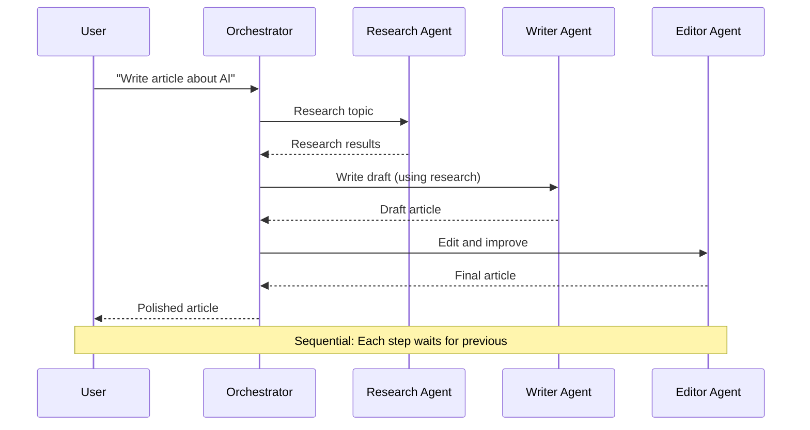
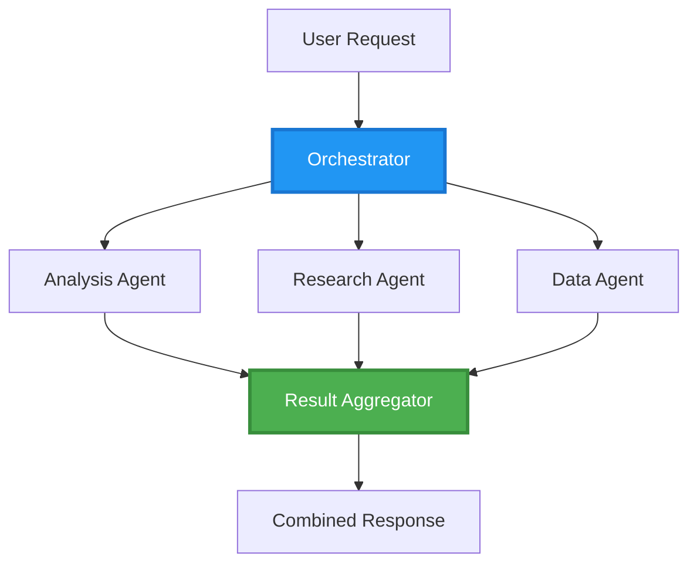
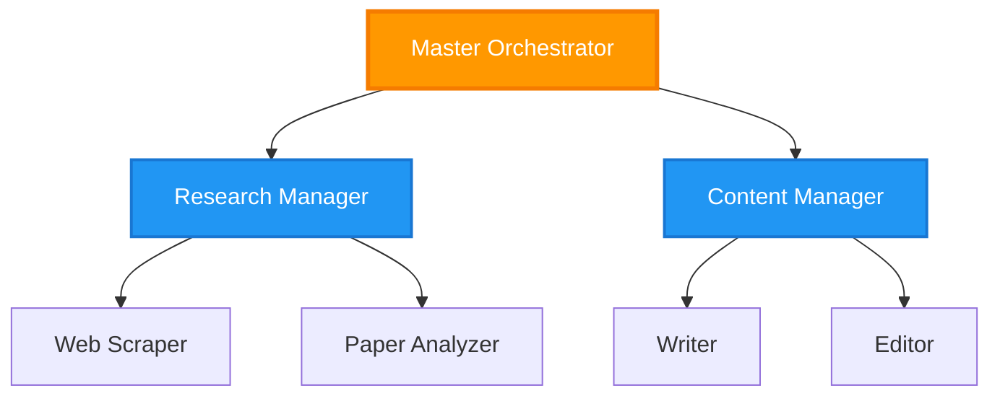
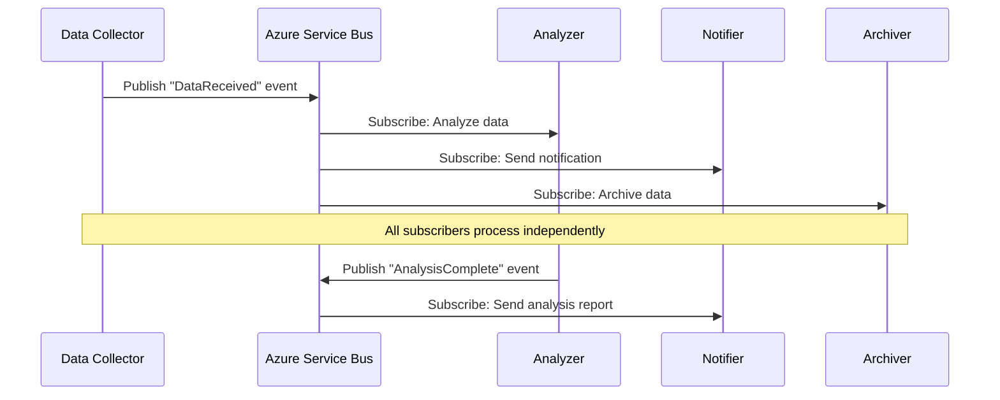
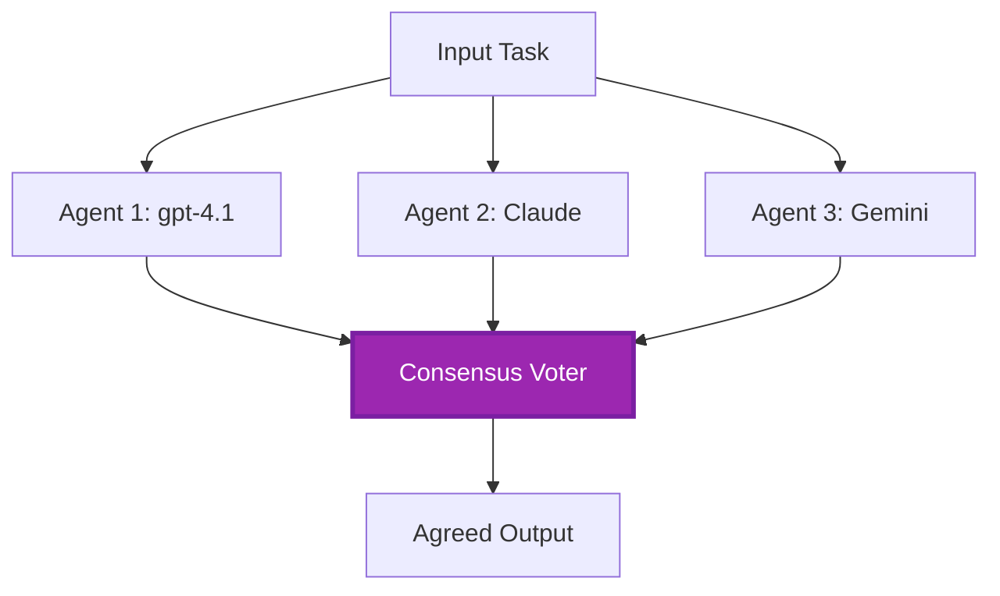
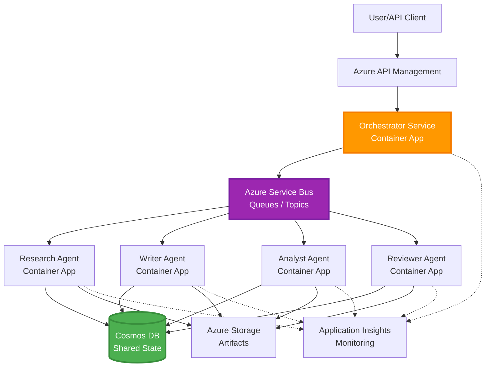

# Multi-Agent Koordinationsmuster

⏱️ **Geschätzte Zeit**: 60-75 Minuten Lesezeit; mehrere Stunden zur Implementierung | 💰 **Geschätzte Kosten**: abhängig vom Arbeitsaufwand | ⭐ **Komplexität**: Fortgeschritten

**📚 Lernpfad:**
- ← Vorherig: [Kapazitätsplanung](capacity-planning.md) - Strategien zur Ressourcenbemessung und Skalierung
- 🎯 **Sie sind hier**: Multi-Agent Koordinationsmuster (Orchestrierung, Kommunikation, Zustandsverwaltung)
- → Nächstes: [SKU-Auswahl](sku-selection.md) - Auswahl der richtigen Azure-Dienste
- 🏠 [Kursstartseite](../../README.md)

---

## Was Sie lernen werden

Durch den Abschluss dieser Lektion werden Sie:
- Verstehen **Multi-Agent Architektur**-Muster und wann sie einzusetzen sind
- **Orchestrierungsmuster** implementieren (zentralisiert, dezentralisiert, hierarchisch)
- **Agenten-Kommunikationsstrategien** entwerfen (synchron, asynchron, ereignisgesteuert)
- **Gemeinsamen Zustand** über verteilte Agenten verwalten
- **Multi-Agent-Systeme** auf Azure mit AZD bereitstellen
- **Koordinationsmuster** für reale KI-Szenarien anwenden
- Verteilte Agentensysteme überwachen und debuggen

## Warum Multi-Agent Koordination wichtig ist

### Die Entwicklung: Vom Einzelagenten zum Multi-Agenten

**Einzelagent (einfach):**
```
User → Agent → Response
```
- ✅ Einfach zu verstehen und umzusetzen
- ✅ Schnell bei einfachen Aufgaben
- ❌ Beschränkt durch die Fähigkeiten eines einzelnen Modells
- ❌ Komplexe Aufgaben nicht parallelisierbar
- ❌ Keine Spezialisierung

**Multi-Agenten-System (fortgeschritten):**

- ✅ Spezialagenten für spezifische Aufgaben
- ✅ Parallele Ausführung für Geschwindigkeit
- ✅ Modular und wartbar
- ✅ Besser bei komplexen Arbeitsabläufen
- ⚠️ Benötigt Koordinationslogik

**Analogie**: Ein Einzelagent ist wie eine Person, die alle Aufgaben erledigt. Multi-Agent ist wie ein Team, in dem jedes Mitglied spezialisierte Fähigkeiten hat (Forscher, Programmierer, Prüfer, Autor) und zusammenarbeitet.

---

## Kern-Koordinationsmuster

### Muster 1: Sequenzielle Koordination (Verantwortungskette)

**Wann anwenden**: Aufgaben müssen in bestimmter Reihenfolge abgeschlossen werden, jeder Agent baut auf dem Ergebnis des Vorherigen auf.



**Vorteile:**
- ✅ Klarer Datenfluss
- ✅ Einfach zu debuggen
- ✅ Vorhersehbare Ausführungsreihenfolge

**Einschränkungen:**
- ❌ Langsamer (keine Parallelität)
- ❌ Ein Fehler blockiert die gesamte Kette
- ❌ Kann keine voneinander abhängigen Aufgaben verarbeiten

**Beispiele:**
- Content-Erstellungspipeline (Recherche → Schreiben → Bearbeiten → Veröffentlichen)
- Code-Generierung (Planen → Implementieren → Testen → Bereitstellen)
- Berichtserstellung (Datensammlung → Analyse → Visualisierung → Zusammenfassung)

---

### Muster 2: Parallele Koordination (Fan-Out/Fan-In)

**Wann anwenden**: Unabhängige Aufgaben können gleichzeitig ausgeführt werden, Ergebnisse werden am Ende zusammengeführt.



**Vorteile:**
- ✅ Schnell (parallele Ausführung)
- ✅ Fehlertolerant (Teil-Ergebnisse akzeptabel)
- ✅ Horizontale Skalierbarkeit

**Einschränkungen:**
- ⚠️ Ergebnisse können in falscher Reihenfolge ankommen
- ⚠️ Aggregationslogik erforderlich
- ⚠️ Komplexe Zustandsverwaltung

**Beispiele:**
- Multi-Quellen-Datenerfassung (APIs + Datenbanken + Web-Scraping)
- Wettbewerbsanalyse (mehrere Modelle erzeugen Lösungen, beste wird ausgewählt)
- Übersetzungsdienste (gleichzeitige Übersetzung in mehrere Sprachen)

---

### Muster 3: Hierarchische Koordination (Manager-Arbeiter)

**Wann anwenden**: Komplexe Arbeitsabläufe mit Unteraufgaben, Delegation erforderlich.



**Vorteile:**
- ✅ Bewältigt komplexe Arbeitsabläufe
- ✅ Modular und wartbar
- ✅ Klare Verantwortungsgrenzen

**Einschränkungen:**
- ⚠️ Komplexere Architektur
- ⚠️ Höhere Latenz (mehrere Koordinationsschichten)
- ⚠️ Benötigt ausgeklügelte Orchestrierung

**Beispiele:**
- Unternehmensdokumentenverarbeitung (klassifizieren → weiterleiten → verarbeiten → archivieren)
- Mehrstufige Datenpipelines (einlesen → bereinigen → transformieren → analysieren → berichten)
- Komplexe Automatisierungs-Workflows (Planung → Ressourcenverteilung → Ausführung → Überwachung)

---

### Muster 4: Ereignisgesteuerte Koordination (Publish-Subscribe)

**Wann anwenden**: Agenten müssen auf Ereignisse reagieren, lose Kopplung erwünscht.



**Vorteile:**
- ✅ Lose Kopplung zwischen Agenten
- ✅ Einfach neue Agenten hinzufügen (einfach abonnieren)
- ✅ Asynchrone Verarbeitung
- ✅ Resilient (Nachrichtenpersistenz)

**Einschränkungen:**
- ⚠️ Eventuelle Konsistenz
- ⚠️ Komplexes Debugging
- ⚠️ Herausforderungen bei Nachrichtenreihenfolge

**Beispiele:**
- Echtzeit-Überwachungssysteme (Warnungen, Dashboards, Protokolle)
- Multi-Channel-Benachrichtigungen (E-Mail, SMS, Push, Slack)
- Datenverarbeitungspipelines (mehrere Verbraucher derselben Daten)

---

### Muster 5: Konsensbasierte Koordination (Voting/Quorum)

**Wann anwenden**: Zustimmung von mehreren Agenten vor Fortschritt nötig.



**Vorteile:**
- ✅ Höhere Genauigkeit (mehrere Meinungen)
- ✅ Fehlertolerant (Minoritätsfehler akzeptabel)
- ✅ Integrierte Qualitätssicherung

**Einschränkungen:**
- ❌ Teuer (mehrere Modellaufrufe)
- ❌ Langsamer (Warten auf alle Agenten)
- ⚠️ Konfliktlösung erforderlich

**Beispiele:**
- Inhaltsmoderation (mehrere Modelle prüfen Inhalte)
- Code-Review (mehrere Linter/Analysatoren)
- Medizinische Diagnose (mehrere KI-Modelle, Expertenvalidierung)

---

## Architekturübersicht

### Komplettes Multi-Agent-System auf Azure



**Schlüsselkomponenten:**

| Komponente | Zweck | Azure Dienst |
|-----------|---------|---------------|
| **API Gateway** | Einstiegspunkt, Ratenbegrenzung, Authentifizierung | API Management |
| **Orchestrator** | Koordiniert Agenten-Workflows | Container Apps |
| **Message Queue** | Asynchrone Kommunikation | Service Bus / Event Hubs |
| **Agenten** | Spezialisierte KI-Arbeiter | Container Apps / Functions |
| **State Store** | Gemeinsamer Zustand, Aufgabenverfolgung | Cosmos DB |
| **Artifact Storage** | Dokumente, Ergebnisse, Protokolle | Blob Storage |
| **Monitoring** | Verteiltes Tracing, Protokolle | Application Insights |

Service Bus-Warteschlangen/Themen und Event Hubs sind unterschiedliche Dienste mit verschiedenen Zustell- und Verbrauchsmodellen; Event Hubs ist kein direkter Ersatz für den untenstehenden Service Bus Worker-Code. Parallelität, persistente Nachrichten und Modellvoting garantieren nicht automatisch Fehlertoleranz oder höhere Genauigkeit.

---

## Voraussetzungen

### Benötigte Werkzeuge

```bash
# Verify Azure Developer CLI
azd version
# Command reference baseline: azd 1.37.2

# Verify Azure CLI
az --version
# ✅ Expected: azure-cli 2.50.0 or higher

# Verify Docker (for local testing)
docker --version
# ✅ Expected: Docker version 20.10 or higher
```

### Azure-Anforderungen

- Aktives Azure-Abonnement
- Berechtigungen zum Erstellen von:
  - Container Apps
  - Service Bus Namespaces
  - Cosmos DB Konten
  - Speicherkonten
  - Application Insights

### Kenntnisse als Voraussetzung

Sie sollten abgeschlossen haben:
- [Konfigurationsmanagement](../chapter-03-configuration/configuration.md)
- [Authentifizierung & Sicherheit](../chapter-03-configuration/authsecurity.md)
- [Microservices Beispiel](../../../../examples/microservices)

---

## Implementierungsanleitung

> **Entwurfsfragmente, kein bereitstellbares Labor:** Die Projektstruktur und die `File:` Bezeichnungen unten beschreiben Dateien, die Sie in Ihrem eigenen Projekt erstellen sollen; dieses Repository enthält keine vollständige `multi-agent-system` Anwendung. Fehlende Teile sind Haupt-/Parametervorlagen, Container Apps Umgebung/Registry, Dockerfiles und Abhängigkeitslocks, Cosmos Datenbank-/Container-Setup, Modelldeployments, Identitäts-/Rollen-Konfiguration, Skalierungsregeln und parallele Worker/Warteschlangen. Erwarten Sie nicht, dass `azd init` diese Dateien generiert oder `azd up` die Ausschnitte unverändert bereitstellt. Für einen ausführbaren Startpunkt, schließen Sie [Multi-Agent Grundlagen](../chapter-05-multi-agent/multi-agent-basics.md) ab.

**Laufzeitannahmen:** Python 3.10+, `azure-servicebus`, `azure-cosmos`, `openai`, Flask und (für Monitoring) `azure-monitor-opentelemetry`; legen Sie `shared` auf den Python-Importpfad in jedem Service-Image. Der Cosmos `agent-state/tasks` Container muss bereits mit Partition Key `/id` existieren. Schlüsselbasierte Verbindungen vereinfachen diese Fragmente, sind aber keine Produktionsanleitung: Bevorzugen Sie verwaltete Identitäten mit beschränkten Service Bus/Cosmos/OpenAI Data-Plane-Rollen. Keine Schlüssel in Outputs oder Logs offenlegen.

Service Bus-Zustellung ist **mindestens einmal**. Persistieren Sie Idempotenz pro Aufgabe **und Schritt**, verwenden Sie optimistische Nebenläufigkeit (ETags) für Lesen/Modifizieren/Schreiben des Zustands und erneuern Sie Nachrichtenlocks während langer Verarbeitungen. Der untenstehende einfache Zustandsmanager ist nur sequenziell und implementiert diese Produktionsgarantien nicht.

### Projektstruktur

```
multi-agent-system/
├── azure.yaml                    # AZD configuration
├── infra/
│   ├── main.bicep               # Main infrastructure
│   ├── core/
│   │   ├── servicebus.bicep     # Message queue
│   │   ├── cosmos.bicep         # State store
│   │   ├── storage.bicep        # Artifact storage
│   │   └── monitoring.bicep     # Application Insights
│   └── app/
│       ├── orchestrator.bicep   # Orchestrator service
│       └── agent.bicep          # Agent template
└── src/
    ├── orchestrator/            # Orchestration logic
    │   ├── app.py
    │   ├── workflows.py
    │   └── Dockerfile
    ├── agents/
    │   ├── research/            # Research agent
    │   ├── writer/              # Writer agent
    │   ├── analyst/             # Analyst agent
    │   └── reviewer/            # Reviewer agent
    └── shared/
        ├── state_manager.py     # Shared state logic
        └── message_handler.py   # Message handling
```

---

## Lektion 1: Sequenzielles Koordinationsmuster

### Implementierung: Content-Erstellungspipeline

Entwerfen wir eine sequentielle Pipeline: Recherche → Schreiben → Bearbeiten. Die Veröffentlichung liegt außerhalb dieses Beispiels.

### 1. AZD-Konfiguration

**Datei: `azure.yaml`**

```yaml
name: content-pipeline
metadata:
  template: multi-agent-sequential@1.0.0

services:
  orchestrator:
    project: ./src/orchestrator
    language: python
    host: containerapp
  
  research-agent:
    project: ./src/agents/research
    language: python
    host: containerapp
  
  writer-agent:
    project: ./src/agents/writer
    language: python
    host: containerapp
  
  editor-agent:
    project: ./src/agents/editor
    language: python
    host: containerapp
```

### 2. Infrastruktur: Service Bus zur Koordination

**Datei: `infra/core/servicebus.bicep`**

```bicep
param name string
param location string
param tags object = {}

resource serviceBusNamespace 'Microsoft.ServiceBus/namespaces@2022-10-01-preview' = {
  name: name
  location: location
  tags: tags
  sku: {
    name: 'Standard'
    tier: 'Standard'
  }
  properties: {
    minimumTlsVersion: '1.2'
  }
}

// Queue for orchestrator → research agent
resource researchQueue 'Microsoft.ServiceBus/namespaces/queues@2022-10-01-preview' = {
  parent: serviceBusNamespace
  name: 'research-tasks'
  properties: {
    maxDeliveryCount: 3
    lockDuration: 'PT5M'
    deadLetteringOnMessageExpiration: true
  }
}

// Queue for research agent → writer agent
resource writerQueue 'Microsoft.ServiceBus/namespaces/queues@2022-10-01-preview' = {
  parent: serviceBusNamespace
  name: 'writer-tasks'
  properties: {
    maxDeliveryCount: 3
    lockDuration: 'PT5M'
  }
}

// Queue for writer agent → editor agent
resource editorQueue 'Microsoft.ServiceBus/namespaces/queues@2022-10-01-preview' = {
  parent: serviceBusNamespace
  name: 'editor-tasks'
  properties: {
    maxDeliveryCount: 3
    lockDuration: 'PT5M'
  }
}

output namespace string = serviceBusNamespace.name
// Do not output RootManageSharedAccessKey. Resolve scoped credentials
// securely or use managed identity in the application and scale rules.
```

### 3. Gemeinsamer Zustandsmanager

**Datei: `src/shared/state_manager.py`**

```python
from azure.cosmos import CosmosClient, PartitionKey
from datetime import datetime, timezone
import os

class StateManager:
    """Manages shared state across agents using Cosmos DB"""
    
    def __init__(self):
        endpoint = os.environ['COSMOS_ENDPOINT']
        key = os.environ['COSMOS_KEY']
        
        self.client = CosmosClient(endpoint, key)
        self.database = self.client.get_database_client('agent-state')
        self.container = self.database.get_container_client('tasks')
    
    def create_task(self, task_id: str, task_type: str, input_data: dict):
        """Create a new task"""
        task = {
            'id': task_id,
            'type': task_type,
            'status': 'pending',
            'input': input_data,
            'created_at': datetime.now(timezone.utc).isoformat(),
            'steps': []
        }
        self.container.create_item(task)
        return task
    
    def update_task_step(self, task_id: str, step_name: str, result: dict):
        """Update task with completed step"""
        task = self.container.read_item(task_id, partition_key=task_id)
        
        task['steps'].append({
            'name': step_name,
            'completed_at': datetime.now(timezone.utc).isoformat(),
            'result': result
        })
        
        self.container.replace_item(task_id, task)
        return task
    
    def complete_task(self, task_id: str, final_result: dict):
        """Mark task as complete"""
        task = self.container.read_item(task_id, partition_key=task_id)
        task['status'] = 'completed'
        task['result'] = final_result
        task['completed_at'] = datetime.now(timezone.utc).isoformat()
        self.container.replace_item(task_id, task)
        return task
    
    def get_task(self, task_id: str):
        """Retrieve task state"""
        return self.container.read_item(task_id, partition_key=task_id)
```

### 4. Orchestrator-Service

**Datei: `src/orchestrator/app.py`**

```python
from flask import Flask, request, jsonify
from azure.servicebus import ServiceBusClient, ServiceBusMessage
import json
import uuid
import os
from shared.state_manager import StateManager

app = Flask(__name__)
state_manager = StateManager()

# Service Bus connection
servicebus_connection_str = os.environ['SERVICEBUS_CONNECTION_STRING']
servicebus_client = ServiceBusClient.from_connection_string(servicebus_connection_str)

@app.route('/health', methods=['GET'])
def health():
    return jsonify({'status': 'healthy', 'service': 'orchestrator'})

@app.route('/create-content', methods=['POST'])
def create_content():
    """
    Sequential workflow: Research → Write → Edit (returns a draft; no publishing)
    """
    data = request.get_json(silent=True) or {}
    topic = data.get('topic')
    
    if not topic:
        return jsonify({'error': 'Topic required'}), 400
    
    # Create task in state store
    task_id = str(uuid.uuid4())
    task = state_manager.create_task(
        task_id=task_id,
        task_type='content_creation',
        input_data={'topic': topic}
    )
    
    # Send message to research agent (first step)
    sender = servicebus_client.get_queue_sender('research-tasks')
    message = ServiceBusMessage(
        body=json.dumps({
            'task_id': task_id,
            'topic': topic,
            'next_queue': 'writer-tasks'  # Where to send results
        }),
        content_type='application/json'
    )
    
    with sender:
        sender.send_messages(message)
    
    return jsonify({
        'task_id': task_id,
        'status': 'started',
        'workflow': 'sequential',
        'steps': ['research', 'write', 'edit'],
        'message': 'Content creation pipeline initiated'
    }), 202

@app.route('/task/<task_id>', methods=['GET'])
def get_task_status(task_id):
    """Check task status"""
    try:
        task = state_manager.get_task(task_id)
        return jsonify(task)
    except Exception as e:
        return jsonify({'error': str(e)}), 404

if __name__ == '__main__':
    app.run(host='0.0.0.0', port=8080)
```

### 5. Recherche-Agent

**Datei: `src/agents/research/app.py`**

```python
from azure.servicebus import ServiceBusClient, ServiceBusMessage
from openai import AzureOpenAI
import json
import os
import time
from shared.state_manager import StateManager

# Initialize clients
state_manager = StateManager()
servicebus_client = ServiceBusClient.from_connection_string(
    os.environ['SERVICEBUS_CONNECTION_STRING']
)

openai_client = AzureOpenAI(
    api_key=os.environ['AZURE_OPENAI_API_KEY'],
    api_version="2024-10-21",
    azure_endpoint=os.environ['AZURE_OPENAI_ENDPOINT']
)

def process_research_task(message_data):
    """Process research request and pass to writer"""
    task_id = message_data['task_id']
    topic = message_data['topic']
    next_queue = message_data['next_queue']
    
    print(f"🔬 Researching: {topic}")
    
    # Call Microsoft Foundry Models for research
    response = openai_client.chat.completions.create(
        model=os.environ['AZURE_OPENAI_DEPLOYMENT'],
        messages=[
            {"role": "system", "content": "You are a research assistant. Provide comprehensive research on the given topic."},
            {"role": "user", "content": f"Research this topic thoroughly: {topic}"}
        ],
        max_tokens=1500
    )
    
    research_results = response.choices[0].message.content
    
    # Update state
    state_manager.update_task_step(
        task_id=task_id,
        step_name='research',
        result={'research': research_results}
    )
    
    # Send to next agent (writer)
    sender = servicebus_client.get_queue_sender(next_queue)
    message = ServiceBusMessage(
        body=json.dumps({
            'task_id': task_id,
            'topic': topic,
            'research': research_results,
            'next_queue': 'editor-tasks'
        }),
        content_type='application/json'
    )
    
    with sender:
        sender.send_messages(message)
    
    print(f"✅ Research complete for task {task_id}")

def main():
    """Listen to research queue"""
    receiver = servicebus_client.get_queue_receiver('research-tasks')
    
    print("🔬 Research Agent started, listening for tasks...")
    
    with receiver:
        while True:
            messages = receiver.receive_messages(max_wait_time=5)
            for message in messages:
                try:
                    message_data = json.loads(str(message))
                    process_research_task(message_data)
                    receiver.complete_message(message)
                except Exception as e:
                    print(f"❌ Error processing message: {e}")
                    receiver.abandon_message(message)

if __name__ == '__main__':
    main()
```

### 6. Schreib-Agent

**Datei: `src/agents/writer/app.py`**

```python
from azure.servicebus import ServiceBusClient, ServiceBusMessage
from openai import AzureOpenAI
import json
import os
from shared.state_manager import StateManager

state_manager = StateManager()
servicebus_client = ServiceBusClient.from_connection_string(
    os.environ['SERVICEBUS_CONNECTION_STRING']
)

openai_client = AzureOpenAI(
    api_key=os.environ['AZURE_OPENAI_API_KEY'],
    api_version="2024-10-21",
    azure_endpoint=os.environ['AZURE_OPENAI_ENDPOINT']
)

def process_writing_task(message_data):
    """Write article based on research"""
    task_id = message_data['task_id']
    topic = message_data['topic']
    research = message_data['research']
    next_queue = message_data['next_queue']
    
    print(f"✍️ Writing article: {topic}")
    
    # Call Microsoft Foundry Models to write article
    response = openai_client.chat.completions.create(
        model=os.environ['AZURE_OPENAI_DEPLOYMENT'],
        messages=[
            {"role": "system", "content": "You are a professional writer. Write engaging, well-structured articles."},
            {"role": "user", "content": f"Based on this research:\n\n{research}\n\nWrite a comprehensive article about: {topic}"}
        ],
        max_tokens=2000
    )
    
    article_draft = response.choices[0].message.content
    
    # Update state
    state_manager.update_task_step(
        task_id=task_id,
        step_name='writing',
        result={'draft': article_draft}
    )
    
    # Send to editor
    sender = servicebus_client.get_queue_sender(next_queue)
    message = ServiceBusMessage(
        body=json.dumps({
            'task_id': task_id,
            'topic': topic,
            'draft': article_draft
        }),
        content_type='application/json'
    )
    
    with sender:
        sender.send_messages(message)
    
    print(f"✅ Article draft complete for task {task_id}")

def main():
    """Listen to writer queue"""
    receiver = servicebus_client.get_queue_receiver('writer-tasks')
    
    print("✍️ Writer Agent started, listening for tasks...")
    
    with receiver:
        while True:
            messages = receiver.receive_messages(max_wait_time=5)
            for message in messages:
                try:
                    message_data = json.loads(str(message))
                    process_writing_task(message_data)
                    receiver.complete_message(message)
                except Exception as e:
                    print(f"❌ Error: {e}")
                    receiver.abandon_message(message)

if __name__ == '__main__':
    main()
```

### 7. Redaktions-Agent

**Datei: `src/agents/editor/app.py`**

```python
from azure.servicebus import ServiceBusClient
from openai import AzureOpenAI
import json
import os
from shared.state_manager import StateManager

state_manager = StateManager()
servicebus_client = ServiceBusClient.from_connection_string(
    os.environ['SERVICEBUS_CONNECTION_STRING']
)

openai_client = AzureOpenAI(
    api_key=os.environ['AZURE_OPENAI_API_KEY'],
    api_version="2024-10-21",
    azure_endpoint=os.environ['AZURE_OPENAI_ENDPOINT']
)

def process_editing_task(message_data):
    """Edit and finalize article"""
    task_id = message_data['task_id']
    topic = message_data['topic']
    draft = message_data['draft']
    
    print(f"📝 Editing article: {topic}")
    
    # Call Microsoft Foundry Models to edit
    response = openai_client.chat.completions.create(
        model=os.environ['AZURE_OPENAI_DEPLOYMENT'],
        messages=[
            {"role": "system", "content": "You are an expert editor. Improve grammar, clarity, and structure."},
            {"role": "user", "content": f"Edit and improve this article:\n\n{draft}"}
        ],
        max_tokens=2000
    )
    
    final_article = response.choices[0].message.content
    
    # Mark task as complete
    state_manager.complete_task(
        task_id=task_id,
        final_result={
            'topic': topic,
            'final_article': final_article,
            'word_count': len(final_article.split())
        }
    )
    
    print(f"✅ Article finalized for task {task_id}")

def main():
    """Listen to editor queue"""
    receiver = servicebus_client.get_queue_receiver('editor-tasks')
    
    print("📝 Editor Agent started, listening for tasks...")
    
    with receiver:
        while True:
            messages = receiver.receive_messages(max_wait_time=5)
            for message in messages:
                try:
                    message_data = json.loads(str(message))
                    process_editing_task(message_data)
                    receiver.complete_message(message)
                except Exception as e:
                    print(f"❌ Error: {e}")
                    receiver.abandon_message(message)

if __name__ == '__main__':
    main()
```

### 8. Bereitstellen und Testen

Diese Befehle gelten **erst nachdem Sie die fehlenden Projektdateien implementiert haben**. Die interaktive Foundry-Agenteninitialisierung ist ein separater Workflow; sie erzeugt dieses Service Bus-Design nicht.

```bash
# In your completed custom project
azd up

# Alternative in a SEPARATE empty folder (agents beta.23 requires azd >= 1.37)
azd extension install azure.ai.agents
azd ai agent init
azd up
```

> Siehe [AZD AI CLI-Befehle](../chapter-08-production/production-ai-practices.md#azd-ai-cli-commands-and-extensions) für alle `azd ai` Flags und Optionen.

```bash
# Get orchestrator URL
ORCHESTRATOR_URL=$(azd env get-values | grep ORCHESTRATOR_URL | cut -d '=' -f2 | tr -d '"')

# Create content
curl -X POST $ORCHESTRATOR_URL/create-content \
  -H "Content-Type: application/json" \
  -d '{"topic": "The Future of AI in Healthcare"}'
```

**✅ Erwartete Ausgabe:**
```json
{
  "task_id": "a1b2c3d4-e5f6-7890-abcd-ef1234567890",
  "status": "started",
  "workflow": "sequential",
  "steps": ["research", "write", "edit"],
  "message": "Content creation pipeline initiated"
}
```

**Aufgabenfortschritt überprüfen:**
```bash
TASK_ID="a1b2c3d4-e5f6-7890-abcd-ef1234567890"
curl $ORCHESTRATOR_URL/task/$TASK_ID
```

**✅ Erwartete Ausgabe (abgeschlossen):**
```json
{
  "id": "a1b2c3d4-e5f6-7890-abcd-ef1234567890",
  "type": "content_creation",
  "status": "completed",
  "steps": [
    {
      "name": "research",
      "completed_at": "2025-11-19T10:30:00Z",
      "result": {"research": "..."}
    },
    {
      "name": "writing",
      "completed_at": "2025-11-19T10:32:00Z",
      "result": {"draft": "..."}
    }
  ],
  "result": {
    "topic": "The Future of AI in Healthcare",
    "final_article": "...",
    "word_count": 1500
  }
}
```

---

## Lektion 2: Paralleles Koordinationsmuster

### Implementierung: Multi-Quellen-Rechercheaggregator

Wir bauen ein paralleles System, das Informationen gleichzeitig aus mehreren Quellen sammelt.

### Paralleler Orchestrator

**Datei: `src/orchestrator/parallel_workflow.py`**

```python
from flask import Flask, request, jsonify
from azure.servicebus import ServiceBusClient, ServiceBusMessage
import json
import uuid
import os
from shared.state_manager import StateManager

app = Flask(__name__)
state_manager = StateManager()

servicebus_client = ServiceBusClient.from_connection_string(
    os.environ['SERVICEBUS_CONNECTION_STRING']
)

@app.route('/research-parallel', methods=['POST'])
def research_parallel():
    """
    Parallel workflow: Multiple agents work simultaneously
    """
    data = request.json
    query = data.get('query')
    
    task_id = str(uuid.uuid4())
    task = state_manager.create_task(
        task_id=task_id,
        task_type='parallel_research',
        input_data={
            'query': query,
            'agents': ['web', 'academic', 'news', 'social']
        }
    )
    
    # Fan-out: publish sequentially; workers may process concurrently.
    agents = [
        ('web-research-queue', 'web'),
        ('academic-research-queue', 'academic'),
        ('news-research-queue', 'news'),
        ('social-research-queue', 'social')
    ]
    
    for queue_name, agent_type in agents:
        sender = servicebus_client.get_queue_sender(queue_name)
        message = ServiceBusMessage(
            body=json.dumps({
                'task_id': task_id,
                'query': query,
                'agent_type': agent_type,
                'result_queue': 'aggregation-queue'
            }),
            content_type='application/json'
        )
        
        with sender:
            sender.send_messages(message)
    
    return jsonify({
        'task_id': task_id,
        'status': 'started',
        'workflow': 'parallel',
        'agents_dispatched': 4,
        'message': 'Parallel research initiated'
    }), 202

if __name__ == '__main__':
    app.run(host='0.0.0.0', port=8080)
```

### Aggregationslogik

**Datei: `src/agents/aggregator/app.py`**

```python
from azure.servicebus import ServiceBusClient
import json
import os
from collections import defaultdict
from shared.state_manager import StateManager

state_manager = StateManager()
servicebus_client = ServiceBusClient.from_connection_string(
    os.environ['SERVICEBUS_CONNECTION_STRING']
)

# Single-process demo only: not durable or shared across replicas.
# Production: use durable unique (task_id, agent_type) result records.
task_results = defaultdict(dict)
expected_agents = 4  # web, academic, news, social

def process_result(message_data):
    """Aggregate results from parallel agents"""
    task_id = message_data['task_id']
    agent_type = message_data['agent_type']
    result = message_data['result']
    
    # Store result
    task_results[task_id][agent_type] = {
        'agent': agent_type,
        'data': result
    }
    
    print(f"📊 Received result from {agent_type} agent ({len(task_results[task_id])}/{expected_agents})")
    
    # Check if all agents completed (fan-in)
    if len(task_results[task_id]) == expected_agents:
        print(f"✅ All agents completed for task {task_id}. Aggregating...")
        
        # Combine results
        aggregated = {
            'query': message_data['query'],
            'sources': list(task_results[task_id].values()),
            'summary': generate_summary(list(task_results[task_id].values()))
        }
        
        # Mark complete
        state_manager.complete_task(task_id, aggregated)
        
        # Clean up
        del task_results[task_id]
        
        print(f"✅ Aggregation complete for task {task_id}")

def generate_summary(results):
    """Generate summary from all sources"""
    summaries = [r['data'].get('summary', '') for r in results]
    return '\n\n'.join(summaries)

def main():
    """Listen to aggregation queue"""
    receiver = servicebus_client.get_queue_receiver('aggregation-queue')
    
    print("📊 Aggregator started, listening for results...")
    
    with receiver:
        while True:
            messages = receiver.receive_messages(max_wait_time=5)
            for message in messages:
                try:
                    message_data = json.loads(str(message))
                    process_result(message_data)
                    receiver.complete_message(message)
                except Exception as e:
                    print(f"❌ Error: {e}")
                    receiver.abandon_message(message)

if __name__ == '__main__':
    main()
```

**Vorteile des parallelen Musters:**
- ⚡ **Potentiell niedrige Latenz** (begrenzt durch den langsamsten Arbeiter plus Koordinationsaufwand)
- 🔄 **Unterstützt Teil-Ergebnisse** mit expliziten Deadlines und Fehlerpolitik (nicht vom einfachen Aggregator implementiert)
- 📈 **Skalierbar** (leicht weitere Agenten hinzufügen)

---

## Praktische Übungen

### Übung 1: Timeout-Verarbeitung hinzufügen ⭐⭐ (Mittel)

**Ziel**: Implementieren Sie eine Timeout-Logik, damit der Aggregator nicht ewig auf langsame Agenten wartet.

**Ausgangspunkt:** Führen Sie diese lokale Deadline-Simulation aus, bevor Sie sie in einen Warteschlangen-Worker integrieren. Ein Timeout, das nur bei Ankunft einer anderen Nachricht geprüft wird, feuert nie, wenn der fehlende Arbeiter nichts sendet.

**Schritte**:

1. **Timeout-Tracking im Aggregator hinzufügen:**

```python
import asyncio

async def simulated_agent(name, delay):
    await asyncio.sleep(delay)
    return {'agent': name, 'result': 'done'}

async def main():
    tasks = [asyncio.create_task(simulated_agent(name, delay))
             for name, delay in [('web', 0.1), ('academic', 0.2),
                                 ('news', 0.3), ('social', 3)]]
    done, pending = await asyncio.wait(tasks, timeout=1)
    results = [task.result() for task in done]
    for task in pending:
        task.cancel()
    await asyncio.gather(*pending, return_exceptions=True)
    print({'completed_agents': len(results), 'timed_out': bool(pending)})
    assert len(results) == 3 and pending

asyncio.run(main())
```

2. **Erwartete Ausgabe:**

```text
{'completed_agents': 3, 'timed_out': True}
```

3. **Integration ins Warteschlangensystem (Designaufgabe):** Speichern Sie die Versandlebenszeit (Deadline) und erwartete Agenten bei der Aufgabe, führen Sie regelmäßig eine Deadline-Überprüfung unabhängig von eingehenden Ergebnissen durch, finalisieren Sie atomar Teil-Ergebnisse, und ignorieren späte/doppelte Nachrichten für finalisierte Aufgaben. Ein lokaler Timeout bricht keine Remote-Worker ab.

Nur für Ihr implementiertes Projekt:

```bash
azd deploy aggregator

# Submit task
curl -X POST $ORCHESTRATOR_URL/research-parallel \
  -H "Content-Type: application/json" \
  -d '{"query": "AI safety research"}'

# Check results after 30 seconds
curl $ORCHESTRATOR_URL/task/$TASK_ID
```

**✅ Erfolgskriterien:**
- ✅ Der lokale Test kehrt nach seiner Ein-Sekunden-Deadline zurück, auch wenn ein Agent unvollständig ist
- ✅ Antwort zeigt Teil-Ergebnisse (`"timed_out": true`)
- ✅ Verfügbare Ergebnisse werden zurückgegeben (3 von 4 Agenten)

**Zeit**: 20-25 Minuten

---

### Übung 2: Retry-Logik implementieren ⭐⭐⭐ (Fortgeschritten)

**Ziel**: Fehlgeschlagene Agentenaufgaben automatisch erneut ausführen, bevor abgebrochen wird.

**Schritte**:

1. **Verwenden Sie Service Bus Zustellungszähler statt eigener Wiederholungszähler:**

```python
import json
import time
# Integration fragment: use a live peek-lock ServiceBusReceiver.
# Set queue maxDeliveryCount to 4 for one attempt + up to three retries.
```

2. **Retry-Handler den Agenten hinzufügen:**

```python
def process_with_retry(message, receiver, process_func):
    """Process message with automatic retry on failure"""
    try:
        message_data = json.loads(str(message))
        
        # Process the message
        process_func(message_data)
        
        # Success - complete
        receiver.complete_message(message)
        
    except Exception as e:
        if message.delivery_count < 4:
            # Bounded exponential delay: 5s, 10s, 20s.
            # Renew the lock if processing + waiting can exceed its duration.
            time.sleep(5 * 2 ** (message.delivery_count - 1))
            receiver.abandon_message(message)
        else:
            # Max retries exceeded - move to dead letter queue
            print(f"❌ Max attempts exceeded for message {message.message_id}")
            receiver.dead_letter_message(
                message,
                reason="MaxRetriesExceeded",
                error_description=str(e)
            )
```

3. **Dead Letter Queue überwachen:**

```python
def monitor_dead_letters():
    """Check dead letter queue for failed messages"""
    receiver = servicebus_client.get_queue_receiver(
        'research-tasks',
        sub_queue='deadletter'
    )
    
    with receiver:
        messages = receiver.receive_messages(max_wait_time=5)
        for message in messages:
            print(f"☠️ Dead letter: {message.message_id}")
            print(f"Reason: {message.dead_letter_reason}")
            print(f"Description: {message.dead_letter_error_description}")
```

**✅ Erfolgskriterien:**
- ✅ Fehlgeschlagene Aufgaben werden automatisch bis zu 3-mal erneut versucht
- ✅ Exponentielles Backoff zwischen Wiederholungen (5s, 10s, 20s), mit Message-Lock-Erneuerungen wo nötig
- ✅ Nach maximalen Wiederholungen gehen Nachrichten in die Dead Letter Queue
- ✅ Dead Letter-Nachrichten können inspiziert werden; Wiedergabe erfordert einen separaten idempotenten Wiederherstellungs-Workflow

**Zeit**: 30-40 Minuten

---

### Übung 3: Circuit Breaker implementieren ⭐⭐⭐ (Fortgeschritten)

**Ziel**: Verhindern Sie Kettenreaktionsfehler, indem Anfragen an fehlerhafte Agenten gestoppt werden.

**Schritte**:

1. **Circuit Breaker Klasse erstellen:**

```python
from enum import Enum
from datetime import datetime, timedelta, timezone

class CircuitState(Enum):
    CLOSED = "closed"      # Normal operation
    OPEN = "open"          # Failing, reject requests
    HALF_OPEN = "half_open"  # Testing if recovered

class CircuitBreaker:
    def __init__(self, failure_threshold=5, timeout_seconds=60):
        self.failure_threshold = failure_threshold
        self.timeout_seconds = timeout_seconds
        self.failure_count = 0
        self.last_failure_time = None
        self.state = CircuitState.CLOSED
    
    def call(self, func):
        """Execute function with circuit breaker protection"""
        if self.state == CircuitState.OPEN:
            # Check if timeout expired
            if datetime.now(timezone.utc) - self.last_failure_time > timedelta(seconds=self.timeout_seconds):
                self.state = CircuitState.HALF_OPEN
                print("🔄 Circuit breaker: HALF_OPEN (testing)")
            else:
                raise Exception(f"Circuit breaker OPEN for agent. Try again in {self.timeout_seconds}s")
        
        try:
            result = func()
            
            # Success
            self.failure_count = 0 # Count consecutive failures only
            if self.state == CircuitState.HALF_OPEN:
                self.state = CircuitState.CLOSED
                self.failure_count = 0
                print("✅ Circuit breaker: CLOSED (recovered)")
            
            return result
            
        except Exception as e:
            self.failure_count += 1
            self.last_failure_time = datetime.now(timezone.utc)
            
            if self.failure_count >= self.failure_threshold:
                self.state = CircuitState.OPEN
                print(f"🔴 Circuit breaker: OPEN (too many failures)")
            
            raise
```

2. **Bei Agent-Aufrufen anwenden:**

```python
# In orchestrator
agent_circuits = {
    'web': CircuitBreaker(failure_threshold=5, timeout_seconds=60),
    'academic': CircuitBreaker(failure_threshold=5, timeout_seconds=60),
    'news': CircuitBreaker(failure_threshold=5, timeout_seconds=60),
    'social': CircuitBreaker(failure_threshold=5, timeout_seconds=60)
}

def send_to_agent(agent_type, message_data):
    """Send with circuit breaker protection"""
    circuit = agent_circuits[agent_type]
    
    try:
        circuit.call(lambda: send_message(agent_type, message_data))
    except Exception as e:
        print(f"⚠️ Skipping {agent_type} agent: {e}")
        # Continue with other agents
```

Dieser Schaltkreis schützt die **Send-Operation**, nicht den Abschluss durch den Remote-Worker: Das erfolgreiche Einstellen einer Nachricht sagt nichts darüber aus, ob ein Agent aktiv ist. `send_message` ist die Senderfunktion Ihrer Anwendung. Für Ausführungsschaltkreise füttern Sie beobachtete Aufgabenfehler/-zeitüberschreitungen in einen dauerhaften Koordinator ein. Diese In-Memory-Klasse ist eine Einzelthread-Demonstration, kein verteilter Circuit Breaker.

3. **Circuit Breaker lokal testen:**

```python
# Run after the class definition; no Azure changes required.
circuit = CircuitBreaker(failure_threshold=5, timeout_seconds=0)
def fail():
    raise RuntimeError("simulated failure")
for _ in range(5):
    try:
        circuit.call(fail)
    except RuntimeError:
        pass
assert circuit.state == CircuitState.OPEN
assert circuit.call(lambda: "recovered") == "recovered"
assert circuit.state == CircuitState.CLOSED
print("Circuit breaker recovery verified")
```

**✅ Erfolgskriterien:**
- ✅ Nach 5 Fehlern öffnet sich der Schaltkreis (Anfragen werden abgelehnt)
- ✅ Nach 60 Sekunden wird der Schaltkreis halb-offen (Test der Wiederherstellung)
- ✅ Andere Agenten arbeiten normal weiter
- ✅ Schaltkreis schließt sich automatisch, wenn der Agent sich erholt

**Zeit**: 40-50 Minuten

---

## Überwachung und Debugging

### Verteiltes Tracing mit Application Insights

**Datei: `src/shared/tracing.py`**

```python
from azure.monitor.opentelemetry import configure_azure_monitor
from opentelemetry import trace
from opentelemetry.trace import SpanKind
import logging
import os

connection_string = os.environ.get('APPLICATIONINSIGHTS_CONNECTION_STRING')

# Configure once per process. Message send/receive trace-context propagation
# and agent attributes on exceptions need explicit instrumentation.
if connection_string:
    configure_azure_monitor(connection_string=connection_string, logger_name=__name__)
tracer = trace.get_tracer(__name__)

# Configure logging
logger = logging.getLogger(__name__)
logger.setLevel(logging.INFO)

def trace_agent_call(agent_name, task_id, operation_name, operation):
    """Trace agent operations"""
    with tracer.start_as_current_span(f'agent.{agent_name}.{operation_name}', kind=SpanKind.CLIENT) as span:
        span.set_attribute('agent', agent_name)
        span.set_attribute('task_id', task_id)
        span.set_attribute('operation', operation_name)
        
        try:
            result = operation()
            span.set_attribute('status', 'success')
            logger.info('Agent operation completed', extra={
                'agent': agent_name, 'task_id': task_id, 'operation': operation_name
            })
            return result
        except Exception as e:
            span.set_attribute('status', 'error')
            logger.exception('Agent operation failed', extra={
                'agent': agent_name, 'task_id': task_id, 'operation': operation_name
            })
            raise
```

### Abfragen in Application Insights

**Multi-Agenten-Workflows nachverfolgen:**

```kusto
// Trace complete workflow for a task
traces
| where customDimensions.task_id == "a1b2c3d4-..."
| project timestamp, message, customDimensions.agent, customDimensions.operation
| order by timestamp asc
```

**Agentenleistungsvergleich:**

```kusto
// Compare agent execution times
dependencies
| where name contains "agent"
| summarize 
    avg_duration = avg(duration),
    p95_duration = percentile(duration, 95),
    count = count()
  by agent = tostring(customDimensions.agent)
| order by avg_duration desc
```

**Fehleranalyse:**

```kusto
// Find which agents fail most
exceptions
| where customDimensions.agent != ""
| summarize 
    failure_count = count(),
    unique_errors = dcount(outerMessage)
  by agent = tostring(customDimensions.agent)
| order by failure_count desc
```

---

## Kostenanalyse

### Kosten für Multi-Agenten-Systeme (monatliche Schätzungen)

Nur illustrativ, keine Angebote: Die Summe unten beträgt **240-565 $/Monat**. Prüfen Sie aktuelle regionale Tarife, aktive/Leerlauf-Replikastunden, Ein-/Ausgabemisch von Tokens, Speicher und Telemetrie. Serverless hat keine Mindestbereitstellungsdurchsatzmenge, berechnet jedoch Anfragen und Speicher.

| Komponente | Konfiguration | Kosten |
|-----------|--------------|------|
| **Orchestrator** | 1 Container App (1 vCPU, 2GB) | 30-50 $ |
| **4 Agenten** | 4 Container Apps (je 0,5 vCPU, 1GB) | 60-120 $ |
| **Service Bus** | Standard-Tarif, 10 Mio. Nachrichten | 10-20 $ |
| **Cosmos DB** | Serverless, 5GB Speicher, 1 Mio. RUs | 25-50 $ |
| **Blob Storage** | 10GB Speicher, 100K Operationen | 5-10 $ |
| **Application Insights** | 5GB Aufnahme | 10-15 $ |
| **Microsoft Foundry Modelle** | gpt-4.1, 10 Mio. Tokens | 100-300 $ |
| **Summe** | | **240-565 $/Monat** |

### Kostenoptimierungsstrategien

1. **Serverless verwenden, wo möglich:**
   ```bicep
   // Cosmos DB serverless (no minimum cost)
   properties: {
     databaseAccountOfferType: 'Standard'
     capabilities: [{ name: 'EnableServerless' }]
   }
   ```

2. **Agenten im Leerlauf auf Null skalieren:**
   ```bicep
   scale: {
     minReplicas: 0  // Requires a Service Bus/KEDA scale rule to wake workers
     maxReplicas: 10
   }
   ```

3. **Batching für Service Bus nutzen:**
   ```python
   # Send messages in batches (cheaper)
   sender.send_messages([message1, message2, message3])
   ```

4. **Häufig verwendete Ergebnisse cachen:**
   ```python
   # Use Azure Cache for Redis
   if cache.exists(query_hash):
       return cache.get(query_hash)
   ```

---

## Best Practices

### ✅ MACHEN:

1. **Idempotente Operationen verwenden**
   ```python
   # Pseudocode: implement a durable, atomic per-step deduplication claim.
   def process_task(task_id):
       raise NotImplementedError("Claim (task_id, step) atomically, execute, persist outcome")
   ```

2. **Umfassendes Logging implementieren**
   ```python
   logger.info(f"Agent: {agent_name}, Task: {task_id}, Action: {action}")
   ```

3. **Korrelations-IDs verwenden**
   ```python
   # Pass task_id through entire workflow
   message_data = {
       'task_id': task_id,  # Correlation ID
       'timestamp': datetime.utcnow().isoformat()
   }
   ```

4. **Nachrichten-TTL (Lebensdauer) setzen**
   ```bicep
   properties: {
     defaultMessageTimeToLive: 'PT1H'  // 1 hour max
   }
   ```

5. **Dead Letter Queues überwachen**
   ```python
   # Regular monitoring of failed messages
   monitor_dead_letters()
   ```

### ❌ NICHT MACHEN:

1. **Keine zirkulären Abhängigkeiten erzeugen**
   ```python
   # ❌ BAD: Agent A → Agent B → Agent A (infinite loop)
   # ✅ GOOD: Define clear directed acyclic graph (DAG)
   ```

2. **Agenten-Threads nicht blockieren**
   ```python
   # ❌ BAD: Synchronous wait
   while not task_complete:
       time.sleep(1)
   
   # ✅ GOOD: Use message queue callbacks
   ```

3. **Teilweise Fehler nicht ignorieren**
   ```python
   # ❌ BAD: Fail entire workflow if one agent fails
   # ✅ GOOD: Return partial results with error indicators
   ```

4. **Keine unendlichen Wiederholungen verwenden**
   ```python
   # ❌ BAD: retry forever
   # ✅ GOOD: max_retries = 3, then dead letter
   ```

---

## Fehlerbehebungsanleitung

### Problem: Nachrichten bleiben in der Warteschlange hängen

**Symptome:**
- Nachrichten sammeln sich in der Warteschlange an
- Agenten verarbeiten nicht
- Aufgabenstatus bleibt auf „ausstehend“

**Diagnose:**
```bash
# Check queue depth
az servicebus queue show \
  --resource-group "$RG_NAME" \
  --namespace-name mybus \
  --name research-tasks \
  --query "countDetails"

# Check agent logs using Azure CLI
az containerapp logs show --name research-agent --resource-group $RG_NAME --tail 50
```

**Lösungen:**

1. **Agent-Replikate erhöhen:**
   ```bash
   az containerapp update \
     --resource-group "$RG_NAME" \
     --name research-agent \
     --min-replicas 3 \
     --max-replicas 10
   ```

2. **Dead Letter Queue prüfen:**
   ```bash
   az servicebus queue show \
     --resource-group "$RG_NAME" \
     --namespace-name mybus \
     --name research-tasks \
     --query "countDetails.deadLetterMessageCount"
   ```

---

### Problem: Aufgabe läuft zu lange oder wird nie abgeschlossen

**Symptome:**
- Aufgabenstatus bleibt „in Bearbeitung“
- Manche Agenten schließen ab, andere nicht
- Keine Fehlermeldungen

**Diagnose:**
```bash
# Check task state
curl $ORCHESTRATOR_URL/task/$TASK_ID

# Check Application Insights
# Run query: traces | where customDimensions.task_id == "..."
```

**Lösungen:**

1. **Timeout im Aggregator implementieren (Übung 1)**

2. **Agentenfehler mit Azure Monitor prüfen:**
   ```bash
   # View logs via azd monitor
   azd monitor --logs
   
   # Or use Azure CLI to check specific container app logs
   az containerapp logs show --name <agent-name> --resource-group $RG_NAME --follow | grep "ERROR\|FAIL"
   ```

3. **Alle Agenten sind ausgeführt prüfen:**
   ```bash
   az containerapp list \
     --resource-group rg-agents \
     --query "[].{name:name, status:properties.runningStatus}"
   ```

---

## Mehr erfahren

### Offizielle Dokumentation
- [Azure Service Bus](https://learn.microsoft.com/azure/service-bus-messaging/service-bus-messaging-overview)
- [Cosmos DB](https://learn.microsoft.com/azure/cosmos-db/introduction)
- [Container Apps DAPR](https://learn.microsoft.com/azure/container-apps/dapr-overview)
- [AI Agent Orchestration Patterns](https://learn.microsoft.com/azure/architecture/ai-ml/guide/ai-agent-design-patterns)

### Nächste Schritte in diesem Kurs
- ← Vorheriger: [Kapazitätsplanung](capacity-planning.md)
- → Nächster: [SKU-Auswahl](sku-selection.md)
- 🏠 [Kurs-Startseite](../../README.md)

### Verwandte Beispiele
- [Microservices-Beispiel](../../../../examples/microservices) - Service-Kommunikationsmuster
- [Microsoft Foundry Modelle Beispiel](../../../../examples/azure-openai-chat) - KI-Integration

---

## Zusammenfassung

**Sie haben gelernt:**
- ✅ Fünf Koordinationsmuster (sequenziell, parallel, hierarchisch, ereignisgesteuert, Konsens)
- ✅ Multi-Agenten-Architektur auf Azure (Service Bus, Cosmos DB, Container Apps)
- ✅ Zustandsverwaltung über verteilte Agenten hinweg
- ✅ Umgang mit Timeouts, Wiederholungen und Circuit Breakern
- ✅ Überwachung und Debugging verteilter Systeme
- ✅ Kostenoptimierungsstrategien

**Wichtigste Erkenntnisse:**
1. **Das richtige Muster wählen** – sequenziell für geordnete Workflows, parallel für Geschwindigkeit, ereignisgesteuert für Flexibilität
2. **Zustand sorgfältig verwalten** – Cosmos DB oder Ähnliches für gemeinsamen Zustand verwenden
3. **Fehler elegant behandeln** – Timeouts, Wiederholungen, Circuit Breaker, Dead Letter Queues
4. **Alles überwachen** – verteiltes Tracing ist essenziell für Debugging
5. **Kosten optimieren** – auf Null skalieren, Serverless nutzen, Caching implementieren

**Nächste Schritte:**
1. Praktische Übungen abschließen
2. Ein Multi-Agenten-System für Ihren Anwendungsfall bauen
3. [SKU-Auswahl](sku-selection.md) studieren, um Leistung und Kosten zu optimieren

---

<!-- CO-OP TRANSLATOR DISCLAIMER START -->
**Haftungsausschluss**:
Dieses Dokument wurde mit dem KI-Übersetzungsdienst [Co-op Translator](https://github.com/Azure/co-op-translator) übersetzt. Obwohl wir uns um Genauigkeit bemühen, beachten Sie bitte, dass automatisierte Übersetzungen Fehler oder Ungenauigkeiten enthalten können. Das Originaldokument in seiner Ursprungssprache gilt als maßgebliche Quelle. Bei kritischen Informationen wird eine professionelle menschliche Übersetzung empfohlen. Wir übernehmen keine Haftung für Missverständnisse oder Fehlinterpretationen, die aus der Verwendung dieser Übersetzung entstehen.
<!-- CO-OP TRANSLATOR DISCLAIMER END -->