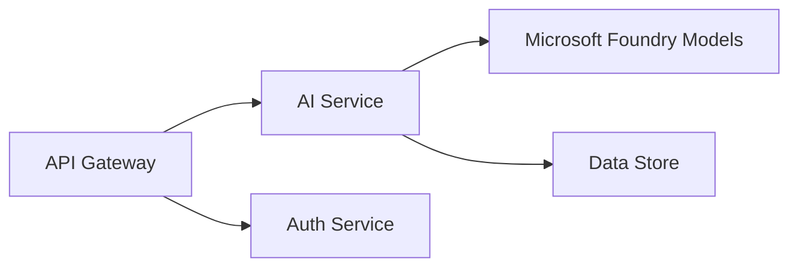
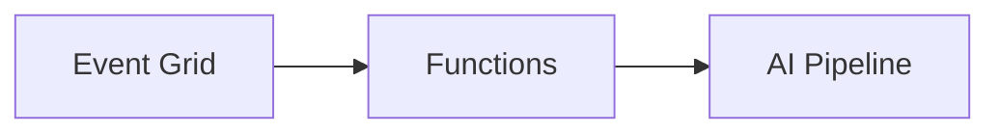

# Kapitel 8: Produktions- & Enterprise-Muster

**📚 Kurs**: [AZD für Anfänger](../../README.md) | **⏱️ Dauer**: 2-3 Stunden | **⭐ Komplexität**: Fortgeschritten

---

## Überblick

Dieses Kapitel behandelt unternehmensgerechte Bereitstellungsmuster, Sicherheitshärtung, Überwachung und Kostenoptimierung für produktive KI-Arbeitslasten.

Dies ist eine architektonische Referenz, keine vollständig bereitstellbare Produktion-Vorlage. Beispiele lassen Integrationsdetails weg, die in Ihrer eigenen Anwendung bereitgestellt und getestet werden müssen; das Lesen der Checkliste garantiert keine Produktionsreife.

> **Release-Überprüfung (2026-11-04):** Die KI-CLI-Anleitung wurde mit der Dokumentation/Quelle von `azd 1.37.2`, Agents `1.0.0-beta.23` und Bewertungen `1.0.0-beta.2` abgeglichen. Siehe [Release-Änderungen und Fixes](production-ai-practices.md#recent-release-changes-and-fixes) für Kompatibilitätsanforderungen und Migrationsdetails; dies ist keine Live-Bereitstellungsvalidierung.

## Lernziele

Nach Abschluss dieses Kapitels werden Sie:
- Mehrregionale resilientere Anwendungen bereitstellen
- Unternehmenssicherheitsmuster implementieren
- Umfassende Überwachung konfigurieren
- Kosten in großem Maßstab optimieren
- CI/CD-Pipelines mit AZD einrichten

---

## 📚 Lektionen

| # | Lektion | Beschreibung | Zeit |
|---|--------|-------------|------|
| 1 | [Produktions-KI-Praktiken](production-ai-practices.md) | Unternehmens-Bereitstellungsmuster | 90 Min |

---

## 🚀 Produktions-Checkliste

- [ ] Mehrregionale Bereitstellung für Resilienz
- [ ] Verwaltete Identität für Authentifizierung (keine Schlüssel)
- [ ] Application Insights zur Überwachung
- [ ] Kostenbudgets und Warnungen konfiguriert
- [ ] Aktivierte Sicherheitsüberprüfung
- [ ] CI/CD-Pipeline-Integration
- [ ] Disaster-Recovery-Plan

---

## 🏗️ Architektur-Muster

### Muster 1: Microservices KI



### Muster 2: Ereignisgesteuerte KI



---

## 🔐 Sicherheits-Best Practices

```bicep
// Illustrative properties from different resources, NOT a standalone Bicep file.
// Attach identity to the application host:
identity: {
  type: 'SystemAssigned'
}

// AI account properties (also require private endpoints, DNS and app connectivity):
properties: {
  publicNetworkAccess: 'Disabled'
  networkAcls: {
    defaultAction: 'Deny'
  }
}
```

---

## 💰 Kostenoptimierung

| Strategie | Haupteinschränkung |
|----------|---------|
| Auf null skalieren (Container Apps) | Erfordert passenden Trigger; andere Dienste verursachen weiterhin Kosten |
| Verbrauchsstufen für Entwicklung nutzen | Vergleiche ausgewählte Servicepreise und Arbeitslast |
| Geplantes Skalieren | Skalierung über unterstützte Infrastruktur/Automatisierung |
| Reservierungen/vorgesehene Kapazität | Nur wenn unterstützt; Verpflichtungen können Leerkosten erhöhen |

Verwenden Sie das [vollständige Budget-Ressourcenmuster](production-ai-practices.md#2-cost-monitoring-and-budgets) mit gültigem Startdatum, Abrechnungsscope, Empfängern und Berechtigungen. Ein Budget sendet Warnungen; es begrenzt nicht die Ausgaben. Einsparungen hängen von gemessener Nutzung ab und sind keine garantierten Prozentsätze.

---

## 📊 Überwachungseinrichtung

```bash
# Open the Application Insights logs view (requires configured monitoring)
azd monitor --logs

# Check Application Insights
azd monitor --overview

# View metrics
az monitor metrics list --resource <resource-id>
```

---

## 🔗 Navigation

| Richtung | Kapitel |
|-----------|---------|
| **Zurück** | [Kapitel 7: Fehlerbehebung](../chapter-07-troubleshooting/README.md) |
| **Kurs abgeschlossen** | [Kursübersicht](../../README.md) |

---

## 📖 Verwandte Ressourcen

- [KI Agents Anleitung](../chapter-02-ai-development/agents.md)
- [Application Insights](../chapter-06-pre-deployment/application-insights.md)
- [Multi-Agenten-Lösungen](../chapter-05-multi-agent/README.md)
- [Microservices-Beispiel](../../examples/microservices/README.md)

---

<!-- CO-OP TRANSLATOR DISCLAIMER START -->
**Haftungsausschluss**:
Dieses Dokument wurde mit dem KI-Übersetzungsdienst [Co-op Translator](https://github.com/Azure/co-op-translator) übersetzt. Obwohl wir uns um Genauigkeit bemühen, beachten Sie bitte, dass automatisierte Übersetzungen Fehler oder Ungenauigkeiten enthalten können. Das Originaldokument in seiner Ursprungssprache gilt als maßgebliche Quelle. Bei kritischen Informationen wird eine professionelle menschliche Übersetzung empfohlen. Wir übernehmen keine Haftung für Missverständnisse oder Fehlinterpretationen, die aus der Verwendung dieser Übersetzung entstehen.
<!-- CO-OP TRANSLATOR DISCLAIMER END -->