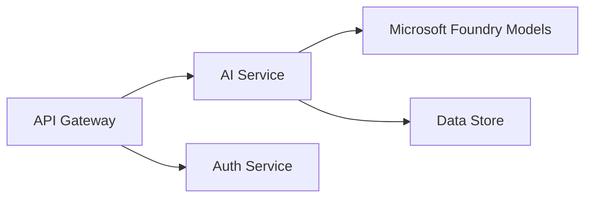
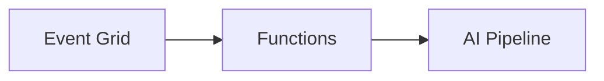

# Kapitel 8: Produktions- & Unternehmensmuster

**📚 Kurs**: [AZD Für Einsteiger](../../README.md) | **⏱️ Dauer**: 2-3 Stunden | **⭐ Komplexität**: Fortgeschritten

---

## Überblick

Dieses Kapitel behandelt unternehmensgerechte Bereitstellungsmuster, Sicherheits-Härtung, Überwachung und Kostenoptimierung für produktive KI-Arbeitslasten.

Dies ist eine Architekturreferenz, keine vollständige produktionsfähige Vorlage. Beispiele lassen Integrationsdetails weg, die in Ihrer eigenen Anwendung bereitgestellt und getestet werden müssen; das Lesen der Checkliste zertifiziert nicht die Produktionsreife.

> **Foundry GA-Update (2026-11-09):** Verwenden Sie `azd >= 1.37.0` und das allgemein verfügbare `microsoft.foundry` 1.0-Bundle für den Foundry-Workflow; Bewertungen werden separat installiert. Siehe [Release-Umfang und Migration](production-ai-practices.md#recent-release-changes-and-fixes) und das [beispielhafte authentifizierte Pipeline-Beispiel](production-ai-practices.md#cicd-pipeline-configuration). Dies ist eine Dokumentationsüberprüfung, keine Live-Bereitstellungsvalidierung oder pauschaler GA-Status für optionale Vorschaufunktionen.

## Lernziele

Nach Abschluss dieses Kapitels werden Sie:
- Mehrregionale widerstandsfähige Anwendungen bereitstellen
- Unternehmenssicherheitsmuster implementieren
- Umfassende Überwachung konfigurieren
- Kosten im großen Maßstab optimieren
- CI/CD-Pipelines mit AZD einrichten

---

## 📚 Lektionen

| # | Lektion | Beschreibung | Zeit |
|---|--------|-------------|------|
| 1 | [Produktions-KI-Praktiken](production-ai-practices.md) | Unternehmens-Bereitstellungsmuster | 90 Min |

---

## 🚀 Produktions-Checkliste

- [ ] Mehrregionale Bereitstellung für Widerstandsfähigkeit
- [ ] Verwaltete Identität für Authentifizierung (keine Schlüssel)
- [ ] Application Insights für Überwachung
- [ ] Kostenbudgets und Warnungen konfiguriert
- [ ] Sicherheitsscans aktiviert
- [ ] CI/CD-Pipeline-Integration
- [ ] Wiederherstellungsplan für Notfälle

---

## 🏗️ Architektur-Muster

### Muster 1: Microservices KI



### Muster 2: Ereignisgesteuerte KI



---

## 🔐 Sicherheits-Best Practices

```bicep
// Illustrative properties from different resources, NOT a standalone Bicep file.
// Attach identity to the application host:
identity: {
  type: 'SystemAssigned'
}

// AI account properties (also require private endpoints, DNS and app connectivity):
properties: {
  publicNetworkAccess: 'Disabled'
  networkAcls: {
    defaultAction: 'Deny'
  }
}
```

---

## 💰 Kostenoptimierung

| Strategie | Hauptbeschränkung |
|----------|--------------------|
| Skalierung auf null (Container Apps) | Erfordert einen geeigneten Trigger; andere Dienste verursachen weiterhin Kosten |
| Nutzung von Verbrauchsstufen für Entwicklung | Preisvergleich der ausgewählten Dienste und Arbeitslast |
| Geplante Skalierung | Skalierung über unterstützte Infrastruktur/Automatisierung |
| Reservierungen/vorab bereitgestellte Kapazität | Nur wenn unterstützt; Verpflichtungen können Leerkosten erhöhen |

Verwenden Sie das [vollständige Budget-Ressourcenmuster](production-ai-practices.md#2-cost-monitoring-and-budgets) mit einem gültigen Startdatum, Abrechnungsbereich, Empfängern und Berechtigungen. Ein Budget sendet Warnungen; es begrenzt nicht die Ausgaben. Einsparungen hängen von der gemessenen Nutzung ab und sind keine garantierten Prozentsätze.

---

## 📊 Überwachungs-Setup

```bash
# Open the Application Insights logs view (requires configured monitoring)
azd monitor --logs

# Check Application Insights
azd monitor --overview

# View metrics
az monitor metrics list --resource <resource-id>
```

---

## 🔗 Navigation

| Richtung | Kapitel |
|-----------|---------|
| **Vorheriges** | [Kapitel 7: Fehlerbehebung](../chapter-07-troubleshooting/README.md) |
| **Kurs abgeschlossen** | [Kursstartseite](../../README.md) |

---

## 📖 Verwandte Ressourcen

- [KI-Agenten Leitfaden](../chapter-02-ai-development/agents.md)
- [Application Insights](../chapter-06-pre-deployment/application-insights.md)
- [Multi-Agenten-Lösungen](../chapter-05-multi-agent/README.md)
- [Microservices-Beispiel](../../examples/microservices/README.md)

---

<!-- CO-OP TRANSLATOR DISCLAIMER START -->
**Haftungsausschluss**:
Dieses Dokument wurde mit dem KI-Übersetzungsdienst [Co-op Translator](https://github.com/Azure/co-op-translator) übersetzt. Obwohl wir uns um Genauigkeit bemühen, beachten Sie bitte, dass automatisierte Übersetzungen Fehler oder Ungenauigkeiten enthalten können. Das Originaldokument in seiner Ursprungssprache gilt als maßgebliche Quelle. Bei kritischen Informationen wird eine professionelle menschliche Übersetzung empfohlen. Wir übernehmen keine Haftung für Missverständnisse oder Fehlinterpretationen, die aus der Verwendung dieser Übersetzung entstehen.
<!-- CO-OP TRANSLATOR DISCLAIMER END -->