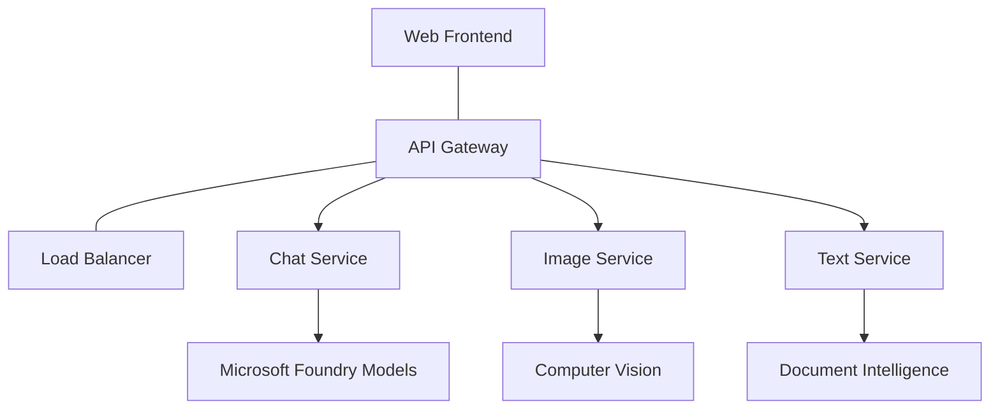

# Best Practices für produktionsreife KI-Arbeitslasten mit AZD

**Kapitel-Navigation:**
- **📚 Kurs Startseite**: [AZD für Anfänger](../../README.md)
- **📖 Aktuelles Kapitel**: Kapitel 8 - Produktion & Unternehmensmuster
- **⬅️ Vorheriges Kapitel**: [Kapitel 7: Fehlerbehebung](../chapter-07-troubleshooting/debugging.md)
- **⬅️ Ebenfalls relevant**: [AI Workshop Lab](../chapter-02-ai-development/ai-workshop-lab.md)
- **🎯 Kurs abgeschlossen**: [AZD für Anfänger](../../README.md)

## Überblick

Dieser Leitfaden erklärt Produktions-KI-Designmuster mithilfe der Azure Developer CLI (AZD). Er dient als Designreferenz, nicht als einsatzbereite Anwendung oder Produktionszertifizierung.

**Beispielgrenzen:** Sofern nicht ausdrücklich als vollständig beschrieben, gehen Bicep-Fragmente von Parametern und referenzierten Ressourcen aus einer enthaltenen Vorlage aus. Sie lassen Host-Images/-Pläne, Identitäten, Rollenzuweisungen, DNS, Ausgaben und andere erforderliche Integrationen weg. YAML-Service-Pfade und Hook-/Testskripte sind illustrative Dateien, die in **Ihrer eigenen Anwendung** erstellt werden müssen; sie werden von diesem Kurs nicht bereitgestellt. Verwenden Sie eine funktionierende AZD-Beispielvorlage als Grundlage, kompilieren Sie die vollständige Infrastruktur und testen Sie sie in einer isolierten Umgebung vor der Produktion.

## Wichtige adressierte Herausforderungen

Häufige Produktionsanliegen umfassen Multi-Service-Bereitstellungen, Identitäts- und Geheimnisverwaltung, Skalierung, Kostenkontrollen und Überwachung. Es wird keine gemessene Verbreitung hier beansprucht.

## Architektur-Muster für Produktions-KI

### Muster 1: Microservices-KI-Architektur

**Wann anzuwenden**: Komplexe KI-Anwendungen mit mehreren Fähigkeiten



**AZD-Implementierung**:

```yaml
# azure.yaml
name: enterprise-ai-platform
services:
  web:
    project: ./web
    host: staticwebapp
  api-gateway:
    project: ./api-gateway
    host: containerapp
  chat-service:
    project: ./services/chat
    host: containerapp
  vision-service:
    project: ./services/vision
    host: containerapp
  text-service:
    project: ./services/text
    host: containerapp
```

### Muster 2: Ereignisgesteuerte KI-Verarbeitung

**Wann anzuwenden**: Batch-Verarbeitung, Dokumentenanalyse, asynchrone Workflows

```bicep
// Event Hub for AI processing pipeline
resource eventHub 'Microsoft.EventHub/namespaces@2024-01-01' = {
  name: eventHubNamespaceName
  location: location
  sku: {
    name: 'Standard'
    tier: 'Standard'
    capacity: 1
  }
}

// Service Bus for reliable message processing
resource serviceBus 'Microsoft.ServiceBus/namespaces@2024-01-01' = {
  name: serviceBusNamespaceName
  location: location
  sku: {
    name: 'Premium'
    tier: 'Premium'
    capacity: 1
  }
}

// Function App for processing
resource functionApp 'Microsoft.Web/sites@2023-01-01' = {
  name: functionAppName
  location: location
  kind: 'functionapp,linux'
  properties: {
    siteConfig: {
      appSettings: [
        {
          name: 'FUNCTIONS_EXTENSION_VERSION'
          value: '~4'
        }
        {
          name: 'AZURE_OPENAI_ENDPOINT'
          value: '@Microsoft.KeyVault(VaultName=${keyVault.name};SecretName=openai-endpoint)'
        }
      ]
    }
  }
}
```

Dies erzeugt Namespace-Fragmente, keine Hubs, Warteschlangen, Abonnements oder Funktionsauslöser. Eine ausführbare Funktion benötigt außerdem einen Hosting-Plan, Laufzeit-/Speicherkonfiguration, eine angehängte Identität, RBAC und Netzwerkzugang. Die Key Vault-Referenz benötigt eine Berechtigung zum Lesen des Geheimnisses; eine Endpunkt-URL selbst ist keine Anmeldeinformation.

## Überwachung des Zustands von KI-Agenten

Wenn eine traditionelle Web-App ausfällt, sind die Symptome vertraut: Eine Seite lädt nicht, eine API gibt einen Fehler zurück oder eine Bereitstellung schlägt fehl. KI-gestützte Anwendungen können auf all diese Arten ausfallen – aber sie können sich auch subtiler falsch verhalten, ohne offensichtliche Fehlermeldungen.

Dieser Abschnitt hilft Ihnen, ein mentales Modell zur Überwachung von KI-Arbeitslasten zu entwickeln, damit Sie wissen, wo Sie nach Problemen suchen müssen, wenn etwas nicht richtig scheint.

### Wie sich Agentenzustand vom traditionellen App-Zustand unterscheidet

Traditionelle Apps können ebenfalls subtile Korrektheitsfehler aufweisen. Ein KI-Agent fügt den üblichen Verfügbarkeits- und Korrektheitsaspekten eine nondeterministische Antwortqualität hinzu. Denken Sie an den Agentenzustand in zwei Ebenen:

| Ebene | Woran man achtet | Wo man schaut |
|-------|------------------|---------------|
| **Infrastrukturzustand** | Läuft der Dienst? Sind Ressourcen bereitgestellt? Sind Endpunkte erreichbar? | `azd monitor`, Azure Portal Ressourcenstatus, Container-/App-Protokolle |
| **Verhaltenszustand** | Reagiert der Agent akkurat? Sind Antworten zeitnah? Wird das Modell korrekt aufgerufen? | Application Insights Traces, Modellaufruf-Latenzmetriken, Protokolle zur Antwortqualität |

Infrastrukturzustand ist vertraut – er ist bei jeder azd-App gleich. Verhaltenszustand ist die neue Ebene, die KI-Arbeitslasten hinzufügen.

### Wo Sie nachschauen, wenn KI-Apps sich unerwartet verhalten

Wenn Ihre KI-Anwendung nicht die erwarteten Ergebnisse liefert, hier eine konzeptuelle Checkliste:

1. **Beginnen Sie mit den Grundlagen.** Läuft die App? Kann sie ihre Abhängigkeiten erreichen? Prüfen Sie `azd monitor` und Ressourcenstatus wie bei jeder App.
2. **Überprüfen Sie die Modellverbindung.** Ruft Ihre Anwendung erfolgreich das KI-Modell auf? Fehlgeschlagene oder zeitüberschreitene Modellaufrufe sind die häufigste Ursache für KI-App-Probleme und erscheinen in Ihren Anwendungsprotokollen.
3. **Untersuchen Sie Eingabe und Grounding sicher.** Falsche Antworten können aus Abrufungen, Anweisungen, Modellgrenzen oder Werkzeugs-Ausführungen resultieren. Verwenden Sie zugriffskontrollierte, geschwärzte Diagnosedaten; aktivieren Sie in der Produktion kein indiscriminates Prompt-/Antwort-Logging.
4. **Überprüfen Sie Antwortlatenzen.** KI-Modellaufrufe sind langsamer als typische API-Aufrufe. Wenn Ihre App träge wirkt, prüfen Sie, ob die Modellantwortzeiten gestiegen sind – das kann auf Drosselung, Kapazitätsgrenzen oder regionale Überlastung hindeuten.
5. **Achten Sie auf Kostensignale.** Unerwartete Spitzen beim Tokenverbrauch oder API-Aufrufen können eine Schleife, eine Fehlkonfiguration im Prompt oder exzessive Wiederholungen anzeigen.

Sie müssen nicht sofort alle Observabilitäts-Tools meistern. Die wichtigste Erkenntnis ist, dass KI-Anwendungen eine zusätzliche Verhaltens-Ebene zur Überwachung haben, und das eingebaute Monitoring von azd (`azd monitor`) bietet einen Anfangspunkt zur Untersuchung beider Ebenen.

---

## Sicherheits-Best Practices

### 1. Zero-Trust-Sicherheitsmodell

**Umsetzungsstrategie**:
- Keine service-zu-service-Kommunikation ohne Authentifizierung
- Alle API-Aufrufe verwenden verwaltete Identitäten
- Netzwerktrennung mit privaten Endpunkten
- Least-Privilege-Zugriffskontrollen

```bicep
// Managed Identity for each service
resource chatServiceIdentity 'Microsoft.ManagedIdentity/userAssignedIdentities@2023-01-31' = {
  name: 'chat-service-identity'
  location: location
}

// Role assignments with minimal permissions
resource openAIUserRole 'Microsoft.Authorization/roleAssignments@2022-04-01' = {
  scope: openAIAccount
  name: guid(openAIAccount.id, chatServiceIdentity.id, '5e0bd9bd-7b93-4f28-af87-19fc36ad61bd')
  properties: {
    roleDefinitionId: subscriptionResourceId('Microsoft.Authorization/roleDefinitions', '5e0bd9bd-7b93-4f28-af87-19fc36ad61bd')
    principalId: chatServiceIdentity.properties.principalId
    principalType: 'ServicePrincipal'
  }
}
```

### 2. Sichere Geheimnisverwaltung

**Key Vault Integrationsmuster**:

```bicep
// Key Vault with proper access policies
resource keyVault 'Microsoft.KeyVault/vaults@2023-02-01' = {
  name: keyVaultName
  location: location
  properties: {
    tenantId: tenant().tenantId
    sku: {
      family: 'A'
      name: 'standard' // Premium is needed for HSM-backed keys, not ordinary secrets
    }
    enableRbacAuthorization: true  // Use RBAC instead of access policies
    enablePurgeProtection: true    // Prevent accidental deletion
    enableSoftDelete: true
    softDeleteRetentionInDays: 90
  }
}

// Optional legacy key-auth alternative; omit when using Entra ID.
resource openAIKeySecret 'Microsoft.KeyVault/vaults/secrets@2023-02-01' = {
  parent: keyVault
  name: 'openai-api-key'
  properties: {
    value: openAIAccount.listKeys().key1
    attributes: {
      enabled: true
    }
  }
}
```

Weisen Sie die Laufzeitidentität `Key Vault Secrets User` auf der entsprechenden Ebene zu und binden Sie sie an den Host an; `enableRbacAuthorization` allein gewährt keinen Zugriff. Bevorzugen Sie die Authentifizierung mit der von OpenAI verwalteten Identität mit `disableLocalAuth: true`. Das optionale Schlüsselgeheimnis ist nur sinnvoll bei einem absichtlich schlüsselaktivierten Konto, und der Bereitstellungs-Principal benötigt ebenfalls Schreibrechte für Geheimnisse.

### 3. Netzwerksicherheit

**Private Endpunktkonfiguration**:

```bicep
// Virtual Network for AI services
resource virtualNetwork 'Microsoft.Network/virtualNetworks@2023-04-01' = {
  name: vnetName
  location: location
  properties: {
    addressSpace: {
      addressPrefixes: ['10.0.0.0/16']
    }
    subnets: [
      {
        name: 'ai-services-subnet'
        properties: {
          addressPrefix: '10.0.1.0/24'
          privateEndpointNetworkPolicies: 'Disabled'
        }
      }
      {
        name: 'app-services-subnet'
        properties: {
          addressPrefix: '10.0.2.0/24'
          delegations: [
            {
              name: 'Microsoft.Web/serverFarms'
              properties: {
                serviceName: 'Microsoft.Web/serverFarms'
              }
            }
          ]
        }
      }
    ]
  }
}

// Private endpoints for all AI services
resource openAIPrivateEndpoint 'Microsoft.Network/privateEndpoints@2023-04-01' = {
  name: '${openAIAccountName}-pe'
  location: location
  properties: {
    subnet: {
      id: virtualNetwork.properties.subnets[0].id
    }
    privateLinkServiceConnections: [
      {
        name: 'openai-connection'
        properties: {
          privateLinkServiceId: openAIAccount.id
          groupIds: ['account']
        }
      }
    ]
  }
}
```

Private Endpunkte benötigen ebenfalls private DNS-Zonengruppen/VNet-Verbindung und AnwendungsvNet-Integration. Sie blockieren nicht automatisch den öffentlichen Zugang: Deaktivieren Sie den öffentlichen Netzwerzzugang des KI-Kontos nach Überprüfung der privaten Konnektivität und Bereitstellungszugriffs explizit.

## Leistung und Skalierung

### 1. Auto-Skalierungsstrategien

**Auto-Skalierung von Container-Apps**:

```bicep
resource containerApp 'Microsoft.App/containerApps@2023-05-01' = {
  name: containerAppName
  location: location
  properties: {
    configuration: {
      ingress: {
        external: true
        targetPort: 8000
        transport: 'http'
      }
    }
    template: {
      scale: {
        minReplicas: 2  // Always have 2 instances minimum
        maxReplicas: 50 // Scale up to 50 for high load
        rules: [
          {
            name: 'http-scaling'
            http: {
              metadata: {
                concurrentRequests: '20'  // Scale when >20 concurrent requests
              }
            }
          }
          {
            name: 'cpu-scaling'
            custom: {
              type: 'cpu'
              metadata: {
                type: 'Utilization'
                value: '70'  // Scale when CPU >70%
              }
            }
          }
        ]
      }
    }
  }
}
```

### 2. Caching-Strategien

**Redis-Cache für KI-Antworten**:

```bicep
// Legacy Azure Cache for Redis example (not recommended for new deployments)
resource redisCache 'Microsoft.Cache/redis@2023-04-01' = {
  name: redisCacheName
  location: location
  properties: {
    sku: {
      name: 'Premium'
      family: 'P'
      capacity: 1
    }
    enableNonSslPort: false
    minimumTlsVersion: '1.2'
    redisConfiguration: {
      'maxmemory-policy': 'allkeys-lru'
    }
    // Sharding distributes data; replication/failover provides availability.
    shardCount: 2
  }
}

// Cache configuration in application
var cacheConnectionString = '${redisCache.properties.hostName}:6380,password=${redisCache.listKeys().primaryKey},ssl=True,abortConnect=False'
```

Azure Cache für Redis Basic/Standard/Premium befindet sich auf einem [Ausmusterungspfad](https://learn.microsoft.com/azure/azure-cache-for-redis/retirement-faq). Verwenden Sie Azure Managed Redis für neue Designs und seine dokumentierte SKU-, Identitäts- und TLS-Konfiguration, anstatt diese Legacy-Ressource in ein neues Produktionssystem zu kopieren. Die Verbindungszeichenfolge ist ein nicht funktionaler Platzhalter, keine Anmeldeinformation. Partitionieren Sie Cache-Schlüssel nach Autorisierung, Modell/Anweisungen und Abrufversion, mit Ablaufzeit; ein geteiltes Query-Only-Cache kann Daten anderer Benutzer freigeben.

### 3. Lastverteilung und Verkehrsmanagement

**Application Gateway mit WAF**:

```bicep
// Application Gateway with Web Application Firewall
resource applicationGateway 'Microsoft.Network/applicationGateways@2023-04-01' = {
  name: appGatewayName
  location: location
  properties: {
    sku: {
      name: 'WAF_v2'
      tier: 'WAF_v2'
      capacity: 2
    }
    webApplicationFirewallConfiguration: {
      enabled: true
      firewallMode: 'Prevention'
      ruleSetType: 'OWASP'
      ruleSetVersion: '3.2'
    }
    // Backend pools for AI services
    backendAddressPools: [
      {
        name: 'ai-services-pool'
        properties: {
          backendAddresses: [
            {
              fqdn: '${containerApp.properties.configuration.ingress.fqdn}'
            }
          ]
        }
      }
    ]
  }
}
```

Dies ist eine partielle Gateway-Ressource: Eine echte Bereitstellung benötigt auch Gateway-Subnetz/IP-Konfiguration, Frontend-IPs und Ports, TLS-Listener/Zertifikate, Backend-HTTP-Einstellungen/Probes, Routingregeln und Prioritäten sowie eine überprüfte WAF-Policy. TLS-Hostname/SNI und Authentifizierung müssen mit dem Backend der Container-App übereinstimmen.

## 💰 Kostenoptimierung

### 1. Ressourcen-Right-Sizing

**Umgebungsspezifische Konfigurationen**:

Diese Namen sind **illustrierende benutzerdefinierte Template-Eingaben**, keine automatische AZD-Einstellungen. Ordnen Sie sie zuerst in `infra/main.parameters.json`/Bicep und Host-Konfiguration ab. Zum Beispiel verwendet das RAG-Beispiel `AZURE_SEARCH_SERVICE_SKU` und `AZURE_OPENAI_CHATGPT_DEPLOYMENT_CAPACITY`, nicht die generischen untenstehenden Namen. Geben Sie Container-Apps-Speicher eine unterstützte Einheit wie `1Gi` in der tatsächlichen Ressource. Wenden Sie Infrastrukturänderungen mit `azd up` oder `azd provision` an; `azd deploy` allein wendet keine Bicep-Änderungen an.

```bash
# Development environment
azd env new development
azd env set AZURE_OPENAI_SKU "S0"
azd env set AZURE_OPENAI_CAPACITY 10
azd env set AZURE_SEARCH_SKU "basic"
azd env set CONTAINER_CPU 0.5
azd env set CONTAINER_MEMORY 1.0

# Production environment  
azd env new production
azd env set AZURE_OPENAI_SKU "S0"
azd env set AZURE_OPENAI_CAPACITY 100
azd env set AZURE_SEARCH_SKU "standard"
azd env set CONTAINER_CPU 2.0
azd env set CONTAINER_MEMORY 4.0
```

### 2. Kostenüberwachung und Budgets

```bicep
// Supply the first day of the current UTC month, e.g. 2026-11-01T00:00:00Z.
param budgetStartDate string

// Cost management and budgets
resource budget 'Microsoft.Consumption/budgets@2024-08-01' = {
  name: 'ai-workload-budget'
  properties: {
    timePeriod: {
      startDate: budgetStartDate
    }
    timeGrain: 'Monthly'
    amount: 2000  // In the billing currency, not necessarily USD
    category: 'Cost'
    notifications: {
      warning: {
        enabled: true
        operator: 'GreaterThan'
        threshold: 80
        contactEmails: [
          'finance@company.com'
          'engineering@company.com'
        ]
        contactRoles: [
          'Owner'
          'Contributor'
        ]
      }
      critical: {
        enabled: true
        operator: 'GreaterThan'
        threshold: 95
        contactEmails: [
          'cto@company.com'
        ]
      }
    }
  }
}
```

Ersetzen Sie die Beispielempfänger und prüfen Sie Umfang/Berechtigungen. Budgetwarnungen verwenden verzögerte Abrechnungsdaten und erzwingen keine Ausgabengrenze.

### 3. Token-Nutzungsoptimierung

**OpenAI-Kostenmanagement**:

Dies ist nur eine zeichenbasierte Heuristik für eine UI-Vorschau, **kein** Modell-Token-Limit-Validator. Produktionscode muss einen Tokenizer verwenden, der zum bereitgestellten Modell passt und Systemanweisungen, Toolschemata, Verlauf und Ausgabe-Budget berücksichtigt. Lehnen Sie eine übergroße Benutzeranfrage ab, anstatt sie stillschweigend zu kürzen.

```typescript
// Application-level token optimization
class TokenOptimizer {
  private readonly maxTokens = 4000;
  private readonly reserveTokens = 500;
  
  optimizePrompt(userInput: string, context: string): string {
    const availableTokens = this.maxTokens - this.reserveTokens;
    if (this.estimateTokens(userInput) + 8 >= availableTokens) {
      throw new Error("User input exceeds the illustrative prompt budget");
    }
    const estimatedTokens = this.estimateTokens(userInput + context) + 8;
    
    if (estimatedTokens > availableTokens) {
      // Truncate context, not user input
      context = this.truncateContext(context, Math.max(0, availableTokens - this.estimateTokens(userInput) - 8));
    }
    
    return `${context}\n\nUser: ${userInput}`;
  }
  
  private estimateTokens(text: string): number {
    // Rough estimation: 1 token ≈ 4 characters
    return Math.ceil(text.length / 4);
  }

  private truncateContext(text: string, estimatedBudget: number): string {
    return text.slice(0, Math.max(0, estimatedBudget) * 4);
  }
}
```

## Überwachung und Observability

### 1. Umfassende Application Insights

```bicep
// Application Insights with advanced features
resource applicationInsights 'Microsoft.Insights/components@2020-02-02' = {
  name: applicationInsightsName
  location: location
  kind: 'web'
  properties: {
    Application_Type: 'web'
    WorkspaceResourceId: logAnalyticsWorkspace.id
    SamplingPercentage: 100  // Ingestion setting; review cost and SDK sampling separately
    DisableIpMasking: false  // Retain IP masking
  }
}

// Custom metrics for AI operations
resource aiMetricAlerts 'Microsoft.Insights/metricAlerts@2018-03-01' = {
  name: 'ai-high-error-rate'
  location: 'global'
  properties: {
    description: 'Alert when failed request count exceeds 10 in five minutes'
    severity: 2
    enabled: true
    scopes: [
      applicationInsights.id
    ]
    evaluationFrequency: 'PT1M'
    windowSize: 'PT5M'
    criteria: {
      'odata.type': 'Microsoft.Azure.Monitor.SingleResourceMultipleMetricCriteria'
      allOf: [
        {
          name: 'high-error-rate'
          metricName: 'requests/failed'
          operator: 'GreaterThan'
          threshold: 10
          timeAggregation: 'Count'
        }
      ]
    }
  }
}
```

### 2. KI-spezifische Überwachung

**Benutzerdefinierte Dashboards für KI-Metriken**:

```json
{
  "dashboard": {
    "name": "AI Application Monitoring",
    "tiles": [
      {
        "name": "OpenAI Request Volume",
        "query": "dependencies | where target contains 'openai' | summarize count() by bin(timestamp, 5m)"
      },
      {
        "name": "AI Response Latency",
        "query": "dependencies | where target contains 'openai' | summarize avg(duration) by bin(timestamp, 5m)"
      },
      {
        "name": "Token Usage",
        "query": "customMetrics | where name == 'openai_tokens_used' | summarize sum(value) by bin(timestamp, 1h)"
      },
      {
        "name": "Cost per Hour",
        "query": "customMetrics | where name == 'openai_cost' | summarize sum(value) by bin(timestamp, 1h)"
      }
    ]
  }
}
```

Dieses JSON ist eine von der Anwendung definierte Skizze, kein importierbares Azure-Portal-Dashboard-Schema. Die Token-/Kosten-Abfragen erfordern, dass Ihre Anwendung genau diese benutzerdefinierten Metriken ausgibt; sie werden nicht von AZD erstellt. Passen Sie Abhängigkeitsfilter für Ihre tatsächlichen Modellendpunkt/-Spannennamen an.

### 3. Gesundheitschecks und Verfügbarkeitsüberwachung

```bicep
// Application Insights availability tests
resource availabilityTest 'Microsoft.Insights/webtests@2022-06-15' = {
  name: 'ai-app-availability-test'
  location: location
  tags: {
    'hidden-link:${applicationInsights.id}': 'Resource'
  }
  properties: {
    SyntheticMonitorId: 'ai-app-availability-test'
    Name: 'AI Application Availability Test'
    Description: 'Tests AI application endpoints'
    Enabled: true
    Frequency: 300  // 5 minutes
    Timeout: 120    // 2 minutes
    Kind: 'standard'
    Locations: [
      {
        Id: 'us-east-2-azr'
      }
      {
        Id: 'us-west-2-azr'
      }
    ]
    Request: {
      RequestUrl: 'https://${webApp.properties.defaultHostName}/health'
      HttpVerb: 'GET'
      FollowRedirects: true
      ParseDependentRequests: false
    }
    ValidationRules: {
      ExpectedHttpStatusCode: 200
      SSLCheck: true
      SSLCertRemainingLifetimeCheck: 7
    }
  }
}
```

## Disaster Recovery und Hochverfügbarkeit

Der vorausgehende Test setzt eine bestehende App Service `webApp` und Application Insights Ressource voraus. Standardverfügbarkeitstests sind kostenpflichtig und benötigen einen erreichbaren Endpunkt; Apps mit ausschließlich privatem Zugang benötigen ein entsprechendes privates Monitoring-Design. URL-Ping-Tests sind veraltet; verwenden Sie [Standardverfügbarkeitstests](https://learn.microsoft.com/azure/azure-monitor/app/availability).

### 1. Multi-Region-Bereitstellung

```yaml
# azure.yaml - Multi-region configuration
name: ai-app-multiregion
services:
  api-primary:
    project: ./api
    host: containerapp
    env:
      AZURE_REGION: eastus
  api-secondary:
    project: ./api
    host: containerapp
    env:
      AZURE_REGION: westus2
```

```bicep
// Separate App Service topology, not the Container Apps declarations above
resource trafficManager 'Microsoft.Network/trafficManagerProfiles@2022-04-01' = {
  name: trafficManagerProfileName
  location: 'global'
  properties: {
    profileStatus: 'Enabled'
    trafficRoutingMethod: 'Priority'
    dnsConfig: {
      relativeName: trafficManagerProfileName
      ttl: 30
    }
    monitorConfig: {
      protocol: 'HTTPS'
      port: 443
      path: '/health'
      intervalInSeconds: 30
      toleratedNumberOfFailures: 3
      timeoutInSeconds: 10
    }
    endpoints: [
      {
        name: 'primary-endpoint'
        type: 'Microsoft.Network/trafficManagerProfiles/azureEndpoints'
        properties: {
          targetResourceId: primaryAppService.id
          endpointStatus: 'Enabled'
          priority: 1
        }
      }
      {
        name: 'secondary-endpoint'
        type: 'Microsoft.Network/trafficManagerProfiles/azureEndpoints'
        properties: {
          targetResourceId: secondaryAppService.id
          endpointStatus: 'Enabled'
          priority: 2
        }
      }
    ]
  }
}
```

Umgebungsvariablen wählen keine Ressourcenstandorte aus. IaC muss unterschiedliche regionale Hosts bereitstellen und jeden Dienst mit `resourceName` oder `azd-service-name` Tags verbinden. Das Traffic Manager-Beispiel ist eine **separate App Service-Topologie** (`primaryAppService`/`secondaryAppService`), kein Routing für die Container-Apps-Deklarationen. Container Apps benötigen einen entsprechend konfigurierten externen Endpunkt/Front Door, TLS-/Custom-Domain-Routing und Gesundheitsprüfungen.

### 2. Datensicherung und Wiederherstellung

```bicep
// Backup configuration for critical data
resource backupVault 'Microsoft.DataProtection/backupVaults@2023-05-01' = {
  name: backupVaultName
  location: location
  identity: {
    type: 'SystemAssigned'
  }
  properties: {
    storageSettings: [
      {
        datastoreType: 'VaultStore'
        type: 'LocallyRedundant'
      }
    ]
  }
}

```

Das Vault sichert alleine nichts. Konfigurieren Sie eine **arbeitslastspezifische unterstützte Richtlinie und Backup-Instanz**, Quellberechtigungen, Aufbewahrung und Wiederherstellungstests mit den [Azure Backup Support-Matrizen](https://learn.microsoft.com/azure/backup/backup-support-matrix). Es gibt keine generische Azure Backup Richtlinie für gehostete Azure OpenAI-Modellbereitstellungen. Bewahren Sie Infrastruktur-/Modell-Bereitstellungsdefinitionen in der Quellcodeverwaltung; schützen Sie hochgeladene Dokumente, Anwendungsdaten und Fine-Tuning-Artefakte mit den von jedem unterstützten Backing-Service gebotenen Backup-/Exportfunktionen. Definieren und testen Sie RPO/RTO explizit.

## DevOps- und CI/CD-Integration

### 1. GitHub Actions Workflow

```yaml
# .github/workflows/deploy-ai-app.yml
name: Deploy AI Application

on:
  push:
    branches: [main]
  pull_request:
    branches: [main]

jobs:
  test:
    runs-on: ubuntu-latest
    steps:
      - uses: actions/checkout@v4
      
      - name: Setup Python
        uses: actions/setup-python@v4
        with:
          python-version: '3.11'
          
      - name: Install dependencies
        run: |
          pip install -r requirements.txt
          pip install pytest
          
      - name: Run tests
        run: pytest tests/
        
      - name: AI Safety Tests
        run: |
          python scripts/test_ai_safety.py
          python scripts/validate_prompts.py

```

Dies ist der **Nur-Test-Teil** eines Workflows und geht davon aus, dass Sie `requirements.txt`, `tests/` und die zwei Sicherheits-Skripte erstellt haben. Fügen Sie die authentifizierten OIDC-Provisionierungs-/Bereitstellungsjobs aus [CI/CD-Pipeline-Konfiguration](#cicd-pipeline-configuration) hinzu, mit `needs: test`, einem vertrauenswürdigen Push-/manuellen Trigger und geschützten GitHub-Umgebungen. Setzen Sie keinen unzuverlässigen Pull-Request-Code mit Cloud-Zugangsdaten ein. Ein frischer Runner hat keine ausgewählte lokale AZD-Umgebung; liefern Sie die Eingaben für Umgebung/Abonnement/Standort und verwenden Sie `azd auth login`, nicht nur `azure/login`.

### 2. Infrastrukturvalidierung

```bash
# scripts/validate_infrastructure.sh
#!/bin/bash
set -euo pipefail

echo "Validating AI infrastructure deployment..."

# Requires Azure CLI login and the resource group selected explicitly.
: "${AZURE_RESOURCE_GROUP:?Set AZURE_RESOURCE_GROUP}"
: "${AZURE_OPENAI_NAME:?Set AZURE_OPENAI_NAME}"
: "${AZURE_OPENAI_CHAT_DEPLOYMENT:?Set the actual deployment name}"

# A successful empty list is not proof that resources exist.
types=("Microsoft.CognitiveServices/accounts" "Microsoft.Search/searchServices"
       "Microsoft.Storage/storageAccounts" "Microsoft.KeyVault/vaults")
for resource_type in "${types[@]}"; do
    count=$(az resource list --resource-group "$AZURE_RESOURCE_GROUP" \
        --resource-type "$resource_type" --query "length(@)" -o tsv)
    if [[ "$count" -lt 1 ]]; then
        echo "ERROR: No $resource_type found in $AZURE_RESOURCE_GROUP"
        exit 1
    fi
done

# Validate OpenAI model deployments
echo "Validating OpenAI model deployments..."
state=$(az cognitiveservices account deployment show \
  --name "$AZURE_OPENAI_NAME" --resource-group "$AZURE_RESOURCE_GROUP" \
  --deployment-name "$AZURE_OPENAI_CHAT_DEPLOYMENT" \
  --query "properties.provisioningState" -o tsv)
if [[ "$state" != "Succeeded" ]]; then
    echo "ERROR: Required model deployment is not provisioned successfully"
    exit 1
fi

echo "Infrastructure validation completed successfully!"
```

Erwartet: Null Exit und Abschlussnachricht nur wenn alle erwarteten Typen vorhanden sind und die benannte Modellbereitstellung vorgenommen wurde. Dies überprüft Inventar/Bereitstellungsstatus, **nicht** Ressourcengesundheit, exakte Topologie, RBAC, Netzwerkzugänglichkeit oder Modellverhalten. Passen Sie die erwarteten Typen an Ihre Architektur an und führen Sie dann einen separaten authentifizierten Anwendungsvorbereitungstest durch.

## Produktionsbereitschafts-Checkliste

### Sicherheit ✅
- [ ] Alle Dienste verwenden verwaltete Identitäten
- [ ] Geheimnisse im Key Vault gespeichert
- [ ] Private Endpunkte konfiguriert
- [ ] Netzwerksicherheitsgruppen implementiert
- [ ] RBAC mit Least Privilege
- [ ] WAF auf öffentlichen Endpunkten aktiviert

### Leistung ✅
- [ ] Auto-Skalierung konfiguriert
- [ ] Caching umgesetzt
- [ ] Lastverteilung eingerichtet
- [ ] CDN für statische Inhalte
- [ ] Datenbank-Verbindungs-Pooling
- [ ] Token-Nutzungsoptimierung

### Überwachung ✅
- [ ] Application Insights konfiguriert
- [ ] Benutzerdefinierte Metriken definiert
- [ ] Alarmregeln eingerichtet
- [ ] Dashboard erstellt
- [ ] Gesundheitsprüfungen implementiert
- [ ] Aufbewahrungsrichtlinien für Protokolle

### Zuverlässigkeit ✅
- [ ] Multi-Region-Bereitstellung
- [ ] Backup- und Wiederherstellungsplan
- [ ] Circuit Breaker implementiert
- [ ] Retry-Richtlinien konfiguriert
- [ ] Sanfter Abbau
- [ ] Gesundheitscheck-Endpunkte

### Kostenmanagement ✅
- [ ] Budgetalarm eingerichtet
- [ ] Ressourcen an Bedarf angepasst
- [ ] Entwicklungs-/Testnachlässe angewendet
- [ ] Reservierte Instanzen gekauft
- [ ] Kostenüberwachungs-Dashboard
- [ ] Regelmäßige Kostenüberprüfungen

### Compliance ✅
- [ ] Datenresidenzanforderungen erfüllt
- [ ] Audit-Logging aktiviert
- [ ] Compliance-Richtlinien angewendet
- [ ] Sicherheitsgrundlinien implementiert
- [ ] Regelmäßige Sicherheitsbewertungen
- [ ] Notfallreaktionsplan

## Performance-Benchmarks

### Illustrierte Produktionsziele

Dies sind Beispiel-SLOs zum Aushandeln und Lasttesten, keine gemessenen Benchmarks oder Garantien. Antwortlatenz hängt von Modell-/Ausgabelänge ab; monatliche Token-Ausgaben hängen vom Traffic und Preisen ab, nicht nur von der Tokenanzahl.

| Metrik | Ziel | Überwachung |
|--------|--------|------------|
| **Antwortzeit** | < 2 Sekunden | Application Insights |
| **Verfügbarkeit** | 99,9 % | Uptime-Überwachung |
| **Fehlerrate** | < 0,1 % | Anwendungsprotokolle |
| **Modell-Ausgaben** | < 500 $/Monat (Beispielbudget) | Kostenmanagement |
| **Gleichzeitige Benutzer** | 1000+ | Lasttests |
| **Wiederherstellungszeit** | < 1 Stunde | Katastrophenwiederherstellungstests |

### Lasttest

Das Folgende ist eine Schnittstellenskizze für ein Lasttest-Skript, das **Sie implementieren müssen**; dieses Repository stellt `scripts/load_test.py` nicht bereit. Definieren Sie Anforderungspayloads, Authentifizierung, repräsentative Arbeitslasten, Perzentil-Latenz-/Fehlerbehauptungen und ein Ausgabenlimit in Ihrem bevorzugten Lasttest-Tool, bevor Sie es ausführen:

```bash
# Load testing script for AI applications
python scripts/load_test.py \
  --endpoint https://your-ai-app.azurewebsites.net \
  --concurrent-users 100 \
  --duration 300 \
  --ramp-up 60
```

## 🤝 Community Best Practices

Basierend auf dem Feedback der Microsoft Foundry Discord Community:

### Top-Empfehlungen der Community:

1. **Klein anfangen, schrittweise skalieren**: Beginnen Sie mit einfachen SKUs und skalieren Sie basierend auf der tatsächlichen Nutzung
2. **Alles überwachen**: Richten Sie von Anfang an umfassendes Monitoring ein
3. **Sicherheit automatisieren**: Verwenden Sie Infrastruktur als Code für konsistente Sicherheit
4. **Gründlich testen**: Beziehen Sie KI-spezifische Tests in Ihre Pipeline ein
5. **Kosten planen**: Überwachen Sie die Token-Nutzung und richten Sie frühzeitig Budgetwarnungen ein

### Häufige Fallstricke vermeiden:

- ❌ API-Schlüssel hartkodieren im Code
- ❌ Kein richtiges Monitoring einrichten
- ❌ Kostenoptimierung ignorieren
- ❌ Fehlerszenarien nicht testen
- ❌ Deployment ohne Health Checks

## AZD AI CLI-Befehle und Erweiterungen

AZD umfasst eine wachsende Anzahl KI-spezifischer Befehle und Erweiterungen, die Produktions-KI-Workflows vereinfachen. Diese Tools überbrücken die Lücke zwischen lokaler Entwicklung und Produktionseinsatz für KI-Arbeitslasten.

> **Foundry GA-Update (2026-11-09):** Das `microsoft.foundry` Bundle erreichte **1.0 / allgemeine Verfügbarkeit** am [5. November 2026](https://devblogs.microsoft.com/azure-sdk/microsoft-foundry-azure-developer-cli-ga/). Verwenden Sie **`azd >= 1.37.0`** für diesen Workflow. Die frühere `azd 1.37.2`, agents beta.23 und evaluations beta.2 Übersicht bleibt unten als Migrationsgeschichte erhalten, nicht als die aktuelle Bundleversion. Dies ist eine Dokumentations-/Quellenübersicht, keine Live-Deploymentsüberprüfung oder eine Behauptung, dass jede optionale Erweiterung, API oder Vorschaufunktion GA ist.

### AZD-Erweiterungen für KI

AZD verwendet ein Erweiterungssystem, um KI-spezifische Funktionen hinzuzufügen. Installieren und verwalten Sie Erweiterungen mit:

```bash
# List all available extensions (including AI)
azd extension list

# Inspect installed versions
azd version
azd ext list --installed

# Install the GA Foundry bundle
azd ext install microsoft.foundry

# Install the separate Foundry evaluations extension
azd extension install azure.ai.evaluations

# Install the fine-tuning extension
azd extension install azure.ai.finetune

# Install the custom models extension
azd extension install azure.ai.models

# Upgrade the Foundry bundle
azd ext upgrade microsoft.foundry
```

**Verfügbare KI-Erweiterungen:**

| Erweiterung | Zweck | Status |
|-----------|---------|--------|
| `microsoft.foundry` | Meta-Paket, das die sieben untenstehenden Kern-Erweiterungen installiert; keine eigene Befehlsgruppe | GA Bundle 1.0 |
| `azure.ai.agents` | `azd ai agent`: Agenteneinrichtung, lokale Ausführung und Betrieb | Inklusive; eigenständig versioniert |
| `azure.ai.connections` | `azd ai connection`: Projektverbindungen | Inklusive; eigenständig versioniert |
| `azure.ai.inspector` | `azd ai inspector`: lokale Agent Inspector UI | Inklusive; eigenständig versioniert |
| `azure.ai.projects` | `azd ai project`: Projektressourcen und Modell-Deployments | Inklusive; eigenständig versioniert |
| `azure.ai.routines` | `azd ai routine`: Zeitpläne und Trigger | Inklusive; eigenständig versioniert |
| `azure.ai.skills` | `azd ai skill`: wiederverwendbare Verhaltensrichtlinien | Inklusive; eigenständig versioniert |
| `azure.ai.toolboxes` | `azd ai toolbox`: versionierte Tool-Sammlungen | Inklusive; eigenständig versioniert |
| `azure.ai.evaluations` | Evaluations-Datensätze, Evaluatoren, Eval-Gruppen und Läufe | Separate Installation/Veröffentlichung |
| `azure.ai.dataset` | Datensatz-Registrierung und Versionierung | Separate Installation/Veröffentlichung |
| `azure.ai.finetune` | Foundry Modell-Feinabstimmung | Separate Installation/Veröffentlichung |
| `azure.ai.models` | Foundry benutzerdefinierte Modelle | Separate Installation/Veröffentlichung |

Die einzelne Installation von `azure.ai.agents` bleibt unterstützt und installiert deren Abhängigkeiten; das Bundle ist die Standardwahl des Kurses für den GA-Workflow. Die Bundle-GA ist keine pauschale Freigabegarantie für optionale Features ihrer Komponenten. Siehe [Erweiterungspaketierung und -verifizierung](https://learn.microsoft.com/azure/foundry/agents/how-to/install-cli-foundry-extensions) und prüfen Sie installierte Befehle vor deren Nutzung.

> Aktualisieren Sie zuerst die Kern-CLI mit `azd update` oder der passenden [Installations-/Update-Methode](https://learn.microsoft.com/azure/developer/azure-developer-cli/install-azd), dann führen Sie `azd ext upgrade microsoft.foundry` aus. Installieren Sie separat installierte Evaluations bei Bedarf mit `azd ext upgrade azure.ai.evaluations`. Es gibt keinen Kern-`azd upgrade`-Befehl. Protokollieren und überprüfen Sie eigenständig versionierte Erweiterungen in der Produktionsautomatisierung; ein Upgrade migriert nicht automatisch alte Konfiguration.

### Aktuelle Release-Änderungen und -Fixes

| Release | Was sich für diesen Kurs ändert |
|---------|------------------------------|
| `microsoft.foundry` 1.0 GA (2026-11-05) | Standardmäßig das sieben-Erweiterungen-Bundle verwenden, Agent-/Deployment-Einstellungen in `azure.yaml` behalten, lokal mit Agent Inspector testen und Code für einen entfernten Foundry-Build hochladen. Evalutionen separat installieren und erforderliche Erweiterungen nochmal auf CI-Runnern installieren. |
| `azd 1.37.0` | Fügt stabile Deployment-Preview-APIs hinzu und behebt, dass Erweiterungsänderungen nicht verwandte `azure.yaml`-Einstellungen überschreiben. |
| `azd 1.37.1` | Behebt die Weitergabe von Strg+C über Erweiterungen hinweg und unterscheidet Abbruch/Timeouts von generischen Fehlern. |
| `azd 1.37.2` | Verbessert die Validierung der Bereitstellung: Kritische Warnungen standardmäßig auf **Nein**, Fehler ohne Bestätigung bei unbeaufsichtigtem Ablauf, und Abbruch überspringt Post-Provision Hooks. Behebt außerdem nicht aufgelöste Umgebungswerte in Ablehnungslisten von Deployment Stacks, wenn die Alpha-Funktion aktiv ist. |
| Agents `beta.22` | Migriert Evaluation zu `azd ai eval`, ändert Optimierung auf die GA v1 API, erfordert Plural-`toolboxes` und trennt verwaltetes Harness, Voice- und lang laufende Preview-Opt-ins. Behebt umgebungsspezifische Modellwahl und Toolbox-Authentifizierung. |
| Agents `beta.23` | Macht `init --harness` sichtbar; behebt A2A 0.3 Antwortausgabe, ungültige prompt-agent Pfade/Module über Infrastruktur-Schichten, Aktivierungs-Timeout-Diagnosen und beibehaltene Entwickler-RBAC-Warnungen. |
| Evaluations `beta.2` | Erfordert camelCase Evaluationskonfiguration, fügt statische/simulierte Gesprächserstellung und explizite lokale Dateiquellen hinzu und behebt Handhabung von Datensatz-Identität/Version, Quality-Gate-Zählungen und Fehlerlauf-Diagnosen. |

Ein Agentenaktivierungs-Timeout beweist **nicht** einen Bereitstellungsfehler: Prüfen Sie die versuchte Version und ihren Zustand vor erneutem Versuch. Entwickler-RBAC-Warnungen können bleiben, auch wenn die Bereitstellung erfolgreich war; beheben Sie den fehlenden Zugriff, bevor Sie als dieser Entwickler aufrufen.

Die Beta-Zeilen oben beschreiben frühere Fixes und Migrationsgrenzen, nicht die Verpflichtung, neue Projekte an diese Versionen zu binden.

Quellen: [Foundry GA-Ankündigung](https://devblogs.microsoft.com/azure-sdk/microsoft-foundry-azure-developer-cli-ga/), [AZD Releases](https://github.com/Azure/azure-dev/releases), [agents beta.23 Release](https://github.com/Azure/azure-dev/releases/tag/azd-ext-azure-ai-agents_1.0.0-beta.23), [agents beta.22 Migration](https://github.com/Azure/azure-dev/releases/tag/azd-ext-azure-ai-agents_1.0.0-beta.22) und [evaluations beta.2 Release](https://github.com/Azure/azure-dev/releases/tag/azd-ext-azure-ai-evaluations_1.0.0-beta.2).

**Was sind die gebündelten `skills` und `connections` Erweiterungen?**

Diese werden mit dem Kernbundle installiert, erfüllen aber unterschiedliche Zwecke:

- **`azure.ai.skills`** — Eine **Skill** bündelt wiederverwendbare Verhaltensrichtlinien für Agenten. Teilen Sie geprüfte Anweisungen über Agenten hinweg, statt sie zu kopieren. Eine Skill implementiert selbst kein Tool und gewährt keinen Datenzugriff; verwenden Sie Toolboxen und Anwendungs-Code für die Toolausführung.
- **`azure.ai.connections`** — Eine **Verbindung** ist ein verwalteter Link von Ihrem Foundry-Projekt zu einer externen Ressource, die Ihre Agenten brauchen — eine Datenquelle (wie Azure AI Search), ein Tool-Endpunkt oder ein anderer Dienst. Verbindungen zentralisieren *wo* und *wie* Agenten auf Daten zugreifen, so dass Anmeldeinformationen und Endpunkte an einem gesteuerten Ort leben statt verstreut im Code.

Sie müssen nicht jede gebündelte Fähigkeit konfigurieren, um Ihren ersten Agenten bereitzustellen. Greifen Sie auf Skills zurück, wenn Agenten Verhaltensrichtlinien teilen, und auf Verbindungen, wenn sie externe Ressourcen teilen.

### Initialisierung von Agenten-Projekten mit `azd ai agent init`

Der `azd ai agent init`-Befehl erstellt ein Microsoft Foundry Agentenprojekt. Für ein ausführbares Code-Deployment-Beispiel mit Python 3.13+ und aktuellem uv folgen Sie dem [GA gehosteten Agenten Walkthrough](../chapter-02-ai-development/microsoft-foundry-integration.md#hosted-agent-walkthrough-ga). Die folgenden Befehle zeigen stattdessen die Übernahme **eigenen** aktuellen `azure.yaml` Projekt-Templates; das benannte lokale Template wird in diesem Kurs nicht bereitgestellt:

```bash
# Initialize a new agent project from a local project template
azd ai agent init --template ./templates/support-agent/azure.yaml

# Initialize and target a specific Foundry project
azd ai agent init --template ./templates/support-agent/azure.yaml --project-id <foundry-project-id>

# Adopt the template into a different directory
azd ai agent init --template ./templates/support-agent/azure.yaml --src ./agents/my-agent
```

**Wichtige Flags:**

| Flag | Beschreibung |
|------|-------------|
| `-t, --template` | Pfad oder unterstützte GitHub-URI zu einem `azure.yaml` Projektdokument |
| `-p, --project-id` | Bestehende Microsoft Foundry Projekt-ID für Ihre azd-Umgebung |
| `-s, --src` | Quellverzeichnis für generierte Agenten oder Zielverzeichnis beim Übernehmen eines Projekts |
| `--deploy-mode code` | Upload-Quelle für einen entfernten Foundry-Build anstelle eines lokalen Builds |
| `--model-deployment` | Wiederverwendung einer benannten existierenden Modellbereitstellung während der Initialisierung |
| `--kind` | Initialisieren eines `hosted`, `prompt` oder Preview-`prompt-voice` Agenten |
| `--harness` | Optionales Ausführungsharness für `--kind prompt`; erfordert sein Preview-Opt-in |
| `-e, --environment` | Die zu verwendende azd-Umgebung |

`--manifest`/`-m` ist ein veralteter Alias für `--template`/`-t`; das Umbenennen des Flags konvertiert kein altes Manifest in ein aktuelles Projektdokument. `--host containerapp` ist kein aktuelles agent-init Flag. Für eine gewöhnliche Container Apps Anwendung verwenden Sie `azd init --template` mit einem Template, das `host: containerapp` deklariert.

Für ein bestehendes Projekt mit genau einem `azure.ai.project` Dienst fügt `azd ai agent add support-agent --file ./agents/support-agent.yaml` eine direkte Agentdefinition hinzu oder aktualisiert sie, ohne Bereitstellung oder Deployment. Laufzeitbefehle lehnen veraltete implizite `agent.yaml`/AgentManifest und verschachtelte Dienst-`config:` Definitionen ab; migrieren Sie sie zu einem aktuellen `azure.ai.agent` Dienst. Wenn init einen `cd`-Nächsten-Schritt ausgibt, führen Sie diesen vor `azd up` aus: Init ändert Ihr Shell-Verzeichnis nicht.

**Produktionstipp**: Verwenden Sie `--project-id`, um sich direkt mit einem bestehenden Foundry-Projekt zu verbinden und Ihren Agenten-Code sowie die Cloud-Ressourcen von Anfang an zu verknüpfen.

#### Optionale Vorschaufunktionen

Managed Harness, Voice und lang laufende Aufrufe sind standardmäßig unabhängig deaktiviert. Setzen Sie nur den Schalter für die Funktion, die Sie benötigen, in der **Shell/CI-Prozessumgebung**, nicht mit `azd env set`:

| Funktion | Prozess-Umgebungsvariable |
|---------|------------------------------|
| Managed Harness (`init --kind prompt --harness ...`) | `AZD_ALPHA_ENABLE_AGENTS_MANAGED_HARNESS=true` |
| Voice (`init --kind prompt-voice`) | `AZD_ALPHA_ENABLE_AGENTS_VOICE=true` |
| Lang laufende Aufrufe | `AZD_ALPHA_ENABLE_AGENTS_LONG_RUNNING=true` |

Zum Beispiel verwenden Sie `export AZD_ALPHA_ENABLE_AGENTS_MANAGED_HARNESS=true` in Bash oder `$env:AZD_ALPHA_ENABLE_AGENTS_MANAGED_HARNESS = "true"` in PowerShell, bevor Sie den entsprechenden Befehl ausführen. Ein Schalter aktiviert nicht die anderen. Siehe das [README der veröffentlichten Agenten](https://github.com/Azure/azure-dev/blob/azd-ext-azure-ai-agents_1.0.0-beta.23/cli/azd/extensions/azure.ai.agents/README.md) für alle Preview-Schalter und Einschränkungen.

### Verwaltung des Agenten-Lebenszyklus

Die Bundle-Erweiterung `azure.ai.agents` unterstützt lokale Tests und den Betrieb bereitgestellter Agenten. Installieren Sie `azure.ai.evaluations` separat, um Qualität zu messen:

```bash
# Start the local agent and Agent Inspector (leave running)
azd ai agent run

# From a second terminal in the project directory
azd ai agent invoke --local "Explain how this agent is deployed."

# Invoke a deployed agent and view server response timing
# (total latency and time to first byte)
azd ai agent invoke

# Show the live endpoint configuration before changing it
azd ai agent endpoint show

# Download the deployed source of a code-based hosted agent
# (with SHA-256 verification)
azd ai agent code download

# Delete a hosted agent and all of its versions
# (--force terminates active sessions)
azd ai agent delete --force
```

**Lebenszyklus auf einen Blick:**

| Phase | Befehl | Produktionseinsatz |
|-------|---------|----------------|
| Lokaler Test | `azd ai agent run`, dann `azd ai agent invoke --local "Test prompt"` | Untersuchen Sie Anfragen und Antworten vor Deployment; Azure Modellaufrufe verursachen weiterhin Kosten |
| Deployment | `azd deploy` | Im Code-Modus wird die hochgeladene Quelle entfernt in Foundry gebaut |
| Test | `azd ai agent invoke` | Validieren Sie Antworten und messen Sie Latenz vor Freigabe |
| Diagnose | `azd ai agent doctor`, `azd ai agent monitor --follow` | Prüfen Sie Setup/Berechtigungen und streamen Sie Agent-Logs |
| Inspektion | `azd ai agent endpoint show` | Überprüfen Sie Endpunkt-Authentifizierung/-Konfiguration; erkennen Sie frühzeitige Breaking Changes |
| Messen | `azd ai eval init`, `generate`, `run start` | Definieren, bereitstellen und ausführen wiederholbarer Evaluierungen |
| Verbessern | `azd ai agent optimize --eval <evaluation-name> --optimize-model <optimizer-deployment>` | Wiederverwenden kompatibler Evaluationen zur Agentenoptimierung |
| Wiederherstellen | `azd ai agent code download` | Holen Sie die exakt bereitgestellte Quelle für Audit/Rollback zurück |
| Stilllegen | `azd ai agent delete --force` | Bauen Sie einen Agenten und seine Versionen sauber ab |

> Führen Sie `azd ai agent --help` aus, um Befehle in Ihrer installierten Version zu inspizieren. Das Bundle ist GA; eigenständig geregelte Vorschau-Features bleiben optional. Unterscheiden Sie vor Bereinigung Agentenlöschung von Projektlöschung: `azd down` löscht die Ressourcen-Gruppe eines neu erstellten Projekts, lässt aber Ressourcen wiederverwendeter Projekte bestehen. Folgen Sie der [Bereinigungsanleitung](../chapter-02-ai-development/microsoft-foundry-integration.md#7-clean-up-deliberately).

`endpoint show` unterstützt gehostete, Prompt- und Voice-Agenten, aber Endpunkt-Updates sind nur für gehostete verfügbar; Workflow-Agenten werden nicht unterstützt. Code-Download und das Beispiel zur Stilllegung gehosteter Agenten sind keine generischen Operationen für jeden Agententyp.

#### Evaluationsmigration und Qualitätschecks

Ab Agents **1.0.0-beta.22 (2026-10-23)** bieten Legacy-`azd ai agent eval` Befehle Migrationshinweise anstelle des früheren Evaluations-Workflows. Kopieren Sie keine alten `eval generate --dataset ...` Beispiele: Evaluation befindet sich nun unter **`azd ai eval`**.

In einem initialisierten Agent-Projekt authentifizieren Sie sich mit `azd auth login`, bestätigen die ausgewählte Umgebung/Foundry-Projekt und installieren `azure.ai.evaluations`. Eine Bereitstellung eines Bewertungsmodells ist für modellbasiertes Scoring erforderlich; Generierung und Gesprächssimulation können ihre eigenen Modellauswahlen benötigen und zusätzliche Kosten verursachen.

```bash
# Generate a draft rubric and dataset from the deployed agent
azd ai eval generate

# After reviewing the assets, configure a named evaluation
azd ai eval init --name quality

# Review generated files, then register datasets, evaluators, and eval groups
azd up

# Start an evaluation and wait for its results
azd ai eval run start --eval quality --wait

# Inspect runs and available test-case output
azd ai eval run list
azd ai eval run show <run-id>
azd ai eval run output list <run-id>
```

Für das Beispiel der GA-Ankündigung wählen Sie während der Generierung **Dataset and evaluator** und **Turn** aus, dann wählen Sie diese geprüften Assets und ein Bewertungsmodell während der Initialisierung. Folgen Sie den gedruckten nächsten Schritten, anstatt anzunehmen, dass generierte Assets bereits registriert sind. Sie können auch gegen ein bestehendes geprüftes Datenset/Rubrik initialisieren, ohne neue Daten zu generieren. Die Evaluierungskonfiguration befindet sich normalerweise in `evals/azure.eval.yaml`, referenziert vom `azure.ai.eval`-Dienst in `azure.yaml`. Schlüssel sind **camelCase** (`evaluationLevel`, `maxSamples`, `initializationParameters`, `dataMapping`); alte snake_case-Konfigurationsschlüssel werden abgelehnt. Pfade innerhalb einer referenzierten Konfiguration werden relativ zu dieser Datei aufgelöst, nicht zum Repository-Root.

Für Gesprächsevaluationen wählen Sie **static**, um abgeschlossene Transkripte ohne Einsatz eines Agenten zu bewerten, oder **simulation**, um Gespräche aus Szenario-Seed-Daten zu generieren. Simulation benötigt ein Agentenziel, ein Simulatormodell und eine separate Auswahl des Bewertungsmodells. Für unbeaufsichtigte Befehle geben Sie die von `azd ai eval init --help` und `azd ai eval generate --help` aufgelisteten Eingaben an; gehen Sie nicht davon aus, dass das Generierungsmodell auch das Bewertungs- oder Simulatormodell ist.

Für CI konfigurieren Sie eine explizite Qualitätspolitik mit `azd ai eval run start --help` (`--fail-on`) und behandeln einen Host-Exit ungleich null als Fehler. Ein abgeschlossener Lauf ist nicht automatisch ein Qualitätspass. Überprüfen Sie fehlgeschlagene/fehlerhafte Zeilen und Diagnosen; fehlende oder inkonsistente Ergebnisanzahlen sind kein Erfolgshinweis. Registrierte Datensätze behalten ihre Dienstidentität/version; `--max-samples` kann einen registrierten Datensatz nicht subsetten. Veröffentlichen Sie absichtlich einen kleineren Datensatz oder verwenden Sie eine unterstützte lokale Quelldatei.

```bash
# Example CI policy: at least 90% of all test cases must pass
azd ai eval run start --eval quality --wait --no-prompt --fail-on "pass-rate=0.9"
```

Das Pass-Rate-Gate verwendet bestandene Testfälle geteilt durch alle Testfälle; fehlgeschlagene, fehlerhafte, übersprungene und anders nicht bestandene Zeilen zählen dagegen. Kombinieren Sie kein Gate mit `--no-wait`, das vor einem verfügbaren Urteil zurückkehrt.

#### Optimierungskonfigurationsmigration

Die Optimierung verwendet jetzt die GA v1 API. Um eine kompatible **turn-level, dataset-backed** Evaluation aus dem neuen Workflow wiederzuverwenden:

```bash
# Replace placeholders with the evaluation name and optimizer model deployment
azd ai agent optimize --eval-config ./evals/azure.eval.yaml --eval <evaluation-name> --optimize-model <optimizer-deployment>
```

`--eval` wählt eine Evaluation; `--eval-config` wählt die zugehörige Konfigurationsdatei (einschließlich dateibasierter Definitionen). `--config` nimmt stattdessen eine **standalone Optimierungs-API-Anfrage** in YAML oder JSON entgegen. Übergeben Sie keinen alten Agent `eval.yaml` oder den neuen `azure.eval.yaml` an `--config`, und kombinieren Sie `--config` nicht mit `--eval`/`--eval-config`. Gesprächs-, trace-gestützte oder Simulationsevaluationen sind nicht mit der dataset-backed Optimierungskurzform austauschbar; verwenden Sie für diese Szenarien das unterstützte Optimierungsanfrageformat. Überprüfen Sie Kandidaten vor Anwendung oder Bereitstellung.

Siehe die [Evaluationen-Referenz für die geprüfte Version](https://github.com/Azure/azure-dev/blob/azd-ext-azure-ai-evaluations_1.0.0-beta.2/cli/azd/extensions/azure.ai.evaluations/README.md) und [Optimierungskommandosource für die geprüfte Version](https://github.com/Azure/azure-dev/blob/azd-ext-azure-ai-agents_1.0.0-beta.23/cli/azd/extensions/azure.ai.agents/internal/cmd/optimize.go) für genaue Optionen.

#### Vorschau der Read-Only Hosted-Agent-Bereitstellung

Für eine vorhandene Foundry-gebundene Umgebung mit einem vereinheitlichten `azure.ai.agent`-Dienst von `kind: hosted` vergleichen Sie die unterstützte Konfiguration vor der Bereitstellung:

```bash
azd deploy <service-name> --preview --no-prompt
```

Diese Vorschau setzt den Agenten nicht ein. Es ist kein vollständiger Infrastruktur-/Sicherheitsdiff: Prompt-/Voice-/Workflow-Agenten, Legacy-Konfigurationslayouts und einige Hosted-Einstellungen sind nicht enthalten. Ein `unknown`-Ergebnis ist keine Freigabe für die Bereitstellung. Es gibt keinen standalone `azd ai agent deploy`- oder Agenten-`--dry-run`-Befehl; verwenden Sie den Kernbereitstellungsworkflow.

### Model Context Protocol (MCP) mit `azd mcp`

AZD enthält eingebaute MCP-Serverunterstützung (Alpha), die KI-Agenten und Werkzeuge ermöglicht, über ein standardisiertes Protokoll mit Ihren Azure-Ressourcen zu interagieren:

```bash
# Start the MCP server for your project
azd mcp start

# Review current Copilot consent rules for tool execution
azd copilot consent list
```

Der MCP-Server stellt Ihren azd-Projektkontext – Umgebungen, Dienste und Azure-Ressourcen – für KI-gestützte Entwicklungstools bereit. Dies ermöglicht:

- **KI-unterstützte Bereitstellung**: Coding-Agenten können Ihren Projektstatus abfragen und Bereitstellungen auslösen
- **Ressourcenerkennung**: KI-Werkzeuge können erkennen, welche Azure-Ressourcen Ihr Projekt verwendet
- **Umgebungsverwaltung**: Agenten können zwischen Entwicklungs-, Staging- und Produktionsumgebungen wechseln

### Infrastruktur-Generierung mit `azd infra generate`

Für produktive KI-Workloads können Sie Infrastruktur als Code generieren und anpassen, statt auf automatische Bereitstellung zu vertrauen:

```bash
# Generate supported infrastructure for this project type
azd infra generate
```

Die Unterstützung hängt vom Projekt/Host und installierten Providern ab; dies ist kein allgemeiner Reverse-Engineering-Befehl für beliebige Azure-Ressourcen oder ein Versprechen, sowohl Bicep als auch Terraform zu generieren. Führen Sie `azd infra generate --help` aus und prüfen Sie das generierte Format. Wo unterstützt, ermöglicht die Speicherung von IaC auf dem Datenträger:
- Überprüfung und Audit der Infrastruktur vor der Bereitstellung
- Hinzufügen benutzerdefinierter Sicherheitsrichtlinien (Netzwerkregeln, private Endpunkte)
- Integration in vorhandene IaC-Review-Prozesse
- Versionskontrolle von Infrastrukturänderungen getrennt vom Anwendungscode

### Produktion Lifecycle Hooks

AZD-Hooks ermöglichen es, benutzerdefinierte Logik in jeder Phase des Bereitstellungs-Lebenszyklus einzufügen – kritisch für produktive KI-Workflows:

```yaml
# azure.yaml - Production hooks example
name: ai-production-app
hooks:
  preprovision:
    shell: sh
    run: scripts/validate-quotas.sh    # Check AI model quota before provisioning
  postprovision:
    shell: sh
    run: scripts/verify-networking.sh  # Verify IaC-provisioned private connectivity
  predeploy:
    shell: sh
    run: scripts/run-ai-safety-tests.sh  # Run prompt safety checks
  postdeploy:
    shell: sh
    run: scripts/smoke-test.sh           # Verify agent responses post-deploy
services:
  agent-api:
    project: ./src/agent
    host: containerapp
    hooks:
      predeploy:
        shell: sh
        run: scripts/validate-model-access.sh  # Per-service hook
```

```bash
# Run a specific hook manually during development
azd hooks run predeploy
```

**Empfohlene Produktions-Hooks für KI-Workloads:**

| Hook | Anwendungsfall |
|------|--------------|
| `preprovision` | Überprüfen der Abonnementquoten für KI-Modellkapazität |
| `postprovision` | Verifizieren privater Konnektivität und erforderlicher Ressourcenoutputs |
| `predeploy` | Durchführung von KI-Sicherheitstests, Validierung von Prompt-Vorlagen |
| `postdeploy` | Smoke-Test von Agentenantworten, Überprüfung der Modellverbindung |

### CI/CD-Pipeline-Konfiguration

Validieren Sie zuerst das Projekt lokal und absolvieren Sie einen erfolgreichen `azd up`. Verbinden Sie es dann mit GitHub Actions oder Azure Pipelines mit sicherer Azure-Authentifizierung durch `azd pipeline config`:

```bash
# Configure CI/CD pipeline (interactive)
azd pipeline config

# Configure with a specific provider
azd pipeline config --provider github
```

Dieser Befehl:
- Erstellt oder konfiguriert eine Pipeline-Identität; überprüfen Sie ihren generierten Rollenscope/die Berechtigungen und gehen Sie nicht von geringsten Rechten aus
- Konfiguriert föderierte Anmeldeinformationen (keine gespeicherten Geheimnisse)
- Generiert oder aktualisiert Ihre Pipelinedefinitionsdatei
- Setzt erforderliche Umgebungsvariablen in Ihrem CI/CD-System

#### Schritt-für-Schritt: Ihre erste GitHub Actions Pipeline

Hier ist die vollständige Anleitung von einem funktionierenden azd-Projekt bis zu automatisierten Bereitstellungen bei jedem Push.

**1. Stellen Sie sicher, dass Ihr Projekt auf GitHub liegt**

```bash
git init
git add .
git commit -m "Initial azd project"
gh repo create my-ai-app --private --source=. --push
```

**2. Führen Sie Pipeline-Konfiguration aus**

```bash
azd pipeline config --provider github
```

azd wird interaktiv:
- Fragen, welches Azure-Abonnement und welche Umgebung Ziel sind
- Eine Entra-**App-Registrierung + Dienstprinzipal** für die Pipeline erstellen
- **Föderierte Anmeldeinformationen (OIDC)** einrichten — damit sich GitHub mit kurzlebigen Tokens gegenüber Azure authentifiziert und **keine Geheimnisse gespeichert werden**
- Benötigte **Variablen** in Ihr GitHub-Repository pushen (`AZURE_CLIENT_ID`, `AZURE_TENANT_ID`, `AZURE_SUBSCRIPTION_ID`, `AZURE_ENV_NAME`, `AZURE_LOCATION`)

**3. Verstehen Sie den generierten Workflow**

Für eine unterstützte Vorlage konfigurieren/prüfen Sie `.github/workflows/azure-dev.yml`. Das folgende Foundry-Beispiel behält Checkout-, OIDC-Anmeldung und Umgebungszieleinstellungen und installiert das GA-Bundle plus Evaluationen auf dem Runner. Fügen Sie die Toolchain und Infrastrukturprovider-Anforderungen Ihrer App hinzu; bei Terraform behalten Sie Setup, Remote-State und Authentifizierungsschritte bei. Wählen und pinnen Sie eine geprüfte AZD-Version ab 1.37.0; dieser Ausschnitt verwendet die Mindestversion der Ankündigung.

```yaml
# .github/workflows/azure-dev.yml
on:
  push:
    branches: [ main ]
  workflow_dispatch:        # lets you run it manually too

permissions:
  id-token: write           # required for OIDC federated login
  contents: read

concurrency:
  group: foundry-production-deployment
  cancel-in-progress: false

jobs:
  build:
    runs-on: ubuntu-latest
    env:
      AZURE_CLIENT_ID: ${{ vars.AZURE_CLIENT_ID }}
      AZURE_TENANT_ID: ${{ vars.AZURE_TENANT_ID }}
      AZURE_SUBSCRIPTION_ID: ${{ vars.AZURE_SUBSCRIPTION_ID }}
      AZURE_ENV_NAME: ${{ vars.AZURE_ENV_NAME }}
      AZURE_LOCATION: ${{ vars.AZURE_LOCATION }}
    steps:
      - uses: actions/checkout@v4
      - name: Install azd
        uses: Azure/setup-azd@v2
        with:
          version: 1.37.0
      - name: Install Foundry extensions
        run: azd ext install microsoft.foundry azure.ai.evaluations
      - name: Log in with OIDC
        run: azd auth login --client-id "$AZURE_CLIENT_ID" --federated-credential-provider "github" --tenant-id "$AZURE_TENANT_ID"
      - name: Provision infrastructure
        run: azd provision --no-prompt
      - name: Deploy application
        run: azd deploy --no-prompt
      - name: Evaluate deployed agent
        run: azd ai eval run start --eval quality --wait --no-prompt --fail-on "pass-rate=0.9"
```

Der Evaluierungsschritt erfordert ein festgeschriebenes `evals/azure.eval.yaml`, den Dienstverweis in `azure.yaml`, geprüfte nicht-geheime Testassets und Pipeline-Zugriff auf referenzierte Datensätze, Bewertungsmodelle und Modellbereitstellungen. Konfigurieren Sie die `quality`-Evaluation vor Aktivierung dieses Schrittes; lassen Sie sowohl den Schritt als auch die Evaluationen-Installation weg, wenn Ihr Projekt sie nicht nutzt. Ein abgeschlossener Lauf allein ist kein Qualitätstor: dieses Beispiel erfordert mindestens 90 % aller Fälle zu bestehen.

Verwenden Sie für jede Stufe eine separate AZD-Umgebung und passende Genehmigungen. Die Concurrency Group serialisiert nur diesen Workflow, nicht andere Tools oder Repositories, die denselben Agenten aktualisieren. Gewähren Sie der Pipeline-Identität erforderliche Ressourcen- und Foundry-Berechtigungen und speichern Sie ggf. nötige Laufzeit-Anmeldeinformationen in Secrets, nicht in festgeschriebenen Konfigurationen. Siehe die [vollständige Foundry CI/CD-Anleitung](https://learn.microsoft.com/azure/foundry/agents/how-to/set-up-ci-cd-cli) für provider-spezifische Anforderungen.

**4. Verifizieren Sie das Funktionieren**

```bash
# Push a change to trigger the pipeline
git commit -am "Trigger pipeline" --allow-empty
git push
```

Öffnen Sie die Registerkarte **Actions** in Ihrem GitHub-Repository und beobachten Sie, wie der Workflow `azd provision` und `azd deploy` automatisch ausgeführt wird.

> **Warum föderierte Anmeldeinformationen wichtig sind:** Ältere Pipelines speicherten ein Client-Geheimnis bei GitHub. OIDC-föderierte Anmeldeinformationen entfernen dieses Geheimnis vollständig – GitHub fordert zur Laufzeit einen kurzlebigen Token an, was sowohl sicherer ist als auch nichts ist, was rotiert oder geleakt werden muss. Dies ist die Standardkonfiguration von `azd pipeline config`.

> **Secrets vs. Variablen:** Nicht-sensitive Kennungen (`AZURE_CLIENT_ID` usw.) gehören in Repository-**Variablen**. Falls Ihre App wirklich zur Buildzeit ein Geheimnis benötigt, fügen Sie es als GitHub-**Secret** hinzu und referenzieren Sie es mit `${{ secrets.NAME }}` – bevorzugen Sie aber Key Vault + verwaltete Identität zur Laufzeit (siehe [Kapitel 3](../chapter-03-configuration/authsecurity.md)).

**Produktionsworkflow mit Pipeline-Konfiguration:**

```bash
# 1. Set up production environment
azd env new production
azd env set AZURE_OPENAI_CAPACITY 100

# 2. Configure the pipeline
azd pipeline config --provider github

# 3. Review the generated trigger, provisioning/deployment steps, and approvals
```

#### Schritt-für-Schritt: Azure DevOps Pipelines

Bevorzugen Sie Azure DevOps statt GitHub Actions? azd unterstützt es nativ mit dem `azdo`-Provider. Der Ablauf ist nahezu identisch – azd generiert die Pipeline-Datei, erstellt eine Service-Verbindung und richtet die Authentifizierung ein.

**1. Stellen Sie sicher, dass Sie ein Azure DevOps-Projekt haben**

Sie benötigen eine Organisation und ein Projekt bei `https://dev.azure.com/<your-org>`. Erstellen Sie ein Personal Access Token (PAT) mit den Rechten **Build (Lesen & Ausführen)**, **Code (Lesen & Schreiben)** und **Service Connections (Lesen, Abfragen & Verwalten)** – azd wird Sie danach fragen.

**2. Konfigurieren Sie die Pipeline**

```bash
azd pipeline config --provider azdo
```

azd wird:
- Nach Ihrer Azure DevOps-Organisation und Ihrem Projekt fragen
- Eine **Service Connection** zu Azure über einen Dienstprinzipal erstellen (oder wiederverwenden)
- **Workload-Identitätsföderation (OIDC)** konfigurieren, damit kein Client-Geheimnis gespeichert wird
- Eine Pipelinedefinition (gewöhnlich `.azdo/pipelines/azure-dev.yml`) aus der Pipeline-Vorlage des Projekts konfigurieren

**3. Überprüfen Sie die generierte Pipeline**

Verwenden Sie die generierte Pipeline des Projekts, einschließlich ihrer **Azure Service Connection und AZD-Authentifizierungsschritte**. Die offizielle [Azure Pipelines Installationsanleitung](https://learn.microsoft.com/azure/developer/azure-developer-cli/pipeline-azure-pipelines) zeigt den untenstehenden Installationsausschnitt; dies ist **nur Installation**, kein ausführbarer authentifizierter Bereitstellungsworkflow:

```yaml
# .azdo/pipelines/azure-dev.yml (installer fragment only)
trigger:
  - main

pool:
  vmImage: ubuntu-latest

steps:
  - task: setup-azd@0
    displayName: Install azd
```

Installieren Sie die AZD Azure DevOps-Erweiterung, falls diese Aufgabe in Ihrer Organisation nicht verfügbar ist. Für Foundry-Jobs überprüfen Sie AZD 1.37.0+ und installieren `microsoft.foundry` auf dem Runner, plus `azure.ai.evaluations` wenn Evaluierungen erforderlich sind. Kopieren Sie keine nackten `azd provision`/`azd deploy` Shell-Schritte ohne Authentifizierung: Das Konfigurieren einer Service Connection loggt nicht automatisch jeden Prozess in AZD ein. Befolgen Sie die OIDC-Anmeldung und den autorisierten Task-Kontext der generierten Vorlage und geben Sie Umgebung/Abonnement/Standort an.

**4. Woher kommen die Variablen**

azd speichert die Umgebungswerte (`AZURE_ENV_NAME`, `AZURE_LOCATION`, `AZURE_SUBSCRIPTION_ID`) als **Variable Group** in Azure DevOps, sodass die Pipeline sie lesen kann. Sie können diese unter **Pipelines → Library** ansehen und bearbeiten.

> **Der gleiche OIDC-Vorteil wie bei GitHub:** Der `azdo`-Provider konfiguriert ebenfalls standardmäßig Workload-Identitätsföderation, sodass kein Client-Geheimnis in der Service Connection gespeichert wird – Azure DevOps tauscht zur Laufzeit einen kurzlebigen Token aus. Übergeben Sie `--auth-type client-credentials` nur, wenn Ihre Organisation OIDC noch nicht verwenden kann.

**5. Führen Sie es aus**

```bash
git commit -am "Add Azure DevOps pipeline" --allow-empty
git push
```

Öffnen Sie **Pipelines** in Azure DevOps und beobachten Sie `azd provision` und `azd deploy` bei der Ausführung.

### Komponenten hinzufügen mit `azd add`

Fügen Sie schrittweise Azure-Dienste zu einem bestehenden Projekt hinzu:

```bash
# Add a new service component interactively
azd add
```

Dies ist besonders nützlich, um produktive KI-Anwendungen zu erweitern – zum Beispiel um einen Vector-Suchdienst, einen neuen Agentenendpunkt oder eine Überwachungskomponente zu einer bestehenden Bereitstellung hinzuzufügen.

## Zusätzliche Ressourcen

- **Azure Well-Architected Framework**: [AI-Workload-Leitfaden](https://learn.microsoft.com/azure/well-architected/ai/)
- **Microsoft Foundry Documentation**: [Offizielle Dokumentation](https://learn.microsoft.com/azure/ai-studio/)
- **Community Templates**: [Azure Samples](https://github.com/Azure-Samples)
- **Discord Community**: [#Azure-Kanal](https://discord.gg/microsoft-azure)
- **Agent Skills for Azure**: [microsoft/github-copilot-for-azure auf skills.sh](https://skills.sh/microsoft/github-copilot-for-azure) – Wiederverwendbare Agentenfähigkeiten für Azure AI, Foundry, Bereitstellung, Kostenoptimierung und Diagnose. Installation in Ihrem Editor:
  ```bash
  npx skills add microsoft/github-copilot-for-azure
  ```

---

**Kapitel-Navigation:**
- **📚 Kurs-Startseite**: [AZD für Anfänger](../../README.md)
- **📖 Aktuelles Kapitel**: Kapitel 8 - Produktion & Enterprise Patterns
- **⬅️ Vorheriges Kapitel**: [Kapitel 7: Fehlerbehebung](../chapter-07-troubleshooting/debugging.md)
- **⬅️ Ebenfalls relevant**: [KI Workshop Labor](../chapter-02-ai-development/ai-workshop-lab.md)
- **🎯 Kurs abgeschlossen**: [AZD Für Anfänger](../../README.md)

**Denken Sie daran**: KI-Produktivlasten erfordern sorgfältige Planung, Überwachung und kontinuierliche Optimierung. Beginnen Sie mit diesen Mustern und passen Sie sie an Ihre spezifischen Anforderungen an.

---

<!-- CO-OP TRANSLATOR DISCLAIMER START -->
**Haftungsausschluss**:
Dieses Dokument wurde mit dem KI-Übersetzungsdienst [Co-op Translator](https://github.com/Azure/co-op-translator) übersetzt. Obwohl wir uns um Genauigkeit bemühen, beachten Sie bitte, dass automatisierte Übersetzungen Fehler oder Ungenauigkeiten enthalten können. Das Originaldokument in seiner Ursprungssprache gilt als maßgebliche Quelle. Bei kritischen Informationen wird eine professionelle menschliche Übersetzung empfohlen. Wir übernehmen keine Haftung für Missverständnisse oder Fehlinterpretationen, die aus der Verwendung dieser Übersetzung entstehen.
<!-- CO-OP TRANSLATOR DISCLAIMER END -->