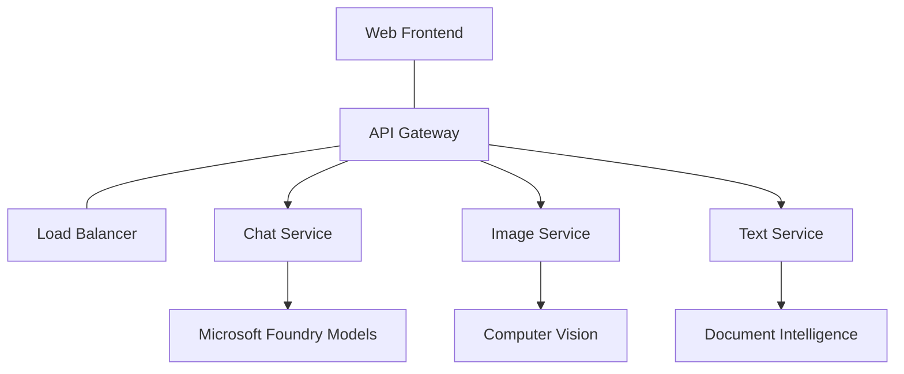

# Best Practices für KI-Produktiv-Workloads mit AZD

**Kapitelnavigation:**
- **📚 Kursstartseite**: [AZD für Einsteiger](../../README.md)
- **📖 Aktuelles Kapitel**: Kapitel 8 - Produktions- & Enterprise-Muster
- **⬅️ Vorheriges Kapitel**: [Kapitel 7: Fehlerbehebung](../chapter-07-troubleshooting/debugging.md)
- **⬅️ Ebenfalls zugehörig**: [KI Workshop-Labor](../chapter-02-ai-development/ai-workshop-lab.md)
- **🎯 Kurs abgeschlossen**: [AZD für Einsteiger](../../README.md)

## Übersicht

Dieser Leitfaden erklärt Produktions-KI-Designmuster mithilfe der Azure Developer CLI (AZD). Er dient als Designreferenz, nicht als bereitstellbare Anwendung oder Produktionszertifizierung.

**Beispielgrenzen:** Sofern nicht ausdrücklich als vollständig beschrieben, setzen Bicep-Fragmente Parameter und referenzierte Ressourcen aus einer übergeordneten Vorlage voraus. Sie lassen Host-Images/-Pläne, Identitäten, Rollenzuweisungen, DNS, Ausgaben und andere erforderliche Integrationen weg. YAML-Servicepfade sowie Hook-/Testskripte sind Beispiel-Dateien, die in **Ihrer eigenen Anwendung** erstellt werden sollen; sie werden von diesem Kurs nicht bereitgestellt. Verwenden Sie eine funktionierende AZD-Beispielbasis, kompilieren Sie die komplette Infrastruktur und testen Sie sie in einer isolierten Umgebung vor der Produktion.

## Wichtige adressierte Herausforderungen

Häufige Produktionsbedenken umfassen Multi-Service-Bereitstellungen, Identitäts- und Geheimnisverwaltung, Skalierung, Kostenkontrolle und Überwachung. Hier wird keine gemessene Verbreitung behauptet.

## Architektur-Muster für Produktions-KI

### Muster 1: Microservices-KI-Architektur

**Wann anwenden**: Komplexe KI-Anwendungen mit mehreren Fähigkeiten



**AZD-Implementierung**:

```yaml
# azure.yaml
name: enterprise-ai-platform
services:
  web:
    project: ./web
    host: staticwebapp
  api-gateway:
    project: ./api-gateway
    host: containerapp
  chat-service:
    project: ./services/chat
    host: containerapp
  vision-service:
    project: ./services/vision
    host: containerapp
  text-service:
    project: ./services/text
    host: containerapp
```

### Muster 2: Ereignisgesteuerte KI-Verarbeitung

**Wann anwenden**: Batch-Verarbeitung, Dokumentenanalyse, asynchrone Workflows

```bicep
// Event Hub for AI processing pipeline
resource eventHub 'Microsoft.EventHub/namespaces@2024-01-01' = {
  name: eventHubNamespaceName
  location: location
  sku: {
    name: 'Standard'
    tier: 'Standard'
    capacity: 1
  }
}

// Service Bus for reliable message processing
resource serviceBus 'Microsoft.ServiceBus/namespaces@2024-01-01' = {
  name: serviceBusNamespaceName
  location: location
  sku: {
    name: 'Premium'
    tier: 'Premium'
    capacity: 1
  }
}

// Function App for processing
resource functionApp 'Microsoft.Web/sites@2023-01-01' = {
  name: functionAppName
  location: location
  kind: 'functionapp,linux'
  properties: {
    siteConfig: {
      appSettings: [
        {
          name: 'FUNCTIONS_EXTENSION_VERSION'
          value: '~4'
        }
        {
          name: 'AZURE_OPENAI_ENDPOINT'
          value: '@Microsoft.KeyVault(VaultName=${keyVault.name};SecretName=openai-endpoint)'
        }
      ]
    }
  }
}
```

Dies erzeugt Namespace-Fragmente, keine Hubs, Queues, Abonnements oder Function-Trigger. Eine ausführbare Function benötigt außerdem einen Hosting-Plan, Laufzeit-/Speicherkonfiguration, eine angehängte Identität, RBAC und Netzwerkzugriff. Die Key Vault-Verweisung benötigt Berechtigung zum Lesen des Geheimnisses; eine Endpunkt-URL allein ist kein Anmeldecredential.

## Überwachung der KI-Agenten-Gesundheit

Wenn eine traditionelle Webanwendung ausfällt, sind die Symptome vertraut: eine Seite lädt nicht, eine API meldet einen Fehler oder eine Bereitstellung schlägt fehl. KI-gestützte Anwendungen können auf all diese Weisen ausfallen — aber auch subtilere Fehlverhalten zeigen, die keine offensichtlichen Fehlermeldungen erzeugen.

Dieser Abschnitt hilft Ihnen, ein mentales Modell zur Überwachung von KI-Workloads aufzubauen, damit Sie wissen, wo Sie nach Problemen suchen müssen.

### Wie sich Agenten-Gesundheit von traditioneller Anwendungs-Gesundheit unterscheidet

Traditionelle Anwendungen können ebenfalls subtile Korrektheitsprobleme haben. Ein KI-Agent fügt zur üblichen Verfügbarkeit und Korrektheit nondeterministische Antwortqualität hinzu. Betrachten Sie Agenten-Gesundheit in zwei Ebenen:

| Ebene | Worauf achten | Wo nachsehen |
|-------|--------------|---------------|
| **Infrastruktur-Gesundheit** | Läuft der Dienst? Sind Ressourcen bereitgestellt? Sind Endpunkte erreichbar? | `azd monitor`, Azure-Portal-Ressourcengesundheit, Container-/App-Logs |
| **Verhaltens-Gesundheit** | Reagiert der Agent korrekt? Sind Antworten zeitgerecht? Wird das Modell korrekt aufgerufen? | Application Insights Traces, Metriken zur Modellaufruflatenz, Protokolle zur Antwortqualität |

Die Infrastruktur-Gesundheit ist vertraut – sie ist für jede azd-App gleich. Die Verhaltens-Gesundheit ist die neue Ebene, die KI-Workloads hinzufügen.

### Wo nachsehen, wenn KI-Apps unerwartet agieren

Wenn Ihre KI-Anwendung nicht die erwarteten Ergebnisse liefert, hier eine konzeptionelle Checkliste:

1. **Bei den Grundlagen anfangen.** Läuft die App? Kann sie ihre Abhängigkeiten erreichen? Prüfen Sie `azd monitor` und Ressourcengesundheit wie bei jeder anderen App.
2. **Modellverbindung checken.** Ruft Ihre Anwendung das KI-Modell erfolgreich auf? Fehlgeschlagene oder zeitüberschrittene Modellaufrufe sind die häufigste Ursache für KI-App-Probleme und erscheinen in Ihren Anwendungsprotokollen.
3. **Eingaben und Grundlagendaten sicher prüfen.** Falsche Antworten können aus Abrufproblemen, Anweisungen, Modellbeschränkungen oder Werkzeugaustführung resultieren. Verwenden Sie kontrollierten und redigierten Diagnosedatenzugriff; aktivieren Sie keine wahllose Prompt-/Antwort-Protokollierung in der Produktion.
4. **Antwortlatenz überprüfen.** KI-Modellaufrufe sind langsamer als typische API-Aufrufe. Fühlt sich Ihre App träge an, prüfen Sie, ob die Modell-Antwortzeiten gestiegen sind – dies kann auf Drosselung, Kapazitätsgrenzen oder regionale Überlastung hinweisen.
5. **Achten Sie auf Kostensignale.** Unerwartete Spitzen bei Token-Nutzung oder API-Aufrufen können auf eine Schleife, einen falsch konfigurierten Prompt oder zu viele Wiederholungen hinweisen.

Sie müssen Monitoring-Tools nicht sofort meistern. Die wichtigste Erkenntnis ist, dass KI-Anwendungen eine zusätzliche Verhaltensebene zum Überwachen haben und azd eingebaute Überwachung (`azd monitor`) dafür einen Ausgangspunkt bietet.

---

## Sicherheits-Best Practices

### 1. Zero-Trust Sicherheitsmodell

**Implementierungsstrategie**:
- Keine service-zu-service Kommunikation ohne Authentifizierung
- Alle API-Aufrufe nutzen verwaltete Identitäten
- Netzwerkisolation mit privaten Endpunkten
- Zugriffe mit geringsten Rechten

```bicep
// Managed Identity for each service
resource chatServiceIdentity 'Microsoft.ManagedIdentity/userAssignedIdentities@2023-01-31' = {
  name: 'chat-service-identity'
  location: location
}

// Role assignments with minimal permissions
resource openAIUserRole 'Microsoft.Authorization/roleAssignments@2022-04-01' = {
  scope: openAIAccount
  name: guid(openAIAccount.id, chatServiceIdentity.id, '5e0bd9bd-7b93-4f28-af87-19fc36ad61bd')
  properties: {
    roleDefinitionId: subscriptionResourceId('Microsoft.Authorization/roleDefinitions', '5e0bd9bd-7b93-4f28-af87-19fc36ad61bd')
    principalId: chatServiceIdentity.properties.principalId
    principalType: 'ServicePrincipal'
  }
}
```

### 2. Sichere Geheimnisverwaltung

**Key Vault Integrationsmuster**:

```bicep
// Key Vault with proper access policies
resource keyVault 'Microsoft.KeyVault/vaults@2023-02-01' = {
  name: keyVaultName
  location: location
  properties: {
    tenantId: tenant().tenantId
    sku: {
      family: 'A'
      name: 'standard' // Premium is needed for HSM-backed keys, not ordinary secrets
    }
    enableRbacAuthorization: true  // Use RBAC instead of access policies
    enablePurgeProtection: true    // Prevent accidental deletion
    enableSoftDelete: true
    softDeleteRetentionInDays: 90
  }
}

// Optional legacy key-auth alternative; omit when using Entra ID.
resource openAIKeySecret 'Microsoft.KeyVault/vaults/secrets@2023-02-01' = {
  parent: keyVault
  name: 'openai-api-key'
  properties: {
    value: openAIAccount.listKeys().key1
    attributes: {
      enabled: true
    }
  }
}
```

Weisen Sie der Laufzeitidentität `Key Vault Secrets User` den passenden Geltungsbereich zu und hängen Sie sie an den Host an; `enableRbacAuthorization` allein gewährt keinen Zugriff. Bevorzugen Sie OpenAI verwaltete Identitäts-Authentifizierung mit `disableLocalAuth: true`. Das optionale Schlüsselgeheimnis macht nur für bewusst schlüsselaktivierte Konten Sinn, und der Bereitsteller benötigt ebenfalls Schreibberechtigung für Geheimnisse.

### 3. Netzwerksicherheit

**Private Endpunkt-Konfiguration**:

```bicep
// Virtual Network for AI services
resource virtualNetwork 'Microsoft.Network/virtualNetworks@2023-04-01' = {
  name: vnetName
  location: location
  properties: {
    addressSpace: {
      addressPrefixes: ['10.0.0.0/16']
    }
    subnets: [
      {
        name: 'ai-services-subnet'
        properties: {
          addressPrefix: '10.0.1.0/24'
          privateEndpointNetworkPolicies: 'Disabled'
        }
      }
      {
        name: 'app-services-subnet'
        properties: {
          addressPrefix: '10.0.2.0/24'
          delegations: [
            {
              name: 'Microsoft.Web/serverFarms'
              properties: {
                serviceName: 'Microsoft.Web/serverFarms'
              }
            }
          ]
        }
      }
    ]
  }
}

// Private endpoints for all AI services
resource openAIPrivateEndpoint 'Microsoft.Network/privateEndpoints@2023-04-01' = {
  name: '${openAIAccountName}-pe'
  location: location
  properties: {
    subnet: {
      id: virtualNetwork.properties.subnets[0].id
    }
    privateLinkServiceConnections: [
      {
        name: 'openai-connection'
        properties: {
          privateLinkServiceId: openAIAccount.id
          groupIds: ['account']
        }
      }
    ]
  }
}
```

Private Endpunkte benötigen außerdem private DNS-Zonengruppen/VNet-Verknüpfungen und App VNet-Integration. Sie blockieren nicht automatisch öffentlichen Zugriff: Deaktivieren Sie nach dem Validieren der privaten Konnektivität und Bereitstellungszugriffe explizit den öffentlichen Netzwerkzugriff des KI-Kontos.

## Performance und Skalierung

### 1. Auto-Scaling-Strategien

**Container Apps Auto-Scaling**:

```bicep
resource containerApp 'Microsoft.App/containerApps@2023-05-01' = {
  name: containerAppName
  location: location
  properties: {
    configuration: {
      ingress: {
        external: true
        targetPort: 8000
        transport: 'http'
      }
    }
    template: {
      scale: {
        minReplicas: 2  // Always have 2 instances minimum
        maxReplicas: 50 // Scale up to 50 for high load
        rules: [
          {
            name: 'http-scaling'
            http: {
              metadata: {
                concurrentRequests: '20'  // Scale when >20 concurrent requests
              }
            }
          }
          {
            name: 'cpu-scaling'
            custom: {
              type: 'cpu'
              metadata: {
                type: 'Utilization'
                value: '70'  // Scale when CPU >70%
              }
            }
          }
        ]
      }
    }
  }
}
```

### 2. Caching-Strategien

**Redis-Cache für KI-Antworten**:

```bicep
// Legacy Azure Cache for Redis example (not recommended for new deployments)
resource redisCache 'Microsoft.Cache/redis@2023-04-01' = {
  name: redisCacheName
  location: location
  properties: {
    sku: {
      name: 'Premium'
      family: 'P'
      capacity: 1
    }
    enableNonSslPort: false
    minimumTlsVersion: '1.2'
    redisConfiguration: {
      'maxmemory-policy': 'allkeys-lru'
    }
    // Sharding distributes data; replication/failover provides availability.
    shardCount: 2
  }
}

// Cache configuration in application
var cacheConnectionString = '${redisCache.properties.hostName}:6380,password=${redisCache.listKeys().primaryKey},ssl=True,abortConnect=False'
```

Azure Cache für Redis Basic/Standard/Premium befindet sich auf einem [Abschiedspfad](https://learn.microsoft.com/azure/azure-cache-for-redis/retirement-faq). Für neue Designs Azure Managed Redis mit dokumentierter SKU, Identität und TLS-Konfiguration verwenden, statt diese Legacy-Ressource in ein neues Produktionssystem zu kopieren. Die Connection-String-Zeile ist ein funktionsloser Platzhalter, kein Credential. Partitionieren Sie Cache-Schlüssel nach Autorisierung, Modell/Anweisungen und Abrufversion mit Ablauf; ein gemeinsam genutzter nur-Lese Cache kann Daten anderer Benutzer offenlegen.

### 3. Lastverteilung und Traffic-Management

**Application Gateway mit WAF**:

```bicep
// Application Gateway with Web Application Firewall
resource applicationGateway 'Microsoft.Network/applicationGateways@2023-04-01' = {
  name: appGatewayName
  location: location
  properties: {
    sku: {
      name: 'WAF_v2'
      tier: 'WAF_v2'
      capacity: 2
    }
    webApplicationFirewallConfiguration: {
      enabled: true
      firewallMode: 'Prevention'
      ruleSetType: 'OWASP'
      ruleSetVersion: '3.2'
    }
    // Backend pools for AI services
    backendAddressPools: [
      {
        name: 'ai-services-pool'
        properties: {
          backendAddresses: [
            {
              fqdn: '${containerApp.properties.configuration.ingress.fqdn}'
            }
          ]
        }
      }
    ]
  }
}
```

Dies ist eine teilweise Gateway-Ressource: Eine echte Bereitstellung benötigt außerdem Gateway-Subnetz-/IP-Konfiguration, Frontend-IPs und -Ports, TLS-Listener/-Zertifikate, Backend-HTTP-Einstellungen/-Probes, Routingregeln und Prioritäten sowie eine geprüfte WAF-Policy. TLS-Hostname/SNI und Authentifizierung müssen zum Container App-Backend passen.

## 💰 Kostenoptimierung

### 1. Ressourcen-Right-Sizing

**Umgebungsspezifische Konfigurationen**:

Diese Namen sind **illustrative benutzerdefinierte Template-Eingaben**, keine automatischen AZD-Einstellungen. Mappen Sie jede zuerst in `infra/main.parameters.json`/Bicep und Hostkonfiguration um. Zum Beispiel verwendet das RAG-Beispiel `AZURE_SEARCH_SERVICE_SKU` und `AZURE_OPENAI_CHATGPT_DEPLOYMENT_CAPACITY`, nicht die generischen untenstehenden Namen. Geben Sie Container Apps-Speicher eine unterstützte Einheit wie `1Gi` in der tatsächlichen Ressource. Wenden Sie Infrastrukturänderungen mit `azd up` oder `azd provision` an; `azd deploy` allein wendet keine Bicep-Änderungen an.

```bash
# Development environment
azd env new development
azd env set AZURE_OPENAI_SKU "S0"
azd env set AZURE_OPENAI_CAPACITY 10
azd env set AZURE_SEARCH_SKU "basic"
azd env set CONTAINER_CPU 0.5
azd env set CONTAINER_MEMORY 1.0

# Production environment  
azd env new production
azd env set AZURE_OPENAI_SKU "S0"
azd env set AZURE_OPENAI_CAPACITY 100
azd env set AZURE_SEARCH_SKU "standard"
azd env set CONTAINER_CPU 2.0
azd env set CONTAINER_MEMORY 4.0
```

### 2. Kostenüberwachung und Budgets

```bicep
// Supply the first day of the current UTC month, e.g. 2026-11-01T00:00:00Z.
param budgetStartDate string

// Cost management and budgets
resource budget 'Microsoft.Consumption/budgets@2024-08-01' = {
  name: 'ai-workload-budget'
  properties: {
    timePeriod: {
      startDate: budgetStartDate
    }
    timeGrain: 'Monthly'
    amount: 2000  // In the billing currency, not necessarily USD
    category: 'Cost'
    notifications: {
      warning: {
        enabled: true
        operator: 'GreaterThan'
        threshold: 80
        contactEmails: [
          'finance@company.com'
          'engineering@company.com'
        ]
        contactRoles: [
          'Owner'
          'Contributor'
        ]
      }
      critical: {
        enabled: true
        operator: 'GreaterThan'
        threshold: 95
        contactEmails: [
          'cto@company.com'
        ]
      }
    }
  }
}
```

Ersetzen Sie die Beispielempfänger und prüfen Sie Geltungsbereich/Berechtigungen. Budgetwarnungen nutzen verzögerte Abrechnungsdaten und erzwingen keine Ausgabenbegrenzung.

### 3. Token-Nutzungsoptimierung

**OpenAI Kostenmanagement**:

Dies ist nur eine zeichenbasierte Heuristik zur UI-Vorschau, **kein** Modell-Tokenlimit-Prüfer. Produktionscode muss einen Tokenizer verwenden, der zum eingesetzten Modell passt und Systemanweisungen, Tool-Schemata, Verlauf und Ausgabe-Budget berücksichtigt. Lehnen Sie übergroße Nutzernachrichten ab, statt sie stillschweigend zu kürzen.

```typescript
// Application-level token optimization
class TokenOptimizer {
  private readonly maxTokens = 4000;
  private readonly reserveTokens = 500;
  
  optimizePrompt(userInput: string, context: string): string {
    const availableTokens = this.maxTokens - this.reserveTokens;
    if (this.estimateTokens(userInput) + 8 >= availableTokens) {
      throw new Error("User input exceeds the illustrative prompt budget");
    }
    const estimatedTokens = this.estimateTokens(userInput + context) + 8;
    
    if (estimatedTokens > availableTokens) {
      // Truncate context, not user input
      context = this.truncateContext(context, Math.max(0, availableTokens - this.estimateTokens(userInput) - 8));
    }
    
    return `${context}\n\nUser: ${userInput}`;
  }
  
  private estimateTokens(text: string): number {
    // Rough estimation: 1 token ≈ 4 characters
    return Math.ceil(text.length / 4);
  }

  private truncateContext(text: string, estimatedBudget: number): string {
    return text.slice(0, Math.max(0, estimatedBudget) * 4);
  }
}
```

## Überwachung und Beobachtbarkeit

### 1. Umfassendes Application Insights

```bicep
// Application Insights with advanced features
resource applicationInsights 'Microsoft.Insights/components@2020-02-02' = {
  name: applicationInsightsName
  location: location
  kind: 'web'
  properties: {
    Application_Type: 'web'
    WorkspaceResourceId: logAnalyticsWorkspace.id
    SamplingPercentage: 100  // Ingestion setting; review cost and SDK sampling separately
    DisableIpMasking: false  // Retain IP masking
  }
}

// Custom metrics for AI operations
resource aiMetricAlerts 'Microsoft.Insights/metricAlerts@2018-03-01' = {
  name: 'ai-high-error-rate'
  location: 'global'
  properties: {
    description: 'Alert when failed request count exceeds 10 in five minutes'
    severity: 2
    enabled: true
    scopes: [
      applicationInsights.id
    ]
    evaluationFrequency: 'PT1M'
    windowSize: 'PT5M'
    criteria: {
      'odata.type': 'Microsoft.Azure.Monitor.SingleResourceMultipleMetricCriteria'
      allOf: [
        {
          name: 'high-error-rate'
          metricName: 'requests/failed'
          operator: 'GreaterThan'
          threshold: 10
          timeAggregation: 'Count'
        }
      ]
    }
  }
}
```

### 2. KI-spezifische Überwachung

**Benutzerdefinierte Dashboards für KI-Metriken**:

```json
{
  "dashboard": {
    "name": "AI Application Monitoring",
    "tiles": [
      {
        "name": "OpenAI Request Volume",
        "query": "dependencies | where target contains 'openai' | summarize count() by bin(timestamp, 5m)"
      },
      {
        "name": "AI Response Latency",
        "query": "dependencies | where target contains 'openai' | summarize avg(duration) by bin(timestamp, 5m)"
      },
      {
        "name": "Token Usage",
        "query": "customMetrics | where name == 'openai_tokens_used' | summarize sum(value) by bin(timestamp, 1h)"
      },
      {
        "name": "Cost per Hour",
        "query": "customMetrics | where name == 'openai_cost' | summarize sum(value) by bin(timestamp, 1h)"
      }
    ]
  }
}
```

Dieses JSON ist ein anwendungsspezifischer Entwurf, kein importierbares Azure-Portal-Dashboard-Schema. Die Token-/Kostenabfragen erfordern, dass Ihre App diese genauen benutzerdefinierten Metriken ausgibt; sie werden nicht von AZD erzeugt. Passen Sie Abhängigkeitsfilter für Ihre tatsächlichen Modellendpunkt-/Spannennamen an.

### 3. Gesundheitsprüfungen und Verfügbarkeitsüberwachung

```bicep
// Application Insights availability tests
resource availabilityTest 'Microsoft.Insights/webtests@2022-06-15' = {
  name: 'ai-app-availability-test'
  location: location
  tags: {
    'hidden-link:${applicationInsights.id}': 'Resource'
  }
  properties: {
    SyntheticMonitorId: 'ai-app-availability-test'
    Name: 'AI Application Availability Test'
    Description: 'Tests AI application endpoints'
    Enabled: true
    Frequency: 300  // 5 minutes
    Timeout: 120    // 2 minutes
    Kind: 'standard'
    Locations: [
      {
        Id: 'us-east-2-azr'
      }
      {
        Id: 'us-west-2-azr'
      }
    ]
    Request: {
      RequestUrl: 'https://${webApp.properties.defaultHostName}/health'
      HttpVerb: 'GET'
      FollowRedirects: true
      ParseDependentRequests: false
    }
    ValidationRules: {
      ExpectedHttpStatusCode: 200
      SSLCheck: true
      SSLCertRemainingLifetimeCheck: 7
    }
  }
}
```

## Katastrophenwiederherstellung und hohe Verfügbarkeit

Der vorstehende Test setzt einen bestehenden App Service `webApp` und eine Application Insights-Ressource voraus. Standard-Verfügbarkeitstests sind kostenpflichtig und benötigen einen erreichbaren Endpunkt; rein private Apps brauchen ein entsprechendes privates Monitoring-Design. URL-Ping-Tests sind veraltet; verwenden Sie [Standard-Verfügbarkeitstests](https://learn.microsoft.com/azure/azure-monitor/app/availability).

### 1. Multi-Region-Bereitstellung

```yaml
# azure.yaml - Multi-region configuration
name: ai-app-multiregion
services:
  api-primary:
    project: ./api
    host: containerapp
    env:
      AZURE_REGION: eastus
  api-secondary:
    project: ./api
    host: containerapp
    env:
      AZURE_REGION: westus2
```

```bicep
// Separate App Service topology, not the Container Apps declarations above
resource trafficManager 'Microsoft.Network/trafficManagerProfiles@2022-04-01' = {
  name: trafficManagerProfileName
  location: 'global'
  properties: {
    profileStatus: 'Enabled'
    trafficRoutingMethod: 'Priority'
    dnsConfig: {
      relativeName: trafficManagerProfileName
      ttl: 30
    }
    monitorConfig: {
      protocol: 'HTTPS'
      port: 443
      path: '/health'
      intervalInSeconds: 30
      toleratedNumberOfFailures: 3
      timeoutInSeconds: 10
    }
    endpoints: [
      {
        name: 'primary-endpoint'
        type: 'Microsoft.Network/trafficManagerProfiles/azureEndpoints'
        properties: {
          targetResourceId: primaryAppService.id
          endpointStatus: 'Enabled'
          priority: 1
        }
      }
      {
        name: 'secondary-endpoint'
        type: 'Microsoft.Network/trafficManagerProfiles/azureEndpoints'
        properties: {
          targetResourceId: secondaryAppService.id
          endpointStatus: 'Enabled'
          priority: 2
        }
      }
    ]
  }
}
```

Umgebungvariablen wählen keine Ressourcenstandorte. IaC muss verschiedene regionale Hosts bereitstellen und jeden Dienst mit `resourceName` oder `azd-service-name` Tags binden. Das Traffic Manager-Beispiel ist eine **separate App Service-Topologie** (`primaryAppService`/`secondaryAppService`), kein Routing für die Container Apps-Deklarationen. Container Apps benötigen einen entsprechend konfigurierten externen Endpunkt/Frontdoor, TLS-/kundenspezifisches Domain-Routing und Gesundheitsprüfungen.

### 2. Datensicherung und Wiederherstellung

```bicep
// Backup configuration for critical data
resource backupVault 'Microsoft.DataProtection/backupVaults@2023-05-01' = {
  name: backupVaultName
  location: location
  identity: {
    type: 'SystemAssigned'
  }
  properties: {
    storageSettings: [
      {
        datastoreType: 'VaultStore'
        type: 'LocallyRedundant'
      }
    ]
  }
}

```

Das Vault allein sichert nichts. Konfigurieren Sie eine **workload-spezifische unterstützte Richtlinie und Sicherungsinstanz**, Quellberechtigungen, Aufbewahrung und Wiederherstellungstests mit den [Azure Backup Support-Matrizen](https://learn.microsoft.com/azure/backup/backup-support-matrix). Es gibt keine generische Azure Backup-Richtlinie für gehostete Azure OpenAI-Modellbereitstellungen. Bewahren Sie Infrastruktur-/Modell-Definitionsdateien in Quellcodeverwaltung auf; schützen Sie hochgeladene Dokumente, Anwendungsdaten und Feinabstimmungsartefakte mit den Sicherungs-/Exportfunktionen der jeweiligen Basisdienste. Definieren und testen Sie RPO/RTO explizit.

## DevOps- und CI/CD-Integration

### 1. GitHub Actions Workflow

```yaml
# .github/workflows/deploy-ai-app.yml
name: Deploy AI Application

on:
  push:
    branches: [main]
  pull_request:
    branches: [main]

jobs:
  test:
    runs-on: ubuntu-latest
    steps:
      - uses: actions/checkout@v4
      
      - name: Setup Python
        uses: actions/setup-python@v4
        with:
          python-version: '3.11'
          
      - name: Install dependencies
        run: |
          pip install -r requirements.txt
          pip install pytest
          
      - name: Run tests
        run: pytest tests/
        
      - name: AI Safety Tests
        run: |
          python scripts/test_ai_safety.py
          python scripts/validate_prompts.py

```

Dies ist der **Test-Only-Teil** eines Workflows und geht davon aus, dass Sie `requirements.txt`, `tests/` und die beiden Sicherheits-Skripte erstellt haben. Fügen Sie die authentifizierten OIDC-Provisionierungs-/Bereitstellungsjobs aus [CI/CD Pipeline Configuration](#cicd-pipeline-configuration) hinzu, mit `needs: test`, einem vertrauenswürdigen Push-/Manuell-Trigger und geschützten GitHub-Umgebungen. Stellen Sie keinen unzuverlässigen Pull-Request-Code mit Cloud-Anmeldeinformationen bereit. Ein frischer Runner hat keine ausgewählte lokale AZD-Umgebung; übergeben Sie die Eingaben für Umgebung/Abonnement/Region und verwenden Sie `azd auth login`, nicht nur `azure/login`.

### 2. Infrastrukturvalidierung

```bash
# scripts/validate_infrastructure.sh
#!/bin/bash
set -euo pipefail

echo "Validating AI infrastructure deployment..."

# Requires Azure CLI login and the resource group selected explicitly.
: "${AZURE_RESOURCE_GROUP:?Set AZURE_RESOURCE_GROUP}"
: "${AZURE_OPENAI_NAME:?Set AZURE_OPENAI_NAME}"
: "${AZURE_OPENAI_CHAT_DEPLOYMENT:?Set the actual deployment name}"

# A successful empty list is not proof that resources exist.
types=("Microsoft.CognitiveServices/accounts" "Microsoft.Search/searchServices"
       "Microsoft.Storage/storageAccounts" "Microsoft.KeyVault/vaults")
for resource_type in "${types[@]}"; do
    count=$(az resource list --resource-group "$AZURE_RESOURCE_GROUP" \
        --resource-type "$resource_type" --query "length(@)" -o tsv)
    if [[ "$count" -lt 1 ]]; then
        echo "ERROR: No $resource_type found in $AZURE_RESOURCE_GROUP"
        exit 1
    fi
done

# Validate OpenAI model deployments
echo "Validating OpenAI model deployments..."
state=$(az cognitiveservices account deployment show \
  --name "$AZURE_OPENAI_NAME" --resource-group "$AZURE_RESOURCE_GROUP" \
  --deployment-name "$AZURE_OPENAI_CHAT_DEPLOYMENT" \
  --query "properties.provisioningState" -o tsv)
if [[ "$state" != "Succeeded" ]]; then
    echo "ERROR: Required model deployment is not provisioned successfully"
    exit 1
fi

echo "Infrastructure validation completed successfully!"
```

Erwartet: ein Null-Exit und die Abschlussmeldung nur, wenn alle erwarteten Typen existieren und die benannte Modellbereitstellung bereitsteht. Dies prüft Inventar/Bereitstellungsstatus, **nicht** Ressourcengesundheit, exakte Topologie, RBAC, Netzwerkkonnektivität oder Modellverhalten. Passen Sie die erwarteten Typen an Ihre Architektur an, führen Sie dann einen separaten authentifizierten Anwendung-Readiness-Test durch.

## Produktionsbereitschafts-Checkliste

### Sicherheit ✅
- [ ] Alle Dienste nutzen verwaltete Identitäten
- [ ] Geheimnisse im Key Vault gespeichert
- [ ] Private Endpunkte konfiguriert
- [ ] Netzwerksicherheitsgruppen implementiert
- [ ] RBAC mit dem geringsten Recht
- [ ] WAF an öffentlichen Endpunkten aktiviert

### Performance ✅
- [ ] Auto-Scaling konfiguriert
- [ ] Caching implementiert
- [ ] Lastverteilung eingerichtet
- [ ] CDN für statische Inhalte
- [ ] Datenbank-Connection-Pooling
- [ ] Token-Nutzungsoptimierung

### Überwachung ✅
- [ ] Application Insights konfiguriert
- [ ] Benutzerdefinierte Metriken definiert
- [ ] Benachrichtigungsregeln eingerichtet
- [ ] Dashboard erstellt
- [ ] Gesundheitsprüfungen implementiert
- [ ] Protokollaufbewahrungsrichtlinien

### Zuverlässigkeit ✅
- [ ] Multi-Region Bereitstellung
- [ ] Backup- und Wiederherstellungsplan
- [ ] Circuit Breaker implementiert
- [ ] Retry-Richtlinien konfiguriert
- [ ] Sanfter Abbau
- [ ] Gesundheitsprüfungsendpunkte

### Kostenmanagement ✅
- [ ] Budgetwarnungen konfiguriert
- [ ] Ressourcen-Right-Sizing
- [ ] Dev/Test-Rabatte angewendet
- [ ] Reserved Instances erworben
- [ ] Kostenüberwachungs-Dashboard
- [ ] Regelmäßige Kostenüberprüfungen

### Compliance ✅
- [ ] Anforderungen an Datenresidenz eingehalten
- [ ] Prüfprotokollierung aktiviert
- [ ] Compliance-Richtlinien angewendet
- [ ] Sicherheitsbaselines implementiert
- [ ] Regelmäßige Sicherheitsbewertungen
- [ ] Vorfallreaktionsplan

## Leistungsbenchmarks

### Illustrierte Produktionsziele

Dies sind Beispiel-SLOs zum Verhandeln und Lasttesten, keine gemessenen Benchmarks oder Garantien. Antwortlatenz hängt von Modell-/Ausgabelänge ab; monatliche Token-Ausgaben hängen von Traffic und Preisen ab, nicht nur der Tokenanzahl.

| Metrik | Ziel | Überwachung |
|--------|--------|------------|
| **Antwortzeit** | < 2 Sekunden | Application Insights |
| **Verfügbarkeit** | 99,9 % | Uptime-Überwachung |
| **Fehlerquote** | < 0,1 % | Anwendungsprotokolle |
| **Modell-Ausgaben** | < 500 $/Monat (Beispielbudget) | Kostenmanagement |
| **Gleichzeitige Nutzer** | 1000+ | Lasttests |
| **Wiederherstellungszeit** | < 1 Stunde | Desaster-Wiederherstellungstests |

### Lasttests

Folgendes ist eine Schnittstellen-Skizze für ein Lasttestskript, das **Sie implementieren müssen**; dieses Repository liefert kein `scripts/load_test.py`. Definieren Sie Anforderungs-Payloads, Authentifizierung, repräsentative Arbeitslasten, Perzentilzeiten/Fehlerannahmen und eine Ausgabengrenze in Ihrem gewählten Lasttest-Tool, bevor Sie es ausführen:

```bash
# Load testing script for AI applications
python scripts/load_test.py \
  --endpoint https://your-ai-app.azurewebsites.net \
  --concurrent-users 100 \
  --duration 300 \
  --ramp-up 60
```

## 🤝 Community Best Practices

Basierend auf Feedback aus der Microsoft Foundry Discord-Community:

### Top-Empfehlungen aus der Community:

1. **Klein anfangen, schrittweise skalieren**: Beginnen Sie mit grundlegenden SKUs und skalieren Sie basierend auf tatsächlicher Nutzung
2. **Alles überwachen**: Richten Sie von Anfang an umfassendes Monitoring ein
3. **Sicherheit automatisieren**: Verwenden Sie Infrastruktur als Code für konsistente Sicherheit
4. **Gründlich testen**: Integrieren Sie KI-spezifische Tests in Ihre Pipeline
5. **Kosten planen**: Überwachen Sie den Tokenverbrauch und richten Sie frühzeitig Budgetwarnungen ein

### Häufige Fallstricke vermeiden:

- ❌ Hardcodierung von API-Schlüsseln im Code
- ❌ Kein richtiges Monitoring einrichten
- ❌ Kostenoptimierung ignorieren
- ❌ Fehlerszenarien nicht testen
- ❌ Deployment ohne Gesundheitsprüfungen durchführen

## AZD AI CLI Befehle und Erweiterungen

AZD enthält eine wachsende Sammlung KI-spezifischer Befehle und Erweiterungen, die Produktions-KI-Workflows vereinfachen. Diese Tools überbrücken die Lücke zwischen lokaler Entwicklung und Produktionsbereitstellung für KI-Arbeitslasten.

> **Release Review (04.11.2026):** Die untenstehende CLI-Anleitung wurde mit den veröffentlichten Versionen von `azd` **1.37.2**, `azure.ai.agents` **1.0.0-beta.23** und `azure.ai.evaluations` **1.0.0-beta.2** geprüft. Agents beta.23 benötigt `azd >= 1.37.0`; evaluations beta.2 benötigt `azd >= 1.33.0`. Verwenden Sie mindestens 1.37.0 für den kombinierten Workflow. Dies ist eine Dokumentations-/Quellcode-Überprüfung, keine Live-Validierung in Azure.

### AZD Erweiterungen für KI

AZD verwendet ein Erweiterungssystem, um KI-spezifische Fähigkeiten hinzuzufügen. Installieren und verwalten Sie Erweiterungen mit:

```bash
# List all available extensions (including AI)
azd extension list

# Inspect installed extension details
azd version
azd extension show azure.ai.agents

# Install the Foundry agents extension
azd extension install azure.ai.agents

# Install the separate Foundry evaluations extension
azd extension install azure.ai.evaluations

# Install the fine-tuning extension
azd extension install azure.ai.finetune

# Install the custom models extension
azd extension install azure.ai.models

# Upgrade all installed extensions
azd extension upgrade --all
```

**Verfügbare KI-Erweiterungen:**

| Erweiterung | Zweck | Status |
|-----------|---------|--------|
| `azure.ai.agents` | Foundry Agent Dienstverwaltung | Vorschau |
| `azure.ai.evaluations` | Evaluierungsdatensätze, Evaluatoren, Bewertungsgruppen und Durchläufe | Vorschau |
| `azure.ai.skills` | Wiederverwendbare Agent-Fähigkeiten | Vorschau |
| `azure.ai.connections` | Foundry-Verbindungen (Datenquellen, Tools) | Vorschau |
| `azure.ai.finetune` | Foundry Modell-Feinabstimmung | Vorschau |
| `azure.ai.models` | Foundry kundenspezifische Modelle | Vorschau |
| `azure.coding-agent` | Konfiguration von Codierungsagenten | Verfügbar |

> Führen Sie `azd extension list --installed` und `azd extension show azure.ai.evaluations` aus, um installierte Versionen zu prüfen. Aktualisieren Sie zuerst die Kern-CLI mit den [Installations-/Updateanweisungen](https://learn.microsoft.com/azure/developer/azure-developer-cli/install-azd) (für eine Windows-Winget-Installation: `winget upgrade Microsoft.Azd`), dann führen Sie `azd extension upgrade --all` aus. Es gibt keinen Kernbefehl `azd upgrade`. Prüfen Sie Breaking Changes vor dem Upgrade von Produktionsautomatisierungen; gehen Sie nicht davon aus, dass ein Erweiterungs-Upgrade alte Befehls- oder Konfigurationsformate bewahrt.

### Aktuelle Release-Änderungen und Fehlerbehebungen

| Release | Was sich für diesen Kurs ändert |
|---------|------------------------------|
| `azd 1.37.0` | Fügt stabile Deployment-Vorschau-APIs hinzu und behebt, dass Erweiterungsbearbeitungen nicht verwandte `azure.yaml`-Einstellungen überschrieben haben. |
| `azd 1.37.1` | Behebt die Ctrl+C-Weitergabe über Erweiterungen hinweg und unterscheidet Abbruch/Timeouts von allgemeinen Fehlern. |
| `azd 1.37.2` | Verbessert die Validierung der Bereitstellung: Kritische Warnungen standardmäßig auf **Nein**, scheitert bei unbeaufsichtigten Läufen ohne Bestätigung, Abbruch überspringt Post-Provision Hooks. Behebt außerdem unerfüllte Umgebungswerte in Deployment Stacks-Verweigerungslisten bei aktivierter Alpha-Funktion. |
| Agents `beta.22` | Migriert Evaluierung zu `azd ai eval`, ändert Optimierung zur GA v1-API, benötigt plural `toolboxes`, und trennt managed-harness, Sprache und lang laufende Vorschau-Opt-Ins. Behebt umgebungsspezifische Modellauswahl und Toolbox-Authentifizierung. |
| Agents `beta.23` | Macht `init --harness` sichtbar; behebt A2A 0.3 Antwort-Ausgabe, ungültige Prompt-Agent-Pfade/-Module über Infrastruktur-Schichten, Aktivierungs-Timeout-Diagnosen und behaltene Entwickler-RBAC-Warnungen. |
| Evaluations `beta.2` | Erfordert CamelCase-Evaluierungskonfiguration, fügt statische/simulierte Konversationsauthoring und explizite lokale Dateiquellen hinzu, und behebt Dataset-Identitäts-/Versionshandhabung, Qualitäts-Gate-Zählungen und Fehlerdiagnosen. |

Ein Agent-Aktivierungs-Timeout beweist **nicht** das Scheitern der Bereitstellung: Prüfen Sie die versuchte Version und deren Zustand, bevor Sie es erneut versuchen. Entwickler-RBAC-Warnungen können verbleiben, selbst wenn die Bereitstellung erfolgreich ist; beheben Sie den fehlenden Zugriff, bevor Sie diesen Entwickler aufrufen.

Quellen: [AZD Releases](https://github.com/Azure/azure-dev/releases), [Agents beta.23 Release](https://github.com/Azure/azure-dev/releases/tag/azd-ext-azure-ai-agents_1.0.0-beta.23), [Agents beta.22 Migration](https://github.com/Azure/azure-dev/releases/tag/azd-ext-azure-ai-agents_1.0.0-beta.22) und [Evaluations beta.2 Release](https://github.com/Azure/azure-dev/releases/tag/azd-ext-azure-ai-evaluations_1.0.0-beta.2).

**Was sind die neueren `skills` und `connections` Erweiterungen?**

Zwei Vorschau-Erweiterungen erschienen parallel zu den Agenten-Tools und sind auch für Anfänger wertvoll:

- **`azure.ai.skills`** — Eine **Fähigkeit** ist eine wiederverwendbare Fähigkeit (ein verpacktes Tool oder Verhalten), das Sie an einen oder mehrere Agenten anhängen können, anstatt es jedes Mal neu zu implementieren. Denken Sie daran als einen gemeinsamen Baustein: Definieren Sie eine "durchsuche die Dokumentation" oder "bestelle ansehen" Fähigkeit einmal, und verwenden Sie sie dann Agenten-übergreifend. Das hält Multi-Agent-Systeme (Kapitel 5) konsistent und vermeidet Copy-Paste.
- **`azure.ai.connections`** — Eine **Verbindung** ist ein verwalteter Link von Ihrem Foundry-Projekt zu einer externen Ressource, die Ihre Agenten benötigen – eine Datenquelle (wie Azure AI Search), einen Tool-Endpunkt oder einen anderen Dienst. Verbindungen zentralisieren *wo* und *wie* Agenten auf Daten zugreifen, sodass Zugangsdaten und Endpunkte an einem verwalteten Ort leben und nicht im Code verstreut sind.

Sie brauchen diese nicht, um Ihre ersten Agenten bereitzustellen – bleiben Sie bei `azure.ai.agents` beim Lernen. Nutzen Sie `skills`, wenn Sie dasselbe Tool über Agenten hinweg duplizieren, und `connections`, wenn mehrere Agenten dieselbe Datenquelle teilen.

### Initialisierung von Agent-Projekten mit `azd ai agent init`

Der Befehl `azd ai agent init` scaffoldet ein Microsoft Foundry-Agenten-Projekt. Verwenden Sie eine aktuelle `azure.yaml` Projektvorlage, nicht ein implizites Legacy-Agentenmanifest:

```bash
# Initialize a new agent project from a local project template
azd ai agent init --template ./templates/support-agent/azure.yaml

# Initialize and target a specific Foundry project
azd ai agent init --template ./templates/support-agent/azure.yaml --project-id <foundry-project-id>

# Adopt the template into a different directory
azd ai agent init --template ./templates/support-agent/azure.yaml --src ./agents/my-agent
```

**Wichtige Flags:**

| Flag | Beschreibung |
|------|-------------|
| `-t, --template` | Pfad oder unterstützte GitHub-URI zu einem `azure.yaml`-Projektdokument |
| `-p, --project-id` | Bestehende Microsoft Foundry Projekt-ID für Ihre azd Umgebung |
| `-s, --src` | Quelldirectory für generierte Agenten oder Zielverzeichnis beim Übernehmen eines Projekts |
| `--kind` | Initialisiert einen `hosted`, `prompt` oder Vorschau-`prompt-voice` Agenten |
| `--harness` | Optionales Ausführungsharness für `--kind prompt`; benötigt dessen Vorschau-Opt-In |
| `-e, --environment` | Die zu verwendende azd-Umgebung |

`--manifest`/`-m` ist ein veralteter Alias für `--template`/`-t`; die Umbenennung des Flags konvertiert kein altes Manifest in ein aktuelles Projektdokument. `--host containerapp` ist kein aktuelles Agent-Init-Flag. Für eine gewöhnliche Container Apps-Anwendung verwenden Sie `azd init --template` mit einer Vorlage, die `host: containerapp` angibt.

Für ein bestehendes Projekt mit genau einem `azure.ai.project` Service fügt oder aktualisiert `azd ai agent add support-agent --file ./agents/support-agent.yaml` eine direkte Agentendefinition ohne Bereitstellung oder Deployment. Laufzeitbefehle lehnen Legacy implizite `agent.yaml`/AgentManifest- und verschachtelte Service-`config:` Definitionen ab; migrieren Sie diese zu einem aktuellen `azure.ai.agent` Service. Wenn init einen `cd` als nächsten Schritt ausgibt, führen Sie diesen vor `azd up` aus: init wechselt nicht Ihr Shell-Verzeichnis.

**Produktionstipp**: Verwenden Sie `--project-id`, um direkt eine bestehende Foundry-Projektverbindung herzustellen und Ihren Agent-Code mit Cloud-Ressourcen von Anfang an zu verknüpfen.

#### Optionale Vorschaufunktionen

Managed Harness, Sprache und lang laufende Aufrufe sind standardmäßig unabhängig voneinander deaktiviert. Setzen Sie nur den Schalter für die Funktion, die Sie im **Shell-/CI-Prozessumfeld** benötigen, nicht mit `azd env set`:

| Funktion | Prozess-Umgebungsvariable |
|---------|------------------------------|
| Managed Harness (`init --kind prompt --harness ...`) | `AZD_ALPHA_ENABLE_AGENTS_MANAGED_HARNESS=true` |
| Sprache (`init --kind prompt-voice`) | `AZD_ALPHA_ENABLE_AGENTS_VOICE=true` |
| Lang laufende Aufrufe | `AZD_ALPHA_ENABLE_AGENTS_LONG_RUNNING=true` |

Zum Beispiel verwenden Sie `export AZD_ALPHA_ENABLE_AGENTS_MANAGED_HARNESS=true` in Bash oder `$env:AZD_ALPHA_ENABLE_AGENTS_MANAGED_HARNESS = "true"` in PowerShell, bevor Sie den relevanten Befehl ausführen. Ein Schalter aktiviert nicht die anderen. Siehe die [veröffentlichten Agents README](https://github.com/Azure/azure-dev/blob/azd-ext-azure-ai-agents_1.0.0-beta.23/cli/azd/extensions/azure.ai.agents/README.md) für alle Vorschau-Schalter und Einschränkungen.

### Verwaltung des Agent-Lebenszyklus

Verwenden Sie `azure.ai.agents` zum Testen, Prüfen, Optimieren und Stilllegen von Agenten und die separate `azure.ai.evaluations` Erweiterung zur Qualitätsmessung:

```bash
# Invoke a deployed agent and view server response timing
# (total latency and time to first byte)
azd ai agent invoke

# Show the live endpoint configuration before changing it
azd ai agent endpoint show

# Download the deployed source of a code-based hosted agent
# (with SHA-256 verification)
azd ai agent code download

# Delete a hosted agent and all of its versions
# (--force terminates active sessions)
azd ai agent delete --force
```

**Lebenszyklus auf einen Blick:**

| Phase | Befehl | Produktionsnutzung |
|-------|---------|----------------|
| Test | `azd ai agent invoke` | Validieren von Antworten und Messen der Latenz vor dem Release |
| Prüfung | `azd ai agent endpoint show` | Überprüfen von Endpunkt-Authentifizierung/-Konfiguration; frühzeitiges Erkennen von Breaking Changes |
| Messung | `azd ai eval init`, `generate`, `run start` | Definieren, Bereitstellen und Ausführen wiederholbarer Evaluierungen |
| Verbesserung | `azd ai agent optimize --eval <evaluation-name> --optimize-model <optimizer-deployment>` | Wiederverwendung einer kompatiblen Evaluierung zur Agentenoptimierung |
| Wiederherstellung | `azd ai agent code download` | Abruf der exakt bereitgestellten Quelle für Prüfung/Rollback |
| Stilllegung | `azd ai agent delete --force` | Sauberes Entfernen eines Agenten und seiner Versionen |

> Dies sind Vorschau-Befehle und können sich zwischen Erweiterungs-Releases ändern. Führen Sie `azd ai agent --help` aus, um die genauen Unterbefehle Ihrer installierten Version zu sehen.

`endpoint show` unterstützt gehostete, Prompt- und Sprachagenten, aber Endpunkt-Updates sind nur für gehostete Agenten; Workflow-Agenten werden nicht unterstützt. Code-Download und das obige Beispiel für die Stilllegung gehosteter Agenten sind keine generischen Operationen für jeden Agententyp.

#### Evaluierungsmigration und Qualitätsprüfungen

Ab Agents **1.0.0-beta.22 (23.10.2026)** bieten Legacy-`azd ai agent eval` Befehle Migrationshilfen anstelle des früheren Evaluierungs-Workflows. Kopieren Sie keine alten `eval generate --dataset ...` Beispiele: Evaluierung befindet sich jetzt unter **`azd ai eval`**.

In einem initialisierten Agentenprojekt authentifizieren Sie sich mit `azd auth login`, bestätigen die ausgewählte Umgebung/Foundry-Projekt und installieren `azure.ai.evaluations`. Ein Judge-Modell-Deployment wird für modellbasiertes Scoring benötigt; Generierung und Gesprächssimulation können jeweils eigene Modellauswahlen erfordern und zusätzliche Kosten verursachen.

```bash
# Scaffold evals/ and wire an azure.ai.eval service into azure.yaml
azd ai eval init

# Optionally synthesize a rubric and dataset from the agent
azd ai eval generate

# Review generated files, then register datasets, evaluators, and eval groups
azd up

# Start an evaluation and wait for its results
azd ai eval run start --wait

# Inspect runs and available test-case output
azd ai eval run list
azd ai eval run show <run-id>
azd ai eval run output list <run-id>
```

Folgen Sie den interaktiven Auswahlen und den ausgegebenen nächsten Schritten, anstatt anzunehmen, dass generierte Assets bereits registriert sind. Evaluierungskonfiguration befindet sich normalerweise in `evals/azure.eval.yaml`, referenziert vom Dienst `azure.ai.eval` in `azure.yaml`. Schlüssel sind **CamelCase** (`evaluationLevel`, `maxSamples`, `initializationParameters`, `dataMapping`); alte snake_case-Konfigurationsschlüssel werden abgelehnt. Pfade innerhalb einer referenzierten Konfiguration lösen sich relativ zu dieser Datei auf, nicht zum Repository-Stamm.

Für Gesprächsevaluierungen wählen Sie **statisch**, um abgeschlossene Transkripte zu bewerten, ohne einen Agenten aufzurufen, oder **Simulation**, um Gespräche aus Szenariensamen zu generieren. Simulation benötigt ein Agentenziel, ein Simulatormodell und eine separate Judge-Modellauswahl. Für unbeaufsichtigte Befehle geben Sie die von `azd ai eval init --help` und `azd ai eval generate --help` aufgelisteten Eingaben an; gehen Sie nicht davon aus, dass das Generierungsmodell auch der Judge oder Simulator ist.

Für CI konfigurieren Sie eine explizite Qualitätspolitik mit `azd ai eval run start --help` (`--fail-on`) und behandeln Sie einen Nicht-Null-Hostexit als Fehler. Ein abgeschlossener Lauf ist nicht automatisch ein Qualitäts-Sieg. Überprüfen Sie fehlgeschlagene/fehlerhafte Zeilen und Diagnosen; fehlende oder inkonsistente Ergebnisanzahlen sind kein Beweis für Erfolg. Registrierte Datensätze behalten ihre Dienstidentität/-version; `--max-samples` kann keinen registrierten Datensatz subsetten. Veröffentlichen Sie bewusst einen kleineren Datensatz oder verwenden Sie eine unterstützte lokale Dateiquelle.

```bash
# Example CI policy: at least 90% of all test cases must pass
azd ai eval run start --wait --fail-on "pass-rate=0.9"
```

Die Erfolgsquote-Grenze verwendet bestandene Testfälle geteilt durch Gesamtzahl der Testfälle; fehlgeschlagene, fehlerhafte, übersprungene und anderweitig nicht bestandene Zeilen zählen dagegen. Kombinieren Sie ein Gate nicht mit `--no-wait`, das vor einem Urteil zurückkehrt.

#### Migration der Optimierungskonfiguration

Die Optimierung verwendet jetzt die GA v1-API. Um eine kompatible **Auf-Ebenen-Turn, datensatzgestützte** Evaluierung aus dem neuen Workflow wiederzuverwenden:

```bash
# Replace placeholders with the evaluation name and optimizer model deployment
azd ai agent optimize --eval-config ./evals/azure.eval.yaml --eval <evaluation-name> --optimize-model <optimizer-deployment>
```

`--eval` wählt eine Bewertung aus; `--eval-config` wählt dessen Konfigurationsdatei aus (einschließlich dateibasierten Definitionen). `--config` nimmt stattdessen eine **eigenständige Optimierungs-API-Anfrage** in YAML oder JSON entgegen. Übergeben Sie keinen alten Agenten `eval.yaml` oder den neuen `azure.eval.yaml` an `--config`, und kombinieren Sie nicht `--config` mit `--eval`/`--eval-config`. Konversations-, trace-basierte oder Simulationsevaluationen sind nicht austauschbar mit der datensatzbasierten Optimierungsabkürzung; verwenden Sie für diese Szenarien das unterstützte Optimierungsanfrageformat. Überprüfen Sie Kandidaten, bevor Sie sie anwenden oder bereitstellen.

Siehe die [Evaluationen-Referenz für die geprüfte Version](https://github.com/Azure/azure-dev/blob/azd-ext-azure-ai-evaluations_1.0.0-beta.2/cli/azd/extensions/azure.ai.evaluations/README.md) und [Optimierungsbefehlsquelle für die geprüfte Version](https://github.com/Azure/azure-dev/blob/azd-ext-azure-ai-agents_1.0.0-beta.23/cli/azd/extensions/azure.ai.agents/internal/cmd/optimize.go) für genaue Optionen.

#### Vorschau der Bereitstellung eines Nur-Lese-Hosted-Agenten

Für eine vorhandene, an Foundry gebundene Umgebung mit einem einheitlichen `azure.ai.agent` Dienst von `kind: hosted` vergleichen Sie vor der Bereitstellung die unterstützte Konfiguration:

```bash
azd deploy <service-name> --preview --no-prompt
```

Diese Vorschau stellt den Agenten nicht bereit. Es handelt sich nicht um eine vollständige Infrastruktur-/Sicherheits-Differenz: Prompt-/Voice-/Workflow-Agenten, Altkonfigurationslayouts und einige gehostete Einstellungen fallen nicht in ihren Umfang. Ein `unknown` Ergebnis ist keine Freigabe zur Bereitstellung. Es gibt keinen eigenständigen `azd ai agent deploy` oder Agenten `--dry-run` Befehl; verwenden Sie den grundlegenden Bereitstellungs-Workflow.

### Model Context Protocol (MCP) mit `azd mcp`

AZD enthält integrierte MCP-Serverunterstützung (Alpha), die es KI-Agenten und -Tools ermöglicht, über ein standardisiertes Protokoll mit Ihren Azure-Ressourcen zu interagieren:

```bash
# Start the MCP server for your project
azd mcp start

# Review current Copilot consent rules for tool execution
azd copilot consent list
```

Der MCP-Server stellt den Kontext Ihres azd-Projekts — Umgebungen, Dienste und Azure-Ressourcen — für KI-gestützte Entwicklungstools bereit. Dies ermöglicht:

- **KI-unterstützte Bereitstellung**: Lassen Sie Codier-Agenten den Projektzustand abfragen und Bereitstellungen auslösen
- **Ressourcenerkennung**: KI-Tools können entdecken, welche Azure-Ressourcen Ihr Projekt verwendet
- **Umgebungsmanagement**: Agenten können zwischen Entwicklungs-, Staging- und Produktionsumgebungen wechseln

### Infrastrukturgenerierung mit `azd infra generate`

Für produktive KI-Workloads können Sie Infrastructure as Code generieren und anpassen, statt sich auf automatische Bereitstellung zu verlassen:

```bash
# Generate supported infrastructure for this project type
azd infra generate
```

Die Unterstützung hängt vom Projekt/Host und installierten Providern ab; dies ist kein allgemeiner Reverse-Engineering-Befehl für beliebige Azure-Ressourcen und auch kein Versprechen, sowohl Bicep als auch Terraform zu generieren. Führen Sie `azd infra generate --help` aus und prüfen Sie das generierte Format. Wo unterstützt, ermöglicht das Schreiben von IaC auf die Festplatte:
- Überprüfen und auditieren Sie die Infrastruktur vor der Bereitstellung
- Fügen Sie benutzerdefinierte Sicherheitsrichtlinien hinzu (Netzwerkregeln, private Endpunkte)
- Integrieren Sie vorhandene IaC-Prüfprozesse
- Versionieren Sie Infrastrukturänderungen separat vom Anwendungscode

### Produktionslebenszyklushooks

AZD-Hooks ermöglichen es Ihnen, benutzerdefinierte Logik in jeder Phase des Bereitstellungslebenszyklus einzufügen – wichtig für produktive KI-Workflows:

```yaml
# azure.yaml - Production hooks example
name: ai-production-app
hooks:
  preprovision:
    shell: sh
    run: scripts/validate-quotas.sh    # Check AI model quota before provisioning
  postprovision:
    shell: sh
    run: scripts/verify-networking.sh  # Verify IaC-provisioned private connectivity
  predeploy:
    shell: sh
    run: scripts/run-ai-safety-tests.sh  # Run prompt safety checks
  postdeploy:
    shell: sh
    run: scripts/smoke-test.sh           # Verify agent responses post-deploy
services:
  agent-api:
    project: ./src/agent
    host: containerapp
    hooks:
      predeploy:
        shell: sh
        run: scripts/validate-model-access.sh  # Per-service hook
```

```bash
# Run a specific hook manually during development
azd hooks run predeploy
```

**Empfohlene Produktions-Hooks für KI-Workloads:**

| Hook | Anwendungsfall |
|------|-------------|
| `preprovision` | Überprüfen der Abonnementskontingente für KI-Modellkapazität |
| `postprovision` | Verifizieren privater Konnektivität und erforderlicher Ressourcenoutputs |
| `predeploy` | Ausführen von KI-Sicherheitstests, Validierung von Prompt-Vorlagen |
| `postdeploy` | Smoke-Test der Agentenantworten, Überprüfen der Modellkonnektivität |

### CI/CD-Pipeline-Konfiguration

Verwenden Sie `azd pipeline config`, um Ihr Projekt mit GitHub Actions oder Azure Pipelines mit sicherer Azure-Authentifizierung zu verbinden:

```bash
# Configure CI/CD pipeline (interactive)
azd pipeline config

# Configure with a specific provider
azd pipeline config --provider github
```

Dieser Befehl:
- Erstellt oder konfiguriert eine Pipeline-Identität; überprüfen Sie deren generierten Rollenumfang/Berechtigungen, statt Least Privilege anzunehmen
- Konfiguriert föderierte Anmeldeinformationen (keine gespeicherten Geheimnisse)
- Generiert oder aktualisiert Ihre Pipeline-Definitionsdatei
- Setzt erforderliche Umgebungsvariablen im CI/CD-System

#### Schritt-für-Schritt: Ihre erste GitHub Actions-Pipeline

Hier ist die vollständige Anleitung von einem funktionierenden azd-Projekt zu automatisierten Bereitstellungen bei jedem Push.

**1. Stellen Sie sicher, dass Ihr Projekt auf GitHub liegt**

```bash
git init
git add .
git commit -m "Initial azd project"
gh repo create my-ai-app --private --source=. --push
```

**2. Führen Sie die Pipeline-Konfiguration aus**

```bash
azd pipeline config --provider github
```

azd wird interaktiv:
- Fragen, welches Azure-Abonnement und welche Umgebung angesprochen werden sollen
- Eine Entra-**App-Registrierung + Dienstprinzipal** für die Pipeline erstellen
- **Föderierte Anmeldeinformationen (OIDC)** einrichten — so authentifiziert sich GitHub bei Azure mit kurzlebigen Tokens und es werden **keine Geheimnisse gespeichert**
- Die erforderlichen **Variablen** in Ihr GitHub-Repo pushen (`AZURE_CLIENT_ID`, `AZURE_TENANT_ID`, `AZURE_SUBSCRIPTION_ID`, `AZURE_ENV_NAME`, `AZURE_LOCATION`)

**3. Verstehen Sie den generierten Workflow**

Für eine unterstützte Vorlage konfigurieren/prüfen Sie `.github/workflows/azure-dev.yml`. Die wichtigsten Teile sehen so aus (die Vorlage muss die Toolchain der App und Umgebungsparameter mitliefern):

```yaml
# .github/workflows/azure-dev.yml
on:
  push:
    branches: [ main ]
  workflow_dispatch:        # lets you run it manually too

permissions:
  id-token: write           # required for OIDC federated login
  contents: read

jobs:
  build:
    runs-on: ubuntu-latest
    env:
      AZURE_CLIENT_ID: ${{ vars.AZURE_CLIENT_ID }}
      AZURE_TENANT_ID: ${{ vars.AZURE_TENANT_ID }}
      AZURE_SUBSCRIPTION_ID: ${{ vars.AZURE_SUBSCRIPTION_ID }}
      AZURE_ENV_NAME: ${{ vars.AZURE_ENV_NAME }}
      AZURE_LOCATION: ${{ vars.AZURE_LOCATION }}
    steps:
      - uses: actions/checkout@v4
      - name: Install azd
        uses: Azure/setup-azd@v2
      - name: Log in with OIDC
        run: azd auth login --client-id "$AZURE_CLIENT_ID" --federated-credential-provider "github" --tenant-id "$AZURE_TENANT_ID"
      - name: Provision infrastructure
        run: azd provision --no-prompt
      - name: Deploy application
        run: azd deploy --no-prompt
```

**4. Überprüfen Sie, dass es funktioniert**

```bash
# Push a change to trigger the pipeline
git commit -am "Trigger pipeline" --allow-empty
git push
```

Öffnen Sie den **Actions**-Tab in Ihrem GitHub-Repo und beobachten Sie, wie der Workflow `azd provision` und `azd deploy` automatisch ausführt.

> **Warum föderierte Anmeldeinformationen wichtig sind:** Ältere Pipelines speicherten ein Client-Geheimnis in GitHub. OIDC-föderierte Anmeldeinformationen entfernen dieses Geheimnis vollständig — GitHub fordert zur Laufzeit ein kurzlebiges Token an, was sowohl sicherer ist als auch nichts zu rotieren oder zu leaken gibt. Das ist der Default, den `azd pipeline config` einrichtet.

> **Geheimnisse vs. Variablen:** Nicht-sensitive Bezeichner (`AZURE_CLIENT_ID` usw.) kommen als Repo-**Variablen**. Wenn Ihre App wirklich ein Geheimnis zur Buildzeit benötigt, fügen Sie es als GitHub-**Geheimnis** hinzu und referenzieren Sie es mit `${{ secrets.NAME }}` – bevorzugen Sie aber Key Vault + verwaltete Identität zur Laufzeit (siehe [Kapitel 3](../chapter-03-configuration/authsecurity.md)).

**Produktions-Workflow mit Pipeline-Konfiguration:**

```bash
# 1. Set up production environment
azd env new production
azd env set AZURE_OPENAI_CAPACITY 100

# 2. Configure the pipeline
azd pipeline config --provider github

# 3. Review the generated trigger, provisioning/deployment steps, and approvals
```

#### Schritt-für-Schritt: Azure DevOps Pipelines

Bevorzugen Sie Azure DevOps gegenüber GitHub Actions? azd unterstützt es nativ mit dem `azdo` Provider. Der Ablauf ist nahezu identisch – azd generiert die Pipeline-Datei, erstellt eine Service-Verbindung und richtet die Authentifizierung ein.

**1. Stellen Sie sicher, dass Sie ein Azure DevOps-Projekt haben**

Sie benötigen eine Organisation und ein Projekt bei `https://dev.azure.com/<your-org>`. Erzeugen Sie einen Personal Access Token (PAT) mit den Bereichen **Build (Lesen & Ausführen)**, **Code (Lesen & Schreiben)** und **Service Connections (Lesen, Abfragen & Verwalten)** – azd wird Sie danach fragen.

**2. Konfigurieren Sie die Pipeline**

```bash
azd pipeline config --provider azdo
```

azd wird:
- Nach Ihrer Azure DevOps-Organisation und dem Projekt fragen
- Eine **Service-Verbindung** zu Azure mit einem Dienstprinzipal erstellen (oder wiederverwenden)
- **Workload Identity Federation (OIDC)** konfigurieren, sodass kein Client-Geheimnis gespeichert wird
- Eine Pipeline-Definition (üblich `.azdo/pipelines/azure-dev.yml`) aus der Pipeline-Vorlage des Projekts einrichten

**3. Prüfen Sie die generierte Pipeline**

Verwenden Sie die generierte Pipeline des Projekts, inkl. deren **Azure Service-Verbindung und AZD-Authentifizierungsschritten**. Die offizielle [Azure Pipelines Einrichtungsanleitung](https://learn.microsoft.com/azure/developer/azure-developer-cli/pipeline-azure-pipelines) zeigt den Installationsausschnitt unten; dies ist **nur Installation**, kein ausführbarer authentifizierter Bereitstellungsworkflow:

```yaml
# .azdo/pipelines/azure-dev.yml (installer fragment only)
trigger:
  - main

pool:
  vmImage: ubuntu-latest

steps:
  - task: setup-azd@0
    displayName: Install azd
```

Installieren Sie die AZD Azure DevOps-Erweiterung, falls diese Aufgabe in Ihrer Organisation nicht verfügbar ist. Kopieren Sie keine nackten `azd provision`/`azd deploy` Shell-Schritte ohne Authentifizierung: Eine konfigurierte Service-Verbindung meldet nicht automatisch jeden Prozess bei AZD an. Folgen Sie der OIDC-Anmeldung und dem autorisierten Aufgaben-Kontext der generierten Vorlage und geben Sie die ausgewählte Umgebung/Subscription/Region an.

**4. Woher die Variablen stammen**

azd speichert die Umgebungswerte (`AZURE_ENV_NAME`, `AZURE_LOCATION`, `AZURE_SUBSCRIPTION_ID`) als **Variable Group** in Azure DevOps, damit die Pipeline sie lesen kann. Sie können sie unter **Pipelines → Bibliothek** anzeigen und bearbeiten.

> **Gleicher OIDC-Vorteil wie bei GitHub:** Der `azdo` Provider konfiguriert ebenfalls standardmäßig Workload Identity Federation, sodass kein Client-Geheimnis in der Service-Verbindung gespeichert wird — Azure DevOps tauscht zur Laufzeit ein kurzlebiges Token aus. Übergeben Sie `--auth-type client-credentials` nur, wenn Ihre Organisation OIDC noch nicht verwenden kann.

**5. Führen Sie die Pipeline aus**

```bash
git commit -am "Add Azure DevOps pipeline" --allow-empty
git push
```

Öffnen Sie **Pipelines** in Azure DevOps, um `azd provision` und `azd deploy` ausführen zu sehen.

### Komponenten hinzufügen mit `azd add`

Fügen Sie schrittweise Azure-Dienste zu einem bestehenden Projekt hinzu:

```bash
# Add a new service component interactively
azd add
```

Dies ist besonders nützlich zum Ausbau produktiver KI-Anwendungen – zum Beispiel das Hinzufügen eines Vektorsuchdienstes, eines neuen Agentenendpunkts oder einer Überwachungskomponente zu einer bestehenden Bereitstellung.

## Zusätzliche Ressourcen

- **Azure Well-Architected Framework**: [KI-Workload-Leitfaden](https://learn.microsoft.com/azure/well-architected/ai/)
- **Microsoft Foundry-Dokumentation**: [Offizielle Dokumentation](https://learn.microsoft.com/azure/ai-studio/)
- **Community-Vorlagen**: [Azure Samples](https://github.com/Azure-Samples)
- **Discord-Community**: [#Azure-Kanal](https://discord.gg/microsoft-azure)
- **Agent Skills für Azure**: [microsoft/github-copilot-for-azure auf skills.sh](https://skills.sh/microsoft/github-copilot-for-azure) – Wiederverwendbare Agentenfähigkeiten für Azure KI, Foundry, Bereitstellung, Kostenoptimierung und Diagnostik. Installation im Editor:
  ```bash
  npx skills add microsoft/github-copilot-for-azure
  ```

---

**Kapitelnavigation:**
- **📚 Kursstart**: [AZD für Anfänger](../../README.md)
- **📖 Aktuelles Kapitel**: Kapitel 8 – Produktions- & Unternehmensmuster
- **⬅️ Vorheriges Kapitel**: [Kapitel 7: Fehlerbehebung](../chapter-07-troubleshooting/debugging.md)
- **⬅️ Ebenfalls relevant**: [KI-Workshop-Labor](../chapter-02-ai-development/ai-workshop-lab.md)
- **🎯 Kurs abgeschlossen**: [AZD für Anfänger](../../README.md)

**Denken Sie daran**: Produktive KI-Workloads erfordern sorgfältige Planung, Überwachung und kontinuierliche Optimierung. Beginnen Sie mit diesen Mustern und passen Sie sie an Ihre spezifischen Anforderungen an.

---

<!-- CO-OP TRANSLATOR DISCLAIMER START -->
**Haftungsausschluss**:
Dieses Dokument wurde mit dem KI-Übersetzungsdienst [Co-op Translator](https://github.com/Azure/co-op-translator) übersetzt. Obwohl wir uns um Genauigkeit bemühen, beachten Sie bitte, dass automatisierte Übersetzungen Fehler oder Ungenauigkeiten enthalten können. Das Originaldokument in seiner Ursprungssprache gilt als maßgebliche Quelle. Bei kritischen Informationen wird eine professionelle menschliche Übersetzung empfohlen. Wir übernehmen keine Haftung für Missverständnisse oder Fehlinterpretationen, die aus der Verwendung dieser Übersetzung entstehen.
<!-- CO-OP TRANSLATOR DISCLAIMER END -->