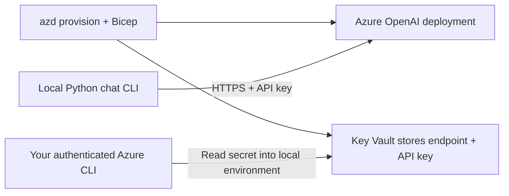

# Azure OpenAI Chat — Lokale CLI und AZD-Infrastruktur

**Niveau:** Mittelstufe · **Dauer:** 35–60 Minuten einschließlich Einrichtung

Dieses Beispiel erstellt eine **Azure OpenAI-Ressource und einen Key Vault** und führt dann eine
interaktive Python-Chat-CLI **auf Ihrem Rechner** aus. Es hostet keine Webanwendung
oder Container-App. Das Standardmodell ist `gpt-4.1`, Version `2025-04-14`, mit
`GlobalStandard` Bereitstellungskapazität 20. Prüfen Sie die aktuelle Verfügbarkeit und Quote in
Ihrer ausgewählten Region vor der Bereitstellung; Lebenszyklusdaten von Modellen können sich ändern.

## Lernziele

- Bereitstellung der Modellinfrastruktur mit Bicep und azd.
- Abrufen eines API-Schlüssels aus Key Vault ohne Ausgabe in Bereitstellungsausgaben.
- Senden von Chat Completions-Anfragen und Verwalten der Gesprächshistorie.
- Interpretation von Token-Anzahlen und den Limitationen von Kostenschätzungen.



In diesem Beispiel gibt es keine Integration einer Managed-Identity-Laufzeitumgebung, keinen Multi-Region-Failover,
keinen kundenspezifischen Ratenbegrenzer, keinen Streaming-Modus oder gehostete Rechenleistung. Das OpenAI-SDK
führt bis zu zwei Wiederholungsversuche bei wiederholbaren Fehlern durch; die CLI meldet verbleibende Fehler.

## Voraussetzungen

- Ein aktuelles stabiles [azd](https://learn.microsoft.com/azure/developer/azure-developer-cli/install-azd)
  (veröffentlichte Version zum Zeitpunkt der Prüfung: 1.37.2).
- [Azure CLI](https://learn.microsoft.com/cli/azure/install-azure-cli).
- Python **3.10+** (3.11 empfohlen) und eine virtuelle Umgebung.
- Ein Azure-Abonnement mit Berechtigungen zur Erstellung von Cognitive Services- und Key Vault-
  Ressourcen, Bereitstellung von Modellen und Lesen der Geheimnisse des Vaults.
- Regionale Verfügbarkeit und `GlobalStandard` Quote für `gpt-4.1`. Zugangs­voraussetzungen
  hängen vom Abonnement und Feature ab; es gibt keine garantierte Genehmigungsfrist.

```bash
azd version
az version
python --version
azd auth login
az login
```

Dies sind separate Authentifizierungssitzungen. Wählen Sie im beiden
Tools dasselbe Abonnement aus, bevor Sie die untenstehenden Befehle ausführen.

## Schnellstart (Bash)

Führen Sie es vom Root-Verzeichnis des Repositories aus:

```bash
cd examples/azure-openai-chat
azd env new myopenai
azd provision
```

Wählen Sie eine unterstützte Region. Die Bereitstellung erstellt eine Ressourcengruppe, OpenAI-Konto,
Modellbereitstellung, Key Vault sowie die `openai-endpoint`/`openai-api-key` Geheimnisse.
Es gibt **keine zu bereitstellenden Dienste** in `azure.yaml`.

Laden Sie die nicht-geheimen Ausgaben und holen Sie das Geheimnis in Ihre aktuelle Shell:

```bash
export AZURE_OPENAI_ENDPOINT="$(azd env get-value AZURE_OPENAI_ENDPOINT)"
export AZURE_OPENAI_MODEL="$(azd env get-value AZURE_OPENAI_MODEL)"
KV_NAME="$(azd env get-value AZURE_KEY_VAULT_NAME)"
export AZURE_OPENAI_API_KEY="$(az keyvault secret show \
  --vault-name "$KV_NAME" --name openai-api-key --query value --output tsv)"

python -m venv .venv
source .venv/bin/activate
python -m pip install -r src/requirements.txt
python src/chat.py
```

In PowerShell aktivieren Sie mit `.\.venv\Scripts\Activate.ps1` und weisen Umgebungsvariablen zu
mit `$env:AZURE_OPENAI_ENDPOINT = azd env get-value AZURE_OPENAI_ENDPOINT`
(ähnlich für das Modell). Rufen Sie den API-Schlüssel mit
`$env:AZURE_OPENAI_API_KEY = az keyvault secret show --vault-name $KV_NAME --name openai-api-key --query value -o tsv` ab.
Legen Sie zuerst `$KV_NAME = azd env get-value AZURE_KEY_VAULT_NAME` fest.

Drucken Sie den API-Schlüssel nicht aus, übergeben Sie ihn nicht und fügen Sie ihn nicht in Fehlerberichte ein.
Die CLI liest Umgebungsvariablen des Prozesses; sie ruft **nicht** Key Vault-Geheimnisse ab oder lädt `.env` Dateien.
`config.py` validiert Endpunkt, Token-Limit und Temperatur beim Start.

Erwartete Ausgabe (Inhalt und Nutzung variieren):

```text
Azure OpenAI Chat Application
Model: gpt-4.1
...
You: Say hello in one sentence.
Assistant: Hello! How can I help you today?
[Tokens: ... | Cost: $...]
```

Befehle: `stats` zeigt Summen, `clear` löscht die Gesprächshistorie und
`quit`/`exit` beendet die Sitzung. Es gibt keine `--stream`, `--show-tokens`, `tokens`,
oder `cost` Befehle.

## Überprüfen der Bereitstellung

Nach dem Laden der Shell-Variablen oben:

```bash
curl --fail-with-body \
  "${AZURE_OPENAI_ENDPOINT%/}/openai/deployments/${AZURE_OPENAI_MODEL}/chat/completions?api-version=2024-10-21" \
  -H "Content-Type: application/json" \
  -H "api-key: $AZURE_OPENAI_API_KEY" \
  -d '{"messages":[{"role":"user","content":"Say hello!"}],"max_tokens":50}'

az keyvault secret list --vault-name "$KV_NAME" --query "[].name" -o table
```

Erfolg: die API gibt HTTP 200 mit `choices[0].message.content` und `usage` zurück;
der Vault listet `openai-api-key` und `openai-endpoint` auf. Eine erfolgreiche ARM-Bereitstellung
allein bestätigt die Inferenz nicht.

## Dateien und Konfiguration

```text
azure.yaml                         # Infrastructure-only AZD project
infra/main.bicep                   # Subscription deployment
infra/main.parameters.json         # Environment, location, principal ID
infra/resources/openai.bicep       # Account + model
infra/resources/keyvault.bicep     # Vault + deploying user's secret access policy
infra/resources/secrets.bicep      # Writes secrets, no key output
src/chat.py                        # Interactive CLI
src/config.py                      # Environment validation
src/requirements.txt               # Python packages
```

Um das bereitgestellte Modell/Version/Kapazität zu ändern, bearbeiten Sie die Standardwerte in
`infra/main.bicep` und führen Sie `azd provision` aus. Das Setzen von `AZURE_OPENAI_MODEL` in Ihrer
Shell wählt nur einen **bestehenden Bereitstellungsnamen** aus; es wird kein weiteres Modell bereitgestellt.

| Laufzeitvariable | Standard / Quelle |
|---|---|
| `AZURE_OPENAI_ENDPOINT` | Erforderlich; azd nicht-geheime Ausgabe |
| `AZURE_OPENAI_API_KEY` | Erforderlich; aus Key Vault abrufen |
| `AZURE_OPENAI_MODEL` | `gpt-4.1`; Azure-Bereitstellungsname |
| `AZURE_OPENAI_MAX_TOKENS` | 800 (Validierungsbereich 1–4096) |
| `AZURE_OPENAI_TEMPERATURE` | 0,7 (Bereich 0–2) |
| `AZURE_OPENAI_INPUT_PRICE_PER_1K` | 0,002 USD; beispielhafter uncachebarer Eingabepreis |
| `AZURE_OPENAI_OUTPUT_PRICE_PER_1K` | 0,008 USD; beispielhafter Ausgabe-Preis |

## Kosten- und Sicherheitsbeschränkungen

Die Kostendarstellung ist eine **Schätzung**, keine Azure-Abrechnung. Sie multipliziert die API-Token-
Nutzung mit den konfigurierten Preisen und berücksichtigt keine Rabatte für zwischengespeicherte Eingaben,
regionale/SKU-Unterschiede, Steuern, Preisänderungen oder fehlgeschlagene/wiederholte Aufrufe.
Überschreiben Sie **beide Preise**, wenn Sie ein anderes Modell oder eine andere SKU nutzen, und prüfen Sie die aktuelle
[Azure OpenAI-Preisliste](https://azure.microsoft.com/pricing/details/cognitive-services/openai-service/).

Zum Beispiel kosten 100 Anfragen mit jeweils 500 nicht zwischengespeicherten Eingabe- und 200 Ausgabe-Tokens
zu den Standardpreisen `100 × (500/1000 × .002 + 200/1000 × .008) = $0.26`.
Key Vault-Operationen/-Speicherung verursachen separate Gebühren. Es gibt keine feste 50 $/Monat-Gebühr
für diese lokale CLI und keine gehostete Rechenleistung in der Vorlage.

Der Vault verwendet eine Zugriffsrichtlinie für die bereitstellende Entität; es ist kein Beispiel für RBAC oder
Managed-Identity-Anwendung. Öffentliche Endpunkte und API-Schlüssel-Authentifizierung
werden zu Lehrzwecken verwendet. Begrenzen Sie Berechtigungen und fügen Sie geeignete Identitäts-/Netzwerk-
Kontrollen hinzu, bevor Sie es für die Produktion anpassen.

## Praktische Übungen

### 1. Kontext überprüfen und zurücksetzen

**Start:** laufende CLI. **Ziel:** Verlauf beobachten.
Sagen Sie „Merke dir das Wort Zeder“, dann fragen Sie „Welches Wort habe ich dich gebeten zu merken?“
Führen Sie `stats` aus; zwei erfolgreiche Durchläufe sollten zwei ausgetauschte Nachrichten ergeben.
Führen Sie `clear` und `stats` aus; ausgetauschte Nachrichten sollten null sein (Token-Gesamtwerte bleiben).
Die genaue Formulierung des Modells ist nicht deterministisch.

### 2. Antwortlimit ändern

**Start:** Beenden Sie die CLI, behalten Sie dieselbe Shell.
Führen Sie `export AZURE_OPENAI_MAX_TOKENS=100` aus, starten Sie `python src/chat.py` neu und bitten Sie um
eine kurze Erklärung von azd. Stellen Sie sicher, dass das Banner 100 zeigt.
Stellen Sie es mit `unset AZURE_OPENAI_MAX_TOKENS` wieder her. Ein kleineres Antwortlimit verringert nicht
bereits gesendete Verlaufs-Tokens.

### Häufige Probleme

- **Fehlende Umgebungsvariablen:** Die Bereitstellung exportiert keine Shell-Werte;
  wiederholen Sie die Export-Schritte. Ein neues Terminal benötigt sie erneut.
- **403 bei Key Vault-Zugriff:** Überprüfen Sie Azure CLI-Abonnement/-Anmeldung und das Principial
  in der Vault-Zugriffsrichtlinie. Richtlinienänderungen können Zeit zur Verbreitung brauchen.
- **404 bei Inferenz:** Prüfen Sie Bereitstellungsnamen, Endpunkt und Bereitstellungsstatus.
- **429 bei Inferenz:** Warten Sie bis Ratenbegrenzungen zurückgesetzt werden; prüfen Sie regionale Modell-Quote.
  Die CLI entfernt fehlgeschlagene Durchläufe aus dem Verlauf, sodass erneutes Versuchen sie nicht dupliziert.
- **Kontextlänge:** Das Beispiel kürzt keine langen Gespräche; verwenden Sie `clear`.
- **Modell nicht verfügbar/ausgemustert:** Prüfen Sie die aktuelle Modellverfügbarkeit und aktualisieren Sie
  Modell/Version/SKU zusammen; API-Version und Modellversion sind unterschiedliche Einstellungen.

## Aufräumen und nächste Schritte

```bash
azd down
unset AZURE_OPENAI_API_KEY
```

Die Aufbewahrung der Soft-Delete-Phase des Key Vault beträgt sieben Tage; das Löschen benötigt separate Berechtigungen.
Es gibt keine festgelegte Test-Suite; führen Sie keinen nicht existierenden `pytest tests/` Befehl aus.
Fügen Sie gemockte API-Tests hinzu, bevor Sie den Code erweitern.

[Container-Beispiele](../../../../examples/container-app) · [Retail-Architektur-Blueprint](../retail-scenario.md) ·
[Kurs-Startseite](../../README.md) · [Problem melden](https://github.com/microsoft/AZD-for-beginners/issues)

---

<!-- CO-OP TRANSLATOR DISCLAIMER START -->
**Haftungsausschluss**:
Dieses Dokument wurde mit dem KI-Übersetzungsdienst [Co-op Translator](https://github.com/Azure/co-op-translator) übersetzt. Obwohl wir uns um Genauigkeit bemühen, beachten Sie bitte, dass automatisierte Übersetzungen Fehler oder Ungenauigkeiten enthalten können. Das Originaldokument in seiner Ursprungssprache gilt als maßgebliche Quelle. Bei kritischen Informationen wird eine professionelle menschliche Übersetzung empfohlen. Wir übernehmen keine Haftung für Missverständnisse oder Fehlinterpretationen, die aus der Verwendung dieser Übersetzung entstehen.
<!-- CO-OP TRANSLATOR DISCLAIMER END -->