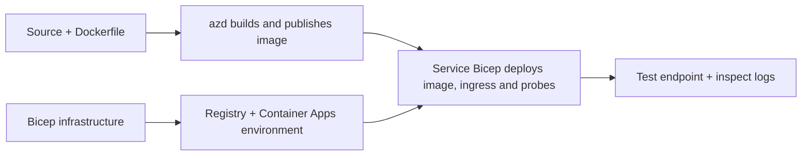

# Beispiele für das Bereitstellen von Container-Apps mit AZD

Dieses Verzeichnis enthält zwei Lernbeispiele mit Quellcode, Dockerfiles,
Bicep-Infrastruktur und `azure.yaml`. Keines davon ist produktionsreif.

## Wähle ein Beispiel aus

| Beispiel | Was implementiert wird | Voraussetzung |
|---|---|---|
| [Einfache Flask-API](../../../../examples/container-app/simple-flask-api) | Einzelne Python-CRUD-API, Items im Speicher, Gesundheitsprüfungen, HTTP-Skalierung | Grundlegende CLI- und HTTP-Kenntnisse |
| [Zwei-Service Microservices](../../../../examples/container-app/microservices) | Node.js-Gateway, interner schreibgeschützter Python-Produktservice, Telemetrie und Skalierung | Zuerst das Einzel-Servicemuster abschließen |

Plane 30–60 Minuten inklusive Einrichtung und Überprüfung ein. Die Azure-Bereitstellungszeiten variieren.

## Voraussetzungen

- [Azure Developer CLI](https://learn.microsoft.com/azure/developer/azure-developer-cli/install-azd)
- [Azure CLI](https://learn.microsoft.com/cli/azure/install-azure-cli) für Verifizierungsbefehle
- Docker mit laufendem Daemon zum Bauen dieser Container-Images
- Ein Azure-Abonnement mit Berechtigungen zur Ressourcenerstellung und ausreichendem regionalem Kontingent
- Bash für die Shell-Beispiele oder äquivalente PowerShell-Befehle

```bash
azd version
az version
docker info
azd auth login
az login
```

Die beiden Tools haben separate Anmeldesitzungen. Verwenden Sie eine aktuelle stabile azd-Version; die zum Bewertungszeitpunkt veröffentlichte
Version ist 1.37.2. Ältere Mindestversionsangaben sind keine
Kompatibilitätsgarantie.

## Schnellstart

Vom Root-Verzeichnis des Repositories:

```bash
cd examples/container-app/simple-flask-api
azd env new flask-demo
azd up
API_URL=$(azd env get-value API_ENDPOINT)
curl --fail-with-body "${API_URL}/health"
```

Erwartet: HTTP 200 mit `"status": "healthy"`. Befolgen Sie die README des Beispiels, um ein Element zu erstellen,
lesen, aktualisieren und löschen sowie die Protokolle zu überprüfen.



Die erste Bereitstellung verwendet ein öffentliches hello-world-Image auf Port 80. Service-spezifische
Bicep-Parameterdateien ermöglichen es `azd deploy`, es mit dem gebauten Anwendungs-Image
und dem richtigen App-Port/Prüfungen (8000 für Flask/Produkt, 8080 für das Gateway) zu ersetzen.
Bewahren Sie diese Dateien mit ihren `azure.yaml` `module` Einstellungen auf.

## Konfiguration: Was ändert was

`azure.yaml` wählt Quellverzeichnisse, Programmiersprachen, Hosts und Bereitstellungsmodule aus.
Container-CPU/Memory, Ingress, Prüfungen, Replikazahlen und Skalierungsregeln werden
in **Bicep** definiert, nicht über beliebige `resources`, `scale` oder `regions` Service-Eigenschaften.

`azd env set SOME_VALUE ...` speichert einen Wert lokal. Es wird nur dann eine bereitgestellte
Ressource geändert, wenn ein Parameter, eine Umgebungszuordnung oder ein Hook diesen Wert explizit verwendet.
Diese Beispiele verwenden keine `MAX_REPLICAS`, `SCALE_TO_ZERO_TIMEOUT`,
`CONTAINER_APP_REPLICA_TYPE` oder benutzerdefinierte Canary-Einstellungen aus azd-Umgebungswerten.
Bearbeiten Sie die entsprechenden Bicep-Dateien und führen `azd up` aus, um neu bereitzustellen und zu deployen.

Legen Sie keinen Anwendungscode unter `infra/` ab. `project` muss auf das Quellverzeichnis
zeigen, das das Dockerfile und die Abhängigkeitsmanifestdatei enthält.

## Überwachung und Kosten

- `azd monitor --logs` öffnet eine Portalansicht; es ist kein Terminal-Logstream.
  Verwenden Sie `az containerapp logs show --follow` mit dem tatsächlichen Ressourcennamen.
- Die einfache API schreibt stdout-Protokolle, die über Container Apps/Log Analytics gesammelt werden.
  Die bereitgestellte Application Insights-Ressource wird nicht automatisch instrumentiert.
- Das Microservices-Gateway verwendet das Node.js Application Insights SDK; der Python-
  Service exportiert Anwendungsprotokollspuren. Vollständiges Python Request-/Dependency-Tracing
  ist nicht konfiguriert.
- Scale-to-zero kann die Compute-Kosten reduzieren, aber Registry- und Protokolleingabe/-speicherung
  können weiterhin Kosten verursachen. Die Microservices-Standardwerte halten Replikate am Laufen.
  Schätzen Sie Ihre Region und Nutzung im
  [Azure-Preisrechner](https://azure.microsoft.com/pricing/calculator/).

## Erweiterte Muster — nicht implementierte Beispiele

Dies sind Designrichtlinien, keine zusätzlichen lokalen Projekte oder Copy-and-Run-Snippets:

- **Persistente Daten und Authentifizierung:** Ersetzen Sie In-Memory-Speicher und fügen Sie
  Microsoft Entra ID-Authentifizierung/Autorisation vor der Produktion hinzu.
- **Blue-Green/Canary:** Verwenden Sie den Mehr-Revisionen-Modus von Container Apps, Revisions-
  Labels, Verkehrsanteile, Gesundheitsprüfungen und Rückrollverfahren.
  Es gibt keine `deploymentStrategy: canary` azd-Konfiguration in diesen Beispielen.
  Siehe [Revision Management](https://learn.microsoft.com/azure/container-apps/revisions).
- **Mehrregionen:** Erstellen Sie separate Umgebungen und Apps in Bicep und entwerfen Sie
  globales Routing und Datenkonsistenz. Eine Dienst-`regions`-Liste ist kein azd-
  Bereitstellungsmechanismus.
- **Queue-Worker:** Fügen Sie Quellcode für Worker, Abhängigkeiten, Warteschlangenressourcen, eine verwaltete
  Identität mit Datenebenen-Rollen und eine authentifizierte Skalierungsregel hinzu. Kopieren Sie keinen
  leeren `src/worker`-Pfad und erwarten Sie ein ausführbares Projekt.
- **Dapr:** Bereitstellen von Komponenten, Konfigurieren des Sidecars, Installieren des passenden SDKs
  und Implementieren von State/Pub-Sub-Fehlerbehandlung.
- **Geheimnisse:** Verwenden Sie nach Möglichkeit verwaltete Identitäten und Rollenzuweisungen. Nur
  das Erstellen eines Key Vaults gewährt Anwendungen keinen Zugriff oder lädt Geheimnisse.

## Aufräumen

Vom Verzeichnis des Beispiels aus:

```bash
azd down
```

Überprüfen Sie die Löschaufforderungen und bestätigen Sie, dass die dedizierte Ressourcengruppe entfernt wird.
Verwenden Sie diese Beispiele nicht als Produktionsbasis ohne zusätzliche Planung und Tests.

[Beispielindex](../README.md) · [Kursstartseite](../../README.md) ·
[Container Apps-Dokumentation](https://learn.microsoft.com/azure/container-apps/) ·
[Problem melden](https://github.com/microsoft/AZD-for-beginners/issues)

---

<!-- CO-OP TRANSLATOR DISCLAIMER START -->
**Haftungsausschluss**:
Dieses Dokument wurde mit dem KI-Übersetzungsdienst [Co-op Translator](https://github.com/Azure/co-op-translator) übersetzt. Obwohl wir uns um Genauigkeit bemühen, beachten Sie bitte, dass automatisierte Übersetzungen Fehler oder Ungenauigkeiten enthalten können. Das Originaldokument in seiner Ursprungssprache gilt als maßgebliche Quelle. Bei kritischen Informationen wird eine professionelle menschliche Übersetzung empfohlen. Wir übernehmen keine Haftung für Missverständnisse oder Fehlinterpretationen, die aus der Verwendung dieser Übersetzung entstehen.
<!-- CO-OP TRANSLATOR DISCLAIMER END -->