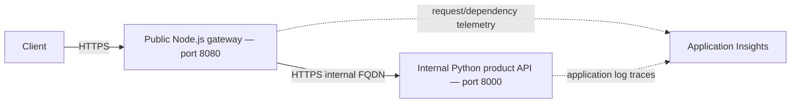

# Microservices mit zwei Diensten — Azure Container Apps

**Niveau:** Mittelstufe · **Dauer:** 45–60 Minuten einschließlich Einrichtung

Dieses Lernbeispiel implementiert ein **Node.js API Gateway** und einen **Python Product Service
(nur lesend)**. Quellcode, Dockerfiles, Bicep und azd-Konfiguration sind enthalten.
Es handelt sich nicht um ein produktionsgehärtetes System.

## Was Sie lernen werden

- Zwei Dienste unabhängig bereitstellen.
- Einen internen Backend-FQDN über HTTPS verwenden.
- Erfolgs-, Nicht-Gefunden- und Dienst-nicht-verfügbar-Antworten überprüfen.
- Telemetrie und unabhängige Skalierungsgrenzen verstehen.



Der Produktkatalog enthält fünf feste Produkte im Speicher. Es gibt **keine POST-, 
PUT- oder DELETE-Handler**, keine Datenbank, Service Bus, Bestell-/Benutzer-/Benachrichtigungsdienst,
C#- oder Go-Code. Das sind Ideen für zukünftige Entwicklungen, keine beinhalteten Funktionen.
Das Gateway authentifiziert keine Benutzer; interner Ingress ersetzt keine
Anwendungsautorisierung.

## Voraussetzungen

Schließen Sie zuerst die [einzelne Flask API](../../../../../examples/container-app/simple-flask-api) ab.
Installieren Sie eine aktuelle stabile azd-Version (veröffentlichte Version zum Prüfzeitpunkt: 1.37.2), Azure CLI,
und Docker mit laufendem Daemon. Sie benötigen ein Azure-Abonnement, Berechtigungen zur Ressourcenerstellung und 
ein Kontingent für Container Apps in der Region.

```bash
azd version
az version
docker info
azd auth login
az login
```

Verwenden Sie dasselbe Abonnement in beiden CLI-Tools. Befehle unten verwenden Bash.

## Bereitstellen und Überprüfen

Vom Repository-Stammverzeichnis:

```bash
cd examples/container-app/microservices
azd env new microservices-demo
azd up
GATEWAY_URL=$(azd env get-value API_GATEWAY_URL)
RG_NAME=$(azd env get-value AZURE_RESOURCE_GROUP)
GATEWAY_NAME=$(azd env get-value API_GATEWAY_NAME)
PRODUCT_NAME=$(azd env get-value PRODUCT_SERVICE_NAME)

curl --fail-with-body "${GATEWAY_URL}/health"
curl --fail-with-body "${GATEWAY_URL}/api/products"
curl --fail-with-body "${GATEWAY_URL}/api/products/1"
curl -i "${GATEWAY_URL}/api/products/999"
```

**Erfolg:** health 200; list 200 mit **fünf** Produkten; Produkt 1 ist ein Laptop
mit Preis 999,99 und Lagerbestand 50; unbekanntes Produkt gibt 404 zurück.
Beschreibungen sind in den Antworten enthalten; Zeitstempel variieren.

Die anfängliche Bereitstellung verwendet öffentliche Hello-World-Images auf Port 80, um nicht zu versuchen,
nicht vorhandene Images aus einem leeren Register zu ziehen. Dienstspezifische Bicep-Module
und Parameterdateien ersetzen sie durch gebaute Images und App-Ports/-Probes während
`azd deploy`. Die Hauptparameter bewahren veröffentlichte Image-Namen für spätere Bereitstellungen.

## Dienste und Netzwerk

| Dienst | Exponierte Endpunkte | Standard-Ressourcen |
|---|---|---|
| Gateway | GET `/`, `/health`, `/api/products`, `/api/products/:id` | 1 vCPU, 2 GiB, 2–20 Replikate |
| Produkt | GET `/`, `/health`, `/products`, `/products/<id>` | 0,5 vCPU, 1 GiB, 1–10 Replikate |

Der Product-Ingress verfügt über `external: false` und `allowInsecure: false`. Bicep injiziert
`PRODUCT_SERVICE_URL=https://<actual-internal-fqdn>` in das Gateway. HTTP würde
umleiten; HTTPS entspricht dem konfigurierten Ingress. Ein kurzer DNS-Name muss mit dem
**tatsächlichen Container-App-Namen**, nicht dem logischen Dienstschlüssel `product-service`, übereinstimmen.
Versuchen Sie nicht, die interne URL direkt von Ihrem Laptop aus aufzurufen.

Das Gateway hat eine Fünf-Sekunden-Timeout für Produktaufrufe. Fehlende Produkt-IDs
propagieren als 404; Transportausfälle/andere Back-End-Fehler geben 503 zurück. Gateway
`/health` prüft nur das Gateway, nicht die Backend-Verfügbarkeit.

## Dateien und Konfiguration

```text
azure.yaml
infra/main.bicep
infra/main.parameters.json
infra/abbreviations.json
infra/core/container-apps-environment.bicep
infra/core/monitor.bicep
infra/app/api-gateway.bicep
infra/app/api-gateway.parameters.json
infra/app/product-service.bicep
infra/app/product-service.parameters.json
src/api-gateway/{app.js,package.json,Dockerfile}
src/product-service/{main.py,requirements.txt,Dockerfile}
```

Skalierung, CPU/Speicher, Ports und Probes werden in `infra/app/*.bicep` gesetzt. Ändern Sie diese
Dateien und führen `azd up` aus, um Infrastruktur anzuwenden und neu bereitzustellen. Es gibt keine
`GATEWAY_MAX_REPLICAS` Umgebungsvariable als Parameter in diesem Beispiel.

Für reine Codeänderungen:

```bash
azd deploy product-service
azd deploy api-gateway
```

Das Node-Image verwendet Node 22; das Python-Image verwendet Python 3.11. Beide binden an
`0.0.0.0`. Ingress/Probes verwenden die Ports 8080 (Gateway) bzw. 8000 (Produkt).

## Lokale Entwicklung mit Docker

Führen Sie es aus diesem Beispielverzeichnis aus. Verwenden Sie ein benutzerdefiniertes Netzwerk, **nicht `localhost`
von einem Container zum anderen zu erreichen**:

```bash
docker network create azd-microservices-demo
docker build -t local-product ./src/product-service
docker build -t local-gateway ./src/api-gateway
docker run -d --name azd-product --network azd-microservices-demo local-product
docker run -d --name azd-gateway --network azd-microservices-demo \
  -p 8080:8080 -e PRODUCT_SERVICE_URL=http://azd-product:8000 local-gateway
curl --fail-with-body http://localhost:8080/api/products
```

Erwartet: fünf Produkte. HTTP wird nur für dieses lokale Docker-Netzwerk verwendet.

```bash
docker stop azd-product azd-gateway
docker rm azd-product azd-gateway
docker network rm azd-microservices-demo
```

## Überwachung

```bash
az containerapp logs show --name "$GATEWAY_NAME" --resource-group "$RG_NAME" --follow
# In a separate terminal:
az containerapp logs show --name "$PRODUCT_NAME" --resource-group "$RG_NAME" --tail 100
```

`azd monitor --logs` öffnet eine Portalsicht; es streamt keine Terminal-Logs.
Das Node SDK sammelt Gateway-Anfragen/Abhängigkeiten. Pythons `AzureLogHandler`
exportiert **Log-Traces**, nicht automatische Flask-Anfragen, SQL-Abhängigkeiten oder vollständige
verteilte Traces. OpenCensus ist ein Legacy-SDK; bei Erweiterung dieses Beispiels wird Azure Monitor OpenTelemetry
bevorzugt.

In Application Insights Logs, generieren Sie Anfragen und prüfen Sie:

```kusto
requests
| where timestamp > ago(1h)
| where name contains "products"
| summarize RequestCount=count(), AvgDuration=avg(duration) by bin(timestamp, 5m)
```

Für Python-Anwendungsnachrichten:

```kusto
traces
| where timestamp > ago(1h)
| where message contains "products"
| project timestamp, message, severityLevel
```

Berücksichtigen Sie Verzögerungen bei der Aufnahme und Sampling; erwarten Sie keine exakte Anfragenanzahl oder
garantierte Latenz. Es sind keine benutzerdefinierten Warnungen oder Dashboards konfiguriert.

## Praktische Übungen

### Übung 1: Katalog ändern

**Ausgangspunkt:** `src/product-service/main.py`.
**Ziel:** unabhängige Dienstbereitstellung überprüfen.
Ändern Sie den Lagerbestand des Laptops von 50 auf 49 in der festen `products`-Liste, führen Sie
`azd deploy product-service` aus, und fordern Sie dann `${GATEWAY_URL}/api/products/1` an.

**Erfolgskriterium / Lösung:** HTTP 200 mit `"stock":49`. Setzen Sie auf 50 zurück und stellen Sie neu bereit.
**Häufiges Problem:** Bearbeiten des Gateways anstelle des Dienstes, dem der Katalog gehört.
Dies ändert Quelldaten, nicht eine persistente Inventardatenbank.

### Übung 2: Replikatkonfiguration überprüfen

**Ausgangspunkt:** `infra/app/product-service.bicep`.
**Ziel:** eine Infrastrukturänderung beobachten, ohne Autoscaling zu raten.
Ändern Sie `minReplicas: 1` zu `minReplicas: 2`, führen Sie `azd up` aus, dann:

```bash
az containerapp show --name "$PRODUCT_NAME" --resource-group "$RG_NAME" \
  --query properties.template.scale -o json
```

**Erfolgskriterium:** konfiguriertes Minimum ist 2 und Maximum bleibt 10.
Stellen Sie das Minimum auf 1 zurück und führen Sie `azd up` aus.
**Häufiges Problem:** `azd deploy` allein wendet keine Änderungen auf nicht verwandte gemeinsame
Infrastruktur an. Setzen Sie `maxReplicas` nicht auf null als Fehler-Simulation.
Dies überprüft die Konfiguration, keinen Lasttest oder garantierte sofortige Replikatanzahl.

### Übung 3: Lokale Behandlung von nicht verfügbarem Dienst testen

**Ausgangspunkt:** oben laufen beide lokalen Docker-Container.
**Ziel:** Backend-Ausfall von fehlendem Produkt unterscheiden.
Stoppen Sie nur den Produkt-Container:

```bash
docker stop azd-product
curl -i http://localhost:8080/api/products
docker start azd-product
curl --fail-with-body http://localhost:8080/api/products
```

**Erfolgskriterium:** Während des Stopps gibt das Gateway 503 mit
`"error":"Product service unavailable"` zurück; nach Neustart liefert die Liste 200.
Wiederholen Sie ggf. nach kurzer Startverzögerung.
**Häufiges Problem:** Gateway-Stopp testet einen anderen Fehler (keine HTTP-Antwort).

## Kosten und Produktionslücken

Standard-Mindestreplikate halten Rechenleistung am Laufen. Registrierung und Überwachung verursachen ebenfalls
Kosten. Es gibt keine validierte feste Summe von $50/Monat: Schätzen Sie regionale CPU/Speicher,
Replikatstunden, Anfragen, Registry und Logaufbewahrung im
[Azure-Preiskalkulator](https://azure.microsoft.com/pricing/calculator/).
Löschen Sie Lernressourcen zügig.

Produktionsarbeit umfasst Authentifizierung/Autorisierung, scoped verwaltete Identitäten,
persistente Daten, Eingabe-/Antwortvalidierung, unterstützte Observability-Instrumentierung,
Last-/Fehlertests, CI/CD, Warnungen und Wiederherstellungsverfahren. Einen Bestelldienst,
Warteschlange oder Datenbank hinzuzufügen, ist eine separate Implementierungsaufgabe, kein fertiges
Übungsbeispiel oder bereits verfügbare Funktion hier.

## Fehlersuche und Bereinigung

- **Image nicht gefunden bei erster Bereitstellung:** Bootstrap sollte das öffentliche Image verwenden;
  überprüfen Sie die Standardwerte der Haupt-Image-Parameter und die Zuordnung der Bereitstellungsmodule.
- **503 Produkte:** Prüfen Sie Produkt-Logs, Image-Revision und injizierte interne HTTPS-URL.
- **404 unerwarteter Pfad:** Produkt-API ist nur lesend; überprüfen Sie die Route, nicht einen nicht vorhandenen CRUD-Handler.
- **Keine Telemetrie:** Prüfen Sie Laufzeit-Verbindungszeichenfolgen, ohne diese preiszugeben, und
  berücksichtigen Sie Verzögerungen bei der Aufnahme. Python-Anfrage-Tabellen werden nicht vom Log-Handler befüllt.

Von diesem Beispielverzeichnis aus:

```bash
azd down
```

Überprüfen Sie Löschaufforderungen und stellen Sie sicher, dass die dedizierte Ressourcengruppe entfernt ist.

[Vorher: Flask API](../../../../../examples/container-app/simple-flask-api) · [Nächste: Datenbank-App](../../../../../examples/database-app) ·
[KI-Entwicklung](../../../docs/chapter-02-ai-development/README.md) ·
[Kursübersicht](../../../README.md) · [Problem melden](https://github.com/microsoft/AZD-for-beginners/issues)

---

<!-- CO-OP TRANSLATOR DISCLAIMER START -->
**Haftungsausschluss**:
Dieses Dokument wurde mit dem KI-Übersetzungsdienst [Co-op Translator](https://github.com/Azure/co-op-translator) übersetzt. Obwohl wir uns um Genauigkeit bemühen, beachten Sie bitte, dass automatisierte Übersetzungen Fehler oder Ungenauigkeiten enthalten können. Das Originaldokument in seiner Ursprungssprache gilt als maßgebliche Quelle. Bei kritischen Informationen wird eine professionelle menschliche Übersetzung empfohlen. Wir übernehmen keine Haftung für Missverständnisse oder Fehlinterpretationen, die aus der Verwendung dieser Übersetzung entstehen.
<!-- CO-OP TRANSLATOR DISCLAIMER END -->