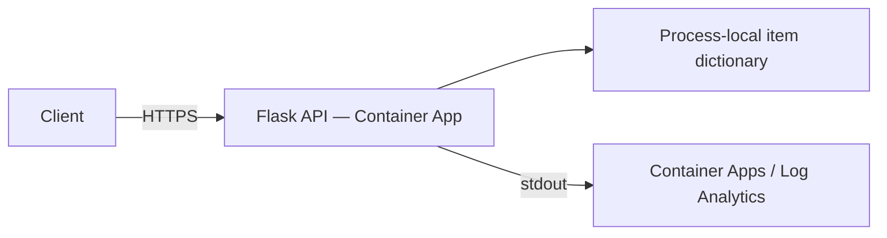

# Einfache Flask-API — Azure Container Apps

**Niveau:** Anfänger · **Dauer:** 30–45 Minuten inklusive Einrichtung

Bereitstellen einer Python Flask CRUD API mit Azure Developer CLI (azd). Quellcode, Dockerfile,
Bicep und Bereitstellungsparameter sind enthalten. Dies ist ein **Lernbeispiel**, keine
produktionsbereite API.

## Was Sie lernen werden

- Erstellen und Veröffentlichen eines Containers über azd.
- Konfigurieren von Ingress- und Liveness/Readiness-Probes.
- Überprüfen der CRUD-Antworten und Inspizieren der Anwendungsprotokolle.
- Verständnis, warum In-Memory-Daten für dauerhafte Anwendungen ungeeignet sind.



**Wichtig:** Elemente werden in einem Prozess gehalten. Standard ist **ein Gunicorn-Worker,
0–1 Replikate**, um inkonsistente Daten über Worker/Replikate hinweg bewusst zu vermeiden.
Elemente gehen bei Neustart, Revisionsänderung oder Scale-to-Zero verloren. Die Erhöhung der Replikate
erfordert gemeinsamen persistenten Speicher. Die API hat keine Authentifizierung oder Autorisierung.

## Voraussetzungen

- [Aktuelles stabiles azd](https://learn.microsoft.com/azure/developer/azure-developer-cli/install-azd)
  (zur Zeit der Überprüfung veröffentlichte Version: 1.37.2).
- [Azure CLI](https://learn.microsoft.com/cli/azure/install-azure-cli) zur Verifizierung.
- Docker mit laufendem Daemon; erforderlich für den lokalen Standard-Image-Build.
- Azure-Abonnement, Berechtigungen zur Ressourcenerstellung und Container Apps regionale Quoten.
- Bash für die nachfolgenden Befehle (oder äquivalentes PowerShell).
- Python 3.11 für optionale lokale Entwicklung.

```bash
azd version
az version
docker info
azd auth login
az login
```

Die CLI-Tools verwalten separate Anmeldesitzungen. Verwenden Sie in beiden dasselbe Abonnement.

## Schnellstart

Vom Repository-Stammverzeichnis:

```bash
cd examples/container-app/simple-flask-api
azd env new flask-demo
azd up
API_URL=$(azd env get-value API_ENDPOINT)
RG_NAME=$(azd env get-value AZURE_RESOURCE_GROUP)
API_NAME=$(azd env get-value API_NAME)
curl --fail-with-body "${API_URL}/health"
```

Erwartet: HTTP 200 und JSON mit `"status":"healthy"`,
`"service":"simple-flask-api"` und einem aktuellen UTC-Zeitstempel.
Die Bereitstellung und Image-Erstellung dauern typischerweise einige Minuten; Zeiten variieren.

Die anfängliche Bereitstellung nutzt ein öffentliches hello-world-Image, das auf Port 80 hört.
`azure.yaml` wählt `infra/app/api.bicep` und dessen passende Parameterdatei für die
Dienstbereitstellung aus, welche das Image, den Ingress und die Probes auf Port 8000 umstellt.
Löschen Sie diese Bereitstellungsparameter nicht.

## CRUD überprüfen

Führen Sie die folgenden Befehle nacheinander aus, während dieselbe Replik verbleibt:

```bash
# Create: HTTP 201; note the returned id (1 for a fresh process).
curl -i -X POST "${API_URL}/api/items" \
  -H "Content-Type: application/json" \
  -d '{"name":"Test Item","description":"My first item"}'

# Read list: HTTP 200, total 1 in a fresh process.
curl --fail-with-body "${API_URL}/api/items"

# Replace 1 if your create response returned another id.
curl --fail-with-body "${API_URL}/api/items/1"
curl -i -X PUT "${API_URL}/api/items/1" \
  -H "Content-Type: application/json" -d '{"name":"Updated Item"}'
curl -i -X DELETE "${API_URL}/api/items/1"
curl -i "${API_URL}/api/items/1"
```

Erfolg: POST 201, Lese-/PUT 200, DELETE 204 ohne Body, dann fehlendes Element 404.
Fehlerhaftes/nicht-objektartiges JSON oder ein leerer Name geben 400 zurück.
Wenn ein Element zwischen Anfragen verschwindet, überprüfen Sie Neustart oder Scale-to-Zero;
dies ist eine beabsichtigte In-Memory-Einschränkung, keine Persistenz.

| Endpunkt | Methoden |
|---|---|
| `/` | GET — Serviceinformationen |
| `/health` | GET — Liveness/Readiness |
| `/api/items` | GET, POST |
| `/api/items/{id}` | GET, PUT, DELETE |

## Protokolle und Konfiguration

```bash
az containerapp logs show --name "$API_NAME" --resource-group "$RG_NAME" --follow
```

Erwartet: Gunicorn-Start, Zugriffsprotokolle von Anfragen und Anwendungsnachrichten.
`azd monitor --logs` öffnet eine Portalanzeige; es wird nicht in die Konsole gestreamt.
Application Insights ist bereitgestellt, aber **nicht durch diesen Flask-Code instrumentiert**;
verwenden Sie Container Apps/Log Analytics für stdout-Protokolle.

Bearbeiten Sie `infra/app/api.bicep` für CPU/RAM, Replikbegrenzungen oder Skalierungsregeln, und
führen Sie dann `azd up` aus. Standardwerte sind 0,5 vCPU, 1 GiB, mindestens 0 / maximal 1 Replikat,
und ein HTTP-Schwellenwert von 50 gleichzeitigen Anfragen. Scale-to-Zero kann Kaltstartlatenz hinzufügen.

Beliebige `azd env set MAX_REPLICAS`, `API_KEY`, `LOG_LEVEL`, oder
`SCALE_TO_ZERO_TIMEOUT` Werte sind **nicht an diese Vorlage oder App angeschlossen**.
Das Setzen eines Werts macht ihn nicht automatisch zu einer Laufzeitumgebungsvariablen.
Das Image bindet explizit Port 8000; aktualisieren Sie Dockerfile, Bicep-Ingress und Probes
gemeinsam, wenn Sie den Port ändern.

## Dateien

```text
azure.yaml
infra/main.bicep
infra/main.parameters.json
infra/app/container-apps.bicep       # Environment, registry, monitoring
infra/app/api.bicep                  # App, ingress, probes, scale settings
infra/app/api.parameters.json        # Image and resource values for azd deploy
src/app.py
src/Dockerfile
src/requirements.txt
```

## Lokale Entwicklung

Aus diesem Beispielverzeichnis:

```bash
python -m venv .venv
source .venv/bin/activate  # PowerShell: .\.venv\Scripts\Activate.ps1
python -m pip install -r src/requirements.txt
python src/app.py
```

Testen Sie in einem anderen Terminal `http://localhost:8000/health` und die CRUD-Endpunkte.
Oder bauen und starten Sie das tatsächliche Image:

```bash
docker build -t flask-api:local ./src
docker run --rm -p 8000:8000 flask-api:local
```

Für reine Codeänderungen nach der ersten Bereitstellung, führen Sie `azd deploy api` aus.
Für Bicep-Änderungen, führen Sie `azd up` aus, um neu bereitzustellen und zu deployen.

## Praktische Übungen

### 1. Eingabeverweigerung validieren

**Ausgangspunkt:** bereitgestellte API, `API_URL` oben.
**Ziel:** Verifizieren, dass die API ungültige JSON-Strukturen und fehlende Namen ablehnt.

```bash
curl -i -X POST "${API_URL}/api/items" \
  -H "Content-Type: application/json" -d '[]'
curl -i -X POST "${API_URL}/api/items" \
  -H "Content-Type: application/json" -d '{"name":""}'
```

**Erfolgskriterium / Lösung:** Beide geben 400 mit einer JSON-Fehlermeldung zurück, nicht 500.
**Häufiges Problem:** Fehlender JSON-Content-Type-Header.

### 2. Einen schreibgeschützten Versions-Endpunkt hinzufügen

**Ausgangspunkt:** `src/app.py`. **Ziel:** API erweitern und neu bereitstellen.
Fügen Sie dies vor dem `if __name__ == '__main__':` Block hinzu:

```python
@app.route('/version', methods=['GET'])
def version():
    return jsonify({'version': '1.0.0'})
```

Führen Sie `azd deploy api` und dann `curl --fail-with-body "${API_URL}/version"` aus.
**Erfolgskriterium:** HTTP 200 und `{"version":"1.0.0"}`.
**Häufiges Problem:** Die Route nach dem blockierenden `app.run()`-Aufruf einfügen, wenn mit
`python src/app.py` getestet wird.

### Wissenscheck

Warum ist ein Worker für dauerhafte Daten unzureichend? Weil sogar ein einzelner Prozess
sein Wörterbuch bei Neustart verliert. Eine Produktionsversion benötigt persistenten gemeinsamen Speicher,
Authentifizierung, Autorisierung, Migrationen, Tests und operative Überwachung.

## Kosten und Fehlerbehebung

Dies ist keine garantierte kostenfreie Bereitstellung: Das Basic-Registry und Protokollspeicherung/-ingestion
können Kosten verursachen, auch wenn die App-Computerzeit bei null liegt. Verwenden Sie den
[Preisrechner](https://azure.microsoft.com/pricing/calculator/) für Ihre Region.

- **Docker-Build-Fehler:** Überprüfen Sie `docker info`, Netzwerkzugang und Abhängigkeiten.
- **Unstabile App:** Untersuchen Sie Konsolen-/Systemprotokolle und vergewissern Sie sich, dass das Image-Port, Ingress
  und Probes übereinstimmen. Platzhalter dürfen nicht am Flask-Port geprüft werden.
- **403/Berechtigungen:** Überprüfen Sie Abonnement- und Ressourcenerstellungsberechtigungen.
- **Elemente verschwinden:** In-Memory-Zustand wird bei Neustart/Scale-to-Zero zurückgesetzt; fügen Sie eine Datenbank
  für dauerhaftes Verhalten hinzu.

## Aufräumen und nächste Schritte

```bash
azd down
```

Überprüfen Sie die Löschabfrage und vergewissern Sie sich, dass die dedizierte Ressourcengruppe entfernt wurde.
Verwenden Sie kein destruktives Aufräumen für eine Ressourcengruppe mit nicht zusammenhängenden Daten.

[Weiter: Datenbank-App](../../../../../examples/database-app) · [Microservices](../../../../../examples/container-app/microservices) ·
[Containerübersicht](../README.md) · [Kursübersicht](../../../README.md) ·
[Problem melden](https://github.com/microsoft/AZD-for-beginners/issues)

---

<!-- CO-OP TRANSLATOR DISCLAIMER START -->
**Haftungsausschluss**:
Dieses Dokument wurde mit dem KI-Übersetzungsdienst [Co-op Translator](https://github.com/Azure/co-op-translator) übersetzt. Obwohl wir uns um Genauigkeit bemühen, beachten Sie bitte, dass automatisierte Übersetzungen Fehler oder Ungenauigkeiten enthalten können. Das Originaldokument in seiner Ursprungssprache gilt als maßgebliche Quelle. Bei kritischen Informationen wird eine professionelle menschliche Übersetzung empfohlen. Wir übernehmen keine Haftung für Missverständnisse oder Fehlinterpretationen, die aus der Verwendung dieser Übersetzung entstehen.
<!-- CO-OP TRANSLATOR DISCLAIMER END -->