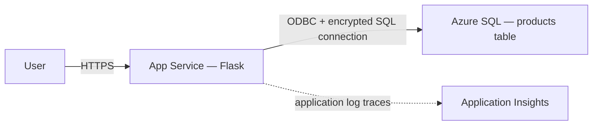

# Flask und Azure SQL auf App Service

**Level:** Mittelstufe · **Dauer:** 30–60 Minuten einschließlich Voraussetzungen

Dieses Beispiel stellt eine Python Flask Read-API auf **Linux App Service** und eine Basic
Azure SQL-Datenbank bereit. Quellcode, Bicep- und azd-Konfiguration sind enthalten. Es handelt sich um eine
Lernanwendung, nicht um eine produktionsreife Datenbankarchitektur.

## Was Sie lernen werden

- Bereitstellung von App Service, SQL und Überwachungsressourcen mit Bicep.
- Verschlüsselte SQL-Konnektivität konfigurieren, ohne Anmeldeinformationen zu übergeben.
- Ein Schema initialisieren, bevor Gunicorn-Arbeiter gestartet werden.
- Überprüfung der eingesäten Daten, nicht gefundener Antworten und der Datenbankgesundheit.



Ressourcen: dedizierte Ressourcengruppe, B1 Linux App Service Plan, Python 3.11 Web
App, SQL-Server und Basic 2-GB-Datenbank, Application Insights und Log Analytics.
Die Web-App verwendet **Source/ZIP-Bereitstellung und Oryx-Abhängigkeitsinstallation**;
`azd deploy` baut oder stellt die optionale Dockerdatei nicht bereit.

## Voraussetzungen

- Aktuelle stabile Version von [azd](https://learn.microsoft.com/azure/developer/azure-developer-cli/install-azd)
  (zum Zeitpunkt der Überprüfung veröffentlichte Version: 1.37.2).
- [Azure CLI](https://learn.microsoft.com/cli/azure/install-azure-cli) zur Überprüfung.
- Azure-Abonnement, Berechtigungen zur Erstellung der aufgelisteten Ressourcen und regionale Kontingente.
- Python **3.11** für die lokale Entwicklung; die übergebene `pyodbc==5.0.1` kann
  native Build-Tools auf neueren Python-Versionen erfordern.
- Microsoft ODBC-Treiber 18 (oder 17) für SQL Server auf lokalen Maschinen. `pip install
  pyodbc` installiert den Systemtreiber nicht. Siehe
  [ODBC-Installation](https://learn.microsoft.com/sql/connect/odbc/download-odbc-driver-for-sql-server).
- Docker nur wenn der optionale Container lokal getestet wird.

```bash
azd version
az version
azd auth login
az login
```

Verwenden Sie in beiden Tools dasselbe Abonnement. Die folgenden Befehle nutzen Bash.

## Bereitstellen

Vom Repository-Stamm aus:

```bash
cd examples/database-app
azd env new sql-demo
azd provision
azd deploy
WEB_URL=$(azd env get-value WEB_APP_URI)
WEB_NAME=$(azd env get-value WEB_APP_NAME)
RG_NAME=$(azd env get-value AZURE_RESOURCE_GROUP)
```

Wählen Sie eine unterstützte Region. `sqlAdminLogin` ist standardmäßig auf `sqladmin` gesetzt; das erforderliche
`sqlAdminPassword` ist ein sicherer Parameter. Geben Sie bei Aufforderung ein sicheres Passwort ein.
Halten Sie Bereitstellungsanmeldeinformationen aus Git und Fehlerberichten heraus. Die aktuelle Verbindungs-
string-Interpolation erwartet ein Passwort ohne Verbindungszeichen wie
`;`; passen Sie das Maskieren vor Verwendung solcher Werte entsprechend an.

Bicep setzt einen Startbefehl, der `init_database()` **ausführt, bevor** Gunicorn-
Arbeiter starten. Dies ist notwendig, da das Importieren von `app:app` das
Python-`if __name__ == '__main__'`-Block nicht ausführt. Auf einer frischen Datenbank
erzeugt die Initialisierung `products` und fügt fünf Zeilen ein. Es ist ein einfaches Lehr-Seed, kein
gleichzeitiges Migrations-Framework; verwenden Sie vor dem Skalieren von Instanzen richtige Migrationen.

Die App wählt den installierten Microsoft ODBC-Treiber 18, danach 17, wenn der Verbindungs-
string keinen Treiber explizit angibt. Wenn keiner existiert, schlägt der Start mit einem
umsetzbaren Installationsfehler fehl. Überprüfen Sie die Verfügbarkeit des Treibers in der
ausgewählten App Service Runtime, statt dies anzunehmen.

## Überprüfen

```bash
curl --fail-with-body "${WEB_URL}/"
curl --fail-with-body "${WEB_URL}/health"
curl --fail-with-body "${WEB_URL}/products"
curl --fail-with-body "${WEB_URL}/products/1"
curl -i "${WEB_URL}/products/999"
```

Erwartet:

- `/` gibt Endpunktinformationen zurück.
- `/health` gibt 200 mit `{"status":"healthy","database":"connected"}` zurück.
- `/products` gibt fünf eingesäte Produkte in einer frischen Datenbank zurück.
- `/products/1` gibt Laptop mit Preis 1299.99 zurück.
- Ein nicht existierendes Produkt gibt 404 mit `{"error":"Product not found"}` zurück.

Die API ist nur lesbar. Es gibt keine POST/PUT/DELETE-Routen oder Browser-UI.
Bei Verbindungsfehler zur Datenbank gibt `/health` 503 zurück; es ist kein Erfolg.

## Dateien und Konfiguration

```text
azure.yaml                         # Python App Service source deployment
infra/main.bicep
infra/main.parameters.json
infra/abbreviations.json
infra/resources/sql-server.bicep
infra/resources/sql-database.bicep
infra/resources/app-service-plan.bicep
infra/resources/web-app.bicep       # Settings + initialization/startup command
infra/resources/app-insights.bicep
src/web/app.py
src/web/requirements.txt
src/web/Dockerfile                 # Optional local container, not the azd target
.env.sample
```

`SQL_CONNECTION_STRING` wird als sicherer Bicep-Parameter an das Web-App-Modul übergeben
und in den App Service-Einstellungen gespeichert, nicht in Bereitstellungsausgaben.
`APPLICATIONINSIGHTS_CONNECTION_STRING` konfiguriert die Protokollexporte.
`SCM_DO_BUILD_DURING_DEPLOYMENT=true` aktiviert die serverseitige Abhängigkeitsinstallation.
Beliebige `azd env`-Werte ändern nicht automatisch die App-Einstellungen.

Die SQL-Firewall-`0.0.0.0`-Regel erlaubt Verbindungen von **Azure-Diensten,
einschließlich Abonnements anderer Kunden**, vorbehaltlich SQL-Authentifizierung. Sie ist
nicht auf diese App oder dieses Abonnement beschränkt. SQL-Öffentliche Netzwerkzugriffe sind aktiviert.
Verwenden Sie vor der Produktion Scoped Networking und eine nicht-administrative Anwendungsidentität.

## Lokale Entwicklung

Verwenden Sie Python 3.11 und einen installierten Microsoft SQL ODBC-Treiber:

```bash
python -m venv .venv
source .venv/bin/activate  # PowerShell: .\.venv\Scripts\Activate.ps1
python -m pip install -r src/web/requirements.txt
export SQL_CONNECTION_STRING='Server=tcp:YOUR_SERVER.database.windows.net,1433;Database=YOUR_DATABASE;UID=YOUR_USER;PWD=YOUR_PASSWORD;Encrypt=yes;TrustServerCertificate=no;Connection Timeout=30;'
python src/web/app.py
```

Ersetzen Sie Platzhalter sicher. Eine kopierte `.env`-Datei wird **nicht automatisch geladen**
von dieser Anwendung. Exportieren Sie stattdessen Variablen in Ihrer aktuellen Shell.
Für Azure SQL vom Laptop aus erlauben Sie vorübergehend nur Ihre eigene öffentliche IP:

```bash
SQL_SERVER=$(azd env get-value SQL_SERVER_NAME)
MY_IP=YOUR_PUBLIC_IP
az sql server firewall-rule create -g "$RG_NAME" -s "$SQL_SERVER" \
  -n AllowMyLearningIP --start-ip-address "$MY_IP" --end-ip-address "$MY_IP"
```

Entfernen Sie die Regel nach dem Testen:

```bash
az sql server firewall-rule delete -g "$RG_NAME" -s "$SQL_SERVER" -n AllowMyLearningIP
```

Optionaler Container-Test aus diesem Beispielverzeichnis:

```bash
docker build -t sql-flask:local src/web
docker run --rm -p 8000:8000 -e SQL_CONNECTION_STRING sql-flask:local
```

Dieses Image installiert Treiber 18 mittels des Debian 12 Paket-Repositorys passend zur
Bookworm-Basis, initialisiert die Datenbank einmalig und startet anschließend Gunicorn.

## Überwachung und Fehlerbehebung

Aktivieren/Überwachen Sie App Service Dateisystem-Anwendungsprotokolle bei der Startdiagnose:

```bash
az webapp log config --name "$WEB_NAME" --resource-group "$RG_NAME" \
  --application-logging filesystem --level information
az webapp log tail --name "$WEB_NAME" --resource-group "$RG_NAME"
```

Dieser Code exportiert Anwendungs-**Logtraces** über einen Legacy OpenCensus Handler.
Er konfiguriert keine automatische Flask-Anforderungs-/Abhängigkeitsverfolgung, Live Metrics,
SQL-Auditing, diagnostische Einstellungen oder Warnungen. Diese erfordern separate Einrichtung.
Für neue Instrumentierungen wird Azure Monitor OpenTelemetry bevorzugt.

In Application Insights Logs, nach API-Anfragen:

```kusto
traces
| where timestamp > ago(1h)
| where message contains "products" or message contains "Health check"
| project timestamp, message, severityLevel
```

Verzögern Sie die Aufnahme. Aktivitäten in der Anforderungstabelle oder Live Metrics sind kein Abschluss-
kriterium für dieses nur Log-orientierte Instrument.

- **Fehlender Treiber:** prüfen Sie `pyodbc.drivers()` im Laufzeitumfeld und installieren Sie einen
  unterstützten Microsoft ODBC-Treiber. Ein reines Python-Paket allein reicht nicht aus.
- **Verbindungsfehler:** prüfen Sie SQL-Einstellungen, Anmeldeinformationen, Firewall und ausgewähltes
  Abonnement. Deaktivieren Sie zur Umgehung eines Fehlers nicht die Verschlüsselung.
- **Fehlende Produkt-Tabelle:** bestätigen Sie, dass der Bicep-Startup-Befehl bereitgestellt wurde;
  allein das Starten von `gunicorn app:app` überspringt die Initialisierung.
- **Paket-Build-Fehler:** verwenden Sie Python 3.11 oder sorgen Sie für native Build-Voraussetzungen.
- **Null-Preis-Daten:** null ist ein gültiger Dezimalpreis; es muss als 0.0,
  nicht `null` serialisiert werden.

## Praktische Übungen

### Übung 1: Fehlverhalten bei fehlendem Produkt überprüfen

**Ausgangspunkt:** bereitgestellte API und `WEB_URL` oben.
**Ziel:** unterscheiden Sie eine fehlende Zeile von einer kaputten Datenbank.
Fordern Sie `/health` und `/products/999` mit den obigen Befehlen an.
**Erfolgskriterien / Antwort:** health 200, nicht vorhandenes Produkt 404 (nicht 500 oder 503).
**Häufiges Problem:** die Annahme, eine Nicht-Fund-Antwort beweise eine unterbrochene SQL-Verbindung.

### Übung 2: Einen eingesäten Wert ändern

**Ausgangspunkt:** Azure SQL Query Editor, verbunden mit der Beispieldatenbank.
**Ziel:** zeigen, dass API-Daten in SQL gespeichert sind und nicht im Prozessspeicher.

```sql
UPDATE products SET price = 0 WHERE id = 1;
SELECT id, name, price FROM products WHERE id = 1;
```

Fordern Sie `${WEB_URL}/products/1` an. **Erfolgskriterium:** Preis ist `0.0`, nicht `null`.
Stellen Sie den Wert wieder her:

```sql
UPDATE products SET price = 1299.99 WHERE id = 1;
```

**Häufiges Problem:** Das Bearbeiten der Python-Seed-Liste aktualisiert keine bereits in SQL vorhandenen Zeilen.
Führen Sie keine Schema-/Datenübungen gegen eine Produktionsdatenbank aus.

### Übung 3: Einen schreibgeschützten Zähl-Endpunkt hinzufügen

**Ausgangspunkt:** `src/web/app.py`.
**Ziel:** die API mit einer parameterfreien Aggregatabfrage erweitern.
Fügen Sie dies vor dem `if __name__ == '__main__':`-Block hinzu:

```python
@app.route('/product-count')
def product_count():
    from contextlib import closing
    with closing(get_db_connection()) as conn, closing(conn.cursor()) as cursor:
        cursor.execute("SELECT COUNT(*) FROM products")
        return jsonify({'count': cursor.fetchone()[0]})
```

Führen Sie `azd deploy web` aus, fordern Sie dann `${WEB_URL}/product-count` an.
**Erfolgskriterium:** 200 mit `{"count":5}` auf der unveränderten eingesäten Datenbank.
**Häufiges Problem:** die Route ändern, aber vergessen neu bereitzustellen.
Für Produktion Fehlerbehandlung/Tests hinzufügen; diese kurze Übung konzentriert sich auf die Abfrage.

## Kosten, Produktionslücken und Bereinigung

B1 App Service und die Basic-Datenbank werden während der Bereitstellung abgerechnet. Das Stoppen der
Web-App stoppt **nicht** die Abrechnung des App Service-Plans. Protokolle und Speicher können Kosten verursachen.
Verwenden Sie den [Azure-Preisrechner](https://azure.microsoft.com/pricing/calculator/)
für die aktuelle regionale Preisinformation. Ein Wechsel zu F1 erfordert auch das Deaktivieren von `alwaysOn`;
es ist kein einfacher Austausch per Einzeiler. SQL serverless ist nicht automatisch kostenlos.

Produktionsarbeiten umfassen eine least-privilege App-Identität (kein SQL-Admin),
Authentifizierung/Autorisierung, privates Netzwerk, sichere Migrationen, Verbindungs-
Pooling/-Lebenszyklusprüfung, Telemetrie, Auditing, Warnungen, Tests und Wiederherstellungsverfahren.
Redis-Caching und zusätzliche Tabellen sind Entwicklungsideen, keine umgesetzten Übungen.

Aus diesem Beispielverzeichnis:

```bash
azd down
```

Überprüfen Sie die Löschabfrage und vergewissern Sie sich, dass die dedizierte Ressourcengruppe entfernt wird.
Löschen Sie keine Gruppen, die nicht zugehörige Daten enthalten.

[Container-Beispiele](../../../../examples/container-app) ·
[KI-Entwicklung](../../docs/chapter-02-ai-development/README.md) ·
[Kurs-Startseite](../../README.md) · [Problem melden](https://github.com/microsoft/AZD-for-beginners/issues)

---

<!-- CO-OP TRANSLATOR DISCLAIMER START -->
**Haftungsausschluss**:
Dieses Dokument wurde mit dem KI-Übersetzungsdienst [Co-op Translator](https://github.com/Azure/co-op-translator) übersetzt. Obwohl wir uns um Genauigkeit bemühen, beachten Sie bitte, dass automatisierte Übersetzungen Fehler oder Ungenauigkeiten enthalten können. Das Originaldokument in seiner Ursprungssprache gilt als maßgebliche Quelle. Bei kritischen Informationen wird eine professionelle menschliche Übersetzung empfohlen. Wir übernehmen keine Haftung für Missverständnisse oder Fehlinterpretationen, die aus der Verwendung dieser Übersetzung entstehen.
<!-- CO-OP TRANSLATOR DISCLAIMER END -->