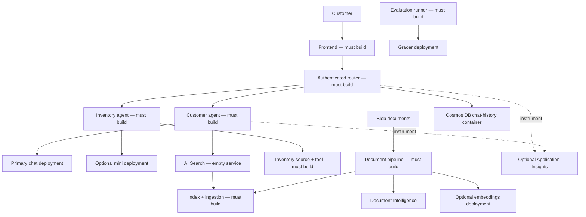

# Multi-Agent Kundenservice — Einzelhandelsarchitektur-Blueprint  

**Kapitel 5: Multi-Agent KI-Lösungen**  

- [Kursstartseite](../README.md)  
- [Kapitel 5](../docs/chapter-05-multi-agent/README.md)  
- [Voraussetzung: KI-Integration](../docs/chapter-02-ai-development/microsoft-foundry-integration.md)  
- [Weiter: Kapazitätsplanung](../docs/chapter-06-pre-deployment/capacity-planning.md)  
- [ARM Infrastrukturgerüst](retail-multiagent-arm-template/README.md)  

> **Architekturanleitung, keine funktionierende Anwendung.** Die einzigen Einzelhandelsimplementierungs-  
> dateien sind `azuredeploy.json`, `azuredeploy.parameters.json` und `deploy.sh` in  
> `retail-multiagent-arm-template/`. Router-/Frontend-Container sind Hello-World  
> Platzhalter. Kein Einzelhandelsagent, UI, Ingestion-Pipeline, Evaluator, Scanner oder  
> Anwendertest-Suite existiert lokal.  

## Überblick  

**Ziel:** Entwurf eines Kundenservice-Systems mit einem Kundenagenten und einem Inventaragenten,  
Ermittlung dessen, was die Infrastruktur bereitstellt, und Planung der fehlenden Anwendungsverträge  
und Verifizierung.  

**Zielgruppe:** Entwickler, die den lokalen  
[Chat-Beispiel](../../../examples/azure-openai-chat) und [Zwei-Service-Container-Beispiel](../../../examples/container-app/microservices) abgeschlossen haben.  
Planen Sie 2–3 Stunden für das Architekturstudium ein. Der Aufbau der Anwendung ist ein separates  
Projekt: 80–120 Entwicklungsstunden sind eine illustrative Planungsschätzung für  
erfahrene Entwickler, **kein Lieferversprechen**; Produktionshärtung, Tests,  
Sicherheitsüberprüfung und Betrieb erfordern zusätzliche Arbeit.  

### Lernziele  

- Erläutern Sie Routing, Grounding, Werkzeugberechtigungen und Gesprächseigentum.  
- Unterscheiden Sie Modellkennungen, Bereitstellungsnamen, API-Versionen und ARM-Versionen.  
- Entwerfen Sie Dokument-Ingestion und -Abruf mit passenden Vektor-Dimensionen.  
- Definieren Sie verifizierbare funktionale, Evaluations- und Fehlerwiederherstellungsanforderungen.  
- Trennen Sie optionale Architekturziele von tatsächlich bereitgestellten Ressourcen.  

## Lösungsarchitektur  


  
Dies ist eine **Zielanwendungsarchitektur**, kein Diagramm laufender Agenten-  
Dienste. Das ARM-Gerüst erstellt nur die zugrunde liegenden Dienste und zwei Platzhalter-  
Container. Front Door, Registry, verwaltete Identitäten, Rollenzuweisungen,  
private Endpunkte, Failover, Anwendungsinstrumentierung und Warnungen sind nicht enthalten.  

### Verantwortlichkeiten und Verträge  

| Komponente | Erforderliches Verhalten | Nachweis vor Fertigstellung |  
|---|---|---|  
| Frontend | Authentifizieren von Benutzern, Chat anzeigen, Dokumente sicher hochladen | UI- und Upload-Tests, zugängliche Fehler |  
| Router | Anfragen autorisieren, Agent auswählen, gebundene Werkzeugaufrufe/-zeitüberschreitungen | Routing-Tests, Autorisierungsprüfungen, Fehlertests |  
| Kundenagent | Richtlinien-/Produkantworten in genehmigten Quellen verankern | Korrekte Zitate, Enthaltung bei fehlenden Daten |  
| Inventarwerkzeug | Autoritative Lagerbestände mit beschränkten Berechtigungen lesen | Deterministische Lager-Tests; keine erfundene Verfügbarkeit |  
| Dokumentpipeline | Extrahieren, zerteilen, einbetten, indexieren, aktualisieren/löschen | Indexierte Fixtures und Retry/Dead-Letter-Verhalten |  
| Gesprächsspeicherung | Benutzer isolieren, Aufbewahrung durchsetzen | Überschreitende Autorisierung und TTL-Tests |  
| Evaluationslauf | Ausgaben mit Ground Truth und Rubrik vergleichen | Abdeckung, Ausfallzählungen, reproduzierbare Berichte |  

Betrachten Sie den Router als Empfangstresen und Werkzeuge als eingeschränkte interne Systeme:  
die Wahl eines Spezialisten ist keine Autorisierung für den Zugriff auf alle Kundenaufzeichnungen.  
Erzwingen Sie Identität und Berechtigungen im Anwendungscode und in Datendiensten, nicht in Prompts.  

## Infrastruktur vs. Anwendung  

Lesen Sie die [Gerüst-README](retail-multiagent-arm-template/README.md) vor dem Bereitstellen.  
Sie listet genaue Ressourcen, Modi, Kosten und Einschränkungen auf.  

| Logische Nutzung | ARM-Bereitstellungsname | Modell / Version | Standardregion |  
|---|---|---|---|  
| Kundenchat | `gpt-4.1-chat` | `gpt-4.1` / `2025-04-14` | `eastus2` |  
| Inventar | `gpt-4.1-mini-inventory` | `gpt-4.1-mini` / `2025-04-14` | `westus2`, optional |  
| Einbettungen | `text-embedding-ada-002` | `text-embedding-ada-002` / `2` | `francecentral`, optional |  
| Evaluation | `gpt-4.1-grader` | `gpt-4.1` / `2025-04-14` | Standardmäßig Primärregion |  

Prüfen Sie Modell-/Version-/SKU-Verfügbarkeit und Kontingent in **jeder Region**. Chat/Mini/Grader  
verwenden `GlobalStandard`; Einbettungen verwenden `Standard`. Kapazitätseinheiten-zu-TPM-  
Zuordnungen sind modellabhängig. Fügen Sie keine ungleichen Kapazitätseinheiten als universelle Kontingentgarantie hinzu.  

Das `model`-Argument einer Azure OpenAI-Anfrage ist der **Bereitstellungsname**, nicht  
notwendigerweise die Katalogmodellkennung. Die Data-Plane-API-Version `2024-10-21`  
unterscheidet sich von der Modellversion `2025-04-14` und der ARM-Ressource `apiVersion`.  
Man kann ein nicht verfügbares Modell nicht beheben, indem man nur die Data-Plane-API-Version ändert.  

`--no-multi-region` überspringt sekundäre und Einbettungskonten. Ein primärer Chat- und  
unabhängiger Grader-Account bleiben bestehen. Separate Modellkonten bieten kein automatisches  
Failover; das erfordert Anwendungsrouting, kompatible Bereitstellungen, Gesundheitsprüfungen,  
Wiederholungsgrenzen und Überprüfung der Datenhoheit.  

## Implementierungsfahrplan  

### 1. Beginnen Sie mit einer getesteten Interaktion  

Verwenden Sie vor dem Bereitstellen des großen Gerüsts das lokale Chat-Beispiel, um  
die Inferenzkonnektivität herzustellen. Definieren Sie eine repräsentative Kundenfrage, die  
genehmigte Antwortquelle, erwartete Zitate und das Fehlverhalten, wenn diese Quelle fehlt.  

### 2. Definieren Sie Routing- und Werkzeuggrenzen  

Erstellen Sie Ihre eigene Router-Quelle, Abhängigkeitsmanifest, Dockerfile und Tests. Ein  
illustrativer Vertrag könnte `POST /chat` mit `{"message":"...","conversation_id":"..."}` sein.  
**Dieser Endpunkt ist ein Designvorschlag; er wird nicht durch die ARM-Vorlage implementiert.**  

Validieren Sie Body-Typen/-Grenzen, leiten Sie Benutzeridentität aus der Authentifizierung ab, erzwingen Sie  
Gesprächseigentum, wenden Sie Anforderungszeitüberschreitungen an und geben Sie aussagekräftige Fehlercodes zurück.  
Behandeln Sie HTTP-Fehler oder leere Antworten nicht als erfolgreiche Agentenergebnisse.  

### 3. Implementieren Sie Grounding und Ingestion  

Die ARM-Vorlage erstellt keinen Suchindex. Dies ist ein **Referenz-JSON  
Ausschnitt zur Anpassung in Ihrer eigenen Indexdefinition**, keine bereits vorhandene Datei im Repo:  

```json
{
  "name": "retail-product-index",
  "fields": [
    {"name": "id", "type": "Edm.String", "key": true},
    {"name": "title", "type": "Edm.String", "searchable": true},
    {"name": "content", "type": "Edm.String", "searchable": true},
    {"name": "category", "type": "Edm.String", "filterable": true},
    {
      "name": "content_vector",
      "type": "Collection(Edm.Single)",
      "searchable": true,
      "dimensions": 1536,
      "vectorSearchProfile": "retail-profile"
    }
  ],
  "vectorSearch": {
    "algorithms": [{"name": "retail-hnsw", "kind": "hnsw"}],
    "profiles": [{"name": "retail-profile", "algorithm": "retail-hnsw"}]
  }
}
```
  
Das Profil verknüpft das Vektorfeld mit seinem Algorithmus. Die Dimensionen müssen mit der  
tatsächlichen Einbettungsausgabe übereinstimmen (1536 für diese `ada-002` Bereitstellung). Für Python-Abrufe  
verwenden Sie `azure.search.documents.models.VectorizedQuery` anstelle eines unvollständigen  
Dictionaries ohne seinen Vektorabfrage-Typ:  

```python
# Reference function only: supply an authenticated async SearchClient and an embedding.
from azure.search.documents.models import VectorizedQuery

async def retrieve(search_client, embedding):
    results = await search_client.search(
        search_text=None,
        vector_queries=[VectorizedQuery(
            vector=embedding,
            k_nearest_neighbors=5,
            fields="content_vector"
        )],
        select=["id", "title", "content"]
    )
    return [document async for document in results]
```
  
Erstellen Sie eine separate Ingestion-Implementierung, die:  

1. Upload-Zugriff autorisiert und Inhaltstyp und -größe validiert.  
2. Private Blobs mit authentifizierten SDK-Aufrufen liest. Eine private Blob-URL allein  
   ist **kein** lesbarer Document-Intelligence-Eingang; senden Sie heruntergeladene Bytes mit  
   `AnalyzeDocumentRequest(bytes_source=...)` oder verwenden Sie eine entsprechend berechtigte,  
   kurzlebige SAS nach Überprüfung der Zugriffsanforderungen.  
3. Text extrahiert, zerteilt, um Einbettungslimits zu erfüllen, und Embeddings generiert.  
4. Stabile gültige Dokumentenschlüssel erstellt und Chunks mit passenden Vektoren hochlädt.  
5. Indexierungsergebnisse pro Dokument prüft, Wiederholungen behandelt und veraltete Daten aktualisiert/löscht.  

Interpolieren Sie keine willkürlichen Benutzer-Schlüssel/Werte in OData-Filter. Erlauben Sie nur bestimmte Felder,  
validieren Sie Werttypen und escapen Sie String-Anführungszeichen. Boolesche und numerische Filter benötigen  
typisierte Literale, keine zitierten Strings.  

### 4. Web-Grounding  

**Bing Search v7 wurde am 11. August 2025 eingestellt.** Die alte `Microsoft.Bing/accounts`  
Ressource und `api.bing.microsoft.com/v7.0/search` Beispiele sind kein unterstützter  
Implementierungspfad. Evaluieren Sie eine aktuell unterstützte Grounding-Integration in  
Microsoft Foundry und dessen SDK, Berechtigungen, Abrechnung und Zitationsanforderungen;  
keine ist hier implementiert. Es ist kein direkter Ersatz für den eingestellten Endpunkt.  

### 5. Fügen Sie Telemetrie und Bewertung hinzu  

Das Erstellen von Application Insights instrumentiert keinen Code. Verwenden Sie unterstützte Azure Monitor  
OpenTelemetry-Instrumentierung beim Erstellen einer neuen Anwendung, propagieren Sie Trace-  
Kontexte zwischen Diensten und vermeiden Sie es, Kunden-Prompts, Dokumente oder Geheimnisse zu protokollieren.  
Das Abschneiden einer Abfrage anonymisiert diese **nicht**.  

Messen Sie Anfrage-Dauer, Routing-/Werkzeugfehler, Relevanz der Abrufe, Korrektheit der Zitation, Token-Nutzung  
und Enthaltung. Speichern Sie Ground-Truth-Inventar-/Richtlinienfakten  
zusammen mit Bewertungsszenarien: Ein Bewerter kann die faktische Genauigkeit nicht zuverlässig bestimmen,  
wenn er nur eine Frage und eine Antwort hat.  

Eine Bewerterbereitstellung ist kein Evaluationsrunner. Implementieren Sie eine versionierte Rubrik,  
strukturierte Ausgabe/Schemavalidierung, Bereichsprüfungen der Punktzahl, Transportfehlerzählungen  
und von Menschen geprüfte Fälle. Melden Sie unvollständige/Fehlerfälle separat; wandeln Sie diese nicht in erfolgreiche Bewertungen um  
oder schließen Sie sie stillschweigend als Antworten von null Qualität ein.  

Ebenso sind einige Keyword-Prüfungen keine Sicherheitszertifizierung. Eine fehlgeschlagene HTTP-  
Anfrage, fehlende Teststrategie oder leere Antwort muss einen Test **ungültig oder  
fehlgeschlagen** machen, nicht eine „100 % sichere“ Bewertung ergeben. Führen Sie autorisierte Tests mit geeigneten  
Werkzeugen und menschlicher Überprüfung durch, bevor Sie eine Produktionsreife behaupten.  

### 6. Stellen Sie Ihre Anwendung bereit  

Erstellen Sie Ihre eigenen Quellverzeichnisse, Manifeste, Tests, Registry- und Image-Pull-  
Berechtigungen. Ersetzen Sie Platzhalter durch erstellte Images und aktualisieren Sie Ingress/Probes,  
um die jeweiligen App-Ports anzupassen. Konfigurieren Sie Laufzeit-Umgebungsvariablen in Bicep  
oder einer explizit unterstützten azd-Umgebungszuordnung.  

Es gibt kein generisches `config` Wörterbuch unter einem azd-Dienst, das automatisch
Laufzeit-Umgebungsvariablen erstellt. `azd env set` ändert nur Ressourcen, die
diese Werte explizit verwenden. Kein Canary, Regionenliste oder Feineinstellungs-Hook
ist in diesem Gerüst implementiert.

## Praktische Gestaltungsübungen

Dies sind **Architekturübungen**, keine Ansprüche auf ausführbaren Einzelhandels-Startercode.

### Übung 1: Überprüfe die Grenze

**Ausgangspunkt:** die drei Dateien in `retail-multiagent-arm-template/`.
**Ziel:** Unterscheide die Bereitstellung von der Anwendungsfunktionalität.
Öffne `azuredeploy.json`, finde sowohl Container-Images als auch `targetPort`-Werte,
und liste dann die Anwendungsbestandteile auf, die im Repository fehlen.

**Erfolgskriterien / Antwort:** Beide Images sind Hello-World-Platzhalter, die auf Port 80 lauschen;
Agenten, Chat-Oberfläche, Router-Handler, Index/Erfassung, Evaluator und Scanner
fehlen. Eine erfolgreiche Platzhalter-Stamm-Anfrage validiert `/chat` nicht.
**Häufiges Problem:** Ressourcen-Namen wie `retail-router` als funktionierenden Code zu interpretieren.

### Übung 2: Verfolge die Vektor-Konfiguration

**Ausgangspunkt:** oben stehendes Index-JSON.
**Ziel:** Verstehe die Feld → Profil → Algorithmus Beziehung.
Identifiziere, welche Werte geändert werden müssen, wenn auf ein Einbettungsmodell mit
einer anderen Ausgabedimension umgeschaltet wird, und überprüfe dann die `retrieve`-Funktion.

**Erfolgskriterien / Antwort:** Ändere das Feld `dimensions` auf die tatsächliche Vektor-Länge;
halte `vectorSearchProfile` synchron mit einem deklarierten Profil und dessen Algorithmus;
Die Abfrage bei `fields` muss das Vektorfeld benennen. Erzeuge vorhandene Dokument-Vektoren neu,
wenn sich das Einbettungsmodell ändert.
**Häufiges Problem:** Nur den Modellnamen ändern, während inkompatible Vektoren beibehalten werden.

### Übung 3: Definiere einen Fehler-Test

**Ausgangspunkt:** Verantwortlichkeitstabelle.
**Ziel:** Vermeide falschen Erfolg.
Schreibe erwartetes Verhalten für eine nicht verfügbare Inventar-API, einen Suchindex ohne
passende Dokumente und eine Auswertungsanfrage, die HTTP 503 zurückgibt.

**Erfolgskriterien / Antwort:** Keine erfundenen Inventarwerte; explizites Enthalten oder
Eskalation, wenn der Kontext fehlt; Auswertung meldet einen Transportfehler statt
einer Qualitäts- oder Sicherheitsbewertung. Füge ausführbare Tests hinzu, wenn du die Anwendung erstellst.
**Häufiges Problem:** Fängt jede Ausnahme ab und macht mit einer leeren Antwort weiter.

## Kosten, Fehlerbehebung und Bereinigung

- Infrastruktur verursacht laufende Kosten, selbst bei leeren Suchindizes und Platzhalter-
  Apps. Nutze aktuelle regionale Preise; weder „minimal“ noch Mehrregionen bedeutet kostenlos.
- Token-Kosten hängen vom Modell, gecachtem/nicht gecachtem Eingabe-, Ausgabe- und Bereitstellungs-SKU ab.
  Routing kann nur Geld sparen, wenn gemessene Arbeitslast und Qualitätsresultate dies rechtfertigen;
  eine feste Einsparung von 60–80 % ist nicht garantiert.
- Prüfe Modellverfügbarkeit und Kontingent vor der Bereitstellung; unterscheide Berechtigungs,
  Bereitstellungsnamen-, Regionen-, Modellversion- und API-Versionsfehler.
- Führe keine fehlenden `setup-data.sh`, evaluator-CLIs oder `pytest tests/`-Befehle aus.
  Ihre Implementierungen sind Teil deines Entwicklungs-Backlogs.
- Das Gerüst ist nur für ARM: Folge den
  [Verifizierungs- und Bereinigungshinweisen](retail-multiagent-arm-template/README.md).
  `azd down` verwaltet diese Ressourcen nicht.

## Verwandte Ressourcen

- [Funktionierendes lokales Chat-Beispiel](../../../examples/azure-openai-chat)
- [Funktionierendes Zwei-Service-Container-Beispiel](../../../examples/container-app/microservices)
- [AI Search Vektorindizes](https://learn.microsoft.com/azure/search/vector-search-how-to-create-index)
- [Container Apps Dokumentation](https://learn.microsoft.com/azure/container-apps/)
- [Fehlerbehebung](../docs/chapter-07-troubleshooting/common-issues.md)
- [Problem melden](https://github.com/microsoft/AZD-for-beginners/issues)

---

<!-- CO-OP TRANSLATOR DISCLAIMER START -->
**Haftungsausschluss**:
Dieses Dokument wurde mit dem KI-Übersetzungsdienst [Co-op Translator](https://github.com/Azure/co-op-translator) übersetzt. Obwohl wir uns um Genauigkeit bemühen, beachten Sie bitte, dass automatisierte Übersetzungen Fehler oder Ungenauigkeiten enthalten können. Das Originaldokument in seiner Ursprungssprache gilt als maßgebliche Quelle. Bei kritischen Informationen wird eine professionelle menschliche Übersetzung empfohlen. Wir übernehmen keine Haftung für Missverständnisse oder Fehlinterpretationen, die aus der Verwendung dieser Übersetzung entstehen.
<!-- CO-OP TRANSLATOR DISCLAIMER END -->