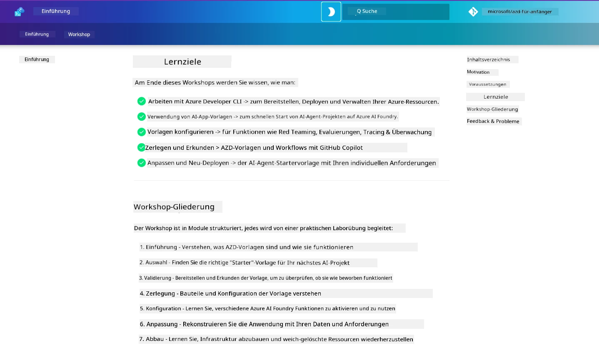

<div align="center">
  <div style="background: linear-gradient(135deg, #0078d4, #106ebe); border-radius: 10px; padding: 20px; margin: 20px 0; box-shadow: 0 4px 15px rgba(0, 120, 212, 0.3); border: 2px solid #005a9e;">
    <h2 style="color: white; margin: 0; font-size: 24px; text-shadow: 1px 1px 2px rgba(0,0,0,0.3);">
      🎯 AZD für KI-Entwickler Workshop
    </h2>
    <p style="color: white; margin: 10px 0 0 0; font-size: 16px; text-shadow: 1px 1px 2px rgba(0,0,0,0.3);">
      <strong>Ein praxisorientierter Workshop zum Erstellen von KI-Anwendungen mit Azure Developer CLI.</strong><br>
      Absolvieren Sie 7 Module, um AZD-Vorlagen und KI-Bereitstellungs-Workflows zu meistern.
    </p>
    <div style="margin-top: 15px;">
      <span style="background: rgba(255,255,255,0.2); padding: 5px 10px; border-radius: 15px; color: white; font-size: 14px;">
        📅 Quelle der Anleitung überprüft: November 2026
      </span>
    </div>
  </div>
</div>

# AZD für KI-Entwickler Workshop

Willkommen zum praxisorientierten Workshop zum Lernen der Azure Developer CLI (AZD) mit Fokus auf die Bereitstellung von KI-Anwendungen. Dieser Workshop hilft Ihnen, ein angewandtes Verständnis für AZD-Vorlagen in 3 Schritten zu gewinnen:

1. **Entdeckung** - finden Sie die Vorlage, die für Sie richtig ist.
1. **Bereitstellung** - bereitstellen und validieren, dass sie funktioniert
1. **Anpassung** - modifizieren und iterieren, um sie zu Ihrer zu machen!

Im Verlauf dieses Workshops werden Sie auch in Kernentwicklungswerkzeuge und Workflows eingeführt, die Ihnen helfen, Ihre End-to-End-Entwicklungsreise zu optimieren.

<br/>

## Browser-basierte Anleitung

Die Workshop-Lektionen sind in Markdown. Sie können sie direkt auf GitHub durchblättern oder eine browser-basierte Vorschau starten, wie im Screenshot unten gezeigt.



Um diese Option zu nutzen – forken Sie das Repository in Ihr Profil und starten Sie GitHub Codespaces. Sobald das VS Code-Terminal aktiv ist, geben Sie diesen Befehl ein:

Diese Browser-Vorschau funktioniert in GitHub Codespaces, Dev-Containern oder einem lokalen Klon mit installiertem Python und MkDocs.

```bash title="" linenums="0"
python -m pip install -r requirements-dev.txt
python -m mkdocs serve --config-file workshop/mkdocs.yml
```

Führen Sie diese Befehle im **Stammverzeichnis des Kurs-Repositorys** aus, nicht im separat initialisierten KI-Beispiel. Halten Sie die Vorschau im Vordergrund, damit Fehler sichtbar bleiben; stoppen Sie sie mit Ctrl+C. Um die Seite ohne Bereitstellung zu prüfen, führen Sie `python -m mkdocs build --strict --config-file workshop/mkdocs.yml` aus.

In einigen Sekunden sehen Sie einen Pop-up-Dialog. Wählen Sie die Option `Open in browser` aus. Die webbasierte Anleitung öffnet sich jetzt in einem neuen Browser-Tab. Einige Vorteile dieser Vorschau:

1. **Integrierte Suche** - finden Sie schnell Schlüsselwörter oder Lektionen.
1. **Kopier-Icon** - fahren Sie mit der Maus über Codeblöcke, um diese Option zu sehen
1. **Themen-Umschalter** - wechseln Sie zwischen dunklem und hellem Thema
1. **Hilfe erhalten** - klicken Sie auf das Discord-Icon im Fußbereich, um beizutreten!

<br/>

## Workshop Übersicht

**Dauer:** 3-4 Stunden  
**Level:** Anfänger bis Mittelstufe  
**Voraussetzungen:** Vertrautheit mit Azure, KI-Konzepten, VS Code & Kommandozeilen-Tools.

Dies ist ein praxisorientierter Workshop, bei dem Sie durch Ausprobieren lernen. Nachdem Sie die Übungen abgeschlossen haben, empfehlen wir, das AZD für Anfänger Curriculum zu überprüfen, um Ihre Lernreise in Sicherheits- und Produktivitäts-Best Practices fortzusetzen.

| Zeit | Modul | Ziel |
|:---|:---|:---|
| 15 Min. | [Einführung](docs/instructions/0-Introduction.md) | Die Grundlagen festlegen, Ziele verstehen |
| 30 Min. | [KI-Vorlage auswählen](docs/instructions/1-Select-AI-Template.md) | Optionen erkunden und Startvorlage wählen |
| 30 Min. | [KI-Vorlage validieren](docs/instructions/2-Validate-AI-Template.md) | Standardlösung in Azure bereitstellen |
| 30 Min. | [KI-Vorlage aufschlüsseln](docs/instructions/3-Deconstruct-AI-Template.md) | Struktur und Konfiguration erkunden |
| 30 Min. | [KI-Vorlage konfigurieren](docs/instructions/4-Configure-AI-Template.md) | Aktivieren und verfügbare Funktionen testen |
| 30 Min. | [KI-Vorlage anpassen](docs/instructions/5-Customize-AI-Template.md) | Vorlage an Ihre Bedürfnisse anpassen |
| 30 Min. | [Infrastruktur abbauen](docs/instructions/6-Teardown-Infrastructure.md) | Aufräumen und Ressourcen freigeben |
| 15 Min. | [Abschluss & nächste Schritte](docs/instructions/7-Wrap-up.md) | Lernressourcen, Workshop-Herausforderung |

<br/>

## Was Sie lernen werden

Betrachten Sie die AZD-Vorlage als Lernspielwiese, um verschiedene Fähigkeiten und Werkzeuge für die End-to-End-Entwicklung auf Microsoft Foundry zu erkunden. Am Ende dieses Workshops sollten Sie ein intuitives Verständnis für verschiedene Tools und Konzepte in diesem Kontext haben.

| Konzept | Ziel |
|:---|:---|
| **Azure Developer CLI** | Werkzeuge, Befehle und Workflows verstehen |
| **AZD-Vorlagen** | Projektstruktur und Konfiguration verstehen |
| **Azure KI-Agent** | Microsoft Foundry-Projekt bereitstellen & bereitstellen |
| **Azure KI-Suche** | Kontext-Engineering mit Agenten ermöglichen |
| **Beobachtbarkeit** | Tracing, Monitoring und Bewertungen erkunden |
| **Red Teaming** | Gegnerschaftliches Testen und Gegenmaßnahmen erkunden |

<br/>

## Workshop-Struktur

Der Workshop ist so strukturiert, dass er Sie auf eine Reise von der Vorlagenauswahl über Bereitstellung, Aufschlüsselung bis hin zur Anpassung führt – basierend auf der offiziellen [Getting Started with AI Agents](https://github.com/Azure-Samples/get-started-with-ai-agents) Starter-Vorlage.

### [Modul 1: KI-Vorlage auswählen](docs/instructions/1-Select-AI-Template.md) (30 Min.)

- Was sind KI-Vorlagen?
- Wo finde ich KI-Vorlagen?
- Wie kann ich mit dem Erstellen von KI-Agenten beginnen?
- **Übung**: Schnellstart in Codespaces oder einem Dev-Container

### [Modul 2: KI-Vorlage validieren](docs/instructions/2-Validate-AI-Template.md) (30 Min.)

- Wie ist die Architektur der KI-Vorlage?
- Wie sieht der AZD-Entwicklungsworkflow aus?
- Wo bekomme ich Hilfe bei der AZD-Entwicklung?
- **Übung**: KI-Agenten-Vorlage bereitstellen & validieren

### [Modul 3: KI-Vorlage aufschlüsseln](docs/instructions/3-Deconstruct-AI-Template.md) (30 Min.)

- Erkunde deine Umgebung in `.azure/` 
- Erkunde deine Ressourcenkonfiguration in `infra/` 
- Erkunde deine AZD-Konfiguration in `azure.yaml`s
- **Übung**: Umgebungsvariablen ändern & erneut bereitstellen

### [Modul 4: KI-Vorlage konfigurieren](docs/instructions/4-Configure-AI-Template.md) (30 Min.)
- Erkunde: Retrieval Augmented Generation
- Erkunde: Agentenbewertung & Red Teaming
- Erkunde: Tracing & Monitoring 
- **Übung**: KI-Agent + Beobachtbarkeit erkunden

### [Modul 5: KI-Vorlage anpassen](docs/instructions/5-Customize-AI-Template.md) (30 Min.)
- Definiere: PRD mit Szenarienanforderungen
- Konfiguriere: Umgebungsvariablen für AZD
- Implementiere: Lifecycle-Hooks für zusätzliche Aufgaben
- **Übung**: Vorlage für mein Szenario anpassen

### [Modul 6: Infrastruktur abbauen](docs/instructions/6-Teardown-Infrastructure.md) (30 Min.)
- Rückblick: Was sind AZD-Vorlagen?
- Rückblick: Warum Azure Developer CLI verwenden?
- Nächste Schritte: Probieren Sie eine andere Vorlage aus!
- **Übung**: Infrastruktur deprovisionieren & aufräumen

<br/>

## Workshop-Herausforderung

Möchten Sie sich selbst mehr herausfordern? Hier sind einige Projektvorschläge – oder teilen Sie Ihre Ideen mit uns!!

| Projekt | Beschreibung |
|:---|:---|
|1. **Eine komplexe KI-Vorlage aufschlüsseln** | Nutzen Sie den dargestellten Workflow und die Tools, um zu sehen, ob Sie eine andere KI-Lösungsvorlage bereitstellen, validieren und anpassen können. _Was haben Sie gelernt?_|
|2. **Anpassen mit Ihrem Szenario** | Versuchen Sie, ein PRD (Product Requirements Document) für ein anderes Szenario zu schreiben. Verwenden Sie dann GitHub Copilot in Ihrem Vorlagen-Repo im Agent-Modell und bitten Sie es, einen Anpassungsworkflow für Sie zu generieren. _Was haben Sie gelernt? Wie könnten Sie diese Vorschläge verbessern?_|
| | |

## Feedback?

1. Erstellen Sie ein Issue in diesem Repository – taggen Sie es für Bequemlichkeit mit `Workshop`.
1. Treten Sie dem Microsoft Foundry Discord bei – verbinden Sie sich mit Ihren Kollegen!


| | | 
|:---|:---|
| **📚 Kursstartseite** | [AZD für Anfänger](../README.md) |
| **📖 Dokumentation** | [Erste Schritte mit KI-Vorlagen](https://learn.microsoft.com/en-us/azure/ai-foundry/how-to/develop/ai-template-get-started) |
| **🛠️ KI-Vorlagen** | [Microsoft Foundry Vorlagen](https://ai.azure.com/templates) |
| **🚀 Nächste Schritte** | [Workshop starten](#workshop-overview) |
| | |

<br/>

---

**Navigation:** [Hauptkurs](../README.md) | [Einführung](docs/instructions/0-Introduction.md) | [Modul 1: Vorlage auswählen](docs/instructions/1-Select-AI-Template.md)

**Bereit, mit AZD KI-Anwendungen zu erstellen?**

[Workshop starten: Einführung →](docs/instructions/0-Introduction.md)

---

<!-- CO-OP TRANSLATOR DISCLAIMER START -->
**Haftungsausschluss**:
Dieses Dokument wurde mit dem KI-Übersetzungsdienst [Co-op Translator](https://github.com/Azure/co-op-translator) übersetzt. Obwohl wir uns um Genauigkeit bemühen, beachten Sie bitte, dass automatisierte Übersetzungen Fehler oder Ungenauigkeiten enthalten können. Das Originaldokument in seiner Ursprungssprache gilt als maßgebliche Quelle. Bei kritischen Informationen wird eine professionelle menschliche Übersetzung empfohlen. Wir übernehmen keine Haftung für Missverständnisse oder Fehlinterpretationen, die aus der Verwendung dieser Übersetzung entstehen.
<!-- CO-OP TRANSLATOR DISCLAIMER END -->