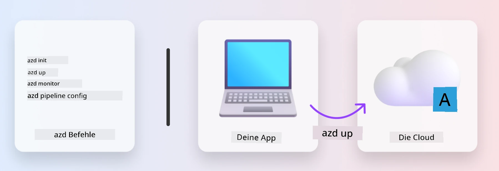
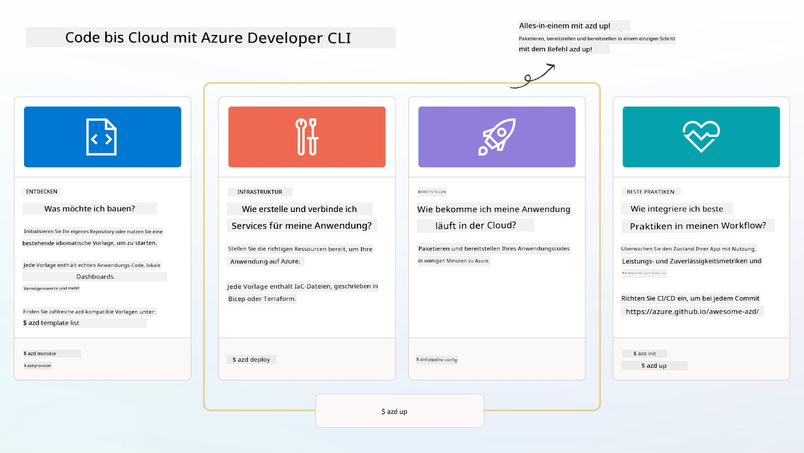

# 1. Wählen Sie eine Vorlage aus

!!! tip "AM ENDE DIESES MODULS WERDEN SIE IN DER LAGE SEIN"

    - [ ] Describe what AZD templates are
    - [ ] Discover and use AZD templates for AI
    - [ ] Get started with the AI Agents template
    - [ ] **Lab 1:** AZD Quickstart in Codespaces or a dev container

---

## 1. Eine Analogie zum Bau

Eine moderne, unternehmensgerechte KI-Anwendung _von Grund auf_ zu bauen, kann einschüchternd sein. Es ist ein bisschen so, als würde man sein neues Zuhause selbst Stein für Stein errichten. Ja, das ist machbar! Aber es ist nicht der effektivste Weg, um das gewünschte Endergebnis zu erzielen!

Stattdessen beginnen wir oft mit einem vorhandenen _Designplan_ und arbeiten mit einem Architekten zusammen, um diesen an unsere persönlichen Anforderungen anzupassen. Und genau das ist der Ansatz beim Erstellen intelligenter Anwendungen. Finden Sie zuerst eine gute Designarchitektur, die zu Ihrem Problemfeld passt. Arbeiten Sie dann mit einem Lösungsarchitekten zusammen, um die Lösung für Ihr spezifisches Szenario anzupassen und zu entwickeln.

Aber wo finden wir diese Designpläne? Und wie finden wir einen Architekten, der bereit ist, uns zu lehren, wie wir diese Pläne selbst anpassen und bereitstellen können? In diesem Workshop beantworten wir diese Fragen, indem wir Ihnen drei Technologien vorstellen:

1. [Azure Developer CLI](https://aka.ms/azd) - ein Open-Source-Tool, das den Entwicklerpfad vom lokalen Entwickeln (build) bis zur Cloud-Bereitstellung (ship) beschleunigt.
1. [Microsoft Foundry Templates](https://ai.azure.com/templates) - standardisierte Open-Source-Repositorien mit Beispielcode, Infrastruktur- und Konfigurationsdateien zur Bereitstellung einer KI-Lösungsarchitektur.
1. [GitHub Copilot Agent Mode](https://code.visualstudio.com/docs/copilot/chat/chat-agent-mode) - ein coderfreundlicher Agent basierend auf Azure-Wissen, der uns mit natürlicher Sprache durch den Code navigiert und Änderungen vorschlägt.

Mit diesen Werkzeugen können wir nun die passende Vorlage _entdecken_, sie _bereitstellen_, um zu prüfen, ob sie funktioniert, und sie _anpassen_, um sie auf unsere spezifischen Szenarien abzustimmen. Lassen Sie uns eintauchen und lernen, wie diese funktionieren.


---

## 2. Azure Developer CLI

Die [Azure Developer CLI](https://learn.microsoft.com/en-us/azure/developer/azure-developer-cli/) (oder `azd`) ist ein Open-Source-Kommandozeilentool, das Ihre Code-zu-Cloud-Reise beschleunigt durch eine Reihe von entwicklerfreundlichen Befehlen, die konsistent in Ihrer IDE (Entwicklung) und CI/CD (DevOps) Umgebungen funktionieren.

Mit `azd` kann Ihre Bereitstellungsreise so einfach sein wie:

- `azd init` - Initialisiert ein neues KI-Projekt aus einer vorhandenen AZD-Vorlage.
- `azd up` - Stellt Infrastruktur bereit und deployt Ihre Anwendung in einem Schritt.
- `azd monitor` - Bietet Echtzeit-Überwachung und Diagnosen für Ihre bereitgestellte Anwendung.
- `azd pipeline config` - Richtet CI/CD-Pipelines ein, um die Bereitstellung in Azure zu automatisieren.

**🎯 | ÜBUNG**: <br/> Erkunden Sie jetzt das Kommandozeilentool `azd` in Ihrer aktuellen Workshop-Umgebung. Dies kann GitHub Codespaces, ein Dev-Container oder ein lokales Klon mit den erforderlichen Voraussetzungen sein. Geben Sie diesen Befehl ein, um zu sehen, was das Tool kann:

```bash title="" linenums="0"
azd help
```



---

## 3. Die AZD-Vorlage

Damit `azd` funktioniert, muss es wissen, welche Infrastruktur bereitzustellen ist, welche Konfigurationseinstellungen durchgesetzt werden und welche Anwendung bereitgestellt wird. Hier kommen die [AZD Vorlagen](https://learn.microsoft.com/en-us/azure/developer/azure-developer-cli/azd-templates?tabs=csharp) ins Spiel.

AZD-Vorlagen sind Open-Source-Repositorien, die Beispielcode mit Infrastruktur- und Konfigurationsdateien kombinieren, die für die Bereitstellung der Lösungsarchitektur erforderlich sind.
Durch den Einsatz eines _Infrastructure-as-Code_ (IaC)-Ansatzes ermöglichen sie Versionskontrolle für Vorlagen-Ressourcendefinitionen und Konfigurationseinstellungen (genau wie beim Quellcode der App) – und schaffen so wiederverwendbare und konsistente Workflows für die Nutzer dieses Projekts.

Wenn Sie eine AZD-Vorlage für _Ihr_ Szenario erstellen oder wiederverwenden, bedenken Sie folgende Fragen:

1. Was bauen Sie? → Gibt es eine Vorlage, die Starter-Code für dieses Szenario enthält?
1. Wie ist Ihre Lösung architektonisch gestaltet? → Gibt es eine Vorlage, die die notwendigen Ressourcen enthält?
1. Wie wird Ihre Lösung bereitgestellt? → Denken Sie an `azd deploy` mit Pre/Post-Processing Hooks!
1. Wie können Sie es weiter optimieren? → Denken Sie an eingebaute Überwachung und Automatisierungs-Pipelines!

**🎯 | ÜBUNG**: <br/> 
Besuchen Sie die [Awesome AZD](https://azure.github.io/awesome-azd/) Galerie und nutzen Sie die Filter, um die derzeit verfügbaren über 250 Vorlagen zu erkunden. Sehen Sie, ob Sie eine finden, die Ihren _szenariobezogenen_ Anforderungen entspricht.



---

## 4. KI-App-Vorlagen

Für KI-basierte Anwendungen stellt Microsoft spezialisierte Vorlagen mit **Microsoft Foundry** und **Foundry Agents** bereit. Diese Vorlagen beschleunigen Ihren Weg zum Bau intelligenter und produktionsreifer Anwendungen.

### Microsoft Foundry & Foundry Agents Vorlagen

Wählen Sie unten eine Vorlage zur Bereitstellung aus. Jede Vorlage ist auf [Awesome AZD](https://azure.github.io/awesome-azd/) verfügbar und kann mit einem einzigen Befehl initialisiert werden.

| Vorlage | Beschreibung | Bereitstellungsbefehl |
|----------|-------------|----------------|
| **[AI Chat mit RAG](https://github.com/Azure-Samples/azure-search-openai-demo)** | Suchbasierte Chat-Anwendung | `azd init -t Azure-Samples/azure-search-openai-demo .` |
| **[Erste Schritte mit KI-Agenten](https://github.com/Azure-Samples/get-started-with-ai-agents)** | Agentgestützte Chat-Anwendung; im gesamten Workshop verwendet | `azd init -t Azure-Samples/get-started-with-ai-agents .` |
| **[Erste Schritte mit KI-Chat](https://github.com/Azure-Samples/get-started-with-ai-chat)** | Starter-KI-Chat-Anwendung | `azd init -t Azure-Samples/get-started-with-ai-chat .` |

Diese sind Alternativen: Initialisieren Sie **eine** Vorlage in einem eigenen leeren Verzeichnis. Das nachgestellte `.` wählt dieses Verzeichnis aus; bei aktuellen AZD-Versionen ohne Angabe wird ein untergeordnetes Verzeichnis mit dem Namen der Vorlage erstellt. Die Initialisierung lädt ein Projekt herunter; `azd up` führt die kostenpflichtige Bereitstellung durch, nachdem Sie die Voraussetzungen, Ressourcen, Regionsunterstützung und Quote geprüft haben.

### Schnellstart

1. **Durchsuchen Sie Vorlagen**: Besuchen Sie [https://azure.github.io/awesome-azd/](https://azure.github.io/awesome-azd/) und filtern Sie nach `AI`, `Agents` oder `Microsoft Foundry`
2. **Wählen Sie Ihre Vorlage**: Wählen Sie eine aus, die zu Ihrem Anwendungsfall passt
3. **Initialisieren**: Führen Sie den Befehl `azd init` für Ihre ausgewählte Vorlage aus
4. **Bereitstellen**: Führen Sie `azd up` aus, um bereitzustellen und zu deployen

**🎯 | ÜBUNG**: <br/>
Wählen Sie eine der oben genannten Vorlagen basierend auf Ihrem Szenario aus:

- **Setzen Sie diesen Workshop fort?** → Wählen Sie **Erste Schritte mit KI-Agenten**
- **Bauen Sie eine suchbasierte Chat-Anwendung?** → Erkunden Sie **AI Chat mit RAG** separat
- **Benötigen Sie eine andere Architektur?** → Durchsuchen Sie die Galerie und prüfen Sie das tatsächliche Repository, Implementierungsstatus und Voraussetzungen

```bash title="Initialize the workshop template in an empty directory" linenums="0"
azd init -t Azure-Samples/get-started-with-ai-agents .
azd auth login
azd up
```

!!! info "Weitere Vorlagen erkunden"
    Die [Awesome AZD Galerie](https://azure.github.io/awesome-azd/) enthält über 250 Vorlagen. Nutzen Sie die Filter, um Vorlagen zu finden, die Ihren spezifischen Anforderungen an Sprache, Framework und Azure-Dienste entsprechen.

---

<!-- CO-OP TRANSLATOR DISCLAIMER START -->
**Haftungsausschluss**:
Dieses Dokument wurde mit dem KI-Übersetzungsdienst [Co-op Translator](https://github.com/Azure/co-op-translator) übersetzt. Obwohl wir uns um Genauigkeit bemühen, beachten Sie bitte, dass automatisierte Übersetzungen Fehler oder Ungenauigkeiten enthalten können. Das Originaldokument in seiner Ursprungssprache gilt als maßgebliche Quelle. Bei kritischen Informationen wird eine professionelle menschliche Übersetzung empfohlen. Wir übernehmen keine Haftung für Missverständnisse oder Fehlinterpretationen, die aus der Verwendung dieser Übersetzung entstehen.
<!-- CO-OP TRANSLATOR DISCLAIMER END -->