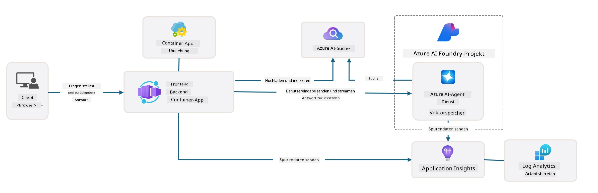
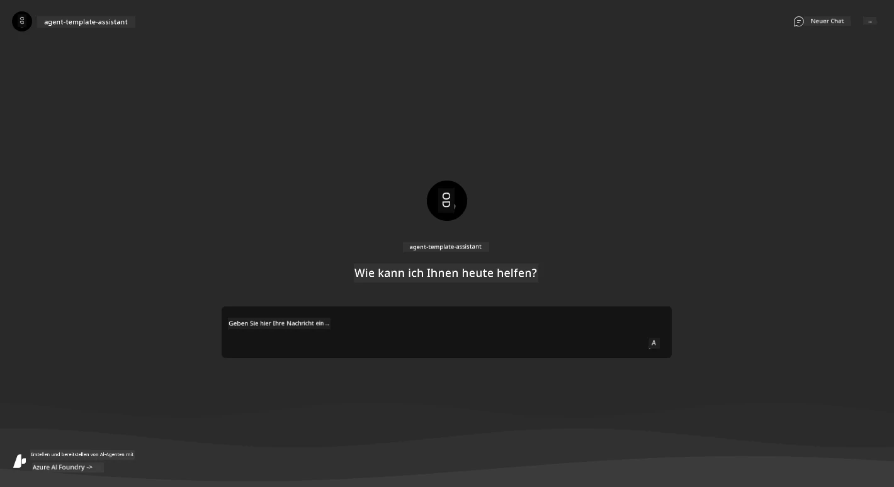

# 2. Eine Vorlage validieren

> Quellenleitfaden überprüft mit AZD 1.37.2 und dem aktuellen Beispiel am 4. November 2026. Screenshots sind illustrativ; Portalnavigation, Vorlageneinstellungen und Dienstverfügbarkeit können sich ändern. Diese Überprüfung hat keine Live-Bereitstellung in Azure durchgeführt.

!!! tip "AM ENDE DIESES MODULS WERDEN SIE IN DER LAGE SEIN"

    - [ ] Identify the sample's prerequisites and intended resources
    - [ ] Deploy the selected template into an intentional environment
    - [ ] Verify the application and agent behavior separately from deployment success
    - [ ] **Lab 2:** Record evidence of a working baseline, or an actionable deployment blocker

---

## 1. Voraussetzungen prüfen

Die [Azure Developer CLI](https://learn.microsoft.com/azure/developer/azure-developer-cli/) verwaltet die Anwendungsbereitstellung mithilfe der Konfiguration, Infrastruktur und des Codes der Vorlage. Überprüfen Sie Ihre installierte Version:

```bash
azd version
```

Verwenden Sie bei Bedarf die [aktuellen Installations-/Update-Anweisungen](https://learn.microsoft.com/azure/developer/azure-developer-cli/install-azd). Das geprüfte Beispiel gibt AZD `>=1.14.0` an, aber eine aktuelle unterstützte Version wird empfohlen. Die optionalen KI-Erweiterungen haben eigene Versionsanforderungen; der normale `azd up`-Workflow dieses Beispiels erfordert die Agents-Erweiterung nicht.

Lesen Sie vor der Bereitstellung die [Azure-Konto-Einrichtung](https://github.com/Azure-Samples/get-started-with-ai-agents/blob/main/docs/azure_account_setup.md) und die [Bereitstellungsanleitung](https://github.com/Azure-Samples/get-started-with-ai-agents/blob/main/docs/deployment.md) des Beispiels. Bestätigen Sie Ihr Abonnement, Berechtigungen, Modellverfügbarkeit, regionale Kontingente und erwartete Kosten. Ein Azure-Free-Konto garantiert nicht den Zugriff oder die kostenlose Nutzung für jeden benötigten Dienst.

## 2. Das ausgewählte Beispiel öffnen

Verwenden Sie das in Modul 1 initialisierte Repository [Get Started with AI Agents](https://github.com/Azure-Samples/get-started-with-ai-agents). Falls nicht initialisiert, wählen Sie eine der folgenden Alternativen:

- Einen [Codespace für das Beispiel öffnen](https://github.com/codespaces/new/Azure-Samples/get-started-with-ai-agents).
- Das Beispiel klonen und die lokale/dev-Container-Einrichtung befolgen.
- In einem **leeren Verzeichnis** ausführen:

```bash
azd init --template Azure-Samples/get-started-with-ai-agents .
```

Initialisieren Sie keine zweite Vorlage über einem bestehenden Projekt. Führen Sie nachfolgende Befehle vom Beispielstammverzeichnis aus, das `azure.yaml` enthält, nicht vom Stammverzeichnis des Kurs-Repositories.

Das Beispiel hostet eine agentengestützte Chat-Anwendung in Container Apps und stellt unterstützende Foundry-Ressourcen bereit. Prüfen Sie die aktuelle Architektur und optionale Dienste, anstatt einen alten Screenshot als exakte Ressourcenübersicht zu betrachten.



## 3. Absichtlich bereitstellen

```bash
azd auth login
azd up
```

Überprüfen Sie die Eingabeaufforderungen:

1. Wählen Sie einen eindeutigen AZD-Umgebungsnamen.
2. Wählen Sie das beabsichtigte Abonnement aus, nicht einfach das zuerst angebotene.
3. Wählen Sie eine von Modell/Version/SKU und Kontingent unterstützte Region aus.
4. Lesen Sie die Ausgabe von Bereitstellung, Deployment und Post-Deployment-Hooks.

Die geprüften Standardeinstellungen umfassen `gpt-5-mini`, Version `2025-08-07` und `GlobalStandard`. Prüfen Sie Ihre initialisierte Vorlage und die [unterstützten Modell-/Region-Kombinationen](https://learn.microsoft.com/azure/ai-services/agents/concepts/model-region-support). Keine Region funktioniert universell garantiert.

Die Bereitstellungsdauer variiert. Falls Bereitstellung fehlschlägt, bewahren Sie den Fehler auf und beheben Sie die Ursache, bevor Sie es erneut versuchen. Löschen Sie die Bereitstellung oder purgen Sie Ressourcen nicht dauerhaft als generischen Troubleshooting-Schritt.

## 4. Die Anwendung validieren

```bash
azd show
```

Öffnen Sie den Endpunkt für `api_and_frontend` oder finden Sie die Container App in der Ressourcengruppe der Bereitstellung im [Azure-Portal](https://portal.azure.com/). Befolgen Sie die Zugriffs-/Authentifizierungsanweisungen im Beispiel, falls eine Anmeldung erforderlich ist; deaktivieren Sie nicht die Authentifizierung, um einen Smoke-Test zu bestehen.



Probieren Sie einige [Beispielfragen](https://github.com/Azure-Samples/get-started-with-ai-agents/blob/main/docs/sample_questions.md) aus:

- Eine allgemeine sachliche Frage.
- Eine Frage, deren Antwort in den hochgeladenen Dokumenten des Beispiels vorhanden sein sollte.
- Eine Frage, die aus diesen Dokumenten nicht beantwortet werden kann.

Verifizieren Sie, dass die UI lädt, die API antwortet, die Abrufe erwartete Daten verwenden, Zitate mit Quellinhalten übereinstimmen und nicht unterstützte Fragen angemessen behandelt werden. Eine erfolgreiche `azd up`-Meldung allein bestätigt diese Ergebnisse nicht.

## 5. Den bereitgestellten Agenten überprüfen

Öffnen Sie Ihr Projekt im [Foundry-Portal](https://ai.azure.com/). Im überprüften Portalablauf wählen Sie **Build**, dann **Agents** und suchen den vom Beispiel erstellten Agenten. Navigationsbeschriftungen können sich ändern.

Notieren Sie:

- Den Namen und die Version des Agenten.
- Die konfigurierte Modelleinsätze.
- Die tatsächlichen Anweisungen und aktivierten Werkzeuge.
- Welche Dateien oder Suchindizes verbunden sind und ob die Einrichtung erfolgreich abgeschlossen wurde.

Das geprüfte Beispiel verwendet eine Agentenkennung in `agent_name:agent_version`-Form für seine Auswertungstests. Kopieren Sie keinen klassischen Agenten-/Thread-Identifier von einem alten Screenshot in einen neueren API-Workflow.

Vergleichen Sie hochgeladene Dokumente mit `src/files/` in Ihrer initialisierten Version. Frühere Screenshots zeigten 32 Dateien; diese Anzahl ist kein garantierter aktueller Standard. Überprüfen Sie jede Antwort zu Beispieldaten zu Kunden/Produkten gegen die tatsächlichen synthetischen Quelldaten und laden Sie keine echten Kundendaten für diese Übung hoch.

## 6. Vergleich mit dem Playground

Öffnen Sie den ausgewählten Agenten-Playground in Foundry und stellen Sie dieselbe Abragefrage. Vergleichen Sie die konfigurierte Agentenversion, Werkzeuge, Zitate und Antwortqualität mit der bereitgestellten Anwendung.

Antworten sind probabilistisch; eine wortwörtliche Übereinstimmung ist kein Kriterium. Wenn die Ergebnisse erheblich abweichen, prüfen Sie, ob App und Playground das gleiche Projekt, den gleichen Agenten/Version und die gleiche Wissensquelle verwenden.

## 7. Beobachtbarkeitsvoraussetzungen prüfen

Der [Beobachtbarkeitsleitfaden](https://github.com/Azure-Samples/get-started-with-ai-agents/blob/main/docs/observability.md) des Beispiels ist die verlässliche Quelle für Trace-, Evaluierungs- und Red-Teaming-Einrichtung.

In den geprüften Infrastrukturvorgaben ist Application Insights aktiviert, aber **Client-Tracing ist deaktiviert** (`ENABLE_AZURE_MONITOR_TRACING=false`). Das Erstellen einer Monitor-Ressource beweist nicht, dass die Anwendung Traces exportiert. Modul 5 behandelt das Aktivieren von Tracing und das Generieren einer Testanfrage.

Verwenden Sie die Anwendungsprotokolle der Container App zur Untersuchung von Start-/API-Fehlern. Prüfen Sie im Foundry die verfügbaren Trace- und Monitoring-Ansichten des Agenten. Evaluierungseinträge erfordern die entsprechende Konfiguration, unterstützte Evaluatoren/Region und tatsächliche Anfragen; sie erscheinen nicht automatisch bei jedem Durchlauf.

Lassen Sie die Erfassung von Prompt-/Antwortinhalten deaktiviert, sofern deren Datenschutz-, Aufbewahrungs-, Zugriffs- und Schwärzungsanforderungen nicht geprüft wurden.

## 8. Umgebungswerte verstehen

AZD speichert die ausgewählte Umgebung unter `.azure/<environment-name>/`. Persistente Eingaben und Bereitstellungsausgaben können mit folgendem Befehl gelesen werden:

```bash
azd env list
azd env get-value AZURE_ENV_NAME
azd env get-value AZURE_LOCATION
```

`azd env get-values` listet alle Werte auf, darunter auch sensible Konfigurationen. Fügen Sie diese Ausgabe nicht in öffentliche Probleme oder Protokolle ein.

AZD verwendet die ausgewählte Umgebung zum Ausführen seiner Befehle/Hooks, wobei Prozessumgebungsvariablen ebenfalls Befehle und Vorlagen beeinflussen können. Dies exportiert Werte **nicht** in Ihre übergeordnete Shell oder jeden unabhängig gestarteten Python-Prozess. Befolgen Sie die [Anweisungen zur lokalen Entwicklung](https://github.com/Azure-Samples/get-started-with-ai-agents/blob/main/docs/local_development.md) des Beispiels.

Vorlageneinstellungen können in `infra/main.parameters.json` angewendet werden, ohne als explizite lokale Werte aufzutreten. Das Setzen einer beliebigen Variable ändert die Infrastruktur nicht, sofern die Vorlage sie nicht verwendet.

Um beispielsweise die geprüften Modellstandards explizit auszuwählen:

```bash
azd env set AZURE_AI_AGENT_MODEL_NAME gpt-5-mini
azd env set AZURE_AI_AGENT_MODEL_VERSION 2025-08-07
azd env set AZURE_AI_AGENT_DEPLOYMENT_SKU GlobalStandard
azd provision --preview
azd up
```

Prüfen Sie zunächst Kompatibilität, Kapazität, Verfügbarkeit und geplante Änderungen. Infrastruktur-Updates erfordern eine Bereitstellung; `azd deploy` allein reicht nicht aus. Unterstützte Modelländerungen erfordern normalerweise keinen kompletten Abbau der Anwendung.

`azd env refresh` ruft Bereitstellungsausgaben für eine zugängliche Umgebung ab; es rekonstruiert nicht alle benutzerdefinierten Eingaben, synchronisiert keine Geheimnisse und ersetzt keine Konfigurationsverwaltung.

## 9. Ihre Basislinie festhalten

- [ ] Korrekte Umgebung, Abonnement, Region und Modell verifiziert.
- [ ] Bereitstellung, Deployment und erforderliche Setup-Hooks ohne ungelöste Fehler abgeschlossen.
- [ ] Anwendungszugang, Chat, Abruf und Zitate geprüft.
- [ ] Agent/Version und Wissensquelle identifiziert.
- [ ] Beobachtbarkeitsvoraussetzungen und verbleibende Blocker dokumentiert.

Weiter zu [Eine Vorlage zerlegen](3-Deconstruct-AI-Template.md).

---

<!-- CO-OP TRANSLATOR DISCLAIMER START -->
**Haftungsausschluss**:
Dieses Dokument wurde mit dem KI-Übersetzungsdienst [Co-op Translator](https://github.com/Azure/co-op-translator) übersetzt. Obwohl wir uns um Genauigkeit bemühen, beachten Sie bitte, dass automatisierte Übersetzungen Fehler oder Ungenauigkeiten enthalten können. Das Originaldokument in seiner Ursprungssprache gilt als maßgebliche Quelle. Bei kritischen Informationen wird eine professionelle menschliche Übersetzung empfohlen. Wir übernehmen keine Haftung für Missverständnisse oder Fehlinterpretationen, die aus der Verwendung dieser Übersetzung entstehen.
<!-- CO-OP TRANSLATOR DISCLAIMER END -->