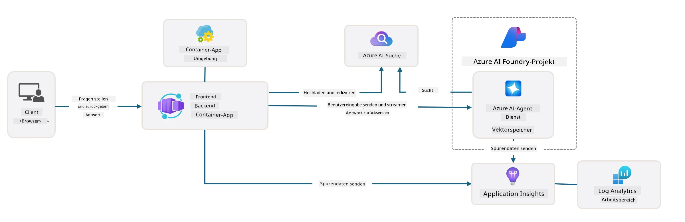

# 3. Eine Vorlage zerlegen

!!! tip "AM ENDE DIESES MODULS WERDEN SIE IN DER LAGE SEIN"

    - [ ] Use GitHub Copilot and optional MCP tools for Azure documentation and read-only exploration
    - [ ] Identify the template's application, infrastructure, configuration, and test entry points
    - [ ] Verify generated explanations against actual repository files
    - [ ] **Lab 3:** Trace one request and one configuration input through the project

---

## 1. GitHub Copilot aktivieren

Öffnen Sie das initialisierte KI-Beispiel in VS Code und aktivieren Sie [GitHub Copilot](https://code.visualstudio.com/docs/copilot/chat/chat-agent-mode). Melden Sie sich mit einem Konto an, das einen berechtigten Plan hat; die Nutzungslimits variieren. Bitten Sie Copilot, das Repository vor der Autorisierung von Änderungen zu erklären.

### Optionale MCP-Server

Diese Dienste können zusätzliche Werkzeuge bereitstellen:

- [Azure MCP Server](https://learn.microsoft.com/azure/developer/azure-mcp-server/overview)
- [Microsoft Learn MCP Server](https://learn.microsoft.com/training/support/mcp)

Überprüfen Sie in VS Code die [MCP-Konfigurationsanleitung](https://code.visualstudio.com/docs/copilot/chat/mcp-servers) und erstellen Sie ggf. `.vscode/mcp.json`:

```json
{
  "servers": {
    "Azure MCP Server": {
      "type": "stdio",
      "command": "npx",
      "args": ["-y", "@azure/mcp@latest", "server", "start"]
    },
    "microsoft.docs.mcp": {
      "type": "http",
      "url": "https://learn.microsoft.com/api/mcp"
    }
  }
}
```

Der Befehl `npx` erfordert eine unterstützte Node.js/npm-Installation und lädt ausführbaren Code herunter. Überprüfen Sie das Paket und fixieren Sie eine genehmigte Version für ein reproduzierbares Team-Setup. Starten Sie die Server über die MCP-Steuerung in VS Code und prüfen Sie deren verfügbare Werkzeuge; Namen können sich zwischen den Versionen ändern.

**Authentifizierung ist separat.** Verwenden Sie `azd auth login` für AZD. Folgen Sie dem dokumentierten Azure MCP-Authentifizierungsablauf für dessen Werkzeuge; eine AZD-Anmeldung allein erstellt keine MCP-Sitzung. Verwenden Sie `az login` separat, wenn eine Übung oder ein Hook die Azure CLI aufruft.

Versuchen Sie Lesezugriffs-Prompts:

1. „Verwenden Sie Microsoft Learn MCP, um die Dokumentation zur Azure Developer CLI-Konfiguration zu finden.“
2. „Erklären Sie das `azure.yaml` dieses Repositories; nennen Sie die Dateien, die jeden Hook implementieren.“
3. „Listen Sie mit den verfügbaren Azure MCP-Werkzeugen meine bereitgestellten Ressourcen auf, ohne etwas zu ändern.“

Überprüfen Sie den ausgewählten Mandanten/Abonnement und jeden vorgeschlagenen Werkzeugaufruf. Genehmigen Sie nicht einfach das Erstellen, Löschen oder Ändern des Zugriffs auf Ressourcen, nur um die Architektur zu erkunden.

## 2. Die Architektur verstehen

Das Beispiel hostet ein Python FastAPI-Backend und ein React/TypeScript-Frontend in Azure Container Apps. Das Backend kommuniziert mit einem Agenten in einem Microsoft Foundry-Projekt. Abruf und Beobachtbarkeit hängen von den aktivierten Vorlagenfunktionen und erfolgreichem Setup ab; sie sind nicht garantiert, nur weil die Anwendung bereitgestellt wurde.



Vergleichen Sie dieses Diagramm mit der [aktuellen Upstream-Bereitstellungsanleitung](https://github.com/Azure-Samples/get-started-with-ai-agents/blob/main/docs/deployment.md) und Ihren tatsächlichen Ressourcen. Prüfen Sie die konfigurierte Modellausführung, Agentenwerkzeuge, verwaltete Identität, Rollenzuweisungen und optionale Ressourcen für AI Search/Application Insights.

**Übung:** Bitten Sie Copilot, eine Chat-Anfrage vom Frontend über die API zu Foundry nachzuverfolgen, inklusive Datei- und Funktionsreferenzen. Öffnen Sie diese Referenzen und überprüfen Sie die Erklärung. Leiten Sie implementierte Authentifizierung, Routing oder Autorisierung nicht nur aus einem Diagramm ab.

## 3. Repository-Struktur

Die folgenden ausgewählten Pfade wurden am 4. November 2026 gegen das Beispiel geprüft. Ihre initialisierte Revision bleibt die wahre Quelle:

```text
get-started-with-ai-agents/
  azure.yaml
  docker-compose.yaml
  requirements-dev.txt
  .devcontainer/
  infra/
    main.bicep
    main.parameters.json
    api.bicep
    core/
  src/
    Dockerfile
    pyproject.toml
    requirements.txt
    api/
      main.py
      routes.py
      search_index_manager.py
    frontend/
      package.json
      src/
    files/
  scripts/
    validate_env_vars.sh
    validate_env_vars.ps1
    postdeploy.sh
    postdeploy.ps1
  tests/
    test_evaluation.py
    test_red_teaming.py
  docs/
    deployment.md
    deploy_customization.md
    ai_search.md
    observability.md
    local_development.md
    troubleshooting.md
```

### Infrastruktur und Konfiguration

`infra/main.bicep` orchestriert Ressourcen; `main.parameters.json` verbindet Vorlageingaben mit AZD-Umgebungswerten. `azure.yaml` wählt den Anwendungsdienst und Lifecycle-Hooks aus. Verfolgen Sie eine Eingabe wie `USE_AZURE_AI_SEARCH_SERVICE` durch diese Dateien, um herauszufinden, was sich tatsächlich ändert.

### Anwendung und Identität

Lesen Sie `src/api/` und `src/frontend/` zusammen. Stellen Sie fest, wo der Agent erstellt oder abgerufen wird, wo Anweisungen/Werkzeuge konfiguriert werden und welche Identität jeder Azure-Aufruf verwendet. Beispieldateien unter `src/files/` sind Demonstrationsdaten, kein Produktionskatalog oder Autorisierungsmodell.

### Tests und Beobachtbarkeit

Die aktuellen Bewertungen und Red-Teaming-Einstiegspunkte befinden sich unter `tests/`; ältere Verzeichnisse `evals/` und `airedteaming/` sind für dieses Beispiel obsolet. Lesen Sie `docs/observability.md` für Voraussetzungen und Kosten, bevor Sie Cloud-Tests ausführen. Diese Python-Tests sind getrennt von der optionalen `azure.ai.evaluations` AZD-Erweiterung.

## 4. Überprüfen Sie Ihre Erkenntnisse

- Identifizieren Sie die API-Route, Agenteninteraktion und Abrufcodes für eine Beispielanfrage.
- Erklären Sie, welche Identität auf Foundry zugreift und welche Konfiguration dessen Endpunkt auswählt.
- Finden Sie die tatsächlichen Pre-Up- und Post-Deploy-Skripte und deren Fehlerbehandlungsverhalten.
- Listen Sie alle Abhängigkeiten oder optionalen Features auf, die in Ihrer Bereitstellung fehlen.

Fahren Sie fort mit [Eine Vorlage konfigurieren](4-Configure-AI-Template.md).

---

<!-- CO-OP TRANSLATOR DISCLAIMER START -->
**Haftungsausschluss**:
Dieses Dokument wurde mit dem KI-Übersetzungsdienst [Co-op Translator](https://github.com/Azure/co-op-translator) übersetzt. Obwohl wir uns um Genauigkeit bemühen, beachten Sie bitte, dass automatisierte Übersetzungen Fehler oder Ungenauigkeiten enthalten können. Das Originaldokument in seiner Ursprungssprache gilt als maßgebliche Quelle. Bei kritischen Informationen wird eine professionelle menschliche Übersetzung empfohlen. Wir übernehmen keine Haftung für Missverständnisse oder Fehlinterpretationen, die aus der Verwendung dieser Übersetzung entstehen.
<!-- CO-OP TRANSLATOR DISCLAIMER END -->