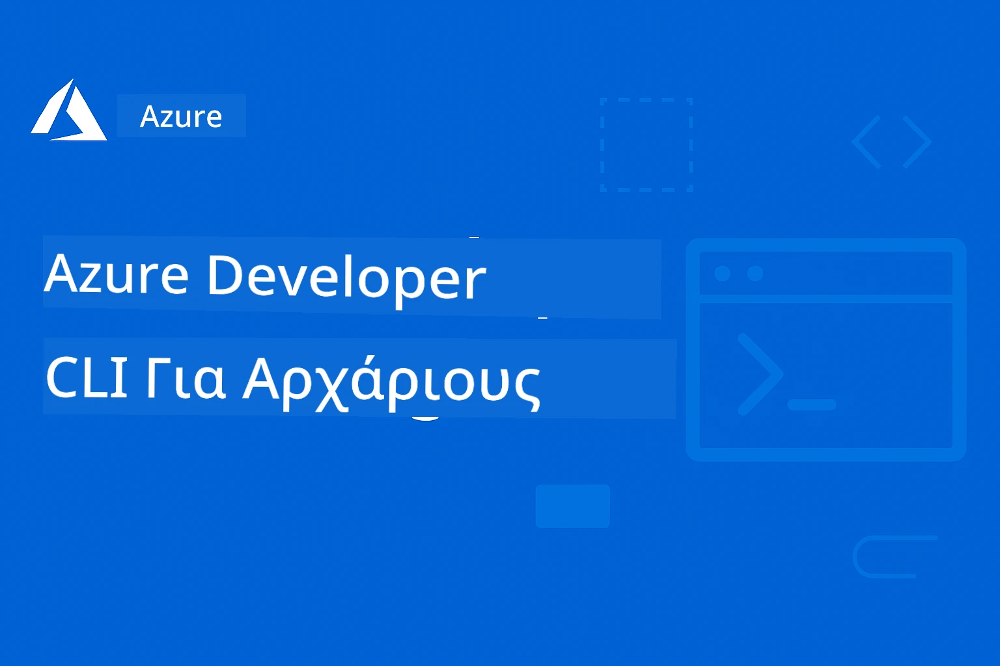

# AZD Για Αρχάριους: Ένα Δομημένο Μαθησιακό Ταξίδι

 

[](https://github.com/microsoft/AZD-for-beginners)
[](https://GitHub.com/microsoft/azd-for-beginners/network/)
[](https://github.com/microsoft/AZD-for-beginners)

[](https://discord.com/invite/nkVh3dp)
[](https://discord.gg/nTYy5BXMWG)

---

### Αυτόματες Μεταφράσεις (Πάντα Ενημερωμένες)

<!-- CO-OP TRANSLATOR LANGUAGES TABLE START -->
[Αραβικά](../ar/README.md) | [Μπενγκάλι](../bn/README.md) | [Βουλγαρικά](../bg/README.md) | [Βιρμανικά (Μιανμάρ)](../my/README.md) | [Κινέζικα (Απλοποιημένα)](../zh-CN/README.md) | [Κινέζικα (Παραδοσιακά, Χονγκ Κονγκ)](../zh-HK/README.md) | [Κινέζικα (Παραδοσιακά, Μακάο)](../zh-MO/README.md) | [Κινέζικα (Παραδοσιακά, Ταϊβάν)](../zh-TW/README.md) | [Κροατικά](../hr/README.md) | [Τσέχικα](../cs/README.md) | [Δανικά](../da/README.md) | [Ολλανδικά](../nl/README.md) | [Εσθονικά](../et/README.md) | [Φινλανδικά](../fi/README.md) | [Γαλλικά](../fr/README.md) | [Γερμανικά](../de/README.md) | [Ελληνικά](./README.md) | [Εβραϊκά](../he/README.md) | [Χίντι](../hi/README.md) | [Ουγγρικά](../hu/README.md) | [Ινδονησιακά](../id/README.md) | [Ιταλικά](../it/README.md) | [Ιαπωνικά](../ja/README.md) | [Κανάντα](../kn/README.md) | [Χμερ](../km/README.md) | [Κορεατικά](../ko/README.md) | [Λιθουανικά](../lt/README.md) | [Μαλαισιανά](../ms/README.md) | [Μαλαγιάλαμ](../ml/README.md) | [Μανιπούρι (Μεϊτέι Μαϊέκ)](../mni/README.md) | [Μαράθι](../mr/README.md) | [Νεπάλ](../ne/README.md) | [Νιγηριανό Πίτζιν](../pcm/README.md) | [Νορβηγικά](../no/README.md) | [Περσικά (Φαρσί)](../fa/README.md) | [Πολωνικά](../pl/README.md) | [Πορτογαλικά (Βραζιλίας)](../pt-BR/README.md) | [Πορτογαλικά (Πορτογαλίας)](../pt-PT/README.md) | [Πουντζάμπι (Γκουρμούκι)](../pa/README.md) | [Ρουμανικά](../ro/README.md) | [Ρωσικά](../ru/README.md) | [Σερβικά (Κυριλλικά)](../sr/README.md) | [Σλοβακικά](../sk/README.md) | [Σλοβενικά](../sl/README.md) | [Ισπανικά](../es/README.md) | [Σουαχίλι](../sw/README.md) | [Σουηδικά](../sv/README.md) | [Ταγκαλόγ (Φιλιππινέζικα)](../tl/README.md) | [Ταμίλ](../ta/README.md) | [Τελούγκου](../te/README.md) | [Ταϊλανδικά](../th/README.md) | [Τουρκικά](../tr/README.md) | [Ουκρανικά](../uk/README.md) | [Ουρντού](../ur/README.md) | [Βιετναμικά](../vi/README.md)

> **Προτιμάτε το τοπικό κλώνο;**
>
> Αυτό το αποθετήριο περιλαμβάνει μεταφράσεις σε πάνω από 50 γλώσσες, που αυξάνουν σημαντικά το μέγεθος λήψης. Για κλώνο χωρίς μεταφράσεις, χρησιμοποιήστε σπάνια αποδέσμευση (sparse checkout):
>
> **Bash / macOS / Linux:**
> ```bash
> git clone --filter=blob:none --sparse https://github.com/microsoft/AZD-for-beginners.git
> cd AZD-for-beginners
> git sparse-checkout set --no-cone '/*' '!translations' '!translated_images'
> ```
>
> **CMD (Windows):**
> ```cmd
> git clone --filter=blob:none --sparse https://github.com/microsoft/AZD-for-beginners.git
> cd AZD-for-beginners
> git sparse-checkout set --no-cone "/*" "!translations" "!translated_images"
> ```
>
> Αυτό σας παρέχει όλα όσα χρειάζεστε για να ολοκληρώσετε το μάθημα με πολύ ταχύτερη λήψη.
<!-- CO-OP TRANSLATOR LANGUAGES TABLE END -->

## 🆕 Τι Νέο Υπάρχει στο azd Σήμερα

> 📌 **Ανασκόπηση έκδοσης AI CLI (2026-11-04):** Οδηγίες ελέγχθηκαν έναντι δημοσιευμένης τεκμηρίωσης/πηγής **`azd 1.37.2`**, **agents `1.0.0-beta.23`** και **evaluations `1.0.0-beta.2`**. Χρησιμοποιήστε `azd >= 1.37.0` για τον συνδυασμένο ροή εργασίας. Τρέξτε `azd version` και [ενημερώστε το κύριο CLI](https://learn.microsoft.com/azure/developer/azure-developer-cli/install-azd) πριν από τις επεκτάσεις. Δείτε [αλλαγές και διορθώσεις έκδοσης](docs/chapter-08-production/production-ai-practices.md#recent-release-changes-and-fixes). Αυτή δεν είναι ζωντανός έλεγχος ανάπτυξης για ολόκληρο το μάθημα.

Το Azure Developer CLI υποστηρίζει πολλούς τύπους εφαρμογών, συμπεριλαμβανομένων web apps, APIs και AI agents, μέσα από υποστηριζόμενους hosts, πρότυπα και επεκτάσεις.

Αυτό σημαίνει για εσάς:

- **Οι AI agents είναι πλέον πρώτης τάξης φορτία εργασίας azd.** Μπορείτε να ξεκινήσετε, να αναπτύξετε και να διαχειριστείτε έργα AI agent χρησιμοποιώντας την ίδια ροή εργασίας `azd init` → `azd up` που ήδη γνωρίζετε.
- **Κύκλος ζωής agent μέσω δύο επεκτάσεων.** Χρησιμοποιήστε `azure.ai.agents` για να ξεκινήσετε, να καλέσετε, να βελτιστοποιήσετε και να αποσύρετε agents. Εγκαταστήστε **`azure.ai.evaluations`** ξεχωριστά για `azd ai eval init`, `generate`, και `run start`. Agents beta.22 αντικατέστησε την παλιά ροή αξιολόγησης και άλλαξε ρυθμίσεις βελτιστοποίησης· ακολουθήστε τον [οδηγό μετανάστευσης](docs/chapter-08-production/production-ai-practices.md#evaluation-migration-and-quality-checks).
- **Περισσότερα οικοδομικά στοιχεία AI.** Νέες προεπισκοπικές επεκτάσεις—`azure.ai.skills` και `azure.ai.connections`—σας επιτρέπουν να διαχειρίζεστε επαναχρησιμοποιήσιμες δεξιότητες agent και συνδέσεις Foundry απευθείας με το azd.
- **Ενσωμάτωση Microsoft Foundry** φέρνει ανάπτυξη μοντέλων, φιλοξενία agents, και ρύθμιση υπηρεσιών AI απευθείας στο οικοσύστημα προτύπων azd.
- **Πιο ομαλά βασικά κάθε μέρα.** Οι πρόσφατες εκδόσεις έκαναν `azd init` επαναλήψιμο (ασφαλές για επανεκτέλεση), έκαναν `azd auth login` να καθαρίζει αυτόματα παλιά tokens, και πρόσθεσαν φιλικό `azd tool` προτροπή πρώτης εκτέλεσης.
- **Η βασική ροή εργασίας δεν άλλαξε.** Είτε αναπτύσσετε μια εφαρμογή todo, ένα μικροϋπηρεσία, είτε μια πολυ-πρακτορική λύση AI, οι εντολές είναι οι ίδιες.

> **Σημείωση για χρήστες Aspire:** Η Microsoft αναφέρεται πλέον στο προϊόν απλά ως **Aspire** (πρώην ".NET Aspire"). Η υποστήριξη azd για Aspire παραμένει ίδια—μόνο το όνομα ενημερώθηκε.

Εάν έχετε χρησιμοποιήσει το azd πριν, η υποστήριξη AI είναι μια φυσική επέκταση—όχι ξεχωριστό εργαλείο ή προχωρημένη διαδρομή. Αν ξεκινάτε από την αρχή, θα μάθετε μία ροή εργασίας που δουλεύει για τα πάντα.

---

## 🚀 Τι είναι το Azure Developer CLI (azd);

**Το Azure Developer CLI (azd)** είναι ένα φιλικό προς τον προγραμματιστή εργαλείο γραμμής εντολών που κάνει απλή την ανάπτυξη εφαρμογών στο Azure. Αντί να δημιουργείτε και να συνδέετε χειροκίνητα δεκάδες πόρους Azure, μπορείτε να αναπτύξετε ολόκληρες εφαρμογές με μία εντολή.

### Η Μαγεία του `azd up`

```bash
# This single command does everything:
# ✅ Creates all Azure resources  
# ✅ Configures networking and security
# ✅ Builds your application code
# ✅ Deploys to Azure
# ✅ Gives you a working URL
azd up
```

Το πρότυπο παρέχει τη διαμόρφωση εφαρμογής και υποδομής. Η επιτυχής ανάπτυξη απαιτεί ακόμη υποστηριζόμενες υπηρεσίες/μοντέλα, επαρκές όριο και δικαιώματα, σωστές εισόδους και επαλήθευση της αναπτυγμένης εφαρμογής. Το `azd up` δεν καθιστά αυτόματα ένα πρότυπο ασφαλές, συμβατό ή έτοιμο για παραγωγή.

---

## ❓ Azure Developer CLI vs Azure CLI: Ποια είναι η Διαφορά;

Αυτή είναι η πιο συχνή ερώτηση από τους αρχάριους. Ακολουθεί η απλή απάντηση:

| Χαρακτηριστικό | **Azure CLI (`az`)** | **Azure Developer CLI (`azd`)** |
|---------|---------------------|--------------------------------|
| **Σκοπός** | Διαχείριση μεμονωμένων πόρων Azure | Ανάπτυξη ολοκληρωμένων εφαρμογών |
| **Νοοτροπία** | Εστίαση στην υποδομή | Εστίαση στην εφαρμογή |
| **Παράδειγμα** | `az webapp create --name myapp...` | `azd up` |
| **Καμπύλη Μάθησης** | Πρέπει να γνωρίζετε υπηρεσίες Azure | Αρκεί να ξέρετε την εφαρμογή σας |
| **Κατάλληλο για** | DevOps, Υποδομή | Προγραμματιστές, Πρωτοτυποποίηση |

### Απλή Αναλογία

- **Το Azure CLI** είναι σαν να έχετε όλα τα εργαλεία για να χτίσετε ένα σπίτι - σφυριά, πριόνια, καρφιά. Μπορείτε να φτιάξετε οτιδήποτε, αλλά πρέπει να ξέρετε οικοδομικά.
- **Το Azure Developer CLI** είναι σαν να προσλαμβάνετε έναν εργολάβο - περιγράφετε τι θέλετε και εκείνος αναλαμβάνει την κατασκευή.

### Πότε να Χρησιμοποιήσετε Κάθε Ένα

| Σενάριο | Χρησιμοποιήστε Αυτό |
|----------|----------|
| "Θέλω να αναπτύξω γρήγορα την web εφαρμογή μου" | `azd up` |
| "Χρειάζομαι να δημιουργήσω μόνο έναν λογαριασμό αποθήκευσης" | `az storage account create` |
| "Φτιάχνω μια πλήρη AI εφαρμογή" | `azd init --template azure-search-openai-demo` |
| "Χρειάζεται να κάνω debug σε συγκεκριμένο πόρο Azure" | `az resource show` |
| "Θέλω να αναπτύξω στο διαμορφωμένο παραγωγικό περιβάλλον μου" | Επανεξετάστε διαμόρφωση, πρόσβαση, κόστος και πύλες λειτουργίας πριν από το `azd up --environment production` |

### Συνεργάζονται!

Το AZD και το Azure CLI έχουν ξεχωριστή πιστοποίηση και ρύθμιση. Χρησιμοποιήστε `azd auth login` για το AZD, και `az login` όταν μια εντολή hook ή διαγνωστική χρειάζεται ρητά το Azure CLI. Μπορείτε να χρησιμοποιήσετε και τα δύο:
```bash
# Deploy your app with AZD
azd up

# Then fine-tune specific resources with Azure CLI
az webapp config set --name myapp --always-on true
```

---

## 🌟 Βρείτε Πρότυπα στο Awesome AZD

Μην ξεκινάτε από το μηδέν! Το **Awesome AZD** είναι η κοινότητα συλλογή έτοιμων για ανάπτυξη προτύπων:

| Πόρος | Περιγραφή |
|----------|-------------|
| 🔗 [**Awesome AZD Gallery**](https://azure.github.io/awesome-azd/) | Περιηγηθείτε σε 200+ πρότυπα με ανάπτυξη με ένα κλικ |
| 🔗 [**Υποβολή Προτύπου**](https://github.com/Azure/awesome-azd/issues) | Συνεισφέρετε το δικό σας πρότυπο στην κοινότητα |
| 🔗 [**Αποθετήριο GitHub**](https://github.com/Azure/awesome-azd) | Αστέρι και εξερεύνηση πηγαίου κώδικα |

### Δημοφιλή AI Πρότυπα από το Awesome AZD

Επιλέξτε ένα πρότυπο σε έναν δικό του κενό φάκελο· οι παρακάτω εντολές είναι εναλλακτικές. Το `.` στο τέλος αρχικοποιεί εκείνον το φάκελο.

```bash
# RAG Chat with Microsoft Foundry Models + AI Search
azd init --template azure-search-openai-demo .

# Quick AI Chat Application
azd init --template openai-chat-app-quickstart .

# AI Agents with Foundry Agents
azd init --template get-started-with-ai-agents .
```

---

## 🎯 Ξεκινώντας σε 3 Βήματα

Πριν ξεκινήσετε, βεβαιωθείτε ότι η μηχανή σας είναι έτοιμη για το πρότυπο που θέλετε να αναπτύξετε:

**Windows:**
```powershell
.\validate-setup.ps1
```

**macOS / Linux:**
```bash
bash ./validate-setup.sh
```

Αν οποιαδήποτε απαιτούμενος έλεγχος αποτύχει, διορθώστε το πρώτα και συνεχίστε με την γρήγορη έναρξη.

### Βήμα 1: Εγκαταστήστε το AZD (2 λεπτά)

**Windows:**
```powershell
winget install microsoft.azd
```

**macOS:**
```bash
brew tap azure/azd && brew install azd
```

**Linux:**
```bash
curl -fsSL https://aka.ms/install-azd.sh | bash
```

### Βήμα 2: Αυθεντικοποιηθείτε για το AZD

```bash
# Optional if you plan to use Azure CLI commands directly in this course
az login

# Required for AZD workflows
azd auth login
```

Αν δεν είστε σίγουροι ποιο χρειάζεστε, ακολουθήστε τη πλήρη ροή εγκατάστασης στο [Installation & Setup](docs/chapter-01-foundation/installation.md#authentication-setup).

### Βήμα 3: Αναπτύξτε την Πρώτη σας Εφαρμογή

```bash
# Initialize from a template
azd init --template todo-nodejs-mongo .

# Deploy to Azure (creates everything!)
azd up
```

**🎉 Αυτό ήταν!** Η εφαρμογή σας είναι πλέον ενεργή στο Azure.

### Καθαρισμός (Μην Ξεχάσετε!)

```bash
# Remove all resources when done experimenting
azd down --force --purge
```

---

## 📚 Πώς να Χρησιμοποιήσετε Αυτό το Μάθημα

Αυτό το μάθημα είναι σχεδιασμένο για **προοδευτική μάθηση** - ξεκινήστε από εκεί που αισθάνεστε άνετα και εργαστείτε προς τα πάνω:

| Η Εμπειρία σας | Ξεκινήστε Εδώ |
|-----------------|------------|
| **Εντελώς νέος στο Azure** | [Κεφάλαιο 1: Θεμέλια](#-chapter-1-foundation--quick-start) |
| **Ξέρω Azure, νέα στο AZD** | [Κεφάλαιο 1: Θεμέλια](#-chapter-1-foundation--quick-start) |
| **Θέλω να αναπτύξω εφαρμογές AI** | [Κεφάλαιο 2: Ανάπτυξη με AI Πρώτα](#-chapter-2-ai-first-development-recommended-for-ai-developers) |
| **Θέλω πρακτική εξάσκηση** | [🎓 Διαδραστικό Εργαστήριο](workshop/README.md) - καθοδηγούμενο εργαστήριο 3-4 ωρών |
| **Χρειάζομαι παραγωγικά πρότυπα** | [Κεφάλαιο 8: Παραγωγή & Επιχείρηση](#-chapter-8-production--enterprise-patterns) |

### Γρήγορη Ρύθμιση

1. **Fork αυτό το Αποθετήριο**: [](https://GitHub.com/microsoft/azd-for-beginners/fork)
2. **Κλωνοποιήστε το**: `git clone https://github.com/YOUR-USERNAME/azd-for-beginners.git`
3. **Λάβετε Βοήθεια**: [Azure Discord Community](https://discord.com/invite/ByRwuEEgH4)

> **Προτιμάτε το τοπικό κλώνο;**

> Αυτό το αποθετήριο περιλαμβάνει μεταφράσεις σε πάνω από 50 γλώσσες, που αυξάνουν σημαντικά το μέγεθος λήψης. Για κλώνο χωρίς μεταφράσεις, χρησιμοποιήστε σπάνια αποδέσμευση (sparse checkout):
> ```bash
> git clone --filter=blob:none --sparse https://github.com/microsoft/AZD-for-beginners.git
> cd AZD-for-beginners
> git sparse-checkout set --no-cone '/*' '!translations' '!translated_images'
> ```
> Αυτό σας δίνει όλα όσα χρειάζεστε για να ολοκληρώσετε το μάθημα με πολύ πιο γρήγορη λήψη.


## Επισκόπηση Μαθήματος

Κατακτήστε το Azure Developer CLI (azd) μέσα από δομημένα κεφάλαια σχεδιασμένα για προοδευτική μάθηση. **Ειδική έμφαση στην ανάπτυξη εφαρμογών AI με ενσωμάτωση Microsoft Foundry.**

### Γιατί αυτό το μάθημα είναι απαραίτητο για σύγχρονους προγραμματιστές

Οι προγραμματιστές που αναπτύσσουν φόρτους εργασίας AI συνήθως χρειάζονται καθοδήγηση σε:
- Πολύπλοκες αρχιτεκτονικές AI πολλαπλών υπηρεσιών
- Καλύτερες πρακτικές ανάπτυξης AI σε παραγωγή  
- Ενσωμάτωση και διαμόρφωση υπηρεσιών AI Azure
- Βελτιστοποίηση κόστους για φόρτους εργασίας AI
- Αντιμετώπιση προβλημάτων ειδικών για ανάπτυξη AI

### Στόχοι Μάθησης

Ολοκληρώνοντας αυτό το δομημένο μάθημα, θα:
- **Κατακτήσετε τα Βασικά του AZD**: Κύριες έννοιες, εγκατάσταση και διαμόρφωση
- **Αναπτύξετε Εφαρμογές AI**: Χρήση του AZD με υπηρεσίες Microsoft Foundry
- **Εφαρμόσετε Infrastructure as Code**: Διαχείριση πόρων Azure με πρότυπα Bicep
- **Αντιμετωπίσετε Προβλήματα Αναπτύξεων**: Επίλυση κοινών θεμάτων και εντοπισμός σφαλμάτων
- **Βελτιστοποιήσετε για Παραγωγή**: Ασφάλεια, κλιμάκωση, παρακολούθηση και διαχείριση κόστους
- **Δημιουργήσετε Πολυ-Πρακτορικές Λύσεις**: Ανάπτυξη πολύπλοκων αρχιτεκτονικών AI

## Πριν Ξεκινήσετε: Λογαριασμοί, Πρόσβαση και Προϋποθέσεις

Πριν ξεκινήσετε το Κεφάλαιο 1, βεβαιωθείτε ότι έχετε τα παρακάτω. Τα βήματα εγκατάστασης αργότερα σε αυτόν τον οδηγό υποθέτουν ότι αυτές οι βασικές προϋποθέσεις έχουν ήδη καλυφθεί.

- **Ένα συνδρομητικό λογαριασμό Azure**: Μπορείτε να χρησιμοποιήσετε υπάρχουσα συνδρομή από τη δουλειά ή τον προσωπικό σας λογαριασμό, ή να δημιουργήσετε μια [δοκιμαστική έκδοση](https://aka.ms/azurefreetrial) για να ξεκινήσετε.
- **Άδεια δημιουργίας πόρων Azure**: Για τις περισσότερες ασκήσεις, θα πρέπει να έχετε τουλάχιστον **Contributor** πρόσβαση στη στοχευμένη συνδρομή ή ομάδα πόρων. Μερικά κεφάλαια μπορεί επίσης να υποθέτουν ότι μπορείτε να δημιουργήσετε ομάδες πόρων, διαχειριζόμενες ταυτότητες και εκχωρήσεις RBAC.
- [**Λογαριασμός GitHub**](https://github.com): Αυτό είναι χρήσιμο για fork του αποθετηρίου, παρακολούθηση των αλλαγών σας και χρήση του GitHub Codespaces για το εργαστήριο.
- **Προαπαιτούμενα χρόνου εκτέλεσης προτύπων**: Ορισμένα πρότυπα χρειάζονται τοπικά εργαλεία όπως Node.js, Python, Java, ή Docker. Τρέξτε τον validator ρύθμισης πριν ξεκινήσετε ώστε να εντοπίσετε νωρίς τυχόν ελλείψεις.
- **Βασική εξοικείωση με το τερματικό**: Δεν χρειάζεται να είστε ειδικός, αλλά θα πρέπει να είστε άνετοι με την εκτέλεση εντολών όπως `git clone`, `azd auth login`, και `azd up`.

> **Εργάζεστε σε εταιρική συνδρομή;**
> Αν το περιβάλλον Azure σας διαχειρίζεται διαχειριστής, επιβεβαιώστε εκ των προτέρων ότι μπορείτε να αναπτύξετε πόρους στη συνδρομή ή ομάδα πόρων που σκοπεύετε να χρησιμοποιήσετε. Αν όχι, ζητήστε sandbox συνδρομή ή πρόσβαση Contributor πριν ξεκινήσετε.

> **Νέοι στο Azure;**
> Ξεκινήστε με τη δική σας δοκιμαστική έκδοση Azure ή συνδρομή pay-as-you-go στο https://aka.ms/azurefreetrial ώστε να μπορείτε να ολοκληρώσετε τις ασκήσεις από την αρχή μέχρι το τέλος χωρίς να περιμένετε εγκρίσεις σε επίπεδο tenant.

## 🗺️ Χάρτης Μαθήματος: Γρήγορη Πλοήγηση ανά Κεφάλαιο

Κάθε κεφάλαιο έχει αποκλειστικό README με στόχους μάθησης, γρήγορα ξεκινήματα και ασκήσεις:

| Κεφάλαιο | Θέμα | Μαθήματα | Διάρκεια | Πολυπλοκότητα |
|---------|-------|---------|----------|------------|
| **[Κεφ. 1: Θεμέλια](docs/chapter-01-foundation/README.md)** | Εισαγωγή | [Βασικά AZD](docs/chapter-01-foundation/azd-basics.md) &#124; [Εγκατάσταση](docs/chapter-01-foundation/installation.md) &#124; [Πρώτο Έργο](docs/chapter-01-foundation/first-project.md) | 30-45 λεπτά | ⭐ |
| **[Κεφ. 2: Ανάπτυξη AI](docs/chapter-02-ai-development/README.md)** | Εφαρμογές AI-First | [Ενσωμάτωση Foundry](docs/chapter-02-ai-development/microsoft-foundry-integration.md) &#124; [Πράκτορες AI](docs/chapter-02-ai-development/agents.md) &#124; [Ανάπτυξη Μοντέλου](docs/chapter-02-ai-development/ai-model-deployment.md) &#124; [Εργαστήριο](docs/chapter-02-ai-development/ai-workshop-lab.md) | 1-2 ώρες | ⭐⭐ |
| **[Κεφ. 3: Διαμόρφωση](docs/chapter-03-configuration/README.md)** | Πιστοποίηση & Ασφάλεια | [Διαμόρφωση](docs/chapter-03-configuration/configuration.md) &#124; [Πιστοποίηση & Ασφάλεια](docs/chapter-03-configuration/authsecurity.md) | 45-60 λεπτά | ⭐⭐ |
| **[Κεφ. 4: Υποδομή](docs/chapter-04-infrastructure/README.md)** | IaC & Ανάπτυξη | [Οδηγός Ανάπτυξης](docs/chapter-04-infrastructure/deployment-guide.md) &#124; [Παροχή Πόρων](docs/chapter-04-infrastructure/provisioning.md) | 1-1.5 ώρες | ⭐⭐⭐ |
| **[Κεφ. 5: Πολυ-Πράκτορες](docs/chapter-05-multi-agent/README.md)** | Λύσεις Πράκτορων AI | [Σενάριο Λιανικής](examples/retail-scenario.md) &#124; [Πρότυπα Συντονισμού](docs/chapter-06-pre-deployment/coordination-patterns.md) | 2-3 ώρες | ⭐⭐⭐⭐ |
| **[Κεφ. 6: Προ-Ανάπτυξη](docs/chapter-06-pre-deployment/README.md)** | Σχεδιασμός & Επικύρωση | [Προκαταρκτικοί Έλεγχοι](docs/chapter-06-pre-deployment/preflight-checks.md) &#124; [Σχεδιασμός Χωρητικότητας](docs/chapter-06-pre-deployment/capacity-planning.md) &#124; [Επιλογή SKU](docs/chapter-06-pre-deployment/sku-selection.md) &#124; [App Insights](docs/chapter-06-pre-deployment/application-insights.md) | 1 ώρα | ⭐⭐ |
| **[Κεφ. 7: Αντιμετώπιση Προβλημάτων](docs/chapter-07-troubleshooting/README.md)** | Εντοπισμός & Διόρθωση | [Κοινά Προβλήματα](docs/chapter-07-troubleshooting/common-issues.md) &#124; [Εντοπισμός Σφαλμάτων](docs/chapter-07-troubleshooting/debugging.md) &#124; [Θέματα AI](docs/chapter-07-troubleshooting/ai-troubleshooting.md) | 1-1.5 ώρες | ⭐⭐ |
| **[Κεφ. 8: Παραγωγή](docs/chapter-08-production/README.md)** | Εταιρικά Πρότυπα | [Πρακτικές Παραγωγής](docs/chapter-08-production/production-ai-practices.md) | 2-3 ώρες | ⭐⭐⭐⭐ |
| **[🎓 Εργαστήριο](workshop/README.md)** | Εργαστήριο | [Εισαγωγή](workshop/docs/instructions/0-Introduction.md) &#124; [Επιλογή](workshop/docs/instructions/1-Select-AI-Template.md) &#124; [Επικύρωση](workshop/docs/instructions/2-Validate-AI-Template.md) &#124; [Αποδόμηση](workshop/docs/instructions/3-Deconstruct-AI-Template.md) &#124; [Διαμόρφωση](workshop/docs/instructions/4-Configure-AI-Template.md) &#124; [Προσαρμογή](workshop/docs/instructions/5-Customize-AI-Template.md) &#124; [Ακύρωση](workshop/docs/instructions/6-Teardown-Infrastructure.md) &#124; [Ολοκλήρωση](workshop/docs/instructions/7-Wrap-up.md) | 3-4 ώρες | ⭐⭐ |

**Συνολική Διάρκεια Μαθήματος:** ~10-14 ώρες | **Πρόοδος Δεξιοτήτων:** Αρχάριος → Ετοιμος για Παραγωγή

---

## 📚 Μαθησιακά Κεφάλαια

*Επιλέξτε τη μαθησιακή σας διαδρομή βάσει επιπέδου εμπειρίας και στόχων*

### 🚀 Κεφάλαιο 1: Θεμέλια & Γρήγορη Έναρξη
**Προαπαιτούμενα**: Συνδρομή Azure, βασικές γνώσεις γραμμής εντολών  
**Διάρκεια**: 30-45 λεπτά  
**Πολυπλοκότητα**: ⭐

#### Τι θα μάθετε
- Κατανόηση των βασικών του Azure Developer CLI
- Εγκατάσταση του AZD στην πλατφόρμα σας
- Την πρώτη επιτυχημένη ανάπτυξή σας

#### Πηγές Μάθησης
- **🎯 Ξεκινήστε εδώ**: [Τι είναι το Azure Developer CLI;](#-what-is-azure-developer-cli-azd)
- **📖 Θεωρία**: [Βασικά AZD](docs/chapter-01-foundation/azd-basics.md) - Κύριες έννοιες και ορολογία
- **⚙️ Ρύθμιση**: [Εγκατάσταση & Ρύθμιση](docs/chapter-01-foundation/installation.md) - Οδηγοί για κάθε πλατφόρμα
- **🛠️ Πρακτική**: [Το πρώτο σας έργο](docs/chapter-01-foundation/first-project.md) - Διαδοχικός οδηγός
- **📋 Γρήγορη Αναφορά**: [Φύλλο εντολών](resources/cheat-sheet.md)

#### Πρακτικές Ασκήσεις
```bash
# Quick installation check
azd version

# Deploy your first application
azd init --template todo-nodejs-mongo .
azd up
```

**💡 Αποτέλεσμα Κεφαλαίου**: Επιτυχής ανάπτυξη απλής web εφαρμογής στο Azure με χρήση AZD

**✅ Επιβεβαίωση Επιτυχίας:**
```bash
# After completing Chapter 1, you should be able to:
azd version              # Shows installed version
azd init --template todo-nodejs-mongo  # Initializes project
azd up                  # Deploys to Azure
azd show                # Displays running app URL
# Application opens in browser and works
azd down --force --purge  # Cleans up resources
```

**📊 Επένδυση Χρόνου:** 30-45 λεπτά  
**📈 Επίπεδο Δεξιότητας Μετά:** Μπορεί να αναπτύσσει βασικές εφαρμογές ανεξάρτητα

---

### 🤖 Κεφάλαιο 2: Ανάπτυξη AI-First (Συνιστάται για Προγραμματιστές AI)
**Προαπαιτούμενα**: Ολοκλήρωση Κεφαλαίου 1  
**Διάρκεια**: 1-2 ώρες  
**Πολυπλοκότητα**: ⭐⭐

#### Τι θα μάθετε
- Ενσωμάτωση Microsoft Foundry με AZD
- Ανάπτυξη εφαρμογών με δυνατότητες AI
- Κατανόηση διαμορφώσεων υπηρεσιών AI

#### Πηγές Μάθησης
- **🎯 Ξεκινήστε εδώ**: [Ενσωμάτωση Microsoft Foundry](docs/chapter-02-ai-development/microsoft-foundry-integration.md)
- **🤖 Πράκτορες AI**: [Οδηγός Πρακτόρων AI](docs/chapter-02-ai-development/agents.md) - Ανάπτυξη ευφυών πρακτόρων με AZD
- **📖 Πρότυπα**: [Ανάπτυξη Μοντέλου AI](docs/chapter-02-ai-development/ai-model-deployment.md) - Ανάπτυξη και διαχείριση μοντέλων AI
- **🛠️ Εργαστήριο**: [Εργαστήριο AI](docs/chapter-02-ai-development/ai-workshop-lab.md) - Κάντε τις λύσεις AI έτοιμες για AZD
- **🎥 Διαδραστικός Οδηγός**: [Υλικά Εργαστηρίου](workshop/README.md) - Μάθηση στον browser με MkDocs * Περιβάλλον DevContainer
- **📋 Πρότυπα**: [Πρότυπα Microsoft Foundry](#featured-microsoft-foundry-templates)
- **📝 Παραδείγματα**: [Παραδείγματα ανάπτυξης AZD](examples/README.md)

#### Πρακτικές Ασκήσεις
```bash
# Deploy your first AI application
azd init --template azure-search-openai-demo .
azd up

# Try additional AI templates
azd init --template openai-chat-app-quickstart .
azd init --template agent-openai-python-prompty .
```

**💡 Αποτέλεσμα Κεφαλαίου**: Ανάπτυξη και διαμόρφωση εφαρμογής συνομιλίας με δυνατότητες RAG AI

**✅ Επιβεβαίωση Επιτυχίας:**
```bash
# After Chapter 2, you should be able to:
azd init --template azure-search-openai-demo .
azd up
# Test the AI chat interface
# Ask questions and get AI-powered responses with sources
# Verify search integration works
azd monitor  # Check Application Insights shows telemetry
azd down --force --purge
```

**📊 Επένδυση Χρόνου:** 1-2 ώρες  
**📈 Επίπεδο Δεξιότητας Μετά:** Μπορεί να αναπτύσσει εφαρμογές μάθησης AI και να εντοπίζει επιπλέον προϋποθέσεις παραγωγικής ετοιμότητας
**💰 Ενημέρωση Κόστους:** Κατανόηση κόστους ανάπτυξης $80-150/μήνα, κόστους παραγωγής $300-3500/μήνα

#### 💰 Θεωρήσεις Κόστους για Ανάπτυξη AI

**Περιβάλλον Ανάπτυξης (Εκτιμώμενο $80-150/μήνα):**
- Μοντέλα Microsoft Foundry (Αξιολόγηση ανά χρήση): $0-50/μήνα (ανάλογα με τη χρήση tokens)
- AI Search (Βασικό επίπεδο): $75/μήνα
- Container Apps (Κατανάλωση): $0-20/μήνα
- Αποθήκευση (Τυπική): $1-5/μήνα

**Περιβάλλον Παραγωγής (Εκτιμώμενο $300-3,500+/μήνα):**
- Μοντέλα Microsoft Foundry (PTU για σταθερή απόδοση): $3,000+/μήνα Ή Pay-as-go με υψηλό όγκο
- AI Search (Κανονικό επίπεδο): $250/μήνα
- Container Apps (Αφιερωμένα): $50-100/μήνα
- Application Insights: $5-50/μήνα
- Αποθήκευση (Premium): $10-50/μήνα

**💡 Συμβουλές Βελτιστοποίησης Κόστους:**
- Ελέγξτε τιμολόγηση inference μοντέλων και πιστώσεις συγκεκριμένου λογαριασμού; το Azure OpenAI δεν περιλαμβάνει γενική μηνιαία δωρεάν χρήση 50.000 tokens
- Τρέξτε `azd down` για να διαγράψετε πόρους όταν δεν χρειάζονται πια, μετά από αξιολόγηση του περιβάλλοντος
- Ξεκινήστε με χρέωση βάσει κατανάλωσης, αναβαθμίστε σε PTU μόνο για παραγωγή
- Χρησιμοποιήστε `azd provision --preview` για έλεγχο προγραμματισμένης υποδομής, μετά κοστολογήστε τους πόρους με τον Υπολογιστή Τιμολόγησης Azure
- Ενεργοποιήστε αυτόματη κλιμάκωση: πληρώστε μόνο για την πραγματική χρήση

**Παρακολούθηση Κόστους:**
```bash
# Inspect planned resources (this does not calculate prices)
azd provision --preview

# Monitor actual costs in Azure Portal
az consumption budget list --resource-group <your-rg>
```

---

### ⚙️ Κεφάλαιο 3: Διαμόρφωση & Πιστοποίηση
**Προαπαιτούμενα**: Ολοκλήρωση Κεφαλαίου 1  
**Διάρκεια**: 45-60 λεπτά  
**Πολυπλοκότητα**: ⭐⭐

#### Τι θα μάθετε
- Διαμόρφωση και διαχείριση περιβάλλοντος
- Καλύτερες πρακτικές πιστοποίησης και ασφάλειας
- Ονομασία και οργάνωση πόρων

#### Πηγές Μάθησης
- **📖 Διαμόρφωση**: [Οδηγός Διαμόρφωσης](docs/chapter-03-configuration/configuration.md) - Ρύθμιση περιβάλλοντος
- **🔐 Ασφάλεια**: [Πρότυπα πιστοποίησης και διαχειριζόμενης ταυτότητας](docs/chapter-03-configuration/authsecurity.md) - Πρότυπα πιστοποίησης
- **📝 Παραδείγματα**: [Παράδειγμα Εφαρμογής Βάσης Δεδομένων](examples/database-app/README.md) - Παραδείγματα AZD για βάσεις δεδομένων

#### Πρακτικές Ασκήσεις
- Διαμόρφωση πολλαπλών περιβαλλόντων (dev, staging, prod)
- Ρύθμιση πιστοποίησης με διαχειριζόμενη ταυτότητα
- Υλοποίηση περιβαλλοντο-εξειδικευμένων διαμορφώσεων

**💡 Αποτέλεσμα Κεφαλαίου**: Διαχείριση πολλαπλών περιβαλλόντων με σωστή πιστοποίηση και ασφάλεια

---

### 🏗️ Κεφάλαιο 4: Υποδομή ως Κώδικας & Ανάπτυξη
**Προαπαιτούμενα**: Ολοκλήρωση Κεφαλαίων 1-3  
**Διάρκεια**: 1-1.5 ώρες  
**Πολυπλοκότητα**: ⭐⭐⭐

#### Τι θα μάθετε
- Προχωρημένα πρότυπα ανάπτυξης
- Υποδομή ως Κώδικας με Bicep
- Στρατηγικές παροχής πόρων

#### Πηγές Μάθησης
- **📖 Ανάπτυξη**: [Οδηγός Ανάπτυξης](docs/chapter-04-infrastructure/deployment-guide.md) - Ολοκληρωμένες ροές εργασίας
- **🏗️ Παροχή Πόρων**: [Παροχή Πόρων](docs/chapter-04-infrastructure/provisioning.md) - Διαχείριση πόρων Azure
- **📝 Παραδείγματα**: [Παράδειγμα Container App](../../examples/container-app) - Ανάπτυξη σε κοντέινερ

#### Πρακτικές Ασκήσεις
- Δημιουργία προσαρμοσμένων προτύπων Bicep
- Ανάπτυξη εφαρμογών πολλαπλών υπηρεσιών
- Υλοποίηση στρατηγικών ανάπτυξης blue-green

**💡 Αποτέλεσμα Κεφαλαίου**: Ανάπτυξη πολύπλοκων εφαρμογών πολλαπλών υπηρεσιών χρησιμοποιώντας προσαρμοσμένα πρότυπα υποδομής

---

### 🎯 Κεφάλαιο 5: Πολυ-Πράκτορες Λύσεις AI (Προχωρημένο)
**Προαπαιτούμενα**: Ολοκλήρωση Κεφαλαίων 1-2  
**Διάρκεια**: 2-3 ώρες  
**Πολυπλοκότητα**: ⭐⭐⭐⭐

#### Τι θα μάθετε
- Πρότυπα αρχιτεκτονικής πολυ-πρακτόρων
- Ορχήστρωση και συντονισμός πρακτόρων
- Παραγωγικές αναπτύξεις AI

#### Πηγές Μάθησης
- **🤖 Επιλεγμένος Σχεδιασμός**: [Λύση Λιανικής με πολλαπλούς Πράκτορες](examples/retail-scenario.md) - Σχεδιαστικό μπλετυπλίν, όχι πλήρης εφαρμογή
- **🛠️ Πρότυπα ARM**: [Πακέτο Προτύπου ARM](../../examples/retail-multiagent-arm-template) - Υποδομή υποδομής; ανασκόπηση προαπαιτούμενων και ελλείποντων στοιχείων εφαρμογής
- **📖 Αρχιτεκτονική**: [Πρότυπα συντονισμού πολλαπλών πρακτόρων](docs/chapter-06-pre-deployment/coordination-patterns.md) - Πρότυπα

#### Πρακτικές Ασκήσεις
```bash
# Inspect the retail infrastructure scaffold before choosing to deploy it
cd examples/retail-multiagent-arm-template
cat README.md

# After an intentional deployment, inspect infrastructure state
az deployment group show --resource-group <rg-name> --name <deployment-name>
```

**💡 Αποτέλεσμα Κεφαλαίου**: Κατανόηση του σχεδιασμού πολλαπλών πρακτόρων και αναγνώριση της υλοποίησης, επικύρωσης και λειτουργιών που απαιτούνται πέρα από την υποδομή

---

### 🔍 Κεφάλαιο 6: Προ-ανάπτυξη Επικύρωσης & Σχεδιασμός
**Προαπαιτούμενα**: Ολοκλήρωση Κεφαλαίου 4  
**Διάρκεια**: 1 ώρα  
**Πολυπλοκότητα**: ⭐⭐

#### Τι θα Μάθετε
- Προγραμματισμός δυναμικότητας και επικύρωση πόρων
- Στρατηγικές επιλογής SKU
- Έλεγχοι πριν την ανάπτυξη και αυτοματοποίηση

#### Πόροι Μάθησης
- **📊 Σχεδιασμός**: [Προγραμματισμός Δυναμικότητας](docs/chapter-06-pre-deployment/capacity-planning.md) - Επικύρωση πόρων
- **💰 Επιλογή**: [Επιλογή SKU](docs/chapter-06-pre-deployment/sku-selection.md) - Οικονομικά αποδοτικές επιλογές
- **✅ Επικύρωση**: [Έλεγχοι πριν την ανάπτυξη](docs/chapter-06-pre-deployment/preflight-checks.md) - Αυτοματοποιημένα σενάρια

#### Πρακτικές Ασκήσεις
- Εκτέλεση σεναρίων επικύρωσης δυναμικότητας
- Βελτιστοποίηση επιλογών SKU για κόστος
- Υλοποίηση αυτοματοποιημένων ελέγχων προ-ανάπτυξης

**💡 Αποτέλεσμα Κεφαλαίου**: Επικύρωση και βελτιστοποίηση αναπτύξεων πριν την εκτέλεση

---

### 🚨 Κεφάλαιο 7: Αντιμετώπιση Προβλημάτων & Αποσφαλμάτωση
**Προαπαιτούμενα**: Οποιοδήποτε κεφάλαιο ανάπτυξης ολοκληρωμένο  
**Διάρκεια**: 1-1.5 ώρες  
**Πολυπλοκότητα**: ⭐⭐

#### Τι θα Μάθετε
- Συστηματικές προσεγγίσεις αποσφαλμάτωσης
- Συνήθη προβλήματα και λύσεις
- Αντιμετώπιση προβλημάτων ειδικών για AI

#### Πόροι Μάθησης
- **🔧 Συνήθη Προβλήματα**: [Συνήθη Προβλήματα](docs/chapter-07-troubleshooting/common-issues.md) - Συχνές ερωτήσεις και λύσεις
- **🕵️ Αποσφαλμάτωση**: [Οδηγός Αποσφαλμάτωσης](docs/chapter-07-troubleshooting/debugging.md) - Βήμα προς βήμα στρατηγικές
- **🤖 Προβλήματα AI**: [Αντιμετώπιση Προβλημάτων AI](docs/chapter-07-troubleshooting/ai-troubleshooting.md) - Προβλήματα υπηρεσιών AI

#### Πρακτικές Ασκήσεις
- Διάγνωση αποτυχιών ανάπτυξης
- Επίλυση ζητημάτων αυθεντικοποίησης
- Αποσφαλμάτωση σύνδεσης υπηρεσίας AI

**💡 Αποτέλεσμα Κεφαλαίου**: Ανεξάρτητη διάγνωση και επίλυση κοινών προβλημάτων ανάπτυξης

---

### 🏢 Κεφάλαιο 8: Παραγωγή & Εταιρικά Πρότυπα
**Προαπαιτούμενα**: Ολοκλήρωση Κεφαλαίων 1-4  
**Διάρκεια**: 2-3 ώρες  
**Πολυπλοκότητα**: ⭐⭐⭐⭐

#### Τι θα Μάθετε
- Στρατηγικές ανάπτυξης παραγωγής
- Πρότυπα ασφάλειας επιχειρήσεων
- Παρακολούθηση και βελτιστοποίηση κόστους

#### Πόροι Μάθησης
- **🏭 Παραγωγή**: [Καλύτερες Πρακτικές AI Παραγωγής](docs/chapter-08-production/production-ai-practices.md) - Πρότυπα επιχειρήσεων
- **📝 Παραδείγματα**: [Παράδειγμα Μικροϋπηρεσιών](../../examples/microservices) - Πολύπλοκες αρχιτεκτονικές
- **📊 Παρακολούθηση**: [Ενσωμάτωση Application Insights](docs/chapter-06-pre-deployment/application-insights.md) - Παρακολούθηση

#### Πρακτικές Ασκήσεις
- Υλοποίηση πρότυπων ασφάλειας επιχειρήσεων
- Εγκατάσταση ολοκληρωμένης παρακολούθησης
- Ανάπτυξη σε παραγωγή με κατάλληλη διακυβέρνηση

**💡 Αποτέλεσμα Κεφαλαίου**: Ανάπτυξη εφαρμογών έτοιμων για παραγωγή με πλήρεις δυνατότητες

---

## 🎓 Επισκόπηση Εργαστηρίου: Πρακτική Εμπειρία Μάθησης

> **⚠️ ΚΑΤΑΣΤΑΣΗ ΕΡΓΑΣΤΗΡΙΟΥ: Ενεργή Ανάπτυξη**  
> Τα υλικά του εργαστηρίου αναπτύσσονται και βελτιώνονται. Οι βασικές ενότητες είναι λειτουργικές, αλλά ορισμένα προηγμένα τμήματα δεν έχουν ολοκληρωθεί. Εργαζόμαστε ενεργά για την ολοκλήρωση όλων των περιεχομένων. [Παρακολούθηση προόδου →](workshop/README.md)

### Διαδραστικά Υλικά Εργαστηρίου
**Πλήρης πρακτική μάθηση με εργαλεία στο πρόγραμμα περιήγησης και καθοδηγούμενες ασκήσεις**

Τα υλικά του εργαστηρίου παρέχουν δομημένη, διαδραστική εμπειρία μάθησης που συμπληρώνει το κεφαλαίο πρόγραμμα παραπάνω. Το εργαστήριο σχεδιάστηκε τόσο για αυτόνομη μάθηση όσο και για μαθήματα με εκπαιδευτή.

#### 🛠️ Χαρακτηριστικά Εργαστηρίου
- **Διεπαφή στο Πρόγραμμα Περιήγησης**: Ολοκληρωμένο εργαστήριο powered by MkDocs με δυνατότητες αναζήτησης, αντιγραφής και θεμάτων
- **Ενσωμάτωση GitHub Codespaces**: Ρύθμιση περιβάλλοντος ανάπτυξης με ένα κλικ
- **Δομημένη Διαδρομή Μάθησης**: 8-ενότητες καθοδηγούμενες ασκήσεις (3-4 ώρες συνολικά)
- **Προοδευτική Μεθοδολογία**: Εισαγωγή → Επιλογή → Επικύρωση → Αποδόμηση → Διαμόρφωση → Προσαρμογή → Αποσυναρμολόγηση → Ολοκλήρωση
- **Διαδραστικό Περιβάλλον DevContainer**: Προ-διαμορφωμένα εργαλεία και εξαρτήσεις

#### 📚 Δομή Ενότητας Εργαστηρίου
Το εργαστήριο ακολουθεί μια **8-ενότητες προοδευτική μεθοδολογία** που σας οδηγεί από την ανακάλυψη στην τελειότητα ανάπτυξης:

| Ενότητα | Θέμα | Τι Θα Κάνετε | Διάρκεια |
|--------|-------|----------------|----------|
| **0. Εισαγωγή** | Επισκόπηση Εργαστηρίου | Κατανόηση στόχων μάθησης, προαπαιτούμενων και δομής εργαστηρίου | 15 λεπτά |
| **1. Επιλογή** | Ανακάλυψη Προτύπου | Εξερευνήστε πρότυπα AZD και επιλέξτε το σωστό AI πρότυπο για το σενάριό σας | 20 λεπτά |
| **2. Επικύρωση** | Ανάπτυξη & Επαλήθευση | Αναπτύξτε το πρότυπο με `azd up` και επικυρώστε τη λειτουργία υποδομής | 30 λεπτά |
| **3. Αποδόμηση** | Κατανόηση Δομής | Χρησιμοποιήστε το GitHub Copilot για να εξερευνήσετε την αρχιτεκτονική προτύπου, αρχεία Bicep και οργάνωση κώδικα | 30 λεπτά |
| **4. Διαμόρφωση** | Εμβάθυνση στο azure.yaml | Κυριαρχήστε στη διαμόρφωση `azure.yaml`, hooks κύκλου ζωής και μεταβλητές περιβάλλοντος | 30 λεπτά |
| **5. Προσαρμογή** | Κάντε το Δικό Σας | Ενεργοποιήστε AI Search, ανίχνευση, αξιολόγηση και προσαρμογή για το σενάριό σας | 45 λεπτά |
| **6. Αποσυναρμολόγηση** | Καθαρισμός | Ασφαλής απενεργοποίηση πόρων με `azd down --purge` | 15 λεπτά |
| **7. Ολοκλήρωση** | Επόμενα Βήματα | Ανασκόπηση επιτευγμάτων, βασικών εννοιών και συνέχιση της μαθησιακής σας πορείας | 15 λεπτά |

**Ροή Εργαστηρίου:**
```
Introduction → Selection → Validation → Deconstruction → Configuration → Customization → Teardown → Wrap-up
     ↓            ↓           ↓              ↓               ↓              ↓            ↓           ↓
  Overview    Find the     Deploy &      Explore        Master         Customize     Clean up    Review &
             right        verify        code &        azure.yaml      for your      resources   next steps
             template                   structure                     scenario
```

#### 🚀 Ξεκινώντας με το Εργαστήριο
```bash
# Option 1: GitHub Codespaces (Recommended)
# Click "Code" → "Create codespace on main" in the repository

# Option 2: Local Development
git clone https://github.com/microsoft/azd-for-beginners.git
cd azd-for-beginners/workshop
# Follow the setup instructions in workshop/README.md
```

#### 🎯 Αποτελέσματα Μάθησης Εργαστηρίου
Με την ολοκλήρωση του εργαστηρίου, οι συμμετέχοντες θα:
- **Αναπτύξουν Παραγωγικές Εφαρμογές AI**: Χρησιμοποιήστε το AZD με υπηρεσίες Microsoft Foundry
- **Κατακτήσουν πολυπρακτορικές Αρχιτεκτονικές**: Υλοποίηση συντονισμένων λύσεων AI πρακτόρων
- **Υλοποιήσουν Καλύτερες Πρακτικές Ασφαλείας**: Διαμόρφωση αυθεντικοποίησης και ελέγχου πρόσβασης
- **Βελτιστοποίηση για Κλίμακα**: Σχεδίαση οικονομικά αποδοτικών, performant αναπτύξεων
- **Αντιμετώπιση Προβλημάτων ανάπτυξης**: Επίλυση κοινών ζητημάτων ανεξάρτητα

#### 📖 Πόροι Εργαστηρίου
- **🎥 Διαδραστικός Οδηγός**: [Υλικά Εργαστηρίου](workshop/README.md) - Περιβάλλον μάθησης στο πρόγραμμα περιήγησης
- **📋 Οδηγίες ανά Ενότητα**:
  - [0. Εισαγωγή](workshop/docs/instructions/0-Introduction.md) - Επισκόπηση και στόχοι εργαστηρίου
  - [1. Επιλογή](workshop/docs/instructions/1-Select-AI-Template.md) - Εύρεση και επιλογή προτύπων AI
  - [2. Επικύρωση](workshop/docs/instructions/2-Validate-AI-Template.md) - Ανάπτυξη και επικύρωση προτύπων
  - [3. Αποδόμηση](workshop/docs/instructions/3-Deconstruct-AI-Template.md) - Εξερεύνηση αρχιτεκτονικής προτύπου
  - [4. Διαμόρφωση](workshop/docs/instructions/4-Configure-AI-Template.md) - Κυριαρχία στο azure.yaml
  - [5. Προσαρμογή](workshop/docs/instructions/5-Customize-AI-Template.md) - Προσαρμογή για το σενάριό σας
  - [6. Αποσυναρμολόγηση](workshop/docs/instructions/6-Teardown-Infrastructure.md) - Καθαρισμός πόρων
  - [7. Ολοκλήρωση](workshop/docs/instructions/7-Wrap-up.md) - Ανασκόπηση και επόμενα βήματα
- **🛠️ Εργαστήριο AI**: [Εργαστήριο AI](docs/chapter-02-ai-development/ai-workshop-lab.md) - Ασκήσεις εστιασμένες σε AI
- **💡 Γρήγορη Εκκίνηση**: [Οδηγός Ρύθμισης Εργαστηρίου](workshop/README.md#browser-based-guide) - Διαμόρφωση περιβάλλοντος

**Ιδανικό για**: Εκπαίδευση σε εταιρίες, πανεπιστημιακά μαθήματα, αυτόνομη μάθηση και bootcamps προγραμματιστών.

---

## 📖 Εμβάθυνση: Δυνατότητες AZD

Πέρα από τα βασικά, το AZD παρέχει ισχυρές δυνατότητες για αναπτύξεις παραγωγής:

- **Αναπτύξεις βάσει προτύπου** - Χρήση προ-κατασκευασμένων προτύπων για κοινά προτύπα εφαρμογών
- **Υποδομή ως Κώδικας** - Διαχείριση πόρων Azure με Bicep ή Terraform  
- **Ενσωματωμένα ροή εργασίας** - Απρόσκοπτη παροχή, ανάπτυξη και παρακολούθηση εφαρμογών
- **Φιλικό προς προγραμματιστές** - Βελτιστοποιημένο για παραγωγικότητα και εμπειρία προγραμματιστών

### **AZD + Microsoft Foundry: Ιδανικό για Αναπτύξεις AI**

**Γιατί AZD για λύσεις AI;** Το AZD αντιμετωπίζει τις κύριες προκλήσεις που αντιμετωπίζουν οι προγραμματιστές AI:

- **Έτοιμα πρότυπα AI** - Προ-διαμορφωμένα πρότυπα για Microsoft Foundry Models, Azure AI Services και φορτία ML
- **Ασφαλείς αναπτύξεις AI** - Ενσωματωμένα πρότυπα ασφάλειας για υπηρεσίες AI, κλειδιά API και endpoints μοντέλων  
- **Πρότυπα παραγωγικής AI** - Καλύτερες πρακτικές για κλιμακούμενες, οικονομικά αποδοτικές αναπτύξεις εφαρμογών AI
- **Ολοκληρωμένες ροές εργασίας AI** - Από την ανάπτυξη μοντέλου μέχρι την παραγωγική ανάπτυξη με κατάλληλη παρακολούθηση
- **Βελτιστοποίηση κόστους** - Έξυπνη κατανομή πόρων και στρατηγικές κλιμάκωσης για φορτία AI
- **Ενσωμάτωση Microsoft Foundry** - Αδιάλειπτη σύνδεση με τον κατάλογο μοντέλων και τα endpoints του Microsoft Foundry

---

## 🎯 Βιβλιοθήκη Προτύπων & Παραδειγμάτων

### Επιλεγμένα: Πρότυπα Microsoft Foundry
**Ξεκινήστε εδώ αν αναπτύσσετε εφαρμογές AI!**

> **Σημείωση:** Αυτά τα πρότυπα δείχνουν διάφορα πρότυπα AI. Κάποια είναι εξωτερικά δείγματα Azure, άλλα τοπικές υλοποιήσεις.

| Πρότυπο | Κεφάλαιο | Πολυπλοκότητα | Υπηρεσίες | Τύπος |
|----------|---------|------------|----------|------|
| [**Ξεκινήστε με AI chat**](https://github.com/Azure-Samples/get-started-with-ai-chat) | Κεφάλαιο 2 | ⭐⭐ | AzureOpenAI + Azure AI Model Inference API + Azure AI Search + Azure Container Apps + Application Insights | Εξωτερικό |
| [**Ξεκινήστε με AI agents**](https://github.com/Azure-Samples/get-started-with-ai-agents) | Κεφάλαιο 2 | ⭐⭐ | Foundry Agents + AzureOpenAI + Azure AI Search + Azure Container Apps + Application Insights| Εξωτερικό |
| [**Επίδειξη Azure Search + OpenAI**](https://github.com/Azure-Samples/azure-search-openai-demo) | Κεφάλαιο 2 | ⭐⭐ | Azure OpenAI + Azure AI Search + Container Apps (προεπιλογή) + Storage | Εξωτερικό |
| [**Γρήγορη εκκίνηση εφαρμογής OpenAI Chat**](https://github.com/Azure-Samples/openai-chat-app-quickstart) | Κεφάλαιο 2 | ⭐ | AzureOpenAI + Container Apps + Application Insights | Εξωτερικό |
| [**Agent OpenAI Python Prompty**](https://github.com/Azure-Samples/agent-openai-python-prompty) | Κεφάλαιο 5 | ⭐⭐⭐ | AzureOpenAI + Azure Functions + Prompty | Εξωτερικό |
| [**Contoso Chat RAG**](https://github.com/Azure-Samples/contoso-chat) | Κεφάλαιο 8 | ⭐⭐⭐⭐ | AzureOpenAI + AI Search + Cosmos DB + Container Apps | Εξωτερικό |
| [**Λύση πολυπρακτορικού λιανεμπορίου**](examples/retail-scenario.md) | Κεφάλαιο 5 | ⭐⭐⭐⭐ | Προτεινόμενη αρχιτεκτονική και υποδομή; απαιτείται υλοποίηση εφαρμογής | **Τοπικός οδηγός** |

### Επιλεγμένα: Πλήρη Σενάρια Μάθησης
**Πρότυπα εφαρμογών έτοιμα για παραγωγή αντιστοιχισμένα σε κεφάλαια μάθησης**

| Πρότυπο | Κεφάλαιο Μάθησης | Πολυπλοκότητα | Κύρια Μάθηση |
|----------|------------------|------------|--------------|
| [**openai-chat-app-quickstart**](https://github.com/Azure-Samples/openai-chat-app-quickstart) | Κεφάλαιο 2 | ⭐ | Βασικά πρότυπα ανάπτυξης AI |
| [**azure-search-openai-demo**](https://github.com/Azure-Samples/azure-search-openai-demo) | Κεφάλαιο 2 | ⭐⭐ | Υλοποίηση RAG με Azure AI Search |
| [**get-started-with-ai-agents**](https://github.com/Azure-Samples/get-started-with-ai-agents) | Κεφάλαιο 2 | ⭐⭐ | Συνομιλία με υποστήριξη πρακτόρων και δοκιμές αξιολόγησης δείγματος |
| [**agent-openai-python-prompty**](https://github.com/Azure-Samples/agent-openai-python-prompty) | Κεφάλαιο 5 | ⭐⭐⭐ | Πλαίσιο πρακτόρων και κλήση συναρτήσεων |
| [**contoso-chat**](https://github.com/Azure-Samples/contoso-chat) | Κεφάλαιο 8 | ⭐⭐⭐ | Επιχειρησιακός συντονισμός AI |
| [**retail-multi-agent-solution**](examples/retail-scenario.md) | Κεφάλαιο 5 | ⭐⭐⭐⭐ | Αρχιτεκτονική πολλαπλών πρακτόρων με πράκτορες πελατών και αποθεμάτων |

### Μάθηση ανά Τύπο Παραδείγματος

> **📌 Τοπικά έναντι Εξωτερικών Παραδειγμάτων:**  
> **Τοπικά παραδείγματα** (σε αυτό το αποθετήριο) = Ελέγξτε το README του παραδείγματος για κατάσταση υλοποίησης και προαπαιτούμενα
> **Εξωτερικά παραδείγματα** (Azure Samples) = Κλωνοποίηση από συνδεδεμένα αποθετήρια

#### Τοπικά Παραδείγματα (Έτοιμα για Χρήση)
- [**Λύση πολυπρακτορικού λιανεμπορίου**](examples/retail-scenario.md) - Οδηγός αρχιτεκτονικής με υποδομή ARM
  - Προτεινόμενοι ρόλοι πρακτόρων πελατών και αποθεμάτων
  - Απαιτείται υλοποίηση και επικύρωση παρακολούθησης, αξιολόγησης και κώδικα εφαρμογής
  - Η παροχή μόνο των πόρων δεν παράγει λειτουργική εφαρμογή λιανεμπορίου

#### Τοπικά Παραδείγματα - Εφαρμογές Container (Κεφάλαια 2-5)
**Πλήρη παραδείγματα ανάπτυξης container σε αυτό το αποθετήριο:**
- [**Παραδείγματα εφαρμογών Container**](examples/container-app/README.md) - Οδηγός ολοκληρωμένων αναπτύξεων container
  - [Απλό Flask API](../../examples/container-app/simple-flask-api) - Βασικό REST API με scale-to-zero
  - [Αρχιτεκτονική Μικροϋπηρεσιών](../../examples/container-app/microservices) - Δείγμα μάθησης δύο υπηρεσιών; η σκληροποίηση για παραγωγή απαιτεί επιπλέον εργασία
  - Γρήγορη εκκίνηση, παραγωγή και προηγμένα πρότυπα ανάπτυξης
  - Οδηγίες παρακολούθησης, ασφάλειας και βελτιστοποίησης κόστους

#### Εξωτερικά Παραδείγματα - Απλές Εφαρμογές (Κεφάλαια 1-2)
**Κλωνοποιήστε αυτά τα αποθετήρια Azure Samples για να ξεκινήσετε:**
- [Απλή Web App - Node.js + MongoDB](https://github.com/Azure-Samples/todo-nodejs-mongo) - Βασικά πρότυπα ανάπτυξης
- [Στατική Ιστοσελίδα - React SPA](https://github.com/Azure-Samples/todo-csharp-sql-swa-func) - Ανάπτυξη στατικού περιεχομένου
- [Εφαρμογή Container - Python Flask](https://github.com/Azure-Samples/container-apps-store-api-microservice) - Ανάπτυξη REST API

#### Εξωτερικά Παραδείγματα - Ενσωμάτωση Βάσης Δεδομένων (Κεφάλαια 3-4)  
- [Εφαρμογή Βάσης Δεδομένων - C# + SQL](https://github.com/Azure-Samples/todo-csharp-sql) - Πρότυπα σύνδεσης σε βάση δεδομένων
- [Functions + Cosmos DB](https://github.com/Azure-Samples/todo-python-mongo-swa-func) - Διαδικασία δεδομένων χωρίς διακομιστή

#### Εξωτερικά Παραδείγματα - Προχωρημένα Πρότυπα (Κεφάλαια 4-8)
- [Java Microservices](https://github.com/Azure-Samples/java-microservices-aca-lab) - Αρχιτεκτονικές πολλαπλών υπηρεσιών
- [Container Apps Jobs](https://github.com/Azure-Samples/container-apps-jobs) - Επεξεργασία στο παρασκήνιο  
- [Enterprise ML Pipeline](https://github.com/Azure/mlops-v2) - Αναφορικά πρότυπα MLOps· όχι πρότυπο drop-in AZD

### Συλλογές Εξωτερικών Προτύπων
- [**Επίσημη Συλλογή Προτύπων AZD**](https://azure.github.io/awesome-azd/) - Επιμελημένη συλλογή επίσημων και κοινοτικών προτύπων
- [**Πρότυπα Azure Developer CLI**](https://learn.microsoft.com/en-us/azure/developer/azure-developer-cli/azd-templates) - Τεκμηρίωση προτύπων Microsoft Learn
- [**Κατάλογος Παραδειγμάτων**](examples/README.md) - Τοπικά παραδείγματα εκμάθησης με λεπτομερείς εξηγήσεις

---

## 📚 Πόροι Μάθησης & Αναφορές

### Γρήγορες Αναφορές
- [**Φύλλο Απάτης Εντολών**](resources/cheat-sheet.md) - Βασικές εντολές azd οργανωμένες ανά κεφάλαιο
- [**Γλωσσάριο**](resources/glossary.md) - Ορολογία Azure και azd  
- [**Συχνές Ερωτήσεις**](resources/faq.md) - Συνήθεις ερωτήσεις οργανωμένες ανά κεφάλαιο μάθησης
- [**Οδηγός Μελέτης**](resources/study-guide.md) - Εκτενείς πρακτικές ασκήσεις

### Εργαστήρια Hands-On
- [**Εργαστήριο Τεχνητής Νοημοσύνης**](docs/chapter-02-ai-development/ai-workshop-lab.md) - Κάντε τις λύσεις AI σας αναπτύξιμες μέσω AZD (2-3 ώρες)
- [**Διαδραστικό Εργαστήριο**](workshop/README.md) - 8-δομημένες ενότητες με MkDocs και GitHub Codespaces
  - Ακολουθεί: Εισαγωγή → Επιλογή → Επικύρωση → Αποδόμηση → Διαμόρφωση → Προσαρμογή → Αποσυναρμολόγηση → Σύνοψη

### Εξωτερικοί Πόροι Μάθησης
- [Τεκμηρίωση Azure Developer CLI](https://learn.microsoft.com/en-us/azure/developer/azure-developer-cli/)
- [Κέντρο Αρχιτεκτονικής Azure](https://learn.microsoft.com/en-us/azure/architecture/)
- [Αριθμομηχανή Τιμολόγησης Azure](https://azure.microsoft.com/pricing/calculator/)
- [Κατάσταση Azure](https://status.azure.com/)

### Δεξιότητες AI Agent για τον Επεξεργαστή σας
- [**Δεξιότητες Microsoft Azure στο skills.sh**](https://skills.sh/microsoft/github-copilot-for-azure) - 37 ανοιχτές δεξιότητες agent για Azure AI, Foundry, ανάπτυξη, διαγνωστικά, βελτιστοποίηση κόστους και άλλα. Εγκαταστήστε τους σε GitHub Copilot, Cursor, Claude Code ή οποιονδήποτε υποστηριζόμενο agent:
  ```bash
  npx skills add microsoft/github-copilot-for-azure
  ```

---

## 🔧 Γρήγορος Οδηγός Αντιμετώπισης Προβλημάτων

**Συνηθισμένα προβλήματα που αντιμετωπίζουν οι αρχάριοι και άμεσες λύσεις:**

<details>
<summary><strong>❌ "azd: εντολή δεν βρέθηκε"</strong></summary>

```bash
# Install AZD first
# Windows (PowerShell):
winget install microsoft.azd

# macOS:
brew tap azure/azd && brew install azd

# Linux:
curl -fsSL https://aka.ms/install-azd.sh | bash

# Verify installation
azd version
```
</details>

<details>
<summary><strong>❌ "Δεν βρέθηκε συνδρομή" ή "Η συνδρομή δεν έχει οριστεί"</strong></summary>

```bash
# List available subscriptions
az account list --output table

# Set default subscription
az account set --subscription "<subscription-id-or-name>"

# Set for AZD environment
azd env set AZURE_SUBSCRIPTION_ID "<subscription-id>"

# Verify
az account show
```
</details>

<details>
<summary><strong>❌ "InsufficientQuota" ή "Υπέρβαση πόρων"</strong></summary>

```bash
# Try different Azure region
azd env set AZURE_LOCATION "westus2"
azd up

# Or use smaller SKUs in development
# Edit infra/main.parameters.json:
{
  "sku": "B1"  // Instead of "P1V2"
}
```
</details>

<details>
<summary><strong>❌ Αποτυχία στην ενδιάμεση φάση της εντολής "azd up"</strong></summary>

```bash
# Option 1: Inspect the error and retry after correcting its cause
azd show
azd up --debug

# Option 2: Just fix infrastructure
azd provision

# Option 3: Check detailed status
azd show

# Option 4: Check logs in Azure Monitor
azd monitor --logs
```
</details>

<details>
<summary><strong>❌ "Αποτυχία πιστοποίησης" ή "Λήξη token"</strong></summary>

```bash
# Re-authenticate for AZD
azd auth logout
azd auth login

# Optional: refresh Azure CLI too if you are running az commands
az logout
az login

# Verify authentication
az account show
```
</details>

<details>
<summary><strong>❌ "Ο πόρος υπάρχει ήδη" ή συγκρούσεις ονομάτων</strong></summary>

```bash
# Inspect the conflicting resource before changing or deleting anything.
# For an isolated new deployment, create a separate environment:
azd env new dev-v2
azd up
```
</details>

<details>
<summary><strong>❌ Η ανάπτυξη προτύπου διαρκεί πολύ</strong></summary>

**Κανονικοί χρόνοι αναμονής:**
- Απλή web εφαρμογή: 5-10 λεπτά
- Εφαρμογή με βάση δεδομένων: 10-15 λεπτά
- Εφαρμογές AI: 15-25 λεπτά (Η παροχή OpenAI είναι αργή)

```bash
# Check progress
azd show

# If stuck >30 minutes, check Azure Portal:
azd monitor --overview
# Look for failed deployments
```
</details>

<details>
<summary><strong>❌ "Άρνηση πρόσβασης" ή "Απαγορεύεται"</strong></summary>

```bash
# Check your Azure role
az role assignment list --assignee $(az account show --query user.name -o tsv)

# You need at least "Contributor" role
# Ask your Azure admin to grant:
# - Contributor (for resources)
# - User Access Administrator (for role assignments)
```
</details>

<details>
<summary><strong>❌ Δεν μπορεί να βρεθεί το URL της αναπτυγμένης εφαρμογής</strong></summary>

```bash
# Show all service endpoints
azd show

# Or open Azure Portal
azd monitor

# Check specific service
azd env get-values
# Look for *_URL variables
```
</details>

### 📚 Πλήρεις Πόροι Αντιμετώπισης Προβλημάτων

- **Οδηγός Συνήθων Προβλημάτων:** [Λεπτομερείς λύσεις](docs/chapter-07-troubleshooting/common-issues.md)
- **Προβλήματα ειδικά για AI:** [Αντιμετώπιση προβλημάτων AI](docs/chapter-07-troubleshooting/ai-troubleshooting.md)
- **Οδηγός Αποσφαλμάτωσης:** [Αποσφαλμάτωση βήμα-βήμα](docs/chapter-07-troubleshooting/debugging.md)
- **Ζητήστε βοήθεια:** [Azure Discord](https://discord.gg/microsoft-azure) #azure-developer-cli

---

## 🎓 Ολοκλήρωση Μαθήματος & Πιστοποίηση

### Παρακολούθηση Προόδου
Παρακολουθήστε την πρόοδό σας σε κάθε κεφάλαιο:

- [ ] **Κεφάλαιο 1**: Βάση & Γρήγορη Έναρξη ✅
- [ ] **Κεφάλαιο 2**: AI-Προσανατολισμένη Ανάπτυξη ✅  
- [ ] **Κεφάλαιο 3**: Διαμόρφωση & Πιστοποίηση ✅
- [ ] **Κεφάλαιο 4**: Υποδομή ως Κώδικας & Ανάπτυξη ✅
- [ ] **Κεφάλαιο 5**: Λύσεις Πολυ-Πράκτορα AI ✅
- [ ] **Κεφάλαιο 6**: Προ-Ανάπτυξη Επικύρωση & Σχεδιασμός ✅
- [ ] **Κεφάλαιο 7**: Αντιμετώπιση προβλημάτων & Αποσφαλμάτωση ✅
- [ ] **Κεφάλαιο 8**: Παραγωγή & Επιχειρησιακά Πρότυπα ✅

### Επαλήθευση Μάθησης
Μετά την ολοκλήρωση κάθε κεφαλαίου, επιβεβαιώστε τις γνώσεις σας με:
1. **Πρακτική Άσκηση**: Ολοκληρώστε την πρακτική ανάπτυξη του κεφαλαίου
2. **Έλεγχος Γνώσεων**: Εξετάστε την ενότητα FAQ για το κεφάλαιό σας
3. **Συζήτηση Κοινότητας**: Μοιραστείτε την εμπειρία σας στο Azure Discord
4. **Επόμενο Κεφάλαιο**: Περάστε στο επόμενο επίπεδο πολυπλοκότητας

### Οφέλη Ολοκλήρωσης Μαθήματος
Μετά την ολοκλήρωση όλων των κεφαλαίων, θα έχετε:
- **Εμπειρία Παραγωγής**: Αναπτυγμένες πραγματικές εφαρμογές AI σε Azure
- **Επαγγελματικές Δεξιότητες**: Ικανότητες ανάπτυξης έτοιμες για επιχειρήσεις  
- **Αναγνώριση Κοινότητας**: Ενεργό μέλος της κοινότητας προγραμματιστών Azure
- **Καριέρα**: Ζητούμενη εξειδίκευση στην ανάπτυξη AZD και AI

---

## 🤝 Κοινότητα & Υποστήριξη

### Λήψη Βοήθειας & Υποστήριξη
- **Τεχνικά Προβλήματα**: [Αναφορά σφαλμάτων και αιτήματα λειτουργιών](https://github.com/microsoft/azd-for-beginners/issues)
- **Ερωτήσεις Μάθησης**: [Κοινότητα Microsoft Azure Discord](https://discord.gg/microsoft-azure) και [](https://discord.gg/nTYy5BXMWG)
- **Βοήθεια ειδικά για AI**: Ενταχθείτε στο [](https://discord.gg/nTYy5BXMWG)
- **Τεκμηρίωση**: [Επίσημη τεκμηρίωση Azure Developer CLI](https://learn.microsoft.com/en-us/azure/developer/azure-developer-cli/)

### Απόψεις Κοινότητας από το Microsoft Foundry Discord

**Θέματα που συζητούνται από την κοινότητα:**
- Αναπτύξεις πολλαπλών υπηρεσιών, διαχείριση διαπιστευτηρίων και ετοιμότητα παραγωγής
- Πρότυπα ειδικά για AI, οδηγοί αντιμετώπισης προβλημάτων και βέλτιστες πρακτικές

**Ενταχθείτε στην κοινότητά μας για να:**
- Μοιραστείτε τις εμπειρίες σας με AZD + AI και λάβετε βοήθεια
- Αποκτήστε πρώιμες προεπισκοπήσεις νέων προτύπων AI
- Συμβάλετε στις βέλτιστες πρακτικές ανάπτυξης AI
- Επηρεάστε τη μελλοντική ανάπτυξη χαρακτηριστικών AI + AZD

### Συμβολή στο Μάθημα
Καλωσορίζουμε τις συνεισφορές! Παρακαλούμε διαβάστε τον [Οδηγό Συμβολής](CONTRIBUTING.md) για λεπτομέρειες σχετικά με:
- **Βελτιώσεις Περιεχομένου**: Βελτιώστε υπάρχοντα κεφάλαια και παραδείγματα
- **Νέα Παραδείγματα**: Προσθέστε σενάρια πραγματικού κόσμου και πρότυπα  
- **Μετάφραση**: Βοηθήστε στη διατήρηση υποστήριξης πολλαπλών γλωσσών
- **Αναφορές Σφαλμάτων**: Βελτιώστε την ακρίβεια και την καθαρότητα
- **Κανόνες Κοινότητας**: Ακολουθήστε τις συμπεριληπτικές οδηγίες της κοινότητάς μας

---

## 📄 Πληροφορίες Μαθήματος

### Άδεια Χρήσης
Αυτό το έργο χρησιμοποιείται υπό την άδεια MIT - δείτε το αρχείο [LICENSE](../../LICENSE) για λεπτομέρειες.

### Σχετικοί Πόροι Μάθησης της Microsoft

Η ομάδα μας παράγει και άλλα ολοκληρωμένα μαθήματα μάθησης:

<!-- CO-OP TRANSLATOR OTHER COURSES START -->
### LangChain
[](https://aka.ms/langchain4j-for-beginners)
[](https://aka.ms/langchainjs-for-beginners?WT.mc_id=m365-94501-dwahlin)
[](https://github.com/microsoft/langchain-for-beginners?WT.mc_id=m365-94501-dwahlin)
---

### Azure / Edge / MCP / Πράκτορες
[](https://github.com/microsoft/AZD-for-beginners?WT.mc_id=academic-105485-koreyst)
[](https://github.com/microsoft/edgeai-for-beginners?WT.mc_id=academic-105485-koreyst)
[](https://github.com/microsoft/mcp-for-beginners?WT.mc_id=academic-105485-koreyst)
[](https://github.com/microsoft/ai-agents-for-beginners?WT.mc_id=academic-105485-koreyst)

---
 
### Σειρά Γεννητικής Τεχνητής Νοημοσύνης
[](https://github.com/microsoft/generative-ai-for-beginners?WT.mc_id=academic-105485-koreyst)
[-9333EA?style=for-the-badge&labelColor=E5E7EB&color=9333EA)](https://github.com/microsoft/Generative-AI-for-beginners-dotnet?WT.mc_id=academic-105485-koreyst)
[-C084FC?style=for-the-badge&labelColor=E5E7EB&color=C084FC)](https://github.com/microsoft/generative-ai-for-beginners-java?WT.mc_id=academic-105485-koreyst)
[-E879F9?style=for-the-badge&labelColor=E5E7EB&color=E879F9)](https://github.com/microsoft/generative-ai-with-javascript?WT.mc_id=academic-105485-koreyst)

---
 
### Βασική Μάθηση
[](https://aka.ms/ml-beginners?WT.mc_id=academic-105485-koreyst)
[](https://aka.ms/datascience-beginners?WT.mc_id=academic-105485-koreyst)
[](https://aka.ms/ai-beginners?WT.mc_id=academic-105485-koreyst)
[](https://github.com/microsoft/Security-101?WT.mc_id=academic-96948-sayoung)
[](https://aka.ms/webdev-beginners?WT.mc_id=academic-105485-koreyst)
[](https://aka.ms/iot-beginners?WT.mc_id=academic-105485-koreyst)
[](https://github.com/microsoft/xr-development-for-beginners?WT.mc_id=academic-105485-koreyst)

---
 
### Σειρά Copilot
[](https://aka.ms/GitHubCopilotAI?WT.mc_id=academic-105485-koreyst)
[](https://github.com/microsoft/mastering-github-copilot-for-dotnet-csharp-developers?WT.mc_id=academic-105485-koreyst)
[](https://github.com/microsoft/CopilotAdventures?WT.mc_id=academic-105485-koreyst)
<!-- CO-OP TRANSLATOR OTHER COURSES END -->

---

## 🗺️ Πλοήγηση Μαθήματος

**🚀 Έτοιμοι να Ξεκινήσετε τη Μάθηση;**

**Αρχάριοι**: Ξεκινήστε με [Κεφάλαιο 1: Βάση & Γρήγορη Έναρξη](#-chapter-1-foundation--quick-start)  
**Προγραμματιστές AI**: Πηγαίνετε στο [Κεφάλαιο 2: AI-Προσανατολισμένη Ανάπτυξη](#-chapter-2-ai-first-development-recommended-for-ai-developers)  
**Έμπειροι Προγραμματιστές**: Ξεκινήστε με [Κεφάλαιο 3: Διαμόρφωση & Πιστοποίηση](#️-chapter-3-configuration--authentication)

**Επόμενα Βήματα**: [Ξεκινήστε το Κεφάλαιο 1 - Βασικά AZD](docs/chapter-01-foundation/azd-basics.md) →

---

<!-- CO-OP TRANSLATOR DISCLAIMER START -->
**Αποποίηση ευθυνών**:
Αυτό το έγγραφο έχει μεταφραστεί χρησιμοποιώντας την υπηρεσία μετάφρασης με τεχνητή νοημοσύνη [Co-op Translator](https://github.com/Azure/co-op-translator). Ενώ επιδιώκουμε την ακρίβεια, παρακαλούμε να έχετε υπόψη ότι οι αυτοματοποιημένες μεταφράσεις ενδέχεται να περιέχουν λάθη ή ανακρίβειες. Το πρωτότυπο έγγραφο στη μητρική του γλώσσα πρέπει να θεωρείται η αυθεντική πηγή. Για κρίσιμες πληροφορίες, συνιστάται επαγγελματική ανθρώπινη μετάφραση. Δεν φέρουμε ευθύνη για τυχόν παρεξηγήσεις ή λανθασμένες ερμηνείες που προκύπτουν από τη χρήση αυτής της μετάφρασης.
<!-- CO-OP TRANSLATOR DISCLAIMER END -->