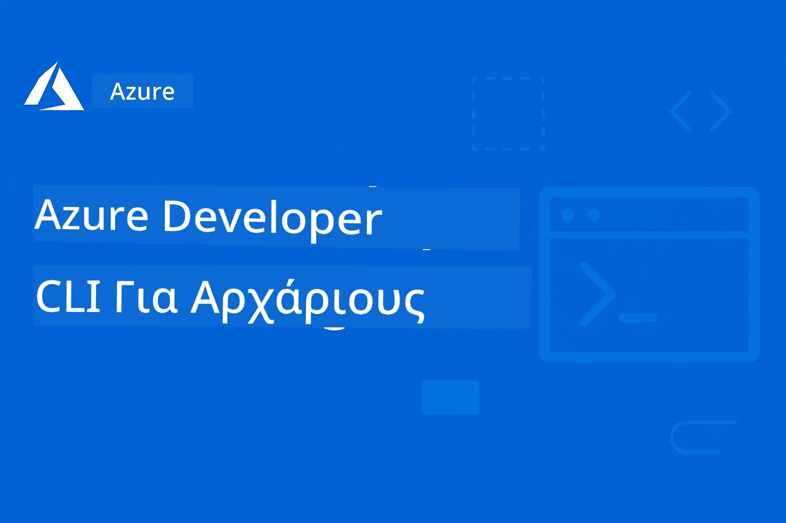

# AZD για Αρχάριους: Ένα Δομημένο Ταξίδι Μάθησης

 

[](https://github.com/microsoft/AZD-for-beginners)
[](https://GitHub.com/microsoft/azd-for-beginners/network/)
[](https://github.com/microsoft/AZD-for-beginners)

[](https://discord.com/invite/nkVh3dp)
[](https://discord.gg/nTYy5BXMWG)

---

### Αυτόματες Μεταφράσεις (Πάντα Ενημερωμένες)

<!-- CO-OP TRANSLATOR LANGUAGES TABLE START -->
[Arabic](../ar/README.md) | [Bengali](../bn/README.md) | [Bulgarian](../bg/README.md) | [Burmese (Myanmar)](../my/README.md) | [Chinese (Simplified)](../zh-CN/README.md) | [Chinese (Traditional, Hong Kong)](../zh-HK/README.md) | [Chinese (Traditional, Macau)](../zh-MO/README.md) | [Chinese (Traditional, Taiwan)](../zh-TW/README.md) | [Croatian](../hr/README.md) | [Czech](../cs/README.md) | [Danish](../da/README.md) | [Dutch](../nl/README.md) | [Estonian](../et/README.md) | [Finnish](../fi/README.md) | [French](../fr/README.md) | [German](../de/README.md) | [Greek](./README.md) | [Hebrew](../he/README.md) | [Hindi](../hi/README.md) | [Hungarian](../hu/README.md) | [Indonesian](../id/README.md) | [Italian](../it/README.md) | [Japanese](../ja/README.md) | [Kannada](../kn/README.md) | [Khmer](../km/README.md) | [Korean](../ko/README.md) | [Lithuanian](../lt/README.md) | [Malay](../ms/README.md) | [Malayalam](../ml/README.md) | [Marathi](../mr/README.md) | [Nepali](../ne/README.md) | [Nigerian Pidgin](../pcm/README.md) | [Norwegian](../no/README.md) | [Persian (Farsi)](../fa/README.md) | [Polish](../pl/README.md) | [Portuguese (Brazil)](../pt-BR/README.md) | [Portuguese (Portugal)](../pt-PT/README.md) | [Punjabi (Gurmukhi)](../pa/README.md) | [Romanian](../ro/README.md) | [Russian](../ru/README.md) | [Serbian (Cyrillic)](../sr/README.md) | [Slovak](../sk/README.md) | [Slovenian](../sl/README.md) | [Spanish](../es/README.md) | [Swahili](../sw/README.md) | [Swedish](../sv/README.md) | [Tagalog (Filipino)](../tl/README.md) | [Tamil](../ta/README.md) | [Telugu](../te/README.md) | [Thai](../th/README.md) | [Turkish](../tr/README.md) | [Ukrainian](../uk/README.md) | [Urdu](../ur/README.md) | [Vietnamese](../vi/README.md)

> **Προτιμάτε να Κλωνοποιήσετε Τοπικά;**
>
> Αυτό το αποθετήριο περιλαμβάνει μεταφράσεις σε 50+ γλώσσες, που αυξάνουν σημαντικά το μέγεθος λήψης. Για να κλωνοποιήσετε χωρίς μεταφράσεις, χρησιμοποιήστε sparse checkout:
>
> **Bash / macOS / Linux:**
> ```bash
> git clone --filter=blob:none --sparse https://github.com/microsoft/AZD-for-beginners.git
> cd AZD-for-beginners
> git sparse-checkout set --no-cone '/*' '!translations' '!translated_images'
> ```
>
> **CMD (Windows):**
> ```cmd
> git clone --filter=blob:none --sparse https://github.com/microsoft/AZD-for-beginners.git
> cd AZD-for-beginners
> git sparse-checkout set --no-cone "/*" "!translations" "!translated_images"
> ```
>
> Αυτό σας δίνει ό,τι χρειάζεστε για να ολοκληρώσετε το μάθημα με πολύ πιο γρήγορη λήψη.
<!-- CO-OP TRANSLATOR LANGUAGES TABLE END -->

## 🆕 Τι Νέο στο azd Σήμερα

> 📌 **Ενημέρωση Foundry GA (2026-11-09):** Το **`microsoft.foundry` 1.0 πακέτο είναι γενικά διαθέσιμο**, ανακοινώθηκε στις [5 Νοεμβρίου 2026](https://devblogs.microsoft.com/azure-sdk/microsoft-foundry-azure-developer-cli-ga/). Χρησιμοποιήστε **`azd >= 1.37.0`** και εγκαταστήστε το με `azd ext install microsoft.foundry`. Ακολουθήστε το [hosted-agent walkthrough](docs/chapter-02-ai-development/microsoft-foundry-integration.md#hosted-agent-walkthrough-ga) για ρύθμιση, τοπικό έλεγχο και ανάπτυξη. Αυτή η ενημέρωση βασίζεται σε δημοσιευμένες οδηγίες, όχι σε ζωντανή ανάπτυξη Azure· η γενική διαθεσιμότητα πακέτου δεν καθιστά διαθέσιμα όλα τα προαιρετικά χαρακτηριστικά, επεκτάσεις ή SDK.

Η Azure Developer CLI υποστηρίζει πολλούς τύπους εφαρμογών, συμπεριλαμβανομένων web apps, APIs και AI agents, μέσω υποστηριζόμενων υποδοχέων, προτύπων και επεκτάσεων.

Αυτό σημαίνει για εσάς:

- **Ένα γενικά διαθέσιμο πακέτο για ανάπτυξη Foundry.** Το `microsoft.foundry` εγκαθιστά επτά βασικές επεκτάσεις, συμπεριλαμβανομένων agents, projects και Agent Inspector. Ο κώδικας agents και οι ρυθμίσεις ανάπτυξης παραμένουν μαζί στο `azure.yaml`.
- **Δοκιμάστε το τοπικά, μετά αναπτύξτε τον κώδικά σας.** Χρησιμοποιήστε `azd ai agent init --deploy-mode code`, `azd provision` και `azd ai agent run` για να ελέγξετε τοπικά αιτήματα και απαντήσεις. Μετά χρησιμοποιήστε `azd deploy` για απομακρυσμένο build στο Foundry, χωρίς τοπικό build container.
- **Μετρήστε την ποιότητα ξεχωριστά.** Εγκαταστήστε **`azure.ai.evaluations`** για `azd ai eval generate`, `init` και `run start`· δεν περιλαμβάνεται στο πακέτο. Κρατήστε τα ελεγμένα σύνολα δεδομένων και τα κριτήρια μαζί με τον κώδικά σας. Τα παλαιότερα έργα θα πρέπει να ακολουθούν τον [οδηγό μετανάστευσης αξιολόγησης και βελτιστοποίησης](docs/chapter-08-production/production-ai-practices.md#evaluation-migration-and-quality-checks).
- **Επαναχρησιμοποιήστε ρυθμίσεις στο CI/CD.** Μετά από επιτυχημένο `azd up`, διαμορφώστε ένα pipeline με `azd pipeline config`. Εγκαταστήστε το πακέτο στον runner και κρατήστε τις παραγόμενες ρυθμίσεις αυθεντικοποίησης και περιβάλλοντος.
- **Ομαλότερα βασικά της καθημερινότητας.** Οι πρόσφατες εκδόσεις έκαναν το `azd init` ιδιόμορφο (ασφαλές για επανεκτέλεση), απλοποίησαν το `azd auth login` ώστε να καθαρίζει αυτόματα τα ξεπερασμένα tokens και πρόσθεσαν μια φιλική προτροπή ρύθμισης πρώτης εκτέλεσης `azd tool`.
- **Η βασική ροή εργασίας δεν έχει αλλάξει.** Είτε αναπτύσσετε μια εφαρμογή todo, ένα μικρο-υπηρεσία ή μια λύση πολλαπλών πρακτόρων AI, οι εντολές είναι οι ίδιες.

> **Σημείωση για χρήστες Aspire:** Η Microsoft αναφέρεται πλέον στο προϊόν απλά ως **Aspire** (πρώην ".NET Aspire"). Η υποστήριξη του azd για το Aspire παραμένει ίδια—μόνο το όνομα ενημερώθηκε.

Αν έχετε χρησιμοποιήσει το azd πριν, η υποστήριξη AI είναι μια φυσική επέκταση—όχι ένα ξεχωριστό εργαλείο ή προηγμένη διαδρομή. Αν ξεκινάτε από το μηδέν, θα μάθετε μια ροή εργασίας που λειτουργεί για τα πάντα.

---

## 🚀 Τι είναι το Azure Developer CLI (azd);

**Το Azure Developer CLI (azd)** είναι ένα εργαλείο εντολών φιλικό προς τον προγραμματιστή που απλοποιεί την ανάπτυξη εφαρμογών στο Azure. Αντί να δημιουργείτε και να συνδέετε χειροκίνητα δεκάδες πόρους Azure, μπορείτε να αναπτύξετε ολόκληρες εφαρμογές με μια μόνο εντολή.

### Η Μαγεία του `azd up`

```bash
# This single command does everything:
# ✅ Creates all Azure resources  
# ✅ Configures networking and security
# ✅ Builds your application code
# ✅ Deploys to Azure
# ✅ Gives you a working URL
azd up
```

Το πρότυπο παρέχει τη διαμόρφωση της εφαρμογής και της υποδομής. Η επιτυχής ανάπτυξη απαιτεί ακόμα υποστηριζόμενες υπηρεσίες/μοντέλα, επαρκές όριο και δικαιώματα, σωστές εισόδους και επαλήθευση της αναπτυγμένης εφαρμογής. Το `azd up` δεν καθιστά αυτόματα ένα πρότυπο ασφαλές, συμμορφωμένο ή έτοιμο για παραγωγή.

---

## ❓ Azure Developer CLI έναντι Azure CLI: Ποια είναι η Διαφορά;

Αυτή είναι η πιο συχνή ερώτηση που έχουν οι αρχάριοι. Εδώ είναι η απλή απάντηση:

| Χαρακτηριστικό | **Azure CLI (`az`)** | **Azure Developer CLI (`azd`)** |
|---------|---------------------|--------------------------------|
| **Σκοπός** | Διαχείριση μεμονωμένων πόρων Azure | Ανάπτυξη ολοκληρωμένων εφαρμογών |
| **Νοοτροπία** | Εστίαση στην υποδομή | Εστίαση στην εφαρμογή |
| **Παράδειγμα** | `az webapp create --name myapp...` | `azd up` |
| **Καμπύλη Μάθησης** | Πρέπει να γνωρίζετε τις υπηρεσίες Azure | Αρκεί να γνωρίζετε την εφαρμογή σας |
| **Καλύτερο Για** | DevOps, Υποδομή | Προγραμματιστές, Πρωτοτυποποίηση |

### Απλή Αναλογία

- **Το Azure CLI** είναι σαν να έχετε όλα τα εργαλεία για να χτίσετε ένα σπίτι - σφυριά, πριόνια, καρφιά. Μπορείτε να χτίσετε οτιδήποτε, αλλά πρέπει να γνωρίζετε κατασκευή.
- **Το Azure Developer CLI** είναι σαν να προσλαμβάνετε έναν εργολάβο - περιγράφετε τι θέλετε, και αυτός αναλαμβάνει την κατασκευή.

### Πότε να Χρησιμοποιήσετε Κάθε Ένα

| Σενάριο | Χρησιμοποιήστε Αυτό |
|----------|----------|
| "Θέλω να αναπτύξω γρήγορα την web εφαρμογή μου" | `azd up` |
| "Χρειάζομαι να δημιουργήσω μόνο έναν λογαριασμό αποθήκευσης" | `az storage account create` |
| "Φτιάχνω μια πλήρη AI εφαρμογή" | `azd init --template azure-search-openai-demo` |
| "Πρέπει να εντοπίσω σφάλμα σε συγκεκριμένο πόρο Azure" | `az resource show` |
| "Θέλω να αναπτύξω στο ρυθμισμένο περιβάλλον παραγωγής μου" | Εξετάστε τις ρυθμίσεις, πρόσβαση, κόστος και λειτουργικούς φραγμούς πριν το `azd up --environment production` |

### Λειτουργούν Μαζί!

Το AZD και το Azure CLI έχουν ξεχωριστή αυθεντικοποίηση και διαμόρφωση. Χρησιμοποιήστε `azd auth login` για το AZD και `az login` όταν μια διασύνδεση ή εντολή διάγνωσης χρειάζεται ρητά το Azure CLI. Μπορείτε να χρησιμοποιήσετε και τα δύο:
```bash
# Deploy your app with AZD
azd up

# Then fine-tune specific resources with Azure CLI
az webapp config set --name myapp --always-on true
```

---

## 🌟 Βρείτε Πρότυπα στο Awesome AZD

Μην ξεκινάτε από το μηδέν! **Το Awesome AZD** είναι η συλλογή της κοινότητας με έτοιμα προς ανάπτυξη πρότυπα:

| Πόρος | Περιγραφή |
|----------|-------------|
| 🔗 [**Awesome AZD Gallery**](https://azure.github.io/awesome-azd/) | Περιηγηθείτε σε πάνω από 200 πρότυπα με ανάπτυξη με ένα κλικ |
| 🔗 [**Υποβολή Προτύπου**](https://github.com/Azure/awesome-azd/issues) | Συνεισφέρετε το δικό σας πρότυπο στην κοινότητα |
| 🔗 [**Αποθετήριο GitHub**](https://github.com/Azure/awesome-azd) | Αξιολογήστε και εξερευνήστε τον κώδικα |

### Δημοφιλή Πρότυπα AI από το Awesome AZD

Επιλέξτε ένα πρότυπο σε δικό του κενό φάκελο· οι παρακάτω εντολές είναι εναλλακτικές. Ο `.` στο τέλος αρχικοποιεί τον φάκελο αυτό.

```bash
# RAG Chat with Microsoft Foundry Models + AI Search
azd init --template azure-search-openai-demo .

# Quick AI Chat Application
azd init --template openai-chat-app-quickstart .

# AI Agents with Foundry Agents
azd init --template get-started-with-ai-agents .
```

---

## 🎯 Ξεκινώντας σε 3 Βήματα

Πριν ξεκινήσετε, βεβαιωθείτε ότι το μηχάνημά σας είναι έτοιμο για το πρότυπο που θέλετε να αναπτύξετε:

**Windows:**
```powershell
.\validate-setup.ps1
```

**macOS / Linux:**
```bash
bash ./validate-setup.sh
```

Αν αποτύχει οποιοςδήποτε απαιτούμενος έλεγχος, διορθώστε τον πρώτα και μετά συνεχίστε με την γρήγορη εκκίνηση.

### Βήμα 1: Εγκαταστήστε το AZD (2 λεπτά)

**Windows:**
```powershell
winget install microsoft.azd
```

**macOS:**
```bash
brew tap azure/azd && brew install azd
```

**Linux:**
```bash
curl -fsSL https://aka.ms/install-azd.sh | bash
```

### Βήμα 2: Αυθεντικοποιηθείτε για το AZD

```bash
# Optional if you plan to use Azure CLI commands directly in this course
az login

# Required for AZD workflows
azd auth login
```

Αν δεν είστε σίγουροι ποιο χρειάζεστε, ακολουθήστε την πλήρη ροή ρυθμίσεων στο [Εγκατάσταση & Ρύθμιση](docs/chapter-01-foundation/installation.md#authentication-setup).

### Βήμα 3: Αναπτύξτε την πρώτη σας εφαρμογή

```bash
# Initialize from a template
azd init --template todo-nodejs-mongo .

# Deploy to Azure (creates everything!)
azd up
```

**🎉 Αυτό ήταν!** Η εφαρμογή σας είναι τώρα ζωντανή στο Azure.

### Καθαρισμός (Μην το Ξεχάσετε!)

```bash
# Remove all resources when done experimenting
azd down --force --purge
```

---

## 📚 Πώς να Χρησιμοποιήσετε Αυτό το Μάθημα

Αυτό το μάθημα είναι σχεδιασμένο για **προοδευτική μάθηση** - ξεκινήστε από εκεί που νιώθετε άνετα και προχωρήστε:

| Η Εμπειρία σας | Ξεκινήστε Εδώ |
|-----------------|------------|
| **Νέοι στο Azure** | [Κεφάλαιο 1: Θεμέλια](#-chapter-1-foundation--quick-start) |
| **Ξέρετε Azure, νέοι στο AZD** | [Κεφάλαιο 1: Θεμέλια](#-chapter-1-foundation--quick-start) |
| **Θέλετε να αναπτύξετε AI εφαρμογές** | [Κεφάλαιο 2: Ανάπτυξη με Προτεραιότητα στο AI](#-chapter-2-ai-first-development-recommended-for-ai-developers) |
| **Θέλετε πρακτική εξάσκηση** | [🎓 Διαδραστικό Εργαστήριο](workshop/README.md) - 3-4 ώρες καθοδηγούμενο εργαστήριο |
| **Χρειάζεστε πρότυπα παραγωγής** | [Κεφάλαιο 8: Παραγωγή & Επιχειρησιακή Χρήση](#-chapter-8-production--enterprise-patterns) |

### Γρήγορη Ρύθμιση

1. **Κάντε Fork Αυτό το Αποθετήριο**: [](https://GitHub.com/microsoft/azd-for-beginners/fork)
2. **Κλωνοποιήστε Το**: `git clone https://github.com/YOUR-USERNAME/azd-for-beginners.git`
3. **Ζητήστε Βοήθεια**: [Κοινότητα Azure Discord](https://discord.com/invite/ByRwuEEgH4)

> **Προτιμάτε να Κλωνοποιήσετε Τοπικά;**

> Αυτό το αποθετήριο περιλαμβάνει πάνω από 50 μεταφράσεις γλωσσών που αυξάνουν σημαντικά το μέγεθος λήψης. Για να το κλωνοποιήσετε χωρίς μεταφράσεις, χρησιμοποιήστε το sparse checkout:
> ```bash
> git clone --filter=blob:none --sparse https://github.com/microsoft/AZD-for-beginners.git
> cd AZD-for-beginners
> git sparse-checkout set --no-cone '/*' '!translations' '!translated_images'
> ```
> Αυτό σας δίνει όλα όσα χρειάζεστε για να ολοκληρώσετε το μάθημα με πολύ πιο γρήγορη λήψη.


## Επισκόπηση Μαθήματος

Κατακτήστε το Azure Developer CLI (azd) μέσα από δομημένα κεφάλαια σχεδιασμένα για προοδευτική μάθηση. **Ιδιαίτερη έμφαση στην ανάπτυξη εφαρμογών AI με ενσωμάτωση Microsoft Foundry.**

### Γιατί Αυτό το Μάθημα Είναι Απαραίτητο για Σύγχρονους Προγραμματιστές

Οι προγραμματιστές που αναπτύσσουν εργασίες AI συχνά χρειάζονται καθοδήγηση για:
- Πολυσύνθετες πολυ-υπηρεσιακές αρχιτεκτονικές AI
- Καλύτερες πρακτικές ανάπτυξης AI σε παραγωγή  
- Ενσωμάτωση και διαμόρφωση υπηρεσιών Azure AI
- Βελτιστοποίηση κόστους για εργασίες AI
- Επίλυση προβλημάτων ειδικών στην ανάπτυξη AI

### Μαθησιακοί Στόχοι

Ολοκληρώνοντας αυτό το δομημένο μάθημα, θα:
- **Κατακτήσετε τις Βασικές Αρχές του AZD**: Κύριες έννοιες, εγκατάσταση και διαμόρφωση
- **Αναπτύξετε Εφαρμογές AI**: Χρησιμοποιήστε AZD με τις υπηρεσίες Microsoft Foundry
- **Εφαρμόσετε Υποδομή ως Κώδικα**: Διαχείριση πόρων Azure με προτύπα Bicep
- **Επιλύσετε Προβλήματα Αναπτύξεων**: Εντοπίστε κοινά προβλήματα και κάντε αποσφαλμάτωση
- **Βελτιστοποιήσετε για Παραγωγή**: Ασφάλεια, κλιμάκωση, παρακολούθηση και διαχείριση κόστους
- **Δημιουργήσετε Λύσεις Πολλαπλών Πρακτόρων**: Αναπτύξτε σύνθετες αρχιτεκτονικές AI

## Πριν Ξεκινήσετε: Λογαριασμοί, Πρόσβαση και Υποθέσεις

Πριν ξεκινήσετε το Κεφάλαιο 1, βεβαιωθείτε ότι έχετε τα ακόλουθα. Τα βήματα εγκατάστασης αργότερα σε αυτόν τον οδηγό υποθέτουν ότι αυτά τα βασικά έχουν ήδη διευθετηθεί.

- **Μια συνδρομή Azure**: Μπορείτε να χρησιμοποιήσετε μια υπάρχουσα συνδρομή από τη δουλειά ή τον δικό σας λογαριασμό, ή να δημιουργήσετε μια [δωρεάν δοκιμή](https://aka.ms/azurefreetrial) για να ξεκινήσετε.
- **Άδεια για δημιουργία πόρων Azure**: Για τις περισσότερες ασκήσεις, θα πρέπει να έχετε τουλάχιστον δικαιώματα **Συνεισφέροντος** στη στοχοθετημένη συνδρομή ή ομάδα πόρων. Ορισμένα κεφάλαια ενδέχεται επίσης να υποθέτουν ότι μπορείτε να δημιουργήσετε ομάδες πόρων, διαχειριζόμενες ταυτότητες και αναθέσεις RBAC.
- [**Ένας λογαριασμός GitHub**](https://github.com): Είναι χρήσιμος για το fork του αποθετηρίου, την παρακολούθηση των δικών σας αλλαγών και τη χρήση του GitHub Codespaces για το εργαστήριο.
- **Προαπαιτούμενα χρόνου εκτέλεσης προτύπων**: Ορισμένα πρότυπα χρειάζονται τοπικά εργαλεία όπως Node.js, Python, Java ή Docker. Τρέξτε τον έλεγχο εγκατάστασης πριν ξεκινήσετε ώστε να εντοπίσετε έγκαιρα τυχόν ελλείψεις εργαλείων.
- **Βασική εξοικείωση με το τερματικό**: Δεν χρειάζεται να είστε ειδικός, αλλά θα πρέπει να νιώθετε άνετα να εκτελείτε εντολές όπως `git clone`, `azd auth login`, και `azd up`.

> **Εργάζεστε σε εταιρική συνδρομή;**
> Αν το περιβάλλον Azure σας διαχειρίζεται από διαχειριστή, επιβεβαιώστε νωρίτερα ότι μπορείτε να αναπτύξετε πόρους στη συνδρομή ή ομάδα πόρων που σκοπεύετε να χρησιμοποιήσετε. Αν όχι, ζητήστε μια sandbox συνδρομή ή δικαιώματα Συνεισφέροντος πριν ξεκινήσετε.

> **Νέοι στο Azure;**
> Ξεκινήστε με τη δική σας δοκιμαστική συνδρομή Azure ή συνδρομή πληρωμής κατά χρήση στο https://aka.ms/azurefreetrial ώστε να ολοκληρώσετε τις ασκήσεις από την αρχή μέχρι το τέλος χωρίς να περιμένετε εγκρίσεις σε επίπεδο ενοικιαστή.

## 🗺️ Χάρτης Μαθήματος: Γρήγορη Πλοήγηση ανά Κεφάλαιο

Κάθε κεφάλαιο έχει ένα αφιερωμένο README με μαθησιακούς στόχους, γρήγορα ξεκινήματα και ασκήσεις:

| Κεφάλαιο | Θέμα | Μαθήματα | Διάρκεια | Πολυπλοκότητα |
|---------|-------|---------|----------|------------|
| **[Κεφ 1: Θεμέλιο](docs/chapter-01-foundation/README.md)** | Ξεκινώντας | [Βασικά AZD](docs/chapter-01-foundation/azd-basics.md) &#124; [Εγκατάσταση](docs/chapter-01-foundation/installation.md) &#124; [Πρώτο Έργο](docs/chapter-01-foundation/first-project.md) | 30-45 λεπτά | ⭐ |
| **[Κεφ 2: Ανάπτυξη AI](docs/chapter-02-ai-development/README.md)** | Εφαρμογές AI-Πρώτα | [Ενσωμάτωση Foundry](docs/chapter-02-ai-development/microsoft-foundry-integration.md) &#124; [Πράκτορες AI](docs/chapter-02-ai-development/agents.md) &#124; [Ανάπτυξη Μοντέλου](docs/chapter-02-ai-development/ai-model-deployment.md) &#124; [Εργαστήριο](docs/chapter-02-ai-development/ai-workshop-lab.md) | 1-2 ώρες | ⭐⭐ |
| **[Κεφ 3: Διαμόρφωση](docs/chapter-03-configuration/README.md)** | Πιστοποίηση & Ασφάλεια | [Διαμόρφωση](docs/chapter-03-configuration/configuration.md) &#124; [Πιστοποίηση & Ασφάλεια](docs/chapter-03-configuration/authsecurity.md) | 45-60 λεπτά | ⭐⭐ |
| **[Κεφ 4: Υποδομή](docs/chapter-04-infrastructure/README.md)** | IaC & Ανάπτυξη | [Οδηγός Ανάπτυξης](docs/chapter-04-infrastructure/deployment-guide.md) &#124; [Προμήθεια](docs/chapter-04-infrastructure/provisioning.md) | 1-1.5 ώρες | ⭐⭐⭐ |
| **[Κεφ 5: Πολλαπλοί Πράκτορες](docs/chapter-05-multi-agent/README.md)** | Λύσεις Πρακτόρων AI | [Σενάριο Λιανικής](examples/retail-scenario.md) &#124; [Πρότυπα Συντονισμού](docs/chapter-06-pre-deployment/coordination-patterns.md) | 2-3 ώρες | ⭐⭐⭐⭐ |
| **[Κεφ 6: Προ-Ανάπτυξη](docs/chapter-06-pre-deployment/README.md)** | Σχεδιασμός & Επικύρωση | [Έλεγχοι Προ-Πτήσης](docs/chapter-06-pre-deployment/preflight-checks.md) &#124; [Σχεδιασμός Χωρητικότητας](docs/chapter-06-pre-deployment/capacity-planning.md) &#124; [Επιλογή SKU](docs/chapter-06-pre-deployment/sku-selection.md) &#124; [App Insights](docs/chapter-06-pre-deployment/application-insights.md) | 1 ώρα | ⭐⭐ |
| **[Κεφ 7: Επίλυση Προβλημάτων](docs/chapter-07-troubleshooting/README.md)** | Αποσφαλμάτωση & Διόρθωση | [Κοινά Προβλήματα](docs/chapter-07-troubleshooting/common-issues.md) &#124; [Αποσφαλμάτωση](docs/chapter-07-troubleshooting/debugging.md) &#124; [Προβλήματα AI](docs/chapter-07-troubleshooting/ai-troubleshooting.md) | 1-1.5 ώρες | ⭐⭐ |
| **[Κεφ 8: Παραγωγή](docs/chapter-08-production/README.md)** | Εταιρικά Πρότυπα | [Πρακτικές Παραγωγής](docs/chapter-08-production/production-ai-practices.md) | 2-3 ώρες | ⭐⭐⭐⭐ |
| **[🎓 Εργαστήριο](workshop/README.md)** | Εργαστήριο Πρακτικής | [Εισαγωγή](workshop/docs/instructions/0-Introduction.md) &#124; [Επιλογή](workshop/docs/instructions/1-Select-AI-Template.md) &#124; [Επικύρωση](workshop/docs/instructions/2-Validate-AI-Template.md) &#124; [Αποδόμηση](workshop/docs/instructions/3-Deconstruct-AI-Template.md) &#124; [Διαμόρφωση](workshop/docs/instructions/4-Configure-AI-Template.md) &#124; [Προσαρμογή](workshop/docs/instructions/5-Customize-AI-Template.md) &#124; [Αποσυναρμολόγηση](workshop/docs/instructions/6-Teardown-Infrastructure.md) &#124; [Ολοκλήρωση](workshop/docs/instructions/7-Wrap-up.md) | 3-4 ώρες | ⭐⭐ |

**Συνολική Διάρκεια Μαθήματος:** ~10-14 ώρες | **Πρόοδος Δεξιοτήτων:** Αρχάριος → Έτοιμος για Παραγωγή

---

## 📚 Μαθησιακά Κεφάλαια

*Επιλέξτε τη διαδρομή μάθησής σας ανάλογα με το επίπεδο εμπειρίας και τους στόχους*

### 🚀 Κεφάλαιο 1: Θεμέλιο & Γρήγορο Ξεκίνημα
**Προαπαιτούμενα**: Συνδρομή Azure, βασική γνώση γραμμής εντολών  
**Διάρκεια**: 30-45 λεπτά  
**Πολυπλοκότητα**: ⭐

#### Τι Θα Μάθετε
- Κατανόηση των βασικών του Azure Developer CLI
- Εγκατάσταση του AZD στην πλατφόρμα σας
- Την πρώτη σας επιτυχή ανάπτυξη

#### Πόροι Μάθησης
- **🎯 Ξεκινήστε Εδώ**: [Τι είναι το Azure Developer CLI;](#-what-is-azure-developer-cli-azd)
- **📖 Θεωρία**: [Βασικά AZD](docs/chapter-01-foundation/azd-basics.md) - Κύριες έννοιες και ορολογία
- **⚙️ Ρύθμιση**: [Εγκατάσταση & Ρύθμιση](docs/chapter-01-foundation/installation.md) - Οδηγοί ανά πλατφόρμα
- **🛠️ Πρακτική**: [Το Πρώτο Σας Έργο](docs/chapter-01-foundation/first-project.md) - Οδηγός βήμα-βήμα
- **📋 Γρήγορη Αναφορά**: [Φύλλο Απαραίτητων Εντολών](resources/cheat-sheet.md)

#### Πρακτικές Ασκήσεις
```bash
# Quick installation check
azd version

# Deploy your first application
azd init --template todo-nodejs-mongo .
azd up
```

**💡 Αποτέλεσμα Κεφαλαίου**: Αναπτύξτε με επιτυχία μια απλή web εφαρμογή στο Azure χρησιμοποιώντας AZD

**✅ Επικύρωση Επιτυχίας:**
```bash
# After completing Chapter 1, you should be able to:
azd version              # Shows installed version
azd init --template todo-nodejs-mongo  # Initializes project
azd up                  # Deploys to Azure
azd show                # Displays running app URL
# Application opens in browser and works
azd down --force --purge  # Cleans up resources
```

**📊 Χρόνος Επένδυσης:** 30-45 λεπτά  
**📈 Επίπεδο Δεξιοτήτων Μετά:** Μπορεί να αναπτύσσει βασικές εφαρμογές ανεξάρτητα

---

### 🤖 Κεφάλαιο 2: Ανάπτυξη AI-Πρώτα (Συνιστάται για Προγραμματιστές AI)
**Προαπαιτούμενα**: Ολοκληρωμένο Κεφάλαιο 1  
**Διάρκεια**: 1-2 ώρες  
**Πολυπλοκότητα**: ⭐⭐

#### Τι Θα Μάθετε
- Ενσωμάτωση Microsoft Foundry με AZD
- Ανάπτυξη εφαρμογών με AI
- Κατανόηση ρυθμίσεων υπηρεσιών AI

#### Πόροι Μάθησης
- **🎯 Ξεκινήστε Εδώ**: [Ενσωμάτωση Microsoft Foundry](docs/chapter-02-ai-development/microsoft-foundry-integration.md)
- **🤖 Πράκτορες AI**: [Οδηγός Πρακτόρων AI](docs/chapter-02-ai-development/agents.md) - Ανάπτυξη έξυπνων πρακτόρων με AZD
- **📖 Πρότυπα**: [Ανάπτυξη Μοντέλου AI](docs/chapter-02-ai-development/ai-model-deployment.md) - Ανάπτυξη και διαχείριση μοντέλων AI
- **🛠️ Εργαστήριο**: [Εργαστήριο AI](docs/chapter-02-ai-development/ai-workshop-lab.md) - Κάντε τις λύσεις AI AZD-έτοιμες
- **🎥 Διαδραστικός Οδηγός**: [Υλικά Εργαστηρίου](workshop/README.md) - Μάθηση μέσω περιηγητή με MkDocs * Περιβάλλον DevContainer
- **📋 Προτύπα**: [Πρότυπα Microsoft Foundry](#featured-microsoft-foundry-templates)
- **📝 Παραδείγματα**: [Παραδείγματα Ανάπτυξης AZD](examples/README.md)

#### Πρακτικές Ασκήσεις
```bash
# Deploy your first AI application
azd init --template azure-search-openai-demo .
azd up

# Try additional AI templates
azd init --template openai-chat-app-quickstart .
azd init --template agent-openai-python-prompty .
```

**💡 Αποτέλεσμα Κεφαλαίου**: Αναπτύξτε και ρυθμίστε μια εφαρμογή συνομιλίας με AI και δυνατότητες RAG

**✅ Επικύρωση Επιτυχίας:**
```bash
# After Chapter 2, you should be able to:
azd init --template azure-search-openai-demo .
azd up
# Test the AI chat interface
# Ask questions and get AI-powered responses with sources
# Verify search integration works
azd monitor  # Check Application Insights shows telemetry
azd down --force --purge
```

**📊 Χρόνος Επένδυσης:** 1-2 ώρες  
**📈 Επίπεδο Δεξιοτήτων Μετά:** Μπορεί να αναπτύξει εφαρμογές εκμάθησης AI και να εντοπίσει πρόσθετες απαιτήσεις για παραγωγή
**💰 Αντίληψη Κόστους:** Κατανόηση κόστους ανάπτυξης $80-150/μήνα, κόστους παραγωγής $300-3500/μήνα

#### 💰 Παρατηρήσεις Κόστους για τις Αναπτύξεις AI

**Περιβάλλον Ανάπτυξης (Εκτιμώμενο $80-150/μήνα):**
- Μοντέλα Microsoft Foundry (Πληρωμή ανά χρήση): $0-50/μήνα (ανάλογα με τη χρήση tokens)
- AI Search (Βασικό επίπεδο): $75/μήνα
- Container Apps (Κατανάλωση): $0-20/μήνα
- Αποθηκευτικός χώρος (Standard): $1-5/μήνα

**Περιβάλλον Παραγωγής (Εκτιμώμενο $300-3,500+/μήνα):**
- Μοντέλα Microsoft Foundry (PTU για σταθερή απόδοση): $3,000+/μήνα Ή πληρωμή ανά χρήση με μεγάλο όγκο
- AI Search (Standard επίπεδο): $250/μήνα
- Container Apps (Αφιερωμένα): $50-100/μήνα
- Application Insights: $5-50/μήνα
- Αποθηκευτικός χώρος (Premium): $10-50/μήνα

**💡 Συμβουλές Βελτιστοποίησης Κόστους:**
- Ελέγξτε την τιμολόγηση για την εκτίμηση μοντέλου και τα πιστωτικά λογαριασμού· το Azure OpenAI δεν περιλαμβάνει καθολική δωρεάν μηνιαία ποσόστωση 50.000 tokens
- Τρέξτε `azd down` για διαγραφή πόρων όταν δεν χρειάζονται, αφού ελέγξετε το επιλεγμένο περιβάλλον
- Ξεκινήστε με χρέωση βάσει κατανάλωσης, αναβαθμίστε στο PTU μόνο για παραγωγή
- Χρησιμοποιήστε `azd provision --preview` για να ελέγξετε την προγραμματισμένη υποδομή, στη συνέχεια τιμολογήστε τους πόρους με το Azure Pricing Calculator
- Ενεργοποιήστε την αυτόματη κλιμάκωση: πληρώστε μόνο για την πραγματική χρήση

**Παρακολούθηση Κόστους:**
```bash
# Inspect planned resources (this does not calculate prices)
azd provision --preview

# Monitor actual costs in Azure Portal
az consumption budget list --resource-group <your-rg>
```

---

### ⚙️ Κεφάλαιο 3: Διαμόρφωση & Πιστοποίηση
**Προαπαιτούμενα**: Ολοκληρωμένο Κεφάλαιο 1  
**Διάρκεια**: 45-60 λεπτά  
**Πολυπλοκότητα**: ⭐⭐

#### Τι Θα Μάθετε
- Διαμόρφωση και διαχείριση περιβάλλοντος
- Καλύτερες πρακτικές αυθεντικοποίησης και ασφάλειας
- Ονοματοδοσία και οργάνωση πόρων

#### Πόροι Μάθησης
- **📖 Διαμόρφωση**: [Οδηγός Διαμόρφωσης](docs/chapter-03-configuration/configuration.md) - Ρύθμιση περιβάλλοντος
- **🔐 Ασφάλεια**: [Πρότυπα Πιστοποίησης και Διαχειριζόμενη Ταυτότητα](docs/chapter-03-configuration/authsecurity.md) - Πρότυπα αυθεντικοποίησης
- **📝 Παραδείγματα**: [Παράδειγμα Εφαρμογής Βάσης Δεδομένων](examples/database-app/README.md) - Παραδείγματα βάσης δεδομένων AZD

#### Πρακτικές Ασκήσεις
- Διαμορφώστε πολλαπλά περιβάλλοντα (dev, staging, prod)
- Ρυθμίστε πιστοποίηση με διαχειριζόμενη ταυτότητα
- Εφαρμόστε διαμορφώσεις ειδικές σε περιβάλλον

**💡 Αποτέλεσμα Κεφαλαίου**: Διαχειριστείτε πολλαπλά περιβάλλοντα με σωστή πιστοποίηση και ασφάλεια

---

### 🏗️ Κεφάλαιο 4: Υποδομή ως Κώδικας & Ανάπτυξη
**Προαπαιτούμενα**: Ολοκληρωμένα Κεφάλαια 1-3  
**Διάρκεια**: 1-1.5 ώρες  
**Πολυπλοκότητα**: ⭐⭐⭐

#### Τι Θα Μάθετε
- Προηγμένα πρότυπα ανάπτυξης
- Υποδομή ως Κώδικας με Bicep
- Στρατηγικές προμήθειας πόρων

#### Πόροι Μάθησης
- **📖 Ανάπτυξη**: [Οδηγός Ανάπτυξης](docs/chapter-04-infrastructure/deployment-guide.md) - Ολοκληρωμένα workflows
- **🏗️ Προμήθεια**: [Προμήθεια Πόρων](docs/chapter-04-infrastructure/provisioning.md) - Διαχείριση πόρων Azure
- **📝 Παραδείγματα**: [Παράδειγμα Container App](../../examples/container-app) - Ανάπτυξη σε κοντέινερ

#### Πρακτικές Ασκήσεις
- Δημιουργήστε προσαρμοσμένα πρότυπα Bicep
- Αναπτύξτε εφαρμογές πολλαπλών υπηρεσιών
- Εφαρμόστε στρατηγικές blue-green deployment

**💡 Αποτέλεσμα Κεφαλαίου**: Αναπτύξτε σύνθετες εφαρμογές πολλαπλών υπηρεσιών χρησιμοποιώντας προσαρμοσμένα πρότυπα υποδομής

---

### 🎯 Κεφάλαιο 5: Λύσεις Πολυ-Πρακτορικών AI (Προχωρημένο)
**Προαπαιτούμενα**: Ολοκληρωμένα Κεφάλαια 1-2  
**Διάρκεια**: 2-3 ώρες  
**Πολυπλοκότητα**: ⭐⭐⭐⭐

#### Τι Θα Μάθετε
- Πρότυπα αρχιτεκτονικής πολλαπλών πρακτόρων
- Συντονισμό και ορχήστρωση πρακτόρων
- Παραγωγική ανάπτυξη AI

#### Πόροι Μάθησης
- **🤖 Επιλεγμένος Σχεδιασμός**: [Λύση Πολυ-Πράκτορα για Λιανική](examples/retail-scenario.md) - Σχεδιαστικό σχέδιο, όχι πλήρης εφαρμογή
- **🛠️ Πρότυπα ARM**: [Πακέτο Προτύπου ARM](../../examples/retail-multiagent-arm-template) - Σκελετός υποδομής· αναθεώρηση προϋποθέσεων και ελλείποντων στοιχείων εφαρμογής
- **📖 Αρχιτεκτονική**: [Πρότυπα συντονισμού πολυ-πρακτόρων](docs/chapter-06-pre-deployment/coordination-patterns.md) - Πρότυπα

#### Πρακτικές Ασκήσεις
```bash
# Inspect the retail infrastructure scaffold before choosing to deploy it
cd examples/retail-multiagent-arm-template
cat README.md

# After an intentional deployment, inspect infrastructure state
az deployment group show --resource-group <rg-name> --name <deployment-name>
```

**💡 Αποτέλεσμα Κεφαλαίου**: Κατανόηση σχεδιασμού πολυ-πρακτόρων και αναγνώριση της υλοποίησης, της επικύρωσης και των λειτουργικών εργασιών που απαιτούνται πέρα από ένα σκελετό υποδομής

---

### 🔍 Κεφάλαιο 6: Επικύρωση και Σχεδιασμός πριν από την Ανάπτυξη
**Προϋποθέσεις**: Ολοκλήρωση Κεφαλαίου 4  
**Διάρκεια**: 1 ώρα  
**Πολυπλοκότητα**: ⭐⭐

#### Τι θα Μάθετε
- Σχεδιασμός χωρητικότητας και επικύρωση πόρων
- Στρατηγικές επιλογής SKU
- Έλεγχοι προ-πτήσης και αυτοματοποίηση

#### Πόροι Μάθησης
- **📊 Σχεδιασμός**: [Σχεδιασμός Χωρητικότητας](docs/chapter-06-pre-deployment/capacity-planning.md) - Επικύρωση πόρων
- **💰 Επιλογή**: [Επιλογή SKU](docs/chapter-06-pre-deployment/sku-selection.md) - Οικονομικές επιλογές
- **✅ Επικύρωση**: [Έλεγχοι Προ-πτήσης](docs/chapter-06-pre-deployment/preflight-checks.md) - Αυτοματοποιημένα σενάρια

#### Πρακτικές Ασκήσεις
- Εκτέλεση σεναρίων επικύρωσης χωρητικότητας
- Βελτιστοποίηση επιλογών SKU για το κόστος
- Υλοποίηση αυτοματοποιημένων ελέγχων προ-ανάπτυξης

**💡 Αποτέλεσμα Κεφαλαίου**: Επικύρωση και βελτιστοποίηση των αναπτύξεων πριν από την εκτέλεση

---

### 🚨 Κεφάλαιο 7: Αντιμετώπιση Προβλημάτων & Εντοπισμός Σφαλμάτων
**Προϋποθέσεις**: Οποιοδήποτε ολοκληρωμένο κεφάλαιο ανάπτυξης  
**Διάρκεια**: 1-1.5 ώρες  
**Πολυπλοκότητα**: ⭐⭐

#### Τι θα Μάθετε
- Συστηματικές προσεγγίσεις εντοπισμού σφαλμάτων
- Συνηθισμένα προβλήματα και λύσεις
- Ειδική αντιμετώπιση προβλημάτων για AI

#### Πόροι Μάθησης
- **🔧 Συνηθισμένα Προβλήματα**: [Συνηθισμένα Προβλήματα](docs/chapter-07-troubleshooting/common-issues.md) - Συχνές ερωτήσεις και λύσεις
- **🕵️ Εντοπισμός Σφαλμάτων**: [Οδηγός Εντοπισμού Σφαλμάτων](docs/chapter-07-troubleshooting/debugging.md) - Στρατηγικές βήμα προς βήμα
- **🤖 Προβλήματα AI**: [Ειδική Αντιμετώπιση Προβλημάτων AI](docs/chapter-07-troubleshooting/ai-troubleshooting.md) - Προβλήματα υπηρεσιών AI

#### Πρακτικές Ασκήσεις
- Διάγνωση σφαλμάτων ανάπτυξης
- Επίλυση προβλημάτων ταυτοποίησης
- Εντοπισμός προβλημάτων σύνδεσης υπηρεσιών AI

**💡 Αποτέλεσμα Κεφαλαίου**: Ανεξάρτητη διάγνωση και επίλυση συνηθισμένων προβλημάτων ανάπτυξης

---

### 🏢 Κεφάλαιο 8: Παραγωγικά & Επιχειρηματικά Πρότυπα
**Προϋποθέσεις**: Ολοκλήρωση Κεφαλαίων 1-4  
**Διάρκεια**: 2-3 ώρες  
**Πολυπλοκότητα**: ⭐⭐⭐⭐

#### Τι θα Μάθετε
- Στρατηγικές παραγωγικής ανάπτυξης
- Επιχειρηματικά πρότυπα ασφαλείας
- Παρακολούθηση και βελτιστοποίηση κόστους

#### Πόροι Μάθησης
- **🏭 Παραγωγή**: [Βέλτιστες Πρακτικές AI Παραγωγής](docs/chapter-08-production/production-ai-practices.md) - Επιχειρηματικά πρότυπα
- **📝 Παραδείγματα**: [Παράδειγμα Microservices](../../examples/microservices) - Σύνθετες αρχιτεκτονικές
- **📊 Παρακολούθηση**: [Ενσωμάτωση Application Insights](docs/chapter-06-pre-deployment/application-insights.md) - Παρακολούθηση

#### Πρακτικές Ασκήσεις
- Υλοποίηση επιχειρηματικών προτύπων ασφαλείας
- Εγκατάσταση ολοκληρωμένης παρακολούθησης
- Ανάπτυξη σε παραγωγή με ορθή διακυβέρνηση

**💡 Αποτέλεσμα Κεφαλαίου**: Ανάπτυξη εφαρμογών έτοιμων για παραγωγή με πλήρεις δυνατότητες

---

## 🎓 Επισκόπηση Εργαστηρίου: Εμπειρία Μαθημάτων με Πρακτική

> **⚠️ ΚΑΤΑΣΤΑΣΗ ΕΡΓΑΣΤΗΡΙΟΥ: Ενεργή Ανάπτυξη**  
> Το υλικό του εργαστηρίου αναπτύσσεται και βελτιώνεται αυτή τη στιγμή. Οι βασικές ενότητες λειτουργούν, αλλά ορισμένα προχωρημένα μέρη είναι ατελή. Εργαζόμαστε ενεργά για την ολοκλήρωση όλου του περιεχομένου. [Παρακολούθηση προόδου →](workshop/README.md)

### Διαδραστικό Υλικό Εργαστηρίου
**Ολοκληρωμένη εκμάθηση με εργαλεία μέσω προγράμματος περιήγησης και καθοδηγούμενες ασκήσεις**

Το υλικό του εργαστηρίου προσφέρει μια δομημένη, διαδραστική εμπειρία εκμάθησης που συμπληρώνει το πρόγραμμα σπουδών βάσει κεφαλαίων παραπάνω. Το εργαστήριο έχει σχεδιαστεί για αυτορυθμιζόμενη μάθηση και σεμινάρια με καθοδήγηση εκπαιδευτή.

#### 🛠️ Χαρακτηριστικά Εργαστηρίου
- **Διεπαφή μέσω Προγράμματος Περιήγησης**: Πλήρες εργαστήριο υποστηριζόμενο από MkDocs με αναζήτηση, αντιγραφή και επιλογές θέματος
- **Ενσωμάτωση GitHub Codespaces**: Ρύθμιση περιβάλλοντος ανάπτυξης με ένα κλικ
- **Δομημένη Διαδρομή Μάθησης**: 8 ενότητες καθοδηγούμενων ασκήσεων (3-4 ώρες συνολικά)
- **Προοδευτική Μεθοδολογία**: Εισαγωγή → Επιλογή → Επικύρωση → Αποδόμηση → Διαμόρφωση → Προσαρμογή → Καθαρισμός → Σύνοψη
- **Διαδραστικό Περιβάλλον DevContainer**: Προδιαμορφωμένα εργαλεία και εξαρτήσεις

#### 📚 Δομή Εργαστηριακών Ενοτήτων
Το εργαστήριο ακολουθεί μια **προοδευτική μεθοδολογία 8 ενοτήτων** που σας οδηγεί από την ανακάλυψη μέχρι την τελειότητα στην ανάπτυξη:

| Ενότητα | Θέμα | Τι θα Κάνετε | Διάρκεια |
|--------|-------|----------------|----------|
| **0. Εισαγωγή** | Επισκόπηση Εργαστηρίου | Κατανόηση στόχων μάθησης, προϋποθέσεων και δομής εργαστηρίου | 15 λεπτά |
| **1. Επιλογή** | Ανακάλυψη Προτύπων | Εξερεύνηση προτύπων AZD και επιλογή του κατάλληλου AI προτύπου για το σενάριό σας | 20 λεπτά |
| **2. Επικύρωση** | Ανάπτυξη & Επαλήθευση | Ανάπτυξη προτύπου με `azd up` και επικύρωση υποδομής | 30 λεπτά |
| **3. Αποδόμηση** | Κατανόηση Δομής | Χρήση GitHub Copilot για εξερεύνηση αρχιτεκτονικής προτύπου, αρχείων Bicep και οργάνωσης κώδικα | 30 λεπτά |
| **4. Διαμόρφωση** | Βαθιά Εμβάθυνση azure.yaml | Κυριαρχία διαμόρφωσης `azure.yaml`, hooks κύκλου ζωής και περιβαλλοντικές μεταβλητές | 30 λεπτά |
| **5. Προσαρμογή** | Κάνε το δικό σου | Ενεργοποίηση AI Search, εντοπισμού σφαλμάτων, αξιολόγησης και προσαρμογή για το σενάριό σας | 45 λεπτά |
| **6. Καθαρισμός** | Εκκαθάριση | Ασφαλής απελευθέρωση πόρων με `azd down --purge` | 15 λεπτά |
| **7. Σύνοψη** | Επόμενα Βήματα | Ανασκόπηση επιτευγμάτων, βασικών εννοιών και συνέχεια της μαθησιακής πορείας | 15 λεπτά |

**Ροή Εργαστηρίου:**
```
Introduction → Selection → Validation → Deconstruction → Configuration → Customization → Teardown → Wrap-up
     ↓            ↓           ↓              ↓               ↓              ↓            ↓           ↓
  Overview    Find the     Deploy &      Explore        Master         Customize     Clean up    Review &
             right        verify        code &        azure.yaml      for your      resources   next steps
             template                   structure                     scenario
```

#### 🚀 Ξεκινώντας με το Εργαστήριο
```bash
# Option 1: GitHub Codespaces (Recommended)
# Click "Code" → "Create codespace on main" in the repository

# Option 2: Local Development
git clone https://github.com/microsoft/azd-for-beginners.git
cd azd-for-beginners/workshop
# Follow the setup instructions in workshop/README.md
```

#### 🎯 Μαθησιακά Αποτελέσματα Εργαστηρίου
Με την ολοκλήρωση του εργαστηρίου, οι συμμετέχοντες θα:
- **Ανάπτυξη Παραγωγικών Εφαρμογών AI**: Χρήση AZD με υπηρεσίες Microsoft Foundry
- **Κατοχή Αρχιτεκτονικών Πολυ-Πρακτόρων**: Υλοποίηση συντονισμένων λύσεων AI πρακτόρων
- **Εφαρμογή Βέλτιστων Πρακτικών Ασφαλείας**: Διαμόρφωση ταυτοποίησης και ελέγχου πρόσβασης
- **Βελτιστοποίηση για Κλίμακα**: Σχεδιασμός οικονομικών και αποδοτικών αναπτύξεων
- **Αντιμετώπιση Προβλημάτων Ανάπτυξης**: Αυτοδύναμη επίλυση συνηθισμένων ζητημάτων

#### 📖 Πόροι Εργαστηρίου
- **🎥 Διαδραστικός Οδηγός**: [Υλικά Εργαστηρίου](workshop/README.md) - Περιβάλλον μάθησης μέσω προγράμματος περιήγησης
- **📋 Οδηγίες Ενότητας-ανά-Ενότητα**:
  - [0. Εισαγωγή](workshop/docs/instructions/0-Introduction.md) - Επισκόπηση και στόχοι εργαστηρίου
  - [1. Επιλογή](workshop/docs/instructions/1-Select-AI-Template.md) - Εύρεση και επιλογή προτύπων AI
  - [2. Επικύρωση](workshop/docs/instructions/2-Validate-AI-Template.md) - Ανάπτυξη και επαλήθευση προτύπων
  - [3. Αποδόμηση](workshop/docs/instructions/3-Deconstruct-AI-Template.md) - Εξερεύνηση αρχιτεκτονικής προτύπου
  - [4. Διαμόρφωση](workshop/docs/instructions/4-Configure-AI-Template.md) - Κυριαρχία azure.yaml
  - [5. Προσαρμογή](workshop/docs/instructions/5-Customize-AI-Template.md) - Προσαρμογή για το σενάριό σας
  - [6. Καθαρισμός](workshop/docs/instructions/6-Teardown-Infrastructure.md) - Καθαρισμός πόρων
  - [7. Σύνοψη](workshop/docs/instructions/7-Wrap-up.md) - Ανασκόπηση και επόμενα βήματα
- **🛠️ Εργαστήριο AI**: [AI Workshop Lab](docs/chapter-02-ai-development/ai-workshop-lab.md) - Ασκήσεις με επίκεντρο το AI
- **💡 Γρήγορη Εκκίνηση**: [Οδηγός Ρυθμίσεων Εργαστηρίου](workshop/README.md#browser-based-guide) - Διαμόρφωση περιβάλλοντος

**Τέλειο για**: Εταιρική κατάρτιση, πανεπιστημιακά μαθήματα, αυτορυθμιζόμενη μάθηση και bootcamps προγραμματιστών.

---

## 📖 Βαθιά Εμβάθυνση: Δυνατότητες AZD

Πέρα από τα βασικά, το AZD παρέχει ισχυρές λειτουργίες για παραγωγικές αναπτύξεις:

- **Αναπτύξεις βάσει προτύπων** - Χρήση προ-κατασκευασμένων προτύπων για κοινά μοτίβα εφαρμογών
- **Υποδομή ως Κώδικας** - Διαχείριση πόρων Azure με Bicep ή Terraform  
- **Ενσωματωμένα ροές εργασίας** - Αδιάκοπη παροχή, ανάπτυξη και παρακολούθηση εφαρμογών
- **Φιλικό προς τον προγραμματιστή** - Βελτιστοποιημένο για παραγωγικότητα και εμπειρία προγραμματιστή

### **AZD + Microsoft Foundry: Ιδανικό για Ανάπτυξη AI**

**Γιατί AZD για Λύσεις AI;** Το AZD αντιμετωπίζει τις κορυφαίες προκλήσεις των προγραμματιστών AI:

- **Έτοιμα πρότυπα AI** - Προ-διαμορφωμένα πρότυπα για Microsoft Foundry Models, Azure AI Services, και ML workloads
- **Ασφαλείς αναπτύξεις AI** - Ενσωματωμένα πρότυπα ασφαλείας για υπηρεσίες AI, κλειδιά API και τελικά σημεία μοντέλων  
- **Παραγωγικά πρότυπα AI** - Βέλτιστες πρακτικές για κλιμακούμενες, οικονομικές εφαρμογές AI
- **Από άκρη σε άκρη ροές εργασίας AI** - Από ανάπτυξη μοντέλων μέχρι παραγωγική ανάπτυξη με ορθή παρακολούθηση
- **Βελτιστοποίηση κόστους** - Έξυπνη κατανομή πόρων και στρατηγικές κλιμάκωσης για workloads AI
- **Ενσωμάτωση Microsoft Foundry** - Αδιάκοπη σύνδεση με κατάλογο μοντέλων και τελικά σημεία Microsoft Foundry

---

## 🎯 Βιβλιοθήκη Προτύπων & Παραδειγμάτων

### Επιλεγμένα: Πρότυπα Microsoft Foundry
**Ξεκινήστε εδώ αν αναπτύσσετε εφαρμογές AI!**

> **Σημείωση:** Αυτά τα πρότυπα δείχνουν διάφορα πρότυπα AI. Μερικά είναι εξωτερικά παραδείγματα Azure, άλλα τοπικές υλοποιήσεις.

| Πρότυπο | Κεφάλαιο | Πολυπλοκότητα | Υπηρεσίες | Τύπος |
|----------|---------|------------|----------|------|
| [**Ξεκινήστε με AI chat**](https://github.com/Azure-Samples/get-started-with-ai-chat) | Κεφάλαιο 2 | ⭐⭐ | AzureOpenAI + Azure AI Model Inference API + Azure AI Search + Azure Container Apps + Application Insights | Εξωτερικό |
| [**Ξεκινήστε με AI agents**](https://github.com/Azure-Samples/get-started-with-ai-agents) | Κεφάλαιο 2 | ⭐⭐ | Foundry Agents + AzureOpenAI + Azure AI Search + Azure Container Apps + Application Insights| Εξωτερικό |
| [**Azure Search + OpenAI Demo**](https://github.com/Azure-Samples/azure-search-openai-demo) | Κεφάλαιο 2 | ⭐⭐ | Azure OpenAI + Azure AI Search + Container Apps (προεπιλογή) + Storage | Εξωτερικό |
| [**OpenAI Chat App Γρήγορο Ξεκίνημα**](https://github.com/Azure-Samples/openai-chat-app-quickstart) | Κεφάλαιο 2 | ⭐ | AzureOpenAI + Container Apps + Application Insights | Εξωτερικό |
| [**Agent OpenAI Python Prompty**](https://github.com/Azure-Samples/agent-openai-python-prompty) | Κεφάλαιο 5 | ⭐⭐⭐ | AzureOpenAI + Azure Functions + Prompty | Εξωτερικό |
| [**Contoso Chat RAG**](https://github.com/Azure-Samples/contoso-chat) | Κεφάλαιο 8 | ⭐⭐⭐⭐ | AzureOpenAI + AI Search + Cosmos DB + Container Apps | Εξωτερικό |
| [**Λύση Πολυ-Πράκτορα Λιανικής**](examples/retail-scenario.md) | Κεφάλαιο 5 | ⭐⭐⭐⭐ | Προτεινόμενη αρχιτεκτονική και σκελετός υποδομής; απαιτείται υλοποίηση εφαρμογής | **Τοπικό σχέδιο** |

### Επιλεγμένα: Πλήρη Σενάρια Μάθησης
**Πρότυπα εφαρμογών έτοιμα για παραγωγή αντιστοιχισμένα σε κεφάλαια μάθησης**

| Πρότυπο | Κεφάλαιο Μάθησης | Πολυπλοκότητα | Βασικό Μάθημα |
|----------|------------------|------------|--------------|
| [**openai-chat-app-quickstart**](https://github.com/Azure-Samples/openai-chat-app-quickstart) | Κεφάλαιο 2 | ⭐ | Βασικά μοτίβα ανάπτυξης AI |
| [**azure-search-openai-demo**](https://github.com/Azure-Samples/azure-search-openai-demo) | Κεφάλαιο 2 | ⭐⭐ | Υλοποίηση RAG με Azure AI Search |
| [**get-started-with-ai-agents**](https://github.com/Azure-Samples/get-started-with-ai-agents) | Κεφάλαιο 2 | ⭐⭐ | Συνομιλία με πρακτόρες και ειδικές δοκιμές αξιολόγησης δειγμάτων |
| [**agent-openai-python-prompty**](https://github.com/Azure-Samples/agent-openai-python-prompty) | Κεφάλαιο 5 | ⭐⭐⭐ | Πλαίσιο πρακτόρα και κλήση συναρτήσεων |
| [**contoso-chat**](https://github.com/Azure-Samples/contoso-chat) | Κεφάλαιο 8 | ⭐⭐⭐ | Επιχειρηματικός συντονισμός AI |
| [**retail-multi-agent-solution**](examples/retail-scenario.md) | Κεφάλαιο 5 | ⭐⭐⭐⭐ | Αρχιτεκτονική πολυ-πρακτόρων με πρακτόρες Πελατών και Αποθεμάτων |

### Μάθηση με Βάση τον Τύπο Παραδείγματος

> **📌 Τοπικά vs. Εξωτερικά Παραδείγματα:**  
> **Τοπικά Παραδείγματα** (στο αποθετήριο αυτό) = Εξετάστε το README του παραδείγματος για κατάσταση υλοποίησης και προϋποθέσεις
> **Εξωτερικά Παραδείγματα** (Azure Samples) = Αντιγράψτε από τα συνδεδεμένα αποθετήρια

#### Τοπικά Παραδείγματα (Έτοιμα για Χρήση)
- [**Λύση Πολυ-Πράκτορα Λιανικής**](examples/retail-scenario.md) - Σχεδιαστικό σχέδιο με σκελετό υποδομής ARM
  - Προτεινόμενοι ρόλοι πρακτόρων Πελατών και Αποθεμάτων
  - Παρακολούθηση, αξιολόγηση και κώδικας εφαρμογής πρέπει να υλοποιηθούν και να επικυρωθούν
  - Η παροχή των πόρων μόνο δεν παράγει λειτουργική εφαρμογή λιανικής

#### Τοπικά Παραδείγματα - Εφαρμογές Εμπορευματοκιβωτίων (Κεφάλαια 2-5)
**Πλήρη παραδείγματα ανάπτυξης εμπορευματοκιβωτίων σε αυτό το αποθετήριο:**
- [**Παραδείγματα Container App**](examples/container-app/README.md) - Οδηγός ολοκληρωμένων αναπτύξεων με containers
  - [Απλό Flask API](../../examples/container-app/simple-flask-api) - Βασικό REST API με scale-to-zero
  - [Αρχιτεκτονική Microservices](../../examples/container-app/microservices) - Δείγμα δύο υπηρεσιών· η ενίσχυση παραγωγής απαιτεί επιπλέον εργασία
  - Γρήγορη εκκίνηση, Παραγωγή και Προχωρημένα πρότυπα ανάπτυξης
  - Καθοδήγηση παρακολούθησης, ασφάλειας και βελτιστοποίησης κόστους

#### Εξωτερικά Παραδείγματα - Απλές Εφαρμογές (Κεφάλαια 1-2)
**Αντιγράψτε αυτά τα αποθετήρια Azure Samples για να ξεκινήσετε:**
- [Απλή Web App - Node.js + MongoDB](https://github.com/Azure-Samples/todo-nodejs-mongo) - Βασικά μοτίβα ανάπτυξης
- [Στατική Ιστοσελίδα - React SPA](https://github.com/Azure-Samples/todo-csharp-sql-swa-func) - Ανάπτυξη στατικού περιεχομένου
- [Εφαρμογή Container - Python Flask](https://github.com/Azure-Samples/container-apps-store-api-microservice) - Ανάπτυξη REST API

#### Εξωτερικά Παραδείγματα - Ενσωμάτωση Βάσης Δεδομένων (Κεφάλαια 3-4)  
- [Εφαρμογή Βάσης Δεδομένων - C# + SQL](https://github.com/Azure-Samples/todo-csharp-sql) - Πρότυπα σύνδεσης βάσης δεδομένων
- [Συναρτήσεις + Cosmos DB](https://github.com/Azure-Samples/todo-python-mongo-swa-func) - Ροή δεδομένων χωρίς διακομιστή

#### Εξωτερικά Παραδείγματα - Προχωρημένα Πρότυπα (Κεφάλαια 4-8)
- [Java Microservices](https://github.com/Azure-Samples/java-microservices-aca-lab) - Αρχιτεκτονικές πολλαπλών υπηρεσιών
- [Container Apps Jobs](https://github.com/Azure-Samples/container-apps-jobs) - Επεξεργασία στο υπόβαθρο  
- [Επιχειρησιακό ML Pipeline](https://github.com/Azure/mlops-v2) - Πρότυπα αναφοράς MLOps· όχι πρότυπο AZD έτοιμο προς χρήση

### Πηγές Προτύπων από Τρίτους
- [**Επίσημη Συλλογή Προτύπων AZD**](https://azure.github.io/awesome-azd/) - Επιμελημένη συλλογή επίσημων και κοινοτικών προτύπων
- [**Πρότυπα Azure Developer CLI**](https://learn.microsoft.com/en-us/azure/developer/azure-developer-cli/azd-templates) - Τεκμηρίωση προτύπων Microsoft Learn
- [**Κατάλογος Παραδειγμάτων**](examples/README.md) - Τοπικά παραδείγματα με λεπτομερείς εξηγήσεις

---

## 📚 Πόροι Μάθησης & Αναφορές

### Γρήγορες Αναφορές
- [**Φύλλο εντολών εντολών**](resources/cheat-sheet.md) - Βασικές εντολές azd οργανωμένες κατά κεφάλαιο
- [**Γλωσσάριο**](resources/glossary.md) - Ορολογία Azure και azd  
- [**Συχνές Ερωτήσεις**](resources/faq.md) - Συνηθισμένες ερωτήσεις οργανωμένες ανά κεφάλαιο μάθησης
- [**Οδηγός Μελέτης**](resources/study-guide.md) - Εκτεταμένες ασκήσεις πρακτικής

### Εργαστήρια Hands-On
- [**Εργαστήριο AI**](docs/chapter-02-ai-development/ai-workshop-lab.md) - Κάνετε τις λύσεις AI αναπτύξιμες με AZD (2-3 ώρες)
- [**Διαδραστικό Εργαστήριο**](workshop/README.md) - 8 ενότητες καθοδηγούμενων ασκήσεων με MkDocs και GitHub Codespaces
  - Ακολουθεί: Εισαγωγή → Επιλογή → Επαλήθευση → Αποδόμηση → Διαμόρφωση → Προσαρμογή → Αποσυναρμολόγηση → Περίληψη

### Εξωτερικοί Πόροι Μάθησης
- [Τεκμηρίωση Azure Developer CLI](https://learn.microsoft.com/en-us/azure/developer/azure-developer-cli/)
- [Κέντρο Αρχιτεκτονικής Azure](https://learn.microsoft.com/en-us/azure/architecture/)
- [Υπολογιστής Τιμολόγησης Azure](https://azure.microsoft.com/pricing/calculator/)
- [Κατάσταση Azure](https://status.azure.com/)

### Δεξιότητες AI Agent για τον Επεξεργαστή σας
- [**Δεξιότητες Microsoft Azure στο skills.sh**](https://skills.sh/microsoft/github-copilot-for-azure) - 37 ανοιχτές δεξιότητες agent για Azure AI, Foundry, ανάπτυξη, διαγνωστικά, βελτιστοποίηση κόστους και άλλα. Εγκαταστήστε τις σε GitHub Copilot, Cursor, Claude Code ή οποιοδήποτε υποστηριζόμενο agent:
  ```bash
  npx skills add microsoft/github-copilot-for-azure
  ```

---

## 🔧 Γρήγορος Οδηγός Επίλυσης Προβλημάτων

**Συνηθισμένα προβλήματα που αντιμετωπίζουν οι αρχάριοι και άμεσες λύσεις:**

<details>
<summary><strong>❌ "azd: εντολή δεν βρέθηκε"</strong></summary>

```bash
# Install AZD first
# Windows (PowerShell):
winget install microsoft.azd

# macOS:
brew tap azure/azd && brew install azd

# Linux:
curl -fsSL https://aka.ms/install-azd.sh | bash

# Verify installation
azd version
```
</details>

<details>
<summary><strong>❌ "Δεν βρέθηκε συνδρομή" ή "Η συνδρομή δεν έχει οριστεί"</strong></summary>

```bash
# List available subscriptions
az account list --output table

# Set default subscription
az account set --subscription "<subscription-id-or-name>"

# Set for AZD environment
azd env set AZURE_SUBSCRIPTION_ID "<subscription-id>"

# Verify
az account show
```
</details>

<details>
<summary><strong>❌ "InsufficientQuota" ή "Υπέρβαση ποσοστώσεων"</strong></summary>

```bash
# Try different Azure region
azd env set AZURE_LOCATION "westus2"
azd up

# Or use smaller SKUs in development
# Edit infra/main.parameters.json:
{
  "sku": "B1"  // Instead of "P1V2"
}
```
</details>

<details>
<summary><strong>❌ Αποτυχία "azd up" στη μέση της διαδικασίας</strong></summary>

```bash
# Option 1: Inspect the error and retry after correcting its cause
azd show
azd up --debug

# Option 2: Just fix infrastructure
azd provision

# Option 3: Check detailed status
azd show

# Option 4: Check logs in Azure Monitor
azd monitor --logs
```
</details>

<details>
<summary><strong>❌ "Αποτυχία πιστοποίησης" ή "Έληξε το διακριτικό"</strong></summary>

```bash
# Re-authenticate for AZD
azd auth logout
azd auth login

# Optional: refresh Azure CLI too if you are running az commands
az logout
az login

# Verify authentication
az account show
```
</details>

<details>
<summary><strong>❌ "Ο πόρος υπάρχει ήδη" ή συγκρούσεις ονομάτων</strong></summary>

```bash
# Inspect the conflicting resource before changing or deleting anything.
# For an isolated new deployment, create a separate environment:
azd env new dev-v2
azd up
```
</details>

<details>
<summary><strong>❌ Η ανάπτυξη προτύπου διαρκεί πολύ</strong></summary>

**Κανονικοί χρόνοι αναμονής:**
- Απλή web εφαρμογή: 5-10 λεπτά
- Εφαρμογή με βάση δεδομένων: 10-15 λεπτά
- Εφαρμογές AI: 15-25 λεπτά (Η παροχή OpenAI είναι αργή)

```bash
# Check progress
azd show

# If stuck >30 minutes, check Azure Portal:
azd monitor --overview
# Look for failed deployments
```
</details>

<details>
<summary><strong>❌ "Άρνηση άδειας" ή "Απαγορεύεται"</strong></summary>

```bash
# Check your Azure role
az role assignment list --assignee $(az account show --query user.name -o tsv)

# You need at least "Contributor" role
# Ask your Azure admin to grant:
# - Contributor (for resources)
# - User Access Administrator (for role assignments)
```
</details>

<details>
<summary><strong>❌ Δεν μπορεί να βρεθεί η διεύθυνση URL της αναπτυγμένης εφαρμογής</strong></summary>

```bash
# Show all service endpoints
azd show

# Or open Azure Portal
azd monitor

# Check specific service
azd env get-values
# Look for *_URL variables
```
</details>

### 📚 Πλήρεις Πόροι Επίλυσης Προβλημάτων

- **Οδηγός Συνηθισμένων Προβλημάτων:** [Λεπτομερείς Λύσεις](docs/chapter-07-troubleshooting/common-issues.md)
- **Προβλήματα AI:** [Επίλυση Προβλημάτων AI](docs/chapter-07-troubleshooting/ai-troubleshooting.md)
- **Οδηγός Αποσφαλμάτωσης:** [Αποσφαλμάτωση βήμα-βήμα](docs/chapter-07-troubleshooting/debugging.md)
- **Λάβετε Βοήθεια:** [Azure Discord](https://discord.gg/microsoft-azure) #azure-developer-cli

---

## 🎓 Ολοκλήρωση Μαθήματος & Πιστοποίηση

### Παρακολούθηση Προόδου
Παρακολουθήστε την πρόοδό σας ανά κεφάλαιο:

- [ ] **Κεφάλαιο 1**: Βάση & Γρήγορη Έναρξη ✅
- [ ] **Κεφάλαιο 2**: AI-Πρώτη Ανάπτυξη ✅  
- [ ] **Κεφάλαιο 3**: Διαμόρφωση & Πιστοποίηση ✅
- [ ] **Κεφάλαιο 4**: Υποδομή ως Κώδικας & Ανάπτυξη ✅
- [ ] **Κεφάλαιο 5**: Πολυ-Agents AI Λύσεις ✅
- [ ] **Κεφάλαιο 6**: Προ-Ανάπτυξη Επαλήθευση & Σχεδιασμός ✅
- [ ] **Κεφάλαιο 7**: Επίλυση Προβλημάτων & Αποσφαλμάτωση ✅
- [ ] **Κεφάλαιο 8**: Παραγωγικά & Επιχειρησιακά Πρότυπα ✅

### Επαλήθευση Μάθησης
Μετά την ολοκλήρωση κάθε κεφαλαίου, επαληθεύστε τις γνώσεις σας με:
1. **Πρακτική Άσκηση**: Ολοκληρώστε την πρακτική ανάπτυξη του κεφαλαίου
2. **Έλεγχος Γνώσεων**: Επανεξετάστε την ενότητα FAQ του κεφαλαίου σας
3. **Συζήτηση στην Κοινότητα**: Μοιραστείτε την εμπειρία σας στο Azure Discord
4. **Επόμενο Κεφάλαιο**: Προχωρήστε στο επόμενο επίπεδο πολυπλοκότητας

### Οφέλη Ολοκλήρωσης Μαθήματος
Μετά από όλα τα κεφάλαια, θα έχετε:
- **Εμπειρία Παραγωγής**: Ανάπτυξη πραγματικών εφαρμογών AI στο Azure
- **Επαγγελματικές Δεξιότητες**: Ικανότητες ανάπτυξης έτοιμες για επιχειρήσεις  
- **Αναγνώριση στην Κοινότητα**: Ενεργό μέλος της κοινότητας Azure developer
- **Προώθηση Καριέρας**: Ζήτηση εξειδίκευσης AZD και ανάπτυξης AI

---

## 🤝 Κοινότητα & Υποστήριξη

### Λάβετε Βοήθεια & Υποστήριξη
- **Τεχνικά Προβλήματα**: [Αναφέρετε σφάλματα και ζητήστε χαρακτηριστικά](https://github.com/microsoft/azd-for-beginners/issues)
- **Ερωτήσεις Μάθησης**: [Κοινότητα Microsoft Azure Discord](https://discord.gg/microsoft-azure) και [](https://discord.gg/nTYy5BXMWG)
- **Βοήθεια AI**: Εγγραφείτε στο [](https://discord.gg/nTYy5BXMWG)
- **Τεκμηρίωση**: [Επίσημη τεκμηρίωση Azure Developer CLI](https://learn.microsoft.com/en-us/azure/developer/azure-developer-cli/)

### Απόψεις Κοινότητας από το Microsoft Foundry Discord

**Θέματα που συζητήθηκαν από την κοινότητα:**
- Αναπτύξεις πολλαπλών υπηρεσιών, διαχείριση διαπιστευτηρίων και ετοιμότητα παραγωγής
- Πρότυπα ειδικά για AI, οδηγοί επίλυσης προβλημάτων και βέλτιστες πρακτικές

**Εγγραφείτε στην κοινότητά μας για να:**
- Μοιραστείτε τις εμπειρίες σας AZD + AI και λάβετε βοήθεια
- Έχετε πρόσβαση σε πρώιμες προεπισκοπήσεις νέων προτύπων AI
- Συμβάλετε στις βέλτιστες πρακτικές ανάπτυξης AI
- Επηρεάστε την μελλοντική ανάπτυξη δυνατοτήτων AI + AZD

### Συμβολή στο Μάθημα
Καλωσορίζουμε τις συνεισφορές! Παρακαλούμε διαβάστε τον [Οδηγό Συμβολής](CONTRIBUTING.md) για λεπτομέρειες σχετικά με:
- **Βελτιώσεις Περιεχομένου**: Ενισχύστε υπάρχοντα κεφάλαια και παραδείγματα
- **Νέα Παραδείγματα**: Προσθέστε πραγματικά σενάρια και πρότυπα  
- **Μετάφραση**: Βοηθήστε στη διατήρηση της υποστήριξης πολυγλωσσίας
- **Αναφορές Σφαλμάτων**: Βελτιώστε την ακρίβεια και τη σαφήνεια
- **Κανόνες Κοινότητας**: Ακολουθήστε τους περιεκτικούς κανόνες κοινότητάς μας

---

## 📄 Πληροφορίες Μαθήματος

### Άδεια
Αυτό το έργο έχει άδεια χρήσης κατά MIT License - δείτε το αρχείο [LICENSE](../../LICENSE) για λεπτομέρειες.

### Σχετικοί Πόροι Microsoft Learning

Η ομάδα μας παράγει άλλα εκτενή μαθήματα μάθησης:

<!-- CO-OP TRANSLATOR OTHER COURSES START -->
### LangChain
[](https://aka.ms/langchain4j-for-beginners)
[](https://aka.ms/langchainjs-for-beginners?WT.mc_id=m365-94501-dwahlin)
[](https://github.com/microsoft/langchain-for-beginners?WT.mc_id=m365-94501-dwahlin)
---

### Azure / Edge / MCP / Agents
[](https://github.com/microsoft/AZD-for-beginners?WT.mc_id=academic-105485-koreyst)
[](https://github.com/microsoft/edgeai-for-beginners?WT.mc_id=academic-105485-koreyst)
[](https://github.com/microsoft/mcp-for-beginners?WT.mc_id=academic-105485-koreyst)
[](https://github.com/microsoft/ai-agents-for-beginners?WT.mc_id=academic-105485-koreyst)

---
 
### Σειρά Generative AI
[](https://github.com/microsoft/generative-ai-for-beginners?WT.mc_id=academic-105485-koreyst)
[-9333EA?style=for-the-badge&labelColor=E5E7EB&color=9333EA)](https://github.com/microsoft/Generative-AI-for-beginners-dotnet?WT.mc_id=academic-105485-koreyst)
[-C084FC?style=for-the-badge&labelColor=E5E7EB&color=C084FC)](https://github.com/microsoft/generative-ai-for-beginners-java?WT.mc_id=academic-105485-koreyst)
[-E879F9?style=for-the-badge&labelColor=E5E7EB&color=E879F9)](https://github.com/microsoft/generative-ai-with-javascript?WT.mc_id=academic-105485-koreyst)

---
 
### Βασική Μάθηση
[](https://aka.ms/ml-beginners?WT.mc_id=academic-105485-koreyst)
[](https://aka.ms/datascience-beginners?WT.mc_id=academic-105485-koreyst)
[](https://aka.ms/ai-beginners?WT.mc_id=academic-105485-koreyst)
[](https://github.com/microsoft/Security-101?WT.mc_id=academic-96948-sayoung)
[](https://aka.ms/webdev-beginners?WT.mc_id=academic-105485-koreyst)
[](https://aka.ms/iot-beginners?WT.mc_id=academic-105485-koreyst)
[](https://github.com/microsoft/xr-development-for-beginners?WT.mc_id=academic-105485-koreyst)

---
 
### Σειρά Copilot
[](https://aka.ms/GitHubCopilotAI?WT.mc_id=academic-105485-koreyst)
[](https://github.com/microsoft/mastering-github-copilot-for-dotnet-csharp-developers?WT.mc_id=academic-105485-koreyst)
[](https://github.com/microsoft/CopilotAdventures?WT.mc_id=academic-105485-koreyst)
<!-- CO-OP TRANSLATOR OTHER COURSES END -->

---

## 🗺️ Πλοήγηση Μαθήματος

**🚀 Έτοιμοι να Ξεκινήσετε;**

**Αρχάριοι**: Ξεκινήστε με [Κεφάλαιο 1: Βάση & Γρήγορη Έναρξη](#-chapter-1-foundation--quick-start)  
**AI Προγραμματιστές**: Πηγαίνετε στο [Κεφάλαιο 2: AI-Πρώτη Ανάπτυξη](#-chapter-2-ai-first-development-recommended-for-ai-developers)  
**Έμπειροι Προγραμματιστές**: Ξεκινήστε με [Κεφάλαιο 3: Διαμόρφωση & Πιστοποίηση](#️-chapter-3-configuration--authentication)

**Επόμενα Βήματα**: [Ξεκινήστε Κεφάλαιο 1 - Βασικά AZD](docs/chapter-01-foundation/azd-basics.md) →

---

<!-- CO-OP TRANSLATOR DISCLAIMER START -->
**Αποποίηση ευθυνών**:
Αυτό το έγγραφο έχει μεταφραστεί χρησιμοποιώντας την υπηρεσία μετάφρασης με τεχνητή νοημοσύνη [Co-op Translator](https://github.com/Azure/co-op-translator). Ενώ επιδιώκουμε την ακρίβεια, παρακαλούμε να έχετε υπόψη ότι οι αυτοματοποιημένες μεταφράσεις ενδέχεται να περιέχουν λάθη ή ανακρίβειες. Το πρωτότυπο έγγραφο στη μητρική του γλώσσα πρέπει να θεωρείται η αυθεντική πηγή. Για κρίσιμες πληροφορίες, συνιστάται επαγγελματική ανθρώπινη μετάφραση. Δεν φέρουμε ευθύνη για τυχόν παρεξηγήσεις ή λανθασμένες ερμηνείες που προκύπτουν από τη χρήση αυτής της μετάφρασης.
<!-- CO-OP TRANSLATOR DISCLAIMER END -->