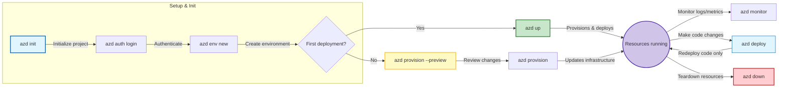
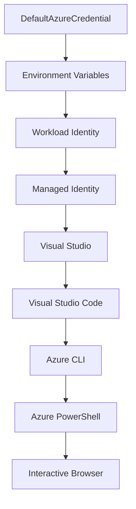

# Βασικά AZD - Κεντρικές Έννοιες και Θεμελιώδη Στοιχεία

**Πλοήγηση Κεφαλαίων:**
- **📚 Αρχική Μαθήματος**: [AZD Για Αρχάριους](../../README.md)
- **📖 Τρέχον Κεφάλαιο**: Κεφάλαιο 1 - Θεμέλια & Γρήγορη Εκκίνηση
- **⬅️ Προηγούμενο**: [Επισκόπηση Μαθήματος](../../README.md#-chapter-1-foundation--quick-start)
- **➡️ Επόμενο**: [Εγκατάσταση & Ρύθμιση](installation.md)
- **🚀 Επόμενο Κεφάλαιο**: [Κεφάλαιο 2: Ανάπτυξη AI-First](../chapter-02-ai-development/microsoft-foundry-integration.md)

## Εισαγωγή

> Επανεξετάστηκε με βάση `azd 1.37.2` (Νοέμβριος 2026). Οι εντολές Bash χρησιμοποιούν κυριολεκτικές θέσεις που πρέπει να αντικαταστήσετε. Τα πρότυπα ροών εργασίας χρησιμοποιούν `.` για την αρχικοποίηση του τρέχοντος φακέλου· χωρίς όρισμα φακέλου, η αρχικοποίηση προτύπου δημιουργεί έναν υποφάκελο και δεν αλλάζει τον τρέχοντα φάκελο του κελύφους σας. Οι προχωρημένες αποσπάσεις είναι ενδεικτικές, όχι πλήρη έργα.

Αυτό το μάθημα σας εισάγει στο Azure Developer CLI (azd), ένα ισχυρό εργαλείο γραμμής εντολών που επιταχύνει το ταξίδι σας από την τοπική ανάπτυξη στην ανάπτυξη στο Azure. Θα μάθετε τα θεμελιώδη στοιχεία, τις βασικές λειτουργίες και θα κατανοήσετε πώς το azd απλοποιεί την ανάπτυξη εφαρμογών που είναι εγγενείς στο νέφος.

## Εκπαιδευτικοί Στόχοι

Μέχρι το τέλος αυτού του μαθήματος, θα:
- Καταλάβετε τι είναι το Azure Developer CLI και τον κύριο σκοπό του
- Μάθετε τις βασικές έννοιες προτύπων, περιβαλλόντων και υπηρεσιών
- Εξερευνήσετε βασικά χαρακτηριστικά όπως την ανάπτυξη που καθοδηγείται από πρότυπα και το Infrastructure as Code
- Κατανοήσετε τη δομή και τη ροή εργασίας του έργου azd
- Είστε έτοιμοι να εγκαταστήσετε και να διαμορφώσετε το azd για το περιβάλλον ανάπτυξής σας

## Αποτελέσματα Μάθησης

Μετά την ολοκλήρωση αυτού του μαθήματος, θα μπορείτε να:
- Εξηγήσετε το ρόλο του azd στις σύγχρονες ροές εργασίας ανάπτυξης νέφους
- Αναγνωρίσετε τα συστατικά της δομής ενός έργου azd
- Περιγράψετε πώς συνεργάζονται πρότυπα, περιβάλλοντα και υπηρεσίες
- Κατανοήσετε τα οφέλη του Infrastructure as Code με τον azd
- Αναγνωρίσετε διαφορετικές εντολές azd και τους σκοπούς τους

## Τι είναι το Azure Developer CLI (azd);

Το Azure Developer CLI (azd) είναι ένα εργαλείο γραμμής εντολών σχεδιασμένο να επιταχύνει το ταξίδι σας από την τοπική ανάπτυξη στην ανάπτυξη στο Azure. Απλοποιεί τη διαδικασία κατασκευής, ανάπτυξης και διαχείρισης εφαρμογών εγγενούς νέφους στο Azure.

### Τι μπορείτε να αναπτύξετε με το azd;

Το azd υποστηρίζει μεγάλη ποικιλία φορτίων εργασίας — και η λίστα συνεχώς αυξάνεται. Σήμερα, μπορείτε να χρησιμοποιήσετε το azd για να αναπτύξετε:

| Τύπος Φορτίου | Παραδείγματα | Ίδια Ροή Εργασίας; |
|---------------|----------|----------------|
| **Παραδοσιακές εφαρμογές** | Ιστοσελίδες, REST APIs, στατικές ιστοσελίδες | ✅ `azd up` |
| **Υπηρεσίες και μικροϋπηρεσίες** | Container Apps, Function Apps, backends πολλών υπηρεσιών | ✅ `azd up` |
| **Εφαρμογές με βάσει AI** | Εφαρμογές συνομιλίας με Microsoft Foundry Models, λύσεις RAG με AI Search | ✅ `azd up` |
| **Έξυπνοι πράκτορες** | Πράκτορες φιλοξενούμενοι στο Foundry, ορχηστρώσεις πολλαπλών πρακτόρων | ✅ `azd up` |

Το βασικό συμπέρασμα είναι ότι **ο κύκλος ζωής του azd παραμένει ο ίδιος ανεξάρτητα από το τι αναπτύσσετε**. Αρχικοποιείτε ένα έργο, προμηθεύετε υποδομή, αναπτύσσετε τον κώδικά σας, παρακολουθείτε την εφαρμογή σας και καθαρίζετε — είτε πρόκειται για μια απλή ιστοσελίδα είτε για έναν σύνθετο πράκτορα AI.

Αυτή η συνέχεια είναι σχεδιασμένη. Το azd αντιμετωπίζει τις δυνατότητες AI ως μια ακόμα υπηρεσία που μπορεί να χρησιμοποιήσει η εφαρμογή σας, όχι κάτι θεμελιωδώς διαφορετικό. Ένα endpoint συνομιλίας υποστηριζόμενο από τα Microsoft Foundry Models είναι, από την οπτική του azd, μια ακόμη υπηρεσία για διαμόρφωση και ανάπτυξη.

### 🎯 Γιατί να χρησιμοποιήσετε το AZD; Μία πραγματική σύγκριση

Ας συγκρίνουμε την ανάπτυξη μιας απλής ιστοσελίδας με βάση δεδομένων:

#### ❌ ΧΩΡΙΣ AZD: Χειροκίνητη ανάπτυξη Azure (πάνω από 30 λεπτά)

**Εικαστική σύγκριση Bash, όχι εκτελέσιμος εκκινητής εφαρμογής.** Αυτό προϋποθέτει υπάρχοντα κώδικα εφαρμογής, μοναδικά ονόματα πόρων, αυθεντικοποίηση Azure CLI και τυχόν απαραίτητες επεκτάσεις CLI. Χρησιμοποιήστε την άσκηση προτύπου παρακάτω για την υποστηριζόμενη πλήρη ροή.

```bash
# Step 1: Create resource group
az group create --name myapp-rg --location eastus

# Step 2: Create App Service Plan
az appservice plan create --name myapp-plan \
  --resource-group myapp-rg \
  --sku B1 --is-linux

# Step 3: Create Web App
az webapp create --name myapp-web-unique123 \
  --resource-group myapp-rg \
  --plan myapp-plan \
  --runtime "NODE:22-lts"

# Step 4: Create Cosmos DB account (10-15 minutes)
az cosmosdb create --name myapp-cosmos-unique123 \
  --resource-group myapp-rg \
  --kind MongoDB

# Step 5: Create database
az cosmosdb mongodb database create \
  --account-name myapp-cosmos-unique123 \
  --resource-group myapp-rg \
  --name tododb

# Step 6: Create collection
az cosmosdb mongodb collection create \
  --account-name myapp-cosmos-unique123 \
  --resource-group myapp-rg \
  --database-name tododb \
  --name todos

# Step 7: Get connection string
CONN_STR=$(az cosmosdb keys list \
  --name myapp-cosmos-unique123 \
  --resource-group myapp-rg \
  --type connection-strings \
  --query "connectionStrings[0].connectionString" -o tsv)

# Step 8: Configure app settings
az webapp config appsettings set \
  --name myapp-web-unique123 \
  --resource-group myapp-rg \
  --settings MONGODB_URI="$CONN_STR"

# Step 9: Enable logging
az webapp log config --name myapp-web-unique123 \
  --resource-group myapp-rg \
  --application-logging filesystem \
  --detailed-error-messages true

# Step 10: Set up Application Insights
az monitor app-insights component create \
  --app myapp-insights \
  --location eastus \
  --resource-group myapp-rg

# Step 11: Link App Insights to Web App
INSTRUMENTATION_KEY=$(az monitor app-insights component show \
  --app myapp-insights \
  --resource-group myapp-rg \
  --query "instrumentationKey" -o tsv)

az webapp config appsettings set \
  --name myapp-web-unique123 \
  --resource-group myapp-rg \
  --settings APPINSIGHTS_INSTRUMENTATIONKEY="$INSTRUMENTATION_KEY"

# Step 12: Build application locally
npm install
npm run build

# Step 13: Create deployment package
zip -r app.zip . -x "*.git*" "node_modules/*"

# Step 14: Deploy application
az webapp deployment source config-zip \
  --resource-group myapp-rg \
  --name myapp-web-unique123 \
  --src app.zip

# Step 15: Wait and pray it works 🙏
# (No automated validation, manual testing required)
```

**Προβλήματα:**
- ❌ 15+ εντολές για να θυμάστε και να εκτελείτε με σειρά
- ❌ 30-45 λεπτά χειροκίνητης εργασίας
- ❌ Εύκολες λάθη (τυπογραφικά, λάθος παράμετροι)
- ❌ Τα διαπιστευτήρια απαιτούν ρητή διαχείριση· τα logs και η ιχνηλάτηση κελύφους μπορεί να τα αποκαλύψουν
- ❌ Δεν υπάρχει αυτόματος μηχανισμός επαναφοράς σε αποτυχία
- ❌ Δύσκολη αναπαραγωγή για μέλη ομάδας
- ❌ Κάθε φορά διαφορετικό (μη αναπαραγώγιμο)

#### ✅ ΜΕ AZD: Αυτοματοποιημένη Ανάπτυξη (5 εντολές, 10-15 λεπτά)

```bash
# Step 1: Initialize from template
azd init --template todo-nodejs-mongo .

# Step 2: Authenticate
azd auth login

# Step 3: Select the environment created during init
azd env select dev

# Step 4: Preview changes (optional but recommended)
azd provision --preview

# Step 5: Deploy everything
azd up

# ✨ Done! Everything is deployed, configured, and monitored
```

**Οφέλη:**
- ✅ **5 εντολές** αντί 15+ χειροκίνητων βημάτων
- ✅ **10-15 λεπτά** συνολικός χρόνος (κυρίως αναμονή Azure)
- ✅ **Λιγότερα χειροκίνητα λάθη** - σταθερή ροή εργασίας καθοδηγούμενη από πρότυπα
- ✅ **Ασφαλής διαχείριση μυστικών** - πολλά πρότυπα χρησιμοποιούν αποθήκευση μυστικών διαχειριζόμενη από Azure
- ✅ **Επαναλαμβανόμενες αναπτύξεις** - ίδια ροή εργασίας κάθε φορά
- ✅ **Επαναλαμβανόμενοι ορισμοί υποδομής** - υπόκεινται σε ποσόστωση, διαθεσιμότητα περιοχής και εκδόσεις προτύπων
- ✅ **Έτοιμο για ομάδες** - ο καθένας μπορεί να αναπτύξει με τις ίδιες εντολές
- ✅ **Υποδομή ως Κώδικας** - πρότυπα Bicep με έλεγχο έκδοσης
- ✅ **Προτυποποιημένη παρακολούθηση** - Application Insights όταν συμπεριλαμβάνεται στο πρότυπο

### Χρόνος και Αξιοπιστία

Οι παραπάνω χρόνοι είναι εκτιμήσεις, όχι μετρήσεις αναφοράς. Το azd μειώνει τις εντολές που πρέπει να συντονίσετε, αλλά δεν εγγυάται τη διάρκεια ανάπτυξης, δεν αποκλείει λάθη ή παρέχει αυτόματη επαναφορά εφαρμογής/βάσης δεδομένων. Κρατήστε λειτουργικές εκδόσεις στον έλεγχο πηγαίου κώδικα και δοκιμάστε διαδικασίες ανάκτησης.

## Κεντρικές Έννοιες

### Πρότυπα
Τα πρότυπα αποτελούν το θεμέλιο του azd. Περιέχουν:
- **Κώδικα εφαρμογής** - Ο πηγαίος κώδικας και οι εξαρτήσεις σας
- **Ορισμούς υποδομής** - Πόροι Azure ορισμένοι σε Bicep ή Terraform
- **Αρχεία ρύθμισης** - Ρυθμίσεις και μεταβλητές περιβάλλοντος
- **Σενάρια ανάπτυξης** - Αυτοματοποιημένες ροές εργασίας ανάπτυξης

### Περιβάλλοντα
Τα περιβάλλοντα αναπαριστούν διαφορετικούς στόχους ανάπτυξης:
- **Ανάπτυξη** - Για δοκιμές και ανάπτυξη
- **Προπαραγωγή** - Περιβάλλον πριν από την παραγωγή
- **Παραγωγή** - Ζωντανό περιβάλλον παραγωγής

Κάθε περιβάλλον διατηρεί το δικό του:
- Όνομα και τιμές περιβάλλοντος· ο διαχωρισμός πόρων εξαρτάται από το πρότυπο υποδομής
- Ρυθμίσεις διαμόρφωσης
- Κατάσταση ανάπτυξης

### Υπηρεσίες
Οι υπηρεσίες σε `azure.yaml` περιγράφουν αναπτυξιμαίους συνιστώσες εφαρμογής:
- **Frontend** - Ιστοσελίδες, SPA
- **Backend** - APIs, μικροϋπηρεσίες

Βάσεις δεδομένων και αποθηκεύσεις συνήθως προμηθεύονται ως πόροι υποδομής, όχι εφευρετικά hosts υπηρεσιών όπως `host: postgres`.

## Κύρια Χαρακτηριστικά

### 1. Ανάπτυξη καθοδηγούμενη από Πρότυπα
```bash
# Browse available templates
azd template list

# Initialize from a template
azd init --template "<template-name>" .
```

### 2. Υποδομή ως Κώδικας
- **Bicep** - Η γλώσσα ειδικού τομέα της Azure
- **Terraform** - Εργαλείο υποδομής πολλαπλών νέφων
- Το Bicep μεταγλωττίζεται σε ARM πρότυπα· το ακατέργαστο JSON ARM δεν είναι ξεχωριστό ενσωματωμένο `infra.provider`.

### 3. Ενσωματωμένες Ροές Εργασίας
```bash
# Complete deployment workflow
azd up            # Provision + Deploy this is hands off for first time setup

# 🧪 NEW: Preview infrastructure changes before deployment (SAFE)
azd provision --preview    # Simulate infrastructure deployment without making changes

azd provision     # Create Azure resources if you update the infrastructure use this
azd deploy        # Deploy application code or redeploy application code once update
azd down          # Clean up resources
```

#### 🛡️ Ασφαλής Σχεδιασμός Υποδομής με Προεπισκόπηση
Η εντολή `azd provision --preview` είναι οριστική για ασφαλείς αναπτύξεις:
- **Ανάλυση χωρίς εκτέλεση** - Δείχνει τι θα δημιουργηθεί, τροποποιηθεί ή διαγραφεί
- **Χωρίς εφαρμογή υποδομής** - Εξετάζει αλλαγές παρόχου· επιθεωρήστε πρώτα τα hooks του έργου, καθώς τα hooks μπορούν να τρέξουν εντολές με παρενέργειες
- **Συνεργασία ομάδας** - Μοιραστείτε τα αποτελέσματα προεπισκόπησης πριν από την ανάπτυξη
- **Εισροή σχεδιασμού κόστους** - Εξετάστε προτεινόμενα SKUs, έπειτα υπολογίστε κόστη με το Azure Pricing Calculator· η προεπισκόπηση δεν υπολογίζει τιμές

```bash
# Example preview workflow
azd provision --preview           # See what will change
# Review the output, discuss with team
azd provision                     # Apply changes with confidence
```

### 📊 Οπτικό: Ροή Εργασίας Ανάπτυξης AZD



**Επεξήγηση Ροής Εργασίας:**
1. **Init** - Ξεκινήστε με πρότυπο ή νέο έργο
2. **Auth** - Πιστοποιηθείτε με το Azure
3. **Environment** - Δημιουργήστε απομονωμένο περιβάλλον ανάπτυξης
4. **Preview** - 🆕 Πάντα κάνετε προεπισκόπηση αλλαγών υποδομής πρώτα (ασφαλές)
5. **Provision** - Δημιουργήστε/ενημερώστε πόρους Azure
6. **Deploy** - Αναπτύξτε τον κώδικά σας
7. **Monitor** - Παρακολουθήστε την απόδοση της εφαρμογής
8. **Iterate** - Κάντε αλλαγές και επανααναπτύξτε τον κώδικα
9. **Cleanup** - Αφαιρέστε πόρους όταν τελειώσετε

### 4. Διαχείριση Περιβάλλοντος
```bash
# Create and manage environments
azd env new "<environment-name>"
azd env select "<environment-name>"
azd env list
```

### 5. Επεκτάσεις και Εντολές AI

Το azd χρησιμοποιεί σύστημα επεκτάσεων για να προσθέσει δυνατότητες πέρα από το βασικό CLI. Αυτό είναι ιδιαίτερα χρήσιμο για φορτία εργασίας AI:

```bash
# List available extensions
azd extension list

# Install the Foundry agents extension
azd extension install azure.ai.agents

# Initialize an AI agent project interactively
azd ai agent init

# Test a deployed agent (shows latency and time-to-first-byte)
azd ai agent invoke

# Start the MCP server for AI-assisted development (Alpha)
azd mcp start
```

**Ο κύκλος ζωής πράκτορα, από την αρχή μέχρι το τέλος.** Χρησιμοποιήστε `azure.ai.agents` για λειτουργίες κύκλου ζωής πράκτορα και εγκαταστήστε ξεχωριστά `azure.ai.evaluations` για αξιολογήσεις. Χρησιμοποιήστε `azd >= 1.37.0` για τη συνδυασμένη ροή εργασίας. Δεν χρειάζεστε όλα αυτά από την πρώτη μέρα:

| Στάδιο | Εντολή | Τι κάνει |
|-------|---------|--------------|
| **Scaffold** | `azd ai agent init --template <path-to-azure.yaml>` | Υιοθετεί ένα πρότυπο τρέχοντος έργου πράκτορα |
| **Δοκιμή** | `azd ai agent invoke` | Καλεί τον πράκτορα και εμφανίζει χρόνο απόκρισης |
| **Μέτρηση** | `azd ai eval init`, `generate`, `run start` | Διαμορφώνει, αναπτύσσει και εκτελεί αξιολογήσεις χρησιμοποιώντας τη ξεχωριστή επέκταση |
| **Βελτίωση** | `azd ai agent optimize --eval <evaluation-name> --optimize-model <optimizer-deployment>` | Επαναχρησιμοποιεί συμβατή αξιολόγηση για βελτιστοποίηση του πράκτορα |
| **Επιθεώρηση** | `azd ai agent endpoint show` | Προβολή ζωντανής διαμόρφωσης endpoint |
| **Καθαρισμός** | `azd ai agent delete` | Διαγράφει έναν φιλοξενούμενο πράκτορα και όλες τις εκδόσεις του |

> Οι επεκτάσεις καλύπτονται λεπτομερώς στο [Κεφάλαιο 2: Ανάπτυξη AI-First](../chapter-02-ai-development/agents.md) και την αναφορά [AZD AI CLI Commands](../chapter-08-production/production-ai-practices.md#azd-ai-cli-commands-and-extensions).

## 📁 Δομή Έργου

Μια τυπική δομή έργου azd:
```
my-app/
├── .azure/                  # Local environments and selected-environment config
│   ├── config.json
│   └── dev/.env
├── .devcontainer/          # Development container config
├── .github/workflows/      # GitHub Actions
├── .vscode/               # VS Code settings
├── infra/                 # Infrastructure code
│   ├── main.bicep        # Main infrastructure template
│   ├── main.parameters.json
│   └── modules/          # Reusable modules
├── src/                  # Application source code
│   ├── api/             # Backend services
│   └── web/             # Frontend application
├── azure.yaml           # azd project configuration
└── README.md
```

## 🔧 Αρχεία Ρύθμισης

### azure.yaml
Το κύριο αρχείο ρύθμισης του έργου:
```yaml
name: my-awesome-app
metadata:
  template: my-template@1.0.0

services:
  web:
    project: ./src/web
    language: js
    host: appservice
  api:
    project: ./src/api
    language: js
    host: appservice

hooks:
  preprovision:
    shell: pwsh
    run: echo "Preparing to provision..."
```

### .azure/config.json
Τοπική επιλογή προεπιλεγμένου περιβάλλοντος έργου (ενδεικτικό· διαχειρίζεται από το azd):
```json
{
  "defaultEnvironment": "dev"
}
```

## 🎪 Συνηθισμένες Ροές Εργασίας με Πρακτικές Ασκήσεις

> **💡 Συμβουλή Μάθησης:** Ακολουθήστε αυτές τις ασκήσεις με τη σειρά για να αναπτύξετε σταδιακά τις δεξιότητές σας στο AZD.

### 🎯 Άσκηση 1: Αρχικοποιήστε το Πρώτο σας Έργο

**Στόχος:** Δημιουργήστε ένα έργο AZD και εξερευνήστε τη δομή του

**Βήματα:**
```bash
# Use a proven template
mkdir azd-basics-practice
cd azd-basics-practice
# Choose "dev" for the environment name when prompted
azd init --template todo-nodejs-mongo .

# Explore the generated files
ls -la  # View all files including hidden ones

# Key files created:
# - azure.yaml (main config)
# - infra/ (infrastructure code)
# - src/ (application code)
```

**✅ Επιτυχία:** Έχετε τους καταλόγους azure.yaml, infra/ και src/

---

### 🎯 Άσκηση 2: Ανάπτυξη στο Azure

**Στόχος:** Ολοκληρώστε πλήρη ανάπτυξη από άκρο σε άκρο

**Βήματα:**
```bash
# 1. Authenticate
azd auth login

# 2. Select the dev environment created in Exercise 1
azd env select dev
azd env set AZURE_LOCATION eastus

# 3. Preview changes (RECOMMENDED)
azd provision --preview

# 4. Deploy everything
azd up

# 5. Verify deployment
azd show    # View your app URL
```

**Αναμενόμενος Χρόνος:** 10-15 λεπτά  
**✅ Επιτυχία:** Η διεύθυνση URL της εφαρμογής ανοίγει στον περιηγητή

---

### 🎯 Άσκηση 3: Πολλαπλά Περιβάλλοντα

**Στόχος:** Ανάπτυξη σε dev και staging

**Βήματα:**
```bash
# Already have dev, create staging
azd env new staging
azd env set AZURE_LOCATION westus2
azd up

# Switch between them
azd env list
azd env select dev
```

**✅ Επιτυχία:** Δύο ξεχωριστές ομάδες πόρων στο Azure Portal

**Καθαρισμός:** Η Άσκηση 3 δημιουργεί δεύτερη εκκαθαρίσιμη ανάπτυξη. Διαγράψτε και τις δύο όταν τελειώσετε:

```bash
azd down --environment dev
azd down --environment staging
```

---

### 🛡️ Καταστροφικός Καθαρισμός: `azd down --force --purge`

Όταν θέλετε σκόπιμα να διαγράψετε τους πόρους Azure του επιλεγμένου περιβάλλοντος:

```bash
azd down --force --purge
```

**Τι κάνει:**
- `--force`: Χωρίς προτροπές επιβεβαίωσης
- `--purge`: Επίσης διαγράφει οριστικά υποστηριζόμενους πόρους με ήπια διαγραφή (π.χ. Key Vaults), όταν το επιτρέπει η προστασία εκκαθάρισης. Δεν διαγράφει το τοπικό `.azure/` directory.

**Χρησιμοποιήστε όταν:** τελειώσατε με ένα disposable περιβάλλον. Μην αντιμετωπίζετε τον καταστροφικό καθαρισμό ως πρώτη αντίδραση σε σφάλμα πιστοποίησης, ποσόστωσης ή ρύθμισης.

---

## 🎪 Αναφορά Αρχικής Ροής Εργασίας

### Έναρξη Νέου Έργου
```bash
# Method 1: Use existing template
azd init --template todo-nodejs-mongo .

# Method 2: Start from scratch
azd init

# Method 3: Use current directory
azd init .
```

### Κύκλος Ανάπτυξης
```bash
# Set up development environment
azd auth login
azd env new dev
azd env select dev

# Deploy everything
azd up

# Make changes and redeploy
azd deploy

# Clean up when done
azd down --force --purge # Deletes this environment's discovered Azure resources; review before forcing deletion.
```

## Κατανόηση `azd down --force --purge`
Η εντολή `azd down --force --purge` είναι ένας ισχυρός τρόπος πλήρους αποσυναρμολόγησης του περιβάλλοντος azd και όλων των συσχετιζόμενων πόρων. Ακολουθεί ανάλυση των σημαδιών της:
```
--force
```
- Παρακάμπτει τις προτροπές επιβεβαίωσης.
- Χρήσιμο για αυτοματισμό ή scripting όπου δεν είναι εφικτή η χειροκίνητη εισαγωγή.
- Δεν παρακάμπτει δικαιώματα, προστασία εκκαθάρισης ή αποτυχίες διαγραφής.

```
--purge
```
Διαγράφει οριστικά υποστηριζόμενους πόρους του Azure που έχουν διαγραφεί μαλακά χωρίς επιπλέον επιβεβαίωση. Η προστασία απομάκρυνσης και τα δικαιώματα εξακολουθούν να ισχύουν. **Δεν** αφαιρεί τοπικά περιβάλλοντα ή το φάκελο `.azure/`.


### Γιατί να χρησιμοποιήσετε και τα δύο;
Χρησιμοποιήστε και τα δύο μόνο όταν σκοπεύετε να διαγράψετε τους πόρους Azure του επιλεγμένου περιβάλλοντος και να απομακρύνετε πόρους που μπορούν να ανακτηθούν. Πρόκειται για καταστροφικό καθαρισμό, όχι για γενική επιδιόρθωση ή επαναφορά τοπικής κατάστασης.

Είναι ιδιαίτερα χρήσιμο μετά από χειροκίνητες διαγραφές πόρων στην πύλη Azure ή όταν αλλάζετε πρότυπα, περιβάλλοντα ή συμβάσεις ονομάτων ομάδων πόρων.


### Διαχείριση Πολλαπλών Περιβάλλοντων
```bash
# Create staging environment
azd env new staging
azd env select staging
azd up

# Switch back to dev
azd env select dev

# Compare environments
azd env list
```

## 🔐 Πιστοποίηση και Διαπιστευτήρια

Διαχωρίστε την πιστοποίηση ανάπτυξης (`azd auth login`) από την πιστοποίηση SDK εφαρμογής (`DefaultAzureCredential`). Είναι ξεχωριστές. Το azd δεν χρησιμοποιεί διαπιστευτήρια Azure CLI από προεπιλογή.

### Πιστοποίηση Azure CLI (`az login`)

Εκτελέστε `azd auth login` για azd. Οι ακόλουθες εντολές Azure CLI είναι προαιρετικές και πιστοποιούν τις εντολές `az` ξεχωριστά:

```bash
# Interactive login (opens browser)
az login

# Login with specific tenant
az login --tenant "<tenant-id>"

# Login with service principal
az login --service-principal -u "<app-id>" -p "<password>" --tenant "<tenant-id>"

# Check current login status
az account show

# List available subscriptions
az account list --output table

# Set default subscription
az account set --subscription "<subscription-id>"
```

### Ροή Πιστοποίησης
1. **Διαδραστική Σύνδεση**: Ανοίγει τον προεπιλεγμένο περιηγητή σας για πιστοποίηση
2. **Ροή Κωδικού Συσκευής**: Για περιβάλλοντα χωρίς πρόσβαση σε περιηγητή
3. **Υπηρεσιακός Πρίγκιπας**: Για αυτοματοποίηση και σενάρια CI/CD
4. **Διαχειριζόμενο Προφίλ**: Για εφαρμογές που φιλοξενούνται στο Azure

### Αλυσίδα DefaultAzureCredential

`DefaultAzureCredential` είναι ένας τύπος διαπιστευτηρίων που παρέχει μια απλοποιημένη εμπειρία πιστοποίησης προσπαθώντας αυτόματα πολλές πηγές διαπιστευτηρίων σε συγκεκριμένη σειρά:

#### Αλυσίδα Διαπιστευτηρίων SDK Εφαρμογής

Η ακριβής αλυσίδα εξαρτάται από τη γλώσσα SDK ταυτότητας Azure, την έκδοση, τα εγκατεστημένα πρόσθετα και τις επιλογές. Αυτό το διάγραμμα είναι εννοιολογικό, όχι μια σταθερή ακολουθία ελέγχου ταυτότητας azd· τα πρόσφατα SDK μπορούν επίσης να περιλαμβάνουν διαπιστευτήρια Azure Developer CLI. 


#### 1. Μεταβλητές Περιβάλλοντος
```bash
# Set environment variables for service principal
export AZURE_CLIENT_ID="<app-id>"
export AZURE_CLIENT_SECRET="<password>"
export AZURE_TENANT_ID="<tenant-id>"
```

#### 2. Workload Identity (Kubernetes/GitHub Actions)
Χρησιμοποιείται αυτόματα σε:
- Azure Kubernetes Service (AKS) με Workload Identity
- GitHub Actions με OIDC ομοσπονδία
- Άλλα σενάρια ομοσπονδιακής ταυτότητας

#### 3. Διαχειριζόμενη Ταυτότητα
Για πόρους Azure όπως:
- Εικονικές Μηχανές
- App Service
- Azure Functions
- Container Instances

```bash
# Inspect a deployed Container App's configured identity (requires az login)
az containerapp show --name "<app-name>" --resource-group "<rg-name>" --query identity
```

#### 4. Ενσωμάτωση Εργαλείων Ανάπτυξης
- **Visual Studio**: Χρησιμοποιεί αυτόματα τον συνδεδεμένο λογαριασμό
- **VS Code**: Η υποστήριξη εξαρτάται από το SDK και τη διαμορφωμένη ρύθμιση διαμεσολαβητή/πρόσθετου
- **Azure CLI**: Χρησιμοποιεί διαπιστευτήρια `az login` (το πιο κοινό για τοπική ανάπτυξη)

### Ρύθμιση Ελέγχου Ταυτότητας AZD

```bash
# Method 1: Direct azd authentication (recommended)
azd auth login

# Method 2: Direct azd authentication
azd auth login --use-device-code  # For headless environments

# Method 3: Check authentication status
azd auth login --check-status

# Method 4: Logout and re-authenticate
azd auth logout
azd auth login
```

### Καλές Πρακτικές Ελέγχου Ταυτότητας

#### Για Τοπική Ανάπτυξη
```bash
# 1. Log in to azd
azd auth login

# 2. Select the subscription for this initialized environment
azd env set AZURE_SUBSCRIPTION_ID "<subscription-id>"

# 3. Check azd sign-in details (read the status message)
azd auth login --check-status
```

#### Για CI/CD Pipeline
```yaml
# Partial GitHub Actions steps: assumes checkout, azd installation,
# required AZURE_* environment values, and pipeline secret configuration.
- name: Deploy with azd
  run: |
    azd auth login --client-id ${{ secrets.AZURE_CLIENT_ID }} \
                    --client-secret ${{ secrets.AZURE_CLIENT_SECRET }} \
                    --tenant-id ${{ secrets.AZURE_TENANT_ID }}
    azd up --no-prompt
```

#### Για Περιβάλλοντα Παραγωγής
- Χρησιμοποιήστε **Διαχειριζόμενη Ταυτότητα** όταν εκτελείται σε πόρους Azure
- Χρησιμοποιήστε **Υπηρεσιακό Διαπιστευτήριο** για σενάρια αυτοματοποίησης
- Αποφύγετε την αποθήκευση διαπιστευτηρίων σε κώδικα ή αρχεία ρύθμισης
- Χρησιμοποιήστε **Azure Key Vault** για ευαίσθητες ρυθμίσεις

### Συχνά Προβλήματα Ελέγχου Ταυτότητας και Λύσεις

#### Πρόβλημα: "Δεν βρέθηκε συνδρομή"
```bash
# Solution: Set default subscription
az account list --output table
az account set --subscription "<subscription-id>"
azd env set AZURE_SUBSCRIPTION_ID "<subscription-id>"
```

#### Πρόβλημα: "Ανεπαρκή δικαιώματα"
```bash
# Solution: Check and assign required roles
az role assignment list --assignee $(az account show --query user.name --output tsv)

# Common required roles:
# - Contributor (for resource management)
# - User Access Administrator (for role assignments)
```

#### Πρόβλημα: "Η ημερομηνία λήξης του token πέρασε"
```bash
# Solution: Re-authenticate
az logout
az login
azd auth logout
azd auth login
```

### Έλεγχος Ταυτότητας σε Διάφορα Σενάρια

#### Τοπική Ανάπτυξη
```bash
# Personal development account
az login
azd auth login
```

#### Ομαδική Ανάπτυξη
```bash
# Use specific tenant for organization
az login --tenant contoso.onmicrosoft.com
azd auth login --tenant-id "<tenant-id>"
```

#### Σενάρια Πολυ-ενοικιαστών (Multi-tenant)
```bash
# Switch between tenants
az login --tenant tenant1.onmicrosoft.com
azd auth login --tenant-id "<tenant-1-id>"
# Select an environment configured with tenant 1's subscription
azd env select tenant1-dev
# Deploy to tenant 1
azd up

az login --tenant tenant2.onmicrosoft.com  
azd auth login --tenant-id "<tenant-2-id>"
azd env select tenant2-dev
# Deploy to tenant 2
azd up
```

### Ζητήματα Ασφαλείας

1. **Αποθήκευση Διαπιστευτηρίων**: Ποτέ μην αποθηκεύετε διαπιστευτήρια στον πηγαίο κώδικα
2. **Περιορισμός Πεδίου Εφαρμογής**: Χρησιμοποιήστε την αρχή των ελάχιστων προνομίων για υπηρεσιακά διαπιστευτήρια
3. **Περιοδική Ανανέωση Token**: Περιοδικά ανανεώνετε τα μυστικά των υπηρεσιακών διαπιστευτηρίων
4. **Αρχείο Ελέγχου**: Παρακολουθείτε ενέργειες ελέγχου ταυτότητας και ανάπτυξης
5. **Ασφάλεια Δικτύου**: Χρησιμοποιήστε ιδιωτικά σημεία πρόσβασης όπου είναι δυνατόν

### Αντιμετώπιση Προβλημάτων Ελέγχου Ταυτότητας

```bash
# Debug authentication issues
azd auth login --check-status
az account show
az account get-access-token

# Common diagnostic commands
whoami                          # Current user context
az ad signed-in-user show      # Microsoft Entra ID user details
az group list                  # Test resource access
```

## Εντοπισμός Εντολών

### Εντοπισμός
```bash
azd template list              # Browse templates
azd template list --help       # Template discovery options
azd init --help               # Initialization options
```

### Διαχείριση Έργου
```bash
azd show                     # Project overview
azd env list                # Available environments and selected default
azd config show            # Configuration settings
```

### Παρακολούθηση
```bash
azd monitor                  # Open Azure portal monitoring
azd monitor --logs           # View application logs
azd monitor --live           # View live metrics
azd pipeline config          # Set up CI/CD
```

## Καλύτερες Πρακτικές

### 1. Χρησιμοποιήστε Σημαντικά Ονόματα
```bash
# Good
azd env new production-east
azd init --template todo-nodejs-mongo .

# Avoid
azd env new env1
azd init --template template1 .
```

### 2. Αξιοποιήστε Πρότυπα
- Ξεκινήστε με υπάρχοντα πρότυπα
- Προσαρμόστε σύμφωνα με τις ανάγκες σας
- Δημιουργήστε επαναχρησιμοποιήσιμα πρότυπα για τον οργανισμό σας

### 3. Απομόνωση Περιβάλλοντος
- Χρησιμοποιήστε ξεχωριστά περιβάλλοντα για ανάπτυξη/δοκιμή/παραγωγή
- Ποτέ μην αναπτύσσετε απευθείας στην παραγωγή από τοπικό υπολογιστή
- Χρησιμοποιήστε CI/CD pipelines για αναπτύξεις παραγωγής

### 4. Διαχείριση Ρυθμίσεων
- Χρησιμοποιήστε διαχειριζόμενη ταυτότητα και Key Vault για μυστικά· οι συνήθεις τιμές `azd env set` είναι απλό κείμενο τοπικά
- Κρατήστε τις ρυθμίσεις σε έλεγχο εκδόσεων
- Τεκμηριώστε ρυθμίσεις ειδικές για το περιβάλλον

## Πρόοδος Μάθησης

### Αρχάριος (Εβδομάδα 1-2)
1. Εγκαταστήστε το azd και αυθεντικοποιηθείτε
2. Αναπτύξτε ένα απλό πρότυπο
3. Κατανοήστε τη δομή του έργου
4. Μάθετε βασικές εντολές (up, down, deploy)

### Ενδιάμεσος (Εβδομάδα 3-4)
1. Προσαρμόστε πρότυπα
2. Διαχειριστείτε πολλαπλά περιβάλλοντα
3. Κατανοήστε τον κώδικα υποδομής
4. Ρυθμίστε CI/CD pipelines

### Προχωρημένος (Εβδομάδα 5+)
1. Δημιουργήστε προσαρμοσμένα πρότυπα
2. Προηγμένα πρότυπα υποδομής
3. Αναπτύξεις σε πολλαπλές περιοχές
4. Ρυθμίσεις επιπέδου επιχείρησης

## Επόμενα Βήματα

**📖 Συνέχεια Μάθησης Κεφαλαίου 1:**
- [Εγκατάσταση & Ρύθμιση](installation.md) - Εγκαταστήστε και διαμορφώστε το azd
- [Το Πρώτο Σας Έργο](first-project.md) - Ολοκληρώστε το πρακτικό οδηγό
- [Οδηγός Ρυθμίσεων](../chapter-03-configuration/configuration.md) - Προχωρημένες επιλογές ρύθμισης

**🎯 Έτοιμοι για το Επόμενο Κεφάλαιο;**
- [Κεφάλαιο 2: Ανάπτυξη με AI Πρώτα](../chapter-02-ai-development/microsoft-foundry-integration.md) - Ξεκινήστε να χτίζετε εφαρμογές AI

## Πρόσθετοι Πόροι

- [Επισκόπηση Azure Developer CLI](https://learn.microsoft.com/en-us/azure/developer/azure-developer-cli/)
- [Γκαλερί Προτύπων](https://azure.github.io/awesome-azd/)
- [Δείγματα Κοινότητας](https://github.com/Azure-Samples)

---

## 🙋 Συχνές Ερωτήσεις

### Γενικές Ερωτήσεις

**Ε: Ποια η διαφορά μεταξύ AZD και Azure CLI;**

Α: Το Azure CLI (`az`) χρησιμοποιείται για τη διαχείριση μεμονωμένων πόρων Azure. Το AZD (`azd`) διαχειρίζεται ολόκληρες εφαρμογές:

```bash
# Azure CLI - Low-level resource management
az webapp create --name myapp --resource-group rg
az sql server create --name myserver --resource-group rg
# ...many more commands needed

# AZD - Application-level management
azd up  # Deploys entire app with all resources
```

**Σκεφτείτε το ως εξής:**
- `az` = Λειτουργία σε μεμονωμένα τουβλάκια Lego
- `azd` = Εργασία με πλήρη σετ Lego

---

**Ε: Χρειάζομαι να ξέρω Bicep ή Terraform για να χρησιμοποιήσω το AZD;**

Α: Όχι! Ξεκινήστε με πρότυπα:
```bash
# Use existing template - no IaC knowledge needed
azd init --template todo-nodejs-mongo .
azd up
```

Μπορείτε να μάθετε Bicep αργότερα για να προσαρμόσετε την υποδομή. Τα πρότυπα παρέχουν λειτουργικά παραδείγματα μάθησης.

---

**Ε: Πόσο κοστίζει η εκτέλεση προτύπων AZD;**

Α: Το κόστος διαφέρει ανά περιοχή, SKU, χρόνο λειτουργίας, λειτουργία βάσης δεδομένων και χρήση μοντέλου. Ένα περιβάλλον ανάπτυξης μπορεί να επιφέρει σημαντικά μηνιαία τέλη ακόμα και όταν είναι ανενεργό· μην υποθέτετε καθολικό εύρος $50-150:

```bash
# Preview resource changes (not prices)
azd provision --preview

# Always cleanup when not using
azd down --force --purge  # Removes all resources
```

**Συμβουλή ειδικού:** Χρησιμοποιήστε δωρεάν επίπεδα όπου υπάρχουν διαθέσιμα:
- App Service: Επίπεδο F1 (Δωρεάν)
- Azure OpenAI: δεν υπάρχει γενική εγγυημένη μηνιαία δωρεάν ποσότητα tokens· ελέγξτε την τρέχουσα αποτίμηση μοντέλου και προσφοράς
- Cosmos DB: επιλέξιμοι λογαριασμοί με παροχή διαμέσου throughput μπορούν να επιλέξουν δωρεάν επίπεδο· τα πρότυπα serverless δεν είναι αυτόματα επιλέξιμα

---

**Ε: Μπορώ να χρησιμοποιήσω το AZD με υπάρχοντες πόρους Azure;**

Α: Ναι, αλλά είναι πιο εύκολο να ξεκινήσετε από το μηδέν. Το AZD λειτουργεί καλύτερα όταν διαχειρίζεται ολόκληρο τον κύκλο ζωής. Για υπάρχοντες πόρους:

```bash
# Option 1: Import existing resources (advanced)
azd init
# Then modify infra/ to reference existing resources

# Option 2: Start fresh (recommended)
azd init --template "<verified-template-name>" .
azd up  # Creates new environment
```

---

**Ε: Πώς μοιράζομαι το έργο μου με συνάδελφους;**

Α: Κάντε commit το έργο AZD στο Git (αλλά ΟΧΙ τον φάκελο .azure):

```bash
# Already in .gitignore by default
.azure/        # Contains secrets and environment data
*.env          # Environment variables

# Team members then:
git clone "<your-repo>"
# Change into the cloned repository before running the remaining commands.
azd auth login
azd env new "<their-name>-dev"
azd up
```

Όλοι λαμβάνουν ταυτόσημη υποδομή από τα ίδια πρότυπα.

---

### Ερωτήσεις για Αντιμετώπιση Προβλημάτων

**Ε: Η εντολή "azd up" απέτυχε στη μέση της διαδικασίας. Τι κάνω;**

Α: Ελέγξτε το λάθος, διορθώστε το, και δοκιμάστε ξανά:

```bash
# Capture detailed diagnostics (redact sensitive values before sharing)
azd up --debug

# Common fixes:

# 1. If quota exceeded:
azd env set AZURE_LOCATION "westus2"  # Try different region

# 2. If resource name conflict:
azd down --force --purge  # Clean slate
azd up  # Retry

# 3. If auth expired:
az login
azd auth login
azd up
```

**Το πιο κοινό πρόβλημα:** Επιλέχθηκε λανθασμένη συνδρομή Azure
```bash
az account list --output table
az account set --subscription "<correct-subscription>"
azd env set AZURE_SUBSCRIPTION_ID "<correct-subscription-id>"
```

---

**Ε: Πώς μπορώ να αναπτύξω μόνο αλλαγές κώδικα χωρίς επαναφορά υποδομής;**

Α: Χρησιμοποιήστε `azd deploy` αντί για `azd up`:

```bash
azd up          # First time: provision + deploy (slow)

# Make code changes...

azd deploy      # Subsequent times: deploy only (fast)
```

Σύγκριση ταχύτητας:
- `azd up`: 10-15 λεπτά (παρέχει υποδομή)
- `azd deploy`: 2-5 λεπτά (μόνο κώδικας)

---

**Ε: Μπορώ να προσαρμόσω τα πρότυπα υποδομής;**

Α: Ναι! Επεξεργαστείτε τα αρχεία Bicep μέσα σε `infra/`:

```bash
# After azd init
cd infra/
code main.bicep  # Edit in VS Code

# Preview changes
azd provision --preview

# Apply changes
azd provision
```

**Συμβουλή:** Ξεκινήστε μικρά - αλλάξτε πρώτα τα SKU:
```bicep
// infra/main.bicep
sku: {
  name: 'B1'  // Change to 'P1V2' for production
}
```

---

**Ε: Πώς διαγράφω ό,τι δημιούργησε το AZD;**

Α: Μια εντολή αφαιρεί όλους τους πόρους:

```bash
azd down --force --purge

# This deletes:
# - Azure resources/resource groups discovered for the selected environment
# - Supported soft-deleted resources, if purge protection allows
# Local .azure files remain; shared/external resources may remain too.
```

**Τρέξτε το πάντα όταν:**
- Τελειώσατε με τη δοκιμή ενός προτύπου
- Αλλάζετε σε άλλο έργο
- Θέλετε να ξεκινήσετε από την αρχή

**Έλεγχος κόστους:** Επιβεβαιώστε τη διαγραφή στο Azure και ελέγξτε για διατηρούμενους/κοινόχρηστους πόρους. Ενδεχόμενες προηγούμενες χρεώσεις παραμένουν.

---

**Ε: Τι γίνεται αν κατά λάθος διέγραψα πόρους στο Azure Portal;**

Α: Η κατάσταση του AZD μπορεί να μην είναι συγχρονισμένη. Καθαρή εκκίνηση:

```bash
# 1. Delete remaining resources only if that is your intent
azd down --force --purge

# 2. Start fresh
azd up

# Alternative: Let AZD detect and fix
azd provision  # Will create missing resources
```

---

### Προχωρημένες Ερωτήσεις

**Ε: Μπορώ να χρησιμοποιήσω AZD σε CI/CD pipelines;**

Α: Ναι! Παράδειγμα GitHub Actions:

```yaml
# .github/workflows/deploy.yml
name: Deploy with AZD

on:
  push:
    branches: [main]

jobs:
  deploy:
    runs-on: ubuntu-latest
    steps:
      - uses: actions/checkout@v4
      
      - name: Install azd
        run: curl -fsSL https://aka.ms/install-azd.sh | bash
      
      - name: Azure Login
        run: |
          azd auth login \
            --client-id ${{ secrets.AZURE_CLIENT_ID }} \
            --client-secret ${{ secrets.AZURE_CLIENT_SECRET }} \
            --tenant-id ${{ secrets.AZURE_TENANT_ID }}
      
      - name: Deploy
        env:
          AZURE_ENV_NAME: dev
          AZURE_LOCATION: ${{ vars.AZURE_LOCATION }}
          AZURE_SUBSCRIPTION_ID: ${{ vars.AZURE_SUBSCRIPTION_ID }}
        run: azd up --no-prompt
```

---

**Ε: Πώς διαχειρίζομαι μυστικά και ευαίσθητα δεδομένα;**

Α: Χρησιμοποιήστε ρητά το Key Vault. Το `azd env set` γράφει συνηθισμένες τιμές στο τοπικό αρχείο περιβάλλοντος· δεν δημιουργεί αυτόματα θύσανο, δεν εκχωρεί ρόλους ή δεν εγχέει μυστικά στην εφαρμογή σας.

```bash
# Interactive: create/select a Key Vault secret and save its reference
azd env set-secret DATABASE_PASSWORD
```

Χρειάζεστε κατάλληλα δικαιώματα στο θύσανο. Η υποδομή/εφαρμογή σας πρέπει ακόμη να συνδέσει το μυστικό στον καταναλωτή του και να παραχωρήσει πρόσβαση στην ταυτότητα χρόνου εκτέλεσης. Μην εμφανίζετε τις επιλυμένες τιμές μυστικού στα αρχεία καταγραφής.

**Ποτέ μην κάνετε commit:**
- Φάκελος `.azure/` (περιέχει δεδομένα περιβάλλοντος)
- Αρχεία `.env` (τοπικά μυστικά)
- Συστολές σύνδεσης

---

**Ε: Μπορώ να αναπτύξω σε πολλαπλές περιοχές;**

Α: Ναι, δημιουργήστε περιβάλλον ανά περιοχή:

```bash
# East US environment
azd env new prod-eastus
azd env set AZURE_LOCATION eastus
azd up

# West Europe environment
azd env new prod-westeurope
azd env set AZURE_LOCATION westeurope
azd up

# Each environment is independent
azd env list
```

Για πραγματικές εφαρμογές πολλαπλών περιοχών, προσαρμόστε τα πρότυπα Bicep για να αναπτυχθούν σε πολλές περιοχές ταυτόχρονα.

---

**Ε: Πού μπορώ να βρω βοήθεια αν κολλήσω;**

1. **Τεκμηρίωση AZD:** https://learn.microsoft.com/azure/developer/azure-developer-cli/
2. **GitHub Issues:** https://github.com/Azure/azure-dev/issues
3. **Discord:** [Azure Discord](https://discord.gg/microsoft-azure) - κανάλι #azure-developer-cli
4. **Stack Overflow:** Ετικέτα `azure-developer-cli`
5. **Αυτό το Μάθημα:** [Οδηγός Αντιμετώπισης Προβλημάτων](../chapter-07-troubleshooting/common-issues.md)

**Συμβουλή ειδικού:** Πριν ρωτήσετε, τρέξτε:
```bash
azd show       # Shows current state
azd version    # Shows your version
```
Συμπεριλάβετε αυτές τις πληροφορίες στην ερώτησή σας για ταχύτερη βοήθεια.

---

## 🎓 Τι Ακολουθεί;

Τώρα κατανοείτε τα βασικά AZD. Επιλέξτε τη διαδρομή σας:

### 🎯 Για Αρχάριους:
1. **Επόμενο:** [Εγκατάσταση & Ρύθμιση](installation.md) - Εγκαταστήστε το AZD στον υπολογιστή σας
2. **Κατόπιν:** [Το Πρώτο Σας Έργο](first-project.md) - Αναπτύξτε την πρώτη σας εφαρμογή
3. **Πρακτική:** Ολοκληρώστε τις 3 ασκήσεις αυτής της ενότητας

### 🚀 Για Προγραμματιστές AI:
1. **Παράλειψη σε:** [Κεφάλαιο 2: Ανάπτυξη με AI Πρώτα](../chapter-02-ai-development/microsoft-foundry-integration.md)
2. **Ανάπτυξη:** Σε έναν κενό φάκελο έργου, ξεκινήστε με `azd init --template get-started-with-ai-chat .`
3. **Μάθηση:** Δημιουργήστε καθώς αναπτύσσετε

### 🏗️ Για Έμπειρους Προγραμματιστές:
1. **Ανασκόπηση:** [Οδηγός Ρυθμίσεων](../chapter-03-configuration/configuration.md) - Προχωρημένες ρυθμίσεις
2. **Εξερεύνηση:** [Υποδομή ως Κώδικας](../chapter-04-infrastructure/provisioning.md) - Βαθιά ματιά σε Bicep
3. **Κατασκευή:** Δημιουργήστε προσαρμοσμένα πρότυπα για το στοίβασμά σας

---

**Πλοήγηση Κεφαλαίου:**
- **📚 Αρχική Σελίδα Μαθήματος**: [AZD Για Αρχάριους](../../README.md)
- **📖 Τρέχον Κεφάλαιο**: Κεφάλαιο 1 - Βάσεις & Γρήγορη Έναρξη  
- **⬅️ Προηγούμενο**: [Επισκόπηση Μαθήματος](../../README.md#-chapter-1-foundation--quick-start)
- **➡️ Επόμενο**: [Εγκατάσταση & Ρύθμιση](installation.md)
- **🚀 Επόμενο Κεφάλαιο**: [Κεφάλαιο 2: Ανάπτυξη με AI Πρώτα](../chapter-02-ai-development/microsoft-foundry-integration.md)

---

<!-- CO-OP TRANSLATOR DISCLAIMER START -->
**Αποποίηση ευθυνών**:
Αυτό το έγγραφο έχει μεταφραστεί χρησιμοποιώντας την υπηρεσία μετάφρασης με τεχνητή νοημοσύνη [Co-op Translator](https://github.com/Azure/co-op-translator). Ενώ επιδιώκουμε την ακρίβεια, παρακαλούμε να έχετε υπόψη ότι οι αυτοματοποιημένες μεταφράσεις ενδέχεται να περιέχουν λάθη ή ανακρίβειες. Το πρωτότυπο έγγραφο στη μητρική του γλώσσα πρέπει να θεωρείται η αυθεντική πηγή. Για κρίσιμες πληροφορίες, συνιστάται επαγγελματική ανθρώπινη μετάφραση. Δεν φέρουμε ευθύνη για τυχόν παρεξηγήσεις ή λανθασμένες ερμηνείες που προκύπτουν από τη χρήση αυτής της μετάφρασης.
<!-- CO-OP TRANSLATOR DISCLAIMER END -->