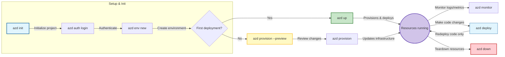
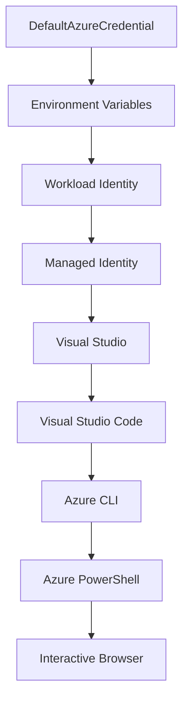

# Βασικά του AZD - Βασικές Έννοιες και Θεμελιώδεις Αρχές

**Πλοήγηση Κεφαλαίου:**
- **📚 Αρχική Σελίδα Μαθήματος**: [AZD Για Αρχάριους](../../README.md)
- **📖 Τρέχον Κεφάλαιο**: Κεφάλαιο 1 - Θεμέλιο & Γρήγορη Εκκίνηση
- **⬅️ Προηγούμενο**: [Επισκόπηση Μαθήματος](../../README.md#-chapter-1-foundation--quick-start)
- **➡️ Επόμενο**: [Εγκατάσταση & Ρύθμιση](installation.md)
- **🚀 Επόμενο Κεφάλαιο**: [Κεφάλαιο 2: AI-First Development](../chapter-02-ai-development/microsoft-foundry-integration.md)

## Εισαγωγή

> Επανεξετασμένο με βάση το `azd 1.37.2` (Νοέμβριος 2026). Οι εντολές Bash χρησιμοποιούν εισαγωγικά για δείκτες που πρέπει να αντικαταστήσετε. Τα πρότυπα ροής εργασιών χρησιμοποιούν `.` για να αρχικοποιήσουν τον τρέχοντα κατάλογο· χωρίς όρισμα καταλόγου, η αρχικοποίηση προτύπου δημιουργεί έναν υποκατάλογο και δεν αλλάζει τον τρέχοντα κατάλογο του κελύφους. Προχωρημένα αποσπάσματα είναι ενδεικτικά, όχι πλήρη έργα.

Αυτό το μάθημα σας εισάγει στο Azure Developer CLI (azd), ένα ισχυρό εργαλείο γραμμής εντολών που επιταχύνει το ταξίδι σας από την τοπική ανάπτυξη στην ανάπτυξη στο Azure. Θα μάθετε τις θεμελιώδεις έννοιες, τις βασικές λειτουργίες και θα κατανοήσετε πώς το azd απλοποιεί την ανάπτυξη εφαρμογών cloud-native.

## Στόχοι Μάθησης

Στο τέλος αυτού του μαθήματος, θα:
- Κατανοείτε τι είναι το Azure Developer CLI και τον κύριο σκοπό του
- Μάθετε τις βασικές έννοιες προτύπων, περιβαλλόντων και υπηρεσιών
- Εξερευνήσετε βασικά χαρακτηριστικά, συμπεριλαμβανομένης της ανάπτυξης με βάση πρότυπα και της Υποδομής ως Κώδικα
- Κατανοήσετε τη δομή του έργου azd και τη ροή εργασίας
- Να είστε προετοιμασμένοι για την εγκατάσταση και διαμόρφωση του azd για το αναπτυξιακό σας περιβάλλον

## Μαθησιακά Αποτελέσματα

Μετά την ολοκλήρωση αυτού του μαθήματος, θα μπορείτε:
- Να εξηγήσετε το ρόλο του azd στις σύγχρονες ροές ανάπτυξης cloud
- Να προσδιορίσετε τα συστατικά της δομής ενός έργου azd
- Να περιγράψετε πώς συνεργάζονται πρότυπα, περιβάλλοντα και υπηρεσίες
- Να κατανοήσετε τα οφέλη της Υποδομής ως Κώδικα με το azd
- Να αναγνωρίζετε διάφορες εντολές azd και τους σκοπούς τους

## Τι είναι το Azure Developer CLI (azd);

Το Azure Developer CLI (azd) είναι ένα εργαλείο γραμμής εντολών σχεδιασμένο να επιταχύνει το ταξίδι σας από την τοπική ανάπτυξη στην ανάπτυξη στο Azure. Απλοποιεί τη διαδικασία κατασκευής, ανάπτυξης και διαχείρισης εφαρμογών cloud-native στο Azure.

### Τι Μπορείτε να Αναπτύξετε με το azd;

Το azd υποστηρίζει ένα ευρύ φάσμα φόρτων εργασίας — και η λίστα συνεχώς μεγαλώνει. Σήμερα, μπορείτε να χρησιμοποιήσετε το azd για να αναπτύξετε:

| Τύπος Φόρτου Εργασίας | Παραδείγματα | Ίδια Ροή Εργασίας; |
|----------------------|------------|--------------------|
| **Παραδοσιακές εφαρμογές** | Web apps, REST APIs, στατικές ιστοσελίδες | ✅ `azd up` |
| **Υπηρεσίες και μικροϋπηρεσίες** | Container Apps, Function Apps, πολυ-υπηρεσιακά backends | ✅ `azd up` |
| **Εφαρμογές με AI** | Εφαρμογές συνομιλίας με Microsoft Foundry Models, λύσεις RAG με AI Search | ✅ `azd up` |
| **Έξυπνοι πράκτορες** | Πράκτορες φιλοξενούμενοι από Foundry, πολυ-πρακτορικές οργανώσεις | ✅ `azd up` |

Το βασικό μήνυμα είναι ότι **ο κύκλος ζωής του azd μένει ο ίδιος ανεξάρτητα από το τι αναπτύσσετε**. Αρχικοποιείτε ένα έργο, προμηθεύετε υποδομή, αναπτύσσετε τον κώδικά σας, παρακολουθείτε την εφαρμογή σας και καθαρίζετε — είτε πρόκειται για μια απλή ιστοσελίδα είτε για έναν εξελιγμένο πράκτορα AI.

Αυτή η συνέχεια είναι σχεδιασμένη. Το azd αντιμετωπίζει τις δυνατότητες AI ως μια ακόμη υπηρεσία που μπορεί να χρησιμοποιήσει η εφαρμογή σας, όχι ως κάτι ουσιαστικά διαφορετικό. Ένα endpoint συνομιλίας υποστηριζόμενο από Microsoft Foundry Models είναι, από την οπτική του azd, απλώς μια άλλη υπηρεσία για ρύθμιση και ανάπτυξη.

### 🎯 Γιατί να Χρησιμοποιήσετε το AZD; Μια Πραγματική Σύγκριση

Ας συγκρίνουμε την ανάπτυξη μιας απλής web εφαρμογής με βάση δεδομένων:

#### ❌ ΧΩΡΙΣ ΤΟ AZD: Χειροκίνητη Ανάπτυξη Azure (30+ λεπτά)

**Ενδεικτική σύγκριση Bash, όχι εκκινήτης εφαρμογής.** Αυτό προϋποθέτει υπάρχοντα κώδικα εφαρμογής, μοναδικά ονόματα πόρων, αυθεντικοποίηση Azure CLI και οποιεσδήποτε απαιτούμενες επεκτάσεις CLI. Χρησιμοποιήστε την άσκηση προτύπου παρακάτω για την υποστηριζόμενη πλήρη διαδρομή.

```bash
# Step 1: Create resource group
az group create --name myapp-rg --location eastus

# Step 2: Create App Service Plan
az appservice plan create --name myapp-plan \
  --resource-group myapp-rg \
  --sku B1 --is-linux

# Step 3: Create Web App
az webapp create --name myapp-web-unique123 \
  --resource-group myapp-rg \
  --plan myapp-plan \
  --runtime "NODE:22-lts"

# Step 4: Create Cosmos DB account (10-15 minutes)
az cosmosdb create --name myapp-cosmos-unique123 \
  --resource-group myapp-rg \
  --kind MongoDB

# Step 5: Create database
az cosmosdb mongodb database create \
  --account-name myapp-cosmos-unique123 \
  --resource-group myapp-rg \
  --name tododb

# Step 6: Create collection
az cosmosdb mongodb collection create \
  --account-name myapp-cosmos-unique123 \
  --resource-group myapp-rg \
  --database-name tododb \
  --name todos

# Step 7: Get connection string
CONN_STR=$(az cosmosdb keys list \
  --name myapp-cosmos-unique123 \
  --resource-group myapp-rg \
  --type connection-strings \
  --query "connectionStrings[0].connectionString" -o tsv)

# Step 8: Configure app settings
az webapp config appsettings set \
  --name myapp-web-unique123 \
  --resource-group myapp-rg \
  --settings MONGODB_URI="$CONN_STR"

# Step 9: Enable logging
az webapp log config --name myapp-web-unique123 \
  --resource-group myapp-rg \
  --application-logging filesystem \
  --detailed-error-messages true

# Step 10: Set up Application Insights
az monitor app-insights component create \
  --app myapp-insights \
  --location eastus \
  --resource-group myapp-rg

# Step 11: Link App Insights to Web App
INSTRUMENTATION_KEY=$(az monitor app-insights component show \
  --app myapp-insights \
  --resource-group myapp-rg \
  --query "instrumentationKey" -o tsv)

az webapp config appsettings set \
  --name myapp-web-unique123 \
  --resource-group myapp-rg \
  --settings APPINSIGHTS_INSTRUMENTATIONKEY="$INSTRUMENTATION_KEY"

# Step 12: Build application locally
npm install
npm run build

# Step 13: Create deployment package
zip -r app.zip . -x "*.git*" "node_modules/*"

# Step 14: Deploy application
az webapp deployment source config-zip \
  --resource-group myapp-rg \
  --name myapp-web-unique123 \
  --src app.zip

# Step 15: Wait and pray it works 🙏
# (No automated validation, manual testing required)
```

**Προβλήματα:**
- ❌ 15+ εντολές για απομνημόνευση και εκτέλεση με σειρά
- ❌ 30-45 λεπτά χειροκίνητης εργασίας
- ❌ Εύκολες λάθη (τυπογραφικά, λάθος παράμετροι)
- ❌ Τα διαπιστευτήρια απαιτούν ρητό χειρισμό· τα αρχεία καταγραφής αποσφαλμάτωσης και η καταγραφή κελύφους μπορούν να τα αποκαλύψουν
- ❌ Χωρίς αυτόματο rollback αν κάτι αποτύχει
- ❌ Δύσκολη η αναπαραγωγή για μέλη της ομάδας
- ❌ Διαφορετικό κάθε φορά (μη αναπαραγώγιμο)

#### ✅ ΜΕ ΤΟ AZD: Αυτοματοποιημένη Ανάπτυξη (5 εντολές, 10-15 λεπτά)

```bash
# Step 1: Initialize from template
azd init --template todo-nodejs-mongo .

# Step 2: Authenticate
azd auth login

# Step 3: Select the environment created during init
azd env select dev

# Step 4: Preview changes (optional but recommended)
azd provision --preview

# Step 5: Deploy everything
azd up

# ✨ Done! Everything is deployed, configured, and monitored
```

**Οφέλη:**
- ✅ **5 εντολές** αντί για 15+ χειροκίνητα βήματα
- ✅ **10-15 λεπτά** συνολικός χρόνος (κυρίως αναμονή για Azure)
- ✅ **Λιγότερα χειροκίνητα λάθη** - συνεπής, με βάση πρότυπα ροή εργασίας
- ✅ **Ασφαλής διαχείριση μυστικών** - πολλά πρότυπα χρησιμοποιούν μυστική αποθήκευση διαχειριζόμενη από το Azure
- ✅ **Επαναλαμβανόμενες αναπτύξεις** - ίδια ροή εργασίας κάθε φορά
- ✅ **Επαναλαμβανόμενοι ορισμοί υποδομής** - υπόκεινται σε ποσοστώσεις, διαθεσιμότητα περιοχής και εκδόσεις προτύπων
- ✅ **Έτοιμο για ομάδα** - ο καθένας μπορεί να αναπτύξει με τις ίδιες εντολές
- ✅ **Υποδομή ως Κώδικας** - πρότυπα Bicep με έκδοση ελέγχου
- ✅ **Παρακολούθηση καθορισμένη από το πρότυπο** - Application Insights όταν περιλαμβάνεται στο πρότυπο

### Χρόνος και Αξιοπιστία

Οι παραπάνω χρόνοι είναι εκτιμήσεις, όχι benchmarks. Το azd μειώνει τις εντολές που πρέπει να συντονίσετε, αλλά δεν εγγυάται διάρκεια ανάπτυξης, δεν εξαλείφει λάθη ούτε παρέχει αυτόματο rollback εφαρμογών/βάσεων δεδομένων. Διατηρείτε λειτουργικές εκδόσεις σε έλεγχο πηγαίου και δοκιμάζετε διαδικασίες ανάκτησης.

## Βασικές Έννοιες

### Πρότυπα
Τα πρότυπα είναι η βάση του azd. Περιέχουν:
- **Κώδικα εφαρμογής** - Τον πηγαίο κώδικα και τις εξαρτήσεις σας
- **Ορισμούς υποδομής** - Πόρους Azure ορισμένους σε Bicep ή Terraform
- **Αρχεία ρύθμισης** - Ρυθμίσεις και μεταβλητές περιβάλλοντος
- **Σενάρια ανάπτυξης** - Αυτοματοποιημένες ροές εργασιών ανάπτυξης

### Περιβάλλοντα
Τα περιβάλλοντα αντιπροσωπεύουν διαφορετικούς στόχους ανάπτυξης:
- **Ανάπτυξη** - Για δοκιμές και ανάπτυξη
- **Προ-παραγωγή** - Περιβάλλον πριν την παραγωγή
- **Παραγωγή** - Ζωντανό περιβάλλον παραγωγής

Κάθε περιβάλλον διατηρεί το δικό του:
- Όνομα και τιμές περιβάλλοντος; ο διαχωρισμός πόρων εξαρτάται από το πρότυπο υποδομής
- Ρυθμίσεις διαμόρφωσης
- Κατάσταση ανάπτυξης

### Υπηρεσίες
Οι υπηρεσίες σε `azure.yaml` περιγράφουν αναπτυξιμα συστατικά εφαρμογής:
- **Frontend** - Web εφαρμογές, SPAs
- **Backend** - APIs, μικροϋπηρεσίες

Βάσεις δεδομένων και αποθηκευτικούς χώρους κανονικά προμηθεύονται ως πόροι υποδομής, όχι ως εφευρεσιοι διακομιστές υπηρεσιών όπως το `host: postgres`.

## Κύρια Χαρακτηριστικά

### 1. Ανάπτυξη Βασισμένη σε Πρότυπα
```bash
# Browse available templates
azd template list

# Initialize from a template
azd init --template "<template-name>" .
```

### 2. Υποδομή ως Κώδικας
- **Bicep** - Η γλώσσα ειδικού τομέα του Azure
- **Terraform** - Εργαλείο υποδομής πολλαπλών cloud
- Το Bicep συντάσσεται σε πρότυπα ARM· το αρχικό JSON ARM δεν είναι ξεχωριστός ενσωματωμένος `infra.provider`.

### 3. Ενσωματωμένες Ροές Εργασίας
```bash
# Complete deployment workflow
azd up            # Provision + Deploy this is hands off for first time setup

# 🧪 NEW: Preview infrastructure changes before deployment (SAFE)
azd provision --preview    # Simulate infrastructure deployment without making changes

azd provision     # Create Azure resources if you update the infrastructure use this
azd deploy        # Deploy application code or redeploy application code once update
azd down          # Clean up resources
```

#### 🛡️ Ασφαλές Σχεδιασμό Υποδομής με Προεπισκόπηση
Η εντολή `azd provision --preview` είναι αλλαγή παιχνιδιού για ασφαλείς αναπτύξεις:
- **Ανάλυση χωρίς εφαρμογή** - Δείχνει τι θα δημιουργηθεί, τροποποιηθεί ή διαγραφεί
- **Χωρίς εφαρμογή υποδομής** - Ελέγχει τις αλλαγές παρόχου· ελέγχετε πρώτα τα hooks του έργου αφού μπορεί να τρέχουν εντολές με παρενέργειες
- **Συνεργασία ομάδας** - Μοιραστείτε τα αποτελέσματα προεπισκόπησης πριν την ανάπτυξη
- **Εισροή σχεδιασμού κόστους** - Ελέγξτε τις προτεινόμενες SKUs και μετά κοστολογήστε με τον Υπολογιστή Τιμολόγησης Azure· η προεπισκόπηση δεν υπολογίζει τιμές

```bash
# Example preview workflow
azd provision --preview           # See what will change
# Review the output, discuss with team
azd provision                     # Apply changes with confidence
```

### 📊 Οπτικό: Ροή Ανάπτυξης AZD



**Επεξήγηση Ροής Εργασίας:**
1. **Init** - Ξεκινήστε με πρότυπο ή νέο έργο
2. **Auth** - Αυθεντικοποιηθείτε στο Azure
3. **Περιβάλλον** - Δημιουργήστε απομονωμένο περιβάλλον ανάπτυξης
4. **Προεπισκόπηση** - 🆕 Πάντα προεπισκόπηση αλλαγών υποδομής πρώτα (ασφαλής πρακτική)
5. **Provision** - Δημιουργία/ενημέρωση πόρων Azure
6. **Deploy** - Αναπτύξτε τον κώδικά σας
7. **Monitor** - Παρακολουθήστε την απόδοση εφαρμογής
8. **Iterate** - Κάντε αλλαγές και αναπτύξτε ξανά τον κώδικα
9. **Cleanup** - Αφαιρέστε πόρους όταν τελειώσετε

### 4. Διαχείριση Περιβάλλοντος
```bash
# Create and manage environments
azd env new "<environment-name>"
azd env select "<environment-name>"
azd env list
```

### 5. Επεκτάσεις και Εντολές AI

Το azd χρησιμοποιεί σύστημα επεκτάσεων για να προσθέσει δυνατότητες πέρα από τον πυρήνα CLI. Αυτό είναι ιδιαίτερα χρήσιμο για φόρτους εργασίας AI:

```bash
# List available extensions
azd extension list

# Install the GA Foundry bundle (requires azd >= 1.37.0)
azd ext install microsoft.foundry

# Initialize an AI agent project interactively
azd ai agent init

# Test a deployed agent (shows latency and time-to-first-byte)
azd ai agent invoke

# Start the MCP server for AI-assisted development (Alpha)
azd mcp start
```

**Ο κύκλος ζωής του πράκτορα, από άκρο σε άκρο.** Το πακέτο GA `microsoft.foundry` περιλαμβάνει `azure.ai.agents` και έξι άλλες βασικές επεκτάσεις. Εγκαταστήστε το `azure.ai.evaluations` ξεχωριστά για αξιολόγηση. Χρησιμοποιήστε το `azd >= 1.37.0` για αυτή τη ροή εργασίας. Δεν χρειάζεστε όλες αυτές την πρώτη μέρα:

| Στάδιο | Εντολή | Τι κάνει |
|--------|---------|------------|
| **Scaffold** | `azd ai agent init --template <path-to-azure.yaml>` | Υιοθετήστε ένα τρέχον πρότυπο έργου πράκτορα |
| **Εκτέλεση τοπικά** | `azd ai agent run`, μετά `azd ai agent invoke --local "Test prompt"` σε άλλο τερματικό | Εξετάστε τη δραστηριότητα τοπικά με το Agent Inspector· οι κλήσεις μοντέλων εξακολουθούν να χρησιμοποιούν Azure |
| **Ανάπτυξη** | `azd deploy` | Για πράκτορες με κώδικα σε λειτουργία φιλοξενίας, ανεβάστε πηγαίο για απομακρυσμένη κατασκευή Foundry |
| **Δοκιμή** | `azd ai agent invoke` | Καλέστε τον πράκτορα και δείτε το χρόνο απόκρισης |
| **Μέτρηση** | `azd ai eval init`, `generate`, `run start` | Ρυθμίστε, αναπτύξτε και εκτελέστε αξιολογήσεις με τη ξεχωριστή επέκταση |
| **Βελτίωση** | `azd ai agent optimize --eval <evaluation-name> --optimize-model <optimizer-deployment>` | Επαναχρησιμοποιήστε μια συμβατή αξιολόγηση για βελτιστοποίηση του πράκτορα |
| **Επιθεώρηση** | `azd ai agent endpoint show` | Δείτε τη ρύθμιση του ζωντανού endpoint |
| **Καθαρισμός** | `azd ai agent delete` | Διαγράψτε ένα φιλοξενούμενο πράκτορα και όλες τις εκδόσεις του |

> Ξεκινήστε με το [Οδηγό φιλοξενούμενου πράκτορα GA](../chapter-02-ai-development/microsoft-foundry-integration.md#hosted-agent-walkthrough-ga), που καλύπτει προαπαιτούμενα, προμήθεια και ασφαλή καθαρισμό. Οι επεκτάσεις καλύπτονται περαιτέρω στη [Αναφορά Εντολών AI CLI AZD](../chapter-08-production/production-ai-practices.md#azd-ai-cli-commands-and-extensions).

## 📁 Δομή Έργου

Μια τυπική δομή έργου azd:
```
my-app/
├── .azure/                  # Local environments and selected-environment config
│   ├── config.json
│   └── dev/.env
├── .devcontainer/          # Development container config
├── .github/workflows/      # GitHub Actions
├── .vscode/               # VS Code settings
├── infra/                 # Infrastructure code
│   ├── main.bicep        # Main infrastructure template
│   ├── main.parameters.json
│   └── modules/          # Reusable modules
├── src/                  # Application source code
│   ├── api/             # Backend services
│   └── web/             # Frontend application
├── azure.yaml           # azd project configuration
└── README.md
```

## 🔧 Αρχεία Ρύθμισης

### azure.yaml
Το βασικό αρχείο διαμόρφωσης έργου:
```yaml
name: my-awesome-app
metadata:
  template: my-template@1.0.0

services:
  web:
    project: ./src/web
    language: js
    host: appservice
  api:
    project: ./src/api
    language: js
    host: appservice

hooks:
  preprovision:
    shell: pwsh
    run: echo "Preparing to provision..."
```

### .azure/config.json
Τοπική επιλογή έργου για το προεπιλεγμένο περιβάλλον (ενδεικτικό· διαχειρίζεται από το azd):
```json
{
  "defaultEnvironment": "dev"
}
```

## 🎪 Κοινές Ροές Εργασίας με Πρακτικές Ασκήσεις

> **💡 Συμβουλή Μάθησης:** Ακολουθήστε αυτές τις ασκήσεις με τη σειρά για να αναπτύξετε σταδιακά τις δεξιότητες AZD.

### 🎯 Άσκηση 1: Αρχικοποίηση του Πρώτου σας Έργου

**Στόχος:** Δημιουργήστε ένα έργο AZD και εξερευνήστε τη δομή του

**Βήματα:**
```bash
# Use a proven template
mkdir azd-basics-practice
cd azd-basics-practice
# Choose "dev" for the environment name when prompted
azd init --template todo-nodejs-mongo .

# Explore the generated files
ls -la  # View all files including hidden ones

# Key files created:
# - azure.yaml (main config)
# - infra/ (infrastructure code)
# - src/ (application code)
```

**✅ Επιτυχία:** Έχετε τους καταλόγους azure.yaml, infra/ και src/

---

### 🎯 Άσκηση 2: Ανάπτυξη στο Azure

**Στόχος:** Ολοκληρώστε την ανάπτυξη από άκρο σε άκρο

**Βήματα:**
```bash
# 1. Authenticate
azd auth login

# 2. Select the dev environment created in Exercise 1
azd env select dev
azd env set AZURE_LOCATION eastus

# 3. Preview changes (RECOMMENDED)
azd provision --preview

# 4. Deploy everything
azd up

# 5. Verify deployment
azd show    # View your app URL
```

**Αναμενόμενος Χρόνος:** 10-15 λεπτά  
**✅ Επιτυχία:** Το URL της εφαρμογής ανοίγει στον περιηγητή

---

### 🎯 Άσκηση 3: Πολλαπλά Περιβάλλοντα

**Στόχος:** Αναπτύξτε σε dev και staging

**Βήματα:**
```bash
# Already have dev, create staging
azd env new staging
azd env set AZURE_LOCATION westus2
azd up

# Switch between them
azd env list
azd env select dev
```

**✅ Επιτυχία:** Δύο ξεχωριστές ομάδες πόρων στο Azure Portal

**Καθαρισμός:** Η Άσκηση 3 δημιουργεί δεύτερη χρεώσιμη ανάπτυξη. Διαγράψτε και τις δύο όταν τελειώσετε:

```bash
azd down --environment dev
azd down --environment staging
```

---

### 🛡️ Καταστροφικός Καθαρισμός: `azd down --force --purge`

Όταν θέλετε σκόπιμα να διαγράψετε τους πόρους Azure του επιλεγμένου περιβάλλοντος:

```bash
azd down --force --purge
```

**Τι κάνει:**
- `--force`: Χωρίς αιτήματα επιβεβαίωσης
- `--purge`: Διαγράφει επίσης μόνιμα υποστηριζόμενους πόρους που έχουν διαγραφεί με «μαλακό» τρόπο (π.χ. Key Vaults), όπου επιτρέπεται προστασία εκκαθάρισης. Δεν διαγράφει το τοπικό κατάλογο `.azure/`.

**Χρήση όταν:** έχετε τελειώσει με ένα περιβάλλον μιας χρήσης. Μη θεωρείτε τον καταστροφικό καθαρισμό ως πρώτη απάντηση σε σφάλμα αυθεντικοποίησης, ποσοστώσεων ή ρυθμίσεων.

---

## 🎪 Αναφορά Αρχικής Ροής Εργασίας

### Εκκίνηση Νέου Έργου
```bash
# Method 1: Use existing template
azd init --template todo-nodejs-mongo .

# Method 2: Start from scratch
azd init

# Method 3: Use current directory
azd init .
```

### Κύκλος Ανάπτυξης
```bash
# Set up development environment
azd auth login
azd env new dev
azd env select dev

# Deploy everything
azd up

# Make changes and redeploy
azd deploy

# Clean up when done
azd down --force --purge # Deletes this environment's discovered Azure resources; review before forcing deletion.
```

## Κατανόηση της `azd down --force --purge`
Η εντολή `azd down --force --purge` είναι ένας ισχυρός τρόπος να καταστρέψετε πλήρως το περιβάλλον azd και όλους τους συνδεδεμένους πόρους. Να μια ανάλυση του τι κάνει κάθε σημαία:
```
--force
```
- Παρακάμπτει αιτήματα επιβεβαίωσης.
- Χρήσιμο για αυτοματοποίηση ή σεναριοποίηση όπου δεν είναι εφικτή η χειροκίνητη εισαγωγή.
- Δεν παρακάμπτει δικαιώματα, προστασία εκκαθάρισης ή αποτυχίες διαγραφής.

```
--purge
```
Διαγράφει μόνιμα υποστηριζόμενους πόρους Azure που έχουν διαγραφεί μαλακά χωρίς πρόσθετη επιβεβαίωση. Η προστασία εκκαθάρισης και τα δικαιώματα εξακολουθούν να ισχύουν. Δεν αφαιρεί **ούτε** τοπικά περιβάλλοντα ή το φάκελο `.azure/`.


### Γιατί να χρησιμοποιήσετε και τα δύο;
Χρησιμοποιήστε και τα δύο μόνο όταν σκοπεύετε να διαγράψετε τους πόρους Azure του επιλεγμένου περιβάλλοντος και να εκκαθαρίσετε πόρους που μπορούν να ανακτηθούν. Αυτή είναι καταστροφική εκκαθάριση και όχι γενική επιδιόρθωση ή επαναφορά τοπικής κατάστασης.

Είναι ιδιαίτερα χρήσιμο μετά από χειροκίνητες διαγραφές πόρων στην πύλη Azure ή κατά την αλλαγή προτύπων, περιβαλλόντων ή συμβάσεων ονομασίας ομάδων πόρων.


### Διαχείριση Πολλαπλών Περιβαλλόντων
```bash
# Create staging environment
azd env new staging
azd env select staging
azd up

# Switch back to dev
azd env select dev

# Compare environments
azd env list
```

## 🔐 Πιστοποίηση και Διαπιστευτήρια

Διαχωρίστε την πιστοποίηση ανάπτυξης (`azd auth login`) από την πιστοποίηση SDK εφαρμογής (`DefaultAzureCredential`). Είναι ξεχωριστές. Το azd δεν χρησιμοποιεί διαπιστευτήρια Azure CLI από προεπιλογή.

### Πιστοποίηση Azure CLI (`az login`)

Εκτελέστε `azd auth login` για το azd. Οι ακόλουθες εντολές Azure CLI είναι προαιρετικές και πιστοποιούν τις εντολές `az` ξεχωριστά:

```bash
# Interactive login (opens browser)
az login

# Login with specific tenant
az login --tenant "<tenant-id>"

# Login with service principal
az login --service-principal -u "<app-id>" -p "<password>" --tenant "<tenant-id>"

# Check current login status
az account show

# List available subscriptions
az account list --output table

# Set default subscription
az account set --subscription "<subscription-id>"
```

### Ροή Πιστοποίησης
1. **Διαδραστική Σύνδεση**: Ανοίγει το προεπιλεγμένο πρόγραμμα περιήγησής σας για πιστοποίηση
2. **Ροή Κώδικα Συσκευής**: Για περιβάλλοντα χωρίς πρόσβαση σε πρόγραμμα περιήγησης
3. **Κύριος Υπηρεσίας**: Για σενάρια αυτοματοποίησης και CI/CD
4. **Διαχειριζόμενη Ταυτότητα**: Για εφαρμογές που φιλοξενούνται στο Azure

### Αλυσίδα DefaultAzureCredential

`DefaultAzureCredential` είναι ένας τύπος διαπιστευτηρίων που παρέχει μια απλουστευμένη εμπειρία πιστοποίησης προσπαθώντας αυτόματα πολλαπλές πηγές διαπιστευτηρίων με συγκεκριμένη σειρά:

#### Αλυσίδα Διαπιστευτηρίων Application SDK

Η ακριβής αλυσίδα εξαρτάται από τη γλώσσα Azure Identity SDK, την έκδοση, τα εγκατεστημένα πρόσθετα και τις επιλογές. Αυτό το διάγραμμα είναι εννοιολογικό, όχι μια σταθερή ακολουθία πιστοποίησης azd· τα πρόσφατα SDK μπορούν επίσης να περιλαμβάνουν διαπιστευτήρια Azure Developer CLI.


#### 1. Μεταβλητές Περιβάλλοντος
```bash
# Set environment variables for service principal
export AZURE_CLIENT_ID="<app-id>"
export AZURE_CLIENT_SECRET="<password>"
export AZURE_TENANT_ID="<tenant-id>"
```

#### 2. Workload Identity (Kubernetes/GitHub Actions)
Χρησιμοποιείται αυτόματα σε:
- Azure Kubernetes Service (AKS) με Workload Identity
- GitHub Actions με ομοσπονδία OIDC
- Άλλα σενάρια ομοσπονδιακής ταυτότητας

#### 3. Διαχειριζόμενη Ταυτότητα
Για πόρους Azure όπως:
- Εικονικές Μηχανές
- App Service
- Azure Functions
- Container Instances

```bash
# Inspect a deployed Container App's configured identity (requires az login)
az containerapp show --name "<app-name>" --resource-group "<rg-name>" --query identity
```

#### 4. Ενσωμάτωση Εργαλείων Προγραμματιστή
- **Visual Studio**: Χρησιμοποιεί αυτόματα τον λογαριασμό που έχει συνδεθεί
- **VS Code**: Η υποστήριξη εξαρτάται από το SDK και τη ρύθμιση υποστήριξης broker/plugin
- **Azure CLI**: Χρησιμοποιεί διαπιστευτήρια `az login` (το πιο συνηθισμένο για τοπική ανάπτυξη)

### Ρύθμιση Πιστοποίησης AZD

```bash
# Method 1: Direct azd authentication (recommended)
azd auth login

# Method 2: Direct azd authentication
azd auth login --use-device-code  # For headless environments

# Method 3: Check authentication status
azd auth login --check-status

# Method 4: Logout and re-authenticate
azd auth logout
azd auth login
```

### Καλές Πρακτικές Πιστοποίησης

#### Για Τοπική Ανάπτυξη
```bash
# 1. Log in to azd
azd auth login

# 2. Select the subscription for this initialized environment
azd env set AZURE_SUBSCRIPTION_ID "<subscription-id>"

# 3. Check azd sign-in details (read the status message)
azd auth login --check-status
```

#### Για CI/CD Pipelines
```yaml
# Partial GitHub Actions steps: assumes checkout, azd installation,
# required AZURE_* environment values, and pipeline secret configuration.
- name: Deploy with azd
  run: |
    azd auth login --client-id ${{ secrets.AZURE_CLIENT_ID }} \
                    --client-secret ${{ secrets.AZURE_CLIENT_SECRET }} \
                    --tenant-id ${{ secrets.AZURE_TENANT_ID }}
    azd up --no-prompt
```

#### Για Παραγωγικά Περιβάλλοντα
- Χρησιμοποιήστε **Διαχειριζόμενη Ταυτότητα** όταν εκτελείται σε πόρους Azure
- Χρησιμοποιήστε **Κύριο Υπηρεσίας** για σενάρια αυτοματοποίησης
- Αποφύγετε την αποθήκευση διαπιστευτηρίων σε κώδικα ή αρχεία ρυθμίσεων
- Χρησιμοποιήστε **Azure Key Vault** για ευαίσθητες ρυθμίσεις

### Συνηθισμένα Προβλήματα Πιστοποίησης και Λύσεις

#### Πρόβλημα: "Δεν βρέθηκε συνδρομή"
```bash
# Solution: Set default subscription
az account list --output table
az account set --subscription "<subscription-id>"
azd env set AZURE_SUBSCRIPTION_ID "<subscription-id>"
```

#### Πρόβλημα: "Μη επαρκή δικαιώματα"
```bash
# Solution: Check and assign required roles
az role assignment list --assignee $(az account show --query user.name --output tsv)

# Common required roles:
# - Contributor (for resource management)
# - User Access Administrator (for role assignments)
```

#### Πρόβλημα: "Η εκπρόθεσμη μάσκα έχει λήξει"
```bash
# Solution: Re-authenticate
az logout
az login
azd auth logout
azd auth login
```

### Πιστοποίηση σε Διάφορα Σενάρια

#### Τοπική Ανάπτυξη
```bash
# Personal development account
az login
azd auth login
```

#### Ανάπτυξη Ομάδας
```bash
# Use specific tenant for organization
az login --tenant contoso.onmicrosoft.com
azd auth login --tenant-id "<tenant-id>"
```

#### Σενάρια Πολυ-ενοικιαστών
```bash
# Switch between tenants
az login --tenant tenant1.onmicrosoft.com
azd auth login --tenant-id "<tenant-1-id>"
# Select an environment configured with tenant 1's subscription
azd env select tenant1-dev
# Deploy to tenant 1
azd up

az login --tenant tenant2.onmicrosoft.com  
azd auth login --tenant-id "<tenant-2-id>"
azd env select tenant2-dev
# Deploy to tenant 2
azd up
```

### Σκέψεις Ασφαλείας

1. **Αποθήκευση Διαπιστευτηρίων**: Ποτέ μην αποθηκεύετε διαπιστευτήρια στον πηγαίο κώδικα
2. **Περιορισμός Εμβέλειας**: Χρησιμοποιήστε την αρχή ελάχιστων προνομίων για τους κύριους υπηρεσίας
3. **Περιοδική Αντικατάσταση Μάσκας**: Περιοδικά ανανεώστε τα μυστικά του κύριου υπηρεσίας
4. **Καταγραφή Ελέγχου**: Παρακολουθήστε δραστηριότητες πιστοποίησης και ανάπτυξης
5. **Ασφάλεια Δικτύου**: Χρησιμοποιήστε ιδιωτικά endpoints όταν αυτό είναι δυνατόν

### Επίλυση Προβλημάτων Πιστοποίησης

```bash
# Debug authentication issues
azd auth login --check-status
az account show
az account get-access-token

# Common diagnostic commands
whoami                          # Current user context
az ad signed-in-user show      # Microsoft Entra ID user details
az group list                  # Test resource access
```

## Ανίχνευση Εντολών

### Ανίχνευση
```bash
azd template list              # Browse templates
azd template list --help       # Template discovery options
azd init --help               # Initialization options
```

### Διαχείριση Έργου
```bash
azd show                     # Project overview
azd env list                # Available environments and selected default
azd config show            # Configuration settings
```

### Παρακολούθηση
```bash
azd monitor                  # Open Azure portal monitoring
azd monitor --logs           # View application logs
azd monitor --live           # View live metrics
azd pipeline config          # Set up CI/CD
```

## Καλές Πρακτικές

### 1. Χρησιμοποιήστε Σημαντικά Ονόματα
```bash
# Good
azd env new production-east
azd init --template todo-nodejs-mongo .

# Avoid
azd env new env1
azd init --template template1 .
```

### 2. Εκμεταλλευτείτε Πρότυπα
- Ξεκινήστε με υπάρχοντα πρότυπα
- Προσαρμόστε τα στα ανάγκες σας
- Δημιουργήστε επαναχρησιμοποιήσιμα πρότυπα για την οργάνωσή σας

### 3. Απομόνωση Περιβάλλοντος
- Χρησιμοποιήστε ξεχωριστά περιβάλλοντα για dev/staging/prod
- Ποτέ μην αναπτύσσετε απευθείας στην παραγωγή από τοπικό μηχάνημα
- Χρησιμοποιήστε CI/CD pipelines για αναπτύξεις παραγωγής

### 4. Διαχείριση Ρυθμίσεων
- Χρησιμοποιήστε διαχειριζόμενη ταυτότητα και Key Vault για μυστικά· οι απλές τιμές `azd env set` είναι τοπικό απλό κείμενο
- Κρατήστε τις ρυθμίσεις στον έλεγχο εκδόσεων
- Τεκμηριώστε ρυθμίσεις ειδικές για το περιβάλλον

## Εξέλιξη Μάθησης

### Αρχάριος (Εβδομάδα 1-2)
1. Εγκαταστήστε το azd και πιστοποιηθείτε
2. Αναπτύξτε ένα απλό πρότυπο
3. Κατανοήστε τη δομή του έργου
4. Μάθετε βασικές εντολές (up, down, deploy)

### Μεσαίο Επίπεδο (Εβδομάδα 3-4)
1. Προσαρμόστε πρότυπα
2. Διαχειριστείτε πολλαπλά περιβάλλοντα
3. Κατανοήστε υποδομή ως κώδικα
4. Ρυθμίστε CI/CD pipelines

### Προχωρημένο (Εβδομάδα 5+)
1. Δημιουργήστε προσαρμοσμένα πρότυπα
2. Προχωρημένα πρότυπα υποδομής
3. Αναπτύξεις σε πολλαπλές περιοχές
4. Ρυθμίσεις εταιρικού επιπέδου

## Επόμενα Βήματα

**📖 Συνεχίστε τη Μάθηση Κεφαλαίου 1:**
- [Εγκατάσταση & Ρύθμιση](installation.md) - Εγκαταστήστε και ρυθμίστε το azd
- [Το Πρώτο σας Έργο](first-project.md) - Ολοκληρώστε εκπαιδευτικό μάθημα με πρακτική
- [Οδηγός Ρυθμίσεων](../chapter-03-configuration/configuration.md) - Προχωρημένες επιλογές ρύθμισης

**🎯 Έτοιμοι για το Επόμενο Κεφάλαιο;**
- [Κεφάλαιο 2: Ανάπτυξη με AI-Πρώτο Προσανατολισμό](../chapter-02-ai-development/microsoft-foundry-integration.md) - Ξεκινήστε την κατασκευή εφαρμογών AI

## Πρόσθετοι Πόροι

- [Επισκόπηση Azure Developer CLI](https://learn.microsoft.com/en-us/azure/developer/azure-developer-cli/)
- [Gallery Προτύπων](https://azure.github.io/awesome-azd/)
- [Δείγματα Κοινότητας](https://github.com/Azure-Samples)

---

## 🙋 Συχνές Ερωτήσεις

### Γενικές Ερωτήσεις

**Ε: Ποια είναι η διαφορά μεταξύ AZD και Azure CLI;**

Α: Το Azure CLI (`az`) είναι για διαχείριση μεμονωμένων πόρων Azure. Το AZD (`azd`) είναι για διαχείριση ολόκληρων εφαρμογών:

```bash
# Azure CLI - Low-level resource management
az webapp create --name myapp --resource-group rg
az sql server create --name myserver --resource-group rg
# ...many more commands needed

# AZD - Application-level management
azd up  # Deploys entire app with all resources
```

**Σκεφτείτε το έτσι:**
- `az` = Εργασία με μεμονωμένα τουβλάκια Lego
- `azd` = Εργασία με ολοκληρωμένα σετ Lego

---

**Ε: Χρειάζεται να ξέρω Bicep ή Terraform για να χρησιμοποιήσω το AZD;**

Α: Όχι! Ξεκινήστε με πρότυπα:
```bash
# Use existing template - no IaC knowledge needed
azd init --template todo-nodejs-mongo .
azd up
```

Μπορείτε να μάθετε Bicep αργότερα για να προσαρμόσετε την υποδομή. Τα πρότυπα παρέχουν λειτουργικά παραδείγματα για μάθηση.

---

**Ε: Πόσο κοστίζει να τρέχετε τα πρότυπα AZD;**

Α: Τα κόστη διαφέρουν ανά περιοχή, SKU, χρόνο λειτουργίας, λειτουργία βάσης δεδομένων και χρήση μοντέλου. Ένα περιβάλλον ανάπτυξης μπορεί να επιβαρύνει σημαντικά το μηνιαίο κόστος ακόμα και όταν δεν χρησιμοποιείται· μην υποθέτετε ένα καθολικό εύρος $50-150:

```bash
# Preview resource changes (not prices)
azd provision --preview

# Always cleanup when not using
azd down --force --purge  # Removes all resources
```

**Επαγγελματική συμβουλή:** Χρησιμοποιήστε δωρεάν επίπεδα όπου υπάρχουν:
- App Service: Επίπεδο F1 (Δωρεάν)
- Azure OpenAI: Δεν υπάρχει γενική εγγυημένη δωρεάν μηνιαία παροχή tokens· ελέγξτε το τρέχον μοντέλο και τις τιμές προσφοράς
- Cosmos DB: οι επιλέξιμοι λογαριασμοί με διαμορφωμένη παροχή μπορούν να συμμετάσχουν σε δωρεάν επίπεδο· τα πρότυπα serverless δεν πληρούν αυτόματα τα κριτήρια

---

**Ε: Μπορώ να χρησιμοποιήσω το AZD με υπάρχοντες πόρους Azure;**

Α: Ναι, αλλά είναι πιο εύκολο να ξεκινήσετε από την αρχή. Το AZD λειτουργεί καλύτερα όταν διαχειρίζεται ολόκληρο τον κύκλο ζωής. Για υπάρχοντες πόρους:

```bash
# Option 1: Import existing resources (advanced)
azd init
# Then modify infra/ to reference existing resources

# Option 2: Start fresh (recommended)
azd init --template "<verified-template-name>" .
azd up  # Creates new environment
```

---

**Ε: Πώς μοιράζω το έργο μου με συναδέλφους;**

Α: Κάντε commit το έργο AZD στο Git (αλλά ΟΧΙ το φάκελο .azure):

```bash
# Already in .gitignore by default
.azure/        # Contains secrets and environment data
*.env          # Environment variables

# Team members then:
git clone "<your-repo>"
# Change into the cloned repository before running the remaining commands.
azd auth login
azd env new "<their-name>-dev"
azd up
```

Όλοι λαμβάνουν ταυτόσημη υποδομή από τα ίδια πρότυπα.

---

### Ερωτήσεις Επίλυσης Προβλημάτων

**Ε: Η εντολή "azd up" απέτυχε στο μέσο της εκτέλεσης. Τι πρέπει να κάνω;**

Α: Ελέγξτε το σφάλμα, διορθώστε το και δοκιμάστε ξανά:

```bash
# Capture detailed diagnostics (redact sensitive values before sharing)
azd up --debug

# Common fixes:

# 1. If quota exceeded:
azd env set AZURE_LOCATION "westus2"  # Try different region

# 2. If resource name conflict:
azd down --force --purge  # Clean slate
azd up  # Retry

# 3. If auth expired:
az login
azd auth login
azd up
```

**Το πιο συνηθισμένο πρόβλημα:** Επιλέχθηκε λάθος συνδρομή Azure
```bash
az account list --output table
az account set --subscription "<correct-subscription>"
azd env set AZURE_SUBSCRIPTION_ID "<correct-subscription-id>"
```

---

**Ε: Πώς αναπτύσσω μόνο αλλαγές στον κώδικα χωρίς επαναπαροχή υποδομής;**

Α: Χρησιμοποιήστε `azd deploy` αντί για `azd up`:

```bash
azd up          # First time: provision + deploy (slow)

# Make code changes...

azd deploy      # Subsequent times: deploy only (fast)
```

Σύγκριση ταχύτητας:
- `azd up`: 10-15 λεπτά (παρέχει υποδομή)
- `azd deploy`: 2-5 λεπτά (μόνο κώδικας)

---

**Ε: Μπορώ να προσαρμόσω τα πρότυπα υποδομής;**

Α: Ναι! Επεξεργαστείτε τα αρχεία Bicep στο `infra/`:

```bash
# After azd init
cd infra/
code main.bicep  # Edit in VS Code

# Preview changes
azd provision --preview

# Apply changes
azd provision
```

**Συμβουλή:** Ξεκινήστε μικρά - αλλάξτε πρώτα τα SKUs:
```bicep
// infra/main.bicep
sku: {
  name: 'B1'  // Change to 'P1V2' for production
}
```

---

**Ε: Πώς διαγράφω όλα όσα δημιούργησε το AZD;**

Α: Μία εντολή αφαιρεί όλους τους πόρους:

```bash
azd down --force --purge

# This deletes:
# - Azure resources/resource groups discovered for the selected environment
# - Supported soft-deleted resources, if purge protection allows
# Local .azure files remain; shared/external resources may remain too.
```

**Πάντα εκτελέστε το όταν:**
- Τελειώσατε τη δοκιμή ενός προτύπου
- Αλλάζετε σε διαφορετικό έργο
- Θέλετε να ξεκινήσετε από την αρχή

**Έλεγχος κόστους:** Επιβεβαιώστε τη διαγραφή στο Azure και ελέγξτε για διατηρούμενους/κοινούς πόρους. Οι προηγούμενες χρεώσεις εξακολουθούν να ισχύουν.

---

**Ε: Τι γίνεται αν κατά λάθος διέγραψα πόρους στο Azure Portal;**

Α: Η κατάσταση AZD μπορεί να είναι μη συγχρονισμένη. Μέθοδος καθαρής αρχής:

```bash
# 1. Delete remaining resources only if that is your intent
azd down --force --purge

# 2. Start fresh
azd up

# Alternative: Let AZD detect and fix
azd provision  # Will create missing resources
```

---

### Προχωρημένες Ερωτήσεις

**Ε: Μπορώ να χρησιμοποιήσω το AZD σε CI/CD pipelines;**

Α: Ναι! Παράδειγμα GitHub Actions:

```yaml
# .github/workflows/deploy.yml
name: Deploy with AZD

on:
  push:
    branches: [main]

jobs:
  deploy:
    runs-on: ubuntu-latest
    steps:
      - uses: actions/checkout@v4
      
      - name: Install azd
        run: curl -fsSL https://aka.ms/install-azd.sh | bash
      
      - name: Azure Login
        run: |
          azd auth login \
            --client-id ${{ secrets.AZURE_CLIENT_ID }} \
            --client-secret ${{ secrets.AZURE_CLIENT_SECRET }} \
            --tenant-id ${{ secrets.AZURE_TENANT_ID }}
      
      - name: Deploy
        env:
          AZURE_ENV_NAME: dev
          AZURE_LOCATION: ${{ vars.AZURE_LOCATION }}
          AZURE_SUBSCRIPTION_ID: ${{ vars.AZURE_SUBSCRIPTION_ID }}
        run: azd up --no-prompt
```

---

**Ε: Πώς διαχειρίζομαι μυστικά και ευαίσθητα δεδομένα;**

Α: Χρησιμοποιήστε ρητά το Key Vault. Το `azd env set` γράφει απλές τιμές στο τοπικό αρχείο περιβάλλοντος· δεν δημιουργεί αυτόματα θησαυροφυλάκιο, δεν αναθέτει ρόλους, ούτε εγχέει μυστικά στην εφαρμογή σας.

```bash
# Interactive: create/select a Key Vault secret and save its reference
azd env set-secret DATABASE_PASSWORD
```

Χρειάζεστε κατάλληλα δικαιώματα θησαυροφυλακίου. Η υποδομή/εφαρμογή σας πρέπει ακόμα να συνδέσει το μυστικό στον καταναλωτή του και να επιτρέψει πρόσβαση στην ταυτότητα χρόνου εκτέλεσης. Μην εκτυπώνετε τις λυμένες τιμές μυστικών στα αρχεία καταγραφής.

**Ποτέ μην κάνετε commit:**
- Φάκελος `.azure/` (περιέχει δεδομένα περιβάλλοντος)
- Αρχεία `.env` (τοπικά μυστικά)
- Strings σύνδεσης

---

**Ε: Μπορώ να αναπτύξω σε πολλαπλές περιοχές;**

Α: Ναι, δημιουργήστε περιβάλλον ανά περιοχή:

```bash
# East US environment
azd env new prod-eastus
azd env set AZURE_LOCATION eastus
azd up

# West Europe environment
azd env new prod-westeurope
azd env set AZURE_LOCATION westeurope
azd up

# Each environment is independent
azd env list
```

Για πραγματικές εφαρμογές multi-region, προσαρμόστε τα πρότυπα Bicep για να αναπτύσσονται σε πολλαπλές περιοχές ταυτόχρονα.

---

**Ε: Πού μπορώ να πάρω βοήθεια αν κολλήσω;**

1. **Τεκμηρίωση AZD:** https://learn.microsoft.com/azure/developer/azure-developer-cli/
2. **GitHub Issues:** https://github.com/Azure/azure-dev/issues
3. **Discord:** [Azure Discord](https://discord.gg/microsoft-azure) - κανάλι #azure-developer-cli
4. **Stack Overflow:** Ετικέτα `azure-developer-cli`
5. **Αυτό το Μάθημα:** [Οδηγός Επίλυσης Προβλημάτων](../chapter-07-troubleshooting/common-issues.md)

**Επαγγελματική συμβουλή:** Πριν ρωτήσετε, εκτελέστε:
```bash
azd show       # Shows current state
azd version    # Shows your version
```
Περιλάβετε αυτές τις πληροφορίες στην ερώτησή σας για ταχύτερη βοήθεια.

---

## 🎓 Τι Ακολουθεί;

Τώρα κατανοείτε τα θεμέλια του AZD. Επιλέξτε την πορεία σας:

### 🎯 Για Αρχάριους:
1. **Επόμενο:** [Εγκατάσταση & Ρύθμιση](installation.md) - Εγκαταστήστε το AZD στον υπολογιστή σας
2. **Έπειτα:** [Το Πρώτο σας Έργο](first-project.md) - Αναπτύξτε την πρώτη σας εφαρμογή
3. **Πρακτική:** Ολοκληρώστε τις 3 ασκήσεις σε αυτό το μάθημα

### 🚀 Για Προγραμματιστές AI:
1. **Παράκαμψη στο:** [Κεφάλαιο 2: Ανάπτυξη με AI-Πρώτο Προσανατολισμό](../chapter-02-ai-development/microsoft-foundry-integration.md)
2. **Ανάπτυξη:** Σε κενό φάκελο έργου, ξεκινήστε με `azd init --template get-started-with-ai-chat .`
3. **Μάθετε:** Κατασκευάστε καθώς αναπτύσσετε

### 🏗️ Για Έμπειρους Προγραμματιστές:
1. **Ανασκόπηση:** [Οδηγός Ρυθμίσεων](../chapter-03-configuration/configuration.md) - Προχωρημένες ρυθμίσεις
2. **Εξερεύνηση:** [Υποδομή ως Κώδικας](../chapter-04-infrastructure/provisioning.md) - Βαθιά σε Bicep
3. **Κατασκευή:** Δημιουργήστε προσαρμοσμένα πρότυπα για τη στοίβα σας

---

**Πλοήγηση Κεφαλαίου:**
- **📚 Αρχική Σελίδα Μαθήματος**: [AZD Για Αρχάριους](../../README.md)
- **📖 Τρέχον Κεφάλαιο**: Κεφάλαιο 1 - Θεμέλια & Γρήγορη Εναρξη  
- **⬅️ Προηγούμενο**: [Επισκόπηση Μαθήματος](../../README.md#-chapter-1-foundation--quick-start)
- **➡️ Επόμενο**: [Εγκατάσταση & Ρύθμιση](installation.md)
- **🚀 Επόμενο Κεφάλαιο**: [Κεφάλαιο 2: Ανάπτυξη με AI-Πρώτο Προσανατολισμό](../chapter-02-ai-development/microsoft-foundry-integration.md)

---

<!-- CO-OP TRANSLATOR DISCLAIMER START -->
**Αποποίηση ευθυνών**:
Αυτό το έγγραφο έχει μεταφραστεί χρησιμοποιώντας την υπηρεσία μετάφρασης με τεχνητή νοημοσύνη [Co-op Translator](https://github.com/Azure/co-op-translator). Ενώ επιδιώκουμε την ακρίβεια, παρακαλούμε να έχετε υπόψη ότι οι αυτοματοποιημένες μεταφράσεις ενδέχεται να περιέχουν λάθη ή ανακρίβειες. Το πρωτότυπο έγγραφο στη μητρική του γλώσσα πρέπει να θεωρείται η αυθεντική πηγή. Για κρίσιμες πληροφορίες, συνιστάται επαγγελματική ανθρώπινη μετάφραση. Δεν φέρουμε ευθύνη για τυχόν παρεξηγήσεις ή λανθασμένες ερμηνείες που προκύπτουν από τη χρήση αυτής της μετάφρασης.
<!-- CO-OP TRANSLATOR DISCLAIMER END -->