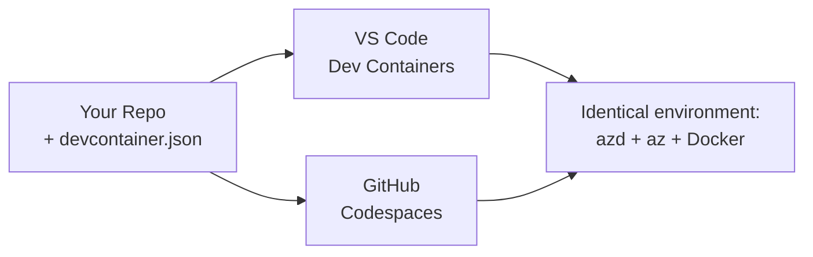

# Dev Containers & GitHub Codespaces για το azd

**Πλοήγηση Κεφαλαίου:**
- **📚 Αρχική Μαθήματος**: [AZD Για Αρχάριους](../../README.md)
- **📖 Τρέχον Κεφάλαιο**: Κεφάλαιο 1 - Βάση & Γρήγορη Εκκίνηση
- **⬅️ Προηγούμενο**: [Φέρε την Εφαρμογή σου](bring-your-own-app.md)
- **🚀 Επόμενο Κεφάλαιο**: [Κεφάλαιο 2: Ανάπτυξη με Προτεραιότητα στην AI](../chapter-02-ai-development/README.md)

> Στόχος ανασκόπησης εντολών και διαμόρφωσης: `azd 1.37.2` (Νοέμβριος 2026). Η κατασκευή κοντέινερ και οι αναπτύξεις Azure δεν εκτελέστηκαν ως μέρος αυτής της ανασκόπησης.

## Εισαγωγή

Η εγκατάσταση του azd, του κατάλληλου χρόνου εκτέλεσης γλώσσας, Docker και του Azure CLI σε κάθε μηχανή είναι μια αγγαρεία — και είναι ο βασικός λόγος που ένας οδηγός με το μήνυμα "δουλεύει στο μηχάνημά μου" αποτυγχάνει για κάποιον άλλο. Ένα **dev container** λύνει αυτό το πρόβλημα περιγράφοντας ολόκληρη την αλυσίδα εργαλείων σας σε ένα αρχείο. Οποιοσδήποτε ανοίγει το έργο στο VS Code ή στο GitHub Codespaces λαμβάνει το ακριβώς ίδιο περιβάλλον, με το azd ήδη εγκατεστημένο. Αυτό το μάθημα δείχνει πώς να προσθέσετε ένα.

## Στόχοι Μάθησης

Μέχρι το τέλος αυτού του μαθήματος, θα:
- Κατανοείτε τι είναι ένα dev container και γιατί βοηθά με το azd
- Προσθέσετε ένα ελάχιστο `.devcontainer/devcontainer.json` σε ένα έργο
- Συμπεριλάβετε το azd, το Azure CLI, και το Docker μέσω των *features* του Dev Container
- Ανοίξετε το έργο στο GitHub Codespaces ή το VS Code

## Αποτελέσματα Μάθησης

Αφού ολοκληρώσετε αυτό το μάθημα, θα μπορείτε να:
- Δημιουργήσετε ένα `devcontainer.json` για ένα έργο azd
- Προσθέσετε azd και εργαλεία Azure χωρίς χειροκίνητες εγκαταστάσεις
- Εκτελείτε `azd up` από μέσα σε ένα container ή Codespace

---

## Τι Είναι το Dev Container;

Ένα dev container είναι ένα περιβάλλον ανάπτυξης βασισμένο σε Docker που ορίζεται από ένα αρχείο `.devcontainer/devcontainer.json` στο αποθετήριο σας. Όταν ανοίγετε το έργο:

- **Το VS Code** (με το extension Dev Containers) κατασκευάζει το container και συνδέεται σ’ αυτό.
- **Τα GitHub Codespaces** κατασκευάζουν το ίδιο container στο cloud και σας παρέχουν έναν επεξεργαστή βασισμένο σε πρόγραμμα περιήγησης.

Σε κάθε περίπτωση, κάθε συνεισφέρων έχει τα ίδια εργαλεία — χωρίς απορίες τύπου "έχεις εγκαταστήσει το azd;"



---

## Βήμα 1: Δημιουργήστε το Αρχείο devcontainer

Δημιουργήστε `.devcontainer/devcontainer.json` στη ρίζα του έργου σας:

```json
{
  "name": "azd-project",
  "image": "mcr.microsoft.com/devcontainers/base:bookworm",
  "features": {
    "ghcr.io/devcontainers/features/azure-cli:1": {},
    "ghcr.io/azure/azure-dev/azd:0": { "version": "1.37.2" },
    "ghcr.io/devcontainers/features/docker-in-docker:2": {},
    "ghcr.io/devcontainers/features/node:1": {}
  },
  "customizations": {
    "vscode": {
      "extensions": [
        "ms-azuretools.azure-dev",
        "ms-azuretools.vscode-bicep"
      ]
    }
  },
  "forwardPorts": [3000],
  "postCreateCommand": "azd version"
}
```

Τι κάνει το καθένα:

| Κλειδί | Σκοπός |
|-----|---------|
| `image` | Το βασικό λειτουργικό σύστημα για το container |
| `features` | Προκατασκευασμένοι εγκαταστάτες — εδώ: Azure CLI, **azd**, Docker και Node.js |
| `customizations.vscode.extensions` | Αυτοματοποιημένη εγκατάσταση των επεκτάσεων azd και Bicep στο VS Code |
| `forwardPorts` | Αποκαλύπτει τη θύρα της εφαρμογής σας στον browser σας |
| `postCreateCommand` | Εκτελείται μία φορά μετά την κατασκευή του container (εδώ, ένας έλεγχος ορθότητας) |

> Η έκδοση του feature (`azd:0`) και η εγκατεστημένη έκδοση του CLI είναι διαφορετικές. Ορίστε την επιλογή `version` του feature στο `"1.37.2"` για να καρφιτσώσετε το CLI. Μην χρησιμοποιείτε μια έκδοση CLI ως ετικέτα feature.

---

## Βήμα 2: Αντιστοιχίστε το Feature στη Γλώσσα της Εφαρμογής σας

Αντικαταστήστε το feature `node` με όποια γλώσσα χρησιμοποιεί η εφαρμογή σας:

```jsonc
// Python project
"ghcr.io/devcontainers/features/python:1": {},

// .NET project
"ghcr.io/devcontainers/features/dotnet:2": {},

// Java project
"ghcr.io/devcontainers/features/java:1": {},

// Go project
"ghcr.io/devcontainers/features/go:1": {}
```

Κρατήστε `docker-in-docker` όταν κατασκευάζετε εικόνες τοπικά. Μια ρυθμισμένη απομακρυσμένη κατασκευή ACR (`docker.remoteBuild: true`) είναι μια εναλλακτική λύση· ο τύπος του host μόνος δεν απαιτεί πάντα τοπικό Docker.

---

## Βήμα 3: Ανοίξτε Το

**Σε VS Code:**
1. Εγκαταστήστε το extension **Dev Containers**.
2. Ανοίξτε το φάκελο του έργου.
3. Κάντε κλικ στο **Reopen in Container** όταν σας ζητηθεί (ή τρέξτε *Dev Containers: Reopen in Container*).

**Στα GitHub Codespaces:**
1. Εσπρώξτε το repo στο GitHub.
2. Κάντε κλικ στο **Code → Codespaces → Create codespace on main**.
3. Περιμένετε να κατασκευαστεί το container — το azd είναι έτοιμο στο τερματικό.

---

## Βήμα 4: Αναπτύξτε Από Μέσα στο Container

Το container έχει το azd προεγκατεστημένο, οπότε η κανονική ροή εργασίας λειτουργεί απευθείας:

```bash
azd auth login --use-device-code   # device code is handy inside Codespaces
azd up
```

> **Γιατί `--use-device-code`;** Σε απομακρυσμένο container ή Codespace δεν υπάρχει τοπικός browser για ανακατεύθυνση, οπότε το login με κωδικό συσκευής είναι η αξιόπιστη μέθοδος. Θα επικολλήσετε έναν κωδικό σε μια καρτέλα browser για να ολοκληρώσετε την είσοδο.

---

## Συνήθη Σφάλματα 

| Σφάλμα | Διόρθωση |
|---------|-----|
| `azd up` δεν μπορεί να κατασκευάσει εικόνα | Προσθέστε το feature `docker-in-docker` |
| Το login στον browser κολλάει στα Codespaces | Χρησιμοποιήστε `azd auth login --use-device-code` |
| Τα εργαλεία διαφέρουν ανάμεσα στα μέλη | Κλειδώστε το CLI μέσω της επιλογής `version` του feature azd και κλειδώστε τους χρόνους εκτέλεσης γλώσσας |
| Η εφαρμογή δεν είναι προσβάσιμη στον browser | Προσθέστε τη θύρα στο `forwardPorts` |

---

## Περίληψη

- Ένα dev container κάνει την αλυσίδα εργαλείων azd αναπαραγώγιμη για όλους.
- Προσθέστε το azd, το Azure CLI, και το Docker μέσω των *features* του Dev Container.
- Ταιριάξτε το feature της γλώσσας με την εφαρμογή σας και κρατήστε `docker-in-docker` για hosts container.
- Χρησιμοποιήστε login με κωδικό συσκευής όταν τρέχετε μέσα σε Codespaces.

---

## 🔗 Πλοήγηση

| Κατεύθυνση | Πόρος |
|-----------|----------|
| **Προηγούμενο** | [Φέρε την Εφαρμογή σου](bring-your-own-app.md) |
| **Αρχική Κεφαλαίου** | [Κεφάλαιο 1: Βάση & Γρήγορη Εκκίνηση](README.md) |
| **Επόμενο Κεφάλαιο** | [Κεφάλαιο 2: Ανάπτυξη με Προτεραιότητα στην AI](../chapter-02-ai-development/README.md) |

## 📖 Σχετικοί Πόροι

- [Εγκατάσταση & Ρύθμιση](installation.md)
- [Φύλλο Οδηγιών Εντολών](../../resources/cheat-sheet.md)
- [Επίσημη προδιαγραφή Dev Containers](https://containers.dev/)
- [Feature του azd Dev Container](https://github.com/Azure/azure-dev/tree/main/ext/devcontainer)

---

<!-- CO-OP TRANSLATOR DISCLAIMER START -->
**Αποποίηση ευθυνών**:
Αυτό το έγγραφο έχει μεταφραστεί χρησιμοποιώντας την υπηρεσία μετάφρασης με τεχνητή νοημοσύνη [Co-op Translator](https://github.com/Azure/co-op-translator). Ενώ επιδιώκουμε την ακρίβεια, παρακαλούμε να έχετε υπόψη ότι οι αυτοματοποιημένες μεταφράσεις ενδέχεται να περιέχουν λάθη ή ανακρίβειες. Το πρωτότυπο έγγραφο στη μητρική του γλώσσα πρέπει να θεωρείται η αυθεντική πηγή. Για κρίσιμες πληροφορίες, συνιστάται επαγγελματική ανθρώπινη μετάφραση. Δεν φέρουμε ευθύνη για τυχόν παρεξηγήσεις ή λανθασμένες ερμηνείες που προκύπτουν από τη χρήση αυτής της μετάφρασης.
<!-- CO-OP TRANSLATOR DISCLAIMER END -->