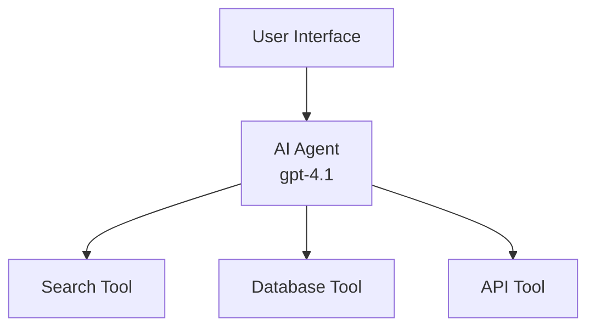
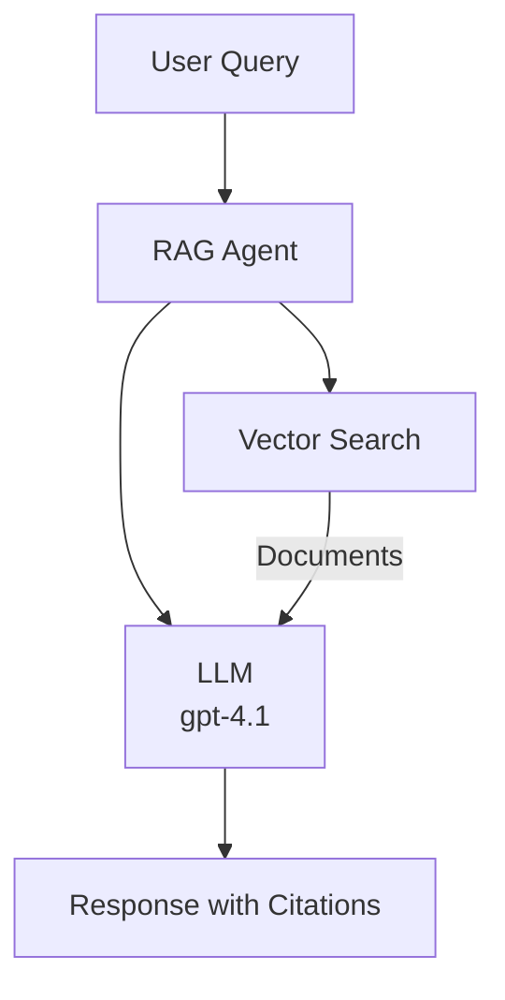
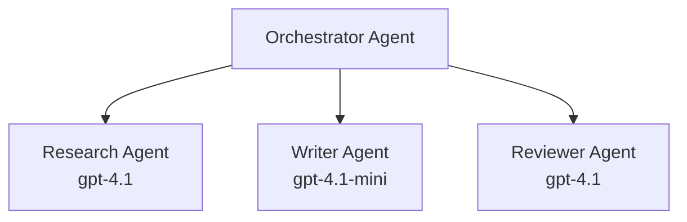

# Πράκτορες Τεχνητής Νοημοσύνης με το Azure Developer CLI

**Πλοήγηση Κεφαλαίου:**
- **📚 Αρχική Μαθήματος**: [AZD Για Αρχάριους](../../README.md)
- **📖 Τρέχον Κεφάλαιο**: Κεφάλαιο 2 - AI-First Ανάπτυξη
- **⬅️ Προηγούμενο**: [Ενσωμάτωση Microsoft Foundry](microsoft-foundry-integration.md)
- **➡️ Επόμενο**: [Ανάπτυξη Μοντέλου AI](ai-model-deployment.md)
- **🚀 Προχωρημένο**: [Λύσεις Πολλαπλών Πρακτόρων](../../examples/retail-scenario.md)

---

## Εισαγωγή

Οι πράκτορες τεχνητής νοημοσύνης είναι αυτόνομα προγράμματα που μπορούν να αντιλαμβάνονται το περιβάλλον τους, να λαμβάνουν αποφάσεις και να εκτελούν ενέργειες για την επίτευξη συγκεκριμένων στόχων. Σε αντίθεση με απλούς συνομιλητικούς ρομπότ που απαντούν σε ερωτήματα, οι πράκτορες μπορούν:

- **Να χρησιμοποιούν εργαλεία** - Να καλούν APIs, να αναζητούν σε βάσεις δεδομένων, να εκτελούν κώδικα
- **Να σχεδιάζουν και να συλλογίζονται** - Να χωρίζουν σύνθετα καθήκοντα σε βήματα
- **Να μαθαίνουν από το πλαίσιο** - Να διατηρούν μνήμη και να προσαρμόζουν συμπεριφορά
- **Να συνεργάζονται** - Να εργάζονται με άλλους πράκτορες (πολυπρακτορικά συστήματα)

Αυτός ο οδηγός σας δείχνει πώς να αναπτύξετε πράκτορες AI στο Azure χρησιμοποιώντας το Azure Developer CLI (azd).

Η χρήση του πλαισίου συνομιλίας δεν είναι εκπαίδευση μοντέλου: η επίμονη μνήμη, ο έλεγχος πρόσβασης και η διατήρηση πρέπει να υλοποιηθούν/διαμορφωθούν από την εφαρμογή.

> **Ενημέρωση Foundry GA (2026-11-09):** Εγκαταστήστε το γενικά διαθέσιμο `microsoft.foundry` 1.0 πακέτο με `azd >= 1.37.0`. Οι αξιολογήσεις εγκαθίστανται ξεχωριστά· οι προαιρετικές λειτουργίες προεπισκόπησης και το κλασικό κομμάτι SDK παρακάτω δεν προωθούνται σε GA από την ανακοίνωση του πακέτου. Αυτές οι οδηγίες βασίζονται στην [ανακοίνωση GA](https://devblogs.microsoft.com/azure-sdk/microsoft-foundry-azure-developer-cli-ga/) και τεκμηρίωση, όχι σε ζωντανή ανάπτυξη Azure.

## Στόχοι Μάθησης

Με την ολοκλήρωση αυτού του οδηγού, θα:
- Κατανοήσετε τι είναι οι πράκτορες AI και πώς διαφέρουν από τους συνομιλητικούς ρομπότ
- Αναπτύξετε προ-κατασκευασμένα πρότυπα πρακτόρων AI χρησιμοποιώντας AZD
- Διαμορφώσετε Πράκτορες Foundry για προσαρμοσμένους πράκτορες
- Υλοποιήσετε βασικά πρότυπα πρακτόρων (χρήση εργαλείων, RAG, πολυπρακτορικό)
- Παρακολουθήσετε και αποσφαλματώσετε τους αναπτυγμένους πράκτορες

## Αποτελέσματα Μάθησης

Μετά την ολοκλήρωση, θα μπορείτε να:
- Αναπτύξετε εφαρμογές πράκτορα AI στο Azure με μια εντολή
- Διαμορφώσετε τα εργαλεία και τις ικανότητες του πράκτορα
- Υλοποιήσετε την παραγωγή με ενίσχυση ανάκτησης (RAG) με πράκτορες
- Σχεδιάσετε αρχιτεκτονικές πολυπρακτορικών συστημάτων για σύνθετες ροές εργασίας
- Αντιμετωπίσετε κοινά προβλήματα ανάπτυξης πρακτόρων

---

## 🤖 Τι Κάνει Έναν Πράκτορα Διαφορετικό από Έναν Συνομιλητικό Ρομπότ;

| Χαρακτηριστικό | Συνομιλητικό Ρομπότ | Πράκτορας AI |
|---------|---------|----------|
| **Συμπεριφορά** | Απαντά σε προτροπές | Αναλαμβάνει αυτόνομες ενέργειες |
| **Εργαλεία** | Μπορεί να χρησιμοποιεί ανάκτηση ή εργαλεία | Συνήθως χρησιμοποιεί εργαλεία σε βρόχο με στόχο |
| **Μνήμη** | Εξαρτάται από την εφαρμογή | Επίμονη μνήμη μόνο αν υλοποιηθεί ρητά |
| **Σχεδιασμός** | Μία απάντηση | Συλλογισμός πολλαπλών βημάτων |
| **Συνεργασία** | Μονός φορέας | Μπορεί να συνεργάζεται με άλλους πράκτορες |

### Απλή Αναλογία

- **Συνομιλητικό Ρομπότ** = Ένα χρήσιμο άτομο που απαντά ερωτήσεις σε πληροφοριακό πάγκο
- **Πράκτορας AI** = Ένας προσωπικός βοηθός που μπορεί να κάνει κλήσεις, να κλείνει ραντεβού και να ολοκληρώνει εργασίες για εσάς

---

## 🚀 Γρήγορη Εκκίνηση: Αναπτύξτε τον Πρώτο σας Πράκτορα

Επιλέξτε μία επιλογή σε **νέο κενό φάκελο εργασίας**. Η δηλωτική `.` αρχικοποιείται εκεί· χωρίς ρητό προορισμό, το τρέχον AZD μπορεί να δημιουργήσει υποφάκελο με το όνομα προτύπου και δεν αλλάζει το φάκελο του κελύφους σας. Κρατήστε διαφορετικά πρότυπα/περιβάλλοντα σε ξεχωριστούς φακέλους.

Οι παρακάτω εκτιμήσεις χρόνου/κόστους είναι ενδεικτικές, όχι επιβεβαιωμένες προσφορές. Ελέγξτε τις προϋποθέσεις, τις τιμές, το όριο μοντέλου και τις προαιρετικές υπηρεσίες κάθε παραδείγματος πριν την ανάπτυξη.

### Επιλογή 1: Πρότυπο Πρακτόρων Foundry (Συνιστάται)

```bash
# Initialize the AI agents template
azd init --template get-started-with-ai-agents .

# Deploy to Azure
azd up
```

**Τι αναπτύσσεται:** Η τρέχουσα υποδομή και οι επιλεγμένες επιλογές του δείγματος καθορίζουν το μοντέλο, τα εργαλεία, τη φιλοξενία και τους πόρους παρακολούθησης. Εξετάστε το README και `infra/` πριν την προμήθεια· μην υποθέτετε ότι κάθε πρότυπο πράκτορα περιλαμβάνει Αναζήτηση ή Web interface.

**Χρόνος:** ~15-20 λεπτά
**Κόστος:** ~$100-150/μήνα (ανάπτυξη)

### Επιλογή 2: Πράκτορες Δημιουργικής Γραφής με Prompty

```bash
# Initialize the Prompty-based agent template
azd init --template https://github.com/Azure-Samples/contoso-creative-writer .

# Deploy to Azure
azd up
```

**Τι αναπτύσσεται:** Ένα δείγμα πολυπρακτορικής γραφής FastAPI/Prompty με χρήση Azure OpenAI, Bing Grounding και Azure AI Search. Το προηγούμενο `agent-openai-python-prompty` αποθετήριο ανακατευθύνει εδώ· δεν είναι ένα ελάχιστο πρότυπο πράκτορα καιρού Azure Functions. Ακολουθήστε το τρέχον README για φιλοξενία, όριο μοντέλου και προϋποθέσεις Bing Grounding.

**Χρόνος:** ~10-15 λεπτά
**Κόστος:** ~$50-100/μήνα (ανάπτυξη)

### Επιλογή 3: Πράκτορας RAG Chat

```bash
# Initialize RAG chat template
azd init --template azure-search-openai-demo .

# Deploy to Azure
azd up
```

**Τι αναπτύσσεται:**
- ✅ Μοντέλα Microsoft Foundry
- ✅ Azure AI Search με δείγματα δεδομένων
- ✅ Αλυσίδα επεξεργασίας εγγράφων
- ✅ Εφαρμογή συνομιλίας με παραπομπές

**Χρόνος:** ~15-25 λεπτά
**Κόστος:** ~$80-150/μήνα (ανάπτυξη)

### Επιλογή 4: Φιλοξενούμενος Πράκτορας με το GA Foundry Bundle

Χρησιμοποιήστε το [πλήρες φυλλάδιο φιλοξενούμενου πράκτορα](microsoft-foundry-integration.md#hosted-agent-walkthrough-ga) για το βασικό δείγμα Python Agent Framework Responses API. Αυτή η διαδρομή ανάπτυξης κώδικα απαιτεί Python 3.13+, τρέχον uv, δικαιώματα Foundry και περιφερειακό όριο μοντέλου. Αυθεντικοποιήστε τις τοπικές κλήσεις SDK ξεχωριστά με διαπιστευτήρια Azure CLI.

```bash
azd auth login
azd ext install microsoft.foundry
```

Σε κενό φάκελο, αρχικοποιήστε το δείγμα:

```text
azd ai agent init --template https://github.com/microsoft-foundry/foundry-samples/blob/main/samples/python/hosted-agents/agent-framework/responses/01-basic/azure.yaml --deploy-mode code --src .
```

Επιλέξτε νέο ή υπάρχον έργο, ελέγξτε `azure.yaml` και εκτελέστε `azd provision`. Χρησιμοποιήστε `azd ai agent run` για να ανοίξετε το Agent Inspector και, από άλλο τερματικό στον ίδιο φάκελο, `azd ai agent invoke --local "Explain how this agent is hosted."`. Μετά την τοπική επιβεβαίωση, χρησιμοποιήστε `azd deploy` και `azd ai agent invoke "Explain how this agent is hosted."` για σύγκριση της αναπτυγμένης απάντησης. Το Foundry κατασκευάζει τον ανέβασμένο κώδικα απομακρυσμένα· δεν απαιτείται τοπικό container build.

**Πότε να χρησιμοποιήσετε `azd ai agent init` έναντι `azd init --template`:**

| Προσέγγιση | Κατάλληλο για | Πώς λειτουργεί |
|----------|----------|------|
| `azd init --template` | Ξεκινώντας από δείγμα εφαρμογής σε λειτουργία | Κλωνοποιεί πλήρες αποθετήριο προτύπου με κώδικα + υποδομή |
| `azd ai agent init --template` | Υιοθετώντας ενεργό έργο Foundry πράκτορα | Χρησιμοποιεί έγγραφο έργου `azure.yaml` και τους ορισμούς του |

> **Συμβουλή:** Οι επιλογές 1-3 ξεκινούν από πλήρη πρότυπα εφαρμογών· η Επιλογή 4 διδάσκει τη ροή φιλοξενούμενου πράκτορα GA. Καμία εντολή αρχικοποίησης δεν μεταφέρει αυτόματα παλαιά μανιφέστα πρακτόρων. Για προσθήκη άμεσου ορισμού πράκτορα σε υπάρχον έργο, δείτε [οδηγίες αρχικοποίησης και μετανάστευσης](../chapter-08-production/production-ai-practices.md#initializing-agent-projects-with-azd-ai-agent-init).

Εγκαταστήστε το `azure.ai.evaluations` ξεχωριστά για δημιουργία και ανασκόπηση δεδομένων/κριτηρίων δοκιμών, ρυθμίστε αξιολόγηση και εκτελέστε τη με `azd ai eval`. Η βελτιστοποίηση μπορεί να επαναχρησιμοποιήσει συμβατή αξιολόγηση· ελέγξτε υποψηφίους πριν αναπτύξετε ρητά μια. Ακολουθήστε τη [ροή αξιολόγησης](../chapter-08-production/production-ai-practices.md#evaluation-migration-and-quality-checks) και τη [μετανάστευση βελτιστοποίησης](../chapter-08-production/production-ai-practices.md#optimization-configuration-migration) πριν από επαναχρησιμοποίηση παλαιότερων παραδειγμάτων. Για καθαρισμό, οι πόροι επαναχρησιμοποιούμενου έργου Foundry παραμένουν μετά `azd down`· ο φάκελος πόρων νέου έργου διαγράφεται. Δείτε τις [οδηγίες καθαρισμού](microsoft-foundry-integration.md#7-clean-up-deliberately).

---

## 🏗️ Πρότυπα Αρχιτεκτονικής Πρακτόρων

### Πρότυπο 1: Μονός Πράκτορας με Εργαλεία

Το απλούστερο πρότυπο πράκτορα - ένας πράκτορας που μπορεί να χρησιμοποιεί πολλαπλά εργαλεία.



**Κατάλληλο για:**
- Bots υποστήριξης πελατών
- Βοηθούς έρευνας
- Πράκτορες ανάλυσης δεδομένων

**Σχετικό δείγμα εφαρμογής:** `azure-search-openai-demo` επιδεικνύει RAG, όχι γενικό βρόχο πράκτορα με αυθαίρετα εργαλεία.

### Πρότυπο 2: Πράκτορας RAG (Παραγωγή με Ενίσχυση Ανάκτησης)

Πράκτορας που ανακτά σχετικά έγγραφα πριν παράγει απαντήσεις.



**Κατάλληλο για:**
- Επιχειρησιακές βάσεις γνώσης
- Συστήματα ερωταπαντήσεων εγγράφων
- Συμμόρφωση και νομική έρευνα

**Πρότυπο AZD:** `azure-search-openai-demo`

### Πρότυπο 3: Πολυπρακτορικό Σύστημα

Πολλοί εξειδικευμένοι πράκτορες που συνεργάζονται σε σύνθετες εργασίες.



**Κατάλληλο για:**
- Σύνθετη δημιουργία περιεχομένου
- Πολύ-βηματικές ροές εργασίας
- Εργασίες που απαιτούν διαφορετική εμπειρογνωμοσύνη

**Μάθετε Περισσότερα:** [Πρότυπα Συντονισμού Πολυπρακτόρων](../chapter-06-pre-deployment/coordination-patterns.md)

---

## ⚙️ Διαμόρφωση Εργαλείων Πρακτόρων

Οι πράκτορες γίνονται ισχυροί όταν μπορούν να χρησιμοποιούν εργαλεία. Δείτε πώς να διαμορφώσετε κοινά εργαλεία:

### Διαμόρφωση Εργαλείων σε Πράκτορες Foundry

Αυτό το **κλασικό αποσπασματικό SDK υπηρεσίας Πράκτορα** στοχεύει `azure-ai-projects==1.0.0` και `azure-ai-agents==1.1.0` με `azure-identity`. Δεν είναι η νεότερη API versioned-agent/Responses που χρησιμοποιείται από μερικά τρέχοντα πρότυπα Foundry, ούτε η επέκταση `azure.ai.agents` AZD (διαφορετικό πακέτο). Μην αναμειγνύετε αυτές τις γενιές API. Ορίστε `PROJECT_ENDPOINT` σε κλασικό τελικό σημείο έργου Foundry και `MODEL_DEPLOYMENT_NAME` σε υπάρχουσα υποστηριζόμενη ανάπτυξη μοντέλου· αυθεντικοποιήστε με `az login` τοπικά και δώστε τα απαραίτητα δικαιώματα έργου.

```python
# agent_config.py
import os
from azure.ai.projects import AIProjectClient
from azure.ai.agents.models import FunctionTool
from azure.identity import DefaultAzureCredential

def search_knowledge_base(query: str) -> str:
    """Search the demonstration knowledge base.

    :param query: Search text.
    :return: Matching demonstration information.
    """
    # Local fixture only, not a production search implementation.
    return "Demo policy: returns are accepted within 30 days."

project_client = AIProjectClient(
    endpoint=os.environ["PROJECT_ENDPOINT"],
    credential=DefaultAzureCredential(),
)
search_tool = FunctionTool(functions={search_knowledge_base})
project_client.agents.enable_auto_function_calls(search_tool)
agent = project_client.agents.create_agent(
    model=os.environ["MODEL_DEPLOYMENT_NAME"],
    name="Support Agent",
    instructions="Use search_knowledge_base for policy questions. Label results as demo data.",
    tools=search_tool.definitions,
)
```

Η εγγραφή ενός σχήματος συνάρτησης δεν εκτελεί Python στην υπηρεσία. Σε αυτό το SDK, `enable_auto_function_calls` συν `agents.runs.create_and_process(...)` τρέχουν καταχωρημένες επιστροφές κλήσεων στη διαδικασία του πελάτη σας. Δείτε το [παραδοθέν παράδειγμα SDK](https://github.com/Azure/azure-sdk-for-python/blob/azure-ai-agents_1.1.0/sdk/ai/azure-ai-agents/samples/agents_tools/sample_agents_auto_function_call.py). Κλείστε τον πελάτη και διαγράψτε δείκτες/νήματα επίδειξης όταν τελειώσετε.

### Διαμόρφωση Περιβάλλοντος

Τα ακόλουθα ονόματα είναι **ενδεικτικές προσαρμοσμένες είσοδοι προτύπου**, όχι ενσωματωμένοι διακόπτες AZD. Πρώτα περάστε κάθε τιμή μέσω `infra/main.parameters.json`, υποδομής και κώδικα εφαρμογής. Μόνο `azd env set` δεν αλλάζει τα εργαλεία ή τις οδηγίες πράκτορα.

```bash
# Set up agent-specific environment variables
azd env set AZURE_OPENAI_MODEL "gpt-4.1"
azd env set AGENT_INSTRUCTIONS "You are a helpful assistant..."
azd env set ENABLE_CODE_INTERPRETER "true"
azd env set ENABLE_FILE_SEARCH "true"

# Apply wired infrastructure and application changes
azd up
```

---

## 📊 Παρακολούθηση Πρακτόρων

### Ενσωμάτωση Application Insights

Αν το επιλεγμένο πρότυπο παρέχει Application Insights και διαμορφώνει την οργάνωση:

```bash
# Open monitoring dashboard
azd monitor --overview

# Open the Application Insights logs view (not a streaming log tail)
azd monitor --logs

# View live metrics
azd monitor --live
```

### Κύρια Μετρικά προς Παρακολούθηση

| Μετρικό | Περιγραφή | Στόχος |
|--------|-------------|--------|
| Καθυστέρηση Απόκρισης | Χρόνος για παραγωγή απάντησης | < 5 δευτερόλεπτα |
| Χρήση Tokens | Tokens ανά αίτημα | Παρακολούθηση κόστους |
| Ποσοστό Επιτυχίας Κλήσης Εργαλείου | % επιτυχημένων εκτελέσεων εργαλείων | > 95% |
| Ποσοστό Σφαλμάτων | Αποτυχημένα αιτήματα πράκτορα | < 1% |
| Ικανοποίηση Χρήστη | Βαθμολογίες ανατροφοδότησης | > 4.0/5.0 |

### Προσαρμοσμένη Καταγραφή για Πράκτορες

```python
import os
from azure.monitor.opentelemetry import configure_azure_monitor
from opentelemetry import trace

# Configure Azure Monitor with OpenTelemetry
configure_azure_monitor(
    connection_string=os.environ["APPLICATIONINSIGHTS_CONNECTION_STRING"]
)

tracer = trace.get_tracer(__name__)

def log_agent_interaction(user_query, agent_response, tools_used, latency_ms):
    with tracer.start_as_current_span("agent_interaction") as span:
        span.set_attributes({
            "query_length": len(user_query),  # Do not log raw prompts or personal data
            "response_length": len(agent_response),
            "tools_used": tools_used,
            "latency_ms": latency_ms
        })
```

> **Σημείωση:** Εγκαταστήστε το απαιτούμενο πακέτο: `pip install azure-monitor-opentelemetry`. Φέρνει τις εξαρτήσεις OpenTelemetry· ο χώρος ονομάτων εισαγωγής δεν είναι απαίτηση για εγκατάσταση πακέτου με το όνομα `opentelemetry`.

---

## 💰 Σκέψεις Κόστους

### Εκτιμώμενο Μηνιαίο Κόστος ανά Πρότυπο

Αυτά είναι ενδεικτικά όρια σχεδιασμού, όχι προσφορές ή όρια δαπάνης. Περιφέρεια, tokens μοντέλου, SKU αναζήτησης/υπολογισμού, συνεδρίες εργαλείων, αποθήκευση και κίνηση μπορούν να τα υπερβούν. Ελέγξτε τις οδηγίες κόστους του δείγματος και την τιμολόγηση Azure πριν από `azd up`.

| Πρότυπο | Περιβάλλον Ανάπτυξης | Παραγωγή |
|---------|-----------------|------------|
| Μονός Πράκτορας | $50-100 | $200-500 |
| Πράκτορας RAG | $80-150 | $300-800 |
| Πολυπρακτορικό (2-3 πράκτορες) | $150-300 | $500-1,500 |
| Επιχειρησιακό Πολυπρακτορικό | $300-500 | $1,500-5,000+ |

### Συμβουλές Βελτιστοποίησης Κόστους

1. **Χρησιμοποιήστε gpt-4.1-mini για απλές εργασίες** (μόνο αν το πρότυπό σας το καταναλώνει)
   ```bash
   azd env set AZURE_OPENAI_MODEL "gpt-4.1-mini"
   ```

2. **Υλοποιήστε scoped caching για ασφαλείς, επαναλαμβανόμενες ερωτήσεις.** Περιλάβετε έγκριση ενοικιαστή/χρήστη, ανάπτυξη μοντέλου, οδηγίες και έκδοση ανάκτησης στο κλειδί cache· ορίστε λήξη. Μην μοιράζεστε ιδιωτικές απαντήσεις συνομιλίας μέσω cache μόνο για ζητούμενα σε όλη την διαδικασία. Το αντικείμενο SDK πράκτορα δεν έχει γενική μέθοδο `agent.run()`.

3. **Ορίστε όρια token ανά εκτέλεση**
   ```python
   # Set max_completion_tokens when running the agent, not during creation
   run = project_client.agents.runs.create_and_process(
       thread_id=thread.id,
       agent_id=agent.id,
       max_completion_tokens=1000  # Budget across the run; may finish as incomplete
   )
   ```

4. **Κλιμακώστε επιλέξιμες Container Apps σε μηδέν όταν δεν χρησιμοποιούνται**
   ```bash
   # Custom-template input: must map to template.scale.minReplicas
   azd env set MIN_REPLICAS "0"
   ```
   Εφαρμόστε την αλλαγή υποδομής με `azd provision` ή `azd up`. Η κλιμάκωση σε μηδέν χρειάζεται κατάλληλο ενεργοποιητή και δεν σταματά χρεώσεις Αναζήτησης, αποθήκευσης ή μοντέλου/εργαλείου.

---

## 🔧 Αντιμετώπιση Προβλημάτων Πρακτόρων

### Συνήθη Προβλήματα και Λύσεις

<details>
<summary><strong>❌ Ο πράκτορας δεν ανταποκρίνεται σε κλήσεις εργαλείων</strong></summary>

```bash
# Inspect the application deployment (not the agent's registered tools)
azd show

# Verify OpenAI deployment
az cognitiveservices account deployment list \
  --name $AZURE_OPENAI_NAME \
  --resource-group $RG_NAME

# Check agent logs
azd monitor --logs
```

**Κοινές αιτίες:**
- Ασυμβατότητα υπογραφής λειτουργίας εργαλείου
- Έλλειψη απαραίτητων δικαιωμάτων
- Μη προσβασιμότητα του τελικού σημείου API
</details>

<details>
<summary><strong>❌ Υψηλή καθυστέρηση στις απαντήσεις του πράκτορα</strong></summary>

```bash
# Check Application Insights for bottlenecks
azd monitor --live

# Consider using a faster model
azd env set AZURE_OPENAI_MODEL "gpt-4.1-mini"
azd up
```

**Συμβουλές βελτιστοποίησης:**
- Χρησιμοποιήστε απαντήσεις streaming
- Υλοποιήστε caching απαντήσεων
- Μειώστε το μέγεθος παραθύρου πλαισίου
</details>

<details>
<summary><strong>❌ Ο πράκτορας επιστρέφει λανθασμένες ή παραισθητικές πληροφορίες</strong></summary>

```python
# Improve with better system prompts
instructions = """
You are a helpful assistant. IMPORTANT:
- Only answer based on provided context
- If you don't know, say "I don't know"
- Always cite your sources
- Never make up information
"""

# Use these instructions in the agent definition.
# For classic file search, first upload/index documents in a vector store,
# then use FileSearchTool(vector_store_ids=[...]) and pass both its
# .definitions and .resources when creating the agent.
```
Οι οδηγίες και η ανάκτηση μειώνουν τον κίνδυνο· κανένα δεν εγγυάται αληθινές απαντήσεις. Αξιολογήστε θεμελιωμένες και μη σχετικές ερωτήσεις με βάση γνωστές απαντήσεις.
</details>

<details>
<summary><strong>❌ Σφάλματα υπέρβασης ορίου tokens</strong></summary>

```python
# Implement context window management
def truncate_context(messages, max_tokens=8000, model="gpt-4.1"):
    """Approximate content-only budget for objects with .content strings."""
    import tiktoken
    encoding = tiktoken.encoding_for_model(model)
    total_tokens = 0
    truncated = []
    
    for msg in reversed(messages):
        msg_tokens = len(encoding.encode(msg.content))
        if total_tokens + msg_tokens > max_tokens:
            break
        truncated.insert(0, msg)
        total_tokens += msg_tokens
    
    return truncated
```
Αυτός ο βοηθός εξαιρεί ρόλους/σχήματα εργαλείων, οδηγίες συστήματος, tokens εικόνας και επικεφαλίδες πρωτοκόλλου. Κρατήστε χώρο για αυτά και την ολοκλήρωση· μην χωρίζετε ζεύγη κλήσης εργαλείου/αποτελέσματος ή απορρίπτετε υποχρεωτικές οδηγίες συστήματος. Εγκαταστήστε `tiktoken` ξεχωριστά. Δεν είναι γενικός επικυρωτής παραθύρου πλαισίου.
</details>

---

## 🎓 Πρακτικές Ασκήσεις

### Άσκηση 1: Ανάπτυξη Βασικού Πράκτορα (20 λεπτά)

**Στόχος:** Αναπτύξτε τον πρώτο σας πράκτορα AI χρησιμοποιώντας AZD

```bash
# Step 1: Initialize template
azd init --template get-started-with-ai-agents .

# Step 2: Login to Azure
azd auth login
# If you work across tenants, add --tenant-id <tenant-id>

# Step 3: Deploy
azd up

# Step 4: Test the agent
# Expected output after deployment:
#   Deployment Complete!
#   Endpoint: https://<app-name>.<region>.azurecontainerapps.io
# Open the URL shown in the output and try asking a question

# Step 5: View monitoring
azd monitor --overview

# Step 6: Review the listed resources and confirm cleanup
azd down
```

**Κριτήρια Επιτυχίας:**
- [ ] Ο agent απαντά σε ερωτήσεις
- [ ] Μπορεί να έχει πρόσβαση στον πίνακα ελέγχου παρακολούθησης μέσω `azd monitor`
- [ ] Οι πόροι καθαρίζονται με επιτυχία

### Άσκηση 2: Προσθήκη Εξατομικευμένου Εργαλείου (30 λεπτά)

**Στόχος:** Επέκταση ενός agent με ένα εξατομικευμένο εργαλείο

**Αφετηρία:** Χρησιμοποιήστε τον κλασικό SDK client από το [Tool Configuration](#tool-configuration-in-foundry-agents), όχι ένα αυθαίρετο πρότυπο με διαφορετική γενιά SDK.

1. Προσθέστε αυτό το καθοριστικό fixture στο `agent_config.py`:
   ```python
   def get_weather(location: str) -> str:
       """Return demonstration weather, not live conditions.

       :param location: City name.
       :return: A clearly labelled fixture.
       """
       print(f"TOOL_CALLED: {location}")
       return f"Demo weather in {location}: Sunny, 72°F (fixture, not live)"
   ```
2. Αντικαταστήστε το μπλοκ καταχώρησης και δημιουργίας του search-tool με:
   ```python
   weather_tool = FunctionTool(functions={get_weather})
   project_client.agents.enable_auto_function_calls(weather_tool)
   agent = project_client.agents.create_agent(
       model=os.environ["MODEL_DEPLOYMENT_NAME"],
       name="Weather Agent",
       instructions="Call get_weather for weather questions; explain that it returns demo data.",
       tools=weather_tool.definitions,
   )
   thread = project_client.agents.threads.create()
   try:
       project_client.agents.messages.create(
           thread_id=thread.id, role="user", content="Use get_weather for Seattle."
       )
       run = project_client.agents.runs.create_and_process(
           thread_id=thread.id, agent_id=agent.id
       )
       if run.status != "completed":
           raise RuntimeError(f"Run status: {run.status}; error: {run.last_error}")
       for message in project_client.agents.messages.list(thread_id=thread.id):
           for text in message.text_messages:
               print(text.text.value)
   finally:
       project_client.agents.threads.delete(thread.id)
       project_client.agents.delete_agent(agent.id)
       project_client.close()
   ```
3. Εκτελέστε το τοπικά (αυτό καλεί το υπάρχον έργο Azure και επιβαρύνει με χρεώσεις μοντέλου):
   ```bash
   python agent_config.py
   # Expected: TOOL_CALLED: Seattle, then a completed answer labelled demo data.
   ```

**Κριτήρια Επιτυχίας:**
- [ ] Ο agent αναγνωρίζει ερωτήσεις σχετικές με τον καιρό
- [ ] Το εργαλείο καλείται σωστά
- [ ] Η απάντηση περιλαμβάνει πληροφορίες για τον καιρό

### Άσκηση 3: Δημιουργία RAG Agent (45 λεπτά)

**Στόχος:** Δημιουργήστε έναν agent που απαντά σε ερωτήσεις από τα έγγραφά σας

```bash
# Step 1: Deploy RAG template
azd init --template azure-search-openai-demo .
azd up

# Step 2: Upload your documents
# For the sample's local ingestion path, place supported files in data/.
# Run from the sample root after following its Python environment setup:
./scripts/prepdocs.sh
# Windows PowerShell equivalent: .\\scripts\\prepdocs.ps1

# Step 3: Test with domain-specific questions
# Open the web app URL from the azd up output
# Ask questions about your uploaded documents
# Responses should include citation references like [doc.pdf]
```

**Κριτήρια Επιτυχίας:**
- [ ] Ο agent απαντά από τα ανεβασμένα έγγραφα
- [ ] Οι απαντήσεις περιλαμβάνουν παραπομπές
- [ ] Οι ερωτήσεις εκτός πεδίου χειρίζονται χωρίς μη υποστηριζόμενες αξιώσεις (δεν είναι εγγύηση για κάθε μελλοντική ερώτηση)

Αν `USE_CLOUD_INGESTION=true`, χρησιμοποιήστε τη διαδικασία ingestion/upload του δείγματος στο cloud, αντίθετα ο τοπικός wrapper παραλείπει σκόπιμα την ingestion. Μετά τη δοκιμή, εκτελέστε `azd down` στο περιβάλλον RAG και ελέγξτε τους πόρους που πρόκειται να διαγραφούν.

---

## 📚 Επόμενα Βήματα

Τώρα που καταλαβαίνετε τους AI agents, εξερευνήστε αυτά τα προχωρημένα θέματα:

| Θέμα | Περιγραφή | Σύνδεσμος |
|-------|-------------|------|
| **Συστήματα Πολλαπλών Agents** | Δημιουργήστε συστήματα με πολλούς συνεργαζόμενους agents | [Παράδειγμα Λιανικής με Πολλούς Agents](../../examples/retail-scenario.md) |
| **Σχήματα Συντονισμού** | Μάθετε πρότυπα ορχήστρωσης και επικοινωνίας | [Σχήματα Συντονισμού](../chapter-06-pre-deployment/coordination-patterns.md) |
| **Ανάπτυξη Παραγωγής** | Ανάπτυξη agent έτοιμου για επιχειρήσεις | [Πρακτικές AI Παραγωγής](../chapter-08-production/production-ai-practices.md) |
| **Αξιολόγηση Agent** | Δοκιμάστε και αξιολογήστε την απόδοση του agent | [Επίλυση Προβλημάτων AI](../chapter-07-troubleshooting/ai-troubleshooting.md) |
| **AI Workshop Lab** | Πρακτική: Κάντε τη λύση AI σας έτοιμη για AZD | [AI Workshop Lab](ai-workshop-lab.md) |

---

## 📖 Επιπλέον Πόροι

### Επίσημη Τεκμηρίωση
- [Υπηρεσία Agent Microsoft Foundry](https://learn.microsoft.com/azure/ai-services/agents/)
- [Οδηγός Εκκίνησης Υπηρεσίας Agent Microsoft Foundry](https://learn.microsoft.com/azure/ai-services/agents/quickstart)
- [Πλαίσιο Agent Semantic Kernel](https://learn.microsoft.com/semantic-kernel/)

### Πρότυπα AZD για Agents
- [Ξεκινήστε με AI Agents](https://github.com/Azure-Samples/get-started-with-ai-agents)
- [Agents Δημιουργικής Γραφής με Prompty](https://github.com/Azure-Samples/contoso-creative-writer)
- [Επίδειξη Azure Search OpenAI](https://github.com/Azure-Samples/azure-search-openai-demo)

### Πόροι Κοινότητας
- [Awesome AZD - Πρότυπα Agents](https://azure.github.io/awesome-azd/?tags=ai-agents)
- [Discord Azure AI](https://discord.gg/microsoft-azure)
- [Discord Microsoft Foundry](https://discord.gg/nTYy5BXMWG)

### Δεξιότητες Agent για τον Επεξεργαστή σας
- [**Δεξιότητες Agent Microsoft Azure**](https://skills.sh/microsoft/github-copilot-for-azure) - Εγκαταστήστε επαναχρησιμοποιήσιμες δεξιότητες AI agent για ανάπτυξη Azure στο GitHub Copilot, Cursor, ή οποιονδήποτε υποστηριζόμενο agent. Περιλαμβάνει δεξιότητες για [Azure AI](https://skills.sh/microsoft/github-copilot-for-azure/azure-ai), [Microsoft Foundry](https://skills.sh/microsoft/github-copilot-for-azure/microsoft-foundry), [ανάπτυξη](https://skills.sh/microsoft/github-copilot-for-azure/azure-deploy), και [διαγνωστικά](https://skills.sh/microsoft/github-copilot-for-azure/azure-diagnostics):
  ```bash
  npx skills add microsoft/github-copilot-for-azure
  ```

---

**Πλοήγηση**
- **Προηγούμενο Μάθημα**: [Ενσωμάτωση Microsoft Foundry](microsoft-foundry-integration.md)
- **Επόμενο Μάθημα**: [Ανάπτυξη Μοντέλου AI](ai-model-deployment.md)

---

<!-- CO-OP TRANSLATOR DISCLAIMER START -->
**Αποποίηση ευθυνών**:
Αυτό το έγγραφο έχει μεταφραστεί χρησιμοποιώντας την υπηρεσία μετάφρασης με τεχνητή νοημοσύνη [Co-op Translator](https://github.com/Azure/co-op-translator). Ενώ επιδιώκουμε την ακρίβεια, παρακαλούμε να έχετε υπόψη ότι οι αυτοματοποιημένες μεταφράσεις ενδέχεται να περιέχουν λάθη ή ανακρίβειες. Το πρωτότυπο έγγραφο στη μητρική του γλώσσα πρέπει να θεωρείται η αυθεντική πηγή. Για κρίσιμες πληροφορίες, συνιστάται επαγγελματική ανθρώπινη μετάφραση. Δεν φέρουμε ευθύνη για τυχόν παρεξηγήσεις ή λανθασμένες ερμηνείες που προκύπτουν από τη χρήση αυτής της μετάφρασης.
<!-- CO-OP TRANSLATOR DISCLAIMER END -->