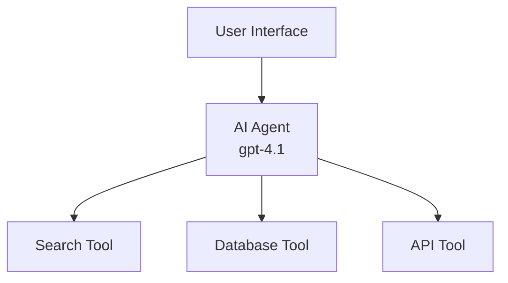
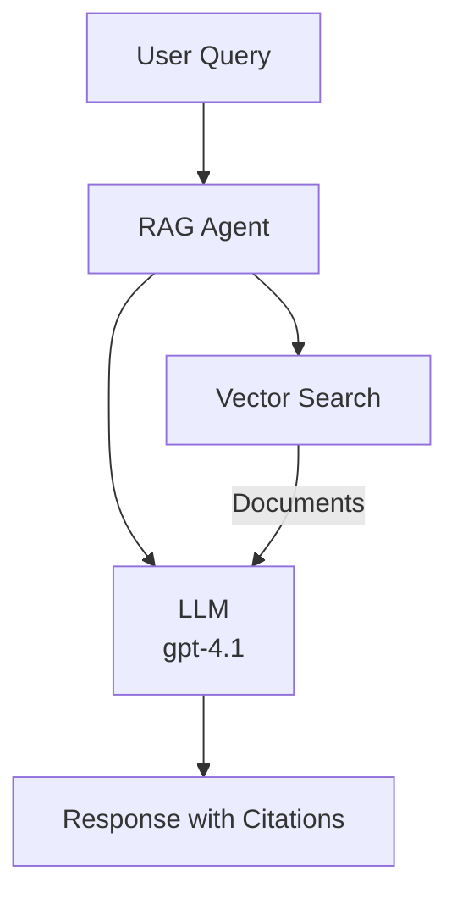
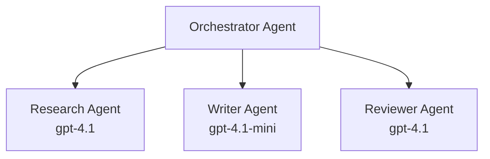

# Πράκτορες AI με το Azure Developer CLI

**Πλοήγηση Κεφαλαίου:**
- **📚 Αρχική Μαθήματος**: [AZD Για Αρχάριους](../../README.md)
- **📖 Τρέχον Κεφάλαιο**: Κεφάλαιο 2 - AI-Πρώτη Ανάπτυξη
- **⬅️ Προηγούμενο**: [Ενσωμάτωση Microsoft Foundry](microsoft-foundry-integration.md)
- **➡️ Επόμενο**: [Ανάπτυξη Μοντέλου AI](ai-model-deployment.md)
- **🚀 Προχωρημένο**: [Λύσεις Πολλαπλών Πρακτόρων](../../examples/retail-scenario.md)

---

## Εισαγωγή

Οι πράκτορες AI είναι αυτόνομα προγράμματα που μπορούν να αντιλαμβάνονται το περιβάλλον τους, να λαμβάνουν αποφάσεις και να αναλαμβάνουν δράσεις για την επίτευξη συγκεκριμένων στόχων. Σε αντίθεση με απλούς συνομιλητές (chatbots) που απαντούν σε ερωτήματα, οι πράκτορες μπορούν:

- **Να χρησιμοποιούν εργαλεία** - Να καλούν APIs, να αναζητούν σε βάσεις δεδομένων, να εκτελούν κώδικα
- **Να σχεδιάζουν και να συλλογίζονται** - Να διασπούν πολύπλοκες εργασίες σε βήματα
- **Να μαθαίνουν από το πλαίσιο** - Να διατηρούν μνήμη και να προσαρμόζουν τη συμπεριφορά
- **Να συνεργάζονται** - Να εργάζονται με άλλους πράκτορες (πολλαπλά συστήματα πρακτόρων)

Αυτός ο οδηγός σας δείχνει πώς να αναπτύξετε πράκτορες AI στο Azure χρησιμοποιώντας το Azure Developer CLI (azd).

Η χρήση του πλαισίου συνομιλίας δεν ισοδυναμεί με εκπαίδευση μοντέλου: η διατήρηση μνήμης, ο έλεγχος πρόσβασης και η διατήρηση πρέπει να υλοποιηθούν/ρυθμιστούν από την εφαρμογή.

> **Ανασκόπηση έκδοσης (2026-11-04):** Τα παραδείγματα CLI ελέγχθηκαν έναντι της τεκμηρίωσης/πηγής `azd` `1.37.2`, `azure.ai.agents` `1.0.0-beta.23`, και `azure.ai.evaluations` `1.0.0-beta.2`, όχι σε ζωντανή ανάπτυξη Azure. Χρησιμοποιήστε `azd >= 1.37.0` για τη συνδυασμένη ροή εργασιών. Δείτε [τελευταίες αλλαγές και διορθώσεις](../chapter-08-production/production-ai-practices.md#recent-release-changes-and-fixes) πριν αναβαθμίσετε παλαιότερα έργα.

## Στόχοι Μάθησης

Με την ολοκλήρωση αυτού του οδηγού, θα:
- Κατανοείτε τι είναι οι πράκτορες AI και πώς διαφέρουν από τους συνομιλητές
- Αναπτύσσετε έτοιμα πρότυπα πρακτόρων AI χρησιμοποιώντας το AZD
- Ρυθμίζετε Foundry Agents για προσαρμοσμένους πράκτορες
- Υλοποιείτε βασικά πρότυπα πρακτόρων (χρήση εργαλείων, RAG, πολλαπλοί πράκτορες)
- Παρακολουθείτε και διορθώνετε τους αναπτυγμένους πράκτορες

## Αποτελέσματα Μάθησης

Με την ολοκλήρωση, θα μπορείτε να:
- Αναπτύσσετε εφαρμογές πρακτόρων AI στο Azure με μία μόνο εντολή
- Ρυθμίζετε τα εργαλεία και τις δυνατότητες των πρακτόρων
- Υλοποιείτε την παραγωγή με υποβοήθηση ανάκτησης (RAG) με πράκτορες
- Σχεδιάζετε αρχιτεκτονικές πολλαπλών πρακτόρων για πολύπλοκες ροές εργασίας
- Αντιμετωπίζετε κοινά προβλήματα ανάπτυξης πρακτόρων

---

## 🤖 Τι Κάνει Έναν Πράκτορα Διαφορετικό από Έναν Συνομιλητή;

| Χαρακτηριστικό | Συνομιλητής | Πράκτορας AI |
|---------|---------|----------|
| **Συμπεριφορά** | Απαντά σε ερωτήματα | Αναλαμβάνει αυτόνομες δράσεις |
| **Εργαλεία** | Μπορεί να χρησιμοποιεί ανάκτηση ή εργαλεία | Συνήθως χρησιμοποιεί εργαλεία σε βρόχο κατεύθυνσης στόχου |
| **Μνήμη** | Εξαρτάται από την εφαρμογή | Μόνιμη μνήμη μόνο αν υλοποιηθεί ρητά |
| **Σχεδιασμός** | Μοναδική απάντηση | Πολυβηματική συλλογιστική |
| **Συνεργασία** | Μοναδική οντότητα | Μπορεί να συνεργάζεται με άλλους πράκτορες |

### Απλή Αναλογία

- **Συνομιλητής** = Ένα βοηθητικό άτομο που απαντά σε ερωτήσεις σε ένα γραφείο πληροφοριών
- **Πράκτορας AI** = Ένας προσωπικός βοηθός που μπορεί να κάνει κλήσεις, να κλείνει ραντεβού και να ολοκληρώνει εργασίες για εσάς

---

## 🚀 Γρήγορη Εκκίνηση: Αναπτύξτε τον Πρώτο σας Πράκτορα

Επιλέξτε μία επιλογή σε έναν **νέο κενό φάκελο εργασίας**. Το `.` στο τέλος αρχικοποιεί εκεί· χωρίς ρητό προορισμό, το τρέχον AZD μπορεί να δημιουργήσει έναν υποφάκελο με όνομα προτύπου και δεν αλλάζει το φάκελο του κελύφους σας. Κρατήστε ξεχωριστά πρότυπα/περιβάλλοντα σε ξεχωριστούς φακέλους.

Οι χρόνοι/κόστος που δίνονται παρακάτω είναι ενδεικτικοί, όχι επικυρωμένες προσφορές. Ελέγξτε κάθε δείγμα για τρέχουσες προαπαιτήσεις, τιμολόγηση, όριο μοντέλου και προαιρετικές υπηρεσίες πριν την ανάπτυξη.

### Επιλογή 1: Πρότυπα Πρακτόρων Foundry (Συνιστάται)

```bash
# Initialize the AI agents template
azd init --template get-started-with-ai-agents .

# Deploy to Azure
azd up
```

**Τι αναπτύσσεται:** Η τρέχουσα υποδομή του δείγματος και οι επιλεγμένες επιλογές καθορίζουν το μοντέλο, τα εργαλεία, τη φιλοξενία και τους πόρους παρακολούθησης. Εξετάστε το README και το `infra/` πριν την παροχή· μην υποθέτετε ότι κάθε πρότυπο πράκτορα περιλαμβάνει Αναζήτηση ή διεπαφή web.

**Χρόνος:** ~15-20 λεπτά
**Κόστος:** ~$100-150/μήνα (ανάπτυξη)

### Επιλογή 2: Πράκτορες Δημιουργικής Γραφής με το Prompty

```bash
# Initialize the Prompty-based agent template
azd init --template https://github.com/Azure-Samples/contoso-creative-writer .

# Deploy to Azure
azd up
```

**Τι αναπτύσσεται:** Ένα δείγμα πολλαπλών πρακτόρων FastAPI/Prompty που χρησιμοποιεί Azure OpenAI, Bing Grounding και Azure AI Search. Το παλιό αποθετήριο `agent-openai-python-prompty` μεταφέρει εδώ· δεν είναι ένα μίνιμαλ πρότυπο πράκτορα καιρού Azure Functions. Ακολουθήστε το τελευταίο README για φιλοξενία, όριο μοντέλου και προαπαιτήσεις Bing Grounding.

**Χρόνος:** ~10-15 λεπτά
**Κόστος:** ~$50-100/μήνα (ανάπτυξη)

### Επιλογή 3: Πράκτορας Συνομιλίας RAG

```bash
# Initialize RAG chat template
azd init --template azure-search-openai-demo .

# Deploy to Azure
azd up
```

**Τι αναπτύσσεται:**
- ✅ Μοντέλα Microsoft Foundry
- ✅ Azure AI Search με δείγμα δεδομένων
- ✅ Αλυσίδα επεξεργασίας εγγράφων
- ✅ Διεπαφή συνομιλιών με παραπομπές

**Χρόνος:** ~15-25 λεπτά
**Κόστος:** ~$80-150/μήνα (ανάπτυξη)

### Επιλογή 4: AZD AI Agent Init (Προεπισκόπηση Προτύπου Έργου)

Χρησιμοποιήστε `azd ai agent init` διαδραστικά, ή υιοθετήστε τρέχον έργο πράκτορα `azure.yaml` με `--template`/`-t`. Η παλιά επιλογή `--manifest`/`-m` είναι παρωχημένο ψευδώνυμο, όχι μετατροπέας για παλιές manifiests.

```bash
# Install the AI agents extension
azd extension install azure.ai.agents

# Optional: verify the installed preview version
azd extension show azure.ai.agents

# Initialize from a current agent project template (supply your template path)
azd ai agent init --template ./templates/support-agent/azure.yaml

# Deploy to Azure
azd up

# Test the deployed agent (shows latency + time-to-first-byte)
azd ai agent invoke
```

**Πότε να χρησιμοποιείτε `azd ai agent init` έναντι `azd init --template`:**

| Προσέγγιση | Κατάλληλο Για | Πώς Λειτουργεί |
|----------|----------|------|
| `azd init --template` | Έναρξη από λειτουργική εύκολη εφαρμογή | Αντιγράφει ολόκληρο αποθετήριο προτύπου με κώδικα + υποδομή |
| `azd ai agent init --template` | Υιοθέτηση τρέχοντος Foundry agent έργου | Χρησιμοποιεί έγγραφο έργου `azure.yaml` και τους ορισμούς του |

> **Συμβουλή:** Χρησιμοποιήστε `azd init --template` κατά τη μάθηση (Επιλογές 1-3 παραπάνω). Χρησιμοποιήστε `azd ai agent init` για τη ροή εργασίας Foundry agent. Για να προσθέσετε απευθείας ορισμό πράκτορα σε υπάρχον έργο, δείτε [οδηγίες αρχικοποίησης και μετανάστευσης](../chapter-08-production/production-ai-practices.md#initializing-agent-projects-with-azd-ai-agent-init).

Μετά από `azd up`, χρησιμοποιήστε `azd ai agent invoke` για δοκιμές, το ξεχωριστό `azure.ai.evaluations` extension (`azd ai eval init`, `generate`, και `run start`) για μέτρηση ποιότητας, και `azd ai agent optimize` για βελτίωση αυτής χρησιμοποιώντας τη νέα διαμόρφωση αξιολόγησης. Οι Agents beta.22 αντικατέστησαν τη παλαιά διαδικασία αξιολόγησης και άλλαξαν τη μορφή `--config` της βελτιστοποίησης. Δείτε [μεταφορά αξιολόγησης](../chapter-08-production/production-ai-practices.md#evaluation-migration-and-quality-checks) και [μεταφορά βελτιστοποίησης](../chapter-08-production/production-ai-practices.md#optimization-configuration-migration) πριν χρησιμοποιήσετε ξανά παλιότερα παραδείγματα.

---

## 🏗️ Πρότυπα Αρχιτεκτονικής Agent

### Πρότυπο 1: Μονός Agent με Εργαλεία

Το απλούστερο πρότυπο agent - ένας agent που μπορεί να χρησιμοποιήσει πολλά εργαλεία.



**Καλύτερο για:**
- Bots υποστήριξης πελατών
- Βοηθούς έρευνας
- Agents ανάλυσης δεδομένων

**Σχετικό δείγμα εφαρμογής:** `azure-search-openai-demo` δείχνει RAG, όχι έναν γενικό βρόχο agent με εργαλεία.

### Πρότυπο 2: RAG Agent (Αναζήτηση-Εμπλουτισμένη Γεννήτρια)

Agent που αναζητά σχετικά έγγραφα πριν δημιουργήσει απαντήσεις.



**Καλύτερο για:**
- Βάσεις γνώσεων επιχειρήσεων
- Συστήματα ερωταπαντήσεων εγγράφων
- Συμμόρφωση και νομική έρευνα

**Πρότυπο AZD:** `azure-search-openai-demo`

### Πρότυπο 3: Σύστημα Πολυ-Agent

Πολλοί εξειδικευμένοι agents που συνεργάζονται σε σύνθετες εργασίες.



**Καλύτερο για:**
- Σύνθετη δημιουργία περιεχομένου
- Διαδικασίες πολλαπλών βημάτων
- Εργασίες που χρειάζονται διαφορετικές ειδικεύσεις

**Μάθετε περισσότερα:** [Πρότυπα Συντονισμού Πολυ-Agent](../chapter-06-pre-deployment/coordination-patterns.md)

---

## ⚙️ Διαμόρφωση Εργαλείων Agent

Οι agents γίνονται ισχυροί όταν μπορούν να χρησιμοποιούν εργαλεία. Ακολουθεί πως να διαμορφώσετε κοινά εργαλεία:

### Διαμόρφωση Εργαλείων σε Foundry Agents

Αυτό το **κλασικό απόσπασμα Agent Service SDK** στοχεύει `azure-ai-projects==1.0.0` και `azure-ai-agents==1.1.0` με `azure-identity`. Δεν είναι η νεότερη API έκδοση για agent/Responses που χρησιμοποιείται από μερικά τρέχοντα Foundry templates, ούτε η `azure.ai.agents` επέκταση AZD (άλλο πακέτο). Μην αναμειγνύετε αυτές τις γενιές API. Ορίστε `PROJECT_ENDPOINT` σε endpoint κλασικού έργου Foundry και `MODEL_DEPLOYMENT_NAME` σε υπάρχουσα υποστηριζόμενη ανάπτυξη μοντέλου· πιστοποιηθείτε τοπικά με `az login` και παραχωρήστε τις απαιτούμενες δικαιοδοσίες έργου.

```python
# agent_config.py
import os
from azure.ai.projects import AIProjectClient
from azure.ai.agents.models import FunctionTool
from azure.identity import DefaultAzureCredential

def search_knowledge_base(query: str) -> str:
    """Search the demonstration knowledge base.

    :param query: Search text.
    :return: Matching demonstration information.
    """
    # Local fixture only, not a production search implementation.
    return "Demo policy: returns are accepted within 30 days."

project_client = AIProjectClient(
    endpoint=os.environ["PROJECT_ENDPOINT"],
    credential=DefaultAzureCredential(),
)
search_tool = FunctionTool(functions={search_knowledge_base})
project_client.agents.enable_auto_function_calls(search_tool)
agent = project_client.agents.create_agent(
    model=os.environ["MODEL_DEPLOYMENT_NAME"],
    name="Support Agent",
    instructions="Use search_knowledge_base for policy questions. Label results as demo data.",
    tools=search_tool.definitions,
)
```

Η εγγραφή ενός σχήματος συνάρτησης δεν εκτελεί Python στην υπηρεσία. Σε αυτό το SDK, `enable_auto_function_calls` συν `agents.runs.create_and_process(...)` εκτελούν καταχωρημένες κλήσεις πίσω στην διεργασία του πελάτη σας. Δείτε το [παραδείγμα SDK που εκδόθηκε](https://github.com/Azure/azure-sdk-for-python/blob/azure-ai-agents_1.1.0/sdk/ai/azure-ai-agents/samples/agents_tools/sample_agents_auto_function_call.py). Κλείστε τον πελάτη και διαγράψτε δείγματα agents/νήματα όταν τελειώσετε.

### Διαμόρφωση Περιβάλλοντος

Τα ακόλουθα ονόματα είναι **εικονογραφημένες εισόδους προτύπου προσαρμογής**, όχι ενσωματωμένοι μεταγωγείς AZD. Πρώτα δρομολογήστε κάθε τιμή μέσω `infra/main.parameters.json`, υποδομής, και κώδικα εφαρμογής. Μόνο `azd env set` δεν αλλάζει τα εργαλεία ή οδηγίες του agent.

```bash
# Set up agent-specific environment variables
azd env set AZURE_OPENAI_MODEL "gpt-4.1"
azd env set AGENT_INSTRUCTIONS "You are a helpful assistant..."
azd env set ENABLE_CODE_INTERPRETER "true"
azd env set ENABLE_FILE_SEARCH "true"

# Apply wired infrastructure and application changes
azd up
```

---

## 📊 Παρακολούθηση Agents

### Ενσωμάτωση Application Insights

Εάν το επιλεγμένο πρότυπό σας παρέχει Application Insights και ρυθμίζει τη μέτρηση:

```bash
# Open monitoring dashboard
azd monitor --overview

# Open the Application Insights logs view (not a streaming log tail)
azd monitor --logs

# View live metrics
azd monitor --live
```

### Βασικά Μετρικά για Παρακολούθηση

| Μετρικό | Περιγραφή | Στόχος |
|--------|-------------|--------|
| Καθυστέρηση Απάντησης | Χρόνος για δημιουργία απάντησης | < 5 δευτερόλεπτα |
| Χρήση Tokens | Tokens ανά αίτημα | Παρακολούθηση κόστους |
| Ποσοστό Επιτυχίας Κλήσεων Εργαλείων | % επιτυχημένων εκτελέσεων εργαλείων | > 95% |
| Ποσοστό Σφαλμάτων | Αποτυχημένα αιτήματα agent | < 1% |
| Ικανοποίηση Χρήστη | Βαθμολογία ανατροφοδότησης | > 4.0/5.0 |

### Προσαρμοσμένη Καταγραφή για Agents

```python
import os
from azure.monitor.opentelemetry import configure_azure_monitor
from opentelemetry import trace

# Configure Azure Monitor with OpenTelemetry
configure_azure_monitor(
    connection_string=os.environ["APPLICATIONINSIGHTS_CONNECTION_STRING"]
)

tracer = trace.get_tracer(__name__)

def log_agent_interaction(user_query, agent_response, tools_used, latency_ms):
    with tracer.start_as_current_span("agent_interaction") as span:
        span.set_attributes({
            "query_length": len(user_query),  # Do not log raw prompts or personal data
            "response_length": len(agent_response),
            "tools_used": tools_used,
            "latency_ms": latency_ms
        })
```

> **Σημείωση:** Εγκαταστήστε το απαιτούμενο πακέτο: `pip install azure-monitor-opentelemetry`. Φέρνει τις εξαρτήσεις OpenTelemetry· ο χώρος ονομάτων εισαγωγής δεν απαιτείται για την εγκατάσταση πακέτου με όνομα `opentelemetry`.

---

## 💰 Θεώρηση Κόστους

### Εκτιμώμενα Μηνιαία Κόστη ανά Πρότυπο

Αυτά είναι ενδεικτικά εύρη προγραμματισμού, όχι προσφορές ή όρια δαπανών. Περιοχή, tokens μοντέλου, Search/compute SKUs, συνεδρίες εργαλείων, αποθήκευση και κίνηση μπορεί να τα ξεπεράσουν. Ελέγξτε τις οδηγίες κόστους του δείγματος και τις τιμές Azure πριν από `azd up`.

| Πρότυπο | Περιβάλλον Ανάπτυξης | Παραγωγή |
|---------|-----------------|------------|
| Μονός Agent | $50-100 | $200-500 |
| RAG Agent | $80-150 | $300-800 |
| Πολυ-Agent (2-3 agents) | $150-300 | $500-1,500 |
| Επιχειρησιακό Πολυ-Agent | $300-500 | $1,500-5,000+ |

### Συμβουλές Βελτιστοποίησης Κόστους

1. **Χρησιμοποιήστε gpt-4.1-mini για απλές εργασίες** (μόνο αν το πρότυπό σας καταναλώνει αυτή την είσοδο)
   ```bash
   azd env set AZURE_OPENAI_MODEL "gpt-4.1-mini"
   ```

2. **Εφαρμόστε scoped caching για ασφαλείς, επαναλαμβανόμενες ερωτήσεις.** Συμπεριλάβετε εξουσιοδότηση ενοικιαστή/χρήστη, ανάπτυξη μοντέλου, οδηγίες και έκδοση ανάκτησης στο κλειδί cache· ορίστε λήξη. Μην μοιράζεστε ιδιωτικές απαντήσεις συνομιλιών μέσω cache μόνο-για-ερωτήσεις σε όλη τη διεργασία. Το αντικείμενο agent του SDK δεν διαθέτει γενική μέθοδο `agent.run()`.

3. **Ορίστε όρια tokens ανά εκτέλεση**
   ```python
   # Set max_completion_tokens when running the agent, not during creation
   run = project_client.agents.runs.create_and_process(
       thread_id=thread.id,
       agent_id=agent.id,
       max_completion_tokens=1000  # Budget across the run; may finish as incomplete
   )
   ```

4. **Κλιμακώστε επιλέξιμες Container Apps σε μηδέν όταν δεν χρησιμοποιούνται**
   ```bash
   # Custom-template input: must map to template.scale.minReplicas
   azd env set MIN_REPLICAS "0"
   ```
   Εφαρμόστε την αλλαγή υποδομής με `azd provision` ή `azd up`. Η κλιμάκωση σε μηδέν χρειάζεται κατάλληλο trigger και δεν σταματάται το Search, η αποθήκευση ή τα έξοδα μοντέλου/εργαλείου.

---

## 🔧 Αντιμετώπιση Προβλημάτων Agents

### Κοινά Προβλήματα και Λύσεις

<details>
<summary><strong>❌ Ο Agent δεν ανταποκρίνεται σε κλήσεις εργαλείων</strong></summary>

```bash
# Inspect the application deployment (not the agent's registered tools)
azd show

# Verify OpenAI deployment
az cognitiveservices account deployment list \
  --name $AZURE_OPENAI_NAME \
  --resource-group $RG_NAME

# Check agent logs
azd monitor --logs
```

**Συνήθεις αιτίες:**
- Ασυμφωνία υπογραφής συνάρτησης εργαλείου
- Έλλειψη απαιτούμενων αδειών
- Μη προσβάσιμο endpoint API
</details>

<details>
<summary><strong>❌ Υψηλή καθυστέρηση στις απαντήσεις agent</strong></summary>

```bash
# Check Application Insights for bottlenecks
azd monitor --live

# Consider using a faster model
azd env set AZURE_OPENAI_MODEL "gpt-4.1-mini"
azd up
```

**Συμβουλές βελτιστοποίησης:**
- Χρήση απαντήσεων streaming
- Εφαρμογή caching απαντήσεων
- Μείωση μεγέθους παραθύρου συμφραζομένων
</details>

<details>
<summary><strong>❌ Ο Agent επιστρέφει λανθασμένες ή φανταστικές πληροφορίες</strong></summary>

```python
# Improve with better system prompts
instructions = """
You are a helpful assistant. IMPORTANT:
- Only answer based on provided context
- If you don't know, say "I don't know"
- Always cite your sources
- Never make up information
"""

# Use these instructions in the agent definition.
# For classic file search, first upload/index documents in a vector store,
# then use FileSearchTool(vector_store_ids=[...]) and pass both its
# .definitions and .resources when creating the agent.
```
Οι οδηγίες και η ανάκτηση μειώνουν τον κίνδυνο· καμία δεν εγγυάται ελεγμένες απαντήσεις. Αξιολογήστε τις ενήμερες και μη σχετικές ερωτήσεις βάσει γνωστών απαντήσεων.
</details>

<details>
<summary><strong>❌ Σφάλματα υπέρβασης ορίου tokens</strong></summary>

```python
# Implement context window management
def truncate_context(messages, max_tokens=8000, model="gpt-4.1"):
    """Approximate content-only budget for objects with .content strings."""
    import tiktoken
    encoding = tiktoken.encoding_for_model(model)
    total_tokens = 0
    truncated = []
    
    for msg in reversed(messages):
        msg_tokens = len(encoding.encode(msg.content))
        if total_tokens + msg_tokens > max_tokens:
            break
        truncated.insert(0, msg)
        total_tokens += msg_tokens
    
    return truncated
```
Αυτός ο βοηθός εξαιρεί τα σχήματα ρόλων/εργαλείων, τις οδηγίες συστήματος, τα tokens εικόνας, και το πρωτόκολλο overhead. Κρατήστε χώρο για αυτά και την ολοκλήρωση· μην διαχωρίζετε ζεύγη κλήσης-αποτελέσματος εργαλείου ή απορρίπτετε απαιτούμενες οδηγίες συστήματος. Εγκαταστήστε `tiktoken` ξεχωριστά. Δεν είναι γενικός validator παραθύρου συμφραζομένων.
</details>

---

## 🎓 Πρακτικές Ασκήσεις

### Άσκηση 1: Ανάπτυξη Βασικού Agent (20 λεπτά)

**Στόχος:** Αναπτύξτε τον πρώτο AI agent σας με χρήση AZD

```bash
# Step 1: Initialize template
azd init --template get-started-with-ai-agents .

# Step 2: Login to Azure
azd auth login
# If you work across tenants, add --tenant-id <tenant-id>

# Step 3: Deploy
azd up

# Step 4: Test the agent
# Expected output after deployment:
#   Deployment Complete!
#   Endpoint: https://<app-name>.<region>.azurecontainerapps.io
# Open the URL shown in the output and try asking a question

# Step 5: View monitoring
azd monitor --overview

# Step 6: Clean up
azd down --force --purge
```

**Κριτήρια Επιτυχίας:**
- [ ] Ο Agent απαντά σε ερωτήσεις
- [ ] Έχει πρόσβαση στον πίνακα παρακολούθησης μέσω `azd monitor`
- [ ] Οι πόροι καθαρίζονται επιτυχώς

### Άσκηση 2: Προσθήκη Προσαρμοσμένου Εργαλείου (30 λεπτά)

**Στόχος:** Επεκτείνετε τον agent με ένα προσαρμοσμένο εργαλείο

**Αφετηρία:** Χρησιμοποιήστε τον κλασικό SDK client από [Διαμόρφωση Εργαλείων](#tool-configuration-in-foundry-agents), όχι ένα αυθαίρετο πρότυπο με διαφορετική γενιά SDK.

1. Προσθέστε αυτό το ντετερμινιστικό fixture στο `agent_config.py`:
   ```python
   def get_weather(location: str) -> str:
       """Return demonstration weather, not live conditions.

       :param location: City name.
       :return: A clearly labelled fixture.
       """
       print(f"TOOL_CALLED: {location}")
       return f"Demo weather in {location}: Sunny, 72°F (fixture, not live)"
   ```
2. Αντικαταστήστε το μπλοκ εγγραφής και δημιουργίας του εργαλείου αναζήτησης με:
   ```python
   weather_tool = FunctionTool(functions={get_weather})
   project_client.agents.enable_auto_function_calls(weather_tool)
   agent = project_client.agents.create_agent(
       model=os.environ["MODEL_DEPLOYMENT_NAME"],
       name="Weather Agent",
       instructions="Call get_weather for weather questions; explain that it returns demo data.",
       tools=weather_tool.definitions,
   )
   thread = project_client.agents.threads.create()
   try:
       project_client.agents.messages.create(
           thread_id=thread.id, role="user", content="Use get_weather for Seattle."
       )
       run = project_client.agents.runs.create_and_process(
           thread_id=thread.id, agent_id=agent.id
       )
       if run.status != "completed":
           raise RuntimeError(f"Run status: {run.status}; error: {run.last_error}")
       for message in project_client.agents.messages.list(thread_id=thread.id):
           for text in message.text_messages:
               print(text.text.value)
   finally:
       project_client.agents.threads.delete(thread.id)
       project_client.agents.delete_agent(agent.id)
       project_client.close()
   ```
3. Εκτελέστε το τοπικά (αυτό καλεί το υπάρχον έργο Azure και επιφέρει χρεώσεις μοντέλου):
   ```bash
   python agent_config.py
   # Expected: TOOL_CALLED: Seattle, then a completed answer labelled demo data.
   ```

**Κριτήρια Επιτυχίας:**
- [ ] Ο πράκτορας αναγνωρίζει ερωτήσεις σχετικά με τον καιρό
- [ ] Το εργαλείο καλείται σωστά
- [ ] Η απάντηση περιλαμβάνει πληροφορίες καιρού

### Άσκηση 3: Δημιουργία Πράκτορα RAG (45 λεπτά)

**Στόχος:** Δημιουργήστε έναν πράκτορα που απαντά σε ερωτήσεις από τα έγγραφά σας

```bash
# Step 1: Deploy RAG template
azd init --template azure-search-openai-demo .
azd up

# Step 2: Upload your documents
# For the sample's local ingestion path, place supported files in data/.
# Run from the sample root after following its Python environment setup:
./scripts/prepdocs.sh
# Windows PowerShell equivalent: .\\scripts\\prepdocs.ps1

# Step 3: Test with domain-specific questions
# Open the web app URL from the azd up output
# Ask questions about your uploaded documents
# Responses should include citation references like [doc.pdf]
```

**Κριτήρια Επιτυχίας:**
- [ ] Ο πράκτορας απαντά από τα ανεβασμένα έγγραφα
- [ ] Οι απαντήσεις περιλαμβάνουν αναφορές
- [ ] Οι ερωτήσεις εκτός πεδίου δοκιμάζονται χωρίς μη υποστηριζόμενες ισχυρισμούς (δεν αποτελεί εγγύηση για κάθε μελλοντική ερώτηση)

Αν `USE_CLOUD_INGESTION=true`, χρησιμοποιήστε αντ’ αυτού τη ροή εισαγωγής/ανέβασμα στο cloud του παραδείγματος· ο τοπικός περιτύλιξης παραλείπει σκόπιμα την εισαγωγή. Μετά τη δοκιμή, εκτελέστε `azd down` στο περιβάλλον RAG και αναθεωρήστε τους πόρους που θα διαγραφούν.

---

## 📚 Επόμενα Βήματα

Τώρα που καταλαβαίνετε τους πράκτορες AI, εξερευνήστε αυτά τα προχωρημένα θέματα:

| Θέμα | Περιγραφή | Σύνδεσμος |
|-------|-------------|------|
| **Συστήματα Πολλαπλών Πρακτόρων** | Δημιουργία συστημάτων με πολλούς συνεργαζόμενους πράκτορες | [Παράδειγμα Πολλαπλών Πρακτόρων Λιανικής](../../examples/retail-scenario.md) |
| **Πρότυπα Συντονισμού** | Μάθετε πρότυπα ορχήστρωσης και επικοινωνίας | [Πρότυπα Συντονισμού](../chapter-06-pre-deployment/coordination-patterns.md) |
| **Ανάπτυξη σε Παραγωγή** | Ανάπτυξη πράκτορα έτοιμου για επιχειρήσεις | [Πρακτικές AI Παραγωγής](../chapter-08-production/production-ai-practices.md) |
| **Αξιολόγηση Πράκτορα** | Δοκιμάστε και αξιολογήστε την απόδοση του πράκτορα | [Επίλυση Προβλημάτων AI](../chapter-07-troubleshooting/ai-troubleshooting.md) |
| **Εργαστήριο AI** | Εργαστηριακή πρακτική: Κάντε τη λύση AI σας έτοιμη για AZD | [Εργαστήριο AI](ai-workshop-lab.md) |

---

## 📖 Επιπλέον Πόροι

### Επίσημη Τεκμηρίωση
- [Microsoft Foundry Agent Service](https://learn.microsoft.com/azure/ai-services/agents/)
- [Microsoft Foundry Agent Service Quickstart](https://learn.microsoft.com/azure/ai-services/agents/quickstart)
- [Semantic Kernel Agent Framework](https://learn.microsoft.com/semantic-kernel/)

### Πρότυπα AZD για Πράκτορες
- [Ξεκινήστε με Πράκτορες AI](https://github.com/Azure-Samples/get-started-with-ai-agents)
- [Πράκτορες Δημιουργικής Γραφής με Prompty](https://github.com/Azure-Samples/contoso-creative-writer)
- [Επίδειξη Azure Search OpenAI](https://github.com/Azure-Samples/azure-search-openai-demo)

### Πόροι Κοινότητας
- [Awesome AZD - Πρότυπα Πρακτόρων](https://azure.github.io/awesome-azd/?tags=ai-agents)
- [Azure AI Discord](https://discord.gg/microsoft-azure)
- [Microsoft Foundry Discord](https://discord.gg/nTYy5BXMWG)

### Δεξιότητες Πρακτόρων για τον Επεξεργαστή σας
- [**Δεξιότητες Πρακτόρων Microsoft Azure**](https://skills.sh/microsoft/github-copilot-for-azure) - Εγκαταστήστε επαναχρησιμοποιήσιμες δεξιότητες AI πρακτόρων για ανάπτυξη Azure σε GitHub Copilot, Cursor ή οποιονδήποτε υποστηριζόμενο πράκτορα. Περιλαμβάνει δεξιότητες για [Azure AI](https://skills.sh/microsoft/github-copilot-for-azure/azure-ai), [Microsoft Foundry](https://skills.sh/microsoft/github-copilot-for-azure/microsoft-foundry), [ανάπτυξη](https://skills.sh/microsoft/github-copilot-for-azure/azure-deploy), και [διαγνωστικά](https://skills.sh/microsoft/github-copilot-for-azure/azure-diagnostics):
  ```bash
  npx skills add microsoft/github-copilot-for-azure
  ```

---

**Πλοήγηση**
- **Προηγούμενο Μάθημα**: [Ενσωμάτωση Microsoft Foundry](microsoft-foundry-integration.md)
- **Επόμενο Μάθημα**: [Ανάπτυξη Μοντέλου AI](ai-model-deployment.md)

---

<!-- CO-OP TRANSLATOR DISCLAIMER START -->
**Αποποίηση ευθυνών**:
Αυτό το έγγραφο έχει μεταφραστεί χρησιμοποιώντας την υπηρεσία μετάφρασης με τεχνητή νοημοσύνη [Co-op Translator](https://github.com/Azure/co-op-translator). Ενώ επιδιώκουμε την ακρίβεια, παρακαλούμε να έχετε υπόψη ότι οι αυτοματοποιημένες μεταφράσεις ενδέχεται να περιέχουν λάθη ή ανακρίβειες. Το πρωτότυπο έγγραφο στη μητρική του γλώσσα πρέπει να θεωρείται η αυθεντική πηγή. Για κρίσιμες πληροφορίες, συνιστάται επαγγελματική ανθρώπινη μετάφραση. Δεν φέρουμε ευθύνη για τυχόν παρεξηγήσεις ή λανθασμένες ερμηνείες που προκύπτουν από τη χρήση αυτής της μετάφρασης.
<!-- CO-OP TRANSLATOR DISCLAIMER END -->