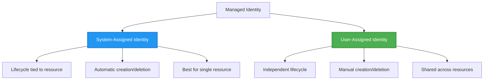

# Πρότυπα Αυθεντικοποίησης και Διαχειριζόμενη Ταυτότητα

⏱️ **Εκτιμώμενος Χρόνος**: 45-60 λεπτά ανάγνωσης· επιτρέψτε επιπλέον χρόνο για ενσωμάτωση ασκήσεων | 💰 **Επίδραση Κόστους**: Η ταυτότητα/RBAC είναι δωρεάν· η αναπτυχθείσα υπολογιστική ισχύς, αποθήκευση και Key Vault χρεώνονται | ⭐ **Πολυπλοκότητα**: Μεσαίου επιπέδου

> Ελεγμένο σύμφωνα με `azd 1.37.2` (Νοέμβριος 2026). Αυτό το μάθημα περιέχει **ενδεικτικά τμήματα ενσωμάτωσης, όχι πλήρες πρότυπο λήψης `secure-app`**. Δημιουργήστε τα αναφερόμενα αρχεία, παρέχετε την αντίστοιχη υποδομή και αντικαταστήστε τα στοιχεία κράτησης πριν την ανάπτυξη. Δεν αναπτύχθηκαν πόροι Azure κατά τον έλεγχο.

**📚 Διαδρομή Μάθησης:**
- ← Προηγούμενο: [Διαχείριση Διαμόρφωσης](configuration.md) - Διαχείριση μεταβλητών περιβάλλοντος και μυστικών
- 🎯 **Είστε εδώ**: Αυθεντικοποίηση & Ασφάλεια (Διαχειριζόμενη Ταυτότητα, Key Vault, ασφαλή πρότυπα)
- → Επόμενο: [Υποδομή ως Κώδικας](../chapter-04-infrastructure/README.md) - Παροχή και ανάπτυξη πόρων
- 🏠 [Αρχική Σελίδα Μαθήματος](../../README.md)

---

## Τι Θα Μάθετε

Ολοκληρώνοντας αυτό το μάθημα, θα:
- Κατανοήσετε τα πρότυπα αυθεντικοποίησης του Azure (κλειδιά, συμβολοσειρές σύνδεσης, διαχειριζόμενη ταυτότητα)
- Υλοποιήσετε **Διαχειριζόμενη Ταυτότητα** για αυθεντικοποίηση χωρίς κωδικό πρόσβασης
- Ασφαλίσετε μυστικά με ενσωμάτωση **Azure Key Vault**
- Διαμορφώσετε τον **έλεγχο πρόσβασης βάσει ρόλων (RBAC)** για αναπτύξεις AZD
- Εφαρμόσετε βέλτιστες πρακτικές ασφάλειας στις Εφαρμογές Κοντέινερ και υπηρεσίες Azure
- Μεταβείτε από αυθεντικοποίηση βασισμένη σε κλειδιά σε αυθεντικοποίηση βασισμένη σε ταυτότητα

## Γιατί η Διαχειριζόμενη Ταυτότητα Είναι Σημαντική

### Το Πρόβλημα: Παραδοσιακή Αυθεντικοποίηση

**Πριν τη Διαχειριζόμενη Ταυτότητα:**
```javascript
// ❌ SECURITY RISK: Hardcoded secrets in code
const connectionString = "Server=mydb.database.windows.net;User=admin;Password=P@ssw0rd123";
const storageKey = "xK7mN9pQ2wR5tY8uI0oP3aS6dF1gH4jK...";
const cosmosKey = "C2x7B9n4M1p8Q5w3E6r0T2y5U8i1O4p7...";
```

**Προβλήματα:**
- 🔴 **Αποκαλυπτόμενα μυστικά** στον κώδικα, στα αρχεία διαμόρφωσης, στις μεταβλητές περιβάλλοντος
- 🔴 **Ανανέωση διαπιστευτηρίων** απαιτεί αλλαγές κώδικα και εκ νέου ανάπτυξη
- 🔴 **Εφιάλτες ελέγχου** - ποιος προσέβαλε τι και πότε;
- 🔴 **Διάσπαρτα μυστικά** - μυστικά σκορπισμένα σε πολλά συστήματα
- 🔴 **Κίνδυνοι συμμόρφωσης** - αποτυχία ελέγχων ασφαλείας

### Η Λύση: Διαχειριζόμενη Ταυτότητα

**Μετά τη Διαχειριζόμενη Ταυτότητα:**
```javascript
// ✅ SECURE: No secrets in code
const credential = new DefaultAzureCredential();
const client = new BlobServiceClient(
  "https://mystorageaccount.blob.core.windows.net",
  credential  // Azure automatically handles authentication
);
```

**Οφέλη:**
- ✅ **Μηδενικά μυστικά** στον κώδικα ή τη διαμόρφωση
- ✅ **Αυτόματη ανανέωση** - το Azure το διαχειρίζεται
- ✅ **Πλήρες ιστορικό ελέγχου** στα αρχεία καταγραφής Microsoft Entra ID
- ✅ **Κεντρική ασφάλεια** - διαχείριση στο Azure Portal
- ✅ **Έτοιμο για συμμόρφωση** - πληροί πρότυπα ασφάλειας

**Παρομοίωση**: Η παραδοσιακή αυθεντικοποίηση είναι σαν να κουβαλάς πολλαπλά φυσικά κλειδιά για διαφορετικές πόρτες. Η Διαχειριζόμενη Ταυτότητα είναι σαν να έχεις ταυτότητα ασφαλείας που παρέχει αυτόματα πρόσβαση ανάλογα με το ποιος είσαι - χωρίς κλειδιά να χάνονται, να αντιγράφονται ή να ανανεώνονται.

---

## Επισκόπηση Αρχιτεκτονικής

### Ροή Αυθεντικοποίησης με Διαχειριζόμενη Ταυτότητα

```mermaid
sequenceDiagram
    participant App as Your Application<br/>(Container App)
    participant MI as Managed Identity<br/>(Microsoft Entra ID)
    participant KV as Key Vault
    participant Storage as Azure Storage
    participant DB as Azure SQL
    
    App->>MI: Request access token<br/>(automatic)
    MI->>MI: Verify identity<br/>(no password needed)
    MI-->>App: Return token for requested audience<br/>(lifetime varies)
    
    App->>KV: Get secret<br/>(using token)
    KV->>KV: Check RBAC permissions
    KV-->>App: Return secret value
    
    App->>Storage: Upload blob<br/>(using token)
    Storage->>Storage: Check RBAC permissions
    Storage-->>App: Success
    
    App->>DB: Query data<br/>(using token)
    DB->>DB: Check SQL permissions
    DB-->>App: Return results
    
    Note over App,DB: Request a separate token for each service audience;<br/>SDK credentials handle caching and renewal
```

### Τύποι Διαχειριζόμενων Ταυτοτήτων



| Χαρακτηριστικό | Αντιστοιχισμένη από το Σύστημα | Αντιστοιχισμένη από τον Χρήστη |
|--------------|---------------------------|-------------------------|
| **Κύκλος Ζωής** | Δεμένη στον πόρο | Ανεξάρτητη |
| **Δημιουργία** | Αυτόματη με τον πόρο | Χειροκίνητη δημιουργία |
| **Διαγραφή** | Διαγράφεται με τον πόρο | Παραμένει μετά τη διαγραφή πόρου |
| **Κοινή χρήση** | Μόνο σε έναν πόρο | Σε πολλούς πόρους |
| **Περίπτωση Χρήσης** | Απλά σενάρια | Πολύπλοκα σενάρια με πολλούς πόρους |
| **Επιλογή Προτύπου** | Ορισμένο στην υποδομή | Ορισμένο στην υποδομή |

---

## Προαπαιτούμενα

### Απαραίτητα Εργαλεία

Πρέπει να έχετε ήδη εγκαταστήσει από προηγούμενα μαθήματα:

```bash
# Verify Azure Developer CLI
azd version
# ✅ Expected: azd version 1.0.0 or higher

# Verify Azure CLI
az --version
# ✅ Expected: azure-cli 2.50.0 or higher
```

### Απαιτήσεις Azure

- Ενεργή συνδρομή στο Azure
- Δικαιώματα για:
  - Δημιουργία διαχειριζόμενων ταυτοτήτων
  - Ανάθεση ρόλων RBAC
  - Δημιουργία πόρων Key Vault
  - Ανάπτυξη Εφαρμογών Κοντέινερ

### Γνώσεις Προαπαιτούμενες

Πρέπει να έχετε ολοκληρώσει:
- [Οδηγός Εγκατάστασης](../chapter-01-foundation/installation.md) - Ρύθμιση AZD
- [Βασικά AZD](../chapter-01-foundation/azd-basics.md) - Βασικές έννοιες
- [Διαχείριση Διαμόρφωσης](configuration.md) - Μεταβλητές περιβάλλοντος

---

## Μάθημα 1: Κατανόηση Προτύπων Αυθεντικοποίησης

### Πρότυπο 1: Συμβολοσειρές Σύνδεσης (Παραδοσιακό - Αποφύγετε)

**Πώς λειτουργεί:**
```bash
# Connection string contains credentials
STORAGE_CONNECTION_STRING="DefaultEndpointsProtocol=https;AccountName=myaccount;AccountKey=xK7mN9pQ2wR5..."
COSMOS_CONNECTION_STRING="AccountEndpoint=https://myaccount.documents.azure.com:443/;AccountKey=C2x7..."
SQL_CONNECTION_STRING="Server=myserver.database.windows.net;User=admin;Password=P@ssw0rd..."
```

**Προβλήματα:**
- ❌ Τα μυστικά είναι ορατά στις μεταβλητές περιβάλλοντος
- ❌ Καταγεγραμμένα στα συστήματα ανάπτυξης
- ❌ Δύσκολη η ανανέωση
- ❌ Δεν υπάρχει ιστορικό ελέγχου πρόσβασης

**Πότε να χρησιμοποιηθεί:** Όταν η στοχευόμενη υπηρεσία απαιτεί αυθεντικοποίηση βασισμένη σε κλειδί. Προτιμήστε την ταυτότητα όπου υποστηρίζεται· αλλιώς αποθηκεύστε τα κλειδιά με ασφάλεια και ανανεώστε τα, ακόμα και σε παραγωγή.

---

### Πρότυπο 2: Αναφορές Key Vault (Καλύτερο)

**Πώς λειτουργεί:**
**Μερικά τμήματα Bicep:** απαραίτητα πεδία vault, ταυτότητα Container App και η `configuration.secrets` εισαγωγή παραλείπονται. Το `secretRef` αναφέρει όνομα μυστικού Container App· δεν είναι **αυτοτελές** URI Key Vault. Για χρήση Key Vault, ορίστε το συγκεκριμένο μυστικό με `keyVaultUrl` και εγκεκριμένο `identity`.

```bicep
// Store secret in Key Vault
resource keyVault 'Microsoft.KeyVault/vaults@2023-02-01' = {
  name: 'mykv'
  properties: {
    enableRbacAuthorization: true
  }
}

// Reference in Container App
env: [
  {
    name: 'STORAGE_KEY'
    secretRef: 'storage-key'  // References Key Vault
  }
]
```

**Οφέλη:**
- ✅ Τα μυστικά αποθηκεύονται με ασφάλεια στο Key Vault
- ✅ Κεντρική διαχείριση μυστικών
- ✅ Ανανέωση χωρίς αλλαγές στον κώδικα

**Περιορισμοί:**
- ⚠️ Χρησιμοποιούνται ακόμα κλειδιά/κωδικοί
- ⚠️ Απαιτείται διαχείριση πρόσβασης Key Vault

**Πότε να χρησιμοποιηθεί:** Βήμα μετάβασης από συμβολοσειρές σύνδεσης προς διαχειριζόμενη ταυτότητα.

---

### Πρότυπο 3: Διαχειριζόμενη Ταυτότητα (Βέλτιστη Πρακτική)

**Πώς λειτουργεί:**
**Μερικά Bicep:** συγχωνεύστε το μπλοκ ταυτότητας σε πλήρη Container App και παρέχετε `storageAccount` και τον ορισμό ρόλου. Ανάθεση ρόλου απαιτεί επίσης καθοριστικό `name`.

```bicep
// Enable managed identity
resource containerApp 'Microsoft.App/containerApps@2023-05-01' = {
  name: 'myapp'
  identity: {
    type: 'SystemAssigned'  // Automatically creates identity
  }
}

// Grant permissions
resource roleAssignment 'Microsoft.Authorization/roleAssignments@2022-04-01' = {
  name: guid(storageAccount.id, containerApp.id, storageBlobDataContributorRole)
  scope: storageAccount
  properties: {
    roleDefinitionId: storageBlobDataContributorRole
    principalId: containerApp.identity.principalId
    principalType: 'ServicePrincipal'
  }
}
```

**Κώδικας εφαρμογής:**
```javascript
// No secrets needed!
const { DefaultAzureCredential } = require('@azure/identity');
const { BlobServiceClient } = require('@azure/storage-blob');

const credential = new DefaultAzureCredential();
const blobServiceClient = new BlobServiceClient(
  'https://mystorageaccount.blob.core.windows.net',
  credential
);
```

**Οφέλη:**
- ✅ Μηδενικά μυστικά στον κώδικα/διαμόρφωση
- ✅ Αυτόματη ανανέωση διαπιστευτηρίων
- ✅ Πλήρες ιστορικό ελέγχου
- ✅ Δικαιώματα βάσει RBAC
- ✅ Έτοιμο για συμμόρφωση

**Πότε να χρησιμοποιηθεί:** Προτιμήστε για εφαρμογές που φιλοξενούνται στο Azure και έχουν πρόσβαση σε υπηρεσίες που υποστηρίζουν αυθεντικοποίηση Microsoft Entra.

---

### Πρότυπο 4: Υπηρεσιακοί Χρήστες (CI/CD & Αυτοματισμός)

Η διαχειριζόμενη ταυτότητα είναι το χρυσό πρότυπο *για πόρους που τρέχουν μέσα στο Azure*. Αλλά τι γίνεται με πράγματα που τρέχουν **εκτός** Azure — όπως μια ροή CI/CD σε έναν πράκτορα δημιουργίας, ή ένα σενάριο στο λάπτοπ σας που δεν μπορεί να χρησιμοποιήσει την αλληλεπιδραστική είσοδό σας; Εκεί έρχεται ο **υπηρεσιακός χρήστης**: μια μη ανθρώπινη ταυτότητα με δικά της διαπιστευτήρια που μπορεί να χρησιμοποιεί μια αυτοματοποιημένη διαδικασία.

**Πώς λειτουργεί:**

Δημιουργήστε έναν υπηρεσιακό χρήστη περιορισμένο σε μια ομάδα πόρων (ελάχιστα προνόμια):

```bash
az ad sp create-for-rbac \
  --name "myapp-cicd" \
  --role contributor \
  --scopes "/subscriptions/<sub-id>/resourceGroups/<rg-name>"
```

Αυτό εμφανίζει ένα client ID, client secret και tenant ID. Το azd μπορεί να κάνει είσοδο με αυτά μη αλληλεπιδραστικά:

```bash
azd auth login \
  --client-id "<appId>" \
  --client-secret "<password>" \
  --tenant-id "<tenant>"
```

**Προτιμήστε διαπιστευτήρια ομοσπονδίας (OIDC) αντί για μυστικά.** Αντί για μακροχρόνιο client secret, διαμορφώστε ένα ομοσπονδιακό διαπιστευτήριο ώστε η ροή εργασίας να ανταλλάσσει ένα βραχύβιο διακριτικό — χωρίς μυστικό να εκτίθεται ή να ανανεώνεται:

```bash
azd auth login \
  --client-id "<appId>" \
  --federated-credential-provider "github" \
  --tenant-id "<tenant>"
```

> `azd pipeline config` το ρυθμίζει αυτό αυτόματα για εσάς. Δείτε τα βήματα CI/CD στο [Κεφάλαιο 8](../chapter-08-production/production-ai-practices.md).

**Οφέλη:**
- ✅ Λειτουργεί εκτός Azure (πράκτορες κατασκευής, εσωτερικά δίκτυα, άλλα clouds)
- ✅ Μπορεί να περιοριστεί σε μία ομάδα πόρων με έναν ρόλο
- ✅ Η ομοσπονδιακή (OIDC) μορφή δεν χρησιμοποιεί αποθηκευμένο μυστικό

**Αντισταθμίσεις:**
- ⚠️ Η μορφή με μυστικό απαιτεί προσεκτική αποθήκευση και ανανέωση
- ⚠️ Αν διαρρεύσει το μυστικό, παρέχει πλήρη δικαιώματα - περιορίστε αυστηρά το πεδίο

**Πότε να χρησιμοποιήσετε:** Ροές εργασίας CI/CD και αυτοματισμοί που δεν μπορούν να χρησιμοποιήσουν διαχειριζόμενη ταυτότητα. Πάντα προτιμήστε την **ομοσπονδιακή/OIDC** μορφή έναντι του client secret, και προτιμήστε τη διαχειριζόμενη ταυτότητα όταν το φορτίο εκτελείται μέσα στο Azure.

**Αποθήκευση διαπιστευτηρίων με ασφάλεια:**
- Ποτέ μην καταχωρείτε μυστικά—χρησιμοποιήστε το μυστικό αποθήκευσης της ροής σας (GitHub Actions secrets, Azure DevOps groups μεταβλητών / Key Vault).
- Περιορίστε τον υπηρεσιακό χρήστη στον ελάχιστο απαιτούμενο ρόλο και ομάδα πόρων.
- Ορίστε ημερομηνία λήξης και ανανεώστε ή αφαιρέστε το μυστικό εντελώς με OIDC.

---

## Μάθημα 2: Υλοποίηση Διαχειριζόμενης Ταυτότητας με AZD

### Υλοποίηση Βήμα-βήμα

Τα παρακάτω τμήματα δείχνουν πώς να ενσωματώσετε διαχειριζόμενη ταυτότητα σε έργο Container App. Δεν είναι **αντιγραφή-εκτέλεση αρχικό πλαίσιο**: το Storage module, πλήρης υποδομή διαχειριζόμενου περιβάλλοντος/καταλόγου, Dockerfile και αρχείο παραμέτρων δεν παρέχονται πλήρως εδώ. Ξεκινήστε από ένα λειτουργικό πρότυπο Container Apps και ενσωματώστε αυτά τα πρότυπα, διατηρώντας τη διαμόρφωση καταλόγου και τις ετικέτες υπηρεσιών.

### Δομή Έργου

```
secure-app/
├── azure.yaml                 # AZD configuration
├── infra/
│   ├── main.bicep            # Main infrastructure
│   ├── core/
│   │   ├── identity.bicep    # Managed identity setup
│   │   ├── keyvault.bicep    # Key Vault configuration
│   │   └── storage.bicep     # Storage with RBAC
│   └── app/
│       └── container-app.bicep
└── src/
    ├── app.js                # Application code
    ├── package.json
    └── Dockerfile
```

### 1. Διαμόρφωση AZD (azure.yaml)

```yaml
name: secure-app
metadata:
  template: secure-app@1.0.0

services:
  api:
    project: ./src
    language: js
    host: containerapp

# Managed identity must be enabled in the infrastructure, not by this YAML.
```

### 2. Υποδομή: Ενεργοποίηση Διαχειριζόμενης Ταυτότητας

**Αρχείο: `infra/main.bicep`**

```bicep
targetScope = 'subscription'

param environmentName string
param location string = 'eastus'
param containerAppsEnvironmentId string
param containerImage string

var tags = { 'azd-env-name': environmentName }

// Resource group
resource rg 'Microsoft.Resources/resourceGroups@2021-04-01' = {
  name: 'rg-${environmentName}'
  location: location
  tags: tags
}

// Storage Account
module storage './core/storage.bicep' = {
  name: 'storage'
  scope: rg
  params: {
    name: 'st${uniqueString(rg.id)}'
    location: location
    tags: tags
  }
}

// Key Vault
module keyVault './core/keyvault.bicep' = {
  name: 'keyvault'
  scope: rg
  params: {
    name: 'kv-${uniqueString(rg.id)}'
    location: location
    tags: tags
  }
}

// Container App with Managed Identity
module containerApp './app/container-app.bicep' = {
  name: 'container-app'
  scope: rg
  params: {
    name: 'ca-${environmentName}'
    location: location
    tags: tags
    storageAccountName: storage.outputs.name
    keyVaultName: keyVault.outputs.name
    containerAppsEnvironmentId: containerAppsEnvironmentId
    containerImage: containerImage
  }
}

// Grant Container App access to Storage
module storageRoleAssignment './core/role-assignment.bicep' = {
  name: 'storage-role'
  scope: rg
  params: {
    principalId: containerApp.outputs.identityPrincipalId
    roleDefinitionId: 'ba92f5b4-2d11-453d-a403-e96b0029c9fe'  // Storage Blob Data Contributor
    targetResourceType: 'storage'
    targetResourceName: storage.outputs.name
  }
}

// Grant Container App access to Key Vault
module kvRoleAssignment './core/role-assignment.bicep' = {
  name: 'kv-role'
  scope: rg
  params: {
    principalId: containerApp.outputs.identityPrincipalId
    roleDefinitionId: '4633458b-17de-408a-b874-0445c86b69e6'  // Key Vault Secrets User
    targetResourceType: 'keyvault'
    targetResourceName: keyVault.outputs.name
  }
}

// Outputs
output AZURE_STORAGE_ACCOUNT_NAME string = storage.outputs.name
output AZURE_KEY_VAULT_NAME string = keyVault.outputs.name
output APP_URL string = containerApp.outputs.url
```

### 3. Container App με Ταυτότητα Αντιστοιχισμένη από το Σύστημα

**Αρχείο: `infra/app/container-app.bicep`**

```bicep
param name string
param location string
param tags object = {}
param storageAccountName string
param keyVaultName string
param containerAppsEnvironmentId string
param containerImage string

resource containerApp 'Microsoft.App/containerApps@2023-05-01' = {
  name: name
  location: location
  tags: union(tags, { 'azd-service-name': 'api' })
  identity: {
    type: 'SystemAssigned'  // 🔑 Enable managed identity
  }
  properties: {
    managedEnvironmentId: containerAppsEnvironmentId
    configuration: {
      ingress: {
        external: true
        targetPort: 3000
      }
    }
    template: {
      containers: [
        {
          name: 'api'
          image: containerImage // Must exist; configure registry credentials for private images
          resources: {
            cpu: json('0.5')
            memory: '1Gi'
          }
          env: [
            {
              name: 'AZURE_STORAGE_ACCOUNT_NAME'
              value: storageAccountName
            }
            {
              name: 'AZURE_KEY_VAULT_NAME'
              value: keyVaultName
            }
            // 🔑 No secrets - managed identity handles authentication!
          ]
        }
      ]
    }
  }
}

// Output the identity for RBAC assignments
output identityPrincipalId string = containerApp.identity.principalId
output id string = containerApp.id
output url string = 'https://${containerApp.properties.configuration.ingress.fqdn}'
```

### 4. Μονάδα Ανάθεσης Ρόλου RBAC

**Αρχείο: `infra/core/role-assignment.bicep`**

```bicep
param principalId string
param roleDefinitionId string  // Azure built-in role ID
@allowed(['storage', 'keyvault'])
param targetResourceType string
param targetResourceName string

// Typed existing resources give Bicep a valid resource scope, not a string ID.
resource storageTarget 'Microsoft.Storage/storageAccounts@2023-01-01' existing = {
  name: targetResourceName
}
resource vaultTarget 'Microsoft.KeyVault/vaults@2023-02-01' existing = {
  name: targetResourceName
}

resource storageAssignment 'Microsoft.Authorization/roleAssignments@2022-04-01' = if (targetResourceType == 'storage') {
  name: guid(storageTarget.id, principalId, roleDefinitionId)
  scope: storageTarget
  properties: {
    roleDefinitionId: subscriptionResourceId('Microsoft.Authorization/roleDefinitions', roleDefinitionId)
    principalId: principalId
    principalType: 'ServicePrincipal'
  }
}

resource vaultAssignment 'Microsoft.Authorization/roleAssignments@2022-04-01' = if (targetResourceType == 'keyvault') {
  name: guid(vaultTarget.id, principalId, roleDefinitionId)
  scope: vaultTarget
  properties: {
    roleDefinitionId: subscriptionResourceId('Microsoft.Authorization/roleDefinitions', roleDefinitionId)
    principalId: principalId
    principalType: 'ServicePrincipal'
  }
}

// This module assigns at the target resource scope, not the whole resource group.
```

### 5. Κώδικας Εφαρμογής με Διαχειριζόμενη Ταυτότητα

**Αρχείο: `src/app.js`**

```javascript
const express = require('express');
const { DefaultAzureCredential } = require('@azure/identity');
const { BlobServiceClient } = require('@azure/storage-blob');
const { SecretClient } = require('@azure/keyvault-secrets');

const app = express();
const PORT = process.env.PORT || 3000;

// 🔑 Initialize credential (works automatically with managed identity)
const credential = new DefaultAzureCredential();

// Azure Storage setup
const storageAccountName = process.env.AZURE_STORAGE_ACCOUNT_NAME;
const blobServiceClient = new BlobServiceClient(
  `https://${storageAccountName}.blob.core.windows.net`,
  credential  // No keys needed!
);

// Key Vault setup
const keyVaultName = process.env.AZURE_KEY_VAULT_NAME;
const secretClient = new SecretClient(
  `https://${keyVaultName}.vault.azure.net`,
  credential  // No keys needed!
);

// Health check
app.get('/health', (req, res) => {
  res.json({ status: 'healthy', authentication: 'managed-identity' });
});

// Upload file to blob storage
app.post('/upload', async (req, res) => {
  try {
    const containerClient = blobServiceClient.getContainerClient('uploads');
    await containerClient.createIfNotExists();
    
    const blobName = `file-${Date.now()}.txt`;
    const blockBlobClient = containerClient.getBlockBlobClient(blobName);
    
    const content = 'Hello from managed identity!';
    await blockBlobClient.upload(content, Buffer.byteLength(content));
    
    res.json({
      success: true,
      blobName: blobName,
      message: 'File uploaded using managed identity!'
    });
  } catch (error) {
    console.error('Upload error:', error);
    res.status(500).json({ error: error.message });
  }
});

// Get secret from Key Vault
app.get('/secret/:name', async (req, res) => {
  try {
    const secretName = req.params.name;
    const secret = await secretClient.getSecret(secretName);
    
    res.json({
      name: secretName,
      retrieved: secret.value !== undefined, // Never return the secret value to callers
      message: 'Secret retrieved using managed identity!'
    });
  } catch (error) {
    console.error('Secret error:', error);
    res.status(500).json({ error: error.message });
  }
});

// List blob containers (demonstrates read access)
app.get('/containers', async (req, res) => {
  try {
    const containers = [];
    for await (const container of blobServiceClient.listContainers()) {
      containers.push(container.name);
    }
    
    res.json({
      containers: containers,
      count: containers.length,
      message: 'Containers listed using managed identity!'
    });
  } catch (error) {
    console.error('List error:', error);
    res.status(500).json({ error: error.message });
  }
});

app.listen(PORT, () => {
  console.log(`Secure API listening on port ${PORT}`);
  console.log('Authentication: Managed Identity (passwordless)');
});
```

**Αρχείο: `src/package.json`**

```json
{
  "name": "secure-app",
  "version": "1.0.0",
  "dependencies": {
    "express": "^4.18.2",
    "@azure/identity": "^4.0.0",
    "@azure/storage-blob": "^12.17.0",
    "@azure/keyvault-secrets": "^4.7.0"
  },
  "scripts": {
    "start": "node app.js"
  }
}
```

### 6. Ανάπτυξη και Δοκιμή

Εκτελέστε αυτές τις εντολές **μετά** την ολοκλήρωση της υποδομής που λείπει, Dockerfile και το αντίστοιχο `main.parameters.json` στο δικό σας έργο. Πραγματοποιήστε αυθεντικοποίηση azd με `azd auth login`· κάντε είσοδο χωριστά με `az login` για τους ελέγχους Azure CLI αργότερα. Τα endpoints που εμφανίζονται είναι επιδείξεις και απαιτούν κατάλληλους ελέγχους πρόσβασης πριν τη δημόσια χρήση.

```bash
# Initialize AZD environment
azd init

# Deploy infrastructure and application
azd up

# Get the app URL
APP_URL=$(azd env get-value APP_URL)

# Test health check
curl $APP_URL/health
```

**✅ Αναμενόμενη έξοδος:**
```json
{
  "status": "healthy",
  "authentication": "managed-identity"
}
```

**Δοκιμή μεταφόρτωσης blob:**
```bash
curl -X POST $APP_URL/upload
```

**✅ Αναμενόμενη έξοδος:**
```json
{
  "success": true,
  "blobName": "file-1700404800000.txt",
  "message": "File uploaded using managed identity!"
}
```

**Δοκιμή λίστας κοντέινερ:**
```bash
curl $APP_URL/containers
```

**✅ Αναμενόμενη έξοδος:**
```json
{
  "containers": ["uploads"],
  "count": 1,
  "message": "Containers listed using managed identity!"
}
```

---

## Συνήθεις Ρόλοι Azure RBAC

### Ενσωματωμένα Αναγνωριστικά Ρόλων για Διαχειριζόμενη Ταυτότητα

| Υπηρεσία | Όνομα Ρόλου | Αναγνωριστικό Ρόλου | Δικαιώματα |
|---------|-------------|--------------------|-------------|
| **Storage** | Storage Blob Data Reader | `2a2b9908-6ea1-4ae2-8e65-a410df84e7d1` | Ανάγνωση blobs και κοντέινερ |
| **Storage** | Storage Blob Data Contributor | `ba92f5b4-2d11-453d-a403-e96b0029c9fe` | Ανάγνωση, εγγραφή, διαγραφή blobs |
| **Storage** | Storage Queue Data Contributor | `974c5e8b-45b9-4653-ba55-5f855dd0fb88` | Ανάγνωση, εγγραφή, διαγραφή ουρών/μηνυμάτων |
| **Key Vault** | Key Vault Secrets User | `4633458b-17de-408a-b874-0445c86b69e6` | Ανάγνωση μυστικών |
| **Key Vault** | Key Vault Secrets Officer | `b86a8fe4-44ce-4948-aee5-eccb2c155cd7` | Ανάγνωση, εγγραφή, διαγραφή μυστικών |
| **Cosmos DB** | Cosmos DB Built-in Data Reader | `00000000-0000-0000-0000-000000000001` | Ανάγνωση δεδομένων Cosmos DB |
| **Cosmos DB** | Cosmos DB Built-in Data Contributor | `00000000-0000-0000-0000-000000000002` | Ανάγνωση, εγγραφή δεδομένων Cosmos DB |
| **SQL Database** | SQL DB Contributor | `9b7fa17d-e63e-47b0-bb0a-15c516ac86ec` | Διαχείριση πόρων βάσης δεδομένων· δεν παρέχει SQL πρόσβαση δεδομένων |
| **Service Bus** | Azure Service Bus Data Owner | `090c5cfd-751d-490a-894a-3ce6f1109419` | Αποστολή, λήψη, διαχείριση μηνυμάτων |

### Πώς να Βρείτε Αναγνωριστικά Ρόλων

Τα δύο παραπάνω IDs για Cosmos DB για NoSQL είναι **ενσωματωμένοι ορισμοί ρόλων δεδομένων Cosmos** και όχι IDs ρόλων συνδρομής Azure RBAC. Αναθέστε τα με `az cosmosdb sql role assignment create` (ή `Microsoft.DocumentDB/databaseAccounts/sqlRoleAssignments`), όχι `az role assignment create`. Η πρόσβαση σε δεδομένα SQL απαιτεί χρήστη βάσης Entra και δικαιώματα SQL.

```bash
# List all built-in roles
az role definition list --query "[].{Name:roleName, ID:name}" --output table

# Search for specific role
az role definition list --query "[?contains(roleName, 'Storage Blob')].{Name:roleName, ID:name}" --output table

# Get role details
az role definition list --name "Storage Blob Data Contributor"
```

---

## Πρακτικές Ασκήσεις

**Προαπαιτούμενα ενσωμάτωσης για τις τρεις ασκήσεις:** λειτουργικό πρότυπο Container App στο δικό σας έργο, αντίστοιχοι πόροι Bicep, είσοδος Azure CLI/azd και εξουσιοδότηση για ανάθεση των απαιτούμενων ρόλων. Πρόκειται για καθοδηγούμενες προσαρμογές, όχι ανεξάρτητα αρχικά· αντικαταστήστε τα δείγματα ονομάτων πόρων με τα αναπτυγμένα ονόματά σας.

### Άσκηση 1: Ενεργοποίηση Διαχειριζόμενης Ταυτότητας για Υφιστάμενη Εφαρμογή ⭐⭐ (Μεσαίο)

**Σκοπός**: Προσθήκη διαχειριζόμενης ταυτότητας σε υπάρχουσα ανάπτυξη Container App

**Σενάριο**: Έχετε μια Container App που χρησιμοποιεί συμβολοσειρές σύνδεσης. Μετατρέψτε τη σε διαχειριζόμενη ταυτότητα.

**Αρχικό Σημείο**: Container App με αυτή τη διαμόρφωση:

```bicep
// ❌ Current: Using connection string
env: [
  {
    name: 'STORAGE_CONNECTION_STRING'
    secretRef: 'storage-connection'
  }
]
```

**Βήματα**:

1. **Ενεργοποιήστε διαχειριζόμενη ταυτότητα στο Bicep:**

```bicep
resource containerApp 'Microsoft.App/containerApps@2023-05-01' = {
  name: 'myapp'
  identity: {
    type: 'SystemAssigned'  // Add this
  }
  // ... rest of configuration
}
```

2. **Παρέχετε πρόσβαση Storage:**

```bicep
// Get storage account reference
resource storageAccount 'Microsoft.Storage/storageAccounts@2023-01-01' existing = {
  name: storageAccountName
}

// Assign role
resource roleAssignment 'Microsoft.Authorization/roleAssignments@2022-04-01' = {
  name: guid(containerApp.id, 'ba92f5b4-2d11-453d-a403-e96b0029c9fe', storageAccount.id)
  scope: storageAccount
  properties: {
    roleDefinitionId: subscriptionResourceId('Microsoft.Authorization/roleDefinitions', 'ba92f5b4-2d11-453d-a403-e96b0029c9fe')
    principalId: containerApp.identity.principalId
    principalType: 'ServicePrincipal'
  }
}
```

3. **Ενημερώστε τον κώδικα εφαρμογής:**

**Πριν (συμβολοσειρά σύνδεσης):**
```javascript
const { BlobServiceClient } = require('@azure/storage-blob');

const blobServiceClient = BlobServiceClient.fromConnectionString(
  process.env.STORAGE_CONNECTION_STRING
);
```

**Μετά (διαχειριζόμενη ταυτότητα):**
```javascript
const { DefaultAzureCredential } = require('@azure/identity');
const { BlobServiceClient } = require('@azure/storage-blob');

const credential = new DefaultAzureCredential();
const blobServiceClient = new BlobServiceClient(
  `https://${process.env.STORAGE_ACCOUNT_NAME}.blob.core.windows.net`,
  credential
);
```

4. **Ενημερώστε μεταβλητές περιβάλλοντος:**

```bicep
env: [
  {
    name: 'STORAGE_ACCOUNT_NAME'
    value: storageAccountName  // Just the name, no secrets!
  }
  // Remove STORAGE_CONNECTION_STRING
]
```

5. **Αναπτύξτε και δοκιμάστε:**

```bash
# Redeploy
azd up

# Test that it still works
APP_URL=$(azd show --output json | jq -er '.services.api.ingressUrl')
curl --fail -X POST "$APP_URL/upload"
```

**✅ Κριτήρια Επιτυχίας:**
- ✅ Η εφαρμογή αναπτύσσεται χωρίς σφάλματα
- ✅ Λειτουργίες αποθήκευσης δουλεύουν (ανέβασμα, λίστα, λήψη)
- ✅ Καμία συμβολοσειρά σύνδεσης στις μεταβλητές περιβάλλοντος
- ✅ Ταυτότητα ορατή στο Azure Portal στην ενότητα "Identity"

**Επαλήθευση:**

```bash
# Check managed identity is enabled
az containerapp show \
  --name myapp \
  --resource-group rg-myapp \
  --query "identity.type"
# ✅ Expected: "SystemAssigned"

# Check role assignment
az role assignment list \
  --assignee $(az containerapp show --name myapp --resource-group rg-myapp --query "identity.principalId" -o tsv) \
  --scope /subscriptions/{sub-id}/resourceGroups/rg-myapp/providers/Microsoft.Storage/storageAccounts/mystorageaccount
# ✅ Expected: Shows "Storage Blob Data Contributor" role
```

**Χρόνος**: 20-30 λεπτά

---

### Άσκηση 2: Πρόσβαση Πολλών Υπηρεσιών με Διαχειριζόμενη Ταυτότητα Ανατεθείσα από Χρήστη ⭐⭐⭐ (Προχωρημένο)

**Σκοπός**: Δημιουργήστε μια διαχειριζόμενη ταυτότητα ανατεθείσα από χρήστη κοινή σε πολλαπλές Εφαρμογές Κοντέινερ

**Σενάριο**: Έχετε 3 μικροϋπηρεσίες που όλες χρειάζονται πρόσβαση στον ίδιο λογαριασμό Storage και Key Vault.

**Βήματα**:

1. **Δημιουργία διαχειριζόμενης ταυτότητας ανατεθείσας από χρήστη:**

**Αρχείο: `infra/core/identity.bicep`**

```bicep
param name string
param location string
param tags object = {}

resource userAssignedIdentity 'Microsoft.ManagedIdentity/userAssignedIdentities@2023-01-31' = {
  name: name
  location: location
  tags: tags
}

output id string = userAssignedIdentity.id
output principalId string = userAssignedIdentity.properties.principalId
output clientId string = userAssignedIdentity.properties.clientId
```

2. **Ανάθεση ρόλων στη διαχειριζόμενη ταυτότητα ανατεθείσα από χρήστη:**

```bicep
// In main.bicep
module userIdentity './core/identity.bicep' = {
  name: 'user-identity'
  scope: rg
  params: {
    name: 'id-${environmentName}'
    location: location
    tags: tags
  }
}

// Grant Storage access
resource storageRoleAssignment 'Microsoft.Authorization/roleAssignments@2022-04-01' = {
  name: guid(storageAccount.id, environmentName, 'storage-contributor')
  scope: storageAccount
  properties: {
    roleDefinitionId: subscriptionResourceId('Microsoft.Authorization/roleDefinitions', 'ba92f5b4-2d11-453d-a403-e96b0029c9fe')
    principalId: userIdentity.outputs.principalId
    principalType: 'ServicePrincipal'
  }
}

// Grant Key Vault access
resource kvRoleAssignment 'Microsoft.Authorization/roleAssignments@2022-04-01' = {
  name: guid(keyVault.id, environmentName, 'kv-secrets-user')
  scope: keyVault
  properties: {
    roleDefinitionId: subscriptionResourceId('Microsoft.Authorization/roleDefinitions', '4633458b-17de-408a-b874-0445c86b69e6')
    principalId: userIdentity.outputs.principalId
    principalType: 'ServicePrincipal'
  }
}
```

3. **Ανάθεση ταυτότητας σε πολλαπλές Εφαρμογές Container:**

```bicep
resource apiGateway 'Microsoft.App/containerApps@2023-05-01' = {
  name: 'api-gateway'
  identity: {
    type: 'UserAssigned'
    userAssignedIdentities: {
      '${userIdentity.outputs.id}': {}
    }
  }
  // ... rest of config
}

resource productService 'Microsoft.App/containerApps@2023-05-01' = {
  name: 'product-service'
  identity: {
    type: 'UserAssigned'
    userAssignedIdentities: {
      '${userIdentity.outputs.id}': {}
    }
  }
  // ... rest of config
}

resource orderService 'Microsoft.App/containerApps@2023-05-01' = {
  name: 'order-service'
  identity: {
    type: 'UserAssigned'
    userAssignedIdentities: {
      '${userIdentity.outputs.id}': {}
    }
  }
  // ... rest of config
}
```

4. **Κώδικας εφαρμογής (όλες οι υπηρεσίες χρησιμοποιούν το ίδιο μοτίβο):**

```javascript
const { ManagedIdentityCredential } = require('@azure/identity');
const { BlobServiceClient } = require('@azure/storage-blob');

// For user-assigned identity, specify the client ID
const credential = new ManagedIdentityCredential(
  process.env.AZURE_CLIENT_ID  // User-assigned identity client ID
);

// Alternative (choose ONE credential declaration):
// const { DefaultAzureCredential } = require('@azure/identity');
// const credential = new DefaultAzureCredential({
//   managedIdentityClientId: process.env.AZURE_CLIENT_ID
// });

const blobServiceClient = new BlobServiceClient(
  `https://${process.env.STORAGE_ACCOUNT_NAME}.blob.core.windows.net`,
  credential
);
```

Ορίστε το runtime `AZURE_CLIENT_ID` κάθε Εφαρμογής Container σε `userIdentity.outputs.clientId` και `STORAGE_ACCOUNT_NAME` στο όνομα αποθήκευσης σας στο Bicep. Το απλό να αναθέσετε την ταυτότητα ή να τρέξετε `azd env set` δεν ρυθμίζει αυτές τις τιμές runtime.

5. **Ανάπτυξη και επαλήθευση:**

```bash
azd up

# Test all services can access storage
# Replace with the actual ingress URLs reported for your three services
curl --fail -X POST "$API_GATEWAY_URL/upload"
curl --fail -X POST "$PRODUCT_SERVICE_URL/upload"
curl --fail -X POST "$ORDER_SERVICE_URL/upload"
```

**✅ Κριτήρια επιτυχίας:**
- ✅ Μία ταυτότητα κοινή για 3 υπηρεσίες
- ✅ Όλες οι υπηρεσίες μπορούν να έχουν πρόσβαση σε Storage και Key Vault
- ✅ Η ταυτότητα διατηρείται αν διαγράψετε μία υπηρεσία
- ✅ Κεντρική διαχείριση δικαιωμάτων

**Οφέλη της ταυτότητας που της ανατίθεται από τον χρήστη:**
- Μία μοναδική ταυτότητα για διαχείριση
- Συνεπή δικαιώματα ανάμεσα σε υπηρεσίες
- Επιβιώνει από τη διαγραφή υπηρεσίας
- Καλύτερο για σύνθετες αρχιτεκτονικές

**Χρόνος**: 30-40 λεπτά

---

### Άσκηση 3: Υλοποίηση Περιστροφής Μυστικού Key Vault ⭐⭐⭐ (Προχωρημένο)

**Στόχος**: Αποθήκευση κλειδιών API τρίτων μερών στο Key Vault και πρόσβαση σε αυτά χρησιμοποιώντας managed identity

**Σενάριο**: Η εφαρμογή σας πρέπει να καλέσει ένα εξωτερικό API (OpenAI, Stripe, SendGrid) που απαιτεί κλειδιά API.

**Βήματα**:

1. **Δημιουργία Key Vault με RBAC:**

**Αρχείο: `infra/core/keyvault.bicep`**

```bicep
param name string
param location string
param tags object = {}

resource keyVault 'Microsoft.KeyVault/vaults@2023-02-01' = {
  name: name
  location: location
  tags: tags
  properties: {
    enableRbacAuthorization: true  // Use RBAC instead of access policies
    sku: {
      family: 'A'
      name: 'standard'
    }
    tenantId: subscription().tenantId
    enableSoftDelete: true
    softDeleteRetentionInDays: 90
  }
}

// Allow Container App to read secrets
output id string = keyVault.id
output name string = keyVault.name
output uri string = keyVault.properties.vaultUri
```

2. **Αποθήκευση μυστικών στο Key Vault:**

```bash
# Get Key Vault name
KV_NAME=$(azd env get-value AZURE_KEY_VAULT_NAME)

# Store third-party API keys
az keyvault secret set \
  --vault-name $KV_NAME \
  --name "OpenAI-ApiKey" \
  --value "sk-proj-xxxxxxxxxxxxx"

az keyvault secret set \
  --vault-name $KV_NAME \
  --name "Stripe-ApiKey" \
  --value "sk_live_xxxxxxxxxxxxx"

az keyvault secret set \
  --vault-name $KV_NAME \
  --name "SendGrid-ApiKey" \
  --value "SG.xxxxxxxxxxxxx"
```

3. **Κώδικας εφαρμογής για ανάκτηση μυστικών:**

**Αρχείο: `src/config.js`**

```javascript
const { DefaultAzureCredential } = require('@azure/identity');
const { SecretClient } = require('@azure/keyvault-secrets');

class Config {
  constructor() {
    this.credential = new DefaultAzureCredential();
    this.secretClient = new SecretClient(
      `https://${process.env.AZURE_KEY_VAULT_NAME}.vault.azure.net`,
      this.credential
    );
    this.cache = {};
  }

  async getSecret(secretName) {
    // Check cache first
    if (this.cache[secretName]) {
      return this.cache[secretName];
    }

    try {
      const secret = await this.secretClient.getSecret(secretName);
      this.cache[secretName] = secret.value;
      console.log(`✅ Retrieved secret: ${secretName}`);
      return secret.value;
    } catch (error) {
      console.error(`❌ Failed to get secret ${secretName}:`, error.message);
      throw error;
    }
  }

  async getOpenAIKey() {
    return this.getSecret('OpenAI-ApiKey');
  }

  async getStripeKey() {
    return this.getSecret('Stripe-ApiKey');
  }

  async getSendGridKey() {
    return this.getSecret('SendGrid-ApiKey');
  }
}

module.exports = new Config();
```

4. **Χρησιμοποίηση μυστικών στην εφαρμογή:**

**Αρχείο: `src/app.js`**

Αυτό το **αντικαταστατικό τμήμα εφαρμογής** απαιτεί `npm install openai`, ένα πραγματικό κλειδί τρίτου μέρους, ένα προσβάσιμο μοντέλο και την υποδομή από το έργο εργασίας σας. Καλεί το OpenAI απευθείας, όχι μια ανάπτυξη Azure OpenAI. Τα παρακάτω δείγματα κλειδιών δεν εξουσιοδοτούν κάποιο αίτημα.

```javascript
const express = require('express');
const config = require('./config');
const { OpenAI } = require('openai');

const app = express();

// Initialize OpenAI with key from Key Vault
let openaiClient;

async function initializeServices() {
  const openaiKey = await config.getOpenAIKey();
  openaiClient = new OpenAI({ apiKey: openaiKey });
  console.log('✅ Services initialized with secrets from Key Vault');
}

app.post('/chat', async (req, res) => {
  try {
    const completion = await openaiClient.chat.completions.create({
      model: 'gpt-4.1',
      messages: [{ role: 'user', content: 'Hello!' }]
    });
    
    res.json({
      response: completion.choices[0].message.content,
      authentication: 'Key from Key Vault via Managed Identity'
    });
  } catch (error) {
    res.status(500).json({ error: error.message });
  }
});

// Start listening only after initialization succeeds.
initializeServices().then(() => {
  app.listen(3000, () => console.log('Key Vault demo running'));
}).catch(error => {
  console.error('Initialization failed:', error.message);
  process.exitCode = 1;
});
```

5. **Ανάπτυξη και δοκιμή:**

```bash
azd up

# Test that API keys work
curl -X POST https://myapp.azurecontainerapps.io/chat \
  -H "Content-Type: application/json" \
  -d '{"message":"Hello AI"}'
```

**✅ Κριτήρια επιτυχίας:**
- ✅ Κανένα κλειδί API στον κώδικα ή στις μεταβλητές περιβάλλοντος
- ✅ Η εφαρμογή ανακτά τα κλειδιά από το Key Vault
- ✅ Τα API τρίτων λειτουργούν σωστά
- ✅ Μπορεί να περιστρέψει τα κλειδιά χωρίς αλλαγές κώδικα

**Περιστροφή μυστικού:**

```bash
# Update secret in Key Vault
az keyvault secret set \
  --vault-name $KV_NAME \
  --name "OpenAI-ApiKey" \
  --value "sk-proj-NEW_KEY_HERE"

# Find the active revision name, then restart it to clear the in-process cache
az containerapp revision list --name myapp --resource-group rg-myapp --output table
az containerapp revision restart \
  --name myapp \
  --resource-group rg-myapp \
  --revision "<active-revision-name>"
```

**Χρόνος**: 25-35 λεπτά

---

## Σημείο Ελέγχου Γνώσης

### 1. Μοτίβα Αυθεντικοποίησης ✓

Ελέγξτε την κατανόησή σας:

- [ ] **Ε1**: Ποια είναι τα τρία βασικά μοτίβα αυθεντικοποίησης; 
  - **Α**: Connection strings (παρωχημένα), Αναφορές Key Vault (μετάβαση), Managed Identity (το καλύτερο)

- [ ] **Ε2**: Γιατί η managed identity είναι καλύτερη από τα connection strings;
  - **Α**: Χωρίς μυστικά στον κώδικα, αυτόματη περιστροφή, πλήρες ιστορικό ελέγχου, δικαιώματα RBAC

- [ ] **Ε3**: Πότε θα χρησιμοποιούσατε user-assigned identity αντί για system-assigned;
  - **Α**: Όταν μοιράζεστε ταυτότητα μεταξύ πολλών πόρων ή όταν ο κύκλος ζωής της ταυτότητας είναι ανεξάρτητος από τον κύκλο ζωής του πόρου

**Πρακτικός Έλεγχος:**
```bash
# Check what type of identity your app uses
az containerapp show \
  --name myapp \
  --resource-group rg-myapp \
  --query "identity.type"

# List all role assignments for the identity
az role assignment list \
  --assignee $(az containerapp show --name myapp --resource-group rg-myapp --query "identity.principalId" -o tsv)
```

---

### 2. RBAC και Δικαιώματα ✓

Ελέγξτε την κατανόησή σας:

- [ ] **Ε1**: Ποιος είναι ο ρόλος ID για "Storage Blob Data Contributor";
  - **Α**: `ba92f5b4-2d11-453d-a403-e96b0029c9fe`

- [ ] **Ε2**: Ποια δικαιώματα παρέχει ο ρόλος "Key Vault Secrets User";
  - **Α**: Πρόσβαση μόνο ανάγνωσης σε μυστικά (δεν μπορεί να δημιουργήσει, ενημερώσει ή διαγράψει)

- [ ] **Ε3**: Πώς δίνετε πρόσβαση Εφαρμογής Container σε Azure SQL;
  - **Α**: Ρυθμίστε την αυθεντικοποίηση Microsoft Entra, δημιουργήστε την ταυτότητα ως χρήστη βάσης δεδομένων, και δώστε τα απαραίτητα δικαιώματα SQL. Ο ρόλος "SQL DB Contributor" διαχειρίζεται μόνο πόρους Azure, δεν εξουσιοδοτεί τα ερωτήματα.

**Πρακτικός Έλεγχος:**
```bash
# Find specific role
az role definition list --name "Storage Blob Data Contributor"

# Check what roles are assigned to your identity
PRINCIPAL_ID=$(az containerapp show --name myapp --resource-group rg-myapp --query "identity.principalId" -o tsv)
az role assignment list --assignee $PRINCIPAL_ID --output table
```

---

### 3. Ενσωμάτωση Key Vault ✓

Ελέγξτε την κατανόησή σας:

- [ ] **Ε1**: Πώς ενεργοποιείτε το RBAC για το Key Vault αντί για τις πολιτικές πρόσβασης;
  - **Α**: Ορίστε `enableRbacAuthorization: true` στο Bicep

- [ ] **Ε2**: Ποια βιβλιοθήκη Azure SDK χειρίζεται την αυθεντικοποίηση managed identity;
  - **Α**: `@azure/identity` με την κλάση `DefaultAzureCredential`

- [ ] **Ε3**: Πόσο καιρό παραμένουν τα μυστικά Key Vault στην κρυφή μνήμη;
  - **Α**: Εξαρτάται από την εφαρμογή· υλοποιήστε τη δική σας στρατηγική caching

**Πρακτικός Έλεγχος:**
```bash
# Test Key Vault access
az keyvault secret show \
  --vault-name $KV_NAME \
  --name "OpenAI-ApiKey" \
  --query "{name:name,enabled:attributes.enabled}"

# Check RBAC is enabled
az keyvault show \
  --name $KV_NAME \
  --query "properties.enableRbacAuthorization"
# ✅ Expected: true
```

---

## Καλύτερες Πρακτικές Ασφαλείας

### ✅ ΚΑΝΕΤΕ:

1. **Πάντα να χρησιμοποιείτε managed identity σε παραγωγή**
   ```bicep
   identity: {
     type: 'SystemAssigned'
   }
   ```

2. **Χρησιμοποιήστε ρόλους RBAC με την ελάχιστη δυνατή άδεια**
   - Χρησιμοποιήστε ρόλους "Reader" όπου είναι δυνατόν
   - Αποφύγετε ρόλους "Owner" ή "Contributor" εκτός αν είναι απαραίτητο

3. **Αποθηκεύστε κλειδιά τρίτων στο Key Vault**
   ```javascript
   const apiKey = await secretClient.getSecret('ThirdPartyApiKey');
   ```

4. **Ενεργοποιήστε την καταγραφή ελέγχου** (μερικό τμήμα πόρου· συγχωνεύστε με τις δηλώσεις του vault και του workspace σας)
   ```bicep
   resource vaultDiagnostics 'Microsoft.Insights/diagnosticSettings@2021-05-01-preview' = {
     name: 'vault-audit'
     scope: keyVault
     properties: {
       workspaceId: logAnalytics.id
       logs: [{ category: 'AuditEvent', enabled: true }]
     }
   }
   ```

5. **Χρησιμοποιήστε διαφορετικές ταυτότητες για dev/staging/prod**
   ```bash
   azd env new dev
   azd env new staging
   azd env new prod
   ```

6. **Περιστρέψτε τα μυστικά τακτικά**
   - Ορίστε ημερομηνίες λήξης στα μυστικά Key Vault
   - Αυτοματοποιήστε την περιστροφή με Azure Functions

### ❌ ΜΗΝ:

1. **Ποτέ μην ενσωματώνετε μυστικά στον κώδικα**
   ```javascript
   // ❌ BAD
   const apiKey = "sk-proj-xxxxxxxxxxxxx";
   ```

2. **Μην χρησιμοποιείτε connection strings σε παραγωγή**
   ```javascript
   // ❌ BAD
   BlobServiceClient.fromConnectionString(process.env.STORAGE_CONNECTION_STRING)
   ```

3. **Μην δίνετε υπερβολικά δικαιώματα**
   ```bicep
   // ❌ BAD - too much access
   roleDefinitionId: subscriptionResourceId('Microsoft.Authorization/roleDefinitions', '8e3af657-a8ff-443c-a75c-2fe8c4bcb635')
   
   // ✅ GOOD - least privilege
   roleDefinitionId: subscriptionResourceId('Microsoft.Authorization/roleDefinitions', '2a2b9908-6ea1-4ae2-8e65-a410df84e7d1')
   ```

4. **Μην καταγράφετε μυστικά**
   ```javascript
   // ❌ BAD
   console.log('API Key:', apiKey);
   
   // ✅ GOOD
   console.log('API Key retrieved successfully');
   ```

5. **Μην μοιράζεστε ταυτότητες παραγωγής μεταξύ περιβαλλόντων**
   ```bicep
   // ❌ BAD - same identity for dev and prod
   // ✅ GOOD - separate identities per environment
   ```

---

## Οδηγός Επίλυσης Προβλημάτων

### Πρόβλημα: "Ανεπιθύμητη πρόσβαση" κατά την πρόσβαση στο Azure Storage

**Συμπτώματα:**
```
Error: Unauthorized (403)
AuthorizationPermissionMismatch: This request is not authorized to perform this operation
```

**Διάγνωση:**

```bash
# Check if managed identity is enabled
az containerapp show \
  --name myapp \
  --resource-group rg-myapp \
  --query "identity.type"
# ✅ Expected: "SystemAssigned" or "UserAssigned"

# Check role assignments
PRINCIPAL_ID=$(az containerapp show --name myapp --resource-group rg-myapp --query "identity.principalId" -o tsv)
az role assignment list --assignee $PRINCIPAL_ID

# Expected: Should see "Storage Blob Data Contributor" or similar role
```

**Λύσεις:**

1. **Παραχωρήστε τον σωστό ρόλο RBAC:**
```bash
STORAGE_ID=$(az storage account show --name mystorageaccount --resource-group rg-myapp --query "id" -o tsv)
az role assignment create \
  --assignee $PRINCIPAL_ID \
  --role "Storage Blob Data Contributor" \
  --scope $STORAGE_ID
```

2. **Περίμενε για τη διάδοση (μπορεί να πάρει 5-10 λεπτά):**
```bash
# Check role assignment status
az role assignment list --assignee $PRINCIPAL_ID --scope $STORAGE_ID
```

3. **Επαληθεύστε ότι ο κώδικας της εφαρμογής χρησιμοποιεί τα σωστά διαπιστευτήρια:**
```javascript
// Make sure you're using DefaultAzureCredential
const credential = new DefaultAzureCredential();
```

---

### Πρόβλημα: Αρνηση πρόσβασης στο Key Vault

**Συμπτώματα:**
```
Error: Forbidden (403)
The user, group or application does not have secrets get permission
```

**Διάγνωση:**

```bash
# Check Key Vault RBAC is enabled
az keyvault show \
  --name $KV_NAME \
  --query "properties.enableRbacAuthorization"
# ✅ Expected: true

# Check role assignments
az role assignment list \
  --assignee $PRINCIPAL_ID \
  --scope /subscriptions/{sub-id}/resourceGroups/rg-myapp/providers/Microsoft.KeyVault/vaults/$KV_NAME
```

**Λύσεις:**

1. **Ενεργοποιήστε το RBAC στο Key Vault:**
```bash
az keyvault update \
  --name $KV_NAME \
  --enable-rbac-authorization true
```

2. **Παραχωρήστε ρόλο Key Vault Secrets User:**
```bash
KV_ID=$(az keyvault show --name $KV_NAME --query "id" -o tsv)
az role assignment create \
  --assignee $PRINCIPAL_ID \
  --role "Key Vault Secrets User" \
  --scope $KV_ID
```

---

### Πρόβλημα: Το DefaultAzureCredential αποτυγχάνει τοπικά

**Συμπτώματα:**
```
Error: DefaultAzureCredential failed to retrieve a token
CredentialUnavailableError: No credential available
```

**Διάγνωση:**

```bash
# Check if you're logged in
az account show

# Check Azure CLI authentication
az ad signed-in-user show
```

**Λύσεις:**

1. **Συνδεθείτε στο Azure CLI:**
```bash
az login
```

2. **Ορίστε την συνδρομή Azure:**
```bash
az account set --subscription "Your Subscription Name"
```

3. **Για τοπική ανάπτυξη, χρησιμοποιήστε περιβαλλοντικές μεταβλητές:**
```bash
export AZURE_TENANT_ID="your-tenant-id"
export AZURE_CLIENT_ID="your-client-id"
export AZURE_CLIENT_SECRET="your-client-secret"
```

4. **Ή χρησιμοποιήστε διαφορετικό διαπιστευτήριο τοπικά:**
```javascript
const { DefaultAzureCredential, AzureCliCredential } = require('@azure/identity');

// Use AzureCliCredential for local dev
const credential = process.env.NODE_ENV === 'production' 
  ? new DefaultAzureCredential()
  : new AzureCliCredential();
```

---

### Πρόβλημα: Η ανάθεση ρόλου χρειάζεται πολύ χρόνο για να διαδοθεί

**Συμπτώματα:**
- Ο ρόλος ανατέθηκε επιτυχώς
- Ακόμα εμφανίζονται σφάλματα 403
- Εναλλασσόμενη πρόσβαση (μερικές φορές λειτουργεί, άλλες φορές όχι)

**Εξήγηση:**
Οι αλλαγές Azure RBAC μπορεί να πάρουν 5-10 λεπτά για να διαδοθούν παγκοσμίως.

**Λύση:**

```bash
# Wait and retry
echo "Waiting for RBAC propagation..."
sleep 300  # Wait 5 minutes

# Test access
curl --fail -X POST "$APP_URL/upload"

# If still failing, restart the app
az containerapp revision restart \
  --name myapp \
  --resource-group rg-myapp \
  --revision "<active-revision-name>"
```

---

## Σκέψεις Κόστους

### Κόστος Managed Identity

| Πόρος | Κόστος |
|----------|------|
| **Managed Identity** | 🆓 **ΔΩΡΕΑΝ** - Χωρίς χρέωση |
| **Αναθέσεις ρόλων RBAC** | 🆓 **ΔΩΡΕΑΝ** - Χωρίς χρέωση |
| **Αιτήσεις Token Microsoft Entra ID** | 🆓 **ΔΩΡΕΑΝ** - Συμπεριλαμβανόμενο |
| **Ενέργειες Key Vault** | $0.03 ανά 10.000 ενέργειες |
| **Αποθήκευση μυστικών Key Vault** | Ελέγξτε τις τρέχουσες τιμές· μην υποθέτετε μηνιαία χρέωση ανά μυστικό |

**Η managed identity εξοικονομεί χρήματα με:**
- ✅ Κατάργηση ενεργειών Key Vault για την αυθεντικοποίηση υπηρεσίας προς υπηρεσία
- ✅ Μείωση περιστατικών ασφαλείας (χωρίς διαρροή διαπιστευτηρίων)
- ✅ Μείωση χειροκίνητου κόστους λειτουργίας (χωρίς χειροκίνητη περιστροφή)

Ο αριθμός αιτήσεων εφαρμογής δεν ισούται με τον αριθμό ενεργειών Key Vault: τα μοτίβα caching και περιστροφής καθορίζουν το κόστος ανάγνωσης μυστικών. Η ταυτότητα δεν αφαιρεί χρεώσεις υπολογισμού ή αποθήκευσης. Ελέγξτε το [τιμολόγιο Key Vault](https://azure.microsoft.com/pricing/details/key-vault/) και τον Υπολογιστή Τιμών Azure για την περιοχή σας, αντί να υποθέτετε μηνιαίες αποταμιεύσεις μόνο από τον αριθμό αιτήσεων.

---

## Μάθετε Περισσότερα

### Επίσημη Τεκμηρίωση
- [Azure Managed Identity](https://learn.microsoft.com/entra/identity/managed-identities-azure-resources/overview)
- [Azure RBAC](https://learn.microsoft.com/azure/role-based-access-control/overview)
- [Azure Key Vault](https://learn.microsoft.com/azure/key-vault/general/overview)
- [DefaultAzureCredential](https://learn.microsoft.com/dotnet/api/azure.identity.defaultazurecredential)

### Τεκμηρίωση SDK
- [@azure/identity (Node.js)](https://www.npmjs.com/package/@azure/identity)
- [Azure.Identity (C#)](https://www.nuget.org/packages/Azure.Identity/)
- [azure-identity (Python)](https://pypi.org/project/azure-identity/)

### Επόμενα Βήματα σε Αυτό το Μάθημα
- ← Προηγούμενο: [Διαχείριση Διαμόρφωσης](configuration.md)
- → Επόμενο: [Υποδομή ως Κώδικας](../chapter-04-infrastructure/README.md)
- 🏠 [Αρχική Σελίδα Μαθήματος](../../README.md)

### Σχετικά Παραδείγματα
- [Παράδειγμα Συνομιλίας Microsoft Foundry Models](../../../../examples/azure-openai-chat) - Χρησιμοποιεί managed identity για Microsoft Foundry Models
- [Παράδειγμα Microservices](../../../../examples/microservices) - Μοτίβα αυθεντικοποίησης πολλαπλών υπηρεσιών

---

## Περίληψη

**Έχετε μάθει:**
- ✅ Τρία μοτίβα αυθεντικοποίησης (connection strings, Key Vault, managed identity)
- ✅ Πώς να ενεργοποιήσετε και να ρυθμίσετε managed identity σε AZD
- ✅ Αναθέσεις ρόλων RBAC για υπηρεσίες Azure
- ✅ Ενσωμάτωση Key Vault για μυστικά τρίτων
- ✅ Ταυτότητες που ανατίθενται από χρήστη έναντι συστημικά ανατιθέμενων
- ✅ Καλύτερες πρακτικές ασφαλείας και επίλυση προβλημάτων

**Σημαντικά σημεία:**
1. **Πάντα να χρησιμοποιείτε managed identity σε παραγωγή** - Μηδενικά μυστικά, αυτόματη περιστροφή
2. **Χρησιμοποιήστε ρόλους RBAC με την ελάχιστη δικαιοδοσία** - Παραχωρήστε μόνο τα απαραίτητα δικαιώματα
3. **Αποθηκεύστε κλειδιά τρίτων στο Key Vault** - Κεντρική διαχείριση μυστικών
4. **Διαχωρισμός ταυτοτήτων ανά περιβάλλον** - Απομόνωση dev, staging, prod
5. **Ενεργοποίηση καταγραφής ελέγχου** - Παρακολούθηση ποιος είχε πρόσβαση σε τι

**Επόμενα βήματα:**
1. Ολοκληρώστε τις πρακτικές ασκήσεις παραπάνω
2. Μεταφέρετε μια υπάρχουσα εφαρμογή από connection strings σε managed identity
3. Επανεξετάστε τη ροή ανάπτυξης για αρχάριους: [Πρώτο Έργο](../chapter-01-foundation/first-project.md)

---

<!-- CO-OP TRANSLATOR DISCLAIMER START -->
**Αποποίηση ευθυνών**:
Αυτό το έγγραφο έχει μεταφραστεί χρησιμοποιώντας την υπηρεσία μετάφρασης με τεχνητή νοημοσύνη [Co-op Translator](https://github.com/Azure/co-op-translator). Ενώ επιδιώκουμε την ακρίβεια, παρακαλούμε να έχετε υπόψη ότι οι αυτοματοποιημένες μεταφράσεις ενδέχεται να περιέχουν λάθη ή ανακρίβειες. Το πρωτότυπο έγγραφο στη μητρική του γλώσσα πρέπει να θεωρείται η αυθεντική πηγή. Για κρίσιμες πληροφορίες, συνιστάται επαγγελματική ανθρώπινη μετάφραση. Δεν φέρουμε ευθύνη για τυχόν παρεξηγήσεις ή λανθασμένες ερμηνείες που προκύπτουν από τη χρήση αυτής της μετάφρασης.
<!-- CO-OP TRANSLATOR DISCLAIMER END -->