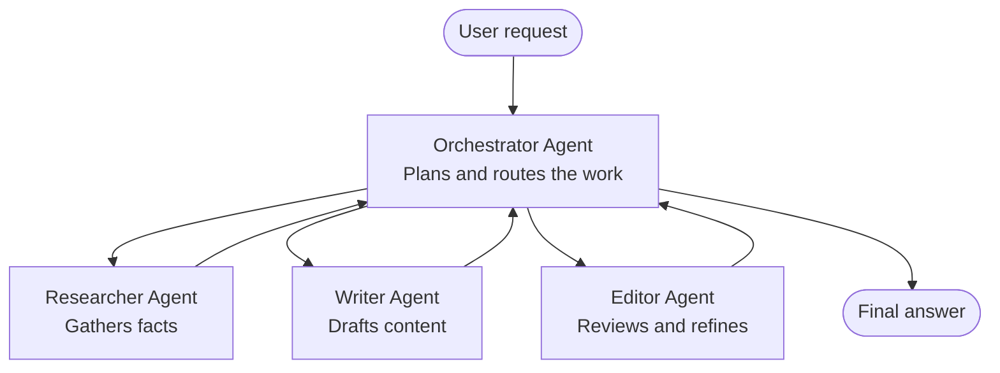

# Βασικά για Πολυ-Πρακτορικά Συστήματα - Αναπτύξτε το Πρώτο Συντονισμένο AI Σύστημά Σας

**Πλοήγηση Κεφαλαίου:**
- **📚 Αρχική Σελίδα Μαθήματος**: [AZD Για Αρχάριους](../../README.md)
- **📖 Τρέχον Κεφάλαιο**: Κεφάλαιο 5 - Πολυ-Πρακτορικές AI Λύσεις
- **⬅️ Προηγούμενο**: [Κεφάλαιο 4: Υποδομή](../chapter-04-infrastructure/README.md)
- **➡️ Επόμενο**: [Πρότυπα Συντονισμού](../chapter-06-pre-deployment/coordination-patterns.md)

> Η καθοδήγηση εντολών ελέγχθηκε έναντι του κυκλοφορημένου `azd 1.37.2` αναφοράς. Οι αναπτύξεις στο cloud δεν εκτελέστηκαν.

## Εισαγωγή

Στα προηγούμενα κεφάλαια αναπτύξατε μια μοναδική εφαρμογή—και στο Κεφάλαιο 2 αναπτύξατε έναν μεμονωμένο πράκτορα AI. Αυτό το μάθημα κάνει το επόμενο βήμα: αναπτύσσοντας ένα **πολυ-πρακτορικό σύστημα**, όπου πολλοί εξειδικευμένοι πράκτορες συνεργάζονται για να λύσουν ένα πρόβλημα που κανένας μεμονωμένος πράκτορας δεν θα μπορούσε να χειριστεί καλά μόνος του.

Τα καλά νέα για αρχάριους: **δεν χρειάζεστε νέες εντολές.** Μια πολυ-πρακτορική λύση παραμένει ένα έργο azd. Θα `azd init`, `azd up`, δοκιμάσετε και `azd down`—ακριβώς τη ροή εργασίας που ήδη γνωρίζετε. Αυτό που αλλάζει είναι το *σχήμα* της εφαρμογής εσωτερικά.

## Στόχοι Μάθησης

Μέχρι το τέλος αυτού του μαθήματος, θα:
- Κατανοείτε τι σημαίνει "πολυ-πρακτορικό" και πότε αξίζει η πρόσθετη πολυπλοκότητα
- Αναγνωρίζετε τους κοινούς ρόλους σε ένα πολυ-πρακτορικό σύστημα (συντονιστής + ειδικοί)
- Αναπτύσσετε ένα πραγματικό, λειτουργικό πολυ-πρακτορικό πρότυπο με `azd up`
- Κατανοείτε τους πόρους Azure που υποστηρίζουν μια πολυ-πρακτορική εφαρμογή
- Γνωρίζετε πώς να επαληθεύσετε, να προσαρμόσετε και να καταργήσετε με ασφάλεια τη λύση

## Αποτελέσματα Μάθησης

Μετά την ολοκλήρωση αυτού του μαθήματος, θα μπορείτε να:
- Εξηγήσετε τη διαφορά μεταξύ ενός μεμονωμένου πράκτορα και ενός πολυ-πρακτορικού συστήματος
- Επιλέξετε μεταξύ ενός μεμονωμένου πράκτορα με εργαλεία και ενός αληθινού πολυ-πρακτορικού σχεδιασμού
- Αναπτύξετε και δοκιμάσετε ένα πολυ-πρακτορικό πρότυπο από την αρχή έως το τέλος με azd
- Εντοπίζετε πού τρέχει κάθε πράκτορας και πώς επικοινωνούν
- Καθαρίζετε όλους τους πόρους για να αποφύγετε συνεχιζόμενες χρεώσεις

---

## Τι Είναι ένα Πολυ-Πρακτορικό Σύστημα;

Ένας μεμονωμένος πράκτορας AI είναι ένα μοντέλο με μια σειρά εντολών και (προαιρετικά) κάποια εργαλεία. Αυτό λειτουργεί καλά για εστιασμένες εργασίες. Αλλά καθώς η εργασία μεγαλώνει—έρευνα, μετά συγγραφή, μετά επεξεργασία, μετά έλεγχος γεγονότων—το να χωρέσεις τα πάντα σε ένα προτροπή κάνει τον πράκτορα πιο αργό, λιγότερο αξιόπιστο και δυσκολότερο στον εντοπισμό λαθών.

Ένα **πολυ-πρακτορικό σύστημα** χωρίζει την εργασία σε ειδικούς που κάνουν ο καθένας μια δουλειά καλά, συντονισμένους από ένα συντονιστή:



### Οι δύο ρόλοι που θα δείτε πάντα

| Ρόλος | Δουλειά | Παράδειγμα |
|------|---------|------------|
| **Συντονιστής** | Αποφασίζει *τι θα γίνει μετά* και κατευθύνει την εργασία μεταξύ των πρακτόρων | "Πρώτα έρευνα, μετά γράψε, μετά επεξεργάσου" |
| **Ειδικός** | Κάνει μια εστιασμένη δουλειά και επιστρέφει αποτέλεσμα | Ένας "ερευνητής" που μόνο συγκεντρώνει δεδομένα |

### Χρειάζεστε πραγματικά πολλούς πράκτορες;

Ξεκινήστε απλά. Ζητήστε πολυ-πρακτορικό **μόνο** όταν ισχύει κάποιο από τα ακόλουθα:

- ✅ Η εργασία έχει **διακριτά στάδια** που ωφελούνται από διαφορετικές οδηγίες (έρευνα vs. σύνταξη vs. επανεξέταση)
- ✅ Θέλετε οι ειδικοί να τρέχουν **παράλληλα** για να εξοικονομήσετε χρόνο
- ✅ Διάφορα βήματα χρειάζονται **διαφορετικά εργαλεία ή πηγές δεδομένων**
- ✅ Θέλετε κάθε βήμα να είναι **ανεξάρτητα ελέγξιμο και επιδεκτικό αποσφαλμάτωσης**

Αν η εργασία σας είναι μια απλή ερώτηση-απάντηση ή μια απλή κλήση εργαλείου, ένας **μεμονωμένος πράκτορας με εργαλεία** (Κεφάλαιο 2) είναι πιο απλός, φθηνότερος και ευκολότερος στη λειτουργία.

> **Συμβουλή για αρχάριους:** "Περισσότεροι πράκτορες" δεν σημαίνει "καλύτερο." Κάθε πράκτορας προσθέτει καθυστέρηση, κόστος, και κάτι νέο να παρακολουθείτε. Προσθέστε πράκτορες μόνο όταν το πρόβλημα σαφώς χωρίζεται σε μέρη.

---

## Δύο Τρόποι για να Φτιάξετε Πολυ-Πρακτορικό στο Azure

| Προσέγγιση | Τι είναι | Καλύτερο για |
|----------|----------|------------|
| **Μοναδικός πράκτορας + εργαλεία** | Ένας πράκτορας Foundry που καλεί συναρτήσεις/εργαλεία | Απλές ροές εργασίας, εκκίνηση |
| **Πολλαπλοί συντονισμένοι πράκτορες** | Πολλοί πράκτορες με έναν συντονιστή | Διακριτά στάδια, παράλληλη εργασία, εξειδίκευση |

Αυτό το μάθημα εστιάζει στη δεύτερη προσέγγιση χρησιμοποιώντας ένα **έτοιμο πρότυπο**, για να δείτε ένα πραγματικό πολυ-πρακτορικό σύστημα σε λειτουργία πριν κατασκευάσετε το δικό σας.

---

## Πρακτική Άσκηση: Αναπτύξτε μια Λειτουργική Πολυ-Πρακτορική Εφαρμογή

Θα αναπτύξουμε το **Contoso Creative Writer**, ένα επίσημο δείγμα Azure που συντονίζει πράκτορες έρευνας, προϊόντος, συγγραφής και επεξεργασίας για να παράγει ένα άρθρο. Πριν προχωρήσετε, ελέγξτε τις [προϋποθέσεις και το κόστος του δείγματος](https://github.com/Azure-Samples/contoso-creative-writer#azure-account-requirements): χρειάζεται ποσόστωση μοντέλου, Azure AI Search, πρόσβαση στο Bing Grounding, Python, Docker, και συμβατά hooks Bash. Η διαθεσιμότητα μοντέλου και περιοχής εξαρτάται από τη συνδρομή σας· η ανάπτυξη δεν εγγυάται την επιλογή συγκεκριμένης περιοχής.

### Βήμα 1: Αρχικοποίηση του προτύπου

```bash
# Create a working folder
mkdir creative-writer && cd creative-writer

# Initialize from the official multi-agent template
azd init --template Azure-Samples/contoso-creative-writer .
```

> Περιηγηθείτε σε περισσότερα πολυ-πρακτορικά πρότυπα οποιαδήποτε στιγμή στη [Εκπληκτική γκαλερί AZD AI](https://azure.github.io/awesome-azd/?tags=ai). Άλλες φιλικές για αρχάριους επιλογές περιλαμβάνουν `get-started-with-ai-agents` και `azure-ai-travel-agents`.

### Βήμα 2: Πιστοποίηση

```bash
# Required for azd workflows
azd auth login

# Also required by this sample's Azure CLI hooks
az login
```

### Βήμα 3: Έλεγχος περιβάλλοντος

```bash
# init normally creates/selects an environment; confirm it before proceeding
azd env list
# Only if you need an additional environment:
# azd env new dev
```

### Βήμα 4: Προεπισκόπηση, μετά ανάπτυξη

```bash
# See what will be created before spending anything (recommended)
azd provision --preview

# Provision infrastructure and deploy all agents in one step
azd up
```

`azd up` θα ζητήσει ρυθμίσεις συνδρομής και περιοχής που λείπουν, μετά θα προμηθεύσει πόρους και θα αναπτύξει την εφαρμογή. Η προεπισκόπηση δεν δεσμεύει ποσόστωση ούτε εγγυάται επιτυχία· τα hooks προτύπου μπορεί να τρέξουν ακόμα κατά την προεπισκόπηση προμήθειας, οπότε εξετάστε τα πρώτα. Για να επεκτείνετε πόσο περιμένει ο azd για κάθε **υπηρεσία ανάπτυξης** (όχι παροχή μοντέλου):

```bash
azd deploy --timeout 1800
```

Ένα χρονικό όριο σταματά την αναμονή του azd· δεν ακυρώνει την ανάπτυξη στο Azure. Εξετάστε την κατάσταση πόρου πριν προσπαθήσετε ξανά.

> **Προειδοποίηση για κόστος και χωρητικότητα:** Οι πολυ-πρακτορικές εφαρμογές αναπτύσσουν μοντέλα AI που καταναλώνουν ποσόστωση και επιφέρουν κόστος. Αν `azd up` αποτύχει στην ποσόστωση μοντέλου, δείτε το [AI Troubleshooting](../chapter-07-troubleshooting/ai-troubleshooting.md) για επιδιορθώσεις περιοχής και ποσόστωσης, και το Κεφάλαιο 6 [Σχεδιασμός Χωρητικότητας](../chapter-06-pre-deployment/capacity-planning.md).

---

## Κατανόηση Τι Αναπτύξατε

Μια τυπική πολυ-πρακτορική εφαρμογή όπως αυτή προμηθεύει ένα σύνολο πόρων Azure που αντιστοιχούν άμεσα στις ευθύνες στο παραπάνω διάγραμμα:

| Πόρος | Γιατί υπάρχει |
|--------|-------------|
| **Microsoft Foundry / Μοντέλα** | Φιλοξενεί τα γλωσσικά μοντέλα που χρησιμοποιεί κάθε πράκτορας |
| **Azure AI Search** | Παρέχει στον πράκτορα έρευνας δεδομένα για αναζήτηση |
| **Container Apps** (ή App Service) | Φιλοξενεί τον συντονιστή και τον κώδικα πρακτόρων |
| **Cosmos DB** (σε κάποια δείγματα) | Αποθηκεύει κοινή κατάσταση/μνήμη που ανταλλάσσεται μεταξύ πρακτόρων |
| **Application Insights** | Παρακολουθεί αιτήματα *διαμέσου* των πρακτόρων για να εντοπίσετε την ροή |

### Πώς μιλάνε οι πράκτορες μεταξύ τους

Στα περισσότερα δείγματα πολυ-πρακτορικών azd, ο **συντονιστής τρέχει στον κώδικα της εφαρμογής σας** (για παράδειγμα, χρησιμοποιώντας ένα πλαίσιο όπως το Semantic Kernel ή το Microsoft Agent Framework). Ο συντονιστής καλεί τον κάθε ειδικό πράκτορα με τη σειρά, μεταβιβάζει τα αποτελέσματα και συναρμολογεί την τελική απάντηση. Οι πράκτορες μοιράζονται πλαίσιο μέσω:

- **Κλήσεις λειτουργιών/εργαλείων** — ο συντονιστής καλεί έναν ειδικό και λαμβάνει αποτέλεσμα
- **Κοινή μνήμη** — μια βάση δεδομένων (συχνά Cosmos DB) κρατά κατάσταση που μπορούν να διαβάσουν και οι δύο πράκτορες
- **Μηνύματα/γεγονότα** — για πιο χαλαρό σύνδεσμο, οι πράκτορες επικοινωνούν μέσω ουράς ή Service Bus

> **Γιατί έχει σημασία αυτό για την αποσφαλμάτωση:** επειδή κάθε βήμα είναι ξεχωριστό, το Application Insights δείχνει *ποιος* πράκτορας ήταν αργός ή απέτυχε. Αυτός είναι ένας σημαντικός λόγος για να χωρίσετε τη δουλειά ανάμεσα σε πράκτορες εξαρχής.

---

## Επαλήθευση της Ανάπτυξης

Επιβεβαιώστε ότι το σύστημα λειτουργεί πραγματικά πριν προχωρήσετε:

```bash
# Show the deployed endpoints
azd show

# Open the app's monitoring dashboard
azd monitor

# Open Application Insights Logs (not a terminal log stream)
azd monitor --logs
```

Στη συνέχεια ανοίξτε το URL της εφαρμογής από `azd show` και ζητήστε ένα σύντομο άρθρο. Χρησιμοποιήστε την προβολή αποσφαλμάτωσης του δείγματος για να εξετάσετε τη ροή εργασίας του πράκτορα. Η αναζήτηση συναλλαγών Application Insights μπορεί να δείξει μόνο τα μεμονωμένα βήματα εάν το δείγμα τα ενσωματώνει και συσχετίζει· ο azd δεν προσθέτει αυτόματα spans πράκτορα.

**Κριτήρια επιτυχίας:**
- ✅ `azd show` εμφανίζει ένα προσβάσιμο endpoint
- ✅ Ένα αίτημα παράγει αποτέλεσμα που σαφώς πέρασε από πολλαπλά στάδια
- ✅ Η προβολή αποσφαλμάτωσης δείχνει πολλαπλά βήματα πράκτορα· αν η παρακολούθηση είναι ενεργοποιημένη, επαληθεύστε τη σχετική τηλεμετρία μετά την εισαγωγή

---

## Προσαρμογή: Προσθήκη ή Ρύθμιση Πράκτορα

Επειδή κάθε πράκτορας είναι απλώς οδηγίες συν εργαλεία, η προσαρμογή είναι προσιτή:

1. **Βρείτε τους ορισμούς πρακτόρων** στο πρότυπο (συχνά ένα σύνολο αρχείων `prompts/`, `agents/`, ή `*.prompty`).
2. **Ρυθμίστε τις οδηγίες του πράκτορα** — για παράδειγμα, πείτε στον πράκτορα επιμελητή να επιβάλει συγκεκριμένο ύφος ή πλήθος λέξεων.
3. **Αναπτύξτε ξανά μόνο τον κώδικα** (η υποδομή παραμένει αμετάβλητη):

   ```bash
   azd deploy
   ```

Για να προχωρήσετε με το δικό σας έργο πράκτορα Foundry, χρησιμοποιήστε το GA bundle με AZD 1.37.0+ σε ξεχωριστό κενό φάκελο:

```bash
azd ext install microsoft.foundry
azd ai agent init
azd up
azd ai agent invoke      # test, with response timing
```

Δείτε το [GA hosted-agent walkthrough](../chapter-02-ai-development/microsoft-foundry-integration.md#hosted-agent-walkthrough-ga) για τοπική δοκιμή Agent Inspector, απομακρυσμένη ανάπτυξη κώδικα και διαχείριση καθαρισμού. Η [αναφορά AZD AI CLI](../chapter-08-production/production-ai-practices.md#azd-ai-cli-commands-and-extensions) καλύπτει επίσης την ξεχωριστή επέκταση αξιολογήσεων, βελτιστοποίησης και διαγραφής πρακτόρων.

---

## Καθαρισμός

Οι πολυ-πρακτορικές εφαρμογές τρέχουν πολλαπλές υπηρεσίες που χρεώνονται. Κατεβάστε τα πάντα όταν τελειώσετε:

```bash
# Review the resources and confirm deletion interactively
azd down
```

Η διαγραφή είναι καταστροφική. Για ένα εργαστήριο μιας χρήσης, `azd down --force --purge` παραλείπει τη διαγραφή και τις επιβεβαιώσεις υποστήριξης ήπιας διαγραφής· η πλήρης διαγραφή είναι μη αναστρέψιμη όπου υποστηρίζεται και μπορεί να μπλοκαριστεί από προστασία εκκαθάρισης. Η ήπια διαγραφή αφορά ανάρρωση/επανάχρηση ονόματος, δεν αποτελεί από μόνη της απόδειξη συνεχών χρεώσεων. Ελέγξτε για πόρους που διατηρούνται και χρέωση μετά τον καθαρισμό.

Αν επίσης αρχικοποιήσατε έναν φιλοξενούμενο πράκτορα σε υπάρχον έργο Foundry, `azd down` αφήνει τον πράκτορα και άλλους πόρους αυτού του έργου στη θέση τους. Αφαιρέστε μόνο ανεπιθύμητους πόρους που κατέχετε ξεχωριστά. Για νέο έργο Foundry που δημιουργήθηκε από το AZD περιβάλλον του, `azd down` διαγράφει την ομάδα πόρων και τα πάντα μέσα της.

---

## Μια Σημείωση για Πολυ-Πρακτορικά Συστήματα Παραγωγής

Η [Λύση Πολυ-Πρακτορικής Λιανικής](../../examples/retail-scenario.md) σε αυτό το αποθετήριο είναι ένα **πρότυπο αρχιτεκτονικής**, όχι ένα πρότυπο με μία εντολή—καταγράφει πώς *θα* κατασκευαζόταν ένα σύστημα λιανικής παραγωγής (και δηλώνει ρητά ότι η πλήρης κατασκευή είναι σημαντική προσπάθεια). Χρησιμοποιήστε το ως αναφορά σχεδιασμού *αφού* έχετε αναπτύξει ένα λειτουργικό δείγμα εδώ. Για ζητήματα παραγωγής (ανθεκτικότητα, κόστος, παρακολούθηση, διακυβέρνηση), προχωρήστε στο [Κεφάλαιο 8: Πρακτικές AI Παραγωγής](../chapter-08-production/production-ai-practices.md).

---

## Περίληψη

- Ένα πολυ-πρακτορικό σύστημα χωρίζει την εργασία ανάμεσα σε ειδικούς που συντονίζονται από έναν συντονιστή.
- Χρησιμοποιήστε το μόνο όταν η εργασία έχει διακριτά στάδια, παράλληλη εκτέλεση ή διαφορετικά εργαλεία σε κάθε βήμα—αλλιώς προτιμήστε έναν μεμονωμένο πράκτορα.
- Η ροή εργασίας azd παραμένει ίδια: `azd init` → `azd up` → δοκιμή → `azd down`.
- Ένα πραγματικό πρότυπο όπως `contoso-creative-writer` σας επιτρέπει να δείτε και να προσαρμόσετε σήμερα μια λειτουργική πολυ-πρακτορική εφαρμογή.
- Η παρακολούθηση Application Insights διαμέσου των πρακτόρων είναι ένα από τα μεγαλύτερα πρακτικά οφέλη του πολυ-πρακτορικού σχεδιασμού.

---

## 🔗 Πλοήγηση

| Κατεύθυνση | Μάθημα |
|-----------|---------|
| **Προηγούμενο** | [Κεφάλαιο 4: Υποδομή](../chapter-04-infrastructure/README.md) |
| **Επόμενο** | [Πρότυπα Συντονισμού](../chapter-06-pre-deployment/coordination-patterns.md) |

## 📖 Σχετικοί Πόροι

- [Οδηγός Πρακτόρων AI](../chapter-02-ai-development/agents.md)
- [Πρότυπα Συντονισμού](../chapter-06-pre-deployment/coordination-patterns.md)
- [Πρακτικές AI Παραγωγής](../chapter-08-production/production-ai-practices.md)
- [AI Troubleshooting](../chapter-07-troubleshooting/ai-troubleshooting.md)

---

<!-- CO-OP TRANSLATOR DISCLAIMER START -->
**Αποποίηση ευθυνών**:
Αυτό το έγγραφο έχει μεταφραστεί χρησιμοποιώντας την υπηρεσία μετάφρασης με τεχνητή νοημοσύνη [Co-op Translator](https://github.com/Azure/co-op-translator). Ενώ επιδιώκουμε την ακρίβεια, παρακαλούμε να έχετε υπόψη ότι οι αυτοματοποιημένες μεταφράσεις ενδέχεται να περιέχουν λάθη ή ανακρίβειες. Το πρωτότυπο έγγραφο στη μητρική του γλώσσα πρέπει να θεωρείται η αυθεντική πηγή. Για κρίσιμες πληροφορίες, συνιστάται επαγγελματική ανθρώπινη μετάφραση. Δεν φέρουμε ευθύνη για τυχόν παρεξηγήσεις ή λανθασμένες ερμηνείες που προκύπτουν από τη χρήση αυτής της μετάφρασης.
<!-- CO-OP TRANSLATOR DISCLAIMER END -->