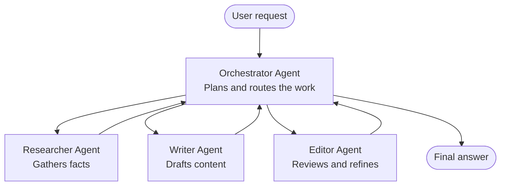

# Βασικά Στοιχεία Πολυ-Πρακτόρων - Αναπτύξτε το Πρώτο Συντονισμένο Σύστημα Τεχνητής Νοημοσύνης σας

**Πλοήγηση Κεφαλαίου:**
- **📚 Αρχική Σελίδα Μαθήματος**: [AZD Για Αρχάριους](../../README.md)
- **📖 Τρέχον Κεφάλαιο**: Κεφάλαιο 5 - Λύσεις Τεχνητής Νοημοσύνης με Πολλούς Πράκτορες
- **⬅️ Προηγούμενο**: [Κεφάλαιο 4: Υποδομή](../chapter-04-infrastructure/README.md)
- **➡️ Επόμενο**: [Πρότυπα Συντονισμού](../chapter-06-pre-deployment/coordination-patterns.md)

> Η καθοδήγηση εντολών ελέγχθηκε με τα διαθέσιμα `azd 1.37.2` αναφορές. Οι αναπτύξεις στο cloud δεν εκτελέστηκαν.

## Εισαγωγή

Στα προηγούμενα κεφάλαια αναπτύξατε μία εφαρμογή—και στο Κεφάλαιο 2 αναπτύξατε έναν μεμονωμένο πράκτορα Τεχνητής Νοημοσύνης. Αυτό το μάθημα κάνει το επόμενο βήμα: να αναπτύξετε ένα **σύστημα πολλαπλών πρακτόρων**, όπου αρκετοί εξειδικευμένοι πράκτορες συνεργάζονται για να λύσουν ένα πρόβλημα που κανένας μεμονωμένος πράκτορας δεν θα μπορούσε να διαχειριστεί καλά μόνος του.

Τα καλά νέα για τους αρχάριους: **δεν χρειάζεστε νέες εντολές.** Μια λύση πολλαπλών πρακτόρων είναι ακόμα ένα έργο azd. Θα `azd init`, `azd up`, δοκιμάσετε, και θα `azd down`—ακριβώς τη ροή εργασίας που ήδη γνωρίζετε. Αυτό που αλλάζει είναι το *σχήμα* της εφαρμογής εσωτερικά.

## Στόχοι Μάθησης

Μέχρι το τέλος αυτού του μαθήματος, θα:
- Κατανοείτε τι σημαίνει "πολυ-πράκτορας" και πότε αξίζει τον επιπλέον κόπο
- Αναγνωρίζετε τους κοινούς ρόλους σε ένα σύστημα πολλαπλών πρακτόρων (διευθυντής + ειδικοί)
- Αναπτύσσετε ένα πραγματικό, λειτουργικό πρότυπο πολλαπλών πρακτόρων με `azd up`
- Κατανοείτε τους πόρους Azure που υποστηρίζουν μια εφαρμογή πολλαπλών πρακτόρων
- Ξέρετε πώς να επαληθεύετε, να προσαρμόζετε και να διακόπτετε τη λύση με ασφάλεια

## Αποτελέσματα Μάθησης

Μετά την ολοκλήρωση αυτού του μαθήματος, θα μπορείτε να:
- Εξηγήσετε τη διαφορά μεταξύ ενός μεμονωμένου πράκτορα και ενός συστήματος πολλαπλών πρακτόρων
- Επιλέγετε μεταξύ ενός μεμονωμένου πράκτορα με εργαλεία και ενός αληθινού σχεδιασμού πολλαπλών πρακτόρων
- Αναπτύσσετε και δοκιμάζετε ένα πρότυπο πολλαπλών πρακτόρων από την αρχή μέχρι το τέλος με το azd
- Εντοπίζετε πού εκτελείται κάθε πράκτορας και πώς επικοινωνούν μεταξύ τους
- Καθαρίζετε όλους τους πόρους για να αποφύγετε συνεχιζόμενες χρεώσεις

---

## Τι Είναι ένα Σύστημα Πολλών Πρακτόρων;

Ένας μεμονωμένος πράκτορας Τεχνητής Νοημοσύνης είναι ένα μοντέλο με ένα σύνολο οδηγιών και (προαιρετικά) κάποια εργαλεία. Αυτό λειτουργεί καλά για εστιασμένες εργασίες. Αλλά καθώς μια εργασία μεγαλώνει—έρευνα, μετά γράψιμο, μετά επιμέλεια, μετά έλεγχος δεδομένων—το να βάζεις τα πάντα σε ένα prompt καθιστά τον πράκτορα πιο αργό, λιγότερο αξιόπιστο και δυσκολότερο στον εντοπισμό σφαλμάτων.

Ένα **σύστημα πολλών πρακτόρων** διασπά την εργασία σε ειδικούς που κάθε ένας κάνει μία δουλειά καλά, συντονισμένους από έναν διευθυντή:



### Οι δύο ρόλοι που πάντα θα δείτε

| Ρόλος | Δουλειά | Παράδειγμα |
|------|---------|------------|
| **Διευθυντής** | Αποφασίζει *τι θα γίνει μετά* και δρομολογεί την εργασία μεταξύ των πρακτόρων | "Πρώτα έρευνα, μετά γράψιμο, μετά επιμέλεια" |
| **Ειδικός** | Κάνει μια εστιασμένη δουλειά και επιστρέφει ένα αποτέλεσμα | Ένας "ερευνητής" που συγκεντρώνει μόνο δεδομένα |

### Χρειάζεστε πραγματικά πολλούς πράκτορες;

Ξεκινήστε απλά. Χρησιμοποιήστε πολλούς πράκτορες **μόνο** όταν ισχύει ένα από τα παρακάτω:

- ✅ Η εργασία έχει **διακριτά στάδια** που ωφελούνται από διαφορετικές οδηγίες (έρευνα έναντι γράψιμο έναντι επιμέλεια)
- ✅ Θέλετε οι ειδικοί να τρέχουν **παράλληλα** για να εξοικονομήσετε χρόνο
- ✅ Διαφορετικά βήματα χρειάζονται **διαφορετικά εργαλεία ή πηγές δεδομένων**
- ✅ Χρειάζεστε κάθε βήμα να είναι **ανεξάρτητα ελεγχόμενο και εντοπίσιμο**

Αν η εργασία σας είναι μια απλή ερώτηση-απάντηση ή μια απλή κλήση εργαλείου, ένας **μεμονωμένος πράκτορας με εργαλεία** (Κεφάλαιο 2) είναι πιο απλός, φθηνότερος και ευκολότερος στη λειτουργία.

> **Συμβουλή για αρχάριους:** "Περισσότεροι πράκτορες" δεν σημαίνει "καλύτερο." Κάθε πράκτορας προσθέτει καθυστέρηση, κόστος, και ένα νέο στοιχείο για παρακολούθηση. Προσθέστε πράκτορες μόνο όταν το πρόβλημα διαχωρίζεται σαφώς σε μέρη.

---

## Δύο Τρόποι για να Δημιουργήσετε Πολύ-Πράκτορα στο Azure

| Προσέγγιση | Τι είναι | Καλύτερο για |
|----------|----------|------------|
| **Μονός πράκτορας + εργαλεία** | Ένας πράκτορας Foundry που καλεί λειτουργίες/εργαλεία | Απλές ροές εργασίας, ξεκινώντας |
| **Πολλοί συντονισμένοι πράκτορες** | Αρκετοί πράκτορες με διευθυντή | Διακριτά στάδια, παράλληλη εργασία, εξειδίκευση |

Αυτό το μάθημα εστιάζει στη δεύτερη προσέγγιση χρησιμοποιώντας ένα **έτοιμο πρότυπο**, έτσι ώστε να δείτε ένα πραγματικό σύστημα πολλαπλών πρακτόρων σε λειτουργία πριν φτιάξετε το δικό σας.

---

## Πρακτική άσκηση: Αναπτύξτε μια Λειτουργική Εφαρμογή Πολλών Πρακτόρων

Θα αναπτύξουμε το **Contoso Creative Writer**, ένα επίσημο δείγμα Azure που συντονίζει πράκτορες έρευνας, προϊόντων, γραφής και επιμέλειας για να παράγει ένα άρθρο. Πριν προχωρήσετε, ελέγξτε τις [προϋποθέσεις και τα κόστη του δείγματος](https://github.com/Azure-Samples/contoso-creative-writer#azure-account-requirements): χρειάζεται όρια μοντέλου, Azure AI Search, πρόσβαση Bing Grounding, Python, Docker και hooks συμβατά με Bash. Η διαθεσιμότητα μοντέλου και περιοχής εξαρτάται από τη συνδρομή σας· η ανάπτυξη δεν εγγυάται επιτυχία απλώς επιλέγοντας μια περιοχή.

### Βήμα 1: Αρχικοποιήστε το πρότυπο

```bash
# Create a working folder
mkdir creative-writer && cd creative-writer

# Initialize from the official multi-agent template
azd init --template Azure-Samples/contoso-creative-writer .
```

> Περιηγηθείτε σε περισσότερα πρότυπα πολλαπλών πρακτόρων οποιαδήποτε στιγμή στη [Εντυπωσιακή συλλογή AZD AI](https://azure.github.io/awesome-azd/?tags=ai). Άλλες επιλογές φιλικές για αρχάριους είναι `get-started-with-ai-agents` και `azure-ai-travel-agents`.

### Βήμα 2: Πιστοποίηση ταυτότητας

```bash
# Required for azd workflows
azd auth login

# Also required by this sample's Azure CLI hooks
az login
```

### Βήμα 3: Ελέγξτε το περιβάλλον

```bash
# init normally creates/selects an environment; confirm it before proceeding
azd env list
# Only if you need an additional environment:
# azd env new dev
```

### Βήμα 4: Προεπισκόπηση και μετά ανάπτυξη

```bash
# See what will be created before spending anything (recommended)
azd provision --preview

# Provision infrastructure and deploy all agents in one step
azd up
```

`azd up` θα ζητήσει ρυθμίσεις συνδρομής και περιοχής αν λείπουν, μετά θα παραχωρήσει πόρους και θα αναπτύξει την εφαρμογή. Η προεπισκόπηση δεν δεσμεύει όρια ούτε εγγυάται επιτυχία· τα hooks προτύπου μπορεί να τρέξουν ακόμα κατά την προεπισκόπηση παραχώρησης, επομένως ελέγξτε τα πρώτα. Για να επεκτείνετε τον χρόνο αναμονής του azd για κάθε **ανάπτυξη υπηρεσίας** (όχι παραχώρηση μοντέλου):

```bash
azd deploy --timeout 1800
```

Μια χρονική λήξη σταματάει το azd από το να περιμένει· δεν ακυρώνει την ανάπτυξη στο Azure. Ελέγξτε την κατάσταση πόρου πριν ξαναδοκιμάσετε.

> **Προειδοποίηση για κόστος και χωρητικότητα:** Οι εφαρμογές πολλαπλών πρακτόρων αναπτύσσουν μοντέλα AI που καταναλώνουν όριο και προκαλούν κόστος. Αν `azd up` αποτύχει λόγω ορίου μοντέλου, δείτε το [AI Troubleshooting](../chapter-07-troubleshooting/ai-troubleshooting.md) για επιδιορθώσεις περιοχής και ορίου, και Κεφάλαιο 6 [Σχεδιασμός Χωρητικότητας](../chapter-06-pre-deployment/capacity-planning.md).

---

## Κατανόηση Τι Αναπτύξατε

Μια τυπική εφαρμογή πολλαπλών πρακτόρων όπως αυτή παραχωρεί ένα σύνολο πόρων Azure που αντιστοιχούν άμεσα στις ευθύνες στο παραπάνω διάγραμμα:

| Πόρος | Γιατί υπάρχει |
|----------|----------------|
| **Microsoft Foundry / Models** | Φιλοξενεί τα γλωσσικά μοντέλα που χρησιμοποιεί κάθε πράκτορας |
| **Azure AI Search** | Προσφέρει στον πράκτορα ερευνητή βασισμένα δεδομένα για αναζήτηση |
| **Container Apps** (ή App Service) | Φιλοξενεί τον διευθυντή και τον κώδικα των πρακτόρων |
| **Cosmos DB** (σε κάποια δείγματα) | Αποθηκεύει κοινόχρηστη κατάσταση/μνήμη που περνά μεταξύ πρακτόρων |
| **Application Insights** | Παρακολουθεί τα αιτήματα *διαμέσου* των πρακτόρων για να μπορείτε να εντοπίσετε σφάλματα στη ροή |

### Πώς επικοινωνούν οι πράκτορες μεταξύ τους

Στα περισσότερα δείγματα azd πολλαπλών πρακτόρων, ο **διευθυντής λειτουργεί μέσα στον κώδικα της εφαρμογής σας** (για παράδειγμα, χρησιμοποιώντας ένα πλαίσιο όπως το Semantic Kernel ή το Microsoft Agent Framework). Ο διευθυντής καλεί διαδοχικά κάθε ειδικό πράκτορα, μεταφέρει τα αποτελέσματα και συνθέτει την τελική απάντηση. Οι πράκτορες μοιράζονται το context μέσω:

- **Κλήσεις λειτουργιών/εργαλείων** — ο διευθυντής καλεί έναν ειδικό πράκτορα και παίρνει απάντηση
- **Κοινή μνήμη** — μια βάση δεδομένων (συχνά Cosmos DB) διατηρεί κατάσταση που μπορούν να διαβάσουν και οι δύο πράκτορες
- **Μηνύματα/γεγονότα** — για πιο χαλαρή σύνδεση, οι πράκτορες επικοινωνούν μέσω ουράς ή Service Bus

> **Γιατί είναι σημαντικό αυτό για τον εντοπισμό σφαλμάτων:** επειδή κάθε βήμα είναι ξεχωριστό, το Application Insights σας δείχνει *ποιος* πράκτορας ήταν αργός ή απέτυχε. Αυτός είναι ένας σημαντικός λόγος να χωρίσετε την εργασία σε πολλούς πράκτορες εξαρχής.

---

## Επαλήθευση της Ανάπτυξης

Επιβεβαιώστε ότι το σύστημα λειτουργεί πραγματικά πριν προχωρήσετε:

```bash
# Show the deployed endpoints
azd show

# Open the app's monitoring dashboard
azd monitor

# Open Application Insights Logs (not a terminal log stream)
azd monitor --logs
```

Μετά ανοίξτε το URL της εφαρμογής από `azd show` και ζητήστε ένα σύντομο άρθρο. Χρησιμοποιήστε την προβολή αποσφαλμάτωσης του δείγματος για να ελέγξετε τη ροή εργασίας των πρακτόρων. Η αναζήτηση συναλλαγών του Application Insights μπορεί να δείξει τα ατομικά βήματα μόνο εάν το δείγμα τα μετρά και διασυνδέει· το azd δεν προσθέτει αυτόματα spans πρακτόρων.

**Κριτήρια επιτυχίας:**
- ✅ `azd show` εμφανίζει ένα προσβάσιμο endpoint
- ✅ Ένα αίτημα παράγει αποτέλεσμα που καθαρά πέρασε από πολλά στάδια
- ✅ Η θέα αποσφαλμάτωσης δείχνει πολλαπλά βήματα πρακτόρων· αν η παρακολούθηση είναι ενεργοποιημένη, επιβεβαιώστε τα σχετικά τηλεμετρικά μετά την εισαγωγή

---

## Προσαρμογή: Προσθέστε ή Ρυθμίστε έναν Πράκτορα

Επειδή κάθε πράκτορας είναι απλά οδηγίες μαζί με εργαλεία, η προσαρμογή είναι προσβάσιμη:

1. **Βρείτε τους ορισμούς των πρακτόρων** στο πρότυπο (συχνά ένα `prompts/`, `agents/`, ή `*.prompty` σύνολο αρχείων).
2. **Ρυθμίστε τις οδηγίες ενός πράκτορα** — για παράδειγμα, πείτε στον πράκτορα επιμελητή να επιβάλλει συγκεκριμένο τόνο ή αριθμό λέξεων.
3. **Αναπτύξτε ξανά μόνο τον κώδικα** (η υποδομή παραμένει αμετάβλητη):

   ```bash
   azd deploy
   ```

Για να προχωρήσετε περαιτέρω με το *δικό* σας έργο πράκτορα Foundry, χρησιμοποιήστε την διαδραστική αρχικοποίηση της επέκτασης πράκτορα:

```bash
azd extension install azure.ai.agents
azd ai agent init
azd up
azd ai agent invoke      # test, with response timing
```

Δείτε το [Κεφάλαιο 2: Πράκτορες](../chapter-02-ai-development/agents.md) και το [AZD AI CLI reference](../chapter-08-production/production-ai-practices.md#azd-ai-cli-commands-and-extensions) για ολόκληρο τον κύκλο ζωής: agent `invoke`, η επέκταση ξεχωριστών αξιολογήσεων `azd ai eval` ροή εργασίας, agent `optimize` και agent `delete`.

---

## Καθαρισμός

Οι εφαρμογές πολλαπλών πρακτόρων τρέχουν πολλαπλές υπηρεσίες που χρεώνονται. Καταργήστε τα πάντα όταν τελειώσετε:

```bash
# Review the resources and confirm deletion interactively
azd down
```

Η διαγραφή είναι καταστροφική. Για ένα εργαστήριο που θα απορριφθεί, `azd down --force --purge` παρακάμπτει τη διαγραφή και τις επιβεβαιώσεις απαλοιφής με ήπια διαγραφή· η οριστική διαγραφή είναι μη αναστρέψιμη όπου υποστηρίζεται και μπορεί να μπλοκαριστεί από προστασία απαλοιφής. Η ήπια διαγραφή αφορά στην ανάκτηση/επανάχρηση ονομάτων, όχι καθεαυτή απόδειξη συνεχιζόμενων χρεώσεων. Ελέγξτε για διατηρημένους πόρους και χρεώσεις μετά τον καθαρισμό.

---

## Σημείωση για Παραγωγικά Συστήματα Πολλών Πρακτόρων

Η [Λύση Λιανικής Πολλών Πρακτόρων](../../examples/retail-scenario.md) σε αυτό το αποθετήριο είναι ένα **σχέδιο αρχιτεκτονικής**, όχι ένα πρότυπο με μια εντολή—τεκμηριώνει πώς *θα* κατασκευαζόταν ένα παραγωγικό σύστημα λιανικής (και λέει σαφώς ότι το πλήρες χτίσιμο είναι σημαντική προσπάθεια). Χρησιμοποιήστε το ως αναφορά σχεδιασμού *μετά* την ανάπτυξη ενός λειτουργικού δείγματος εδώ. Για θέματα παραγωγής (ανθεκτικότητα, κόστος, παρακολούθηση, διακυβέρνηση), συνεχίστε στο [Κεφάλαιο 8: Πρακτικές Παραγωγικής Τεχνητής Νοημοσύνης](../chapter-08-production/production-ai-practices.md).

---

## Περίληψη

- Ένα σύστημα πολλαπλών πρακτόρων διαχωρίζει την εργασία σε ειδικούς συντονισμένους από έναν διευθυντή.
- Χρησιμοποιήστε το μόνο όταν η εργασία έχει διακριτά στάδια, παράλληλη λειτουργία ή διαφορετικά εργαλεία για κάθε βήμα—διαφορετικά προτιμήστε έναν μεμονωμένο πράκτορα.
- Η ροή εργασίας με το azd παραμένει αμετάβλητη: `azd init` → `azd up` → δοκιμή → `azd down`.
- Ένα πραγματικό πρότυπο όπως `contoso-creative-writer` σάς επιτρέπει να δείτε και να προσαρμόσετε σήμερα μια λειτουργική εφαρμογή πολλών πρακτόρων.
- Η παρακολούθηση με το Application Insights διαμέσου πρακτόρων είναι ένα από τα μεγαλύτερα πρακτικά οφέλη του σχεδιασμού πολλαπλών πρακτόρων.

---

## 🔗 Πλοήγηση

| Κατεύθυνση | Μάθημα |
|-----------|---------|
| **Προηγούμενο** | [Κεφάλαιο 4: Υποδομή](../chapter-04-infrastructure/README.md) |
| **Επόμενο** | [Πρότυπα Συντονισμού](../chapter-06-pre-deployment/coordination-patterns.md) |

## 📖 Σχετικοί Πόροι

- [Οδηγός Πρακτόρων Τεχνητής Νοημοσύνης](../chapter-02-ai-development/agents.md)
- [Πρότυπα Συντονισμού](../chapter-06-pre-deployment/coordination-patterns.md)
- [Πρακτικές Παραγωγικής Τεχνητής Νοημοσύνης](../chapter-08-production/production-ai-practices.md)
- [Επίλυση Προβλημάτων AI](../chapter-07-troubleshooting/ai-troubleshooting.md)

---

<!-- CO-OP TRANSLATOR DISCLAIMER START -->
**Αποποίηση ευθυνών**:
Αυτό το έγγραφο έχει μεταφραστεί χρησιμοποιώντας την υπηρεσία μετάφρασης με τεχνητή νοημοσύνη [Co-op Translator](https://github.com/Azure/co-op-translator). Ενώ επιδιώκουμε την ακρίβεια, παρακαλούμε να έχετε υπόψη ότι οι αυτοματοποιημένες μεταφράσεις ενδέχεται να περιέχουν λάθη ή ανακρίβειες. Το πρωτότυπο έγγραφο στη μητρική του γλώσσα πρέπει να θεωρείται η αυθεντική πηγή. Για κρίσιμες πληροφορίες, συνιστάται επαγγελματική ανθρώπινη μετάφραση. Δεν φέρουμε ευθύνη για τυχόν παρεξηγήσεις ή λανθασμένες ερμηνείες που προκύπτουν από τη χρήση αυτής της μετάφρασης.
<!-- CO-OP TRANSLATOR DISCLAIMER END -->